<div class='meta'>
image: liste.webp
kind: reference
</div>

<div
    class="autotoc-secondary-trigger"
    data-title="Auf dieser Seite"
    data-levels="h2,h3,h4">
</div>

# HTML: Inhalt und Struktur

<p class='abstract'>
Mit HTML beschreibst du, was auf einer Webseite oder einer Folie steht: Überschriften, Absätze, Listen, Links und Bilder. Wie es aussieht, regelt CSS. Such dir die Stelle heraus, die du gerade brauchst.
</p>

Alles auf dieser Seite gilt für Webseiten und für Folien mit Shower gleichermaßen. Auf einer Webseite steht der Code im `<body>` deiner Datei `index.html`, auf einer Folie zwischen `<section class="slide">` und `</section>`. Jedes Beispiel zeigt rechts, wie es aussieht; mit dem Knopf <svg class='icon-slide' viewBox='0 0 24 24' aria-hidden='true'><rect x='3' y='4' width='18' height='12' rx='1.5'/><path d='M12 16v3.5M8.5 21l3.5-1.5 3.5 1.5M7 8.5h6M7 11.5h9'/></svg> in der Ecke des Bildes siehst du es als Folie statt als Webseite.

## Aufbau einer Seite

Wie HTML aufgebaut ist und was in jede Seite gehört.

<!-- part: tags -->
<!-- short: Ein Tag beginnt mit `<name>` und endet mit `</name>`; Tags stehen ineinander, eingerückt, damit man sieht, was wozu gehört. -->
### Tags

HTML-Code besteht aus **Tags**. Ein Tag steht in spitzen Klammern und sagt, was für ein Stück Inhalt folgt. Die meisten Tags gibt es paarweise: Das öffnende Tag beginnt etwas, das schließende Tag mit `/` beendet es.

```html
<h1>Axolotl</h1>
<p>Axolotl leben ihr ganzes Leben im Wasser.</p>
```

<!-- tutorial-screenshot
# Die Vorlage der Aktivität »Eine Präsentation in HTML erstellen«: In ihr
# zeigt sich jedes Beispiel als Seite und als Folie (tutorial-screenshot-hooks.mjs)
terminal-open
terminal-run: git clone -q https://git.nhcham.org/specht/shower.js.git /workspace/shower.js && git -C /workspace/shower.js checkout -q 50a071df026545793cfa29853e5e4ed6b1ece36e
terminal-wait-for-prompt
terminal-run: cd /workspace/shower.js && (python3 -m http.server 8090 > /dev/null 2>&1 &)
write-file: beispiel.html <- previous-code
preview-port: 8090
tab: preview
viewport: 1024x576
zoom: 1.6
hook: beispiel
variants: folie
-->

<button class='tutorial-preview' type='button'>
    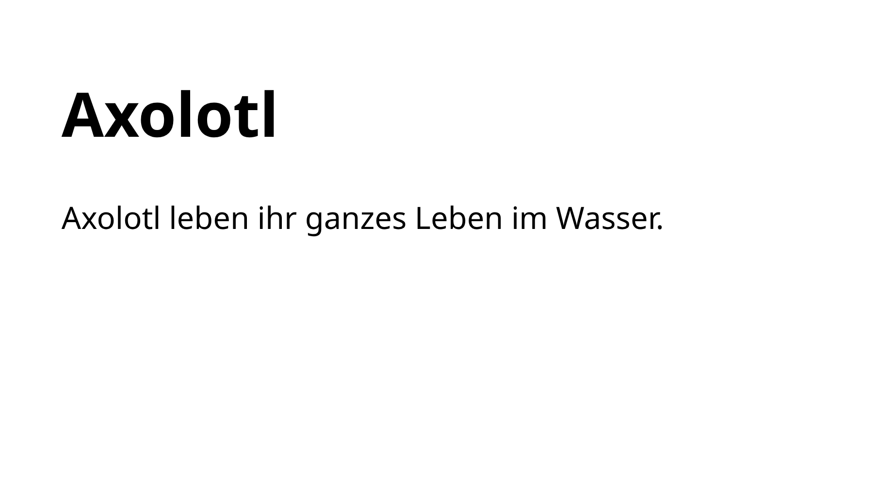
</button>

- `<h1>` beginnt eine Überschrift, `</h1>` beendet sie.
- `<p>` beginnt einen Absatz (»paragraph«), `</p>` beendet ihn.

Was zwischen den beiden Tags steht, ist der Inhalt des **Elements**. Elemente können andere Elemente enthalten. Rücke den Inhalt dann ein, damit du siehst, was wozu gehört:

```html
<ul>
    <li>Ein Punkt</li>
    <li>Noch ein Punkt</li>
</ul>
```

Für den Browser sind die Leerzeichen am Zeilenanfang egal, für dich nicht. Mit <kbd>Tab</kbd> und <kbd>Shift</kbd><kbd>Tab</kbd> rückst du markierte Zeilen ein und aus; <kbd>Strg</kbd><kbd>Shift</kbd><kbd>I</kbd> (»Format Document«) räumt die ganze Datei auf.

<div class='hint'>
Fehlt ein schließendes Tag, zeigt der Browser trotzdem etwas an, aber oft an einer ganz anderen Stelle falsch: Plötzlich ist der Rest der Seite fett, oder auf einer Präsentation fehlen mehrere Folien. Sieht etwas merkwürdig aus, prüfe zuerst, ob jedes Tag geschlossen ist, und zwar in umgekehrter Reihenfolge, wie es geöffnet wurde.
</div>

<div class='tutorial-preview-clear'></div>

<!-- /part -->

<!-- part: grundgeruest -->
<!-- short: Eine Seite beginnt mit `<!DOCTYPE html>`; im `<head>` stehen Zeichensatz, Viewport und Titel, im `<body>` der sichtbare Inhalt. -->
### Das Grundgerüst einer Seite

Jede Webseite hat dasselbe Gerüst. Der sichtbare Inhalt steht im `<body>`, alles im `<head>` beschreibt die Seite selbst:

```html
<!DOCTYPE html>
<html lang="de">
<head>
    <meta charset="UTF-8">
    <meta name="viewport" content="width=device-width, initial-scale=1">
    <title>Axolotl</title>
</head>
<body>
    <h1>Axolotl</h1>
    <p>Axolotl leben ihr ganzes Leben im Wasser.</p>
</body>
</html>
```

<!-- tutorial-screenshot
write-file: beispiel.html <- previous-code
tab: preview
viewport: 1024x576
zoom: 1.6
hook: beispiel
-->

<button class='tutorial-preview' type='button'>
    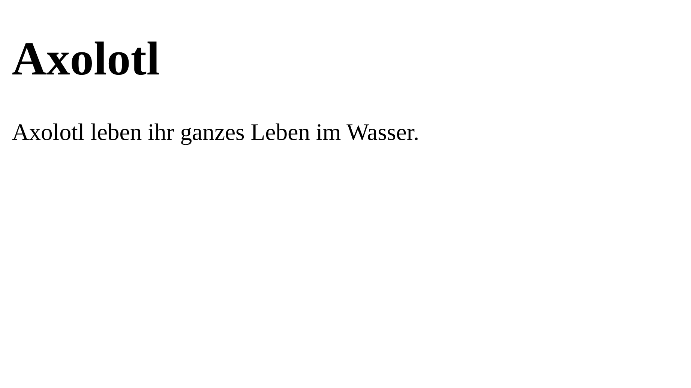
</button>

- `<!DOCTYPE html>` sagt dem Browser: Das ist eine moderne HTML-Seite.
- `lang="de"` nennt die Sprache. Damit trennt der Browser Wörter richtig, und eine Vorlesesoftware spricht deutsch.
- `<meta charset="UTF-8">` sorgt dafür, dass Umlaute und Emojis richtig erscheinen.
- Die Zeile mit `viewport` sagt Handys, dass sie die Seite in ihrer echten Breite zeigen sollen.
- Der `<title>` steht im Browser-Tab, nicht auf der Seite.

<div class='hint'>
In der Shower-Vorlage ist dieses Gerüst schon fertig. Deine Folien stehen im <code>&lt;body&gt;</code>, jede in ihrer eigenen <code>&lt;section class="slide"&gt;</code>.
</div>

<div class='tutorial-preview-clear'></div>

<!-- /part -->

## Text

Was auf einer Seite steht: Überschriften und Absätze, Listen, Hervorhebungen und Links.

<!-- part: text -->
<!-- short: Überschriften mit `<h1>` bis `<h3>`, Text in Absätzen `<p>`, eine neue Zeile ohne neuen Absatz mit `<br>`. -->
### Überschriften und Absätze

Es gibt sechs Stufen von Überschriften, `<h1>` bis `<h6>`; meistens brauchst du nur die ersten drei. Eine Webseite hat genau eine `<h1>` für ihr Thema und `<h2>` für ihre Abschnitte. Auf einer Folie ist die `<h2>` die Überschrift der Folie.

```html
<h2>Warum HTML?</h2>
<p>HTML beschreibt den Inhalt einer Seite.</p>
<p>CSS legt fest, wie dieser Inhalt aussieht.</p>
```

<!-- tutorial-screenshot
write-file: beispiel.html <- previous-code
tab: preview
viewport: 1024x576
zoom: 1.6
hook: beispiel
variants: folie
-->

<button class='tutorial-preview' type='button'>
    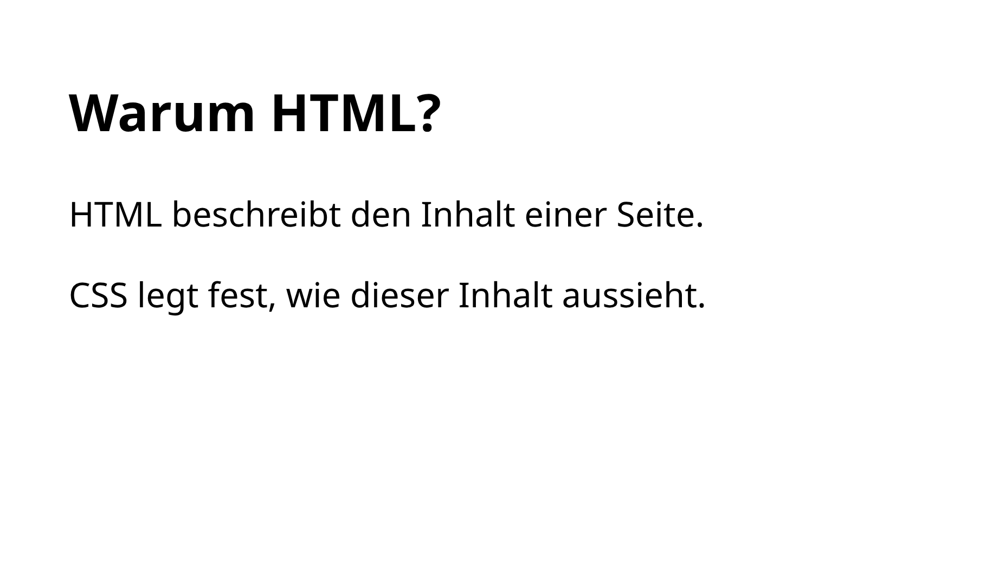
</button>

Zwischen zwei Absätzen entsteht von selbst etwas Abstand. Leere Zeilen im Code oder leere Absätze wie `<p></p>` machen keinen zusätzlichen Abstand; Abstände gestaltest du mit CSS (`margin`).

Eine Überschrift sollte sagen, worum es geht. Besser als ein einzelnes Wort ist oft eine kleine Aussage:

<div class='tutorial-preview-clear'></div>

<div class='row'>
    <div class='col-md-6'>
        <div class='hint bad'>
            <p>Nicht so gut:</p>
            <pre><code class='html'>&lt;h2&gt;HTML&lt;/h2&gt;</code></pre>
        </div>
    </div>
    <div class='col-md-6'>
        <div class='hint good'>
            <p>Besser:</p>
            <pre><code class='html'>&lt;h2&gt;HTML beschreibt die Struktur&lt;/h2&gt;</code></pre>
        </div>
    </div>
</div>

#### Eine neue Zeile ohne neuen Absatz

Manchmal soll innerhalb eines Absatzes eine neue Zeile beginnen, zum Beispiel bei einer Adresse. Dafür gibt es `<br>`, ohne schließendes Tag:

```html
<p>
    Max Mustermann<br>
    Klasse 9b<br>
    Informatik
</p>
```

<!-- tutorial-screenshot
write-file: beispiel.html <- previous-code
tab: preview
viewport: 1024x576
zoom: 1.6
hook: beispiel
variants: folie
-->

<button class='tutorial-preview' type='button'>
    
</button>

`<br>` bricht nur die Zeile um; der Abstand zwischen Absätzen entsteht nicht. Brauchst du einen neuen Gedanken, nimm einen neuen Absatz.

<div class='tutorial-preview-clear'></div>

<!-- /part -->

<!-- part: listen -->
<!-- short: Stichpunkte mit `<ul>`, nummeriert mit `<ol>`, jeder Punkt in einem eigenen `<li>`. -->
### Listen

Listen machen Inhalte übersichtlich. Es gibt zwei Arten:

- `<ul>` (»unordered list«) für Stichpunkte,
- `<ol>` (»ordered list«) für eine nummerierte Liste, wenn die Reihenfolge zählt.

Jeder einzelne Punkt steht in einem eigenen `<li>` (»list item«):

```html
<h2>Meine Projektidee</h2>
<ul>
    <li>🎮 Ein kleines Spiel programmieren</li>
    <li>🧭 Eine Spielfigur bewegen</li>
    <li>💎 Punkte sammeln</li>
</ul>
```

<!-- tutorial-screenshot
write-file: beispiel.html <- previous-code
tab: preview
viewport: 1024x576
zoom: 1.6
hook: beispiel
variants: folie
-->

<button class='tutorial-preview' type='button'>
    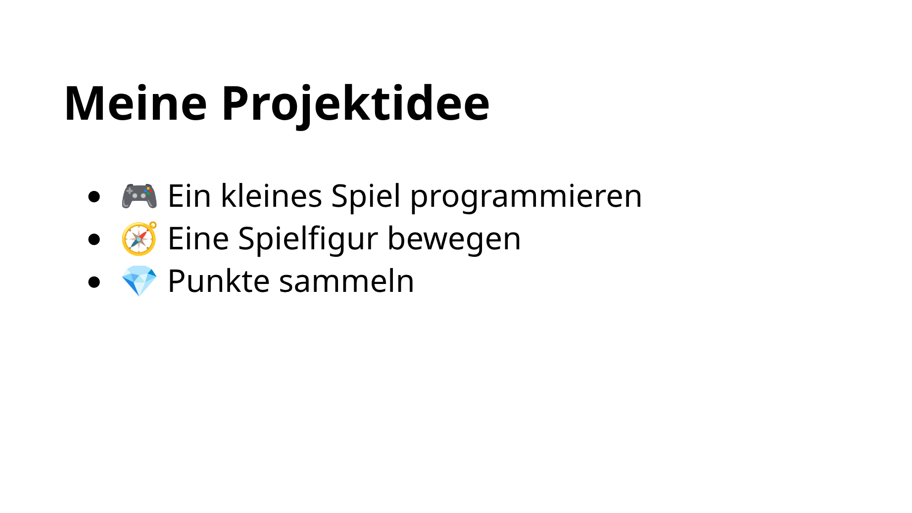
</button>

Bei `<ol>` setzt der Browser die Nummern selbst davor. Schreib sie also nicht in den Text, sonst stimmen sie nicht mehr, sobald du einen Punkt einfügst:

```html
<ol>
    <li>Repository klonen</li>
    <li>index.html öffnen</li>
    <li>Vorschau starten</li>
</ol>
```

<!-- tutorial-screenshot
write-file: beispiel.html <- previous-code
tab: preview
viewport: 1024x576
zoom: 1.6
hook: beispiel
variants: folie
-->

<button class='tutorial-preview' type='button'>
    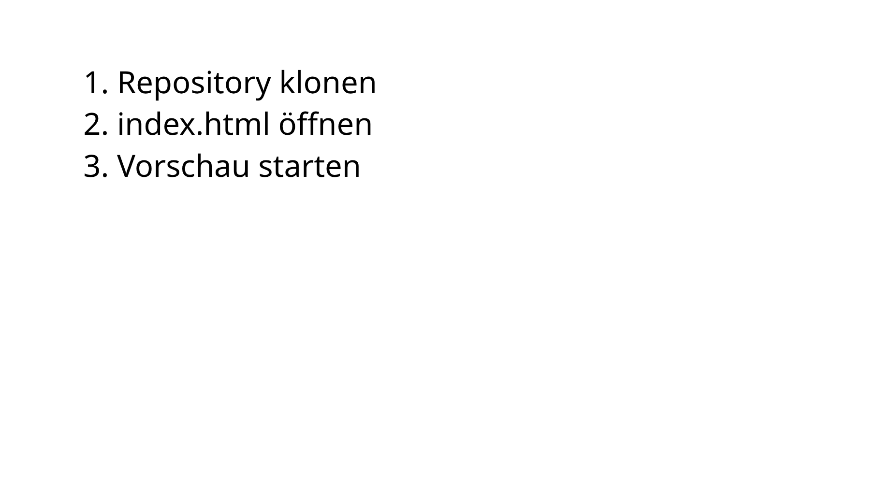
</button>

<div class='hint'>
Jedes <code>&lt;li&gt;</code> gehört zwischen <code>&lt;ul&gt;</code> und <code>&lt;/ul&gt;</code> (oder <code>&lt;ol&gt;</code> und <code>&lt;/ol&gt;</code>). Stehen die Punkte außerhalb, versucht der Browser trotzdem etwas daraus zu machen, aber Abstände und Einrückung stimmen dann nicht mehr.
</div>

<div class='tutorial-preview-clear'></div>

<!-- /part -->

<!-- part: hervorheben -->
<!-- short: Mitten im Text: `<strong>` für Wichtiges, `<em>` für Betonung, `<code>` für Code und Dateinamen, `<sup>` und `<sub>` für hoch- und tiefgestellte Zeichen. -->
### Wörter hervorheben

Manche Tags stehen mitten im Text und verändern nur ein paar Wörter:

```html
<p>Speichere mit <strong>Strg + S</strong>, bevor du die Vorschau prüfst.</p>
<p>Verwende Farben <em>sparsam</em>.</p>
<p>Die Folien stehen in <code>index.html</code>.</p>
<p>Fläche: A = a<sup>2</sup>, Wasser: H<sub>2</sub>O</p>
```

<!-- tutorial-screenshot
write-file: beispiel.html <- previous-code
tab: preview
viewport: 1024x576
zoom: 1.6
hook: beispiel
variants: folie
-->

<button class='tutorial-preview' type='button'>
    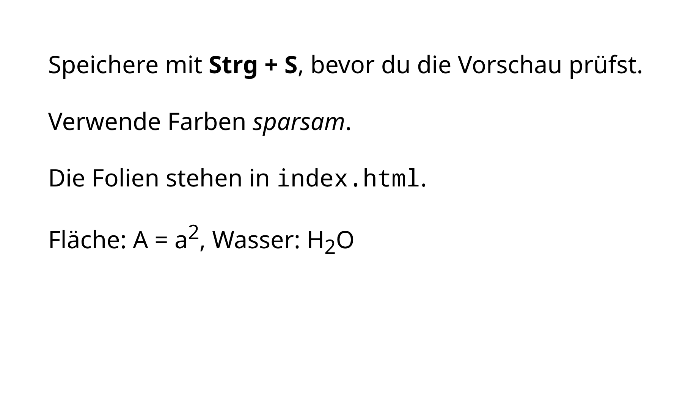
</button>

- `<strong>` markiert etwas Wichtiges (meist fett).
- `<em>` betont ein Wort (meist kursiv).
- `<code>` markiert Code, Dateinamen und Befehle.
- `<sup>` stellt Text hoch, `<sub>` tief.

Wenn alles hervorgehoben ist, fällt nichts mehr auf. Und auch diese Tags brauchen ihr schließendes Tag: Fehlt `</strong>`, ist der ganze Rest fett.

<div class='tutorial-preview-clear'></div>

#### Spitze Klammern im Text

Willst du ein Tag im Text zeigen, statt es zu benutzen, schreibst du die spitzen Klammern anders: `&lt;` für `<` und `&gt;` für `>`.

```html
<p>Eine Folie beginnt mit <code>&lt;section class="slide"&gt;</code>.</p>
```

Ohne diese Umschreibung würde der Browser wirklich eine neue Folie beginnen.

<!-- /part -->

<!-- part: links -->
<!-- short: Ein Link ist `<a href="Adresse">Text</a>`; zu einer eigenen Seite im selben Ordner genügt ihr Dateiname. -->
### Links

Das **H** in HTML steht für **Hypertext**: Seiten können auf andere Seiten verweisen. Ein Link ist ein `<a>`-Element; im Attribut `href` steht, wohin er führt:

```html
<p>
    <a href="https://de.wikipedia.org/wiki/Axolotl">Mehr über Axolotl</a>
</p>
<p>
    Weiter zu <a href="zweite-seite.html">meiner zweiten Seite</a>.
</p>
```

<!-- tutorial-screenshot
write-file: beispiel.html <- previous-code
tab: preview
viewport: 1024x576
zoom: 1.6
hook: beispiel
variants: folie
-->

<button class='tutorial-preview' type='button'>
    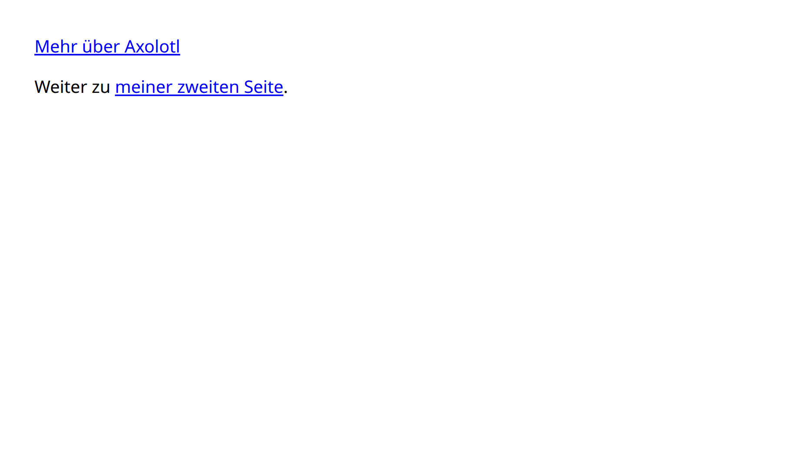
</button>

- Eine Adresse mit `https://` führt zu einer anderen Webseite.
- Ein Dateiname wie `zweite-seite.html` führt zu einer Datei im selben Ordner. Das nennt man einen **relativen Pfad**.

Ein Attribut wie `href` steht immer im öffnenden Tag, in der Form `name="wert"`, mit Anführungszeichen.

<div class='tutorial-preview-clear'></div>

<!-- /part -->

## Bilder

Ein Bild kommt in zwei Schritten auf die Seite: als Datei ins Projekt, dann mit `` in den Text.

<!-- part: bilddateien -->
<!-- short: Ein Bild gehört als Datei ins Projekt: per Drag & Drop in den Explorer oder mit <kbd>Strg</kbd><kbd>V</kbd> aus der Zwischenablage, mit einem einfachen Namen wie `fuji.jpg`. -->
### Bilddateien ins Projekt holen

Bevor ein Bild auf der Seite erscheinen kann, muss die Bilddatei in deinem Projekt liegen. In der Shower-Vorlage gibt es dafür den Ordner `pictures`; bei einer eigenen Webseite legst du Bilder neben `index.html` oder in einen eigenen Ordner wie `bilder`.

<!-- tutorial-screenshot
# Der Ordner der Shower-Vorlage offen, ein Bild aus pictures in der Vorschau
press: Control+K
press: Control+O
wait-for-input-value: /workspace/
type: shower.js
press: Enter
wait-for-input-value: /workspace/shower.js/
press: Enter
wait-for-text: pictures
# die Beispiele von oben gehören nicht zur Vorlage
terminal-run: rm -f /workspace/shower.js/beispiel.html
hide-bottom-panel
show-left-sidebar
click: selector:.explorer-folders-view .monaco-list-row[aria-label="pictures"]
close-tab: Welcome
open-file: pictures/fuji.jpg
# die Maus weg vom Tab, sonst steht sein Tooltip im Bild
move-mouse: selector:.part.editor
-->
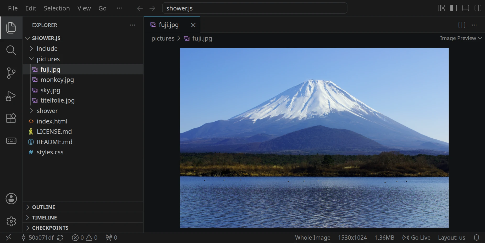

Verwende einfache Dateinamen: kleine Buchstaben, keine Leerzeichen, keine Umlaute, keine Sonderzeichen.

<div class='row'>
    <div class='col-md-4'>
        <div class='hint good'>
            <p>Gut:</p>
            <pre>fuji.jpg</pre>
        </div>
    </div>
    <div class='col-md-4'>
        <div class='hint good'>
            <p>Auch gut:</p>
            <pre>mount-fuji.webp</pre>
        </div>
    </div>
    <div class='col-md-4'>
        <div class='hint bad'>
            <p>Eher schlecht:</p>
            <pre>Fuji Bild NEU!!!.JPG</pre>
        </div>
    </div>
</div>

#### Bildformate

<div style='max-width: 100%; overflow-x: auto;'>
<table class='table'>
<tr><th>Format</th><th>Gut für</th><th>Endung</th></tr>
<tr><td><strong>JPEG</strong></td><td>Fotos; kleine Dateien</td><td><code>.jpg</code>, <code>.jpeg</code></td></tr>
<tr><td><strong>PNG</strong></td><td>Grafiken, Screenshots, durchsichtiger Hintergrund</td><td><code>.png</code></td></tr>
<tr><td><strong>WebP</strong></td><td>Fotos und Grafiken; meist kleiner als JPEG und PNG</td><td><code>.webp</code></td></tr>
<tr><td><strong>SVG</strong></td><td>Logos und Symbole; scharf in jeder Größe</td><td><code>.svg</code></td></tr>
<tr><td><strong>GIF</strong></td><td>einfache Animationen</td><td><code>.gif</code></td></tr>
</table>
</div>

<div class='hint think'>
Das Format steht in der Datei selbst, nicht im Namen. Benennst du <code>bild.png</code> in <code>bild.webp</code> um, bleibt es ein PNG, nur mit falschem Namen. Umwandeln kannst du es weiter unten.
</div>

#### Möglichkeit 1: Drag & Drop

Liegt das Bild auf deinem Computer, ziehe es aus deinem Dateimanager in den Explorer von VS Code und lege es im richtigen Ordner ab:

<!-- tutorial-screenshot
# Eine Datei von außen über dem Ordner pictures: VS Code markiert, wo sie
# landen würde (tutorial-screenshot-hooks.mjs schickt die Drag-Events)
hook: drag-over pictures
move-mouse: selector:.explorer-folders-view .monaco-list-row[aria-label="pictures"]
show-mouse
-->
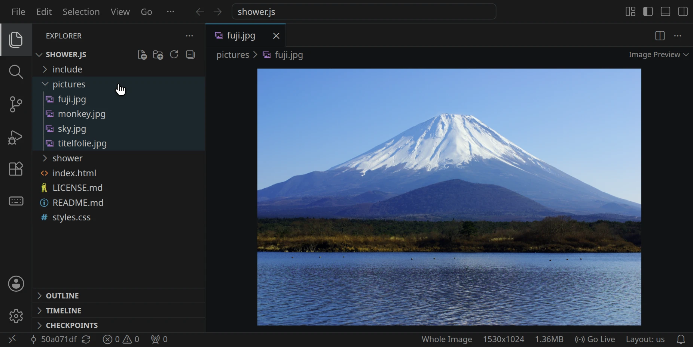

#### Möglichkeit 2: Aus der Zwischenablage

Ein Bild im Browser kopierst du mit einem Rechtsklick und »Bild kopieren« (»Copy image«):

<!-- tutorial-screenshot
# Ein Bild im Browser mit seinem Kontextmenü: bilder/kopieren.html baut das
# Menü von Chrome nach, das eigene zeigt kein Screenshot
preview-port: 8090
tab: preview
hook: page bilder/kopieren.html
move-mouse: Copy image
show-mouse
-->
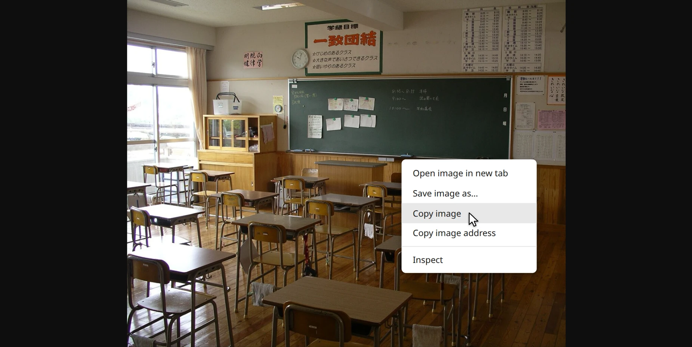

Klicke dann im Explorer auf eine Datei im Zielordner und drücke <kbd>Strg</kbd><kbd>V</kbd>. Je nach Browser musst du das Einfügen bestätigen:

<!-- tutorial-screenshot
# Das Bild in der Zwischenablage, eine Datei in pictures ausgewählt, Strg+V
hook: drag-leave pictures
hook: clipboard-image bilder/classroom.jpg
click: selector:.explorer-folders-view .monaco-list-row[aria-label="fuji.jpg"]
press: Control+V
wait-for-text: Are you sure you want to paste
-->
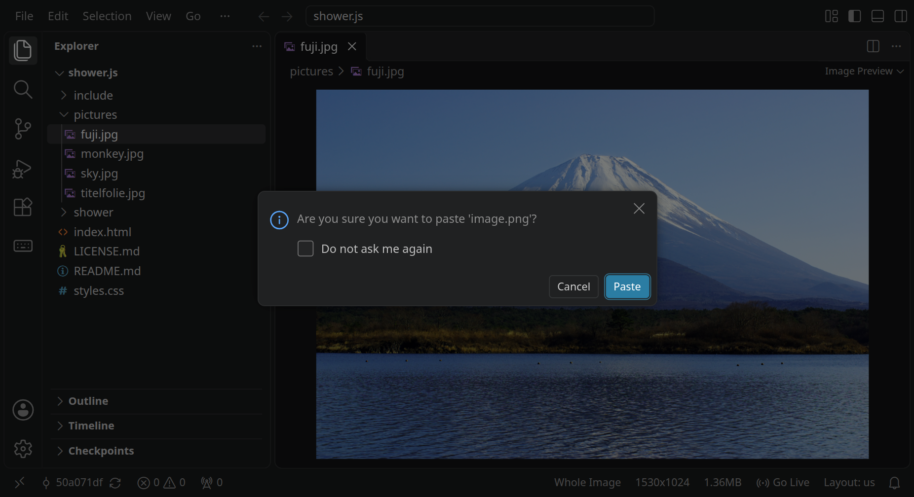

Die neue Datei heißt meist `image.png`:

<!-- tutorial-screenshot
# VS Code öffnet die neue Datei selbst
click: Paste
wait-for-file: shower.js/pictures/image.png
-->
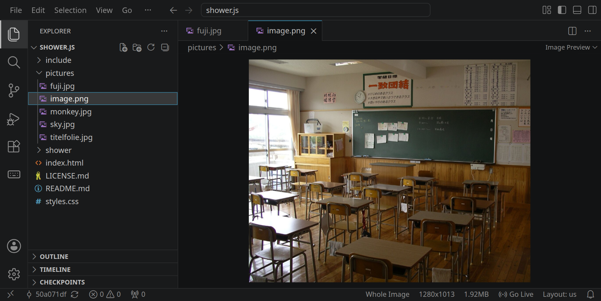

Unten stehen zwei wichtige Angaben: die **Auflösung** (hier 1280 × 1013 Pixel; zu kleine Bilder werden unscharf) und die **Dateigröße** (hier 1,92 MB; das ist für ein einzelnes Bild viel). Gib der Datei einen sinnvollen Namen und behalte die Endung:

<div class='row' style='margin-bottom: 1em;'>
    <div class='col-md-6'>
        <!-- tutorial-screenshot
        click: selector:.explorer-folders-view .monaco-list-row[aria-label="image.png"]
        press: Shift+F10
        wait-for-text: Rename
        move-mouse: Rename...
        show-mouse
        -->
        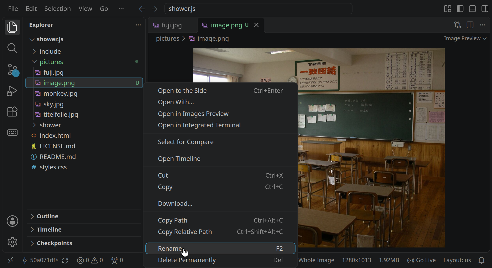
    </div>
    <div class='col-md-6'>
        <!-- tutorial-screenshot
        # F2 markiert den Namen ohne Endung
        press: Escape
        press: F2
        type: classroom
        -->
        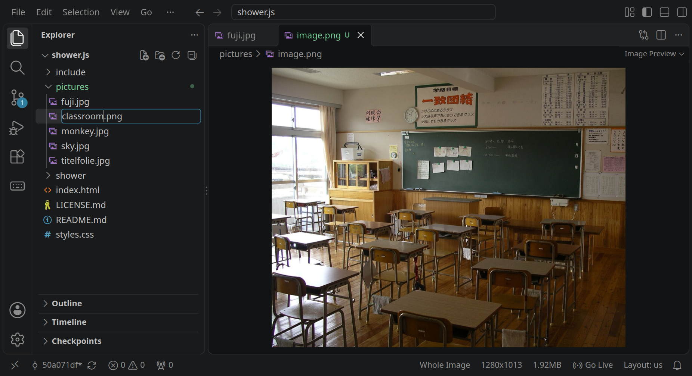
    </div>
</div>

<div class='hint think'>
Prüfe bei fremden Bildern, ob du sie verwenden darfst. Auf Wikimedia Commons stehen bei jedem Bild Urheber und Lizenz; den Bildnachweis schreibst du dann unter das Bild. Durchs Kopieren ändert sich an der Lizenz nichts.
</div>

#### Bilder verkleinern: WebP

Bilder aus der Zwischenablage werden als PNG gespeichert, und Fotos sind als PNG unnötig groß. Die Erweiterung »WebP Converter for VSCode« wandelt sie um: installieren, dann Rechtsklick auf die Datei und »Convert to WebP«:

<div class='row' style='margin-bottom: 1em;'>
    <div class='col-md-6'>
        <!-- tutorial-screenshot
        press: Enter
        wait-for-file: shower.js/pictures/classroom.png
        press: Control+Shift+X
        sleep: 2
        type: webp converter
        wait-for-text: WebP Converter for VSCode
        -->
        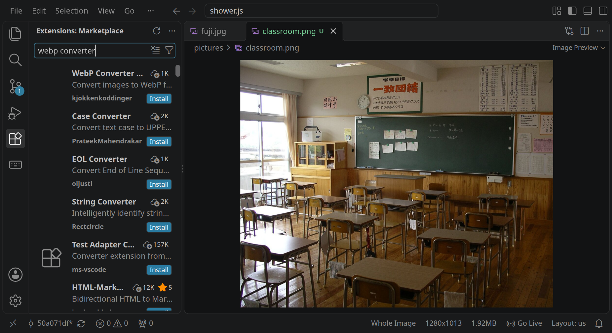
    </div>
    <div class='col-md-6'>
        <!-- tutorial-screenshot
        press: Control+A
        type: @id:kjokkenkoddinger.webp4vscode
        sleep: 2
        click: selector:.extensions-viewlet .extension-action.install:not(.hide)
        wait-for-text: Do you trust the publisher
        click: Trust Publisher & Install
        wait-for-text: Uninstall
        # alle Editoren schließen (die Erweiterung), dann das Bild wieder auf
        press: Control+K
        press: KeyW
        open-file: pictures/classroom.png
        press: Control+Shift+E
        click: selector:.explorer-folders-view .monaco-list-row[aria-label="classroom.png"]
        press: Shift+F10
        wait-for-text: Convert to WebP
        move-mouse: Convert to WebP
        show-mouse
        -->
        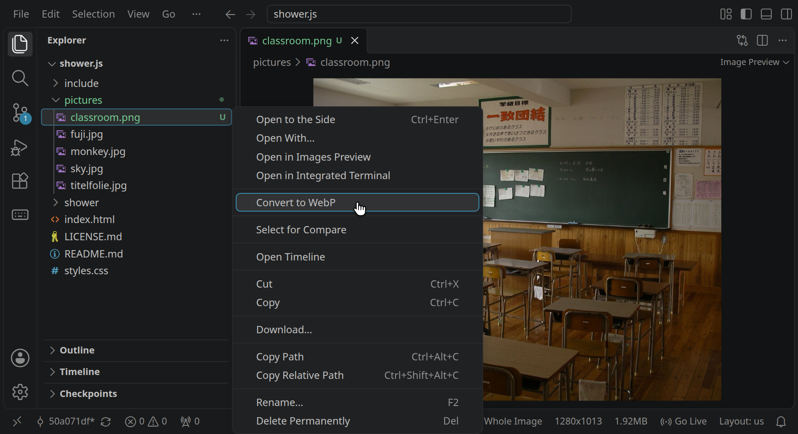
    </div>
</div>

»Lossless« behält jedes Pixel und eignet sich für Grafiken und Screenshots. »Lossy« verliert ein wenig Qualität und macht Fotos viel kleiner; 85 % sieht man kaum:

<!-- tutorial-screenshot
# Lossy ist vorgewählt, mit 75 %; der Text nennt 85 %
click: Convert to WebP
wait-for-text: Lossy encoding (with quality control)
click: selector:input[type="number"]
press: Control+A
type: 85
press: Tab
wait-for-text: Estimated WebP Size
# die Schätzung rechnet die Erweiterung erst kurz danach neu
sleep: 3
move-mouse: Continue
show-mouse
-->
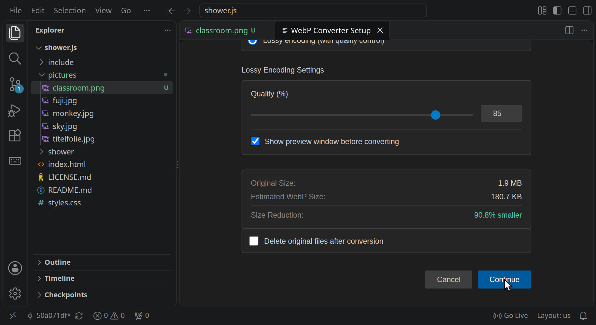

<!-- tutorial-screenshot
# erst eine Vorschau mit beiden Größen, dann »Finish«
click: Continue
wait-for-text: Preview and Adjust Converted Images
click: Finish
wait-for-file: shower.js/pictures/classroom.webp
open-file: pictures/classroom.webp
-->
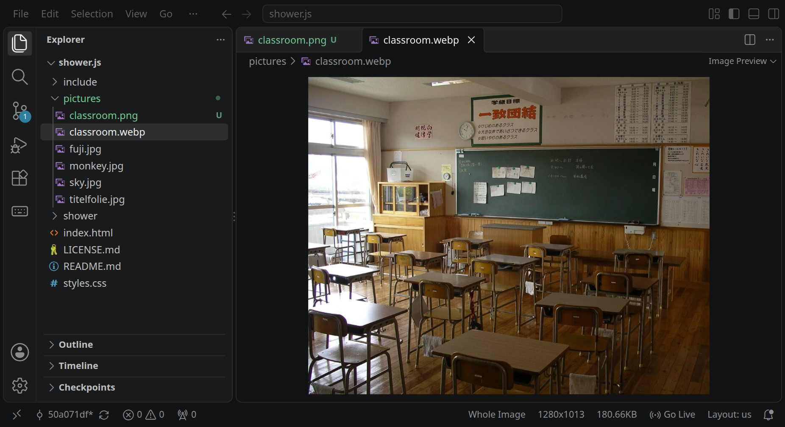

Aus 1,92 MB sind 180 kB geworden.

<!-- /part -->

<!-- part: img -->
<!-- short: Ein Bild ist ``, ohne schließendes Tag; der Pfad muss genau stimmen, auch Groß- und Kleinschreibung. -->
### Bilder einfügen

Liegt die Bilddatei im Projekt, fügst du sie mit `` ein:

```html
<h2>Der Fuji</h2>

```

<!-- tutorial-screenshot
write-file: beispiel.html <- previous-code
tab: preview
viewport: 1024x576
zoom: 1.6
hook: beispiel
variants: folie
-->

<button class='tutorial-preview' type='button'>
    
</button>

- `src` (»source«) sagt, wo die Datei liegt: hier im Ordner `pictures`, relativ zur HTML-Datei.
- `alt` beschreibt, was das Bild zeigt (mehr dazu gleich).
- `style="height: 300px;"` macht das Bild 300 Pixel hoch; ohne das wäre es so groß wie die Datei. Mehr dazu unter [Bildgröße](/reference/css#bildgroesse).

`` hat keinen Inhalt und deshalb kein schließendes Tag.

<div class='tutorial-preview-clear'></div>

#### Der Pfad muss genau stimmen

Erscheint ein Bild nicht, liegt es fast immer am Pfad:

- Stimmt der Dateiname, mit Groß- und Kleinschreibung? `Fuji.JPG` ist nicht `fuji.jpg`. Auf deinem Rechner geht es vielleicht trotzdem, auf dem Webserver nicht.
- Stimmt die Endung (`.jpg`, `.jpeg`, `.png`, `.webp`)?
- Steht der Ordner im Pfad, wenn das Bild in einem Ordner liegt?

<div class='row'>
    <div class='col-md-6'>
        <div class='hint good'>
            <p>Richtig:</p>
            <pre><code class='html'>&lt;img src="pictures/fuji.jpg" alt="Der Fuji"&gt;</code></pre>
        </div>
    </div>
    <div class='col-md-6'>
        <div class='hint bad'>
            <p>Falsch:</p>
            <pre><code class='html'>&lt;img src="Fuji.jpg" alt="Der Fuji"&gt;</code></pre>
        </div>
    </div>
</div>

<div class='hint'>
Statt eines Dateinamens kann in <code>src</code> auch die Adresse eines Bildes im Internet stehen (»Hotlinking«). Das ist praktisch zum Ausprobieren, aber das Bild verschwindet, wenn die fremde Seite es löscht, und ohne Internet fehlt es ganz. Für deine fertige Seite oder Präsentation gehört das Bild in deinen eigenen Ordner.
</div>

#### Was in den Alt-Text gehört

Den Alt-Text liest ein Screenreader Menschen vor, die das Bild nicht sehen, und der Browser zeigt ihn, wenn das Bild fehlt. Er sagt kurz, was das Bild **zusätzlich** zum Text vermittelt:

<div class='row'>
    <div class='col-md-6'>
        <div class='hint good'>
            <p>Gut:</p>
            <pre><code class='html'>alt="Ein rosa Axolotl in einem Aquarium"</code></pre>
        </div>
    </div>
    <div class='col-md-6'>
        <div class='hint bad'>
            <p>Nicht hilfreich:</p>
            <pre><code class='html'>alt="Bild"</code></pre>
        </div>
    </div>
</div>

Schreib nicht »Bild von …«: Dass es ein Bild ist, weiß der Screenreader schon. Ist ein Bild nur Schmuck, ist ein leerer Alt-Text richtig: `alt=""`.

<!-- /part -->

<!-- part: bereiche -->
<!-- short: `<div>` fasst mehrere Elemente zu einem Bereich zusammen, den CSS als Ganzes gestalten oder anordnen kann. -->
## Bereiche: div

Manchmal sollen mehrere Elemente zusammengehören, etwa eine Überschrift und eine Liste, die gemeinsam neben einem Bild stehen, oder ein Kasten mit Hintergrundfarbe. Dafür gibt es `<div>`: einen Bereich ohne eigene Bedeutung, nur zum Zusammenfassen.

```html
<div class="kasten">
    <h3>Merke</h3>
    <p>Ein div fasst Elemente zusammen.</p>
</div>
```

Ohne CSS sieht man von einem `<div>` nichts. Erst mit einer Klasse und einer Regel wird es zum Kasten, zur Spalte oder zur Infokarte; wie das geht, steht unter [CSS](/reference/css) und [Layout](/reference/layout).

Für die großen Teile einer Webseite gibt es Bereiche mit Bedeutung: `<header>` für den Kopf, `<main>` für den Hauptinhalt, `<section>` für einen Abschnitt, `<footer>` für den Fuß. Sie verhalten sich wie `<div>`, sagen aber, was sie sind. In Shower ist jede Folie eine `<section>`.

<!-- /part -->

## Zum Nachschlagen

- [MDN: Referenz der HTML-Elemente](https://developer.mozilla.org/de/docs/Web/HTML/Reference/Elements): jedes Element mit seinen Attributen und Beispielen, auf Deutsch. Hier findest du auch, was auf dieser Seite fehlt, etwa `<table>`, `<video>` oder `<details>`.
- [HTML Living Standard](https://html.spec.whatwg.org/multipage/) der WHATWG: die Spezifikation, nach der sich alle Browser richten. Sehr ausführlich; schau dort nach, wenn MDN eine Frage offenlässt.
- [W3C Markup Validation Service](https://validator.w3.org/): prüft deine Seite auf Fehler wie ein vergessenes schließendes Tag oder falsch verschachtelte Elemente. Unter »Validate by Direct Input« fügst du deinen Code ein.
- [SELFHTML](https://wiki.selfhtml.org/wiki/HTML): ein deutschsprachiges Wiki, das HTML mit vielen Beispielen erklärt.
