<div class='meta'>
kind: reference
</div>

<div
    class="autotoc-secondary-trigger"
    data-title="Auf dieser Seite"
    data-levels="h2,h3">
</div>

# LaTeX

<p class='abstract'>
LaTeX zum Nachschlagen: wie ein Dokument aufgebaut ist, Gliederung, Text, Listen, Tabellen, Bilder, Formeln, Einheiten, Diagramme, Quellen und Querverweise, das Seitenlayout für eine Facharbeit, Schriftarten und was die häufigsten Fehlermeldungen bedeuten. Dazu fertige Vorlagen für Bewerbung, Lebenslauf, Ausarbeitung und ein ganzes Buch.
</p>

## Arbeiten im Workspace

<!-- part: latex-workshop -->
<!-- short: Die Erweiterung »LaTeX Workshop« (James-Yu) übersetzt mit <kbd>Strg</kbd><kbd>Alt</kbd><kbd>B</kbd> und zeigt das PDF mit <kbd>Strg</kbd><kbd>Alt</kbd><kbd>V</kbd>. -->
### LaTeX Workshop

LaTeX ist im Workspace schon installiert. Zum Schreiben brauchst du noch die Erweiterung »LaTeX Workshop« von James-Yu: Öffne die Erweiterungen mit <kbd>Strg</kbd><kbd>Shift</kbd><kbd>X</kbd>, suche nach `LaTeX Workshop` und klicke auf »Install«. Visual Studio Code fragt, ob du dem Herausgeber »James-Yu« vertraust; bestätige mit »Trust Publisher & Install«.

<!-- tutorial-screenshot
# Die Vorlagen klonen (für die Vorlagen weiter unten), dann die Erweiterung suchen
press: Control+Shift+E
wait-for-text: Clone Repository
clone-start: https://github.com/specht/latex-tutorial.git @ e66bfeeb5291c5d901b5eadaa3b65e81e8a7750c
press: Enter
wait-for-input-value: /workspace/
press: Enter
wait-for-text: Would you like to open the repository?
click: Open
wait-for-text: hello.tex
press: Control+Shift+X
sleep: 2
type: latex workshop
wait-for-text: James-Yu
sleep: 2
crop-bottom: 50%
-->
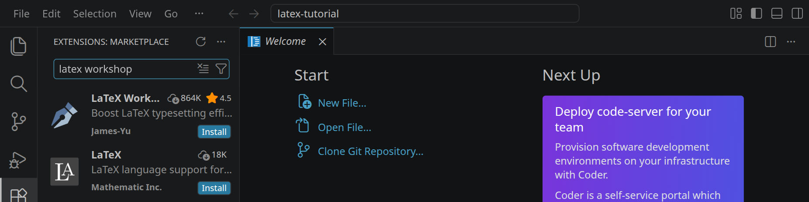
<!-- /part -->

<!-- part: uebersetzen -->
<!-- short: <kbd>Strg</kbd><kbd>Alt</kbd><kbd>B</kbd> übersetzt die `.tex`-Datei zum PDF, <kbd>Strg</kbd><kbd>Alt</kbd><kbd>V</kbd> zeigt es daneben; beim Speichern übersetzt LaTeX Workshop von selbst. -->
### Übersetzen und ansehen

Eine `.tex`-Datei ist Text mit Befehlen. Erst LaTeX macht daraus ein PDF; das nennt man **übersetzen** (oder kompilieren).

- <kbd>Strg</kbd><kbd>Alt</kbd><kbd>B</kbd> oder der Button »Build LaTeX project«  rechts oben übersetzt die Datei. Im Workspace passiert das außerdem bei jedem Speichern.
- Unten in der Statusleiste dreht sich ein Pfeil, solange LaTeX arbeitet; danach steht dort ein Häkchen oder ein Kreuz für Fehler.
- <kbd>Strg</kbd><kbd>Alt</kbd><kbd>V</kbd> oder »View LaTeX PDF file«  zeigt das PDF neben dem Quelltext. Ein Doppelklick ins PDF mit <kbd>Strg</kbd> springt zur Stelle im Quelltext.

<!-- tutorial-screenshot
# Installieren: nur dieses eine »Install« (die Suche oben zeigt mehrere)
press: Control+A
type: @id:james-yu.latex-workshop
sleep: 2
click: selector:.extensions-viewlet .extension-action.install:not(.hide)
wait-for-text: Do you trust the publisher
click: Trust Publisher & Install
wait-for-text: Uninstall
# alle Editoren schließen (Erweiterung, Welcome): Strg+K, dann W
press: Control+K
press: KeyW
sleep: 1
press: Control+Shift+E
open-file: hello.tex
hide-left-sidebar
sleep: 2
press: Control+Alt+B
sleep: 0.8
crop-top: 92%
-->
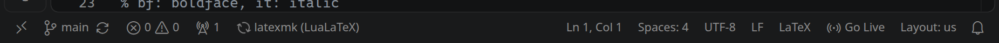

Das PDF liegt danach neben der `.tex`-Datei. Die Hilfsdateien, die LaTeX dabei anlegt (`.aux`, `.log`, `.toc` und andere), landen im Ordner `.build`, den der Explorer nicht anzeigt.

<!-- tutorial-screenshot
sharp-canvas
wait-for-file-newer: latex-tutorial/hello.pdf <- latex-tutorial/hello.tex
sleep: 2
press: Control+Alt+V
wait-for-text: Hallo LaTeX
move-mouse: selector:.monaco-editor .view-lines
sleep: 2
-->
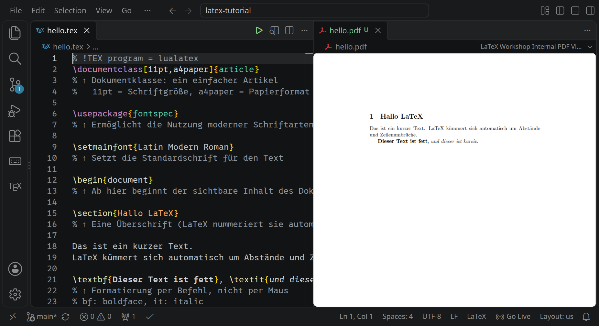
<!-- /part -->

## Ein Dokument

<!-- part: grundgeruest -->
<!-- short: `\documentclass{article}`, dann die Präambel mit `\usepackage{…}`, dann der Text zwischen `\begin{document}` und `\end{document}`. -->
### Grundgerüst

Jedes Dokument hat zwei Teile. In der **Präambel** steht, was für ein Dokument es ist und welche Pakete es benutzt; zwischen `\begin{document}` und `\end{document}` steht der Text:

```tex
% !TEX program = lualatex
\documentclass[12pt,a4paper]{article}

\usepackage{polyglossia}
\setdefaultlanguage{german}      % deutsche Silbentrennung und Wörter
\usepackage{fontspec}
\setmainfont{TeX Gyre Termes}    % eine Schrift wie Times

\begin{document}
Hallo, LaTeX!
\end{document}
```

- Die erste Zeile sagt LaTeX Workshop, dass es mit LuaLaTeX übersetzen soll. Nur damit funktionieren `fontspec` und die Schriften aus dem Abschnitt [Schriftarten](#schriftarten).
- `article` ist die Klasse für Aufsätze, Facharbeiten und Protokolle. `report` und `book` haben zusätzlich Kapitel (`\chapter`), `letter` ist für Briefe.
- In eckigen Klammern stehen Optionen: Schriftgröße (`10pt`, `11pt`, `12pt`) und Papierformat.
- `%` beginnt einen Kommentar bis zum Ende der Zeile; LaTeX ignoriert ihn.
<!-- /part -->

<!-- part: absaetze -->
<!-- short: Eine Leerzeile beginnt einen neuen Absatz; einfache Zeilenumbrüche im Quelltext ändern nichts. -->
### Absätze und Leerzeichen

LaTeX setzt den Text selbst: Wo im Quelltext eine Zeile endet, ist egal, und mehrere Leerzeichen zählen wie eines. Eine **Leerzeile** beginnt einen neuen Absatz.

```tex
Dieser Satz und
dieser stehen im selben Absatz.

Hier beginnt ein neuer Absatz.
```

`\\` erzwingt einen Zeilenumbruch, `\newpage` eine neue Seite. Beides brauchst du im Fließtext selten; meistens ist eine Leerzeile die bessere Wahl.
<!-- /part -->

<!-- part: sonderzeichen -->
<!-- short: `\% \& \$ \# \_ \{ \}` schreiben die Zeichen selbst; Anführungszeichen „so“, Gedankenstrich mit `--`. -->
### Sonderzeichen

Einige Zeichen haben in LaTeX eine Bedeutung. Um sie im Text zu schreiben, steht ein `\` davor:

<div class='scroll-x'><table class='table table-sm reference-table'>
<thead><tr><th>Im Text</th><th>Schreibe</th><th>Warum</th></tr></thead>
<tbody>
<tr><td>50 %</td><td><code>50 \%</code></td><td><code>%</code> beginnt einen Kommentar</td></tr>
<tr><td>A &amp; B</td><td><code>A \&amp; B</code></td><td><code>&amp;</code> trennt Spalten in Tabellen</td></tr>
<tr><td>5 $</td><td><code>5 \$</code></td><td><code>$</code> beginnt eine Formel</td></tr>
<tr><td>#1</td><td><code>\#1</code></td><td><code>#</code> gehört zu Befehlen</td></tr>
<tr><td>a_b</td><td><code>a\_b</code></td><td><code>_</code> ist ein Index in Formeln</td></tr>
<tr><td>{ }</td><td><code>\{ \}</code></td><td>Klammern fassen zusammen</td></tr>
<tr><td>\</td><td><code>\textbackslash</code></td><td><code>\</code> beginnt einen Befehl</td></tr>
<tr><td>„Zitat“</td><td><code>„Zitat“</code></td><td>Die deutschen Zeichen direkt tippen</td></tr>
<tr><td>1990–2000</td><td><code>1990--2000</code></td><td>Zwei Striche ergeben den Gedankenstrich</td></tr>
<tr><td>Dr. Müller</td><td><code>Dr.~Müller</code></td><td><code>~</code> ist ein Leerzeichen, an dem nie umbrochen wird</td></tr>
</tbody>
</table>
</div>

Umlaute und ß tippst du einfach; LuaLaTeX versteht sie.
<!-- /part -->

## Gliederung

<!-- part: gliederung -->
<!-- short: `\section`, `\subsection`, `\subsubsection`; mit Stern ohne Nummer, `\tableofcontents` für das Inhaltsverzeichnis. -->
### Überschriften und Inhaltsverzeichnis

```tex
\tableofcontents           % Inhaltsverzeichnis an dieser Stelle

\section{Theorie}          % 1 Theorie
\subsection{Herleitung}    % 1.1 Herleitung
\subsubsection{Ein Detail} % 1.1.1 Ein Detail
\section*{Anhang}          % mit Stern: ohne Nummer und nicht im Verzeichnis
```

LaTeX nummeriert die Überschriften selbst. Schiebst du einen Abschnitt dazwischen, ändern sich alle Nummern danach von allein, im Text und im Inhaltsverzeichnis. Das Verzeichnis braucht einen zweiten Durchlauf; LaTeX Workshop übersetzt deshalb so oft wie nötig.
<!-- /part -->

<!-- part: titelseite -->
<!-- short: `\begin{titlepage}` … `\end{titlepage}` für eine eigene Titelseite, mit `\centering`, `\vspace` und `\vfill`. -->
### Titelseite

Für eine schnelle Titelzeile reichen `\title{…}`, `\author{…}`, `\date{…}` in der Präambel und `\maketitle` im Text. Eine ganze Titelseite, wie Schulen sie für Facharbeiten verlangen, gestaltest du selbst:

```tex
\begin{titlepage}
  \centering
  \vspace*{30mm}
  {\Large Facharbeit im Fach Physik\par}
  \vspace{15mm}
  {\huge\bfseries Wie lange schwingt ein Pendel?\par}
  \vfill                         % schiebt den Rest nach unten
  {\large Alex Schmidt\par}
  {\large Abgabe: 15. Oktober 2026\par}
\end{titlepage}
```

Die Schriftgrößen von klein nach groß: `\small`, `\normalsize`, `\large`, `\Large`, `\LARGE`, `\huge`, `\Huge`. Sie gelten bis zur schließenden Klammer; `\par` am Ende sorgt dafür, dass auch der Zeilenabstand passt.
<!-- /part -->

## Text

<!-- part: auszeichnen -->
<!-- short: `\emph{…}` betont, `\textbf{…}` fett, `\textit{…}` kursiv, `\texttt{…}` Schreibmaschine; `\footnote{…}` für Fußnoten. -->
### Hervorheben und Fußnoten

<div class='scroll-x'><table class='table table-sm reference-table'>
<thead><tr><th>Befehl</th><th>Ergebnis</th></tr></thead>
<tbody>
<tr><td><code>\emph{wichtig}</code></td><td>betont, meist kursiv: <em>wichtig</em></td></tr>
<tr><td><code>\textbf{fett}</code></td><td><strong>fett</strong></td></tr>
<tr><td><code>\textit{kursiv}</code></td><td><em>kursiv</em></td></tr>
<tr><td><code>\texttt{code}</code></td><td>Schreibmaschinenschrift, für Code und Dateinamen</td></tr>
<tr><td><code>\underline{Text}</code></td><td>unterstrichen; in gesetzten Texten unüblich</td></tr>
<tr><td><code>Wort\footnote{Erklärung}</code></td><td>eine hochgestellte Zahl, die Erklärung unten auf der Seite</td></tr>
</tbody>
</table>
</div>

Für Betonung im Fließtext ist `\emph` die richtige Wahl: Es sagt, *dass* etwas betont ist, und überlässt LaTeX, wie das aussieht.
<!-- /part -->

<!-- part: listen -->
<!-- short: `itemize` für Punkte, `enumerate` für Nummern, `description` für Begriffe; jeder Eintrag beginnt mit `\item`. -->
### Listen

```tex
\begin{itemize}        % Aufzählung mit Punkten
  \item Stativ
  \item Faden und Kugel
\end{itemize}

\begin{enumerate}      % nummeriert: 1., 2., 3.
  \item Länge einstellen.
  \item Kugel auslenken.
\end{enumerate}

\begin{description}    % Begriff und Erklärung
  \item[Periode] die Dauer einer ganzen Schwingung
\end{description}
```

Listen lassen sich ineinander schachteln; LaTeX wählt für jede Ebene eigene Zeichen.
<!-- /part -->

## Tabellen und Bilder

<!-- part: tabellen -->
<!-- short: `tabular` mit Spalten `l c r`, `&` trennt Zellen, `\\` beendet die Zeile; Linien mit `\toprule`, `\midrule`, `\bottomrule` (booktabs). -->
### Tabellen

```tex
\usepackage{booktabs}   % in die Präambel

\begin{tabular}{lcr}    % links, zentriert, rechts
  \toprule
  Länge & Zeit & Periode \\
  \midrule
  0,20  &  9,0 & 0,90 \\
  0,40  & 12,7 & 1,27 \\
  \bottomrule
\end{tabular}
```

- Die Buchstaben nach `\begin{tabular}` legen die Spalten fest: `l` links, `c` zentriert, `r` rechts, `p{4cm}` ein Absatz mit fester Breite, der umbricht.
- `&` trennt die Zellen einer Zeile, `\\` beendet die Zeile.
- `booktabs` zeichnet saubere Linien in drei Stärken. Senkrechte Linien lässt man in gesetzten Tabellen weg; sie machen eine Tabelle unruhiger, nicht klarer.

Mit Nummer und Überschrift steht die Tabelle in einer `table`-Umgebung, siehe [Gleitumgebungen](#gleitumgebungen).
<!-- /part -->

<!-- part: bilder -->
<!-- short: `\usepackage{graphicx}`, dann `\includegraphics[width=0.5\textwidth]{bild.png}`; PNG, JPG und PDF gehen. -->
### Bilder

```tex
\usepackage{graphicx}   % in die Präambel

\includegraphics[width=0.5\textwidth]{aufbau.png}
```

- Das Bild liegt im selben Ordner wie die `.tex`-Datei, oder du gibst den Pfad an: `bilder/aufbau.png`.
- PNG, JPG und PDF funktionieren. SVG nicht: Wandle eine SVG-Datei vorher in PDF oder PNG um.
- `width=0.5\textwidth` macht das Bild halb so breit wie den Text. Auch `width=6cm` oder `height=4cm` gehen; das Seitenverhältnis bleibt dabei erhalten.
<!-- /part -->

<!-- part: gleitumgebungen -->
<!-- short: `figure` und `table` geben Nummer und `\caption`; mit `[H]` aus dem Paket float stehen sie genau an ihrer Stelle. -->
### Gleitumgebungen: Abbildung und Tabelle

Eine Abbildung oder Tabelle mit Nummer und Unterschrift steht in einer `figure`- oder `table`-Umgebung:

```tex
\usepackage{float}      % in die Präambel, für [H]

\begin{figure}[H]
  \centering
  \includegraphics[width=0.45\textwidth]{aufbau.png}
  \caption{Aufbau des Versuchs}
  \label{fig:aufbau}
\end{figure}
```

- `\caption` schreibt »Abbildung 1: …« darunter, in einer `table` »Tabelle 1: …«. Bei Tabellen steht die `\caption` meist vor der Tabelle, also darüber.
- Die Buchstaben in eckigen Klammern sagen, wo die Umgebung stehen darf: `h` hier, `t` oben auf einer Seite, `b` unten, `p` auf einer eigenen Seite. LaTeX sucht sich dann einen guten Platz, und die Abbildung **gleitet** manchmal auf die nächste Seite. In Büchern ist das erwünscht.
- `[H]` aus dem Paket `float` heißt »genau hier«. In einer Facharbeit ist das oft das, was du willst.
- `\label` gibt der Umgebung einen Namen für [Querverweise](#querverweise). Es steht immer nach `\caption`.
<!-- /part -->

## Formeln

<!-- part: formeln -->
<!-- short: `$…$` für Formeln im Satz, `\begin{equation}` … `\end{equation}` für eine nummerierte Formel in eigener Zeile. -->
### Formeln im Text und abgesetzt

```tex
Die Kugel hat die Masse $m = 50\,\mathrm{g}$.   % im Satz

\begin{equation}                                % eigene Zeile, mit Nummer
  T = 2\pi \sqrt{\frac{l}{g}}
  \label{eq:schwingungsdauer}
\end{equation}

\[ a^2 + b^2 = c^2 \]                           % eigene Zeile, ohne Nummer
```

In Formeln werden Variablen kursiv gesetzt, Leerzeichen ignoriert LaTeX. Einheiten und Wörter in Formeln stehen deshalb in `\mathrm{…}` oder `\text{…}`, oder du nimmst gleich [siunitx](#einheiten). Mehrere Zeilen, die am `=` ausgerichtet sind:

```tex
\begin{align}
  f(x) &= x^2 - 4x + 3 \\
       &= (x - 1)(x - 3)
\end{align}
```

Damit Formeln zur Schrift passen, braucht das Dokument eine Formelschrift: `\usepackage{unicode-math}` und zum Beispiel `\setmathfont{TeX Gyre Termes Math}`.
<!-- /part -->

<!-- part: formelzeichen -->
<!-- short: `\frac{a}{b}`, `\sqrt{x}`, `x^2`, `x_1`, griechische Buchstaben wie `\alpha`, `\pi`. -->
### Formelzeichen

<div class='scroll-x'><table class='table table-sm reference-table'>
<thead><tr><th>Schreibe</th><th>Ergebnis</th><th>Schreibe</th><th>Ergebnis</th></tr></thead>
<tbody>
<tr><td><code>x^2</code></td><td>\(x^2\)</td><td><code>x_1</code></td><td>\(x_1\)</td></tr>
<tr><td><code>x^{10}</code></td><td>\(x^{10}\)</td><td><code>a_{ij}</code></td><td>\(a_{ij}\)</td></tr>
<tr><td><code>\frac{a}{b}</code></td><td>\(\frac{a}{b}\)</td><td><code>\sqrt{x}</code></td><td>\(\sqrt{x}\)</td></tr>
<tr><td><code>\sqrt[3]{x}</code></td><td>\(\sqrt[3]{x}\)</td><td><code>\pm</code></td><td>\(\pm\)</td></tr>
<tr><td><code>\cdot</code></td><td>\(a \cdot b\)</td><td><code>\times</code></td><td>\(a \times b\)</td></tr>
<tr><td><code>\leq \geq \neq</code></td><td>\(\leq \geq \neq\)</td><td><code>\approx</code></td><td>\(\approx\)</td></tr>
<tr><td><code>\alpha \beta \gamma</code></td><td>\(\alpha\ \beta\ \gamma\)</td><td><code>\pi \varphi \omega</code></td><td>\(\pi\ \varphi\ \omega\)</td></tr>
<tr><td><code>\Delta \Omega</code></td><td>\(\Delta\ \Omega\)</td><td><code>\infty</code></td><td>\(\infty\)</td></tr>
<tr><td><code>\sum_{i=1}^{n} i</code></td><td>\(\sum_{i=1}^{n} i\)</td><td><code>\int_a^b f(x)\,dx</code></td><td>\(\int_a^b f(x)\,dx\)</td></tr>
<tr><td><code>\lim_{x \to 0}</code></td><td>\(\lim_{x \to 0}\)</td><td><code>\vec{v}</code></td><td>\(\vec{v}\)</td></tr>
<tr><td><code>\sin x \cos x</code></td><td>\(\sin x\ \cos x\)</td><td><code>\log x</code></td><td>\(\log x\)</td></tr>
<tr><td><code>\left( \frac{a}{b} \right)</code></td><td>\(\left( \frac{a}{b} \right)\)</td><td><code>\to \Rightarrow</code></td><td>\(\to\ \Rightarrow\)</td></tr>
</tbody>
</table>
</div>

Zusammengehörige Teile stehen in geschweiften Klammern: `x^{10}`, nicht `x^10`; das würde nur die 1 hochstellen. `\left(` und `\right)` machen Klammern so groß wie ihr Inhalt.
<!-- /part -->

<!-- part: einheiten -->
<!-- short: `\usepackage[locale=DE]{siunitx}`, dann `\qty{9,81}{\metre\per\second\squared}`, `\num{0,5}`, `\unit{\kilo\gram}`, `\ang{10}`. -->
### Zahlen und Einheiten

Das Paket `siunitx` setzt Zahlen und Einheiten richtig: mit Komma, dem richtigen Abstand zwischen Zahl und Einheit und aufrechten Einheiten, auch in Formeln.

```tex
\usepackage[locale=DE]{siunitx}   % in die Präambel

\qty{9,81}{\metre\per\second\squared}   % 9,81 m/s²
\num{12345,678}                         % 12 345,678
\unit{\kilo\gram}                       % kg, ohne Zahl
\ang{10}                                % 10°
```

Einheiten heißen ausgeschrieben auf Englisch: `\metre`, `\second`, `\gram`, `\kelvin`, `\volt`, `\ampere`, `\joule`, `\newton`, `\hertz`; davor Vorsilben wie `\milli`, `\centi`, `\kilo`, `\mega`. `\per` macht einen Bruchstrich, `\squared` und `\cubed` hoch zwei und drei.
<!-- /part -->

## Diagramme

<!-- part: diagramme -->
<!-- short: `\usepackage{tikz}`; in `tikzpicture` zeichnen `\draw` Linien, `\fill … circle` Punkte und `plot` eine Funktion. -->
### Zeichnen mit TikZ

Mit TikZ zeichnest du in LaTeX, mit Koordinaten statt mit der Maus. Für ein Diagramm aus Messwerten:

```tex
\usepackage{tikz}   % in die Präambel

\begin{tikzpicture}[x=10cm, y=2.5cm]   % 1 auf der x-Achse = 10 cm
  \draw[->] (0,0) -- (1.1,0) node[right] {$l$ in m};
  \draw[->] (0,0) -- (0,2.3) node[above] {$T$ in s};
  \foreach \x in {0.2, 0.4, 0.6, 0.8, 1.0}
    \draw (\x,0.03) -- (\x,-0.03) node[below] {\x};
  \draw[thick, blue, domain=0:1.05, samples=60]
    plot (\x, {2*pi*sqrt(\x/9.81)});            % eine Funktion
  \foreach \l/\t in {0.2/0.90, 0.6/1.56, 1.0/2.01}
    \fill[red] (\l,\t) circle (2.5pt);          % Messpunkte
\end{tikzpicture}
```

- `\draw` zeichnet Linien von Punkt zu Punkt (`--`), `[->]` mit Pfeil. `node[right] {…}` schreibt Text an das Ende.
- `\foreach` wiederholt eine Zeile für jeden Wert in der Liste; mit `\l/\t` gehören immer zwei Werte zusammen.
- In Koordinaten und Rechnungen schreibst du Kommazahlen mit Punkt: `0.2`, nicht `0,2`.
- `plot` zeichnet eine Funktion über dem Bereich `domain`; in der Rechnung gibt es `sqrt`, `sin`, `cos`, `exp`, `ln`, `pi` und `^`.
<!-- /part -->

## Verweise und Quellen

<!-- part: querverweise -->
<!-- short: `\label{tab:messwerte}` setzt eine Marke, `\ref{tab:messwerte}` schreibt ihre Nummer, `\eqref` mit Klammern, `\pageref` die Seite. -->
### Querverweise

Mit `\label` bekommt eine Überschrift, Abbildung, Tabelle oder Formel einen Namen. `\ref` schreibt dann ihre Nummer, wo immer du willst:

```tex
\section{Versuch}\label{sec:versuch}
…
Die Werte aus Tabelle~\ref{tab:messwerte} (Seite~\pageref{tab:messwerte})
bestätigen Gleichung~\eqref{eq:schwingungsdauer}.
```

- Ändert sich die Nummer, weil du etwas eingefügt hast, ändern sich alle Verweise mit.
- Die Vorsilben `sec:`, `fig:`, `tab:`, `eq:` sind nur eine Gewohnheit; sie helfen dir, die Namen auseinanderzuhalten.
- `~` zwischen Wort und Verweis verhindert, dass »Tabelle« am Zeilenende steht und die Nummer in der nächsten Zeile.
- Steht im PDF `??`, kennt LaTeX den Namen nicht: ein Tippfehler im `\ref` oder im `\label`.
<!-- /part -->

<!-- part: literatur -->
<!-- short: Quellen in eine `.bib`-Datei, in der Präambel `biblatex` mit `\addbibresource{literatur.bib}`, im Text `\parencite{schluessel}`, am Ende `\printbibliography`. -->
### Quellen und Literaturverzeichnis

Die Quellen stehen in einer eigenen Datei, zum Beispiel `literatur.bib`. Jeder Eintrag hat eine Art, einen **Schlüssel**, über den du ihn zitierst, und Felder:

```bibtex
@book{tipler2019,
  author    = {Tipler, Paul A. and Mosca, Gene},
  title     = {Physik für Studierende der Naturwissenschaften und Technik},
  edition   = {8},
  publisher = {Springer Spektrum},
  location  = {Berlin},
  year      = {2019}
}

@online{pendel,
  author  = {{Wikipedia}},
  title   = {Mathematisches Pendel},
  url     = {https://de.wikipedia.org/wiki/Mathematisches_Pendel},
  urldate = {2026-10-15}
}
```

- `@book` für Bücher, `@article` für Zeitschriftenartikel (mit `journal`, `volume`, `pages`), `@online` für Webseiten (mit `url` und `urldate`, dem Tag, an dem du die Seite gelesen hast).
- Mehrere Personen trennt `and`. Steht ein Name in doppelten Klammern wie `{{Wikipedia}}`, behandelt LaTeX ihn als Ganzes und nicht als Vor- und Nachname.

In der `.tex`-Datei:

```tex
\usepackage[style=authoryear, backend=biber]{biblatex}   % Präambel
\addbibresource{literatur.bib}

… hängt nur von $l$ und $g$ ab \parencite{tipler2019}.    % (Tipler und Mosca 2019)
Nach \textcite{tipler2019} hängt …                         % Tipler und Mosca (2019)

\printbibliography                                         % das Verzeichnis
```

Im Verzeichnis stehen nur die Quellen, die du zitiert hast, sortiert und einheitlich gesetzt. `style=numeric` zitiert mit Nummern wie [1] statt mit Namen und Jahr; frag deine Lehrkraft, welche Form sie erwartet.
<!-- /part -->

## Seitenlayout

<!-- part: seitenlayout -->
<!-- short: `geometry` für die Ränder, `\onehalfspacing` aus `setspace` für 1,5-fachen Zeilenabstand, `\parindent` und `\parskip` für Absätze. -->
### Ränder, Zeilenabstand, Absätze

Schulen geben für Facharbeiten oft vor: 12 pt, anderthalbfacher Zeilenabstand, links ein breiter Rand zum Korrigieren. So stellst du es ein:

```tex
\documentclass[12pt,a4paper]{article}

\usepackage[left=30mm, right=25mm, top=25mm, bottom=25mm]{geometry}
\usepackage{setspace}
\onehalfspacing                % 1,5-facher Zeilenabstand
\setlength{\parindent}{0pt}    % Absätze nicht einrücken …
\setlength{\parskip}{6pt}      % … sondern mit etwas Abstand trennen
```

- `\doublespacing` gibt doppelten Abstand, `\setstretch{1.2}` jeden anderen.
- Die Seitenzahl steht unten in der Mitte. `\thispagestyle{empty}` lässt sie auf einer einzelnen Seite weg, `\pagenumbering{roman}` zählt mit römischen Zahlen, etwa für das Inhaltsverzeichnis.
- Eine Titelseite in `titlepage` bekommt keine Seitenzahl.
<!-- /part -->

## Schriftarten

Mit `fontspec` wählst du die Schrift für den Text, mit `unicode-math` die für Formeln. Die Namen stehen rechts oben auf jeder Schriftprobe; alle diese Schriften sind im Workspace installiert. Um z. B. `Latin Modern Roman` zu verwenden:

```tex
\usepackage{fontspec}
\setmainfont{Latin Modern Roman}
```

### Klassiker (typisches LaTeX-Aussehen)

Diese Schriftarten sind die klassischen LaTeX-Schriftarten, die oft in wissenschaftlichen Arbeiten verwendet werden.

<!-- tutorial-screenshot
# Die Schriftproben: fonts/fonts.tex, im Workspace mit dessen Schriften gesetzt.
# Seite N ist die N-te \showfont-Zeile in fonts.tex.
write-file: latex-tutorial/fonts.tex <- file:fonts/fonts.tex
show-left-sidebar
press: Control+1
open-file: fonts.tex
sleep: 1
press: Control+Alt+B
sleep: 20
wait-for-file-newer: latex-tutorial/fonts.pdf <- latex-tutorial/fonts.tex
pdf-page: latex-tutorial/fonts.pdf 7 Latin Modern Roman
-->
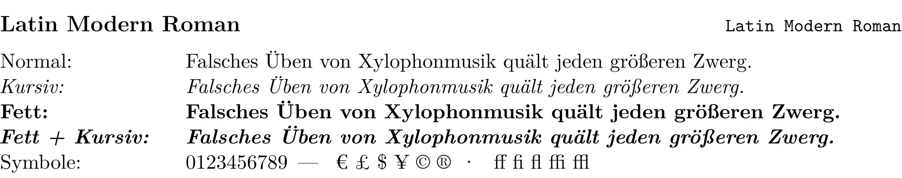

<!-- tutorial-screenshot
pdf-page: latex-tutorial/fonts.pdf 8 Latin Modern Sans
-->
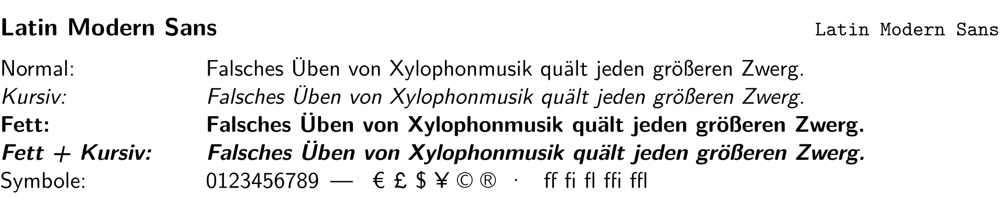

<!-- tutorial-screenshot
pdf-page: latex-tutorial/fonts.pdf 12 CMU Typewriter Text
-->
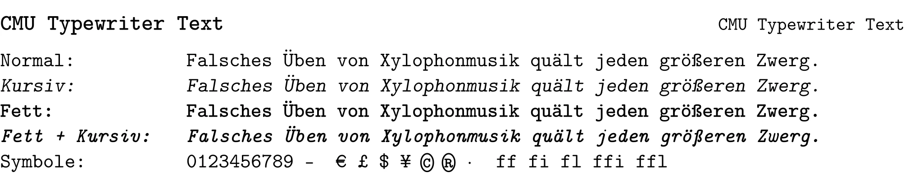

### Buch- und Textschriften (für längere Texte)

Gut für längere Texte wie eine Facharbeit: angenehm zu lesen und mit Serifen, die das Auge entlang der Zeile führen.

<!-- tutorial-screenshot
pdf-page: latex-tutorial/fonts.pdf 13 Nimbus Roman
-->
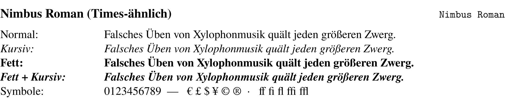

<!-- tutorial-screenshot
pdf-page: latex-tutorial/fonts.pdf 14 XCharter
-->
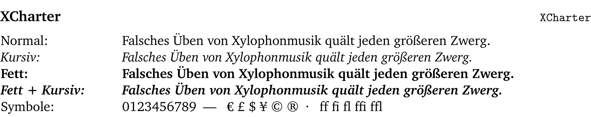

<!-- tutorial-screenshot
pdf-page: latex-tutorial/fonts.pdf 15 Vollkorn
-->
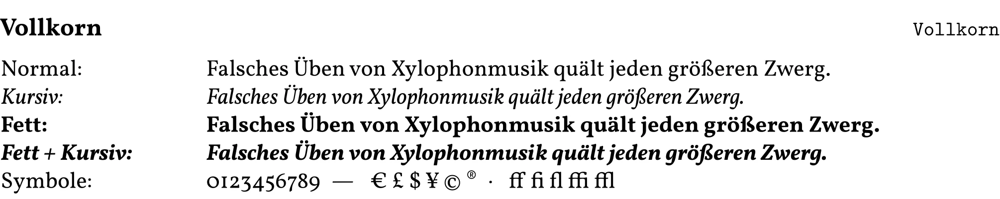

### Moderne serifenlose Schriften (Arbeitsblätter, Präsentationen)

<!-- tutorial-screenshot
pdf-page: latex-tutorial/fonts.pdf 16 Inter
-->
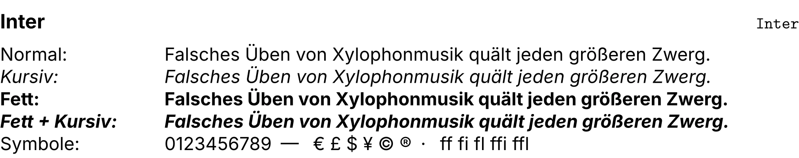

<!-- tutorial-screenshot
pdf-page: latex-tutorial/fonts.pdf 17 IBM Plex Sans
-->
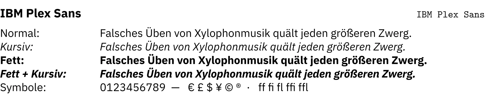

<!-- tutorial-screenshot
pdf-page: latex-tutorial/fonts.pdf 18 Ubuntu
-->
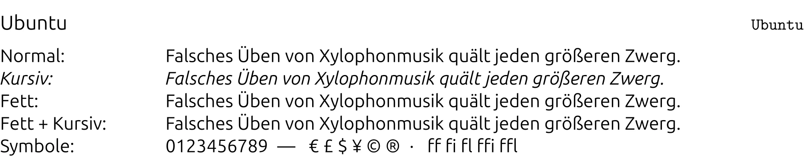

### Monospace-Schriften

Jedes Zeichen gleich breit: für Code, Terminal-Ausgaben und Dateinamen.

<!-- tutorial-screenshot
pdf-page: latex-tutorial/fonts.pdf 22 JetBrains Mono
-->
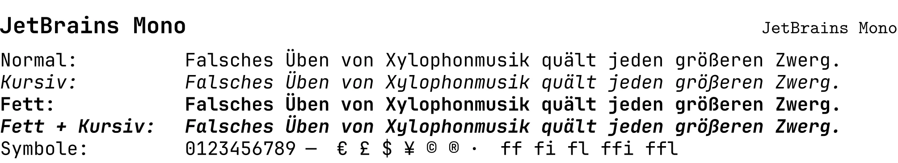

<!-- tutorial-screenshot
pdf-page: latex-tutorial/fonts.pdf 23 Anonymous Pro
-->
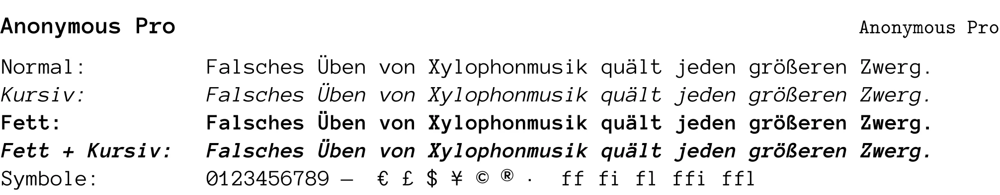

<!-- tutorial-screenshot
pdf-page: latex-tutorial/fonts.pdf 24 IBM Plex Mono
-->
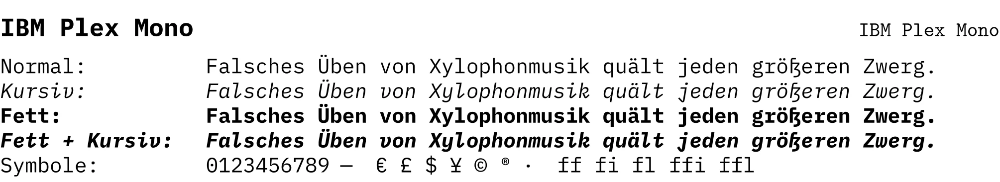

### Kreative Schriftarten (für Überschriften, Plakate)

<!-- tutorial-screenshot
pdf-page: latex-tutorial/fonts.pdf 25 Atkinson Hyperlegible
-->
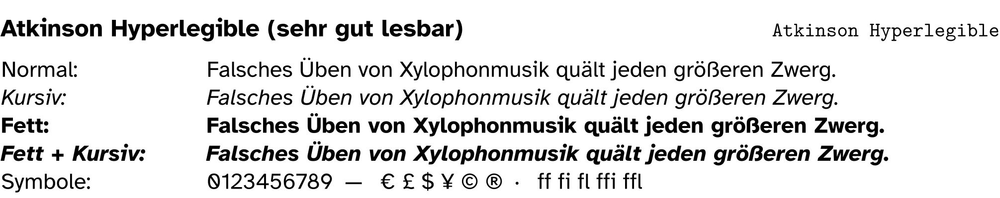

<!-- tutorial-screenshot
pdf-page: latex-tutorial/fonts.pdf 26 Comic Neue
-->
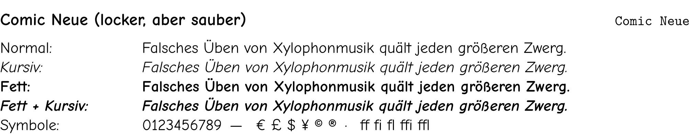

<!-- tutorial-screenshot
pdf-page: latex-tutorial/fonts.pdf 27 Montserrat
-->
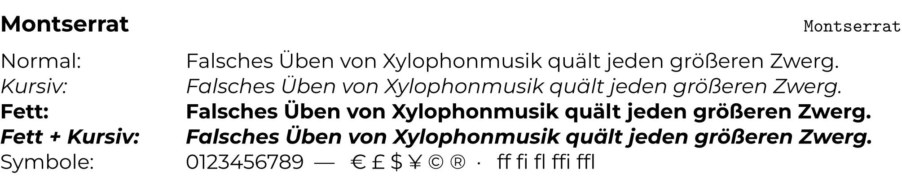

<!-- tutorial-screenshot
pdf-page: latex-tutorial/fonts.pdf 28 Comfortaa
-->
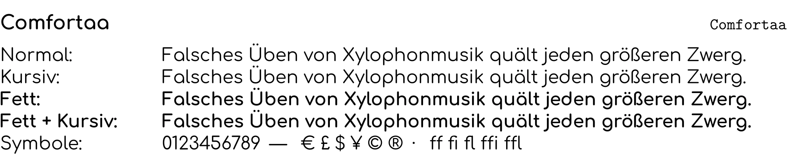

### Schriftarten mit mathematischer Unterstützung

Für Formeln braucht ein Dokument eine eigene Formelschrift, die zur Textschrift passt. Die Namen stehen wieder rechts oben, zum Beispiel:

```tex
\usepackage{fontspec}
\usepackage{unicode-math}
\setmainfont{Latin Modern Roman}
\setmathfont{Latin Modern Math}
```

<!-- tutorial-screenshot
pdf-page: latex-tutorial/fonts.pdf 1 Latin Modern Math
-->
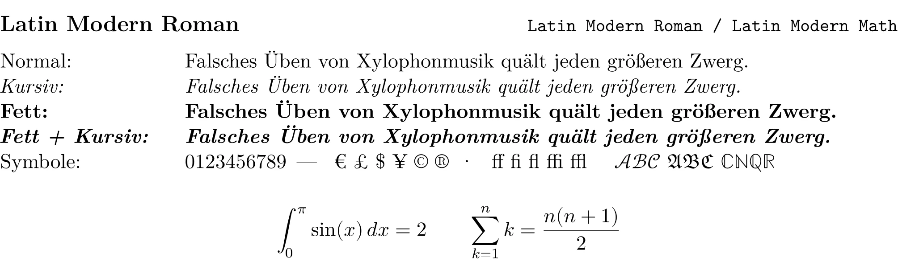

<!-- tutorial-screenshot
pdf-page: latex-tutorial/fonts.pdf 2 XCharter Math
-->
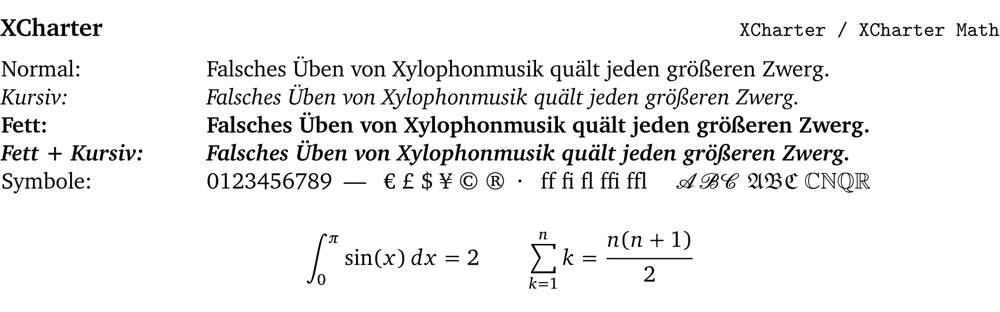

<!-- tutorial-screenshot
pdf-page: latex-tutorial/fonts.pdf 4 TeX Gyre Termes Math
-->
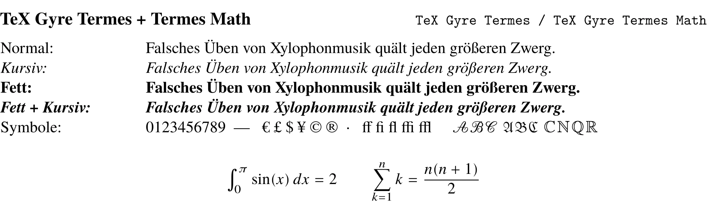

<!-- tutorial-screenshot
pdf-page: latex-tutorial/fonts.pdf 3 TeX Gyre Pagella Math
-->
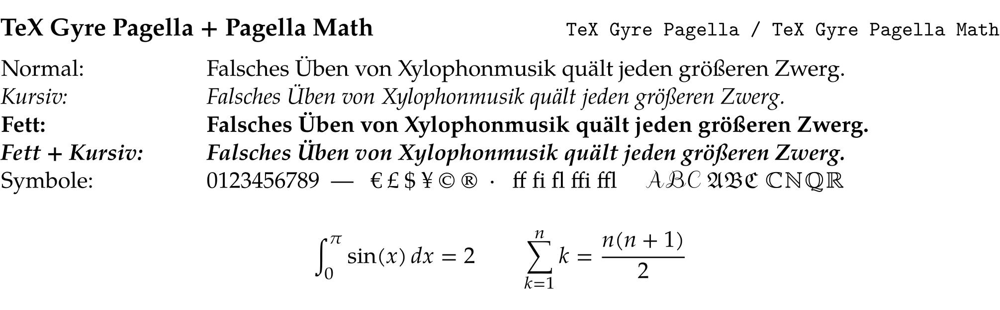

<!-- tutorial-screenshot
pdf-page: latex-tutorial/fonts.pdf 5 TeX Gyre Schola Math
-->
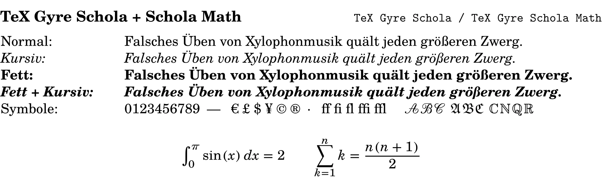

<!-- tutorial-screenshot
pdf-page: latex-tutorial/fonts.pdf 6 TeX Gyre Bonum Math
-->
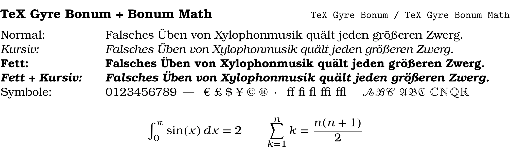

<div class='hint'>
Du kannst auch eigene Schriftarten verwenden: Lege die Schriftdatei (<code>.ttf</code> oder <code>.otf</code>) neben die <code>.tex</code>-Datei und gib sie mit Namen an, etwa <code>\setmainfont{MeineSchrift.otf}</code>.
</div>

## Fehlermeldungen

<!-- part: fehler -->
<!-- short: Lies die erste Fehlermeldung mit Zeilennummer; meist fehlt eine Klammer, ein `$` oder ein `\end{…}`. -->
### Was die häufigsten Fehler bedeuten

Bei einem Fehler zeigt LaTeX Workshop ein Kreuz in der Statusleiste, und unter »Problems« (<kbd>Strg</kbd><kbd>Shift</kbd><kbd>M</kbd>) steht die Meldung mit Zeilennummer. Lies die **erste** Meldung zuerst: Die übrigen sind oft nur Folgefehler.

<div class='scroll-x'><table class='table table-sm reference-table'>
<thead><tr><th>Meldung</th><th>Bedeutung</th></tr></thead>
<tbody>
<tr><td><code>Undefined control sequence</code></td><td>Ein Befehl ist falsch geschrieben (<code>\sectoin</code>) oder sein Paket fehlt in der Präambel.</td></tr>
<tr><td><code>Missing $ inserted</code></td><td>Ein Formelzeichen wie <code>^</code> oder <code>_</code> steht außerhalb einer Formel, oder ein <code>$</code> fehlt.</td></tr>
<tr><td><code>File `aufbau.png' not found</code></td><td>Das Bild liegt nicht dort, wo die <code>.tex</code>-Datei es sucht. Groß- und Kleinschreibung zählen.</td></tr>
<tr><td><code>\begin{itemize} … ended by \end{document}</code></td><td>Ein <code>\end{…}</code> fehlt, oder die Namen bei <code>\begin</code> und <code>\end</code> passen nicht.</td></tr>
<tr><td><code>Runaway argument?</code></td><td>Eine geschweifte Klammer wurde geöffnet und nicht geschlossen.</td></tr>
<tr><td><code>Misplaced alignment tab character &amp;</code></td><td>Ein <code>&amp;</code> steht außerhalb einer Tabelle; im Text heißt es <code>\&amp;</code>.</td></tr>
<tr><td><code>Package fontspec Error: The font "…" cannot be found</code></td><td>Die Schrift heißt anders oder ist nicht installiert; die Namen stehen bei den <a href='#schriftarten'>Schriftproben</a>.</td></tr>
<tr><td><code>??</code> im PDF</td><td>Ein <code>\ref</code> oder <code>\cite</code> kennt seinen Namen nicht: Tippfehler im Schlüssel.</td></tr>
</tbody>
</table>
</div>
<!-- /part -->

## Vorlagen

Die LaTeX-Vorlage enthält fertige Dokumente, die du abwandeln kannst. Klone sie mit »Clone Repository« und der Adresse `https://github.com/specht/latex-tutorial.git`.

### Bewerbung

`Bewerbung.tex` ist ein Anschreiben, zum Beispiel für ein Praktikum. Ersetze Namen, Adressen und Text durch deine eigenen.

<!-- tutorial-screenshot
sharp-canvas
press: Control+1
open-file: Bewerbung.tex
sleep: 1
press: Control+Alt+B
wait-for-file-newer: latex-tutorial/Bewerbung.pdf <- latex-tutorial/Bewerbung.tex
sleep: 2
press: Control+Alt+V
sleep: 5
move-mouse: selector:.monaco-editor .view-lines
-->
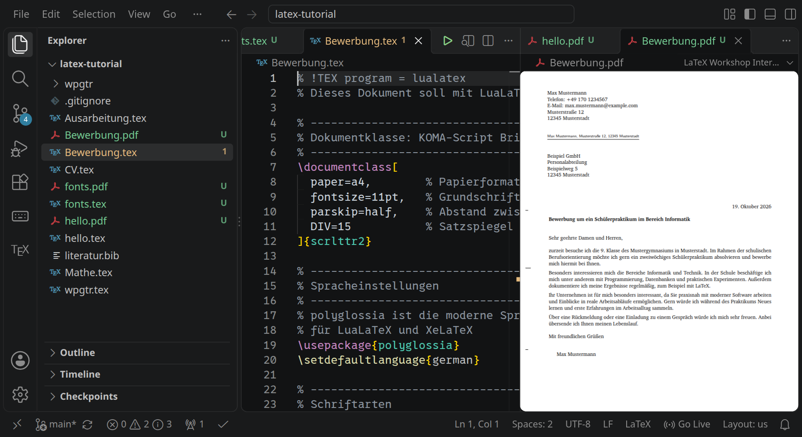

### Lebenslauf

`CV.tex` ist ein Lebenslauf mit Kontaktdaten, Ausbildung, Erfahrung und Kenntnissen. Liegt eine Datei `photo.jpg` im selben Ordner, erscheint sie als Foto.

<!-- tutorial-screenshot
sharp-canvas
press: Control+1
open-file: CV.tex
sleep: 1
press: Control+Alt+B
wait-for-file-newer: latex-tutorial/CV.pdf <- latex-tutorial/CV.tex
sleep: 2
press: Control+Alt+V
sleep: 5
move-mouse: selector:.monaco-editor .view-lines
-->
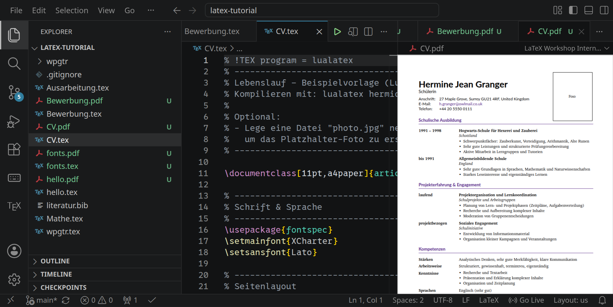

### Ausarbeitung

`Ausarbeitung.tex` ist eine schriftliche Ausarbeitung mit Titelblatt, Inhaltsverzeichnis, Abschnitten und Literaturverzeichnis aus `literatur.bib`.

<!-- tutorial-screenshot
sharp-canvas
press: Control+1
open-file: Ausarbeitung.tex
sleep: 1
press: Control+Alt+B
wait-for-file-newer: latex-tutorial/Ausarbeitung.pdf <- latex-tutorial/Ausarbeitung.tex
sleep: 2
press: Control+Alt+V
sleep: 5
move-mouse: selector:.monaco-editor .view-lines
-->
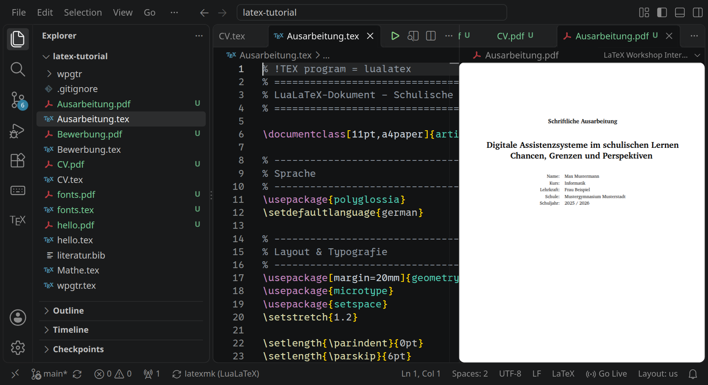

### Mathematik

`Mathe.tex` zeigt Formeln im Text und abgesetzt, Summen, Integrale, Matrizen, Fallunterscheidungen und Einheiten.

<!-- tutorial-screenshot
sharp-canvas
press: Control+1
open-file: Mathe.tex
sleep: 1
press: Control+Alt+B
wait-for-file-newer: latex-tutorial/Mathe.pdf <- latex-tutorial/Mathe.tex
sleep: 2
press: Control+Alt+V
sleep: 5
move-mouse: selector:.monaco-editor .view-lines
-->
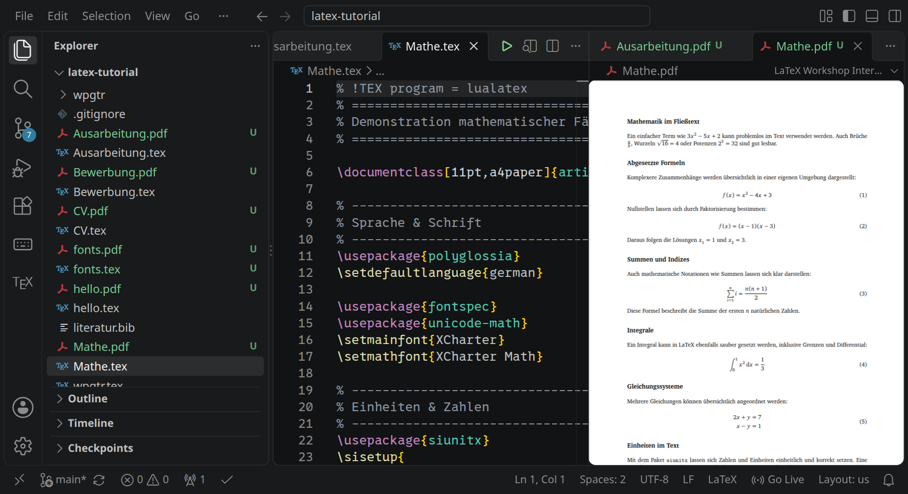

### Ein ganzes Buch

`wpgtr.tex` setzt ein ganzes Buch: »Why's (Poignant) Guide to Ruby« von [*\_why the lucky stiff*](https://tmewett.com/whytheluckystiff/), mit Inhaltsverzeichnis, Kapiteln und Bildern. Das Übersetzen dauert etwa eine Minute.

<!-- tutorial-screenshot
sharp-canvas
press: Control+1
open-file: wpgtr.tex
sleep: 1
press: Control+Alt+B
sleep: 45
wait-for-file-newer: latex-tutorial/wpgtr.pdf <- latex-tutorial/wpgtr.tex
sleep: 2
press: Control+Alt+V
sleep: 5
move-mouse: selector:.monaco-editor .view-lines
-->
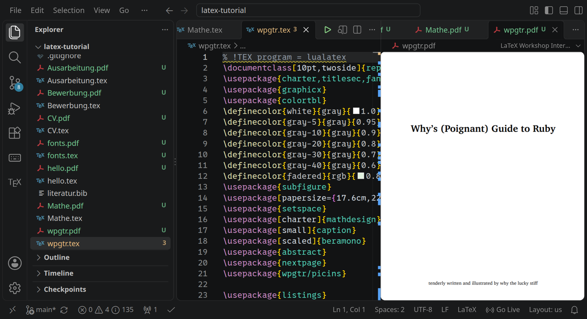
