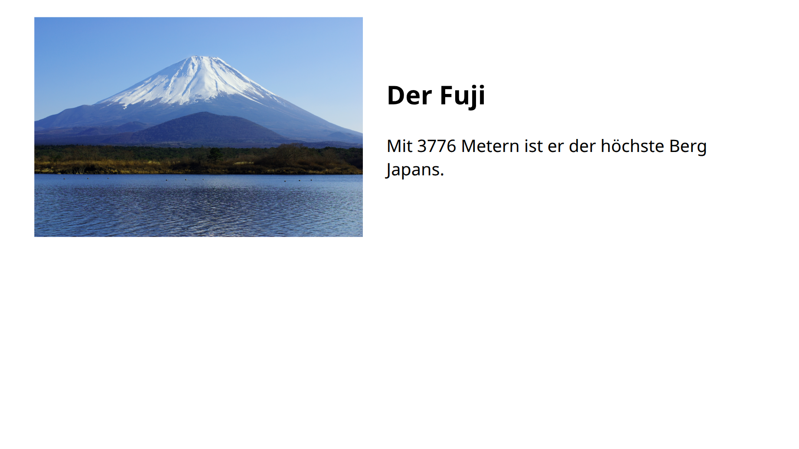
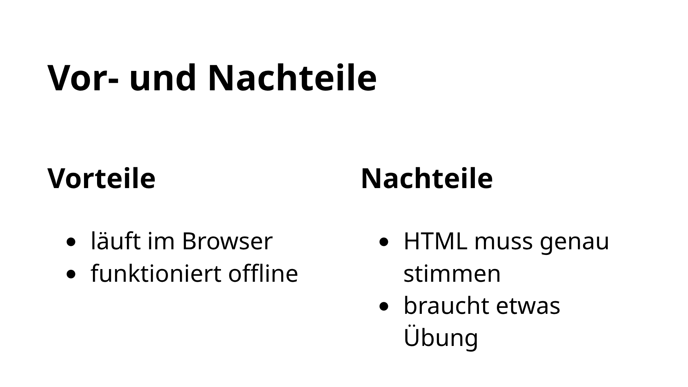
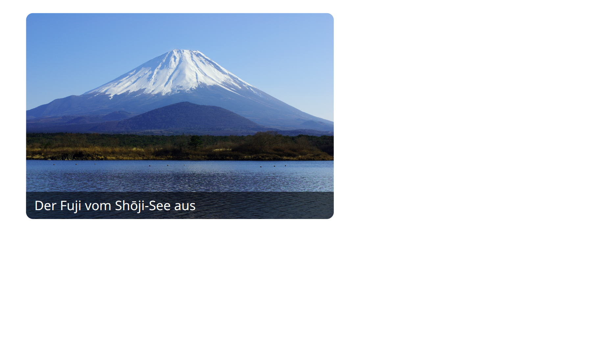

<div class='meta'>
image: nebeneinander.webp
kind: reference
</div>

<div
    class="autotoc-secondary-trigger"
    data-title="Auf dieser Seite"
    data-levels="h2,h3">
</div>

# Layout: Anordnen

<p class='abstract'>
Normalerweise stehen alle Elemente untereinander. Mit CSS stellst du Bild und Text nebeneinander, teilst den Platz in Spalten, setzt einzelne Dinge genau an eine Stelle und sorgst dafür, dass eine Webseite auch auf dem Handy funktioniert.
</p>

Alles auf dieser Seite gilt für Webseiten und für Folien mit Shower. Jedes Beispiel zeigt rechts, wie es aussieht; mit dem Knopf <svg class='icon-slide' viewBox='0 0 24 24' aria-hidden='true'><rect x='3' y='4' width='18' height='12' rx='1.5'/><path d='M12 16v3.5M8.5 21l3.5-1.5 3.5 1.5M7 8.5h6M7 11.5h9'/></svg> in der Ecke des Bildes siehst du es als Folie.

<!-- part: flexbox -->
<!-- short: `display: flex` stellt die direkten Kinder eines Elements nebeneinander; `gap` macht Platz dazwischen, `flex: 1` lässt eines den Rest nehmen. -->
## Nebeneinander mit Flexbox

Bild und Text sollen nebeneinander stehen. Dafür packst du beide in einen gemeinsamen Bereich und gibst ihm `display: flex`. Dann stehen seine **direkten Kinder** nebeneinander statt untereinander:

<!-- screenshot-code: flex-html -->
```html
<div class="nebeneinander">
    
    <div>
        <h2>Der Fuji</h2>
        <p>Mit 3776 Metern ist er der höchste Berg Japans.</p>
    </div>
</div>
```

```css
.nebeneinander {
    display: flex;
    gap: 30px;
    align-items: center;
}

.nebeneinander img {
    width: 45%;
}

.nebeneinander > div {
    flex: 1;
}
```

<!-- tutorial-screenshot
# Die Vorlage der Aktivität »Eine Präsentation in HTML erstellen«: In ihr
# zeigt sich jedes Beispiel als Seite und als Folie (tutorial-screenshot-hooks.mjs)
terminal-open
terminal-run: git clone -q https://git.nhcham.org/specht/shower.js.git /workspace/shower.js && git -C /workspace/shower.js checkout -q 50a071df026545793cfa29853e5e4ed6b1ece36e
terminal-wait-for-prompt
terminal-run: cd /workspace/shower.js && (python3 -m http.server 8090 > /dev/null 2>&1 &)
write-file: beispiel.html <- previous-code (flex-html)
write-file: beispiel.css <- previous-code
preview-port: 8090
tab: preview
viewport: 1024x576
zoom: 1.6
hook: beispiel css
variants: folie
-->

<button class='tutorial-preview' type='button'>
    
</button>

- `display: flex` ordnet die direkten Kinder nebeneinander an: hier das Bild und das innere `<div>`.
- `gap: 30px` lässt Platz zwischen ihnen.
- `align-items: center` richtet sie senkrecht mittig aus; `flex-start` setzt sie oben bündig.
- `width: 45%` gibt dem Bild knapp die Hälfte der Breite, `flex: 1` dem Text den Rest.

Das innere `<div>` ist wichtig: Ohne es wären Überschrift und Absatz zwei eigene Kinder und stünden ebenfalls nebeneinander, in drei Spalten. Willst du das Bild rechts haben, schreib es im HTML nach dem `<div>`.

<div class='tutorial-preview-clear'></div>

<!-- /part -->

<!-- part: spalten -->
<!-- short: `display: grid` mit `grid-template-columns: 1fr 1fr` teilt den Platz in zwei gleich breite Spalten, `1fr 1fr 1fr` in drei. -->
## Spalten

Sollen mehrere gleich wichtige Dinge gleich breit nebeneinander stehen, etwa ein Vergleich oder Vor- und Nachteile, ist ein **Grid** einfacher. `grid-template-columns` legt die Spalten fest; `1fr` ist ein gleicher Anteil am Platz:

<!-- screenshot-code: spalten-html -->
```html
<h2>Vor- und Nachteile</h2>
<div class="zwei-spalten">
    <div>
        <h3>Vorteile</h3>
        <ul>
            <li>läuft im Browser</li>
            <li>funktioniert offline</li>
        </ul>
    </div>
    <div>
        <h3>Nachteile</h3>
        <ul>
            <li>HTML muss genau stimmen</li>
            <li>braucht etwas Übung</li>
        </ul>
    </div>
</div>
```

```css
.zwei-spalten {
    display: grid;
    grid-template-columns: 1fr 1fr;
    gap: 30px;
}
```

<!-- tutorial-screenshot
write-file: beispiel.html <- previous-code (spalten-html)
write-file: beispiel.css <- previous-code
tab: preview
viewport: 1024x576
zoom: 1.6
hook: beispiel css
variants: folie
-->

<button class='tutorial-preview' type='button'>
    
</button>

Jedes direkte Kind des Grids ist eine Spalte. Gehören mehrere Elemente in dieselbe Spalte, wie hier Überschrift und Liste, packe sie in ein gemeinsames `<div>`.

Drei Spalten bekommst du mit `1fr 1fr 1fr`. Ungleiche Spalten auch: `2fr 1fr` gibt der linken doppelt so viel Platz wie der rechten.

<div class='hint'>
Halte die Spalten ungefähr gleich voll. Ist eine sehr lang und die andere fast leer, wirkt es unausgewogen.
</div>

<div class='tutorial-preview-clear'></div>

<!-- /part -->

<!-- part: platzieren -->
<!-- short: `position: absolute` mit zwei Abständen wie `right` und `bottom` setzt ein Element genau an eine Stelle; der Bezugsrahmen ist das nächste Element außen mit `position: relative`. -->
## Genau platzieren

Manchmal soll ein einzelnes Element an eine bestimmte Stelle: ein Hinweis in die Ecke, eine Beschriftung auf ein Bild. Dafür gibt es `position: absolute`. Das Element wird aus dem normalen Fluss genommen; die anderen machen ihm keinen Platz mehr. Mit zwei Abständen sagst du, von welcher Ecke aus es steht:

<!-- screenshot-code: absolut-html -->
```html
<div class="bild-rahmen">
    
    <p class="beschriftung">Der Fuji vom Shōji-See aus</p>
</div>
```

```css
.bild-rahmen {
    position: relative;
    width: 520px;
}

.bild-rahmen img {
    display: block;
    width: 100%;
    border-radius: 12px;
}

.beschriftung {
    position: absolute;
    left: 0;
    right: 0;
    bottom: 0;
    margin: 0;
    padding: 8px 14px;
    border-radius: 0 0 12px 12px;
    background: rgba(0, 0, 0, 0.6);
    color: white;
}
```

<!-- tutorial-screenshot
write-file: beispiel.html <- previous-code (absolut-html)
write-file: beispiel.css <- previous-code
tab: preview
viewport: 1024x576
zoom: 1.6
hook: beispiel css
variants: folie
-->

<button class='tutorial-preview' type='button'>
    
</button>

- `position: absolute` und `left: 0; right: 0; bottom: 0` legen die Beschriftung an den unteren Rand, über die ganze Breite.
- Woran sich `bottom: 0` misst, bestimmt das nächste Element außen herum, das `position: relative` hat; hier der Rahmen um das Bild. Ohne ihn läge die Beschriftung am unteren Rand der Seite oder Folie.
- `rgba(0, 0, 0, 0.6)` ist Schwarz mit 60 % Deckkraft; das Bild scheint durch, die Schrift bleibt lesbar.

<div class='hint'>
Setze nur einzelne Dinge so genau: einen Hinweis, ein Logo, eine Beschriftung. Für den normalen Inhalt sind Absätze, Flexbox und Spalten besser, denn sie passen sich von selbst an, wenn sich der Text ändert.
</div>

<div class='tutorial-preview-clear'></div>

### Ein Element etwas verschieben

`position: relative` mit `left` und `top` verschiebt ein Element von seinem normalen Platz aus, um die angegebenen Pixel nach rechts und nach unten. Sein alter Platz bleibt dabei frei; das taugt also nur für kleine Korrekturen.

```html
<p style="position: relative; left: 40px; top: 10px;">Etwas weiter rechts.</p>
```

<!-- /part -->

<!-- part: kleine-bildschirme -->
<!-- short: Eine Media Query wie `@media (max-width: 700px) { … }` enthält Regeln, die nur in schmalen Fenstern gelten, etwa `flex-direction: column`, damit alles untereinander steht. -->
## Kleine Bildschirme

Webseiten werden auf dem Handy, dem Tablet und dem Laptop geöffnet. Was auf einem breiten Bildschirm nebeneinander gut aussieht, ist auf dem Handy viel zu eng. Eine **Media Query** enthält Regeln, die nur unter einer Bedingung gelten, zum Beispiel nur in schmalen Fenstern:

```css
@media (max-width: 700px) {
    .nebeneinander {
        flex-direction: column;
    }

    .nebeneinander img {
        width: 100%;
    }
}
```

Bis 700 Pixel Breite stehen Bild und Text jetzt untereinander, und das Bild nimmt die ganze Breite. Zieh dein Browserfenster schmaler und breiter: Du siehst genau, wann das Layout wechselt.

Damit Handys die Seite in ihrer echten Breite zeigen, braucht der `<head>` diese Zeile (im [Grundgerüst](/reference/html#grundgeruest) steht sie schon):

```html
<meta name="viewport" content="width=device-width, initial-scale=1">
```

<div class='hint'>
Folien brauchen das nicht: Shower vergrößert und verkleinert eine Folie als Ganzes, sodass sie auf jedem Bildschirm gleich aussieht.
</div>

<!-- /part -->

## Zum Nachschlagen

- [MDN: Grundkonzepte von Flexbox](https://developer.mozilla.org/de/docs/Web/CSS/Guides/Flexible_box_layout/Basic_concepts): Hauptachse und Querachse und alle Eigenschaften von Flexbox, auf Deutsch.
- [MDN: Grundkonzepte des Grid-Layouts](https://developer.mozilla.org/de/docs/Web/CSS/Guides/Grid_layout/Basic_concepts): Spalten und Zeilen, Lücken dazwischen und Elemente, die über mehrere Spalten reichen.
- [MDN: `position`](https://developer.mozilla.org/de/docs/Web/CSS/Reference/Properties/position): `relative` und `absolute`, dazu `fixed` und `sticky` für Elemente, die beim Scrollen stehen bleiben.
- [MDN: Media Queries verwenden](https://developer.mozilla.org/de/docs/Web/CSS/Guides/Media_queries/Using): alle Bedingungen, nicht nur die Breite, etwa Hoch- und Querformat oder der Druck.
- [A Complete Guide to Flexbox](https://css-tricks.com/snippets/css/a-guide-to-flexbox/) und [A Complete Guide to CSS Grid](https://css-tricks.com/complete-guide-css-grid-layout/) von CSS-Tricks: jede Eigenschaft auf einen Blick, mit Bild, auf Englisch.
