

kind: reference
search: Licht, Beleuchtung, Lambert, diffus, Glanz, Glanzlicht, Phong, Blinn, Halbvektor, Exponent, shininess, Flat Shading, Smooth Shading, Gouraud, Spiegelung, Environment Map, Fresnel, Schlick, Metall, Rauheit, roughness, Schatten, Normale

# Licht und Glanz

Wie hell ein Punkt einer Fläche ist, rechnet ein Programm aus der Normale, der Richtung zum Licht und der Richtung zur Kamera aus, im <a href='/raytracing'>Raytracer</a> wie in <a href='/glsl'>Shadern</a> und in <a href='/webgl'>3D-Grafik mit WebGL</a>. Hier stehen die Formeln dafür: mattes Licht, Glanzlichter, Spiegelungen und warum Flächen am Rand mehr spiegeln. Die Rechenarten selbst, Skalarprodukt und Spiegeln, stehen unter <a href='/reference/vektoren'>Vektoren</a>.

## Matt: wie viel Licht ankommt

<!-- part: lambert -->
<!-- short: Matt (Lambert): Helligkeit = max(n · l, 0), n und l mit Länge 1; dazu ein wenig Licht von überall (ambient). -->
### Die Normale und das Licht

Eine matte Fläche, Papier, Putz, Holz ohne Lack, ist von allen Seiten gleich hell. Wie hell, hängt nur davon ab, wie steil das Licht auf sie fällt: Senkrecht von oben trifft viel Licht auf wenig Fläche, flach von der Seite verteilt sich dasselbe Licht auf viel Fläche. Mit der Normale \\(n\\) und der Richtung zum Licht \\(l\\), beide mit der Länge 1, ist der Anteil der Kosinus des Winkels zwischen ihnen, und der ist das Skalarprodukt:

$$\text{diffus} = \max(n \cdot l,\ 0)$$

Ist das Skalarprodukt negativ, zeigt die Fläche vom Licht weg; dann ist sie dunkel, nicht »negativ hell«. Das Gesetz stammt von Johann Heinrich Lambert (1760).

<figure>
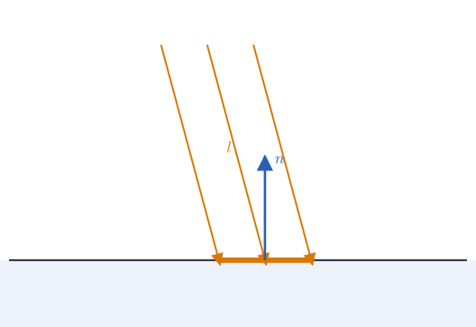
<figcaption>Steil: viel Licht auf wenig Fläche</figcaption></figure>
<figure>
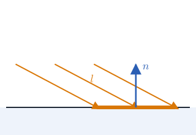
<figcaption>Flach: dasselbe Licht auf viel Fläche</figcaption></figure>

### Licht von überall

Eine Fläche im Schatten ist in Wirklichkeit nicht schwarz, denn Wände, Boden und Himmel werfen Licht zurück. Ein Programm, das nur eine Lampe kennt, gibt dafür einen festen kleinen Anteil dazu, das **ambiente Licht**:

$$\text{Farbe} = \text{Grundfarbe} \cdot (0{,}2 + 0{,}8 \cdot \text{diffus})$$

Genauer ist Licht aus einem Rundumbild der Umgebung, so hell und farbig, wie die Umgebung in Richtung der Normale ist (*Image Based Lighting*, unten bei den Spiegelungen).

<figure>
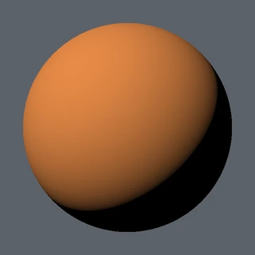
<figcaption>Nur die Lampe</figcaption></figure>
<figure>
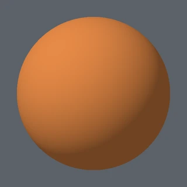
<figcaption>Mit Licht von überall</figcaption></figure>

<!-- /part -->

_person(lambert)

## Glanz: wo das Licht ins Auge fällt

<!-- part: glanz -->
<!-- short: Glanz nach Blinn: h = normalize(l + v), Glanz = max(n · h, 0)^Exponent; großer Exponent kleiner scharfer Fleck. -->
### Nach Phong und nach Blinn

Lack, Kunststoff und nasse Steine glänzen: Dort, wo das Licht so zurückgeworfen wird, dass es genau ins Auge fällt, sieht man einen hellen Fleck. Anders als das matte Licht hängt er davon ab, wo die Kamera steht, also von der Richtung \\(v\\) zur Kamera.

Bùi Tường Phong spiegelte 1973 die Richtung zum Licht an der Normale und verglich sie mit \\(v\\). Jim Blinn rechnete es 1977 einfacher mit der Richtung genau zwischen Licht und Kamera, dem **Halbvektor**:

$$h = \frac{l + v}{|l + v|}, \qquad \text{Glanz} = \max(n \cdot h,\ 0)^{k}$$

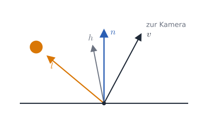

Wird das Licht zum Auge gespiegelt, liegt \\(h\\) genau auf der Normale, und \\(n \cdot h = 1\\). Die hohe Potenz \\(k\\), der **Exponent** (englisch *shininess*), macht daraus einen Fleck, der zur Seite schnell auf 0 fällt:

<table class='table table-sm reference-table'>
<thead><tr><th>Exponent</th><th>sieht aus wie</th></tr></thead>
<tbody>
<tr><td>5 bis 10</td><td>ein breiter, matter Schimmer: rauer Kunststoff</td></tr>
<tr><td>30 bis 60</td><td>ein deutlicher Fleck: Lack, Porzellan</td></tr>
<tr><td>200 und mehr</td><td>ein kleiner, scharfer Punkt: poliertes Metall, Glas</td></tr>
</tbody>
</table>

<figure>
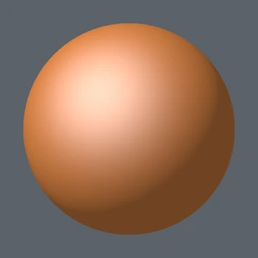
<figcaption>Exponent 8</figcaption></figure>
<figure>

<figcaption>Exponent 40</figcaption></figure>
<figure>
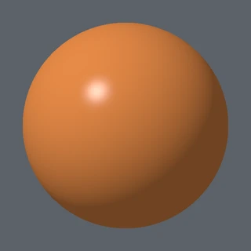
<figcaption>Exponent 200</figcaption></figure>

### Die Farbe des Glanzes

Bei Lack, Kunststoff und Porzellan hat der Glanz die Farbe der Lampe, meist Weiß, und kommt zur Grundfarbe dazu:

$$\text{Farbe} = \text{Grundfarbe} \cdot (0{,}2 + 0{,}8 \cdot \text{diffus}) + 0{,}4 \cdot \text{Glanz}$$

Bei Metall dagegen hat der Glanz die Farbe des Metalls: Gold glänzt golden. Mehrere Lampen rechnet man einzeln und zählt zusammen; eine farbige Lampe multipliziert Grundfarbe und Glanz mit ihrer Farbe.
<!-- /part -->

_person(phong)

_person(blinn)

## Glatt aus geraden Dreiecken

<!-- part: shading -->
<!-- short: Flat Shading eine Normale je Dreieck; Gouraud mischt die Helligkeit der Ecken; Phong mischt die Normalen und rechnet für jedes Pixel. -->
Ein Modell aus Dreiecken ist an seinen Kanten eckig. Wie hell jedes Pixel wird, kann man auf drei Arten ausrechnen:

<table class='table table-sm reference-table'>
<thead><tr><th>Verfahren</th><th>wie</th><th>sieht aus wie</th></tr></thead>
<tbody>
<tr><td>Flat Shading</td><td>eine Normale je Dreieck, das ganze Dreieck eine Helligkeit</td><td>Facetten, wie geschliffen</td></tr>
<tr><td>Gouraud Shading (1971)</td><td>das Licht an den Ecken rechnen, die Helligkeit dazwischen mischen</td><td>glatt, aber ein Glanzfleck mitten im Dreieck fehlt</td></tr>
<tr><td>Phong Shading (1973)</td><td>die Normalen der Ecken mischen und das Licht für jedes Pixel neu rechnen</td><td>glatt, mit Glanzlicht an jeder Stelle</td></tr>
</tbody>
</table>

Dieselbe Kugel aus 196 Dreiecken, mit derselben Lampe und demselben Glanz, auf die drei Arten:

<figure>
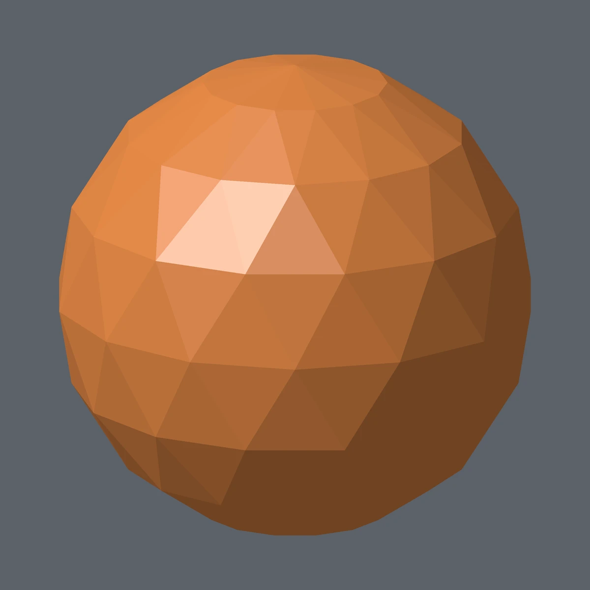
<figcaption>Flat Shading</figcaption></figure>
<figure>
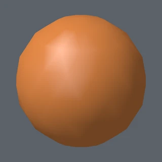
<figcaption>Gouraud Shading</figcaption></figure>
<figure>

<figcaption>Phong Shading</figcaption></figure>

Damit eine runde Fläche glatt aussieht, haben die Ecken ihre eigenen Normalen, senkrecht auf der gedachten runden Fläche, nicht auf einem Dreieck. An einer scharfen Kante dagegen bekommt eine Ecke zwei Normalen, je eine für jede Seite. Der Umriss bleibt in jedem Fall aus geraden Stücken: Normalen ändern die Helligkeit, nicht die Form.

<figure>
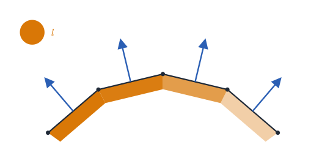
<figcaption>Flat Shading: eine Normale je Dreieck</figcaption></figure>
<figure>
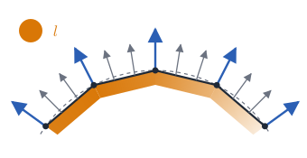
<figcaption>Smooth Shading: Normalen an den Ecken, dazwischen gemischt</figcaption></figure>

<!-- /part -->

_person(gouraud)

## Spiegelungen

<!-- part: spiegelung -->
<!-- short: Gespiegelt wird die Richtung zur Kamera an der Normale: reflect(−v, n); dort die Umgebung lesen, aus einem Rundumbild (Environment Map). -->
### Was eine Fläche spiegelt

Ein Spiegel zeigt, was in der gespiegelten Blickrichtung liegt: Die Richtung von der Kamera zum Punkt, \\(-v\\), an der Normale gespiegelt, gibt \\(r = \text{reflect}(-v, n)\\). Ein Raytracer schickt in diese Richtung einen neuen Strahl und sieht, was er trifft. Ein Shader liest stattdessen ein Rundumbild der Umgebung, eine **Environment Map**: ein Panorama, dessen Breite einmal im Kreis herumgeht und dessen Höhe von ganz unten bis ganz oben. Zur Richtung \\(r\\) gehört die Stelle

$$u = \frac{1}{2} + \frac{\operatorname{atan2}(r\_x, -r\_z)}{2\pi}, \qquad v = \frac{1}{2} + \frac{\arcsin r\_y}{\pi}$$

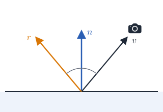

### Raue Flächen

Eine raue Fläche spiegelt verschwommen. Statt viele Richtungen zu mischen, liest ein Shader eine kleinere, schon verschwommene Fassung des Rundumbilds, eine **Mipmap**: je rauer, desto kleiner. In GLSL wählt `textureLod(bild, stelle, stufe)` die Stufe selbst.
<!-- /part -->

## Am Rand spiegelt alles mehr

<!-- part: fresnel -->
<!-- short: Fresnel nach Schlick: F = F₀ + (1 − F₀)(1 − n · v)⁵, für Glas und Lack F₀ ≈ 0,04. -->
Schau flach über einen Tisch oder ein Fenster: Von der Seite spiegelt jede Fläche mehr als von vorne, auch Holz und Lack. Augustin Jean Fresnel hat das für Licht berechnet; Christophe Schlick fand 1994 eine einfache Näherung:

$$F = F\_0 + (1 - F\_0) \\, (1 - n \cdot v)^5$$

\\(F\_0\\) ist, wie viel die Fläche von vorne spiegelt: etwa 0,04 bei Glas, Wasser und Lack, zwischen 0,5 und 1 bei Metall. Ganz von der Seite, \\(n \cdot v = 0\\), spiegelt alles vollständig. Glas, das nur 4 Prozent spiegelt, ist von vorne fast unsichtbar; am Rand eines Glases sieht man die Spiegelung deutlich. In den Bildern spiegelt die Kugel einen Himmel über einem Boden:

<figure>
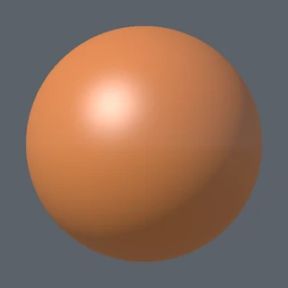
<figcaption>Überall 4 Prozent</figcaption></figure>
<figure>
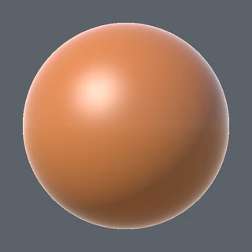
<figcaption>Mit Fresnel nach Schlick</figcaption></figure>
<figure>
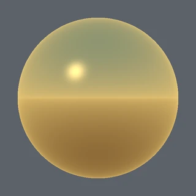
<figcaption>Metall: alles gespiegelt, in Gold</figcaption></figure>

### Metall oder nicht

Ein Material ist entweder Metall oder nicht, und danach richtet sich, was es spiegelt: Nichtmetalle haben eine Grundfarbe und spiegeln wenig und farblos, Metalle haben keine matte Grundfarbe und spiegeln fast alles, in ihrer eigenen Farbe. Eine **Metallic Map** sagt für jede Stelle, welches von beiden gilt, eine **Roughness Map**, wie rau sie ist. Spiele rechnen damit nach der Physik (*Physically Based Rendering*).
<!-- /part -->

_person(fresnel)

## Schatten

<!-- part: schatten -->
<!-- short: Schatten: im Raytracer ein Strahl vom Punkt zum Licht, im Spiel eine Shadow Map, ein Z-Buffer aus Sicht der Lampe. -->
Ob ein Punkt im Schatten liegt, steht in keiner der Formeln oben: Sie fragen nur, wie die Fläche zum Licht steht, nicht, ob etwas dazwischen ist. Ein Raytracer schickt dafür einen zweiten Strahl vom Punkt zur Lampe; trifft er unterwegs etwas, fällt das Licht der Lampe weg, und nur das ambiente bleibt. Ein Spiel rechnet vorher aus Sicht der Lampe einen Z-Buffer, die **Shadow Map**, und vergleicht für jedes Pixel, ob es weiter von der Lampe weg ist als das, was die Lampe sieht.
<!-- /part -->

## Zum Nachschlagen

- [LearnOpenGL: Basic Lighting](https://learnopengl.com/Lighting/Basic-Lighting) und [Advanced Lighting](https://learnopengl.com/Advanced-Lighting/Advanced-Lighting): matt, Glanz nach Phong und Blinn, mit Shadercode, auf Englisch.
- [Phong-Beleuchtungsmodell](https://de.wikipedia.org/wiki/Phong-Beleuchtungsmodell) und [Fresnelsche Formeln](https://de.wikipedia.org/wiki/Fresnelsche_Formeln) in der Wikipedia.
- [Real-Time Rendering](https://www.realtimerendering.com/): das Buch über Licht und Grafik in Echtzeit, auf Englisch.
