

kind: reference
search: Matrix, Matrizen, mat4, mat3, Transformation, drehen, strecken, verschieben, Perspektive, Projektion, homogene Koordinaten, transponieren, Inverse, Kovarianzmatrix, Kamera, view, projection, Float32Array, spaltenweise, Achse, Rodrigues, Quaternion, Quaternionen, Slerp, Eulerwinkel, gimbal lock, kardanische Blockade

# Matrizen

Eine Matrix ist eine Tabelle aus Zahlen, die einen Punkt dreht, streckt, verschiebt oder auf den Bildschirm bringt, so wie in <a href='/webgl'>3D-Grafik mit WebGL</a> und in <a href='/glsl'>Shadern</a>, und die in <a href='/gaussian-splatting'>Gaussian Splatting</a> die Form eines Splats beschreibt. Hier steht, wie man mit ihr rechnet was die einzelnen Matrizen tun und wie Quaternionen eine Drehung in vier Zahlen speichern. Mit Punkten und Richtungen selbst geht es unter <a href='/reference/vektoren'>Vektoren</a>.

## Zahlen in Zeilen und Spalten

<!-- part: matrix -->
<!-- short: Eine Matrix sind Zahlen in Zeilen und Spalten; M · v nimmt jede Zeile mal den Vektor (Skalarprodukt). -->
### Matrix mal Vektor

Eine **Matrix** sind Zahlen in Zeilen und Spalten. Eine 2 × 2-Matrix hat zwei Zeilen und zwei Spalten:

$$M = \begin{pmatrix} a & b \\\\ c & d \end{pmatrix}$$

Mal einen Vektor genommen, gibt sie einen neuen Vektor: Jede Zeile wird mit dem Vektor multipliziert wie beim Skalarprodukt, Zahl für Zahl, und die Produkte zusammengezählt.

$$\begin{pmatrix} a & b \\\\ c & d \end{pmatrix} \begin{pmatrix} x \\\\ y \end{pmatrix} = \begin{pmatrix} a x + b y \\\\ c x + d y \end{pmatrix}$$

Zum Beispiel macht \\(\begin{pmatrix} 2 & 0 \\\\ 0 & 1 \end{pmatrix}\\) aus \\((3, 4)\\) den Punkt \\((6, 4)\\): Alles wird doppelt so breit, die Höhe bleibt.

### Die Spalten verraten, was sie tut

Die erste Spalte ist, wohin der Punkt \\((1, 0)\\) kommt, die zweite, wohin \\((0, 1)\\) kommt. Weil jeder andere Punkt aus diesen beiden zusammengesetzt ist, weiß man damit, was die Matrix mit allen Punkten tut. Wer eine Matrix bauen will, überlegt sich also, wohin die Achsen sollen, und schreibt sie als Spalten hin.
<!-- /part -->

## Drehen, strecken, spiegeln

<!-- part: drehen -->
<!-- short: Drehen um θ: Spalten (cos θ, sin θ) und (−sin θ, cos θ); Strecken: die Faktoren auf der Diagonalen. -->
Um den Winkel \\(\theta\\) gegen den Uhrzeigersinn drehen, strecken und spiegeln:

<table class='table table-sm reference-table'>
<thead><tr><th>was</th><th>Matrix in 2D</th><th>was mit den Achsen passiert</th></tr></thead>
<tbody>
<tr><td>nichts (Einheitsmatrix)</td><td>\(\begin{pmatrix} 1 & 0 \\ 0 & 1 \end{pmatrix}\)</td><td>\((1, 0)\) bleibt</td></tr>
<tr><td>drehen um \(\theta\)</td><td>\(\begin{pmatrix} \cos\theta & -\sin\theta \\ \sin\theta & \cos\theta \end{pmatrix}\)</td><td>\((1, 0)\) wird \((\cos\theta, \sin\theta)\)</td></tr>
<tr><td>strecken um \(s_x\) und \(s_y\)</td><td>\(\begin{pmatrix} s_x & 0 \\ 0 & s_y \end{pmatrix}\)</td><td>\((1, 0)\) wird \((s_x, 0)\)</td></tr>
<tr><td>an der y-Achse spiegeln</td><td>\(\begin{pmatrix} -1 & 0 \\ 0 & 1 \end{pmatrix}\)</td><td>\((1, 0)\) wird \((-1, 0)\)</td></tr>
<tr><td>scheren</td><td>\(\begin{pmatrix} 1 & k \\ 0 & 1 \end{pmatrix}\)</td><td>\((1, 0)\) bleibt, \((0, 1)\) wird \((k, 1)\)</td></tr>
</tbody>
</table>

In den Bildern ist das F vorher gestrichelt und nachher blau. Die roten und grünen Pfeile sind, wohin \\((1, 0)\\) und \\((0, 1)\\) kommen: die beiden Spalten der Matrix.

<figure>
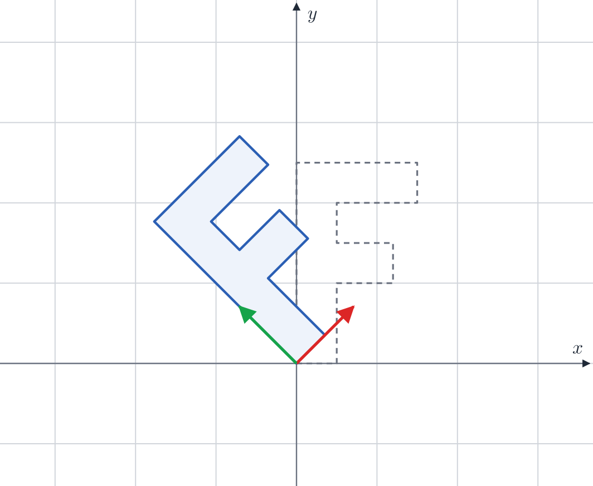
<figcaption>Drehen um 45°</figcaption></figure>
<figure>
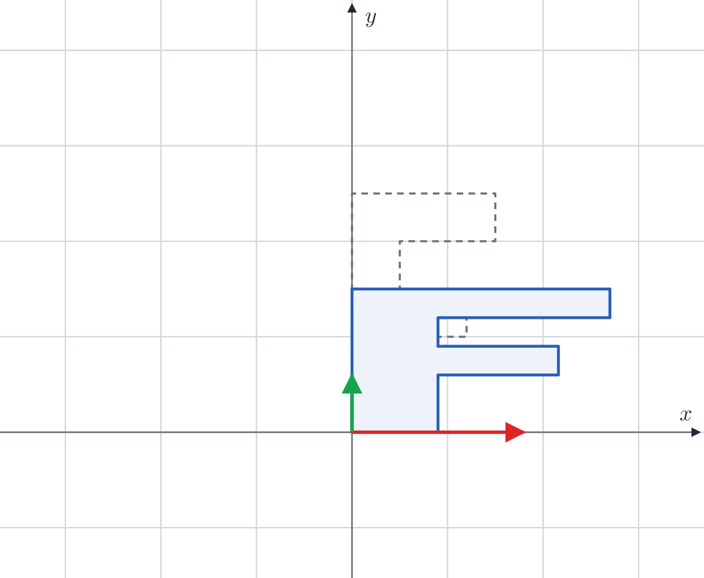
<figcaption>Strecken: 1,8 in x, 0,6 in y</figcaption></figure>
<figure>
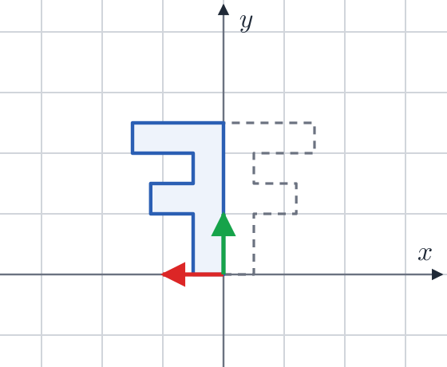
<figcaption>Spiegeln an der y-Achse</figcaption></figure>
<figure>
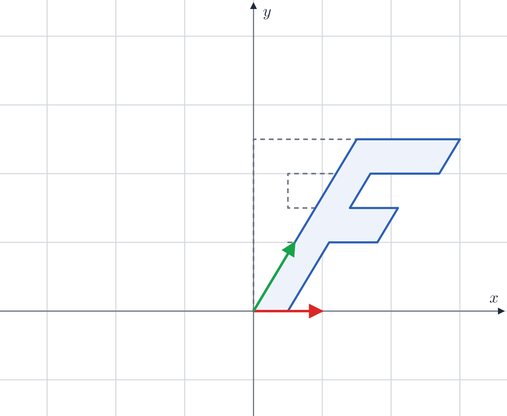
<figcaption>Scheren mit k = 0,6</figcaption></figure>

Im Raum dreht man um eine Achse, und die Zahl auf dieser Achse bleibt. Um die y-Achse, wie eine Figur, die sich auf der Stelle dreht:

$$R\_y(\theta) = \begin{pmatrix} \cos\theta & 0 & \sin\theta \\\\ 0 & 1 & 0 \\\\ -\sin\theta & 0 & \cos\theta \end{pmatrix}$$

Um die x-Achse (nicken) stehen Kosinus und Sinus in der zweiten und dritten Zeile und Spalte, um die z-Achse (kippen) in der ersten und zweiten.
<!-- /part -->

## Hintereinander: Matrix mal Matrix

<!-- part: multiplizieren -->
<!-- short: A · B: erst B, dann A; die Reihenfolge zählt (erst drehen, dann verschieben ist nicht dasselbe wie umgekehrt). -->
Zwei Matrizen lassen sich zu einer zusammenfassen: In \\(A \cdot B\\) ist die Zahl in Zeile \\(i\\), Spalte \\(j\\) das Skalarprodukt aus Zeile \\(i\\) von \\(A\\) und Spalte \\(j\\) von \\(B\\). Die neue Matrix tut dasselbe wie erst \\(B\\) und dann \\(A\\):

$$(A \cdot B) \cdot v = A \cdot (B \cdot v)$$

Gelesen wird also **von rechts nach links**, und die Reihenfolge zählt: Erst drehen und dann verschieben bringt ein Modell an eine andere Stelle als erst verschieben und dann um den Ursprung drehen, das Modell kreist dann um ihn.

<figure>
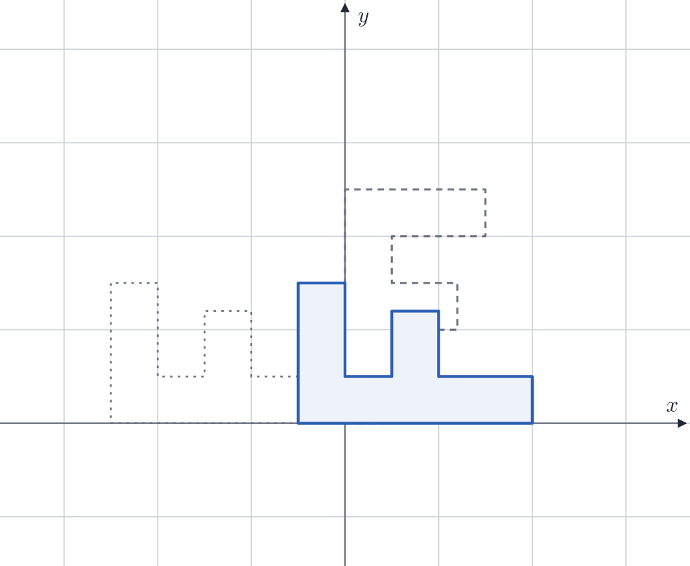
<figcaption>Erst drehen, dann verschieben</figcaption></figure>
<figure>
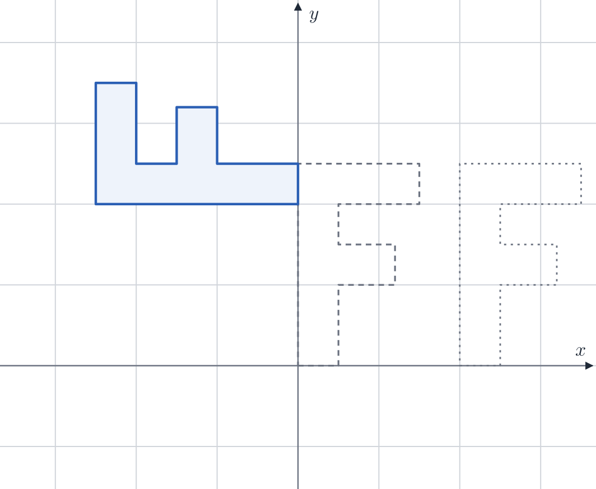
<figcaption>Erst verschieben, dann drehen</figcaption></figure>

 Darum steht in einem Grafikprogramm `projection * view * model * punkt`: zuerst das Modell an seinen Platz, dann in die Sicht der Kamera, zuletzt auf den Bildschirm.

Für viele Punkte rechnet man das Produkt der Matrizen einmal aus und nimmt dann jeden Punkt nur noch mit einer Matrix mal. So macht es die Grafikkarte mit Millionen Ecken.
<!-- /part -->

## Verschieben mit vier Zahlen

<!-- part: homogen -->
<!-- short: Homogene Koordinaten: (x, y, z, 1) für Punkte, (x, y, z, 0) für Richtungen; eine 4 × 4-Matrix kann dann auch verschieben. -->
Eine 3 × 3-Matrix kann drehen und strecken, aber nicht verschieben: Der Ursprung bleibt immer, wo er ist. Der Trick ist eine vierte Zahl, \\(w\\). Ein Punkt bekommt \\(w = 1\\), eine Richtung \\(w = 0\\) (**homogene Koordinaten**). Dann verschiebt diese Matrix um \\((t\_x, t\_y, t\_z)\\):

$$\begin{pmatrix} 1 & 0 & 0 & t\_x \\\\ 0 & 1 & 0 & t\_y \\\\ 0 & 0 & 1 & t\_z \\\\ 0 & 0 & 0 & 1 \end{pmatrix} \begin{pmatrix} x \\\\ y \\\\ z \\\\ 1 \end{pmatrix} = \begin{pmatrix} x + t\_x \\\\ y + t\_y \\\\ z + t\_z \\\\ 1 \end{pmatrix}$$

Die vierte Spalte kommt nur über das \\(w = 1\\) des Punktes ins Ergebnis. Eine Richtung mit \\(w = 0\\) bleibt, wie sie ist: Eine Richtung hat keinen Ort, den man verschieben könnte. Darum sind in Grafikprogrammen fast alle Matrizen 4 × 4 (`mat4`), und drehen, strecken und verschieben lassen sich zu einer einzigen zusammenfassen.
<!-- /part -->

## Die wichtigsten Matrizen in 3D

<!-- part: transformationen -->
<!-- short: T(t) verschiebt, S(s) streckt, Rx, Ry, Rz drehen; ein Modell kommt mit T · R · S an seinen Platz: erst strecken, dann drehen, dann verschieben. -->
### Verschieben, strecken, drehen

Mit vier Zahlen je Punkt sind das die Bausteine, aus denen jede Bewegung eines Modells zusammengesetzt wird:

<table class='table table-sm reference-table'>
<thead><tr><th>Matrix</th><th>tut</th><th>4 × 4</th></tr></thead>
<tbody>
<tr><td>\(T(t_x, t_y, t_z)\)</td><td>verschieben</td><td>\(\begin{pmatrix} 1 & 0 & 0 & t_x \\ 0 & 1 & 0 & t_y \\ 0 & 0 & 1 & t_z \\ 0 & 0 & 0 & 1 \end{pmatrix}\)</td></tr>
<tr><td>\(S(s_x, s_y, s_z)\)</td><td>strecken</td><td>\(\begin{pmatrix} s_x & 0 & 0 & 0 \\ 0 & s_y & 0 & 0 \\ 0 & 0 & s_z & 0 \\ 0 & 0 & 0 & 1 \end{pmatrix}\)</td></tr>
<tr><td>\(R_x(\theta)\)</td><td>um die x-Achse drehen (nicken)</td><td>\(\begin{pmatrix} 1 & 0 & 0 & 0 \\ 0 & \cos\theta & -\sin\theta & 0 \\ 0 & \sin\theta & \cos\theta & 0 \\ 0 & 0 & 0 & 1 \end{pmatrix}\)</td></tr>
<tr><td>\(R_y(\theta)\)</td><td>um die y-Achse drehen (sich umdrehen)</td><td>\(\begin{pmatrix} \cos\theta & 0 & \sin\theta & 0 \\ 0 & 1 & 0 & 0 \\ -\sin\theta & 0 & \cos\theta & 0 \\ 0 & 0 & 0 & 1 \end{pmatrix}\)</td></tr>
<tr><td>\(R_z(\theta)\)</td><td>um die z-Achse drehen (kippen)</td><td>\(\begin{pmatrix} \cos\theta & -\sin\theta & 0 & 0 \\ \sin\theta & \cos\theta & 0 & 0 \\ 0 & 0 & 1 & 0 \\ 0 & 0 & 0 & 1 \end{pmatrix}\)</td></tr>
</tbody>
</table>

Dieselben Bewegungen wie oben in der Ebene, jetzt mit dem F als Block im Raum. Grau ist der Block vorher, blau der Block nachher; verdeckte Kanten sind gestrichelt, beim grauen Block gepunktet. Die x-Achse ist rot, die y-Achse grün, die z-Achse blau und zeigt zu dir.

<figure>
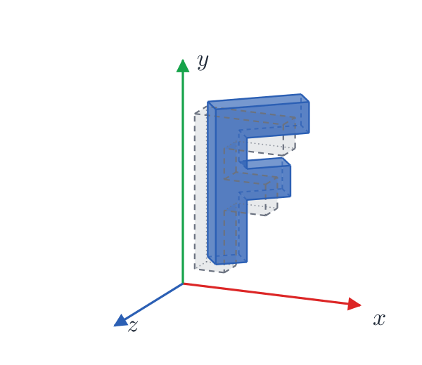
<figcaption>Drehen um 40° um die y-Achse</figcaption></figure>
<figure>
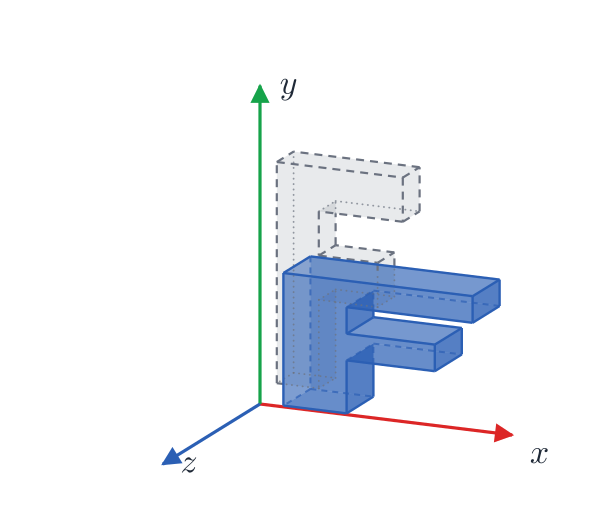
<figcaption>Strecken: 1,5 in x, 0,6 in y, 1,6 in z</figcaption></figure>
<figure>
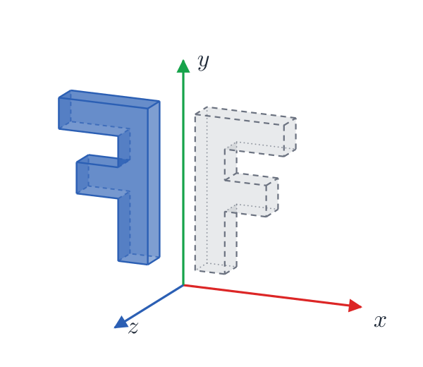
<figcaption>Spiegeln: x wird zu −x</figcaption></figure>
<figure>
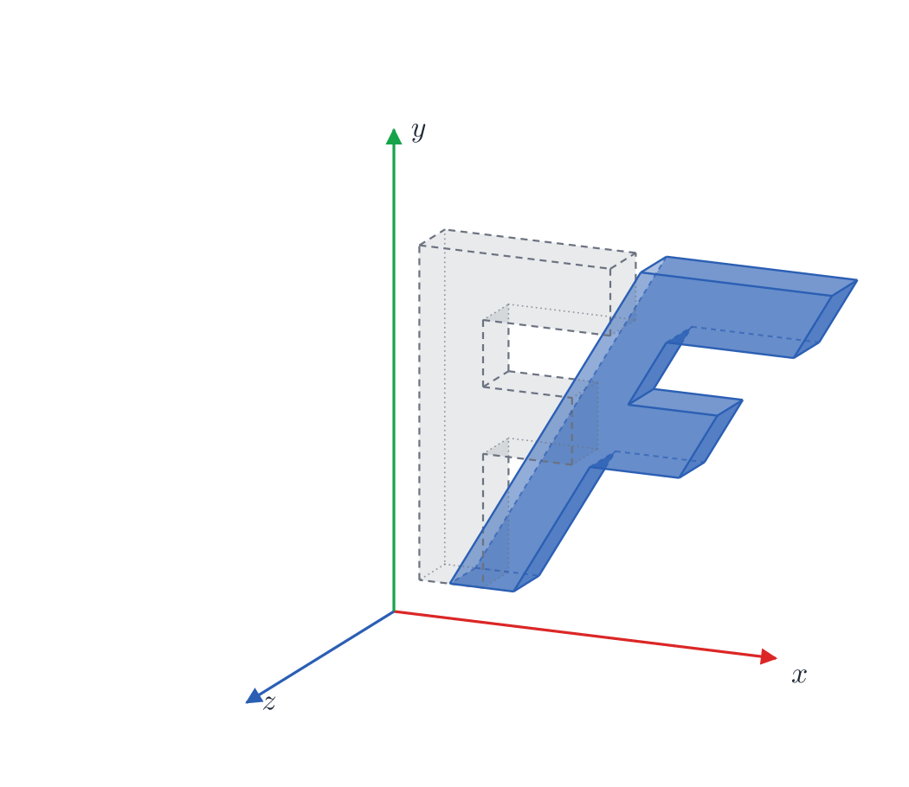
<figcaption>Scheren: x wird zu x + 0,6 · y</figcaption></figure>

### Zusammensetzen

Ein Modell soll doppelt so groß werden, sich um 90° um die z-Achse drehen und dann um 2 nach rechts rücken. Gelesen von rechts nach links ist das

$$M = T(2, 0, 0) \cdot R\_z(90°) \cdot S(2, 2, 2) = \begin{pmatrix} 0 & -2 & 0 & 2 \\\\ 2 & 0 & 0 & 0 \\\\ 0 & 0 & 2 & 0 \\\\ 0 & 0 & 0 & 1 \end{pmatrix}$$

Der Punkt \\((1, 0, 0)\\) wird erst zu \\((2, 0, 0)\\) gestreckt, dann auf \\((0, 2, 0)\\) gedreht, dann nach \\((2, 2, 0)\\) verschoben; \\(M\\) allein, einmal mit dem Punkt multipliziert, gibt dasselbe. Die übliche Reihenfolge ist **erst strecken, dann drehen, dann verschieben**, \\(T \cdot R \cdot S\\): So streckt und dreht sich das Modell um seine eigene Mitte. Erst verschoben und dann gedreht, kreist es um den Ursprung der Welt.
<!-- /part -->

## Drehen um eine beliebige Achse

<!-- part: achse -->
<!-- short: Um eine Achse k mit der Länge 1 dreht die Formel von Rodrigues: Der Teil eines Vektors entlang k bleibt, der Teil quer dazu dreht sich um den Winkel. -->
Eine Tür dreht sich um ihre Angeln, ein Kreisel um seine schräge Achse: Oft ist die Achse keine der drei Koordinatenachsen. Für eine Achse \\(\vec{k}\\) mit der Länge 1 und einen Winkel \\(\theta\\) zerlegt man einen Vektor \\(\vec{v}\\) in zwei Teile. Der Teil entlang der Achse, \\((\vec{k} \cdot \vec{v})\,\vec{k}\\), bleibt, wie er ist. Der Rest steht quer zur Achse und dreht sich in der Ebene senkrecht zu ihr um \\(\theta\\). Zusammen ergibt das die **Formel von Rodrigues** (mit dem Skalarprodukt und dem Kreuzprodukt, Handbuch, [Vektoren](/reference/vektoren)):

$$\vec{v}' = \vec{v}\cos\theta + (\vec{k} \times \vec{v})\sin\theta + \vec{k}\,(\vec{k} \cdot \vec{v})\,(1 - \cos\theta)$$

Als Matrix, mit \\(c = \cos\theta\\), \\(s = \sin\theta\\), \\(t = 1 - c\\) und \\(\vec{k} = (x, y, z)\\):

$$R = \begin{pmatrix} c + x^2 t & xy\,t - z s & xz\,t + y s \\\\ yx\,t + z s & c + y^2 t & yz\,t - x s \\\\ zx\,t - y s & zy\,t + x s & c + z^2 t \end{pmatrix}$$

Mit \\(\vec{k} = (0, 1, 0)\\) wird daraus genau \\(R\_y(\theta)\\) von oben. Im Bild dreht sich das F um 60° um die Diagonale \\(\vec{k} = \frac{1}{\sqrt{3}}(1, 1, 1)\\), die zwischen den drei Achsen liegt:

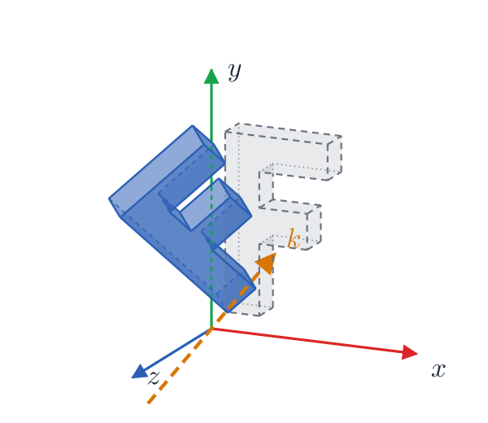

Dieselbe Drehung ließe sich auch aus Drehungen um x, y und z zusammensetzen; die Formel sagt sie in einem Schritt. Sie heißt nach Olinde Rodrigues, der sie 1840 veröffentlicht hat; Leonhard Euler kannte sie schon 1770.
<!-- /part -->

## Quaternionen

<!-- part: quaternionen -->
<!-- short: Ein Quaternion speichert eine Drehung in vier Zahlen, cos(θ/2) und sin(θ/2) mal die Achse; es lässt sich glatt zwischen zwei Lagen mischen und kennt keine kardanische Blockade. glTF und Gaussian Splatting speichern Drehungen so. -->
### Vier Zahlen für eine Drehung

Eine Drehmatrix hat neun Zahlen, eine Drehung braucht aber nur drei Angaben: zwei für die Richtung der Achse und eine für den Winkel. Ein **Quaternion** kommt mit vier Zahlen aus. Für die Drehung um den Winkel \\(\theta\\) um die Achse \\(\vec{k}\\) mit der Länge 1 ist

$$q = (w, x, y, z) = \left(\cos\tfrac{\theta}{2},\ \sin\tfrac{\theta}{2}\,\vec{k}\right)$$

Ein Quaternion für eine Drehung hat immer die Länge 1, \\(w^2 + x^2 + y^2 + z^2 = 1\\). Die Drehung um 90° um die z-Achse ist zum Beispiel \\(w = z = \cos 45° \approx 0{,}707\\) und \\(x = y = 0\\). Der halbe Winkel kommt daher, dass man beim Drehen zweimal mit \\(q\\) multipliziert, einmal von links und einmal von rechts.

### Rechnen mit Quaternionen

Schreibt man \\(\vec{u} = (x, y, z)\\) für den Teil mit der Achse, dann sind zwei Drehungen hintereinander das Produkt der beiden Quaternionen:

$$q\_1\, q\_2 = \left(w\_1 w\_2 - \vec{u}\_1 \cdot \vec{u}\_2,\ \ w\_1 \vec{u}\_2 + w\_2 \vec{u}\_1 + \vec{u}\_1 \times \vec{u}\_2\right)$$

Wie bei Matrizen kommt es auf die Reihenfolge an: \\(q\_1 q\_2\\) dreht erst mit \\(q\_2\\), dann mit \\(q\_1\\). Rückwärts dreht \\(\bar{q} = (w, -x, -y, -z)\\), dieselbe Achse andersherum. Einen Vektor \\(\vec{v}\\) dreht man, indem man ihn als \\(p = (0, \vec{v})\\) schreibt und \\(q\, p\, \bar{q}\\) ausrechnet; heraus kommt \\((0, \vec{v}')\\). Übrigens drehen \\(q\\) und \\(-q\\) genau gleich.

Für die Grafikkarte macht man aus dem Quaternion meist wieder eine Matrix:

$$R = \begin{pmatrix} 1 - 2(y^2 + z^2) & 2(xy - wz) & 2(xz + wy) \\\\ 2(xy + wz) & 1 - 2(x^2 + z^2) & 2(yz - wx) \\\\ 2(xz - wy) & 2(yz + wx) & 1 - 2(x^2 + y^2) \end{pmatrix}$$

Mit \\(w = z \approx 0{,}707\\) und \\(x = y = 0\\) steht da \\(R\_z(90°)\\): in der ersten Zeile 0, −1, 0.

### Warum nicht drei Winkel?

Drei Winkel hintereinander, etwa erst um y, dann um x, dann um z (beim Flugzeug Gieren, Nicken und Rollen, die **Eulerwinkel**), sind leicht zu verstehen, haben aber zwei Schwächen:

- **Kardanische Blockade** (englisch *gimbal lock*): Steht der mittlere Winkel auf 90°, drehen der erste und der dritte Winkel um dieselbe Achse. Eine Richtung zum Drehen fehlt dann, bis man den mittleren Winkel wieder verstellt. Bei Apollo 11 maßen drei solche Ringe die Lage der Kapsel. Michael Collins, der in ihr um den Mond kreiste, fragte nach der Landung: »How about sending me a fourth gimbal for Christmas?«
- **Mischen**: Wer zwischen zwei Lagen eine Bewegung braucht und dafür die drei Winkel mischt, bekommt krumme, ungleichmäßige Drehungen.

Quaternionen haben beides nicht. Zwischen zwei Quaternionen \\(q\_1\\) und \\(q\_2\\) mischt **Slerp** (*spherical linear interpolation*) so, dass sich das Modell mit gleichmäßiger Geschwindigkeit um eine feste Achse dreht, auf dem kürzesten Weg; Ken Shoemake hat das 1985 in die Computergrafik gebracht. Ist \\(\cos\Omega = q\_1 \cdot q\_2\\) (die vier Zahlen paarweise multipliziert und addiert), dann ist

$$\operatorname{slerp}(q\_1, q\_2, t) = \frac{\sin((1 - t)\,\Omega)}{\sin\Omega}\, q\_1 + \frac{\sin(t\,\Omega)}{\sin\Omega}\, q\_2$$

Ist \\(q\_1 \cdot q\_2\\) negativ, nimmt man vorher \\(-q\_2\\), sonst geht es den langen Weg herum. Noch ein Vorteil: Eine Matrix, die über viele Bilder immer wieder mit kleinen Drehungen multipliziert wird, sammelt Rundungsfehler und beginnt zu verzerren. Ein Quaternion teilt man einfach durch seine Länge, und es ist wieder eine reine Drehung.

_person(hamilton)

### Wo man sie trifft

- **glTF**, das Dateiformat vieler 3D-Modelle, speichert die Drehung jedes Teils als Quaternion, in der Reihenfolge \\((x, y, z, w)\\).
- **Gaussian Splatting** speichert die Drehung jedes Splats in `rot_0` bis `rot_3`, in der Reihenfolge \\((w, x, y, z)\\) und nicht unbedingt mit der Länge 1; vor dem Umrechnen teilt man durch die Länge ([Gaussian Splatting](/gaussian-splatting)).
- **Unity** speichert die Drehung jedes Objekts als Quaternion, auch wenn man im Editor drei Winkel einstellt; Godot und three.js haben dafür einen eigenen Typ `Quaternion`.
<!-- /part -->

## Rückgängig machen

<!-- part: inverse -->
<!-- short: T(t)⁻¹ = T(−t), S(s)⁻¹ = S(1/s), R(θ)⁻¹ = R(−θ) = Rᵀ; (A · B)⁻¹ = B⁻¹ · A⁻¹, die Reihenfolge dreht sich um; die View-Matrix ist die Inverse der Kamera. -->
### Jeder Baustein rückwärts

Die **Inverse** \\(M^{-1}\\) macht rückgängig, was \\(M\\) tut. Für die Bausteine ist sie leicht hinzuschreiben, ohne zu rechnen:

<table class='table table-sm reference-table'>
<thead><tr><th>Matrix</th><th>Inverse</th><th>denn</th></tr></thead>
<tbody>
<tr><td>\(T(t)\)</td><td>\(T(-t)\)</td><td>zurückschieben</td></tr>
<tr><td>\(S(s)\)</td><td>\(S(1/s)\)</td><td>wieder schrumpfen; mit \(s = 0\) geht es nicht</td></tr>
<tr><td>\(R(\theta)\)</td><td>\(R(-\theta) = R^\top\)</td><td>zurückdrehen; zur Transponierten unten mehr</td></tr>
</tbody>
</table>

### Ein Produkt rückwärts

Ein Produkt macht man rückgängig, indem man die Schritte rückwärts und in umgekehrter Reihenfolge geht, wie beim Ausziehen erst die Schuhe, dann die Socken:

$$(A \cdot B)^{-1} = B^{-1} \cdot A^{-1}$$

Für \\(M = T \cdot R \cdot S\\) von oben ist \\(M^{-1} = S^{-1} \cdot R^{-1} \cdot T^{-1}\\): erst zurückschieben, dann zurückdrehen, dann wieder schrumpfen.

### Die Kamera als Inverse

Damit ergibt sich die View-Matrix wie von selbst. Steht die Kamera mit \\(C = T(\text{auge}) \cdot R\\) in der Welt, an der Stelle \\(\text{auge}\\) und um \\(R\\) gedreht, muss die View-Matrix das rückgängig machen, damit die Kamera im Ursprung landet:

$$\text{view} = C^{-1} = R^{-1} \cdot T(\text{auge})^{-1} = R^\top \cdot T(-\text{auge})$$

Erst die Welt so verschieben, dass das Auge im Ursprung liegt, dann sie entgegen der Kamera drehen. So baut auch [3D-Grafik mit WebGL](/webgl) seine View-Matrix, aus Drehungen und einem `translate` mit negativen Zahlen.
<!-- /part -->

## Kamera und Perspektive

<!-- part: kamera -->
<!-- short: view rückt die Welt vor die Kamera, projection macht Fernes kleiner; geteilt durch w ergeben sich Bildschirmkoordinaten von −1 bis 1. -->
### Die Kamera

Eine Kamera ist dieselbe Rechnung rückwärts: Statt die Kamera in die Welt zu stellen, rückt die **View-Matrix** die ganze Welt so, dass die Kamera im Ursprung steht und in Richtung −z schaut. Steht die Kamera bei \\((0, 0, 5)\\), verschiebt die View-Matrix alles um \\((0, 0, -5)\\); dreht sie sich nach links, dreht die View-Matrix die Welt nach rechts.

### Die Perspektive

Die **Projektion** bringt den Raum vor der Kamera auf den Bildschirm, und was weiter weg ist, wird kleiner. Eine Matrix kann nicht teilen, darum schreibt sie die Entfernung in die vierte Zahl: Nach der Projektion ist \\(w = -z\\). Die Grafikkarte teilt danach \\(x\\), \\(y\\) und \\(z\\) durch \\(w\\):

$$x\_\text{Bildschirm} = \frac{x}{w}, \qquad y\_\text{Bildschirm} = \frac{y}{w}$$

Doppelt so weit weg heißt doppelt so großes \\(w\\), also halb so groß auf dem Bildschirm. Die Ergebnisse von −1 bis 1 heißen **Clip-Koordinaten** in WebGL: −1 ist der linke oder untere Rand, 1 der rechte oder obere. Die übliche Perspektivmatrix für den Öffnungswinkel \\(\theta\\), das Seitenverhältnis \\(a\\) und die Grenzen \\(n\\) (nah) und \\(f\\) (fern), mit \\(s = 1 / \tan(\theta / 2)\\):

$$P = \begin{pmatrix} s / a & 0 & 0 & 0 \\\\ 0 & s & 0 & 0 \\\\ 0 & 0 & \frac{f + n}{n - f} & \frac{2 f n}{n - f} \\\\ 0 & 0 & -1 & 0 \end{pmatrix}$$
<!-- /part -->

## Transponieren

<!-- part: transponieren -->
<!-- short: Mᵀ vertauscht Zeilen und Spalten; bei einer Drehung ist die Inverse die Transponierte; Normalen dreht man mit (M⁻¹)ᵀ. -->
Die **Transponierte** \\(M^\top\\) vertauscht Zeilen und Spalten: Die erste Zeile wird die erste Spalte. \\(M^{-1} \cdot M\\) ist die Einheitsmatrix; nicht jede Matrix hat eine Inverse, eine, die alles auf eine Linie drückt, lässt sich nicht umkehren.

Bei einer Drehung ist es einfach: Die Inverse ist die Transponierte, \\(R^{-1} = R^\top\\), denn zurückdrehen heißt um denselben Winkel in die andere Richtung, und \\(\sin(-\theta) = -\sin\theta\\) tauscht genau die beiden Zahlen außerhalb der Diagonalen.

Eine Normale dreht man mit dem Modell mit, aber nicht mit derselben Matrix, wenn das Modell ungleich gestreckt ist: Ein in die Breite gezogener Kreis hat an der Seite eine Normale, die steiler wird, nicht flacher. Die richtige Matrix für Normalen ist \\((M^{-1})^\top\\); für reine Drehungen ist das wieder \\(M\\) selbst.
<!-- /part -->

## Die Form eines Ellipsoids

<!-- part: kovarianz -->
<!-- short: Kovarianzmatrix Σ = R S Sᵀ Rᵀ: eine Kugel, mit S gestreckt und mit R gedreht; symmetrisch, sechs verschiedene Zahlen. -->
Eine Matrix kann auch eine Form beschreiben. Ein Ellipsoid entsteht aus einer Kugel, die man mit \\(S\\) entlang der Achsen streckt und mit \\(R\\) dreht. Seine **Kovarianzmatrix** ist

$$\Sigma = R \\, S \\, S^\top R^\top$$

Sie ist symmetrisch, die Zahl in Zeile \\(i\\), Spalte \\(j\\) ist dieselbe wie in Zeile \\(j\\), Spalte \\(i\\): Von neun Zahlen sind nur sechs verschieden. Auf der Diagonalen steht, wie breit das Ellipsoid entlang x, y und z ist (im Quadrat), daneben, wie schräg es liegt. So speichert jeder Splat in [Gaussian Splatting](/gaussian-splatting) seine Form. Von der Kamera aus gesehen wird daraus eine 2 × 2-Matrix, eine Ellipse auf dem Bildschirm.
<!-- /part -->

## In JavaScript, GLSL und Python

<!-- part: schreibweisen -->
<!-- short: WebGL erwartet Matrizen spaltenweise in einem Float32Array; GLSL mat4 * vec4; numpy A @ B. -->

<table class='table table-sm reference-table'>
<thead><tr><th></th><th>JavaScript (WebGL)</th><th>GLSL</th><th>Python (numpy)</th></tr></thead>
<tbody>
<tr><th>Matrix</th><td>16 Zahlen in einem Array, <strong>spaltenweise</strong></td><td><code>mat4</code>, <code>mat3</code></td><td><code>np.array([[…], […]])</code>, zeilenweise</td></tr>
<tr><th>Matrix mal Vektor</th><td>selbst geschrieben</td><td><code>m * v</code></td><td><code>m @ v</code></td></tr>
<tr><th>Matrix mal Matrix</th><td>selbst geschrieben</td><td><code>a * b</code></td><td><code>a @ b</code></td></tr>
<tr><th>transponieren</th><td>selbst geschrieben</td><td><code>transpose(m)</code></td><td><code>m.T</code></td></tr>
<tr><th>umkehren</th><td>selbst geschrieben</td><td><code>inverse(m)</code></td><td><code>np.linalg.inv(m)</code></td></tr>
<tr><th>an den Shader</th><td><code>gl.uniformMatrix4fv(ort, false, m)</code></td><td><code>uniform mat4 view;</code></td><td></td></tr>
</tbody>
</table>

**Spaltenweise** heißt: Die ersten vier Zahlen im Array sind die erste Spalte, nicht die erste Zeile. Die Verschiebung \\((t\_x, t\_y, t\_z)\\) steht deshalb an den Indizes 12, 13 und 14. Wer eine Matrix zeilenweise hinschreibt und so an WebGL gibt, bekommt die Transponierte: Statt zu verschieben, verzerrt sie den Würfel. In numpy ist `*` die Multiplikation Zahl für Zahl; das Matrixprodukt ist `@`.
<!-- /part -->

## Zum Nachschlagen

- [Matrix (Mathematik)](https://de.wikipedia.org/wiki/Matrix_(Mathematik)) und [Homogene Koordinaten](https://de.wikipedia.org/wiki/Homogene_Koordinaten) in der Wikipedia.
- [WebGL2 Fundamentals: Matrices](https://webgl2fundamentals.org/webgl/lessons/webgl-2d-matrices.html): Matrizen Schritt für Schritt mit WebGL, auf Englisch.
- [glMatrix](https://glmatrix.net/): eine kleine JavaScript-Bibliothek mit allen Matrizen für WebGL, zum Vergleichen mit dem eigenen Code.
