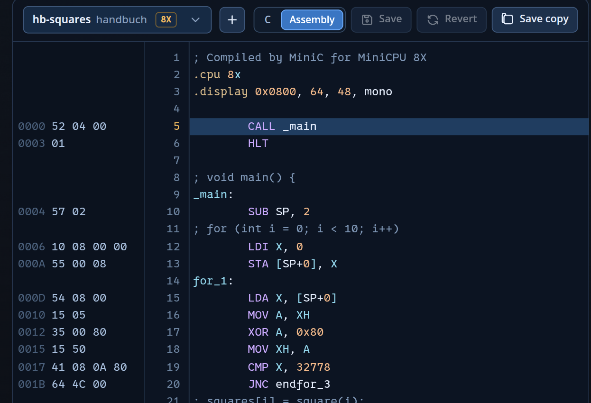

<div class='meta'>
kind: reference
</div>

<div
    class="autotoc-secondary-trigger"
    data-title="Auf dieser Seite"
    data-levels="h2,h3">
</div>

# MiniC: C für die MiniCPU

<p class='abstract'>
Programme in <code>.c</code>-Dateien schreibst du in MiniC, einem kleinen C, das die Sandbox schon beim Tippen in Assembler für die <a href='/reference/minicpu'>MiniCPU</a> übersetzt. Was es gibt, was anders ist als in C, und wie der erzeugte Code aussieht.
</p>

<!-- part: c-ueberblick -->
<!-- short: `.c`-Datei, `#pragma cpu 8x`; der Rand zeigt Adresse und Bytes jeder C-Zeile, »Assembly« den erzeugten Code. -->
## Ein Programm in C

Nichts bleibt verborgen: Der Rand des Editors zeigt Adresse und Bytes jeder C-Zeile, und der Reiter **Assembly** über dem Editor zeigt das erzeugte Programm, jedes Stück unter seiner C-Zeile als Kommentar. Ausführen und Einzelschritte funktionieren wie bei Assembler; ein Schritt ist ein Befehl, und die C-Zeile, zu der er gehört, ist markiert.

```c
// die Stufe (ohne Angabe 8X) und der Bildschirm, wie .display
#pragma cpu 8x
#pragma display 0x0800, 64, 48, mono

int squares[10];

int square(int n) {
    return n * n;
}

void main() {
    for (int i = 0; i < 10; i++)
        squares[i] = square(i);
    out(NUMBER, squares[9]);            // 81 auf der Zahlenanzeige
}
```

<!-- tutorial-screenshot
terminal-open
terminal-run: cd /workspace && git clone -q https://github.com/specht/cpu-sandbox.git && cd cpu-sandbox && git checkout -q 976c731d03cf0331898befab7bffd7afb94c81d4 && mkdir -p programs/handbuch
terminal-wait-for-prompt
write-file: cpu-sandbox/programs/handbuch/hb-squares.c <- previous-code
terminal-run: cd /workspace/cpu-sandbox && (nohup ./run --port 18765 > /tmp/cpu-sandbox.log 2>&1 < /dev/null &)
terminal-wait-for-prompt
preview-port: 18765
tab: preview
viewport: 1600x900
wait-for-text: Class progress
click: selector:#program-picker .picker-button
click: selector:#program-picker .picker-filter
type: hb-squares
sleep: 1
click: selector:#program-picker .picker-option
sleep: 2
click: selector:#view-tabs button:nth-child(2)
sleep: 1
crop-top: 7.5%
crop-bottom: 40%
crop-right: 56.75%
-->


Das Menü »CPU« ändert die Zeile `#pragma cpu`.
<!-- /part -->

<!-- part: c-sprache -->
<!-- short: char (8 Bit), int, Zeiger, Arrays; if, while, for; alle Operatoren; in(), out(), asm(). -->
## Was es gibt

<div class='scroll-x'><table class='table table-sm reference-table'>
<tbody>
<tr><th>Typen</th><td><code>char</code> (8 Bit, 0–255), <code>int</code> (mit Vorzeichen), <code>unsigned int</code>, <code>void</code>, Zeiger, Arrays. <code>int</code> und Zeiger haben auf der 8X 16 Bit, auf der 8 und 8S 8 Bit.</td></tr>
<tr><th>Anweisungen</th><td><code>if</code>/<code>else</code>, <code>while</code>, <code>do</code>/<code>while</code>, <code>for</code>, <code>break</code>, <code>continue</code>, <code>return</code>, Blöcke; Variablen überall in einem Block.</td></tr>
<tr><th>Operatoren</th><td><code>+ - * / % &amp; | ^ ~ &lt;&lt; &gt;&gt; ! &amp;&amp; || == != &lt; &lt;= &gt; &gt;= ?: = += -= … ++ -- &amp; * []</code>, Typumwandlungen, <code>sizeof</code></td></tr>
<tr><th>Werte</th><td><code>42</code>, <code>0x2A</code>, <code>0b101010</code>, <code>'A'</code>, <code>"Texte"</code> (mit <code>\n</code>, <code>\0</code>, <code>\xHH</code>)</td></tr>
<tr><th>Präprozessor</th><td><code>#define NAME wert</code>, <code>#define NAME(a, b) …</code>, <code>#undef</code>, <code>#pragma cpu</code>, <code>#pragma display</code></td></tr>
<tr><th>Geräte</th><td><code>in(port)</code> gibt ein <code>char</code> zurück, <code>out(port, wert)</code> schreibt eins. Vordefiniert: <code>JOYSTICK KEYBOARD TIMER RANDOM VSYNC KEYS SPEAKER NUMBER SCREEN_PAGE PALETTE COLOR NOTE_LENGTH</code>, <code>KEY_SHIFT</code>, <code>JOY_LEFT JOY_RIGHT JOY_UP JOY_DOWN JOY_FIRE</code>, <code>NULL true false</code> (<a href='/reference/minicpu-io#ports'>Geräte</a>)</td></tr>
<tr><th>Assembler</th><td><code>asm("INC A");</code> fügt Befehle ein, einen pro Zeile: <code>asm("loop:\n" "DEC A\n" "JNZ loop");</code> Marken und <code>;</code>-Kommentare wie im Assembler.</td></tr>
</tbody>
</table>
</div>
<!-- /part -->

<!-- part: c-anders -->
<!-- short: char rechnet mit 8 Bit (200 + 100 = 44); Arrays nur global; kein struct, switch, float. -->
## Anders als C, mit Absicht

- **`char` rechnet mit 8 Bit**, wie die Register: Für zwei `char` ist `200 + 100` gleich 44. Sobald ein `int` dabei ist, wird in `int` gerechnet; eine Zahl nimmt den Typ des anderen Werts an, wenn sie hineinpasst. `(int)a + b` rechnet eine `char`-Summe ohne Überlauf. Ebenso ist `-c` ein `char` (aus −9 wird 247), für eine negative Zahl also `-(int)c`. Der Compiler warnt in diesen Fällen.
- **Arrays stehen außerhalb von Funktionen**, und `&` funktioniert nur bei globalen Variablen. Lokale Variablen liegen auf dem Stack und werden mit `[SP+n]` erreicht, aber kein Befehl kopiert SP in ein Register, also lässt sich ihre Adresse nicht berechnen.
- **Es gibt kein** `struct`, `union`, `enum`, `switch`, `goto`, `typedef`, keine Kommazahlen, kein `long` und kein `#include`. Statt Kommazahlen nimmt man Festkommazahlen, etwa 64 für 1,0 in `18-cube.c`.
- **Die MiniCPU 8 hat keinen Stack**: Ein Programm hat dort nur `main`, seine lokalen Variablen werden global, und `*`, `/`, `%` (außer mit Zweierpotenzen) und Schieben um eine variable Anzahl Bits gibt es nicht, weil sie Hilfsroutinen brauchen.
<!-- /part -->

<!-- part: c-code -->
<!-- short: Ergebnis in A oder X; Argumente per PUSH, lokale Variablen mit SUB SP; globale Variablen heißen _name. -->
## Der erzeugte Code

- Der Wert eines Ausdrucks landet in A (8 Bit) oder X (16 Bit). Bei zwei Operanden wird zuerst der linke berechnet; ist der rechte keine Zahl und keine Variable, wartet der linke so lange auf dem Stack.
- **Funktionen** halten sich an die Aufrufregeln der [MiniCPU 8S](/reference/minicpu#funktionen): Der Aufrufer legt die Argumente von links nach rechts mit `PUSH` ab und ruft mit `CALL`; die Funktion beginnt mit `SUB SP, n` für ihre lokalen Variablen und erreicht sie und die Argumente mit `[SP+n]`. Das Ergebnis kommt in A oder X zurück. Jeder Aufruf darf A bis D, X und Y verändern.
- **Globale Variablen** sind Marken mit Unterstrich (`_score`) hinter dem Code, Texte heißen `string_1`, … Schleifen und Verzweigungen verwenden Marken wie `while_3`.
- `*`, `/`, `%` und Schieben um eine variable Anzahl Bits rufen Hilfsroutinen auf (`mul16`, `divs16`, `sar16`, …), die nur angehängt werden, wenn das Programm sie braucht. Mal und geteilt durch Zweierpotenzen werden zu Schiebebefehlen. `>> 8` nimmt einfach das obere Byte, deshalb sind 8.8-Festkommazahlen billig.
- `table[1024 + i]` zählt 1024 schon beim Übersetzen zur Adresse von `table`. Ein `char`-Index läuft trotzdem über: `a[c + 1]` mit `c = 255` ist `a[0]`; `a[(int)c + 1]` ist `a[256]`.
- Das Programm beginnt mit `CALL _main` und hält an, wenn `main` zurückkehrt.

Auf der 8S und 8X wächst der Stack vom Ende des RAMs nach unten. Ein Programm, das das ganze RAM füllt, lässt ihm keinen Platz; der Compiler warnt, wenn weniger als 32 Bytes übrig sind.
<!-- /part -->
