

kind: reference

# Personen

Hinter <code>grep</code>, Git, dem Web und dem kürzesten Weg im Navi stehen Menschen. Hier stehen alle, die im Workspace vorkommen, nach ihrem Geburtsjahr: wer sie waren, was sie gemacht haben und wo du ihnen im Workspace begegnest.

## Geboren vor 1920

<!-- year: 1580 -->
<!-- part: snellius -->
### Willebrord Snellius

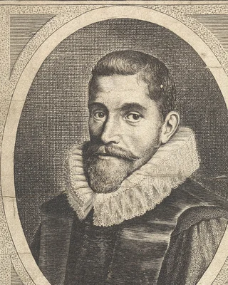

<strong>Willebrord Snellius</strong> (1580–1626), niederländischer Mathematiker, Professor in Leiden. Trifft ein Strahl auf die Glaskugel, knickt er ab, und dein Raytracer rechnet die neue Richtung mit dem Brechungsgesetz aus: Wie stark der Strahl abknickt, hängt vom Winkel ab, unter dem er auftrifft, und davon, wie stark das Glas Licht bricht. Snellius fand das Gesetz 1621, veröffentlichte es aber nie; René Descartes fand es unabhängig von ihm und druckte es 1637. Aufgeschrieben hatte es schon um 984 Ibn Sahl in Bagdad.

Vorher hatte Snellius die Erde vermessen, ohne die Niederlande zu verlassen: Er peilte von Kirchturm zu Kirchturm, legte ein Netz aus Dreiecken über das Land, maß eine Grundlinie von Hand und rechnete alle anderen Strecken aus den Winkeln aus. So bekam er heraus, wie lang ein Grad auf dem Weg von Nord nach Süd ist, und damit den Umfang der Erde (<em>Eratosthenes Batavus</em>, 1617). Mit solchen Dreiecksnetzen haben Landvermesser bis ins 20. Jahrhundert ihre Karten gemacht.

Stich: Werkstatt de Passe, 1625, gemeinfrei, zugeschnitten (<a href='https://commons.wikimedia.org/wiki/File:Portret_van_Willebrordus_Snellius,_RP-P-OB-15.345.jpg'>Wikimedia Commons</a>)

<!-- /part -->

<!-- year: 1707 -->
<!-- part: euler -->
### Leonhard Euler

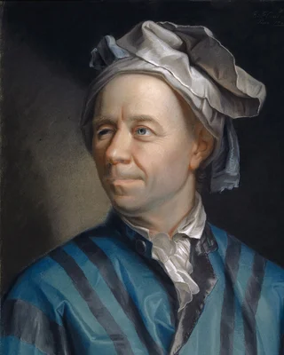

<strong>Leonhard Euler</strong> (1707–1783), Schweizer Mathematiker. 1736 zeigte er, dass es keinen Spaziergang durch Königsberg gibt, der jede der sieben Brücken genau einmal überquert. Dafür kam es nur darauf an, welche Ufer und Inseln durch welche Brücken verbunden sind, nicht auf Straßen und Entfernungen: die Idee hinter jedem Graphen, auch hinter dem Stadtplan im <a href='/routenplaner'>Routenplaner</a>. Mit diesem Beweis beginnt die Graphentheorie.

Ab 1738 sah er auf dem rechten Auge fast nichts mehr, ab 1766 war er fast blind. Er arbeitete trotzdem weiter und diktierte: 1775 entstand im Schnitt jede Woche eine neue mathematische Arbeit.

Gemälde: Jakob Emanuel Handmann, 1753, gemeinfrei, zugeschnitten (<a href='https://commons.wikimedia.org/wiki/File:Leonhard_Euler_-_Jakob_Emanuel_Handmann_(Kunstmuseum_Basel).jpg'>Wikimedia Commons</a>)

<!-- /part -->

<!-- year: 1728 -->
<!-- part: lambert -->
### Johann Heinrich Lambert

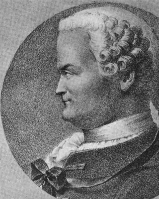

<strong>Johann Heinrich Lambert</strong> (1728–1777), Mathematiker, Physiker und Astronom aus Mülhausen im Elsass. Wie hell eine matte Kugel an einer Stelle ist, rechnet dein Raytracer mit <code>dot(normal, sun_dir)</code>: dem Kosinus des Winkels zwischen der Normalen und der Richtung zur Sonne. Dieses Kosinusgesetz schrieb Lambert 1760 in seinem Buch <em>Photometria</em> auf; matte Flächen heißen in der Computergrafik bis heute »lambertsch«.

Sein Vater war Schneider, und mit zwölf musste Lambert die Schule verlassen, um in der Werkstatt zu helfen; alles Weitere brachte er sich in seiner freien Zeit selbst bei. Später arbeitete er an der Akademie in Berlin, und in einer Arbeit, die 1768 erschien, bewies er als Erster, dass π irrational ist: Seine Nachkommastellen hören nie auf und wiederholen sich nie.

Lithografie: Godefroy Engelmann, 1829, gemeinfrei, zugeschnitten (<a href='https://commons.wikimedia.org/wiki/File:Johann_Heinrich_Lambert_1829_Engelmann.png'>Wikimedia Commons</a>)

<!-- /part -->

<!-- year: 1788 -->
<!-- part: fresnel -->
### Augustin-Jean Fresnel

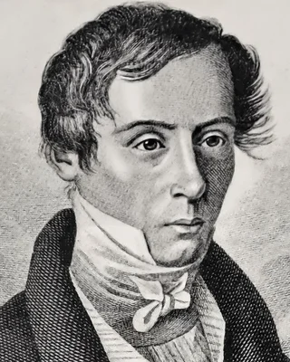

<strong>Augustin-Jean Fresnel</strong> (1788–1827), französischer Ingenieur und Physiker. Wie viel Licht die Glaskugel spiegelt und wie viel sie durchlässt, hängt vom Winkel ab: Von vorn spiegelt Glas nur etwa 4 Prozent, am Rand der Kugel fast alles. Die Formeln dafür, die Fresnel-Gleichungen, stellte er Anfang der 1820er Jahre auf; dein Raytracer nimmt die kurze Näherung, die Christophe Schlick 1994 für die Computergrafik fand.

Damit Leuchttürme weiter zu sehen sind, baute Fresnel eine Linse aus Glasringen, die das Licht bündelt wie eine dicke Linse, aber dünn und leicht bleibt. Die erste leuchtete ab dem 25. Juli 1823 im Leuchtturm von Cordouan an der Mündung der Gironde und war über 30 Kilometer weit zu sehen; die Spiegel davor warfen nur etwa die Hälfte des Lichts zurück. Fresnel-Linsen stecken heute in Overheadprojektoren, Ampeln und Rücklichtern von Autos.

Stich: E. Rosette nach Ambroise Tardieu, 19. Jahrhundert, gemeinfrei, zugeschnitten (<a href='https://commons.wikimedia.org/wiki/File:Augustin_Fresnel.jpg'>Wikimedia Commons</a>)

<!-- /part -->

<!-- year: 1815 -->
<!-- part: lovelace -->
### Ada Lovelace

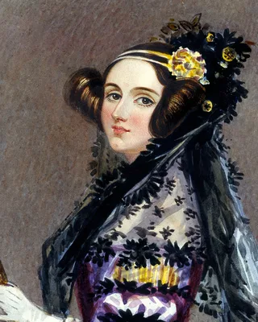

<strong>Ada Lovelace</strong> (1815–1852), englische Mathematikerin, Tochter des Dichters Lord Byron. 1843 übersetzte sie einen Aufsatz über die Analytical Engine, eine Rechenmaschine, die Charles Babbage entworfen hatte, und schrieb Anmerkungen dazu, etwa dreimal so lang wie der Aufsatz. In der letzten, Note G, steht Schritt für Schritt, wie die Maschine die Bernoulli-Zahlen ausrechnen soll: das erste veröffentlichte Programm. Für jede weitere Zahl wiederholen sich darin die Schritte 13 bis 23, eine Schleife. Lovelace nannte so etwas einen »cycle of operations«, eine Folge von Schritten, die mehr als einmal ausgeführt wird, und kannte auch schon die Schleife in der Schleife: »a cycle of cycles«.

Die Maschine wurde nie fertig gebaut, und das Programm lief nie. Lovelace sah aber schon, dass sie mehr kann als rechnen: Stünden die Zahlen für Töne, könnte sie Musik komponieren. Die Programmiersprache Ada ist nach ihr benannt.

Aquarell: Alfred Edward Chalon, um 1840, gemeinfrei, zugeschnitten (<a href='https://commons.wikimedia.org/wiki/File:Ada_Lovelace_portrait.jpg'>Wikimedia Commons</a>)

<!-- /part -->

<!-- year: 1831 -->
<!-- part: maxwell -->
### James Clerk Maxwell

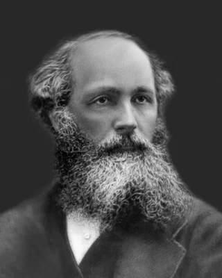

<strong>James Clerk Maxwell</strong> (1831–1879), schottischer Physiker. Er ließ Menschen Farben aus drei Lichtern nachmischen und stützte so Youngs Idee von drei Empfängern im Auge; aus drei Lichtern mischt auch jedes Pixel deines Bildschirms seine Farbe. Das Farbfoto von 1861 nahm der Fotograf Thomas Sutton für ihn auf. Seine Platten waren für Rot fast blind, und warum das rote Bild trotzdem etwas zeigte, fanden Forscher erst 1961 heraus: Der rote Farbstoff der Schleife warf auch ultraviolettes Licht zurück.

Berühmt ist Maxwell vor allem für seine Gleichungen von 1865. Aus ihnen schloss er, dass Licht eine Welle aus elektrischen und magnetischen Feldern ist.

Foto: unbekannt, um 1870, gemeinfrei, zugeschnitten (<a href='https://commons.wikimedia.org/wiki/File:James-Clerk-Maxwell-1831-1879.jpg'>Wikimedia Commons</a>)

<!-- /part -->

<!-- year: 1837 -->
<!-- part: ducos-du-hauron -->
### Louis Ducos du Hauron

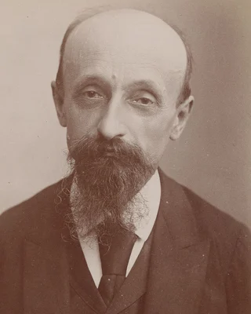

<strong>Louis Ducos du Hauron</strong> (1837–1920), französischer Erfinder, ließ sich 1891 Bilder patentieren, die zwei Ansichten einer Szene in Rot und Blau übereinander drucken; durch eine Brille mit einem roten und einem blauen Glas sieht jedes Auge nur seine: die Anaglyphen. Dein Viewer macht dasselbe mit Rot und Cyan.

Schon 1868 hatte er beschrieben, wie man ein farbiges Bild aus drei Aufnahmen durch drei Farbfilter zusammensetzt, lange bevor es Farbfilme gab.

Foto: Atelier Nadar, gemeinfrei, zugeschnitten (<a href='https://commons.wikimedia.org/wiki/File:M._Ducos_du_Hauron_-_btv1b531734525.jpg'>Wikimedia Commons</a>)

<!-- /part -->

<!-- year: 1845 -->
<!-- year: 1856 -->
<!-- part: markow -->
### Andrei Markow

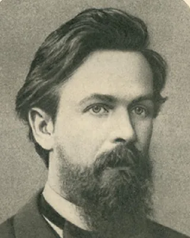

<strong>Andrei Markow</strong> (1856–1922), russischer Mathematiker in Sankt Petersburg. 1913 ging er die ersten 20 000 Buchstaben von Puschkins »Eugen Onegin« durch und zählte, wie oft auf einen Vokal ein Vokal folgt und wie oft ein Konsonant: Der nächste Buchstabe hängt vom vorigen ab, und mit dieser Abhängigkeit kann man rechnen.

Eine Kette, in der jedes Glied nur vom vorigen abhängt, heißt nach ihm Markow-Kette. Auch ein Sprachmodell aus Wortpaaren ist eine Markow-Kette.

Foto: unbekannt, 1886, gemeinfrei, zugeschnitten (<a href='https://commons.wikimedia.org/wiki/File:Andrei_Markov.jpg'>Wikimedia Commons</a>)

<!-- /part -->

<!-- year: 1882 -->
<!-- part: sierpinski -->
### Wacław Sierpiński

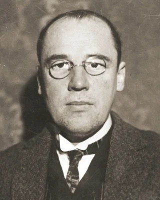

<strong>Wacław Sierpiński</strong> (1882–1969), polnischer Mathematiker in Warschau, mit über 700 Aufsätzen und 50 Büchern. 1916 beschrieb er ein Quadrat, aus dem die Mitte fehlt, und aus jedem der acht Quadrate drumherum wieder die Mitte, ohne Ende: den Sierpinski-Teppich. Auch ein Dreieck aus Dreiecken trägt seinen Namen.

Ein Muster, das in jedem Ausschnitt wieder sich selbst enthält, heißt heute Fraktal. Dein Shader rechnet den Teppich mit einer Schleife aus vier Zeilen.

Foto: unbekannt, 1928, gemeinfrei, zugeschnitten (<a href='https://commons.wikimedia.org/wiki/File:Wac%C5%82aw_Sierpi%C5%84ski.jpg'>Wikimedia Commons</a>)

<!-- /part -->

<!-- year: 1896 -->
<!-- part: luhn -->
### Hans Peter Luhn

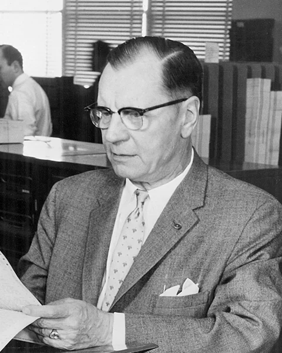

<strong>Hans Peter Luhn</strong> (1896–1964), Ingenieur aus Barmen (heute Wuppertal), später bei IBM in den USA. 1953 schlug er in einer Notiz für IBM vor, Schlüssel mit einer Rechnung auf Buckets zu verteilen und Kollisionen in Listen zu sammeln: die erste Hash Table, mit Chaining.

Von ihm stammt auch die letzte Ziffer jeder Kreditkartennummer, die Prüfziffer nach dem Luhn-Algorithmus: Mit ihr fällt eine falsch getippte Ziffer sofort auf.

Foto: IBM, zugeschnitten (<a href='https://spectrum.ieee.org/hans-peter-luhn-and-the-birth-of-the-hashing-algorithm'>IEEE Spectrum</a>)

<!-- /part -->

<!-- year: 1902 -->
<!-- part: menger -->
### Karl Menger

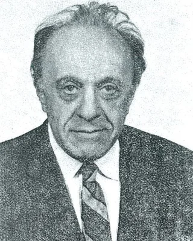

<strong>Karl Menger</strong> (1902–1985), österreichischer Mathematiker, ab 1937 in den USA. 1926 fragte er, was die Dimension einer Form eigentlich ist, und beschrieb dafür einen Würfel, aus dem in jeder Stufe Kreuze fehlen: den Menger-Schwamm, Sierpińskis Teppich in drei Dimensionen.

Mit jeder Stufe schrumpft sein Volumen gegen null, und seine Oberfläche wächst ohne Grenze. Mathematisch hat er trotzdem die Dimension 1: Er ist weder ein Körper noch eine Fläche, sondern eine Kurve.

Foto: Shimer College, 1970, gemeinfrei, zugeschnitten (<a href='https://commons.wikimedia.org/wiki/File:Karl_Menger_1970_Shimer_College_Wiki.jpg'>Wikimedia Commons</a>)

<!-- /part -->

<!-- year: 1903 -->
<!-- part: neumann -->
### John von Neumann

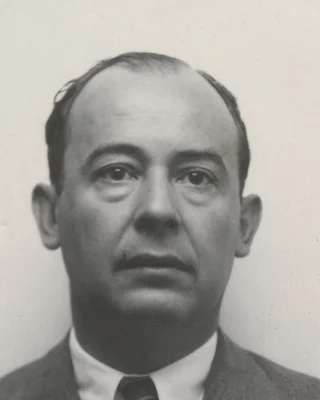

<strong>John von Neumann</strong> (1903–1957), Mathematiker aus Budapest, ab 1930 in den USA. Merge Sort dachte er sich 1945 aus; den Teil, der zwei sortierte Folgen zusammenfügt, schrieb er als eines der ersten Programme für einen Rechner auf, der sein Programm im Speicher hält.

Wie ein solcher Rechner gebaut ist, beschrieb er im selben Jahr: Programm und Daten im selben Speicher. So sind Computer bis heute gebaut, auch die MiniCPU der <a href='/sandbox-cpu'>CPU Sandbox</a>.

Foto: Los Alamos National Laboratory, 1940er Jahre, frei mit Namensnennung, zugeschnitten (<a href='https://commons.wikimedia.org/wiki/File:Vonneumann-john_r.jpg'>Wikimedia Commons</a>)

<!-- /part -->

<!-- year: 1906 -->
<!-- part: hopper -->
### Grace Hopper

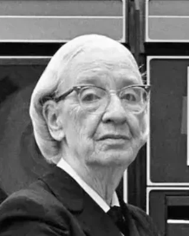

<strong>Grace Hopper</strong> (1906–1992), amerikanische Informatikerin und Konteradmiralin der US Navy. Schon 1952 schrieb sie ein Programm, das aus kurzen Befehlen Maschinencode zusammensetzt, und nannte es Compiler; niemand glaubte ihr zunächst, dass ein Rechner so etwas kann. Sie wollte Programme in englischen Wörtern schreiben und hörte, Computer verstünden kein Englisch. Ihre Sprache FLOW-MATIC benutzte trotzdem englische Wörter, und COBOL übernahm das: <code>DIVIDE NUM BY 2 GIVING LIM</code>.

1947 fand ihr Team in einem Relais des Rechners Mark II eine Motte und klebte sie ins Logbuch: »First actual case of bug being found«, der erste echte Fall eines Käfers. Fehler hießen schon vorher Bugs, aber Hopper erzählte die Geschichte so gern, dass sie berühmt wurde.

Foto: Lynn Gilbert, 1978, CC BY-SA 4.0, zugeschnitten (<a href='https://commons.wikimedia.org/wiki/File:Grace_Murray_Hopper,_in_her_office_in_Washington_DC,_1978,_©Lynn_Gilbert.jpg'>Wikimedia Commons</a>)

<!-- /part -->

<!-- year: 1909 -->
<!-- part: kleene -->
### Stephen Cole Kleene

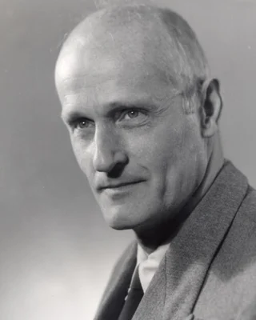

<strong>Stephen Cole Kleene</strong> (1909–1994), Mathematiker in Madison, Wisconsin. Jedes <code>*</code> in einem regulären Ausdruck, bei <code>grep</code> oder in der Suche von VS Code, ist sein Stern.

1951 wollte er wissen, welche Muster ein Netz aus Nervenzellen erkennen kann, und erfand dafür die Bausteine, die heute reguläre Ausdrücke heißen, zwanzig Jahre bevor es <code>grep</code> gab. Er bewies auch, dass sie und endliche Automaten genau dasselbe können.

Foto: Harold N. Hone, um 1963, gemeinfrei (<a href='https://commons.wikimedia.org/wiki/File:Stephen_Cole_Kleene_circa_1963.tif'>Wikimedia Commons</a>)

<!-- /part -->

<!-- year: 1910 -->
<!-- part: bezier -->
### Pierre Bézier

<strong>Pierre Bézier</strong> (1910–1999), französischer Ingenieur bei Renault. Ab den 1960er Jahren beschrieb er die Formen von Autokarosserien mit diesen Kurven, damit Maschinen sie fräsen können. Paul de Casteljau hatte sie bei Citroën schon 1959 gefunden, aber Citroën hielt sie geheim; darum heißen sie nach Bézier.

Jeder Buchstabe einer Schrift auf deinem Bildschirm ist aus Bézierkurven gebaut, und die meisten Kurven in SVG auch.

<!-- /part -->

<!-- year: 1912 -->
<!-- part: turing -->
### Alan Turing

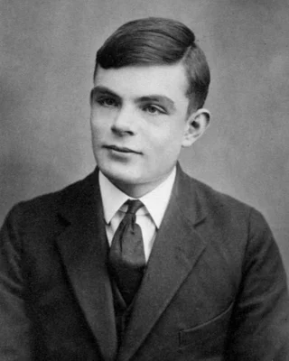

<strong>Alan Turing</strong> (1912–1954), britischer Mathematiker. Was einem endlichen Automaten fehlt, gab er 1936 seiner Turingmaschine: ein Band ohne Ende, auf dem sie lesen und schreiben kann. Was ein Computer berechnen kann, kann auch sie, und er bewies, dass es Fragen gibt, die keine Maschine beantworten kann.

Im Zweiten Weltkrieg half er in Bletchley Park, die verschlüsselten Funksprüche der deutschen Wehrmacht zu entziffern. Der wichtigste Preis der Informatik heißt nach ihm Turing Award.

Foto: um 1928, gemeinfrei, zugeschnitten (<a href='https://commons.wikimedia.org/wiki/File:Alan_Turing_Aged_16.jpg'>Wikimedia Commons</a>)

<!-- /part -->

<!-- year: 1916 -->
<!-- part: shannon -->
### Claude Shannon

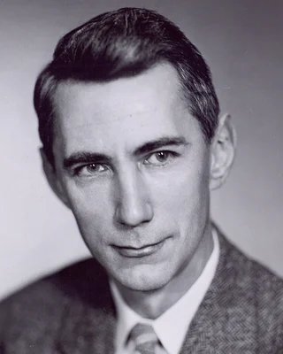

<strong>Claude Shannon</strong> (1916–2001). Wie viele Bits eine Nachricht mindestens braucht, rechnete er 1948 aus und gründete damit die Informationstheorie; das Wort <em>Bit</em> machte er bekannt. Er fuhr Einrad, jonglierte und baute die Maus Theseus, die selbst lernte, durch ein Labyrinth zu finden.

Schon als Student am MIT zeigte er 1937 in seiner Masterarbeit, dass sich Schaltungen aus Relais mit der Algebra von George Boole beschreiben und vereinfachen lassen, mit 1 und 0 für einen Kontakt, der geschlossen oder offen ist. Damit begann die Theorie der digitalen Schaltungen.

Einen Code mit so wenigen Bits wie möglich suchten er und Robert Fano fast gleichzeitig, jeder für sich. Der Shannon-Fano-Code kam nah heran, aber nicht immer ganz.

In derselben Arbeit von 1948 ließ er englische Texte Wort für Wort entstehen, jedes Wort nach dem vorigen aus einem Buch gezogen: ein winziges Sprachmodell, von Hand.

Foto: Tekniska museet, CC BY 2.0, zugeschnitten (<a href='https://commons.wikimedia.org/wiki/File:C.E._Shannon._Tekniska_museet_43069_(cropped).jpg'>Wikimedia Commons</a>)

<!-- /part -->

<!-- year: 1918 -->
<!-- part: bauer-samelson -->
### Friedrich L. Bauer und Klaus Samelson

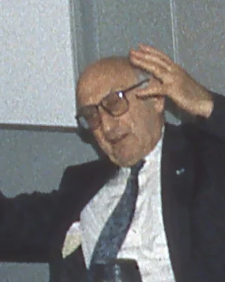

<strong>Friedrich L. Bauer</strong> (1924–2015, im Bild) und <strong>Klaus Samelson</strong> (1918–1980), Mathematiker in München, überlegten, wie ein Rechner eine Formel selbst in seine Befehle übersetzen kann. Dafür schlugen sie 1955 einen Speicher vor, bei dem nur zählt, was zuletzt hineinkam, und meldeten ihn 1957 als »Keller« zum Patent an: den Stack.

Sie sahen schon, dass der Keller auch zu Funktionsaufrufen passt, und heute ist es so: Wohin dein Programm nach einem Aufruf zurückkehrt, liegt auf einem Stack. Bauer hielt 1967 an der TU München die erste Vorlesung über Informatik in Deutschland.

Foto: Rolf Kickuth, 1995, CC BY-SA 4.0, zugeschnitten (<a href='https://commons.wikimedia.org/wiki/File:FriedrichLBauer29-05-1995.jpg'>Wikimedia Commons</a>)

<!-- /part -->

## Geboren 1920 bis 1939

<!-- year: 1921 -->
<!-- part: adelson-velski-landis -->
### Georgi Adelson-Velski und Jewgeni Landis

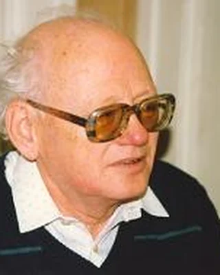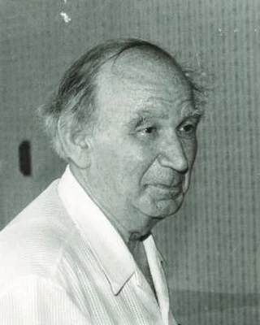

<strong>Georgi Adelson-Velski</strong> (1922–2014) und <strong>Jewgeni Landis</strong> (1921–1997), Mathematiker in Moskau, erfanden 1962 den AVL-Baum: den ersten Suchbaum, der sich selbst ausgleicht. Die Buchstaben AVL sind ihre Namen.

Adelson-Velski schrieb auch an Kaissa mit, dem Schachprogramm, das 1974 die erste Weltmeisterschaft im Computerschach gewann.

Fotos: Monroe Newborn, 1980, CC BY 3.0 (<a href='https://commons.wikimedia.org/wiki/File:Adelson-Velsky-G.Moscow-1980.jpg'>Wikimedia Commons</a>); Konrad Jacobs, 1987, CC BY-SA 2.0 de (<a href='https://commons.wikimedia.org/wiki/File:%D0%95%D0%B2%D0%B3%D0%B5%D0%BD%D0%B8%D0%B9_%D0%9C%D0%B8%D1%85%D0%B0%D0%B9%D0%BB%D0%BE%D0%B2%D0%B8%D1%87_%D0%9B%D0%B0%D0%BD%D0%B4%D0%B8%D1%81.jpeg'>Wikimedia Commons</a>), beide zugeschnitten

<!-- /part -->

<!-- year: 1923 -->
<!-- part: codd -->
### Edgar F. Codd

<strong>Edgar F. Codd</strong> (1923–2003), britischer Mathematiker, im Zweiten Weltkrieg Pilot, dann bei IBM in den USA. 1970 schlug er vor, Daten in Tabellen zu speichern und mit Abfragen zu holen, ohne zu wissen, wie sie gespeichert sind: das relationale Modell.

IBM zögerte lange. Zwei Kollegen, Donald Chamberlin und Raymond Boyce, entwickelten aus seiner Idee SQL; die erste SQL-Datenbank zu kaufen gab es 1979 von einer kleinen Firma, die heute Oracle heißt.

<!-- /part -->

<!-- year: 1924 -->
<!-- part: backus -->
### John Backus

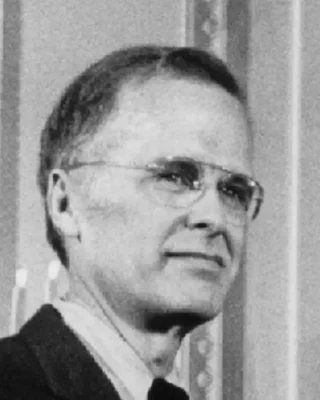

<strong>John Backus</strong> (1924–2007), amerikanischer Informatiker. Ab 1954 leitete er bei IBM das Team, das Fortran und den ersten Fortran-Compiler baute: Statt Maschinenbefehle schrieb man nun Formeln wie <code>x = a * b + c</code>, und der Compiler machte daraus ein Programm, das fast so schnell lief wie eines von Hand. Wettermodelle wie das des Deutschen Wetterdiensts rechnen bis heute in Fortran.

»Vieles an meiner Arbeit kommt daher, dass ich faul war«, sagte er später: Er schrieb nicht gern Programme, also baute er etwas, das es leichter macht. Die Schreibweise, mit der man festlegt, wie eine Programmiersprache aussieht, heißt nach ihm Backus-Naur-Form.

<!-- /part -->

<!-- year: 1925 -->
<!-- part: huffman -->
### David A. Huffman

<strong>David A. Huffman</strong> (1925–1999), amerikanischer Informatiker. Als Student am MIT wollte er 1951 lieber die Hausarbeit schreiben als die Prüfung. Monatelang fand er nichts, und als er schon aufgeben wollte, kam ihm die Idee, den Baum von unten zu bauen, aus den zwei seltensten Zeichen. Sein Professor Robert Fano hatte mit Claude Shannon von oben gebaut und nicht immer die besten Codes gefunden.

Huffman-Codes stecken in ZIP, PNG, JPEG und MP3.

<!-- /part -->

<!-- year: 1925 -->
<!-- part: moore -->
### Edward F. Moore

<strong>Edward F. Moore</strong> (1925–2003), amerikanischer Mathematiker bei den Bell Labs. 1957 zeigte er, wie man den kürzesten Weg durch ein Labyrinth findet: vom Start aus erst alle Felder einen Schritt weit, dann alle zwei Schritte weit und so weiter, bis das Ziel dabei ist. So sucht die Breitensuche, und so sucht der Mampfer nach Pip.

Gedruckt erschien das 1959 als »The Shortest Path Through a Maze«. Nach ihm heißen auch die Moore-Automaten und die acht Nachbarn einer Zelle im Game of Life, die Moore-Nachbarschaft.

<!-- /part -->

<!-- year: 1926 -->
<!-- part: kemeny-kurtz -->
### John G. Kemeny und Thomas E. Kurtz

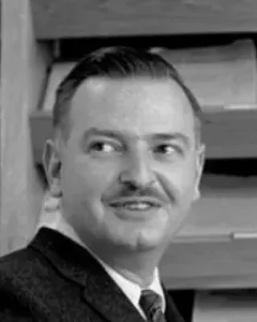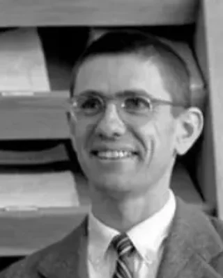

<strong>John G. Kemeny</strong> (1926–1992), in Budapest geborener Mathematiker, und <strong>Thomas E. Kurtz</strong> (1928–2024), amerikanischer Informatiker, erfanden BASIC 1964 am Dartmouth College in den USA. Der Rechner sollte allen Studierenden so offenstehen wie eine Bibliothek, nicht nur Mathematikern und Ingenieuren. Dazu bauten sie mit Studierenden ein System, an dem viele Menschen gleichzeitig an eigenen Terminals denselben Rechner benutzten: Wer ein Programm eintippte, bekam sofort eine Antwort, statt Lochkarten abzugeben und auf das Ergebnis zu warten.

Das erste BASIC-Programm lief der Legende nach am 1. Mai 1964 um vier Uhr morgens. Kemeny war als Student Assistent von Albert Einstein gewesen und wurde später Präsident von Dartmouth.

<!-- /part -->

<!-- year: 1927 -->
<!-- part: mccarthy -->
### John McCarthy

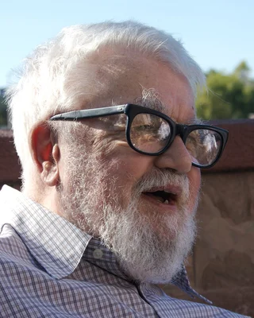

<strong>John McCarthy</strong> (1927–2011), amerikanischer Informatiker am MIT und in Stanford. 1958 erfand er Lisp, in dem auch die Programme selbst Listen in Klammern sind. Dass Ruby oder Python Speicher, den dein Programm nicht mehr braucht, ohne dein Zutun wieder freigeben, geht ebenfalls auf ihn zurück: Diese Garbage Collection erfand er für Lisp.

Den Begriff <em>Artificial Intelligence</em>, Künstliche Intelligenz, prägte er 1955 in einem Antrag für eine Sommerkonferenz. Und schon 1959 schlug er vor, dass viele Menschen an eigenen Terminals gleichzeitig denselben Rechner benutzen.

Foto: null0, 2006, CC BY-SA 2.0, zugeschnitten (<a href='https://commons.wikimedia.org/wiki/File:John_McCarthy_Stanford.jpg'>Wikimedia Commons</a>)

<!-- /part -->

<!-- year: 1928 -->
<!-- part: chomsky -->
### Noam Chomsky

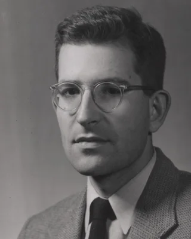

<strong>Noam Chomsky</strong> (geboren 1928), amerikanischer Sprachwissenschaftler am MIT. Er beschrieb Sprachen durch Regeln, die alle ihre Sätze erzeugen, durch Grammatiken, und machte das 1957 mit seinem Buch <em>Syntactic Structures</em> bekannt.

1956 ordnete er Grammatiken danach, was ihre Regeln dürfen; die Ordnung heißt heute Chomsky-Hierarchie. Die Syntax von Programmiersprachen beschreibt man seit ALGOL 60 mit kontextfreien Grammatiken, ihrer Stufe 2.

Foto: unbekannt, 1961, aus The Technology Review, MIT Museum, gemeinfrei, zugeschnitten (<a href='https://commons.wikimedia.org/wiki/File:Portrait_of_Noam_Chomsky_used_in_the_April_1961_issue_of_The_Technology_Review.jpg'>Wikimedia Commons</a>)

<!-- /part -->

<!-- year: 1928 -->
<!-- part: naur -->
### Peter Naur

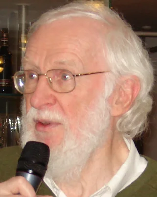

<strong>Peter Naur</strong> (1928–2016), dänischer Informatiker, zuerst Astronom. 1960 gab er den Bericht über die Programmiersprache ALGOL 60 heraus und legte darin die ganze Sprache mit der Schreibweise von John Backus fest, die seitdem Backus-Naur-Form heißt. Dafür bekam er 2005 den Turing Award.

Das Wort »computer science« mochte er nicht und schlug »datalogi« vor; in Dänemark und Schweden heißt die Informatik bis heute so.

Foto: Eriktj, 2008, CC BY-SA 3.0, zugeschnitten (<a href='https://commons.wikimedia.org/wiki/File:Peternaur.JPG'>Wikimedia Commons</a>)

<!-- /part -->

<!-- year: 1928 -->
<!-- part: rosenblatt -->
### Frank Rosenblatt

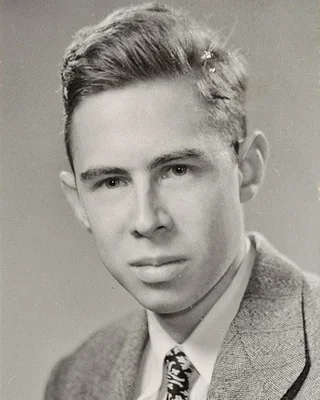

<strong>Frank Rosenblatt</strong> (1928–1971), US-amerikanischer Psychologe an der Cornell University. 1958 baute er das Mark I Perceptron: eine Kamera aus 20 × 20 Fotozellen, also 400 Eingaben, deren Gewichte Motoren an Drehwiderständen selbst einstellten. Die Maschine lernte, einfache Formen auseinanderzuhalten.

Deine Funktion <code>train</code> lernt nach seiner Regel: bei jedem Fehler die Gewichte ein Stück in Richtung der richtigen Antwort.

Foto: unbekannt, um 1950, Heinz Nixdorf MuseumsForum, CC BY-SA 4.0, zugeschnitten (<a href='https://commons.wikimedia.org/wiki/File:Frank_Rosenblatt.jpg'>Wikimedia Commons</a>)

<!-- /part -->

<!-- year: 1930 -->
<!-- part: dijkstra -->
### Edsger W. Dijkstra

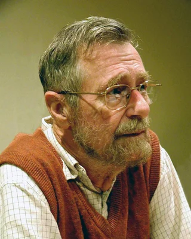

<strong>Edsger W. Dijkstra</strong> (1930–2002), niederländischer Informatiker. Sein Verfahren für den kürzesten Weg erdachte er 1956 in zwanzig Minuten auf einer Caféterrasse in Amsterdam, ohne Stift und Papier. Navis und der <a href='/routenplaner'>Routenplaner</a> suchen ihre Wege mit seiner Idee.

Dass du Schleifen und Funktionen schreibst, statt mit <code>goto</code> kreuz und quer durchs Programm zu springen, geht auch auf ihn zurück: »Go To Statement Considered Harmful«, 1968.

Foto: Hamilton Richards, 2002, CC BY-SA 3.0, zugeschnitten (<a href='https://commons.wikimedia.org/wiki/File:Edsger_Wybe_Dijkstra.jpg'>Wikimedia Commons</a>)

<!-- /part -->

<!-- year: 1931 -->
<!-- part: lempel-ziv -->
### Abraham Lempel und Jacob Ziv

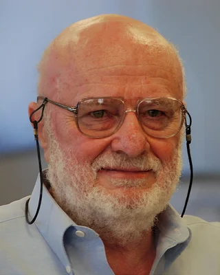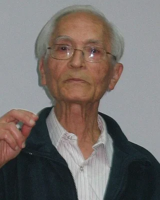

<strong>Abraham Lempel</strong> (1936–2023), Informatiker, und <strong>Jacob Ziv</strong> (1931–2023), Elektroingenieur, beide Professoren am Technion in Haifa. Ihre Idee, dass ein Text sich selbst als Wörterbuch nimmt, steckt in jedem GIF, und ihre andere Fassung von 1977 zusammen mit Huffman-Codes in ZIP, PNG und gzip.

Viele Webseiten kommen so gepackt in deinen Browser.

Fotos: Staelin, 2007, CC BY 3.0, zugeschnitten (<a href='https://commons.wikimedia.org/wiki/File:Abraham_Lempel.JPG'>Wikimedia Commons</a>); gemeinfrei (<a href='https://commons.wikimedia.org/wiki/File:Jacob_Ziv.jpeg'>Wikimedia Commons</a>)

<!-- /part -->

<!-- year: 1931 -->
<!-- part: rabin-scott -->
### Michael O. Rabin und Dana Scott

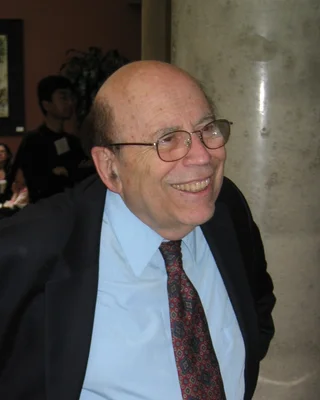

<strong>Michael O. Rabin</strong> (1931–2026, im Bild), in Breslau geboren und in Haifa aufgewachsen, und <strong>Dana Scott</strong> (geboren 1932), amerikanischer Logiker, schrieben 1959 als junge Forscher bei IBM einen Aufsatz über endliche Automaten. Darin darf ein Automat zum ersten Mal raten: der NEA. Sie zeigten auch, wie man aus jedem NEA einen DEA baut, der dieselben Wörter annimmt; die Potenzmengenkonstruktion heißt darum auch Rabin-Scott-Konstruktion.

1976 bekamen beide dafür den Turing Award, den wichtigsten Preis der Informatik. Rabin machte später aus einem Primzahltest von Gary Miller einen schnellen Zufallstest: Wenn <code>openssl</code> ein RSA-Schlüsselpaar erzeugt, prüft es seine Primzahlen mit dem Test von Miller und Rabin.

Foto: Andrej Bauer, 2004, CC BY-SA 2.5 si, zugeschnitten (<a href='https://commons.wikimedia.org/wiki/File:Michael_O._Rabin_2004.jpg'>Wikimedia Commons</a>)

<!-- /part -->

<!-- year: 1932 -->
<!-- part: mcilroy -->
### Douglas McIlroy

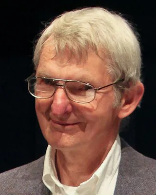

<strong>Douglas McIlroy</strong> (geboren 1932), amerikanischer Mathematiker und Informatiker bei den Bell Labs. Du verkettest Befehle mit <code>|</code>? Die Idee ist von ihm: Schon 1964 schrieb er in einer Notiz, man solle Programme verbinden können wie die Stücke eines Gartenschlauchs. 1973 baute Ken Thompson die Pipes in einer Nacht in Unix ein.

1986 schrieb Donald Knuth ein Programm über mehrere Seiten, das die häufigsten Wörter eines Texts zählt. McIlroy antwortete mit einer Pipeline aus sechs Befehlen, darunter <code>sort</code>, <code>uniq -c</code> und <code>sort -rn</code>.

Foto: Denise Panyik-Dale, 2011, CC BY 2.0, zugeschnitten (<a href='https://commons.wikimedia.org/wiki/File:Douglas_McIlroy.jpeg'>Wikimedia Commons</a>)

<!-- /part -->

<!-- year: 1933 -->
<!-- part: hart-nilsson-raphael -->
### Peter Hart, Nils Nilsson und Bertram Raphael

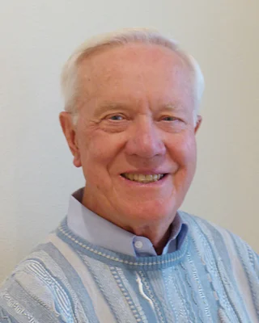

<strong>Peter Hart</strong>, <strong>Nils Nilsson</strong> (1933–2019, im Bild) und <strong>Bertram Raphael</strong> entwarfen A* 1968 am Stanford Research Institute für Shakey, den ersten Roboter, der selbst plante, wie er durch Räume zu einem Ziel kommt.

Figuren in Spielen finden ihre Wege bis heute mit A*.

Foto: Nils Nilsson, 2013, CC BY 4.0, zugeschnitten (<a href='https://commons.wikimedia.org/wiki/File:Nils-Nilsson-2013.jpg'>Wikimedia Commons</a>)

<!-- /part -->

<!-- year: 1934 -->
<!-- part: wirth -->
### Niklaus Wirth

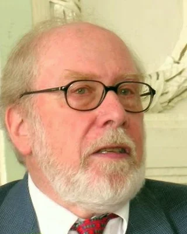

<strong>Niklaus Wirth</strong> (1934–2024), Schweizer Informatiker an der ETH Zürich. Er entwarf Pascal als Sprache, an der man sauberes Programmieren lernt. Eines seiner Bücher heißt <em>Algorithms + Data Structures = Programs</em>: Ein Programm, das sind Algorithmen plus Datenstrukturen.

1995 warb er für schlanke Software und zitierte einen Kollegen: Software werde schneller langsamer, als die Hardware schneller wird. Der Satz heißt heute Wirthsches Gesetz. 1984 bekam er den Turing Award, den wichtigsten Preis der Informatik.

Foto: Robert M. McClure, CC BY-SA 3.0, zugeschnitten (<a href='https://commons.wikimedia.org/wiki/File:Niklaus_Wirth_large.jpg'>Wikimedia Commons</a>)

<!-- /part -->

<!-- year: 1934 -->
<!-- part: hoare -->
### Tony Hoare

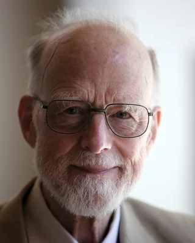

<strong>Tony Hoare</strong> (1934–2026), britischer Informatiker. Quick Sort erfand er 1959 als Austauschstudent in Moskau: Er sollte ein Programm schreiben, das Russisch übersetzt, und musste dafür die Wörter eines Satzes sortieren.

1965 baute er in eine Programmiersprache den Wert <code>null</code> ein, »weil es so einfach war«. Später nannte er ihn seinen »Milliarden-Dollar-Fehler«: Meldungen wie <code>undefined method … for nil</code> in Ruby stammen von dieser Idee.

Foto: Rama, 2011, CC BY-SA 2.0 fr, zugeschnitten (<a href='https://commons.wikimedia.org/wiki/File:Sir_Tony_Hoare_IMG_5125.jpg'>Wikimedia Commons</a>)

<!-- /part -->

<!-- year: 1938 -->
<!-- part: knuth-lamport -->
### Donald Knuth und Leslie Lamport

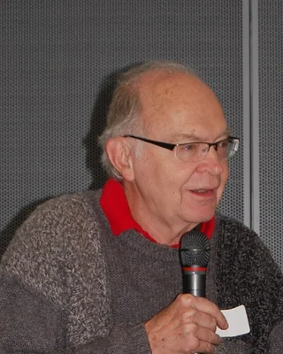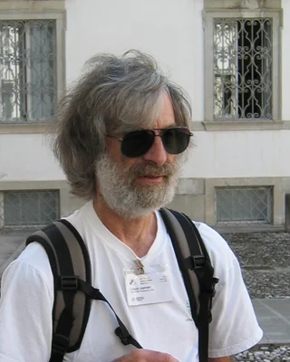

<strong>Donald Knuth</strong> (geboren 1938) und <strong>Leslie Lamport</strong> (geboren 1941), amerikanische Informatiker. Knuth gefiel der Satz seines Buchs <em>The Art of Computer Programming</em> nicht mehr, und er schrieb ab 1977 TeX, ein Programm, das Text und Formeln setzt. Lamport baute Anfang der 1980er Jahre LaTeX darauf: Befehle wie <code>\section</code>, mit denen du sagst, was etwas ist, statt wie es aussehen soll.

Die Versionsnummer von TeX nähert sich mit jeder Fehlerkorrektur der Zahl π: 3.141592653. Lamport bekam 2013 den Turing Award, den wichtigsten Preis der Informatik, für Rechner, die zusammenarbeiten.

Fotos: vonguard, 2011, CC BY-SA 2.0 (<a href='https://commons.wikimedia.org/wiki/File:Donald_Knuth,_CHM_2011_3.jpg'>Wikimedia Commons</a>); Andrej Bauer, 2006, CC BY-SA 2.5 si (<a href='https://commons.wikimedia.org/wiki/File:Leslie_Lamport_September_2006.jpg'>Wikimedia Commons</a>), beide zugeschnitten

<!-- /part -->

<!-- year: 1938 -->
<!-- part: cerf-kahn -->
### Vint Cerf und Bob Kahn

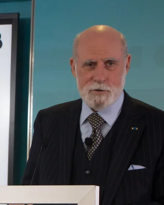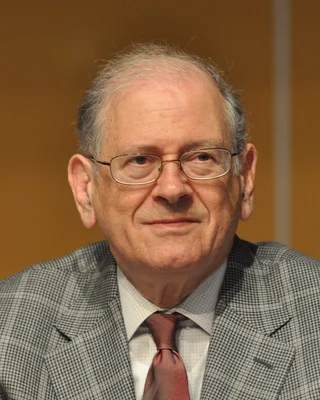

<strong>Vint Cerf</strong> (geboren 1943) und <strong>Bob Kahn</strong> (geboren 1938), amerikanische Informatiker, entwarfen 1973 und 1974 TCP/IP: wie Daten in Pakete zerlegt, über viele verschiedene Netze geschickt und am Ziel wieder zusammengesetzt werden. Am 1. Januar 1983 stellte das ARPANET auf TCP/IP um; der Tag gilt als Geburtstag des Internets.

Jede Verbindung, die du im Workspace aufbaust, mit dem Browser, mit <code>git</code> oder mit <code>netcat</code>, läuft über ihr Protokoll.

Fotos: New America, 2018, CC BY 2.0 (<a href='https://commons.wikimedia.org/wiki/File:Vint_Cerf_at_New_America%27s_Measurement_Lab_10th_Anniversary_event_(30096150328).jpg'>Wikimedia Commons</a>); Veni Markovski, 2013, CC BY-SA 3.0 (<a href='https://commons.wikimedia.org/wiki/File:Bob_Kahn.jpg'>Wikimedia Commons</a>), beide zugeschnitten

<!-- /part -->

<!-- year: 1939 -->
<!-- part: bayer-mccreight -->
### Rudolf Bayer und Edward M. McCreight

<strong>Rudolf Bayer</strong> (geboren 1939), deutscher Informatiker, und <strong>Edward M. McCreight</strong>, amerikanischer Informatiker, erfanden den B-Baum 1970, als beide beim Flugzeugbauer Boeing forschten. Jeder Index, den du mit <code>CREATE INDEX</code> anlegst, ist so ein Baum. Bayer ging 1972 an die TU München, McCreight baute später bei Xerox PARC den Computer Alto mit.

Wofür das B steht, ist bis heute offen: Boeing, <em>balanced</em>, Bayer? McCreight erzählte, sie hätten den Namen Boeing nicht benutzen dürfen, ohne erst mit den Anwälten zu reden. Und Bayer sagte gern: Je länger man darüber nachdenkt, wofür das B steht, desto besser versteht man B-Bäume.

<!-- /part -->

<!-- year: 1939 -->
<!-- part: welch -->
### Terry Welch

<strong>Terry Welch</strong> (1939–1988), amerikanischer Informatiker, vereinfachte 1984 das Verfahren von Abraham Lempel und Jacob Ziv aus dem Jahr 1978 so, dass es schnell genug für Festplatten war. Daher das W in LZW.

GIF benutzte LZW ab 1987. Weil die Firma Unisys ein Patent darauf hatte und ab 1994 Gebühren verlangte, entwickelten Freiwillige ein neues Bildformat ohne LZW: PNG.

<!-- /part -->

## Geboren 1940 bis 1959

<!-- year: 1940 -->
<!-- part: ahmed -->
### Nasir Ahmed

<strong>Nasir Ahmed</strong> (geboren 1940), Ingenieur aus Indien, in den USA. 1972 wollte er Bilder mit Kosinuswellen verdichten. Die Stiftung, die Forschung bezahlt, lehnte seinen Antrag ab: Die Idee sei zu einfach. 1974 veröffentlichte er die DCT trotzdem, mit T. Natarajan und K. R. Rao.

Jedes JPEG-Foto ist aus ihr gebaut, fast jedes Video auch, und eine Abwandlung steckt in MP3.

<!-- /part -->

<!-- year: 1941 -->
<!-- part: ritchie -->
### Dennis Ritchie

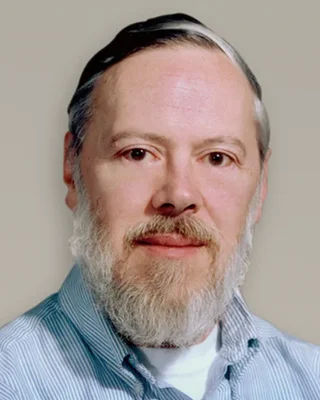

<strong>Dennis Ritchie</strong> (1941–2011), amerikanischer Informatiker bei den Bell Labs. Anfang der 1970er Jahre erfand er C, und damit schrieben er und Ken Thompson ihr Betriebssystem Unix neu, das es bis dahin nur in Assembler gab. Das Terminal im Workspace läuft unter Linux, und auch dessen Kern ist in C geschrieben.

1978 schrieb er mit Brian Kernighan das Buch <em>The C Programming Language</em>. Sein erstes Programm gibt <code>hello, world</code> aus, und seitdem beginnt fast jede Einführung in eine Programmiersprache so.

<!-- /part -->

<!-- year: 1941 -->
<!-- part: strasser -->
### Wolfgang Straßer

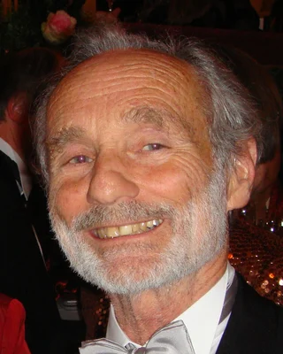

<strong>Wolfgang Straßer</strong> (1941–2015), deutscher Informatiker. Er studierte an der TU Berlin und schrieb dort 1974 seine Doktorarbeit über schnelle Kurven und Flächen auf dem Bildschirm. Darin steht, einige Monate vor Edwin Catmull und unabhängig von ihm, der Tiefenpuffer: Für jeden Bildpunkt wird auch die Z-Koordinate gespeichert, und ein neuer Punkt wird nur gezeichnet, wenn er näher liegt. Diesen Vergleich schaltet <code>BeginMode3D</code> in der Klötzchenwelt ein.

Die Idee steht ganz hinten, unter »Zukünftige Arbeiten«, mit dem Satz: »Beim augenblicklichen Stand der Preise und der Technologie der Halbleiterspeicher ist dieses Verfahren […] nicht realisierbar.« Heute hat jede Grafikkarte einen Tiefenpuffer, auch die in deinem Handy. Ab 1986 war Straßer Professor in Tübingen.

Foto: MA2710, 2011, CC BY-SA 3.0 de, zugeschnitten (<a href='https://commons.wikimedia.org/wiki/File:Wolfgang-Stra%C3%9Fer-2011.jpg'>Wikimedia Commons</a>)

<!-- /part -->

<!-- year: 1943 -->
<!-- part: thompson -->
### Ken Thompson

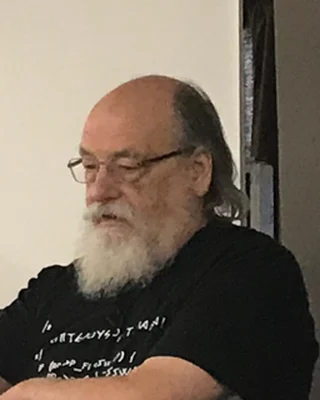

<strong>Ken Thompson</strong> (geboren 1943). Du suchst im Terminal mit <code>grep</code>? Das hat er 1973 geschrieben; der Name kommt aus seinem Texteditor, wo der Befehl <code>g/re/p</code> hieß: global, <em>regular expression</em>, print. Wie man aus einem regulären Ausdruck einen Automaten baut, hatte er schon 1968 beschrieben: die Thompson-Konstruktion.

Das Terminal selbst läuft unter Linux, und Linux funktioniert wie Unix, das er ab 1969 mit Dennis Ritchie schrieb. Unten rechts in VS Code steht <em>UTF-8</em>: Die Kodierung hat er 1992 mit Rob Pike auf ein Tischset in einem Diner gezeichnet. Und die Sprache <a href='/go'>Go</a> hat er mit erfunden.

Foto: A. C. Diller, 2019, CC BY-SA 4.0, zugeschnitten (<a href='https://commons.wikimedia.org/wiki/File:Brian_Kernighan_and_Ken_Thompson.jpg'>Wikimedia Commons</a>)

<!-- /part -->

<!-- year: 1943 -->
<!-- part: smith-alvy -->
### Alvy Ray Smith

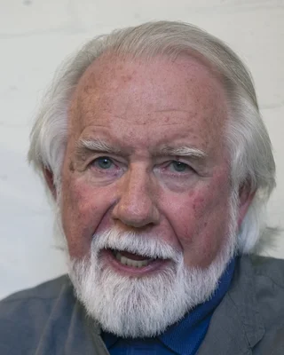

<strong>Alvy Ray Smith</strong> (geboren 1943), amerikanischer Informatiker. Ab 1974 arbeitete er bei Xerox PARC an SuperPaint, einem der ersten Malprogramme mit Farbe, und danach am New York Institute of Technology an weiteren. Damit man dort Farben nach Farbton, Sättigung und Helligkeit aussuchen konnte, ordnete er den RGB-Würfel zu HSV um. Als er es 1978 veröffentlichte, lief die Umrechnung schon seit etwa vier Jahren in Malprogrammen.

Mit Edwin Catmull erfand er Ende der 1970er Jahre den Alphakanal, das A in RGBA, das sagt, wie deckend ein Pixel ist. 1986 gründete er mit Catmull Pixar, mit dem Geld von Steve Jobs.

Foto: Christopher Michel, 2019, CC BY-SA 4.0, zugeschnitten (<a href='https://commons.wikimedia.org/wiki/File:Alvy_Ray_Smith_in_2019_02_(cropped).jpg'>Wikimedia Commons</a>)

<!-- /part -->

<!-- year: 1944 -->
<!-- part: chamberlin-boyce -->
### Donald Chamberlin und Raymond Boyce

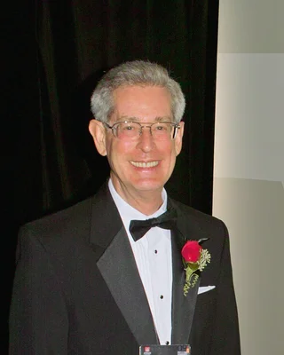

<strong>Donald Chamberlin</strong> (geboren 1944, im Bild) und <strong>Raymond Boyce</strong> (1946–1974), amerikanische Informatiker bei IBM, stellten 1974 eine Sprache für Codds Tabellen vor, die sich fast wie Englisch liest: SEQUEL, die <em>Structured English Query Language</em>. Schon ihr erstes Beispiel hat die Form, in der du heute jede Abfrage schreibst: <code>SELECT NAME FROM EMP WHERE DEPT = 'TOY'</code>.

Weil der Name SEQUEL schon einer britischen Flugzeugfirma gehörte, wurde daraus SQL. Viele sprechen es trotzdem »Sequel« aus, Chamberlin auch. Boyce starb noch im selben Jahr, keine 30 Jahre alt.

Foto: Dicklyon, 2009, CC BY-SA 4.0, zugeschnitten (<a href='https://commons.wikimedia.org/wiki/File:Don_Chamberlin.jpg'>Wikimedia Commons</a>)

<!-- /part -->

<!-- year: 1944 -->
<!-- part: diffie-hellman -->
### Whitfield Diffie und Martin Hellman

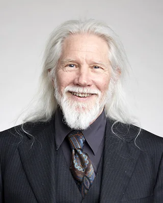

<strong>Whitfield Diffie</strong> (geboren 1944, im Bild) und <strong>Martin Hellman</strong> (geboren 1945), amerikanische Kryptografen in Stanford, schlugen 1976 vor, mit zwei Schlüsseln zu verschlüsseln, einem öffentlichen und einem privaten. Im selben Aufsatz zeigten sie, wie zwei Menschen über eine Leitung, die jeder mitlesen kann, ein gemeinsames Geheimnis verabreden, ohne es je zu schicken: den Diffie-Hellman-Schlüsseltausch. Mit einer Fassung davon verabreden Browser und Server bei <code>https://</code> heute meist ihren Schlüssel.

Beim britischen Geheimdienst GCHQ hatten James Ellis, Clifford Cocks und Malcolm Williamson dieselben Ideen schon einige Jahre früher, aber das blieb bis 1997 geheim. Diffie und Hellman bekamen 2015 den Turing Award, den wichtigsten Preis der Informatik.

Foto: Duncan.Hull, 2017, CC BY-SA 4.0, zugeschnitten (<a href='https://commons.wikimedia.org/wiki/File:Whitfield_Diffie_Royal_Society.jpg'>Wikimedia Commons</a>)

<!-- /part -->

<!-- year: 1945 -->
<!-- part: catmull -->
### Edwin Catmull

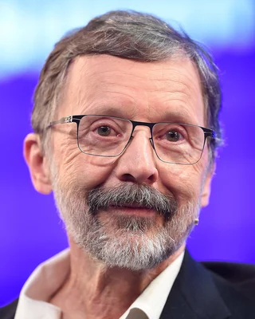

<strong>Edwin Catmull</strong> (geboren 1945), amerikanischer Informatiker. In seiner Doktorarbeit an der University of Utah beschrieb er 1974 den Tiefenpuffer, unabhängig von Wolfgang Straßer, und dazu Texture Mapping: ein Bild auf eine Fläche legen, wie die Kacheln auf die Blöcke der Klötzchenwelt. 1986 gründete er mit Alvy Ray Smith und Steve Jobs Pixar, das 1995 mit Toy Story den ersten Kinofilm ganz aus dem Computer herausbrachte.

Als Kind wollte er Trickfilmzeichner bei Disney werden. 1972 animierte er stattdessen am Computer seine eigene linke Hand, eine der ersten Computeranimationen in 3D. Und als Disney 2006 Pixar kaufte, leitete er bis 2018 auch die Trickfilmstudios von Disney.

Foto: Web Summit, 2015, CC BY 2.0, zugeschnitten (<a href='https://commons.wikimedia.org/wiki/File:Ed_Catmull_at_Web_Summit_2015_(cropped).jpg'>Wikimedia Commons</a>)

<!-- /part -->

<!-- year: 1945 -->
<!-- part: tesler -->
### Larry Tesler

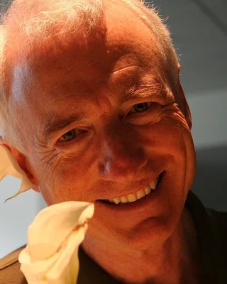

<strong>Larry Tesler</strong> (1945–2020), amerikanischer Informatiker. Du kopierst mit <kbd>Strg</kbd><kbd>C</kbd> und fügst mit <kbd>Strg</kbd><kbd>V</kbd> ein? Die Namen <em>cut</em>, <em>copy</em> und <em>paste</em> dafür hat er vorgeschlagen, und ab 1974 baute er die Befehle mit Kollegen bei Xerox PARC in Texteditoren ein, etwa in Gypsy, den er mit Tim Mott schrieb. 1980 ging er zu Apple, wo die Befehle in die Computer Lisa und Macintosh kamen.

Die Editoren damals hatten Modi: In einem Modus war jede Taste ein Befehl, in einem anderen schrieb sie Text, wie heute noch in <code>vim</code>, wo du erst <kbd>I</kbd> drückst. Tesler fand das furchtbar. »Don't mode me in« war sein Spruch, und auf dem Nummernschild seines Autos stand <code>NOMODES</code>.

Foto: Yahoo! Blog, 2007, CC BY 2.0, zugeschnitten (<a href='https://commons.wikimedia.org/wiki/File:Larry_Tesler_Smiles_at_Whisper.jpeg'>Wikimedia Commons</a>)

<!-- /part -->

<!-- year: 1945 -->
<!-- part: rivest-shamir-adleman -->
### Ron Rivest, Adi Shamir und Leonard Adleman

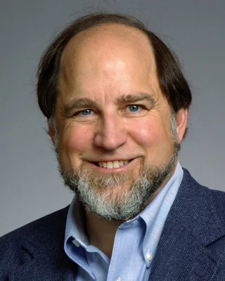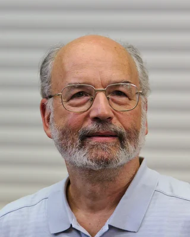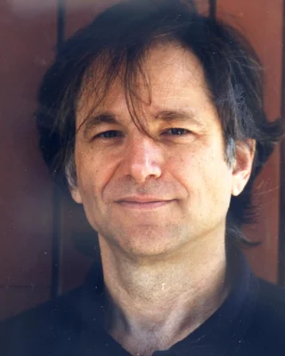

<strong>Ron Rivest</strong> (geboren 1947), <strong>Adi Shamir</strong> (geboren 1952) und <strong>Leonard Adleman</strong> (geboren 1945), damals am MIT. Das Schlüsselpaar, das du mit <code>openssl genpkey -algorithm RSA</code> erzeugst, trägt ihre Anfangsbuchstaben: RSA veröffentlichten sie 1977. Rivest und Shamir schlugen eine Idee nach der anderen vor, und Adleman, der Mathematiker, suchte in jeder die Schwachstelle.

1977 feierten sie Pessach bei einem Studenten, mit viel Wein. Rivest konnte danach nicht schlafen, legte sich mit einem Mathebuch aufs Sofa und hatte bis zum Morgen den größten Teil des Aufsatzes geschrieben. In der gedruckten Fassung von 1978 tauchen zum ersten Mal Alice und Bob auf, die seitdem in fast jedem Beispiel zur Verschlüsselung Nachrichten tauschen. 2002 bekamen die drei den Turing Award, den wichtigsten Preis der Informatik.

Fotos: Ronald L. Rivest, 2015, CC BY-SA 4.0 (<a href='https://commons.wikimedia.org/wiki/File:Ronald_L_Rivest_photo.jpg'>Wikimedia Commons</a>); Erik Tews, 2013, CC BY-SA 3.0 (<a href='https://commons.wikimedia.org/wiki/File:Adi_Shamir_at_TU_Darmstadt_(2013).jpg'>Wikimedia Commons</a>); Leonard Adleman, CC BY-SA 3.0 (<a href='https://commons.wikimedia.org/wiki/File:Len-mankin-pic.jpg'>Wikimedia Commons</a>), alle zugeschnitten

<!-- /part -->

<!-- year: 1947 -->
<!-- part: chen -->
### Peter Chen

<strong>Peter Chen</strong> (geboren 1947), Informatiker aus Taiwan, veröffentlichte 1976 am MIT das Entity-Relationship-Modell: Rechtecke für Entitäten, Rauten für Beziehungen. Die Chen-Notation, in der Attribute als Ellipsen dazukommen, heißt nach ihm.

Er wollte eine Sprache, in der man eine Datenbank planen kann, bevor man an Tabellen denkt.

<!-- /part -->

<!-- year: 1947 -->
<!-- part: whitted -->
### Turner Whitted

<strong>Turner Whitted</strong>, amerikanischer Informatiker. Bei den Bell Labs zeigte er 1979, wie Raytracing Spiegelungen, Glas und Schatten berechnet: Trifft ein Strahl eine spiegelnde oder durchsichtige Fläche, schickt das Programm von dort neue Strahlen weiter, und von deren Treffpunkten wieder neue, rekursiv. Darum spiegeln sich in einer Kugel aus Chrom auch die anderen Kugeln.

Sein berühmtes Bild, eine Glaskugel und eine spiegelnde Kugel über einem Schachbrett, 640 × 480 Pixel groß, rechnete ein Computer vom Typ VAX-11/780 74 Minuten lang. 2014 ging Whitted zu Nvidia, deren Grafikkarten seit 2018 Raytracing in Echtzeit können, viele Bilder in der Sekunde.

<!-- /part -->

<!-- year: 1948 -->
<!-- part: mockapetris -->
### Paul Mockapetris

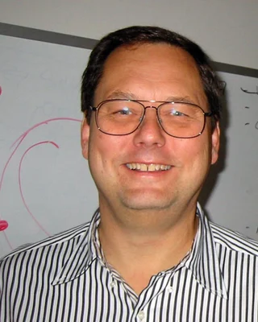

<strong>Paul Mockapetris</strong> (geboren 1948), amerikanischer Informatiker, entwarf 1983 das DNS. Vorher stand jeder Rechner des Internets mit seiner Adresse in einer einzigen Datei, <code>HOSTS.TXT</code>, die alle immer wieder herunterluden. Das Netz wuchs schnell, und bald ging das nicht mehr.

Eine solche Datei hat jeder Rechner bis heute, für Namen, die er selbst kennt: <code>cat /etc/hosts</code> im Terminal zeigt sie.

Foto: Andreu Veà, 2003, CC BY-SA 3.0, zugeschnitten (<a href='https://commons.wikimedia.org/wiki/File:With_Paul_Mockapetris.jpg'>Wikimedia Commons</a>)

<!-- /part -->

<!-- year: 1948 -->
<!-- part: wilhite -->
### Steve Wilhite

<strong>Steve Wilhite</strong> (1948–2022), amerikanischer Programmierer, entwarf 1987 bei der Firma CompuServe das Format GIF: Farbbilder, die über die langsamen Modems der Zeit schnell genug ankamen und auf jedem Rechner gleich aussahen.

2013 bekam er dafür einen Webby Award und sagte bei der Verleihung, wie man es ausspricht: mit weichem G, wie »Jif«.

<!-- /part -->

<!-- year: 1949 -->
<!-- part: livingstone-jackson -->
### Ian Livingstone und Steve Jackson

<strong>Ian Livingstone</strong> (geboren 1949, im Bild) und <strong>Steve Jackson</strong> (geboren 1951), britische Spieleautoren. 1982 erschien ihr Buch »The Warlock of Firetop Mountain«, das erste der Reihe <em>Fighting Fantasy</em>: Du bist der Held, würfelst deine Kämpfe aus und liest nicht von vorn nach hinten, sondern springst zwischen 400 nummerierten Abschnitten hin und her, je nachdem, welchen Gang du nimmst. Eine Geschichte in BIF ist so ein Buch: Jede Seite ist eine Datei, und jede Entscheidung führt auf eine andere.

1975 hatten die beiden mit einem Schulfreund Games Workshop gegründet, die Firma, die heute Warhammer macht. Livingstone sah 1996 für die Spielefirma Eidos ein Studio an, das sie kaufen wollte, und dort zum ersten Mal Lara Croft auf einem Bildschirm: Tomb Raider. Jackson gehörte zu den Gründern von Lionhead, dem Studio hinter Fable. Und ein Bericht, den Livingstone 2011 mitschrieb, trug dazu bei, dass Schulen in England seit 2014 Informatik mit Programmieren unterrichten.

Foto: FrankBoyd, 2006, CC BY-SA 2.0, zugeschnitten (<a href='https://commons.wikimedia.org/wiki/File:Ian_Livingstone,_Paul_Gambaccini_-_Bafta_Awards_2006.jpg'>Wikimedia Commons</a>)

<!-- /part -->

<!-- year: 1949 -->
<!-- part: blinn -->
### Jim Blinn

<strong>Jim Blinn</strong> (geboren 1949), amerikanischer Informatiker. Am Jet Propulsion Laboratory der NASA machte er die Animationen der Vorbeiflüge der Voyager-Sonden und Bilder für Carl Sagans Fernsehserie <em>Cosmos</em> (1980). Um dort Atome zu zeigen, die sich zu Molekülen verbinden, erfand er Formen, die mit ihren Nachbarn verschmelzen: die Blobby Objects, heute Metaballs.

Auch der Glanzpunkt auf deinen Tropfen kommt von ihm: Die Richtung genau zwischen Licht und Auge ist seine Verbesserung des Phong-Modells von 1977. Und nach »Blinns Gesetz« dauert ein Bild immer gleich lange, egal wie schnell die Computer werden: Man rechnet einfach schönere Bilder.

Foto: Eric Haines, 2015, CC BY 2.0, zugeschnitten (<a href='https://commons.wikimedia.org/wiki/File:SIGGRAPH_2015_(20424362159).jpg'>Wikimedia Commons</a>)

<!-- /part -->

<!-- year: 1949 -->
<!-- part: williams -->
### Lance Williams

<strong>Lance Williams</strong> (1949–2017), amerikanischer Grafikforscher. Am New York Institute of Technology erfand er die Mipmaps: jede Textur noch einmal in halber Größe, in Viertelgröße und so weiter, damit weit entfernte Wände nicht flimmern. Jede Grafikkarte rechnet heute so, und auch die Schatten mit einer Tiefenkarte, den Shadow Maps, hat er 1978 beschrieben.

Auf diesem Foto ist er selbst in Stufen zu sehen, jede halb so groß wie die vorige.

Foto: Amberesque, 2004, CC BY-SA 3.0 (<a href='https://commons.wikimedia.org/wiki/File:Lance_Williams.jpg'>Wikimedia Commons</a>)

<!-- /part -->

<!-- year: 1950 -->
<!-- part: stroustrup -->
### Bjarne Stroustrup

<strong>Bjarne Stroustrup</strong> (geboren 1950), dänischer Informatiker. Für seine Doktorarbeit in Cambridge hatte er in der Sprache Simula mit Klassen programmiert, doch die Programme liefen zu langsam. Ab 1979 baute er deshalb bei den Bell Labs Klassen in C ein, erst »C with Classes«, ab 1983 C++. Das <code>++</code> ist der Operator, der in C eine Variable um eins erhöht, wie <code>i++</code> in einer <code>for</code>-Schleife.

Von ihm stammt der Satz: »C makes it easy to shoot yourself in the foot; C++ makes it harder, but when you do it blows your whole leg off.«

Foto: Victor Zavyalov (ICPC News), 2013, CC BY 2.0, zugeschnitten (<a href='https://commons.wikimedia.org/wiki/File:Bjarne_Stroustrup_(2013).jpg'>Wikimedia Commons</a>)

<!-- /part -->

<!-- year: 1951 -->
<!-- part: kajiya -->
### Jim Kajiya

<strong>Jim Kajiya</strong> (geboren 1951), amerikanischer Informatiker, von 1979 bis 1994 am Caltech, danach bei Microsoft Research. 1986 schrieb er in einer Gleichung auf, wie viel Licht von einem Punkt einer Fläche ausgeht: was sie selbst leuchtet und was aus allen Richtungen auf sie fällt und weitergeworfen wird, die Rendering Equation. Genau lösen kann sie kein Computer. Kajiya kam ihr mit dem Zufall nahe, mit einem einzigen Strahl von Fläche zu Fläche statt eines ganzen Baums von Strahlen, und nannte das Path Tracing: Das macht <code>bounce</code> in deinem Raytracer.

1989 zeigten er und Timothy Kay, wie man Fell rechnet, ein Problem, an dem die Computergrafik lange festhing. Kay baute damit in seiner Doktorarbeit bei Kajiya einen Teddybären.

Foto: Dcoetzee, 2009, CC0, zugeschnitten (<a href='https://commons.wikimedia.org/wiki/File:Jim_Kajiya.jpg'>Wikimedia Commons</a>)

<!-- /part -->

<!-- year: 1954 -->
<!-- part: perlin -->
### Ken Perlin

<strong>Ken Perlin</strong>, Informatiker in New York. Nach den Computerbildern für den Film <em>Tron</em> (1982) störte ihn, wie glatt und sauber Oberflächen aus dem Computer aussahen, und er erfand das Rauschen, das seinen Namen trägt. Dafür bekam er 1997 einen Oscar für technische Leistungen.

Wolken, Feuer und ganze Landschaften in Spielen wie Minecraft entstehen aus Perlin-Rauschen und seinen Verwandten.

Foto: Ambuj Saxena, 2007, CC BY 2.5, zugeschnitten (<a href='https://commons.wikimedia.org/wiki/File:Ken_Perlin.jpg'>Wikimedia Commons</a>)

<!-- /part -->

<!-- year: 1955 -->
<!-- part: crockford -->
### Douglas Crockford

<strong>Douglas Crockford</strong> (geboren 1955), amerikanischer Programmierer. Die Einstellungen von VS Code im Workspace stehen in einer Datei <code>settings.json</code>, in JSON. Erfunden habe er JSON nicht, sagt er, sondern entdeckt: Es steckte schon in JavaScript. 2001 gab er dem Format seinen Namen, Ende 2002 schrieb er es auf json.org auf.

Seine eigene Lizenz für ein Programm zu JSON enthält den Satz »The Software shall be used for Good, not Evil.«

Foto: Franco Folini, 2007, CC BY-SA 2.0, zugeschnitten (<a href='https://commons.wikimedia.org/wiki/File:Douglas_Crockford.jpg'>Wikimedia Commons</a>)

<!-- /part -->

<!-- year: 1955 -->
<!-- part: gosling -->
### James Gosling

<strong>James Gosling</strong> (geboren 1955), kanadischer Informatiker, entwarf Java ab 1991 bei der Firma Sun Microsystems und schrieb den ersten Compiler und die erste virtuelle Maschine, die Java-Programme ausführt. Minecraft ist in Java geschrieben, die Java Edition läuft bis heute damit.

Zuerst hieß die Sprache Oak, nach einer Eiche vor seinem Büro. Später bekam sie den Namen einer Kaffeesorte von der indonesischen Insel Java; deshalb ist ihr Logo eine dampfende Tasse.

Foto: Yuichi Sakuraba, zugeschnitten

<!-- /part -->

<!-- year: 1955 -->
<!-- part: berners-lee -->
### Tim Berners-Lee

<strong>Tim Berners-Lee</strong> (geboren 1955), britischer Physiker und Informatiker. Jede Webseite, die du im Browser öffnest, kommt über das World Wide Web: Das schlug er 1989 am Forschungszentrum CERN bei Genf vor, damit Forschende ihre Dokumente miteinander verknüpfen können. Bis Ende 1990 schrieb er HTML, HTTP, den ersten Webserver und den ersten Browser.

Er ließ das Web nicht patentieren: 1993 gab das CERN es für alle frei.

Foto: Web Summit, 2025, CC BY 4.0, zugeschnitten (<a href='https://commons.wikimedia.org/wiki/File:Tim_Berners-Lee_at_the_2025_Web_Summit.jpg'>Wikimedia Commons</a>)

<!-- /part -->

<!-- year: 1955 -->
<!-- part: hanrahan -->
### Pat Hanrahan

<strong>Pat Hanrahan</strong> (geboren 1955), amerikanischer Informatiker. Als einer der ersten Mitarbeiter von Pixar entwarf er von 1986 bis 1989 RenderMan mit, das Programm, mit dem Pixar seine Filme rechnet, und mit Jim Lawson dessen Shading Language: Jede Oberfläche bekommt ein kleines Programm, das ihre Farbe ausrechnet, einen Shader. 2003 gründete er Tableau mit, ein Programm, das aus Daten Diagramme macht.

Jeder Shader, den du schreibst, hat seinen Namen aus dieser Sprache. Für seine Arbeit an Computergrafik bekam Hanrahan drei Oscars für technische Leistungen und 2019 mit Edwin Catmull den Turing Award, den bekanntesten Preis der Informatik.

<!-- /part -->

<!-- year: 1956 -->
<!-- part: van-rossum -->
### Guido van Rossum

<strong>Guido van Rossum</strong> (geboren 1956), niederländischer Programmierer. Im Dezember 1989 suchte er ein Hobbyprojekt für die Woche um Weihnachten, wenn sein Büro am Forschungsinstitut CWI in Amsterdam geschlossen war, und begann Python; 1991 erschien die erste Fassung. Dass in Python die Einrückung bestimmt, welche Zeilen zu einer Schleife gehören, übernahm er aus der Sprache ABC, an der er vorher mitgearbeitet hatte.

Den Namen hat Python nicht von der Schlange, sondern von der britischen Comedy-Truppe Monty Python. Bis 2018 entschied er als »Benevolent Dictator For Life«, wohlwollender Diktator auf Lebenszeit, über jede Änderung an der Sprache.

Foto: Doc Searls, 2006, CC BY-SA 2.0, zugeschnitten (<a href='https://commons.wikimedia.org/wiki/File:Guido_van_Rossum_OSCON_2006.jpg'>Wikimedia Commons</a>)

<!-- /part -->

<!-- year: 1956 -->
<!-- part: griesemer-pike -->
### Robert Griesemer und Rob Pike

<strong>Robert Griesemer</strong> (geboren 1964), Schweizer Informatiker, und <strong>Rob Pike</strong> (geboren 1956), kanadischer Programmierer, erfanden 2007 bei Google mit Ken Thompson die Sprache Go. Pike ärgerte sich damals über C++-Programme, deren Übersetzen 45 Minuten dauerte: Go sollte so schnell übersetzen, dass man darauf nicht warten muss. Auch Docker, mit dem dein Workspace in einem Container läuft, ist in Go geschrieben.

Griesemer hatte an der ETH Zürich bei Niklaus Wirth promoviert, dem Erfinder von Pascal. Pike war 1992 dabei, als Ken Thompson UTF-8 auf ein Tischset in einem Diner zeichnete. Den Gopher, das Maskottchen von Go, hat Pikes Frau Renée French gezeichnet.

<!-- /part -->

<!-- year: 1957 -->
<!-- part: abrash -->
### Michael Abrash

<strong>Michael Abrash</strong> (geboren 1957), amerikanischer Programmierer. Seine Bücher über schnellen Code wie <em>Zen of Code Optimization</em> lasen in den 1990er Jahren alle, die Spiele programmierten. 1995 holte John Carmack ihn zu id Software, und zusammen brachten sie Quake (1996) auf PCs ohne 3D-Grafikkarte zum Laufen. Quake nutzt beide Ideen: Die Wände zeichnet es sortiert, jedes Pixel nur einmal, und schreibt dabei ihre Entfernung in einen Tiefenpuffer, an dem sich danach Monster und Waffen messen.

Bill Gates selbst versuchte, ihn bei Microsoft zu halten. Wie Quake das alles macht, erklärt Abrash in seinem <em>Graphics Programming Black Book</em>, das er 2001 frei ins Netz stellte. Ab 2014 forschte er als Chefwissenschaftler von Oculus an VR-Brillen.

Foto: Maurizio Pesce, 2015, CC BY 2.0, zugeschnitten (<a href='https://commons.wikimedia.org/wiki/File:Michael_Abrash_at_Facebook%27s_F8_2015.jpg'>Wikimedia Commons</a>)

<!-- /part -->

<!-- year: 1958 -->
<!-- part: muuss -->
### Mike Muuss

<strong>Mike Muuss</strong> (1958–2000), amerikanischer Informatiker am Ballistic Research Laboratory der US-Armee. Du prüfst mit <code>ping</code>, ob ein Rechner antwortet? Das Programm schrieb er im Dezember 1983 an einem Abend, weil sich das Netz in seinem Labor seltsam verhielt. Den Namen hat es vom Geräusch eines Sonars, das am Echo misst, wie weit etwas entfernt ist.

Er schrieb auch BRL-CAD, ein Programm für 3D-Modelle, und eines der ersten Programme, die Bilder interaktiv mit Raytracing berechneten.

Foto: Lee Butler, 1999, CC0, zugeschnitten (<a href='https://commons.wikimedia.org/wiki/File:Mike_Muuss.jpg'>Wikimedia Commons</a>)

<!-- /part -->

<!-- year: 1959 -->
<!-- part: fox -->
### Brian Fox

<strong>Brian Fox</strong> (geboren 1959), amerikanischer Programmierer. Die Shell, die im Terminal deine Befehle liest, ist Bash: Er schrieb sie für das GNU-Projekt von Richard Stallman als freien Ersatz für die alte Bourne Shell und stellte sie im Juni 1989 vor. Dass <kbd>Tab</kbd> Dateinamen ergänzt und <kbd>↑</kbd> frühere Befehle zurückholt, erledigt Readline, eine Bibliothek, die er ebenfalls geschrieben hat.

Der Name ist ein Wortspiel: Die alte Shell hatte Stephen Bourne geschrieben, die neue heißt <em>Bourne-Again Shell</em>, gesprochen wie <em>born again</em>, »wiedergeboren«.

Foto: Lissa Liggett, 2008, CC BY 3.0, zugeschnitten (<a href='https://commons.wikimedia.org/wiki/File:BrianJFox.png'>Wikimedia Commons</a>)

<!-- /part -->

## Geboren ab 1960

<!-- year: 1960 -->
<!-- part: hejlsberg -->
### Anders Hejlsberg

<strong>Anders Hejlsberg</strong> (geboren 1960), dänischer Softwareentwickler. Bei Microsoft entwarf er C#, das 2000 erschien, und 2012 stellte er TypeScript vor, JavaScript mit Typen. VS Code, in dem du im Workspace schreibst, ist in TypeScript geschrieben.

Als Student schrieb er einen Pascal-Compiler für den Heimcomputer Nascom. Die Firma Borland verkaufte ihn ab 1983 als Turbo Pascal für 49,95 Dollar, etwa ein Zehntel dessen, was andere Compiler kosteten, und er war berühmt dafür, wie schnell er übersetzte. 2025 kündigte Hejlsberg an, den TypeScript-Compiler in <a href='/go'>Go</a> neu zu schreiben, damit er etwa zehnmal schneller wird.

Foto: DBegley, 2008, CC BY 2.0, zugeschnitten (<a href='https://commons.wikimedia.org/wiki/File:Anders_Hejlsberg.jpg'>Wikimedia Commons</a>)

<!-- /part -->

<!-- year: 1960 -->
<!-- part: ierusalimschy-celes-figueiredo -->
### Roberto Ierusalimschy, Waldemar Celes und Luiz Henrique de Figueiredo

<strong>Roberto Ierusalimschy</strong> (geboren 1960), <strong>Waldemar Celes</strong> und <strong>Luiz Henrique de Figueiredo</strong>, brasilianische Informatiker, entwarfen Lua 1993 in der Gruppe Tecgraf an der Katholischen Universität in Rio de Janeiro. Bis 1992 schottete Brasilien sich mit hohen Handelsschranken gegen Computer und Software aus dem Ausland ab, also bauten sie ihre Werkzeuge selbst. Wer in Roblox ein Spiel baut, schreibt Luau, eine Sprache, die aus Lua entstanden ist.

Lua heißt auf Portugiesisch »Mond«: Eine der Sprachen, aus denen Lua hervorging, hieß SOL, »Sonne«.

Foto: Ernani d’Almeida, 2011, zugeschnitten

<!-- /part -->

<!-- year: 1961 -->
<!-- part: eich -->
### Brendan Eich

<strong>Brendan Eich</strong> (geboren 1961), amerikanischer Programmierer. Jeder Button und jedes Menü, das auf einer Webseite aufklappt, läuft mit JavaScript: Die Sprache schrieb er 1995 bei der Firma Netscape für ihren Browser, die erste Fassung in zehn Tagen. Auch VS Code ist in TypeScript geschrieben, einer Erweiterung von JavaScript.

Erst hieß die Sprache Mocha, dann LiveScript. Den Namen JavaScript bekam sie Ende 1995 als Werbung, weil Java gerade in Mode war; mit Java hat sie wenig gemeinsam. 1998 gründete Eich Mozilla mit, woraus später der Browser Firefox hervorging.

Foto: Darcy Padilla, 2012, CC BY-SA 3.0, zugeschnitten (<a href='https://commons.wikimedia.org/wiki/File:Brendan_Eich_Mozilla_Foundation_official_photo.jpg'>Wikimedia Commons</a>)

<!-- /part -->

<!-- year: 1961 -->
<!-- part: gamma -->
### Erich Gamma

<strong>Erich Gamma</strong> (geboren 1961), Schweizer Informatiker. Der Editor im Workspace ist VS Code: Ab 2011 leitete er bei Microsoft in Zürich das Team, das zuerst einen Editor im Browser baute und daraus VS Code machte; 2015 erschien die erste Fassung.

Vorher schrieb er mit Kent Beck JUnit, mit dem Java-Programme sich selbst testen, und mit drei anderen das Buch <em>Design Patterns</em> (1994), das bis heute zeigt, wie man größere Programme ordnet.

<!-- /part -->

<!-- year: 1961 -->
<!-- part: moolenaar -->
### Bram Moolenaar

<strong>Bram Moolenaar</strong> (1961–2023), niederländischer Programmierer. Du hast mit <code>vim</code> eine Datei geschrieben? Weil es den Editor vi für seinen Amiga nicht gab, baute er ab 1988 einen nach. Am 2. November 1991 war die erste Fassung fertig, damals »Vi IMitation«, später »Vi IMproved«.

Vim kostet nichts, aber wer es mag, wird gebeten, für Kinder in Uganda zu spenden, für die er eine Hilfsorganisation gegründet hatte. Mehr als 30 Jahre lang pflegte er Vim selbst.

Foto: Sebastian Bergmann, 2007, CC BY-SA 2.0, zugeschnitten (<a href='https://commons.wikimedia.org/wiki/File:Bram_Moolenaar_in_2007.jpg'>Wikimedia Commons</a>)

<!-- /part -->

<!-- year: 1962 -->
<!-- part: widenius -->
### Michael »Monty« Widenius

<strong>Michael »Monty« Widenius</strong> (geboren 1962), finnischer Programmierer. Die Datenbank MySQL, die du mit <code>mycli</code> abfragst, begann er 1994 mit David Axmark zu schreiben; 1995 erschien die erste Fassung. Das »My« im Namen ist seine Tochter My.

2008 kaufte Sun Microsystems die Firma hinter MySQL für eine Milliarde Dollar, und bald darauf kaufte Oracle Sun. Widenius fürchtete, dass MySQL dort nicht frei bleibt, und machte 2009 aus dem freien Quellcode eine eigene Fassung: MariaDB, benannt nach seiner jüngeren Tochter Maria. Auch sein Sohn Max hat eine Datenbank: MaxDB.

Foto: Dan Stromberg, 2019, CC BY-SA 4.0, zugeschnitten (<a href='https://commons.wikimedia.org/wiki/File:Michael_%22Monty%22_Widenius,_Maria_DB_och_Open_Ocean.jpg'>Wikimedia Commons</a>)

<!-- /part -->

<!-- year: 1965 -->
<!-- part: wium-lie -->
### Håkon Wium Lie

<strong>Håkon Wium Lie</strong> (geboren 1965), norwegischer Informatiker. Jede Farbe, jeder Abstand und jede Schrift einer Webseite steht in CSS: Das schlug er 1994 am CERN vor, wo Tim Berners-Lee das Web erfunden hatte, damit der Inhalt in HTML und das Aussehen getrennt bleiben.

Später war er lange Technikchef des Browsers Opera.

Foto: Kjetil Ree, 2011, CC BY-SA 3.0, zugeschnitten (<a href='https://commons.wikimedia.org/wiki/File:H%C3%A5kon_Wium_Lie_-_2011-01-15_at_18-43-02.jpg'>Wikimedia Commons</a>)

<!-- /part -->

<!-- year: 1965 -->
<!-- part: bak-lund -->
### Lars Bak und Kasper Lund

<strong>Lars Bak</strong> (geboren 1965), dänischer Programmierer, leitete bei Google die Entwicklung von V8, dem Programm, das in Chrome JavaScript ausführt. Auch Node.js ist um V8 gebaut, und darauf läuft VS Code im Workspace. Mit <strong>Kasper Lund</strong>, der V8 mit ihm begonnen hatte, erfand er die Sprache Dart, die Google 2011 vorstellte.

Dart sollte JavaScript ablösen: Chrome sollte Dart-Programme selbst ausführen. 2015 schrieben Bak und Lund, dass daraus nichts wird; seitdem wird Dart für das Web in JavaScript übersetzt, und groß wurde es mit Flutter. Den Namen hat V8 von einem Automotor mit acht Zylindern.

<!-- /part -->

<!-- year: 1965 -->
<!-- part: matsumoto -->
### Yukihiro Matsumoto

<strong>Yukihiro Matsumoto</strong> (geboren 1965), japanischer Programmierer, den alle »Matz« nennen, veröffentlichte Ruby 1995. Er wollte eine Sprache, mit der Programmieren Freude macht: »Ich hoffe, dass Ruby jedem Programmierer auf der Welt hilft, produktiv zu sein, Spaß am Programmieren zu haben und glücklich zu sein.« Auch die Website des Workspace läuft mit Ruby.

Den Namen wählte er 1993 in einem Chat mit dem Programmierer Keiju Ishitsuka, noch bevor er eine Zeile der Sprache geschrieben hatte: Der Rubin war der Geburtsstein eines Kollegen.

Foto: Marcin Bajer, zugeschnitten

<!-- /part -->

<!-- year: 1969 -->
<!-- part: torvalds -->
### Linus Torvalds

<strong>Linus Torvalds</strong> (geboren 1969). Das Terminal im Workspace läuft unter Linux: Das hat er 1991 als Student in Helsinki angefangen, »nur ein Hobby«, schrieb er damals. Heute läuft Linux auf den meisten Servern der Welt und in jedem Android-Handy.

2005 brauchte er für die Arbeit an Linux eine neue Versionsverwaltung und schrieb in wenigen Tagen die erste Fassung von Git.

Foto: Raysonho, 2018, CC0 (<a href='https://commons.wikimedia.org/wiki/File:LC3Beijing2018_(cropped).jpg'>Wikimedia Commons</a>)

<!-- /part -->

<!-- year: 1970 -->
<!-- part: carmack -->
### John Carmack

<strong>John Carmack</strong> (geboren 1970), amerikanischer Programmierer, Mitgründer der Spielefirma id Software. Er programmierte die Grafik von Wolfenstein 3D (1992), mit einem Raycaster, wie du ihn in »Raycasting in C« selbst baust, von DOOM (1993) und von Quake (1996). Den BSP-Baum hatten Grafikforscher schon 1980 beschrieben. Carmack griff zu ihm, als Wolfenstein 3D auf das Super Nintendo sollte und der Raycaster dort zu langsam war, und baute danach DOOM darauf.

Im Dezember 1997 gab er den Quelltext von DOOM frei. Seitdem haben Leute es auf Taschenrechner und Drucker gebracht, und auch PixelRAM spielt DOOM.

Foto: RoboSabs, 2025, CC0, zugeschnitten (<a href='https://commons.wikimedia.org/wiki/File:John_Carmack_2025.jpg'>Wikimedia Commons</a>)

<!-- /part -->

<!-- year: 1970 -->
<!-- part: stenberg -->
### Daniel Stenberg

<strong>Daniel Stenberg</strong> (geboren 1970), schwedischer Programmierer. Du holst mit <code>curl</code> Webseiten und Daten aus APIs? Ende 1996 wollte er einem Chat-Bot beibringen, Wechselkurse aus dem Web zu holen, und erweiterte dafür ein kleines Programm namens HttpGet. Am 20. März 1998 bekam es den Namen curl.

Er arbeitet bis heute daran. curl steckt inzwischen in Milliarden Geräten, in Handys, Autos und Satelliten.

Foto: Daniel Stenberg, 2021, CC BY-SA 4.0, zugeschnitten (<a href='https://commons.wikimedia.org/wiki/File:Daniel_Stenberg_casually_green_(cropped).jpg'>Wikimedia Commons</a>)

<!-- /part -->

<!-- year: 1973 -->
<!-- part: gruber -->
### John Gruber

<strong>John Gruber</strong> (geboren 1973), amerikanischer Autor eines Blogs über Technik, erfand 2004 Markdown, mit Hilfe von Aaron Swartz. Er wollte Text so schreiben, wie man eine E-Mail schreibt, mit <code>*</code> und <code>#</code>, und ein Programm macht HTML daraus.

Jede <code>README.md</code> in einem Repository ist Markdown, und die Seiten des Workspace sind es auch.

<!-- /part -->

<!-- year: 1974 -->
<!-- birth year not published; placed by her bachelor’s degree in 1996 -->
<!-- part: gorman -->
### Kristen Gorman

<strong>Kristen Gorman</strong>, Meeresbiologin, heute an der University of Alaska Fairbanks. Für ihre Doktorarbeit an der Simon Fraser University in Kanada vermaß sie auf der Palmer-Station in der Antarktis drei Sommer lang Pinguine aller drei Arten. Sie wollte wissen, wie die Kolonien damit zurechtkommen, dass das Meereis und mit ihm das Futter zurückgeht.

Ihre Messungen hat sie veröffentlicht, frei für alle. Allison Horst und Alison Hill machten 2020 daraus das Paket palmerpenguins, heute einer der beliebtesten Datensätze zum Üben. Deine Datei <code>penguins.csv</code> stammt daraus.

Foto: University of Alaska Fairbanks (<a href='https://www.uaf.edu/cfos/people/faculty/detail/kristen-gorman.php'>College of Fisheries and Ocean Sciences</a>)

<!-- /part -->

<!-- year: 1977 -->
<!-- part: graydon-hoare -->
### Graydon Hoare

<strong>Graydon Hoare</strong>, Programmierer in Kanada. Als er 2006 nach Hause kam, war der Aufzug in seinem Haus in Vancouver kaputt: Dessen Software war abgestürzt. Er wohnte im 21. Stock und ärgerte sich auf der Treppe, dass Programmierer nicht einmal einen Aufzug bauen können, der nicht abstürzt. Solche Abstürze kommen oft von Fehlern im Umgang mit dem Speicher, und so begann er neben seiner Arbeit bei Mozilla Rust: eine Sprache, deren Compiler <code>rustc</code> solche Fehler gar nicht erst durchlässt.

Den Namen hat Rust von Rostpilzen, die er »für das Überleben überentwickelt« nennt. Ab 2009 bezahlte Mozilla die Arbeit an Rust, 2013 gab Hoare das Projekt ab. Heute steckt Rust in Firefox und im Linux-Kernel.

<!-- /part -->

<!-- year: 1977 -->
<!-- part: tatham-hall -->
### Simon Tatham und Julian Hall

<strong>Simon Tatham</strong> (geboren 1977, im Bild), britischer Programmierer, schrieb 1996 mit Hilfe von <strong>Julian Hall</strong> NASM, den Netwide Assembler: einen freien Assembler, der aus Befehlen wie <code>mov</code> und <code>syscall</code> Maschinencode für x86-Prozessoren macht. Heute pflegen andere NASM weiter.

Tatham schrieb auch PuTTY (1999), mit dem man sich von Windows aus über SSH in das Terminal eines Linux-Servers einloggt, und eine Sammlung kleiner Rätselspiele, die auch im Browser laufen.

Foto: Richard Kettlewell, 2012, CC BY-SA 2.0, zugeschnitten (<a href='https://commons.wikimedia.org/wiki/File:Simon_Tatham_in_2012.jpg'>Wikimedia Commons</a>)

<!-- /part -->

<!-- year: 1978 -->
<!-- part: eifrem-svensson-neubauer -->
### Emil Eifrem, Johan Svensson und Peter Neubauer

<strong>Emil Eifrem</strong>, <strong>Johan Svensson</strong> und <strong>Peter Neubauer</strong> (im Bild), Programmierer in Schweden, bauten um 2000 ein System, mit dem Firmen ihre Inhalte verwalten, und ihre Datenbank aus Tabellen kam mit den vielen Verknüpfungen nicht mehr mit. Auf einem Flug nach Mumbai zeichnete Eifrem auf eine Serviette, wie man die Daten stattdessen speichern könnte: Knoten mit Eigenschaften und Beziehungen zwischen ihnen. Daraus wurde Neo4j; 2007 gründeten die drei dafür eine Firma.

Die Abfragesprache Cypher erfand Andrés Taylor 2011 bei Neo4j. Ihre Muster sind ein Bild des Graphen aus Textzeichen: <code>(:Person)-[:DIRECTOR]->(:Movie)</code> ist ein Knoten, ein Pfeil und noch ein Knoten.

Foto: Wikimedia Finland, 2015, CC BY-SA 2.0, zugeschnitten (<a href='https://commons.wikimedia.org/wiki/File:Peter_Neubauer_(16263999000).jpg'>Wikimedia Commons</a>)

<!-- /part -->

<!-- year: 1980 -->
<!-- part: santamaria -->
### Ramon Santamaria

<strong>Ramon Santamaria</strong>, Programmierer aus Barcelona, begann raylib 2013, um Studierenden ohne Programmiererfahrung beizubringen, wie man Spiele programmiert. Dafür sollte die Bibliothek einfach bleiben: ohne fremde Abhängigkeiten, und alle Funktionen passen auf ein Cheatsheet.

Er pflegt raylib bis heute, mit Hunderten Helfenden auf GitHub.

<!-- /part -->

<!-- year: 1980 -->
<!-- part: coast -->
### Steve Coast

<strong>Steve Coast</strong>, englischer Informatiker, gründete OpenStreetMap 2004 als Student in London. Gute Karten von Großbritannien gab es nur gegen Geld, also fuhr er mit einem GPS-Empfänger die Straßen ab und stellte, was er aufzeichnete, frei ins Netz, damit alle es benutzen und weiterzeichnen dürfen, wie bei Wikipedia.

Über zwei Millionen Freiwillige haben schon mitgezeichnet, auch die Treppen und Fußwege in Berlin. Der Graph, in dem dein Routenplaner sucht, kommt aus dieser Karte.

Foto: Lucamenini, 2009, CC BY-SA 3.0, zugeschnitten (<a href='https://commons.wikimedia.org/wiki/File:Steve_coast.JPG'>Wikimedia Commons</a>)

<!-- /part -->

<!-- year: 1984 -->
<!-- part: munroe -->
### Randall Munroe

<strong>Randall Munroe</strong> (geboren 1984), amerikanischer Zeichner. Bevor er 2006 nur noch Comics zeichnete, programmierte er Roboter für die NASA. Sein Webcomic xkcd handelt von Mathematik, Naturwissenschaft und Programmieren; im Oktober 2007 erschien Nummer 327, »Exploits of a Mom«, mit der Mutter, die ihren Sohn <code>Robert'); DROP TABLE Students;--</code> genannt hat. »Little Bobby Tables« ist seitdem eines der bekanntesten Beispiele für SQL Injection.

Der Name xkcd bedeutet nichts: Munroe wollte ein Wort, das sich nicht abnutzt. Fahr auf xkcd.com mit der Maus über einen Comic: Jeder hat einen zweiten, versteckten Witz. Bei Nummer 327 heißt die Tochter »Help I'm trapped in a driver's license factory«.

Foto: Σ, 2023, CC BY-SA 4.0, zugeschnitten (<a href='https://commons.wikimedia.org/wiki/File:Randall_Munroe_portrait_2023.jpg'>Wikimedia Commons</a>)

<!-- /part -->

<!-- year: 1986 -->
<!-- part: harris -->
### Rich Harris

<strong>Rich Harris</strong>, britischer Journalist und Programmierer, baute interaktive Grafiken für Zeitungen, erst beim Guardian, dann bei der New York Times. 2016 schrieb er Svelte: keine Bibliothek, die im Browser mitläuft, sondern einen Compiler. Wenn du <code>npm run build</code> eingibst, übersetzt Svelte deine <code>.svelte</code>-Dateien in gewöhnliches JavaScript.

Vorher hatte er schon Rollup geschrieben, ein Programm, das viele JavaScript-Dateien zu wenigen zusammenpackt. Ende 2021 ging er von der Zeitung zur Firma Vercel, um nur noch an Svelte zu arbeiten.

<!-- /part -->

<!-- year: 1990 -->
<!-- 1990 in most sources, 1989 in some; the box names no year -->
<!-- part: buolamwini -->
### Joy Buolamwini

<strong>Joy Buolamwini</strong>, kanadisch-US-amerikanische Informatikerin. Am MIT Media Lab baute sie einen Spiegel, der Gesichter erkennen sollte; ihr Gesicht erkannte die Software erst, als sie eine weiße Maske aufsetzte. Sie gründete die Algorithmic Justice League, die Verzerrungen in Programmen aufdeckt, und schrieb darüber 2023 das Buch »Unmasking AI«.

Wie du am Sandberg hat sie die Fehler eines Programms nach Gruppen getrennt gezählt.

Foto: Niccolò Caranti, 2018, CC BY-SA 4.0, zugeschnitten (<a href='https://commons.wikimedia.org/wiki/File:Joy_Buolamwini,_2018_(cropped).jpg'>Wikimedia Commons</a>)

<!-- /part -->
