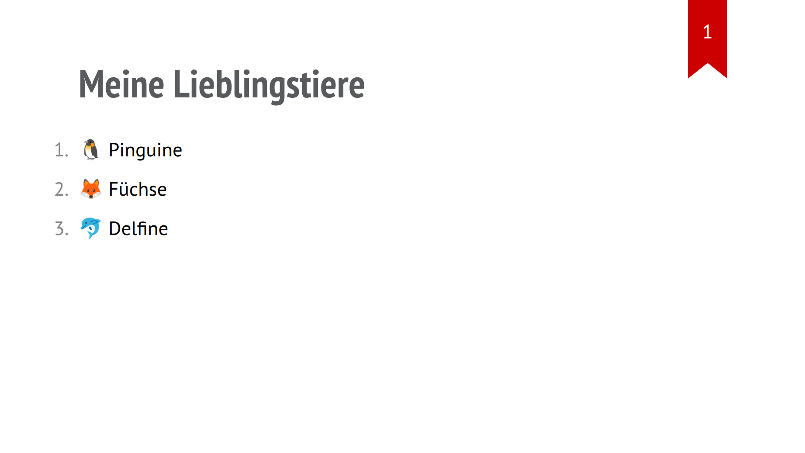
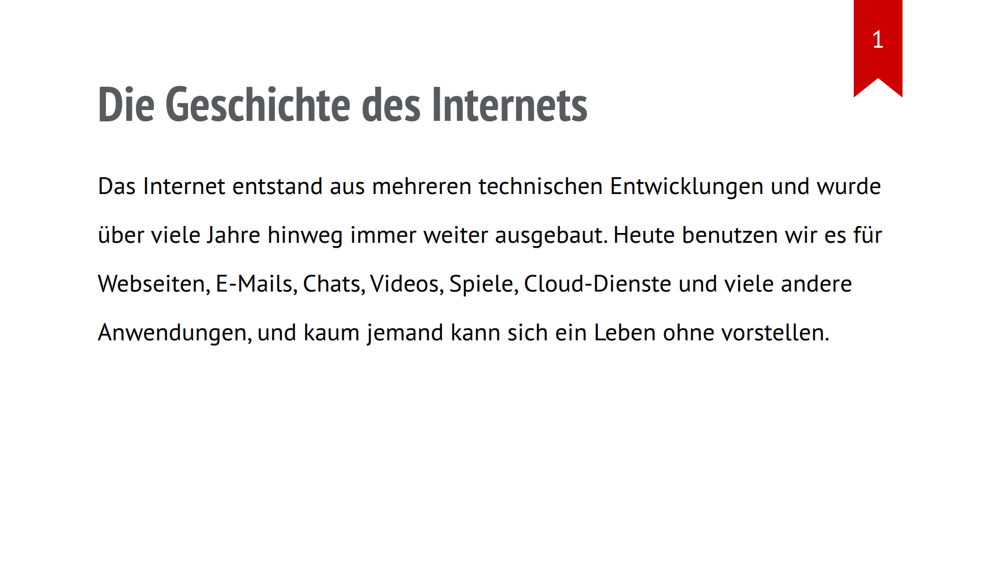
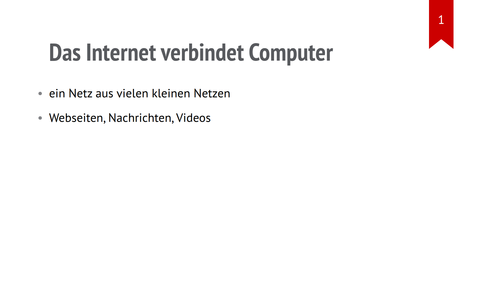
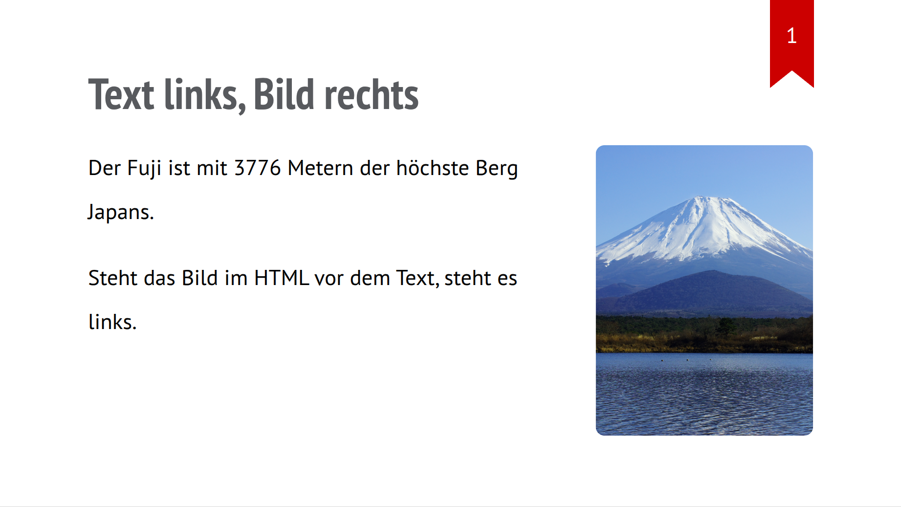
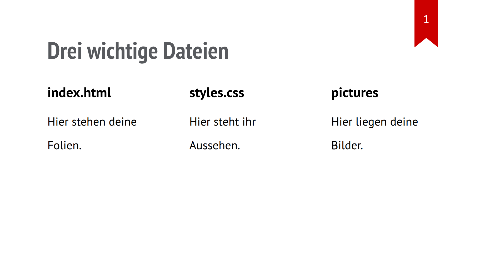
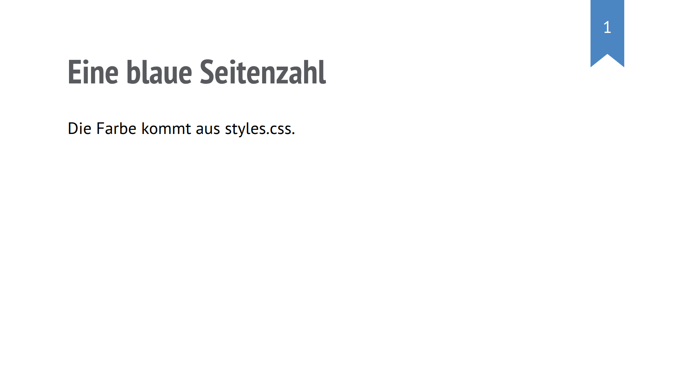
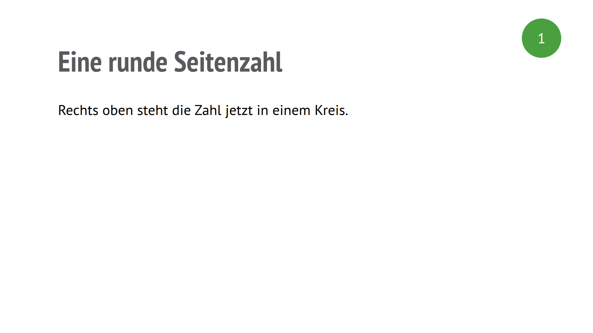
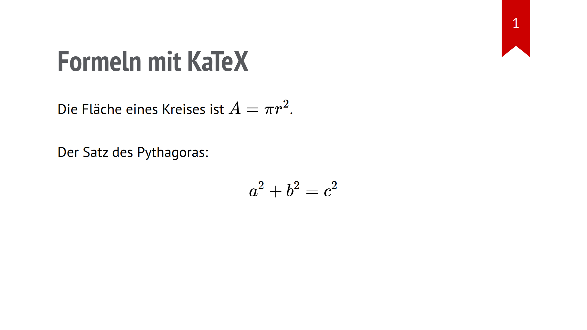

<div class='meta'>
image: folie.webp
kind: reference
</div>

<div
    class="autotoc-secondary-trigger"
    data-title="Auf dieser Seite"
    data-levels="h2,h3">
</div>

# Folien mit Shower

<p class='abstract'>
Was nur für Präsentationen mit Shower gilt: wie eine Folie aufgebaut ist, was eine gute Folie ausmacht, was die Vorlage schon mitbringt, wie du Seitenzahl und Formeln einrichtest und wie du präsentierst.
</p>

Wie du Text, Listen, Bilder, Farben, Schrift und Spalten auf eine Folie bekommst, steht auf den Seiten [HTML](/reference/html), [CSS](/reference/css) und [Layout](/reference/layout): Das geht auf Folien genauso wie auf Webseiten. Hier steht, was dazukommt.

<!-- part: folie -->
<!-- short: Jede Folie ist eine `<section class="slide">` in `index.html`, mit einer `<h2>` als Überschrift; eigenes CSS gehört ans Ende von `styles.css`. -->
## Eine Folie

In der Vorlage steht die ganze Präsentation in `index.html`. Jede Folie ist ein eigener Abschnitt, der mit `<section class="slide">` beginnt und mit `</section>` endet. Alles dazwischen gehört zu dieser einen Folie:

```html
<section class="slide">
    <h2>Meine Lieblingstiere</h2>
    <ol>
        <li>🐧 Pinguine</li>
        <li>🦊 Füchse</li>
        <li>🐬 Delfine</li>
    </ol>
</section>
```

<!-- tutorial-screenshot
# Die Vorlage der Aktivität »Eine Präsentation in HTML erstellen«; die
# Beispiele dieser Seite sind Folien (tutorial-screenshot-hooks.mjs)
terminal-open
terminal-run: git clone -q https://git.nhcham.org/specht/shower.js.git /workspace/shower.js && git -C /workspace/shower.js checkout -q 50a071df026545793cfa29853e5e4ed6b1ece36e
terminal-wait-for-prompt
terminal-run: cd /workspace/shower.js && (python3 -m http.server 8090 > /dev/null 2>&1 &)
write-file: beispiel.html <- previous-code
preview-port: 8090
tab: preview
viewport: 1024x576
hook: beispiel folie
-->

<button class='tutorial-preview' type='button'>
    
</button>

- `<h2>` ist die Überschrift der Folie.
- Die Seitenzahl im roten Band rechts oben setzt die Vorlage von selbst.
- Eine neue Folie fügst du ein, indem du eine ganze `<section>` kopierst und ihren Inhalt änderst.

Deine eigenen CSS-Regeln gehören in `styles.css`, ans Ende unter den Kommentar »Eigene CSS-Regeln«. So bleibt `index.html` übersichtlich: Dort stehen die Folien, in `styles.css` ihr Aussehen.

<div class='hint'>
Fehlt irgendwo ein schließendes Tag oder eine spitze Klammer, verschwinden oft mehrere Folien auf einmal. Mach dann mit <kbd>Strg</kbd><kbd>Z</kbd> rückgängig, bis die Folien wieder da sind, und ändere behutsam noch einmal.
</div>

<div class='tutorial-preview-clear'></div>

<!-- /part -->

<!-- part: gute-folien -->
<!-- short: Eine Aussage pro Folie, wenige Stichpunkte statt ganzer Sätze, große Schrift; die Folie unterstützt deinen Vortrag, sie ersetzt ihn nicht. -->
## Gute Folien

Eine Folie ist keine Buchseite. Dein Publikum soll dir zuhören und nicht gleichzeitig lesen. Diese Folie ist technisch richtig, aber zu voll:

```html
<section class="slide">
    <h2>Die Geschichte des Internets</h2>
    <p>
        Das Internet entstand aus mehreren technischen Entwicklungen und wurde
        über viele Jahre hinweg immer weiter ausgebaut. Heute benutzen wir es
        für Webseiten, E-Mails, Chats, Videos, Spiele, Cloud-Dienste und viele
        andere Anwendungen, und kaum jemand kann sich ein Leben ohne vorstellen.
    </p>
</section>
```

<!-- tutorial-screenshot
write-file: beispiel.html <- previous-code
tab: preview
viewport: 1024x576
hook: beispiel folie
-->

<button class='tutorial-preview' type='button'>
    
</button>

Besser ist eine kurze Aussage als Überschrift und wenige Stichworte. Was du ohnehin sagst, muss nicht auf der Folie stehen:

```html
<section class="slide">
    <h2>Das Internet verbindet Computer</h2>
    <ul>
        <li>ein Netz aus vielen kleinen Netzen</li>
        <li>Webseiten, Nachrichten, Videos</li>
    </ul>
</section>
```

<!-- tutorial-screenshot
write-file: beispiel.html <- previous-code
tab: preview
viewport: 1024x576
hook: beispiel folie
-->

<button class='tutorial-preview' type='button'>
    
</button>

- Eine Folie, eine Aussage. Die Überschrift sagt sie.
- Höchstens vier, fünf Stichpunkte, jeder höchstens eine Zeile.
- Musst du die Schrift kleiner machen, damit alles passt, nimm lieber zwei Folien.

<div class='tutorial-preview-clear'></div>

<!-- /part -->

<!-- part: vorlage -->
<!-- short: Die Vorlage bringt Klassen mit: `side-by-side` (Bild neben Text), `columns two` und `columns three` (Spalten), `cover` (Bild als Hintergrund) mit `bright-text`, `copyright` für den Bildnachweis. -->
## Was die Vorlage mitbringt

Für häufige Aufgaben hat die Vorlage fertige Klassen. Du brauchst dafür kein eigenes CSS, nur die Klasse im HTML.

### Bild neben Text: side-by-side

`side-by-side` stellt ein Bild und einen Textbereich nebeneinander, mit [Flexbox](/reference/layout#flexbox). Der Text bekommt den Platz, den das Bild übrig lässt:

```html
<section class="slide">
    <h2>Text links, Bild rechts</h2>
    <div class="side-by-side">
        <div>
            <p>Der Fuji ist mit 3776 Metern der höchste Berg Japans.</p>
            <p>Steht das Bild im HTML vor dem Text, steht es links.</p>
        </div>
        
    </div>
</section>
```

<!-- tutorial-screenshot
write-file: beispiel.html <- previous-code
tab: preview
viewport: 1024x576
hook: beispiel folie
-->

<button class='tutorial-preview' type='button'>
    
</button>

Das innere `<div>` hält die Absätze zusammen; ohne es stünden sie selbst nebeneinander.

<div class='tutorial-preview-clear'></div>

### Spalten: columns

`columns two`, `columns three` und `columns four` teilen den Platz in gleich breite [Spalten](/reference/layout#spalten). Jedes direkte Kind ist eine Spalte:

```html
<section class="slide">
    <h2>Drei wichtige Dateien</h2>
    <div class="columns three">
        <div>
            <h3>index.html</h3>
            <p>Hier stehen deine Folien.</p>
        </div>
        <div>
            <h3>styles.css</h3>
            <p>Hier steht ihr Aussehen.</p>
        </div>
        <div>
            <h3>pictures</h3>
            <p>Hier liegen deine Bilder.</p>
        </div>
    </div>
</section>
```

<!-- tutorial-screenshot
write-file: beispiel.html <- previous-code
tab: preview
viewport: 1024x576
hook: beispiel folie
-->

<button class='tutorial-preview' type='button'>
    
</button>

<div class='tutorial-preview-clear'></div>

### Ein Bild als Hintergrund: cover

Ein Bild mit der Klasse `cover` füllt die ganze Folie. `bright-text` an der Folie macht die Schrift weiß, mit einem Schatten, damit sie auf dem Bild lesbar bleibt. Unter das Bild gehört der Bildnachweis, mit der Klasse `copyright`:

```html
<section class="slide bright-text">
    <h2>Der Fuji</h2>
    
    <figcaption class="copyright right">
        Bild: 名古屋太郎, CC BY-SA 3.0, Wikimedia Commons
    </figcaption>
</section>
```

<!-- tutorial-screenshot
write-file: beispiel.html <- previous-code
tab: preview
viewport: 1024x576
hook: beispiel folie
-->

<button class='tutorial-preview' type='button'>
    
</button>

`copyright right` setzt den Nachweis unten rechts, `copyright left` unten links.

<div class='hint think'>
Bei fremden Bildern gehört der Nachweis auf die Folie: wer das Bild gemacht hat, unter welcher Lizenz es steht und woher es kommt. Wikimedia Commons nennt das bei jedem Bild.
</div>

<div class='tutorial-preview-clear'></div>

<!-- /part -->

<!-- part: seitenzahl -->
<!-- short: Die Seitenzahl setzt die Vorlage mit `.slide::after`; in `styles.css` änderst du Farbe und Form, `class="slide nopagenumber"` blendet sie auf einer Folie aus. -->
## Die Seitenzahl

Das rote Band mit der Foliennummer erzeugt die Vorlage selbst, mit der CSS-Regel `.slide::after`. Die Zahl schreibst du nie ins HTML; sie zählt von selbst mit.

### Farbe ändern

Willst du nur eine andere Farbe, überschreibe in `styles.css` den Hintergrund:

```html
<section class="slide">
    <h2>Eine blaue Seitenzahl</h2>
    <p>Die Farbe kommt aus styles.css.</p>
</section>
```

```css
.slide::after {
    background-color: #4b86c2;
}
```

<!-- tutorial-screenshot
write-file: beispiel.html <- code:Eine blaue Seitenzahl
write-file: beispiel.css <- previous-code
tab: preview
viewport: 1024x576
hook: beispiel css folie
-->

<button class='tutorial-preview' type='button'>
    
</button>

<div class='tutorial-preview-clear'></div>

### Eine runde Seitenzahl

Aus dem Band wird ein Kreis, wenn du die Lesezeichen-Form entfernst (`clip-path: none`) und die Ecken ganz rundest:

```html
<section class="slide">
    <h2>Eine runde Seitenzahl</h2>
    <p>Rechts oben steht die Zahl jetzt in einem Kreis.</p>
</section>
```

```css
.slide::after {
    top: 32px;
    left: auto;
    right: 55px;
    display: grid;
    place-items: center;
    width: 68px;
    height: 68px;
    padding-top: 0;
    clip-path: none;
    border-radius: 50%;
    background-color: #4aa03f;
    line-height: 1;
}
```

<!-- tutorial-screenshot
write-file: beispiel.html <- code:Eine runde Seitenzahl
write-file: beispiel.css <- previous-code
tab: preview
viewport: 1024x576
hook: beispiel css folie
-->

<button class='tutorial-preview' type='button'>
    
</button>

`left: auto; right: 55px` misst den Abstand vom rechten Rand statt vom linken.

<div class='tutorial-preview-clear'></div>

### Ohne Seitenzahl

Auf einer einzelnen Folie, etwa der Titelfolie, blendest du die Zahl mit einer zweiten Klasse aus; die passende Regel steht schon in `styles.css`:

```html
<section class="slide nopagenumber">
    <h2>Startfolie ohne Seitenzahl</h2>
</section>
```

Beide Klassen stehen im selben `class`-Attribut, durch ein Leerzeichen getrennt. Auf allen Folien zugleich verschwindet sie mit dieser Regel in `styles.css`:

```css
.slide::after {
    visibility: hidden;
}
```

<!-- /part -->

<!-- part: formeln -->
<!-- short: Formeln schreibst du in LaTeX, `\(a^2\)` im Satz und `$$a^2 + b^2 = c^2$$` in einer eigenen Zeile; dafür bindest du einmal KaTeX im `<head>` ein. -->
## Formeln mit KaTeX

`<sup>` und `<sub>` reichen für `a²` und `H₂O`. Für richtige Formeln gibt es KaTeX: Du schreibst die Formel in der Schreibweise von LaTeX, und KaTeX setzt sie.

### KaTeX einschalten

Die Dateien von KaTeX liegen in der Vorlage im Ordner `include/katex`, sind aber noch nicht eingebunden. Füge diese Zeilen einmal in den `<head>` von `index.html` ein, direkt unter `<link rel="stylesheet" href="styles.css">`:

```html_copy
<link rel="stylesheet" href="include/katex/katex.min.css">
<script defer src="include/katex/katex.min.js"></script>
<script defer src="include/katex/auto-render.min.js"
    onload="renderMathInElement(document.body);"></script>
```

### Formeln schreiben

```html
<section class="slide">
    <h2>Formeln mit KaTeX</h2>
    <p>Die Fläche eines Kreises ist \(A = \pi r^2\).</p>
    <p>Der Satz des Pythagoras:</p>
    <p>$$a^2 + b^2 = c^2$$</p>
</section>
```

<!-- tutorial-screenshot
write-file: beispiel.html <- previous-code
tab: preview
viewport: 1024x576
hook: beispiel folie
-->

<button class='tutorial-preview' type='button'>
    
</button>

- `\(` und `\)` umschließen eine Formel mitten im Satz.
- `$$` am Anfang und am Ende setzt eine Formel groß in eine eigene Zeile.

<div class='tutorial-preview-clear'></div>

Was du oft brauchst:

```text
x^2              hochgestellt
H_2O             tiefgestellt
\frac{a}{b}      Bruch
\sqrt{x}         Wurzel
\pi              π
\cdot            Malpunkt
\le  \ge         kleiner gleich, größer gleich
```

Siehst du statt der Formel nur den Code, prüfe: Sind die KaTeX-Zeilen im `<head>`? Ist die Formel mit `\(` **und** `\)` umschlossen? Sind alle geschweiften Klammern geschlossen, etwa bei `\frac{1}{2}`? Steht vor `\sqrt`, `\frac` und `\pi` der Backslash?

<!-- /part -->

<!-- part: praesentieren -->
<!-- short: Präsentieren: Folie anklicken, mit den Pfeiltasten weiter, <kbd>Esc</kbd> zur Übersicht, <kbd>F11</kbd> für Vollbild; der ganze Ordner läuft auch vom Stick. -->
## Präsentieren

Deine Präsentation läuft in jedem Browser:

- Klicke auf eine Folie in der Übersicht, um sie groß zu zeigen.
- Mit den Pfeiltasten oder der Leertaste geht es weiter und zurück.
- <kbd>Esc</kbd> führt zurück zur Übersicht aller Folien.
- <kbd>F11</kbd> schaltet den Browser auf Vollbild.
- <kbd>Strg</kbd><kbd>P</kbd> speichert die Präsentation als PDF, eine Folie pro Seite.

Zum Vortragen brauchst du weder Internet noch den Workspace: Lade den ganzen Ordner herunter, kopiere ihn auf einen Stick und öffne dort `index.html` mit einem Doppelklick. Das klappt nur, wenn alles im Ordner liegt, was die Präsentation braucht: Bilder, Schriften und die Dateien der Vorlage. Probiere es vor dem Vortrag einmal an einem anderen Rechner aus.

<!-- /part -->
