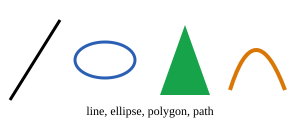
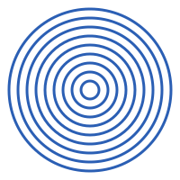

<div class='meta'>
kind: reference
</div>

<div
    class="autotoc-secondary-trigger"
    data-title="Auf dieser Seite"
    data-levels="h2,h3">
</div>

# SVG: Bilder aus Text

<p class='abstract'>
Ein SVG-Bild ist Text: eine Liste von Formen mit ihren Koordinaten und Farben. Du kannst es von Hand schreiben oder von einem Programm schreiben lassen, und es bleibt scharf, wie groß man es auch zeigt.
</p>

## Vektorgrafik und Rastergrafik

Ein Foto ist eine **Rastergrafik**: ein Gitter aus Pixeln, jedes mit seiner
Farbe. Vergrößert man es, werden die Pixel sichtbar. Eine **Vektorgrafik**
beschreibt stattdessen Formen: »ein Kreis mit dem Mittelpunkt (150, 50) und dem
Radius 30, orange«. Der Bildschirm rechnet die Pixel erst beim Anzeigen aus, in
jeder Größe neu, darum bleiben die Kanten scharf. SVG (Scalable Vector
Graphics) ist das Format für Vektorgrafik im Web; jeder Browser zeigt es an.

<!-- part: geruest -->
## Das Gerüst

```html
<svg xmlns="http://www.w3.org/2000/svg" viewBox="0 0 200 100">
  <rect x="10" y="10" width="80" height="50" fill="#2b5fb4"/>
  <circle cx="150" cy="50" r="30" fill="#d97706"/>
</svg>
```

<div class='gallery centered'>
<figure><figcaption>Das Bild zu diesem Text</figcaption></figure>
</div>

- `<svg>` umschließt das Bild; `xmlns` sagt, dass es SVG ist, und muss in einer
  eigenen Datei dastehen.
- `viewBox="0 0 200 100"` legt die Fläche fest, in der gezeichnet wird: links
  oben (0, 0), 200 Einheiten breit, 100 hoch. Wie groß das Bild am Ende
  erscheint, entscheidet, wer es zeigt; die Formen werden mitgestreckt.
- Jede Form ist ein Element, ihre Lage und Farbe stehen in Attributen. Ein
  Element ohne Inhalt endet mit `/>`.
<!-- /part -->

### Koordinaten

Die x-Achse geht nach rechts, die **y-Achse nach unten**, wie auf einem
Bildschirm. Der Punkt (0, 0) ist die linke obere Ecke. Ein Rechteck mit `y="10"`
beginnt also 10 Einheiten unter dem oberen Rand. Wer ein Diagramm mit y nach
oben zeichnen will, rechnet um: Die Höhe der Fläche minus y.

## Formen

```html
<line x1="10" y1="100" x2="60" y2="20" stroke="black" stroke-width="3"/>
<ellipse cx="105" cy="60" rx="30" ry="18" fill="none" stroke="#2b5fb4" stroke-width="3"/>
<polygon points="160,95 185,25 210,95" fill="#16a34a"/>
<path d="M 230 90 Q 255 10 285 90" fill="none" stroke="#d97706" stroke-width="4"/>
<text x="150" y="115" font-size="12" text-anchor="middle">line, ellipse, polygon, path</text>
```

<div class='gallery centered'>
<figure><figcaption>Fünf Formen in einem Bild</figcaption></figure>
</div>

<div class='scroll-x'>
<table class='table table-sm reference-table'>
<thead>
<tr><th>Element</th><th>Was es zeichnet</th><th>Wichtige Attribute</th></tr>
</thead>
<tbody>
<tr><td><code>rect</code></td><td>ein Rechteck</td><td><code>x</code>, <code>y</code> (linke obere Ecke), <code>width</code>, <code>height</code>, <code>rx</code> für runde Ecken</td></tr>
<tr><td><code>circle</code></td><td>einen Kreis</td><td><code>cx</code>, <code>cy</code> (Mittelpunkt), <code>r</code></td></tr>
<tr><td><code>ellipse</code></td><td>eine Ellipse</td><td><code>cx</code>, <code>cy</code>, <code>rx</code>, <code>ry</code></td></tr>
<tr><td><code>line</code></td><td>eine Strecke</td><td><code>x1</code>, <code>y1</code>, <code>x2</code>, <code>y2</code>; ohne <code>stroke</code> unsichtbar</td></tr>
<tr><td><code>polyline</code></td><td>einen Zug aus Strecken</td><td><code>points="x,y x,y …"</code></td></tr>
<tr><td><code>polygon</code></td><td>eine geschlossene Fläche</td><td><code>points</code>, wie <code>polyline</code>, der letzte Punkt wieder mit dem ersten verbunden</td></tr>
<tr><td><code>path</code></td><td>beliebige Linien und Kurven</td><td><code>d</code>: Befehle wie <code>M</code> (dorthin springen), <code>L</code> (Linie), <code>Q</code> und <code>C</code> (Kurven), <code>Z</code> (zurück zum Anfang)</td></tr>
<tr><td><code>text</code></td><td>Text</td><td><code>x</code>, <code>y</code> (die Grundlinie), <code>font-size</code>, <code>text-anchor</code> (<code>start</code>, <code>middle</code>, <code>end</code>)</td></tr>
</tbody>
</table>
</div>

### Farbe und Strich

- `fill` ist die Farbe der Fläche, `stroke` die des Randes, `stroke-width` seine
  Breite. Ohne `fill` ist eine Fläche schwarz; `fill="none"` lässt sie leer.
- Farben schreibt man wie in CSS: als Namen (`orange`), als `#d97706` oder als
  `rgb(217, 119, 6)`. `fill-opacity` und `stroke-opacity` von 0 bis 1 machen sie
  durchsichtig.
- Was später im Text steht, liegt oben: Ein Kreis nach einem Rechteck verdeckt
  es.

### Gruppen

`<g>` fasst Formen zusammen. Was an der Gruppe steht, gilt für alle darin, und
`transform` verschiebt, dreht oder streckt sie gemeinsam:

```html
<g fill="#2b5fb4" transform="translate(100 50) rotate(30)">
  <rect x="-20" y="-10" width="40" height="20"/>
  <circle cx="30" cy="0" r="8"/>
</g>
```

`translate(100 50)` schiebt den Nullpunkt der Gruppe nach (100, 50),
`rotate(30)` dreht sie um ihn, um 30 Grad im Uhrzeigersinn.

<!-- part: programm -->
## Aus einem Programm

Weil SVG Text ist, kann jedes Programm Bilder schreiben: Es setzt die Zeilen
als Strings zusammen und schreibt sie in eine Datei. Eine Schleife zeichnet
neun Kreise um denselben Mittelpunkt, jeder größer als der vorige:

<!-- language: ruby -->
```ruby
svg = ['<svg xmlns="http://www.w3.org/2000/svg" viewBox="0 0 200 200">',
       '<rect width="200" height="200" fill="white"/>']
(1..9).each do |i|
  svg << "<circle cx=\"100\" cy=\"100\" r=\"#{i * 10}\" fill=\"none\" stroke=\"#2b5fb4\" stroke-width=\"3\"/>"
end
svg << "</svg>"
File.write("circles.svg", svg.join("\n"))
```
<!-- /language -->
<!-- language: python -->
```python
svg = ['<svg xmlns="http://www.w3.org/2000/svg" viewBox="0 0 200 200">',
       '<rect width="200" height="200" fill="white"/>']
for i in range(1, 10):
    svg.append(f'<circle cx="100" cy="100" r="{i * 10}" fill="none" stroke="#2b5fb4" stroke-width="3"/>')
svg.append("</svg>")
with open("circles.svg", "w") as f:
    f.write("\n".join(svg))
```
<!-- /language -->

<div class='gallery centered'>
<figure><figcaption>Die neun Kreise der Schleife</figcaption></figure>
</div>

- Ein weißes Rechteck als erste Form gibt dem Bild einen Hintergrund; ohne ist es
  durchsichtig.
- Steht in einem `text` ein `<`, ein `>` oder ein `&`, schreibt man `&lt;`,
  `&gt;` und `&amp;`, sonst ist die Datei kaputt.
<!-- /part -->

## Ansehen

- **In VS Code:** Eine Datei, die auf `.svg` endet, öffnet VS Code als Bild.
  Oben rechts im Reiter wechselt ein Knopf zum Text und zurück.
- **Im Browser:** Zieh die Datei in ein Browserfenster, oder öffne sie mit dem
  Live Server.
- **In einer Webseite:** `` wie jedes Bild, oder
  das ganze `<svg>`-Element direkt im HTML, ohne `xmlns`.

## Zum Nachschlagen

- [SVG bei MDN](https://developer.mozilla.org/de/docs/Web/SVG), mit einem
  [Tutorial](https://developer.mozilla.org/de/docs/Web/SVG/Tutorial) und
  [allen Elementen](https://developer.mozilla.org/en-US/docs/Web/SVG/Reference/Element)
- [Scalable Vector Graphics (SVG) 2](https://www.w3.org/TR/SVG2/), der Standard
  beim W3C
