

kind: reference
search: Vektor, Punkt, Richtung, Länge, normalisieren, Skalarprodukt, dot, Kreuzprodukt, cross, Normale, reflect, Spiegeln, Strahl, lerp, mix, drehen, Winkel, atan2, raymath, vec3, Koordinaten

# Vektoren

Rechnen mit Punkten und Richtungen, so wie in <a href='/raytracing'>Raytracing</a>, im <a href='/raycaster'>Raycaster</a>, mit <a href='/raylib'>raylib</a> und in <a href='/glsl'>Shadern</a>: was die Rechenarten bedeuten, wie man sie in den drei Schreibweisen aufschreibt, und wofür man sie braucht. Die Befehle selbst stehen auch unter <a href='/reference/raylib#vektoren'>raylib</a> und <a href='/reference/glsl#funktionen'>GLSL</a>.

## Punkte, Richtungen, Farben

<!-- part: vektor -->
<!-- short: Ein Vektor sind drei Zahlen (x, y, z): ein Punkt, eine Richtung oder eine Farbe; im Raum x nach rechts, y nach oben, z zum Betrachter. -->
Ein **Vektor** sind zwei oder drei Zahlen. Dieselben Zahlen können verschiedenes bedeuten:

- einen **Punkt**, etwa den Mittelpunkt einer Kugel oder die Position der Kamera,
- eine **Richtung** mit einer Länge, etwa wohin ein Strahl läuft oder wie schnell sich etwas bewegt,
- eine **Farbe** mit Rot, Grün und Blau, wie in Raytracing und in Shadern.

Ein Punkt hat einen Ort. Eine Richtung hat keinen: Derselbe Pfeil darf überall stehen.

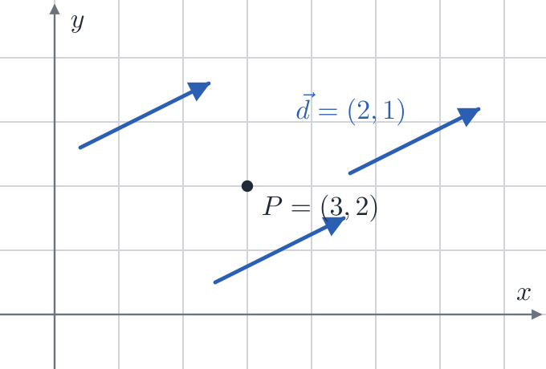

Im Raum zeigt x nach rechts, y nach oben und z zum Betrachter; wer geradeaus in die Szene schaut, schaut in Richtung −z. Auf dem Bildschirm und in der Karte des Raycasters zeigt y dagegen nach unten, wie die Pixelzeilen. `gl_FragCoord` in einem Shader zählt von unten links.

<figure>
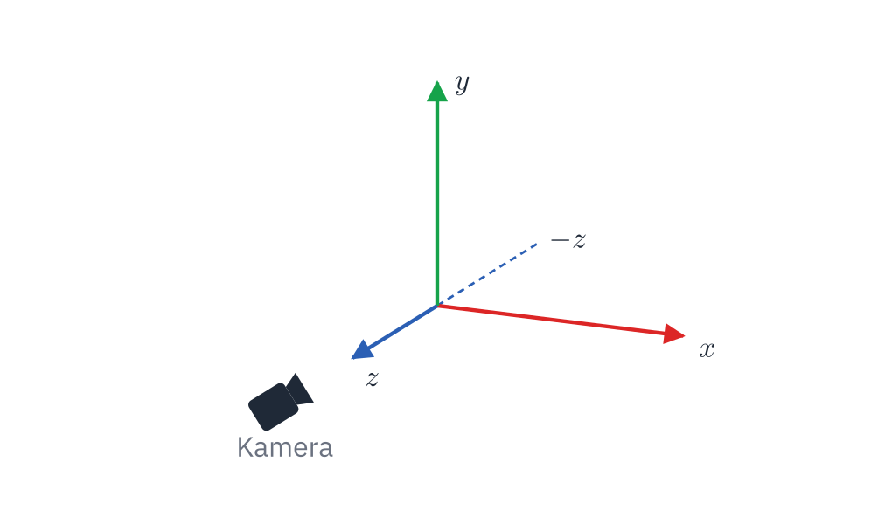
<figcaption>Im Raum</figcaption></figure>
<figure>
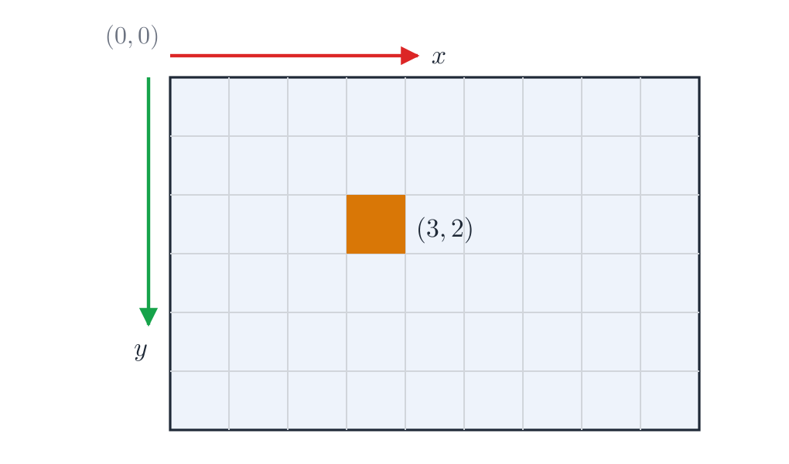
<figcaption>Auf dem Bildschirm</figcaption></figure>

<table class='table table-sm reference-table reference-table-wide'>
<thead><tr><th></th><th>Raytracing (C)</th><th>raylib (C)</th><th>GLSL</th></tr></thead>
<tbody>
<tr><th>Typ</th><td><code>vec</code>, eigenes <code>struct</code></td><td><code>Vector2</code>, <code>Vector3</code></td><td><code>vec2</code>, <code>vec3</code>, <code>vec4</code></td></tr>
<tr><th>ein Vektor</th><td><code>(vec){1, 2, 3}</code></td><td><code>(Vector3){1, 2, 3}</code></td><td><code>vec3(1.0, 2.0, 3.0)</code></td></tr>
<tr><th>eine Komponente</th><td><code>v.x</code></td><td><code>v.x</code></td><td><code>v.x</code>, für Farben auch <code>v.r</code>; <code>v.xy</code> sind zwei auf einmal</td></tr>
<tr><th>rechnen</th><td>mit Funktionen: <code>add(a, b)</code></td><td>mit Funktionen aus <code>raymath.h</code>: <code>Vector3Add(a, b)</code></td><td>mit Zeichen: <code>a + b</code></td></tr>
</tbody>
</table>

<!-- /part -->

## Rechnen

<!-- part: rechnen -->
<!-- short: a + b verschiebt, b − a zeigt von a nach b, s · a streckt; Länge mit Pythagoras, normalize macht die Länge 1. -->

<table class='table table-sm reference-table reference-table-wide'>
<thead><tr><th>Rechnung</th><th>Bedeutung</th><th>Raytracing</th><th>raylib</th><th>GLSL</th></tr></thead>
<tbody>
<tr><th><code>a + b</code></th><td>Punkt plus Richtung: der Punkt, verschoben</td><td><code>add</code></td><td><code>Vector3Add</code></td><td><code>a + b</code></td></tr>
<tr><th><code>b − a</code></th><td>Punkt minus Punkt: die Richtung von <code>a</code> nach <code>b</code></td><td><code>sub(b, a)</code></td><td><code>Vector3Subtract(b, a)</code></td><td><code>b - a</code></td></tr>
<tr><th><code>s · a</code></th><td>streckt die Richtung auf das <code>s</code>-fache, negativ dreht sie um</td><td><code>scale</code></td><td><code>Vector3Scale</code></td><td><code>s * a</code></td></tr>
<tr><th>jede Komponente mal die andere</th><td>Farben mischen: rotes Licht auf einer weißen Wand</td><td><code>mul</code></td><td><code>Vector3Multiply</code></td><td><code>a * b</code></td></tr>
<tr><th><code>|a|</code></th><td>Länge</td><td><code>length</code></td><td><code>Vector3Length</code></td><td><code>length(a)</code></td></tr>
<tr><th><code>a / |a|</code></th><td>dieselbe Richtung mit Länge 1</td><td><code>normalize</code></td><td><code>Vector3Normalize</code></td><td><code>normalize(a)</code></td></tr>
<tr><th><code>|b − a|</code></th><td>Abstand zweier Punkte</td><td><code>length(sub(b, a))</code></td><td><code>Vector3Distance</code></td><td><code>distance(a, b)</code></td></tr>
<tr><th><code>a + t · (b − a)</code></th><td>überblenden: <code>a</code> bei <code>t = 0</code>, <code>b</code> bei <code>t = 1</code>, die Mitte bei 0,5</td><td><code>mix</code></td><td><code>Vector3Lerp</code></td><td><code>mix(a, b, t)</code></td></tr>
</tbody>
</table>

<figure>
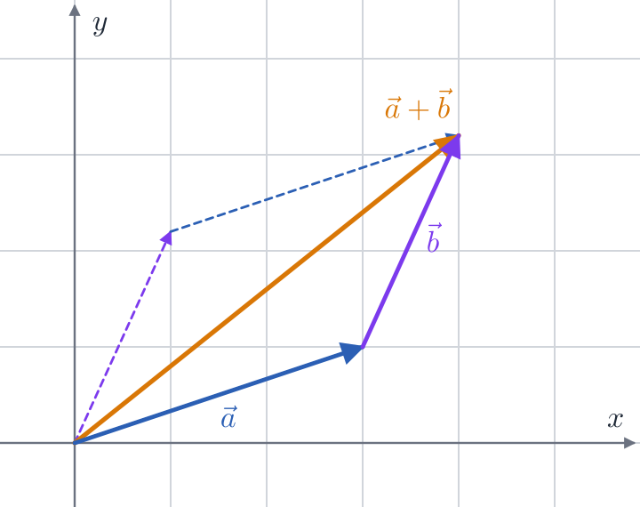
<figcaption>a + b: b an die Spitze von a</figcaption></figure>
<figure>
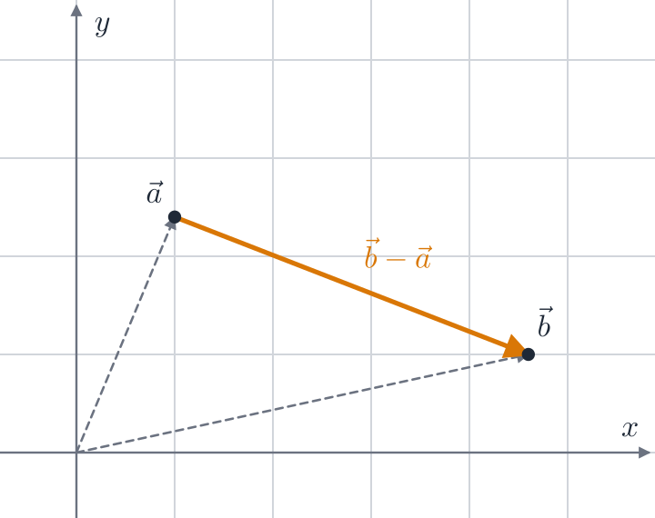
<figcaption>b − a: von a nach b</figcaption></figure>
<figure>
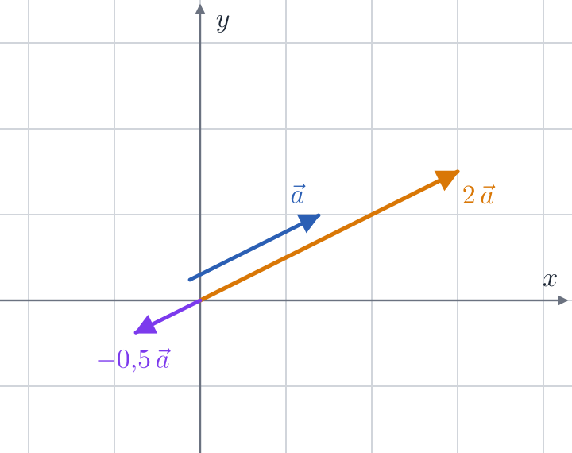
<figcaption>2 · a und −0,5 · a</figcaption></figure>
<figure>
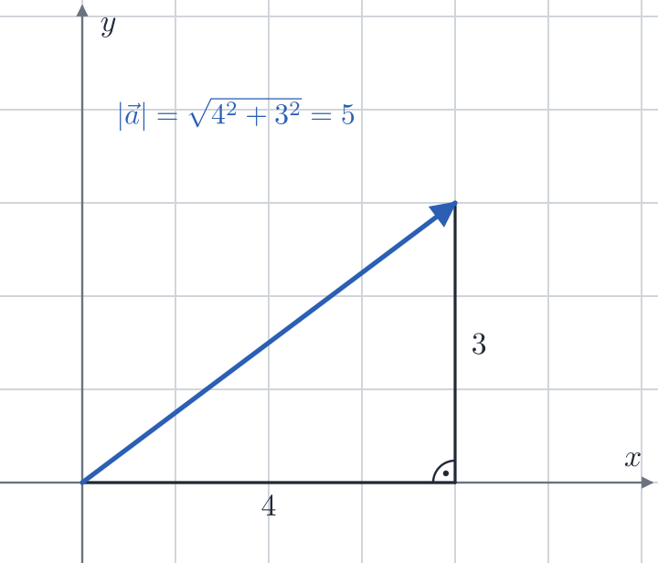
<figcaption>Länge mit Pythagoras</figcaption></figure>
<figure>
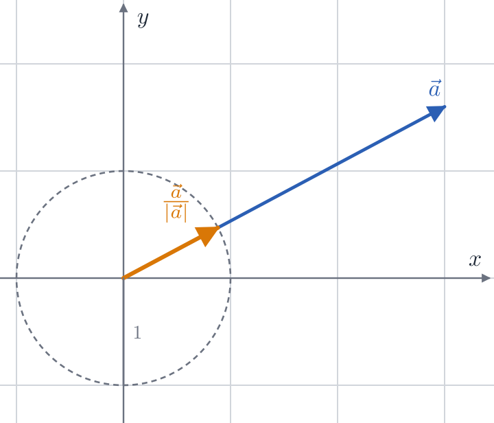
<figcaption>normalize: Länge 1</figcaption></figure>
<figure>
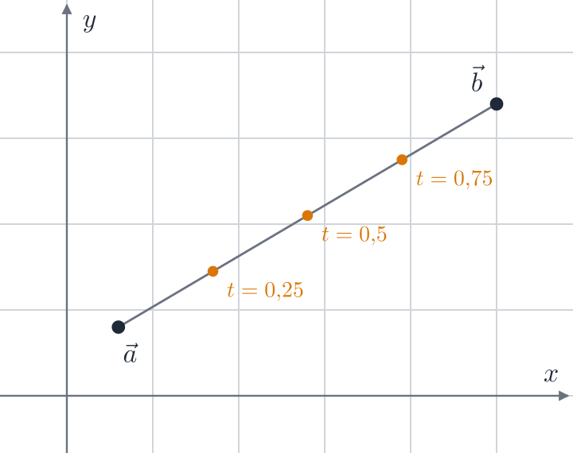
<figcaption>mix: von a nach b</figcaption></figure>

Die Länge kommt aus dem Satz des Pythagoras, einmal in der Ebene und einmal in die Höhe:

$$|a| = \sqrt{x^2 + y^2 + z^2} \qquad |(2, 1, -2)| = \sqrt{4 + 1 + 4} = 3$$

Normalisiert ist das \\((\tfrac{2}{3}, \tfrac{1}{3}, -\tfrac{2}{3})\\). Eine Richtung mit Länge 1 heißt **Einheitsvektor**; viele Formeln unten gelten nur für solche. Ein Vektor der Länge 0 hat keine Richtung und lässt sich nicht normalisieren: Im Raytracing wird dann durch 0 geteilt, und heraus kommt `nan` (»not a number«), das sich durch jede weitere Rechnung zieht; raylib gibt ihn unverändert zurück.
<!-- /part -->

## Das Skalarprodukt

<!-- part: skalarprodukt -->
<!-- short: dot(a, b) = ax·bx + ay·by + az·bz; für Einheitsvektoren der Kosinus des Winkels: 1 gleiche Richtung, 0 senkrecht, negativ entgegengesetzt. -->
Das **Skalarprodukt** zweier Vektoren ist eine Zahl: Komponente mal Komponente, alles zusammengezählt.

$$a \cdot b = a\_x b\_x + a\_y b\_y + a\_z b\_z = |a|\ |b| \cos \theta$$

\\(\theta\\) ist der Winkel zwischen den beiden. Für zwei Einheitsvektoren bleibt nur \\(\cos \theta\\), und daran sieht man, wie sie zueinander stehen:

<table class='table table-sm reference-table'>
<thead><tr><th><code>dot(a, b)</code></th><th>Winkel</th><th>heißt</th></tr></thead>
<tbody>
<tr><td>1</td><td>0°</td><td>dieselbe Richtung</td></tr>
<tr><td>zwischen 0 und 1</td><td>unter 90°</td><td>ungefähr in dieselbe Richtung</td></tr>
<tr><td>0</td><td>90°</td><td>senkrecht zueinander</td></tr>
<tr><td>negativ</td><td>über 90°</td><td>eher entgegengesetzt; −1 genau entgegengesetzt</td></tr>
</tbody>
</table>

<figure>
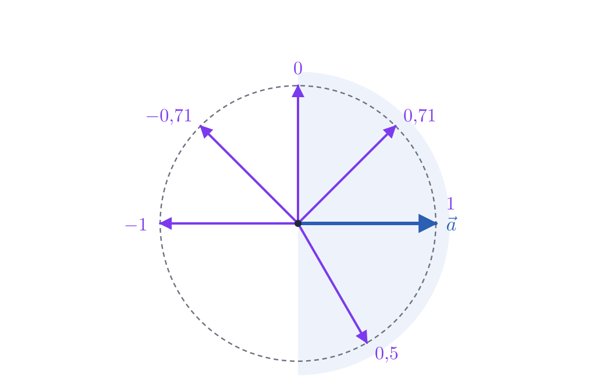
<figcaption>Das Vorzeichen zeigt die Seite</figcaption></figure>
<figure>
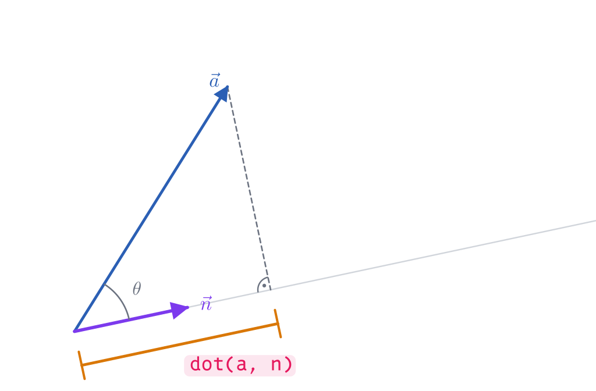
<figcaption>dot(a, n): das Stück von a entlang n</figcaption></figure>

Ein Beispiel ohne Einheitsvektoren: \\((2, 1, -2) \cdot (1, 2, 2) = 2 + 2 - 4 = 0\\), die beiden stehen also senkrecht aufeinander. Wofür man es braucht:

- **Licht**: Wie hell eine Fläche ist, hängt davon ab, wie steil das Licht auf sie fällt: `dot(normal, sun_dir)` für die Normale und die Richtung zur Sonne, beide mit Länge 1. Ist es negativ, liegt die Sonne hinter der Fläche, und es zählt als 0.
- **Vorne oder hinten**: Das Vorzeichen von `dot(dir, b − a)` sagt, ob der Punkt `b` vor oder hinter jemandem bei `a` liegt, der in Richtung `dir` schaut.
- **Ein Stück entlang einer Richtung**: Mit `n` der Länge 1 ist `dot(a, n)` die Länge von `a` entlang `n`, und `dot(a, n) · n` dieser Teil von `a` als Vektor.
- **Länge zum Quadrat**: `dot(a, a)` ist \\(|a|^2\\), ohne Wurzel; gut, um Abstände zu vergleichen.

Den Winkel selbst liefert `acos(dot(a, b))` für Einheitsvektoren, im Bogenmaß; raylibs `Vector3Angle(a, b)` rechnet ihn für beliebige Längen aus.
<!-- /part -->

## Das Kreuzprodukt

<!-- part: kreuzprodukt -->
<!-- short: cross(a, b) steht senkrecht auf a und b, mit der rechten Hand; cross(b, a) zeigt in die Gegenrichtung; bei gleicher Richtung kommt 0 heraus. -->
Das **Kreuzprodukt** zweier Vektoren im Raum ist ein Vektor, der auf beiden senkrecht steht:

$$a \times b = (a\_y b\_z - a\_z b\_y,\quad  a\_z b\_x - a\_x b\_z,\quad  a\_x b\_y - a\_y b\_x)$$

- Die Richtung folgt der **rechten Hand**: Daumen in Richtung `a`, Zeigefinger in Richtung `b`, dann zeigt der abgespreizte Mittelfinger in Richtung `cross(a, b)`. So ist `cross((1, 0, 0), (0, 1, 0))` = `(0, 0, 1)`: x mal y ergibt z.
- Die Reihenfolge zählt: `cross(b, a)` zeigt genau in die Gegenrichtung.
- Die Länge ist \\(|a|\\,|b| \sin \theta\\): für zwei Einheitsvektoren im rechten Winkel 1, sonst kürzer. Wer eine Richtung braucht, normalisiert danach.
- Zeigen `a` und `b` in dieselbe oder genau die entgegengesetzte Richtung, ist das Ergebnis `(0, 0, 0)`. Eine Kamera, die `right` aus ihrer Blickrichtung und »oben« `(0, 1, 0)` berechnet, geht deshalb kaputt, wenn sie genau nach oben oder unten schaut.

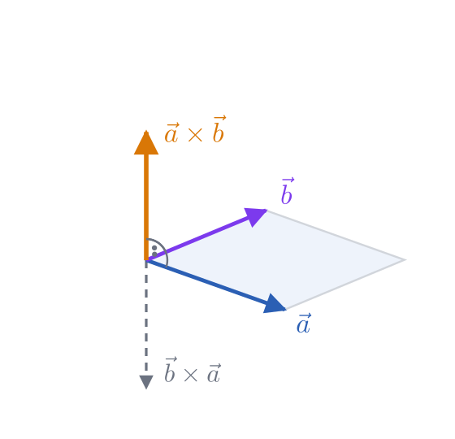

Mit dem Beispiel von oben: \\((2, 1, -2) \times (1, 2, 2) = (2 + 4,\\; -2 - 4,\\; 4 - 1) = (6, -6, 3)\\). Es hat die Länge 9 = 3 · 3, denn die beiden stehen senkrecht.

Im Raytracing: `cross`, in raylib `Vector3CrossProduct`, in GLSL `cross`. In 2D gibt es kein Kreuzprodukt; dort steht `(−y, x)` senkrecht auf `(x, y)`, um 90° gedreht.
<!-- /part -->

## Normalen und Spiegeln

<!-- part: spiegeln -->
<!-- short: Die Normale steht senkrecht auf einer Fläche, Länge 1; reflect(d, n) = d − 2 · dot(d, n) · n. -->
Die **Normale** einer Fläche ist ein Einheitsvektor, der senkrecht auf ihr steht und nach außen zeigt. Bei einem Boden ist das `(0, 1, 0)`, bei einer Kugel mit dem Mittelpunkt `c` und dem Radius `r` an der Stelle `p` ist es `(p − c) / r`.

Eine Richtung `d`, die auf eine Fläche mit der Normalen `n` trifft, prallt so ab:

$$\text{reflect}(d, n) = d - 2\ (d \cdot n)\ n$$

`(d · n) · n` ist der Teil von `d` senkrecht zur Fläche. Einmal abgezogen, läuft der Strahl an der Fläche entlang; zweimal abgezogen, ist dieser Teil umgedreht, und der Strahl fliegt im selben Winkel wieder weg. Der Teil entlang der Fläche bleibt, wie er war. `n` muss die Länge 1 haben.

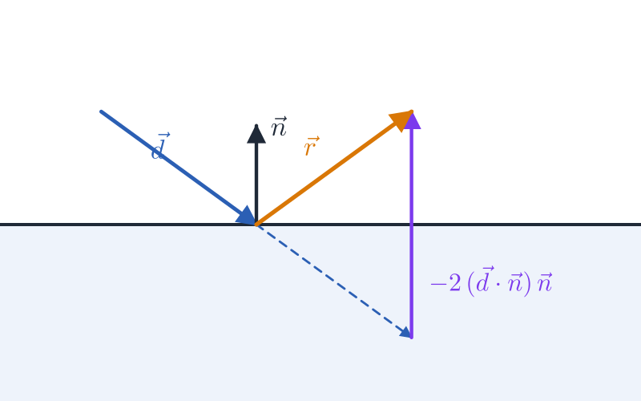

 Im Raytracing: `reflect`, in raylib `Vector3Reflect(d, n)`, in GLSL `reflect(d, n)`.
<!-- /part -->

## Strahlen

<!-- part: strahl -->
<!-- short: Ein Strahl ist p(t) = origin + t · dir; mit |dir| = 1 ist t die Entfernung, t > 0 liegt vor dem Startpunkt. -->
Ein **Strahl** beginnt an einem Punkt `origin` und läuft in die Richtung `dir`. Jeder Punkt auf ihm ist

$$p(t) = \text{origin} + t \cdot \text{dir}$$

Hat `dir` die Länge 1, ist `t` die Entfernung vom Startpunkt: Mit `origin = (0, 1, 0)` und `dir = (0, 0, -1)` liegt `p(3)` = `(0, 1, −3)` drei Einheiten weiter. Ein negatives `t` liegt hinter dem Startpunkt und zählt bei einem Treffer nicht. Zu fragen, wo ein Strahl eine Kugel oder eine Ebene trifft, heißt: das kleinste positive `t` suchen, bei dem `p(t)` auf ihr liegt.

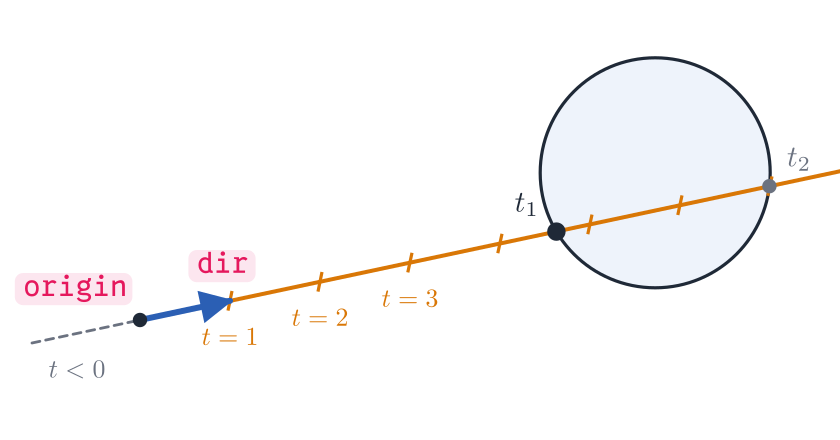

Im Raycaster setzt sich die Richtung jedes Strahls aus zwei Vektoren zusammen, der Blickrichtung und einem Stück der Kamera-Ebene quer dazu: `dir + plane · camera_x`.
<!-- /part -->

## Winkel und Drehen in 2D

<!-- part: drehen -->
<!-- short: Die Richtung zum Winkel α ist (cos α, sin α), der Winkel einer Richtung atan2(y, x); drehen um α mit cos und sin. -->

<table class='table table-sm reference-table'>
<thead><tr><th>Was</th><th>Wie</th></tr></thead>
<tbody>
<tr><td>die Richtung zum Winkel <code>α</code>, Länge 1</td><td><code>(cos(α), sin(α))</code></td></tr>
<tr><td>der Winkel einer Richtung</td><td><code>atan2(y, x)</code>, von −π bis π; die Reihenfolge ist y, x</td></tr>
<tr><td><code>(x, y)</code> um <code>α</code> gedreht</td><td><code>(x · cos(α) − y · sin(α), x · sin(α) + y · cos(α))</code>, in raylib <code>Vector2Rotate(v, α)</code></td></tr>
<tr><td>um 90° gedreht</td><td><code>(−y, x)</code>, in die andere Richtung <code>(y, −x)</code></td></tr>
</tbody>
</table>

<figure>
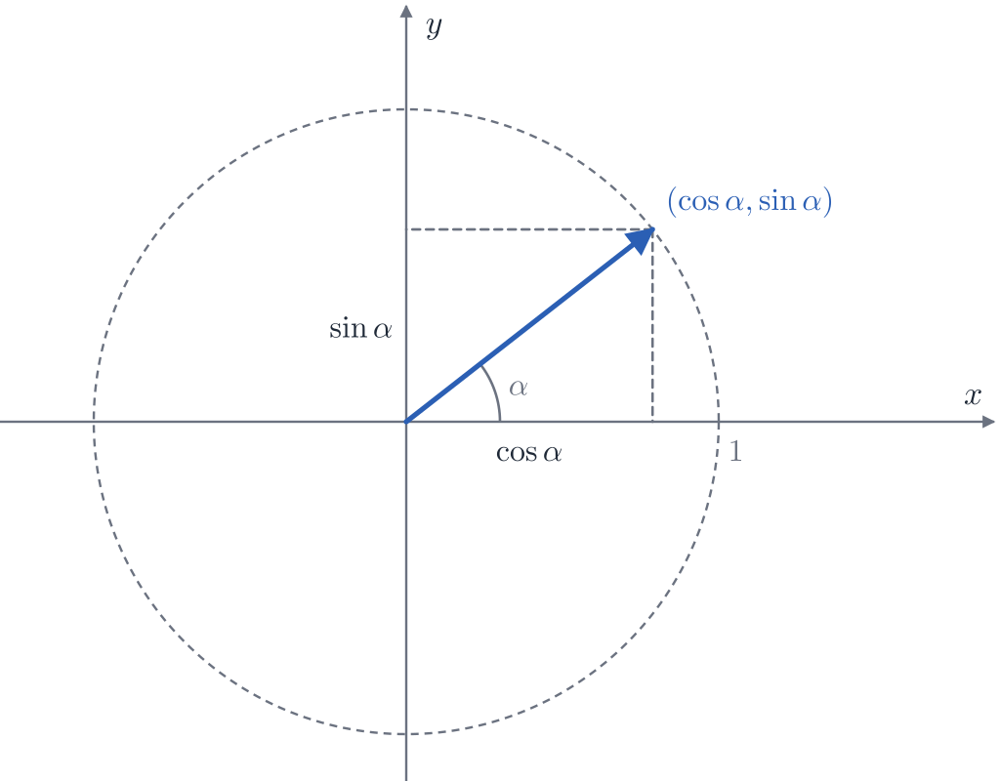
<figcaption>Richtung zum Winkel α</figcaption></figure>
<figure>
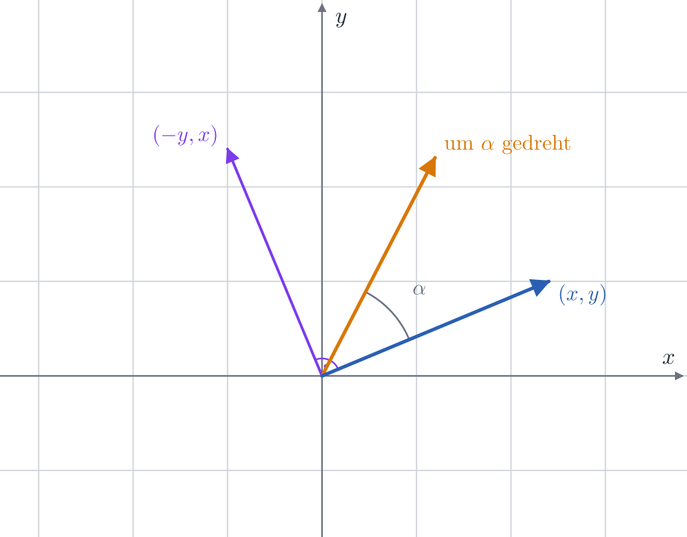
<figcaption>Gedreht um α und um 90°</figcaption></figure>

Winkel stehen im Bogenmaß: Eine ganze Umdrehung ist \\(2\pi\\), 90° sind \\(\pi / 2\\), und aus Grad wird Bogenmaß mal \\(\pi / 180\\). Ein wachsender Winkel dreht gegen den Uhrzeigersinn, wenn y nach oben zeigt, und im Uhrzeigersinn, wenn y wie auf dem Bildschirm nach unten zeigt.
<!-- /part -->

## Zum Nachschlagen

- [raymath.h](https://github.com/raysan5/raylib/blob/master/src/raymath.h): alle Rechenbefehle von raylib für Vektoren, mit dem Code jeder Funktion, auf Englisch.
- [Skalarprodukt](https://de.wikipedia.org/wiki/Skalarprodukt) und [Kreuzprodukt](https://de.wikipedia.org/wiki/Kreuzprodukt) in der Wikipedia.
