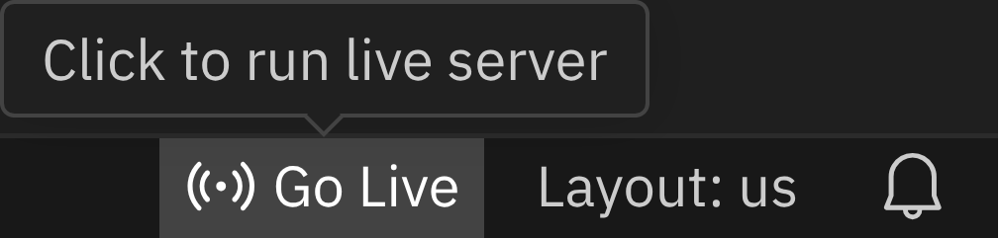

<div class='meta'>
image: git-clone.webp
kind: reference
</div>

# Workspace: Grundgriffe

<p class='abstract'>
Handgriffe, die viele Aktivitäten brauchen: eine Vorlage aus einem Git-Repository klonen, eine neue Version davon holen und die Live-Vorschau starten. Aktivitäten binden diese Abschnitte ein, damit sie überall gleich aussehen.
</p>

## Vorlagen

<!-- part: repository-klonen -->
### Repository klonen

Stelle zuerst sicher, dass du keinen Ordner geöffnet hast. Um sicherzugehen, drücke einfach den Shortcut für »Ordner schließen«: <kbd>Strg</kbd><kbd>K</kbd> und dann <kbd>F</kbd>. Dein Workspace sollte jetzt ungefähr so aussehen:


Klicke auf »Clone Repository« und füge die Adresse der Vorlage ein:

```bash
${template}
```


Bestätige mit <kbd>Enter</kbd>. Danach wählst du das Verzeichnis, in dem das Repository gespeichert werden soll: den Ordner `/workspace`.


Das Repository wird jetzt in einen Unterordner von `/workspace` geklont, der so heißt wie das Repository. Beantworte die Frage, ob es jetzt geöffnet werden soll, mit »Open«:


<!-- /part -->

<!-- part: neue-version -->
### Eine neue Version der Vorlage holen

Vorlagen wie die Sandboxes oder der Anaglyph-Viewer werden weiterentwickelt. Wenn du eine geklont hast, sieht der Workspace auf der Seite der Aktivität nach, ob es inzwischen eine neuere Version gibt, und sagt es dir. Er holt sie nie von selbst; das machst du im Ordner der Vorlage, zum Beispiel:

```bash
cd /workspace/cpu-sandbox
git pull
```

Bricht `git pull` mit **Your local changes to the following files would be overwritten** ab, hast du eine Datei geändert, die auch in der neuen Version anders ist. Leg deine Änderungen kurz beiseite, hol die neue Version und nimm deine Änderungen danach zurück:

```bash
git stash
git pull
git stash pop
```

Meldet Git **divergent branches**, hast du selbst etwas committet. Dann hilft `git pull --no-rebase`; öffnet sich ein Editor für eine Commit-Nachricht, speichere sie unverändert und schließe ihn. Meldet Git einen **Konflikt**: nichts löschen, nichts überschreiben, nach Hilfe fragen. Deine Änderungen sind nicht weg, `git stash list` zeigt sie.
<!-- /part -->

<!-- part: live-server -->
## Live-Vorschau starten



Im Workspace ist die Erweiterung »Live Server« installiert. Unten rechts findest du den Eintrag »Go Live«. Klicke darauf, um die Vorschau zu starten. Sie öffnet sich in einem neuen Browsertab.

Der Live Server ist ein kleiner Webserver in deinem Workspace. Er liefert die Dateien aus deinem geöffneten Ordner aus, und die Adresse in der Vorschau zeigt, welche Datei du gerade siehst.

<div style='clear: both;'></div>

<div class='hint'>
Falls sich die Vorschau einmal nicht mehr aktualisiert, lade die Seite neu: <kbd>Strg</kbd><kbd>R</kbd> oder <kbd>F5</kbd>.
</div>
<!-- /part -->
