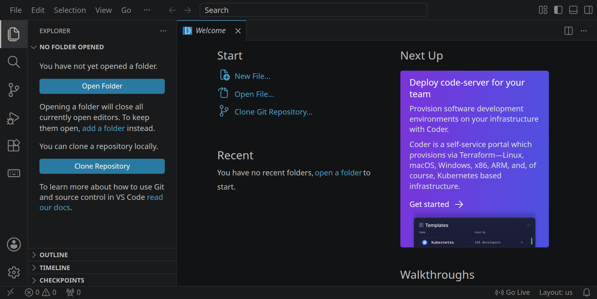
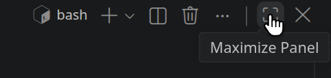
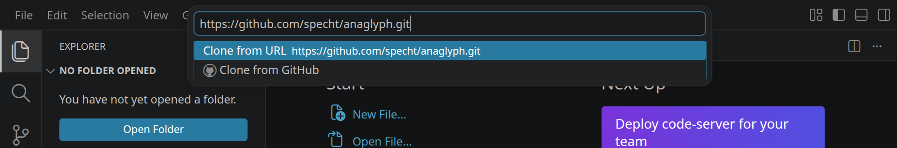
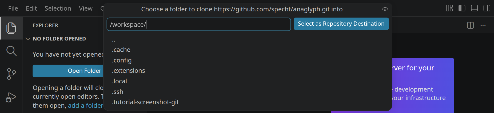
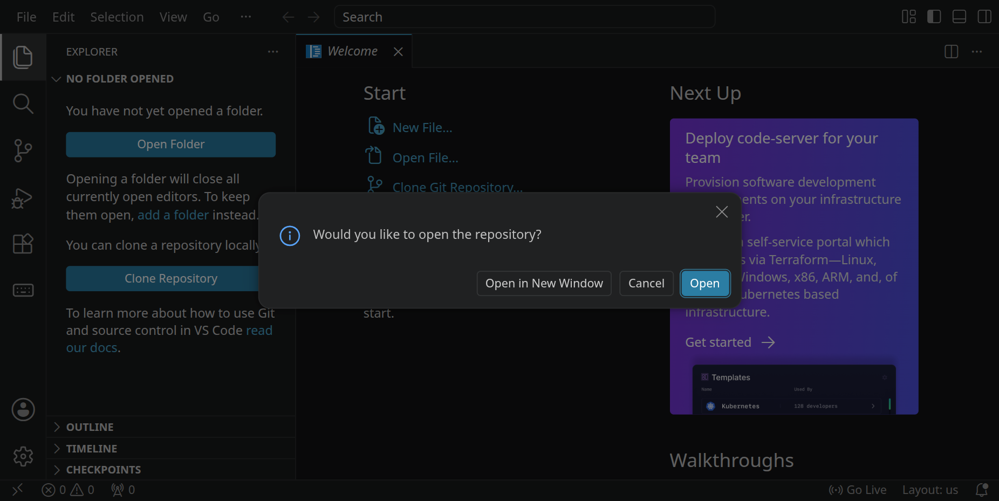
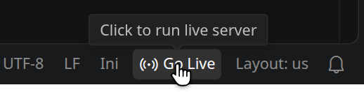
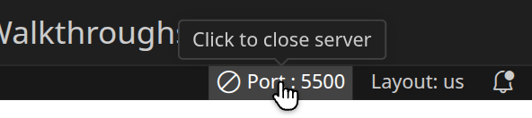
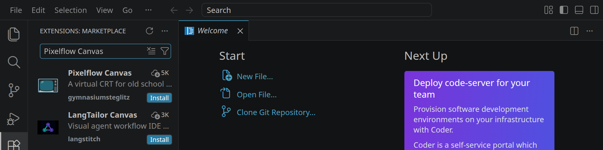
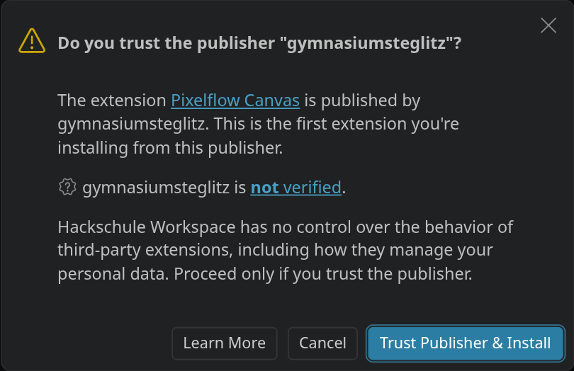

<div class='meta'>
image: git-clone.webp
kind: reference
</div>

<div
    class="autotoc-secondary-trigger"
    data-title="Auf dieser Seite"
    data-levels="h2,h3">
</div>

# Workspace: Grundlagen

<p class='abstract'>
Handgriffe, die viele Aktivitäten brauchen: das Terminal öffnen, eine Vorlage aus einem Git-Repository klonen, eine neue Version davon holen und die Live-Vorschau starten. Aktivitäten binden diese Abschnitte ein, damit sie überall gleich aussehen.
</p>

## Erste Schritte

<!-- part: terminal-oeffnen -->
<!-- short: Kein Ordner offen (<kbd>Strg</kbd><kbd>K</kbd>, dann <kbd>F</kbd>), Seitenleiste zu (<kbd>Strg</kbd><kbd>B</kbd>), Terminal auf (<kbd>Strg</kbd><kbd>J</kbd>). -->
### Terminal öffnen

Stelle zuerst sicher, dass du keinen Ordner geöffnet hast. Um sicherzugehen, drücke einfach den Shortcut für »Ordner schließen«: <kbd>Strg</kbd><kbd>K</kbd> und dann <kbd>F</kbd>. Dein Workspace sollte jetzt ungefähr so aussehen:

<!-- tutorial-screenshot
# Workspace ohne geöffneten Ordner
show-left-sidebar
-->



Schließe die linke Seitenleiste mit <kbd>Strg</kbd><kbd>B</kbd>, um mehr Platz zu haben, und öffne das Terminal mit <kbd>Strg</kbd><kbd>J</kbd>:

<!-- tutorial-screenshot
hide-left-sidebar
terminal-open
-->


<!-- tutorial-screenshot
# Shared: the pages that show it point to this picture (src/content/common/ is gone)
move-mouse: selector:.part.panel [aria-label*="Maximize Panel"]
sleep: 1.5
show-mouse
crop-left: 74%
crop-top: 63.5%
crop-bottom: 24%
keep-only: .part.panel > .composite.title
keep-only: .workbench-hover
keep-only: .workbench-hover-pointer
-->



Mit dem Symbol rechts oben im Terminal kannst du es maximieren. Die linke Seitenleiste blendest du jederzeit mit <kbd>Strg</kbd><kbd>B</kbd> ein und aus.

<div style='clear: both;'></div>
<!-- /part -->

## Vorlagen

<!-- part: repository-klonen -->
<!-- short: Ordner schließen (<kbd>Strg</kbd><kbd>K</kbd>, dann <kbd>F</kbd>), »Clone Repository« mit der Adresse unten, Zielordner `/workspace`, dann »Open«. -->
### Repository klonen

Stelle zuerst sicher, dass du keinen Ordner geöffnet hast. Um sicherzugehen, drücke einfach den Shortcut für »Ordner schließen«: <kbd>Strg</kbd><kbd>K</kbd> und dann <kbd>F</kbd>. Dein Workspace sollte jetzt ungefähr so aussehen:


Klicke auf »Clone Repository« und füge die Adresse der Vorlage ein:

```bash_copy
${template}
```

<!-- tutorial-screenshot
# Beispiel: die Anaglyph-Vorlage
press: Control+Shift+E
wait-for-text: Clone Repository
hide-bottom-panel
clone-start: https://github.com/specht/anaglyph.git @ ec080795f88b538b382398fb91a8e234df3e0c0c
crop-bottom: 67%
-->



Bestätige mit <kbd>Enter</kbd>. Danach wählst du das Verzeichnis, in dem das Repository gespeichert werden soll: den Ordner `/workspace`.

<!-- tutorial-screenshot
press: Enter
wait-for-input-value: /workspace/
crop-bottom: 54%
-->



Das Repository wird jetzt in einen Unterordner von `/workspace` geklont, der so heißt wie das Repository. Beantworte die Frage, ob es jetzt geöffnet werden soll, mit »Open«:

<!-- tutorial-screenshot
press: Enter
wait-for-text: Would you like to open the repository?
-->


<!-- /part -->

<!-- part: neue-version -->
### Eine neue Version der Vorlage holen

Vorlagen wie die Sandboxes oder der Anaglyph-Viewer werden weiterentwickelt. Wenn du eine geklont hast, sieht der Workspace auf der Seite der Aktivität nach, ob es inzwischen eine neuere Version gibt, und sagt es dir. Er holt sie nie von selbst; das machst du im Ordner der Vorlage, zum Beispiel:

```bash
cd /workspace/cpu-sandbox
git pull
```

Bricht `git pull` mit **Your local changes to the following files would be overwritten** ab, hast du eine Datei geändert, die auch in der neuen Version anders ist. Leg deine Änderungen kurz beiseite, hol die neue Version und nimm deine Änderungen danach zurück:

```bash
git stash
git pull
git stash pop
```

Meldet Git **divergent branches**, hast du selbst etwas committet. Dann hilft `git pull --no-rebase`; öffnet sich ein Editor für eine Commit-Nachricht, speichere sie unverändert und schließe ihn. Meldet Git einen **Konflikt**: nichts löschen, nichts überschreiben, nach Hilfe fragen. Deine Änderungen sind nicht weg, `git stash list` zeigt sie.
<!-- /part -->

<!-- part: live-server -->
<!-- short: Vorschau: unten rechts auf »Go Live« klicken. -->
## Live-Vorschau starten

<!-- tutorial-screenshot
# »Go Live« unten rechts, mit Mauszeiger und Tooltip; auch für die
# Aktivitäten, die die Vorschau starten (../reference/workspace/go-live.webp)
click: Open
wait-for-text: scene.ini
# a file in front of the welcome page, whose headings would show behind
# the status bar
open-file: scene.ini
move-mouse: Go Live
sleep: 2
show-mouse
crop-top: 88%
# from »UTF-8« on, so that no word of the status bar is cut in half
crop-left: 72%
# the bottom right corner as it is: a strip of the editor, VS Code's dark
# margin around it (since 1.140) and the status bar with the tooltip; with
# keep-only the margin would become a transparent gap
-->



Im Workspace ist die Erweiterung »Live Server« installiert. Unten rechts findest du den Eintrag »Go Live«. Klicke darauf, um die Vorschau zu starten. Sie öffnet sich in einem neuen Browsertab.

Der Live Server ist ein kleiner Webserver in deinem Workspace. Er liefert die Dateien aus deinem geöffneten Ordner aus, und die Adresse in der Vorschau zeigt, welche Datei du gerade siehst.

<div style='clear: both;'></div>

<!-- tutorial-screenshot
# Der laufende Live Server: ein Klick auf »Port : 5500« hält ihn an
go-live
tab: workspace
# Erst weg und dann darauf: Sonst sieht VS Code die Maus nie ankommen.
move-mouse: selector:.part.editor
sleep: 1
move-mouse: selector:.statusbar-item:has-text("Port :")
sleep: 2
show-mouse
crop-top: 88%
# from »UTF-8« on (»Port : 5500« is wider than »Go Live«)
crop-left: 70%
# the bottom right corner as it is: a strip of the editor, VS Code's dark
# margin around it (since 1.140) and the status bar with the tooltip; with
# keep-only the margin would become a transparent gap
-->



Solange der Live Server läuft, steht an derselben Stelle die Nummer seines Ports, zum Beispiel »Port : 5500«. Ein Klick darauf hält ihn wieder an. Das brauchst du, wenn du einen anderen Ordner öffnest: Der Live Server liefert immer den Ordner aus, in dem er gestartet wurde.

<div style='clear: both;'></div>

<div class='hint'>
Falls sich die Vorschau einmal nicht mehr aktualisiert, lade die Seite neu: <kbd>Strg</kbd><kbd>R</kbd> oder <kbd>F5</kbd>.
</div>
<!-- /part -->

## Zeigen und veröffentlichen

<!-- part: live-apps -->
<!-- short: Zeigen: im Profil unter »Shared Live Apps« die laufende Vorschau teilen. -->
### Mit anderen teilen

Solange dein Workspace läuft, kannst du anderen zeigen, was du gebaut hast. Starte die Vorschau, öffne dein [Profil](/profil#live-apps) und teile unter »Shared Live Apps« die laufende Web-App; die Vorschau mit »Go Live« läuft auf Port 5500. Alle, die im Workspace angemeldet sind, finden sie dann in ihrem Profil unter »Von anderen geteilt«, deine Gruppe ganz oben. Erreichbar ist sie, solange dein Workspace und die Vorschau laufen.
<!-- /part -->

<!-- part: subdomain -->
<!-- short: Veröffentlichen: mit einer eigenen Hackschule-Subdomain (Anleitung zum eigenen Webspace). -->
### Veröffentlichen

Dauerhaft und für alle, auch ohne Anmeldung, wird dein Projekt mit einer eigenen Hackschule-Subdomain, zum Beispiel `meinprojekt.hackschule.de`. Dorthin kopierst du die fertigen Dateien deines Projekts. Das geht mit allem, was ganz im Browser läuft, ohne ein Programm auf dem Server. Wie du die Subdomain bekommst und die Dateien hochlädst, steht in der [Anleitung zum eigenen Webspace](/custom-subdomain).
<!-- /part -->

## Erweiterungen

<!-- part: erweiterung-installieren -->
<!-- short: Erweiterung: <kbd>Strg</kbd><kbd>Shift</kbd><kbd>X</kbd>, Namen suchen, »Install«; ein Herausgeber, den Visual Studio Code nicht kennt, will »Trust Publisher & Install«. -->
### Erweiterung installieren

Visual Studio Code lässt sich mit Erweiterungen ergänzen, etwa um eine Programmiersprache oder eine Zeichenfläche. Welche Erweiterung du brauchst, steht in der Aktivität.

Klicke auf das Erweiterungs-Symbol  in der Seitenleiste oder drücke <kbd>Strg</kbd><kbd>Shift</kbd><kbd>X</kbd>. Gib den Namen der Erweiterung in das Suchfeld ein und klicke bei der richtigen auf »Install«. Achte auf den Herausgeber unter dem Namen: Oft gibt es mehrere Erweiterungen mit ähnlichen Namen.

<!-- tutorial-screenshot
# Beispiel: die Zeichenfläche aus »Pixelgrafik mit Ruby«
close-folder
hide-bottom-panel
# Nach close-folder lädt das Fenster neu; ein Klick statt Strg+Shift+X
click: selector:.activitybar a[aria-label^="Extensions"]
wait-for-text: Marketplace
type: Pixelflow Canvas
wait-for-text: gymnasiumsteglitz
# Weg vom Symbol, sonst steht sein Tooltip im Bild
move-mouse: selector:.part.editor
sleep: 2
crop-bottom: 50%
-->



<!-- tutorial-screenshot
press: Control+p
type: ext install gymnasiumsteglitz.pixelflow-canvas
wait-for-text: Press Enter to install extension
press: Enter
wait-for-text: Trust Publisher & Install
sleep: 1
crop-element: .monaco-dialog-box
-->



Kennt Visual Studio Code den Herausgeber noch nicht, fragt es, ob du ihm vertraust. Bestätige mit »Trust Publisher & Install«. Bringt eine Erweiterung eine zweite von einem anderen Herausgeber mit, heißt der Knopf »Trust Publishers & Install«.

Schneller geht es mit <kbd>Strg</kbd><kbd>P</kbd>: Gib `ext install` und die Kennung der Erweiterung ein, wenn die Aktivität sie nennt, und drücke <kbd>Enter</kbd>. Die Kennung besteht aus Herausgeber und Name, zum Beispiel `gymnasiumsteglitz.pixelflow-canvas`.

Erweiterungen liegen in deinem Workspace unter `/workspace/.extensions`. Sie bleiben installiert, auch wenn der Workspace neu startet.

<div style='clear: both;'></div>
<!-- /part -->

## Zum Nachschlagen

- [Visual Studio Code: Dokumentation](https://code.visualstudio.com/docs): das offizielle Handbuch, auf Englisch. Der Workspace ist Visual Studio Code im Browser; fast alles, was dort steht, gilt auch hier.
- [Die Oberfläche](https://code.visualstudio.com/docs/getstarted/userinterface): wie Explorer, Seitenleiste, Panel und Statusleiste heißen und was sie können.
- [Das Terminal in Visual Studio Code](https://code.visualstudio.com/docs/terminal/basics): mehrere Terminals, nebeneinander oder umbenannt.
- [Erweiterungen](https://code.visualstudio.com/docs/configure/extensions/extension-marketplace): Erweiterungen finden, installieren, abschalten und entfernen. Der Workspace holt sie aus der [Open VSX Registry](https://open-vsx.org/), nicht aus dem Marketplace von Microsoft; dort suchst du, ob es eine Erweiterung für den Workspace gibt.
- [code-server](https://coder.com/docs/code-server): die Software, die Visual Studio Code in den Browser bringt. Die [FAQ](https://coder.com/docs/code-server/FAQ) erklären, was im Browser anders ist als in der Desktop-Fassung.
- [Live Server](https://github.com/ritwickdey/vscode-live-server): die Erweiterung hinter »Go Live«, mit ihren Einstellungen.
