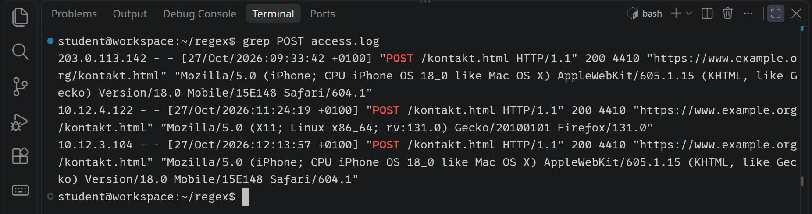
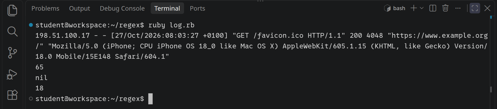
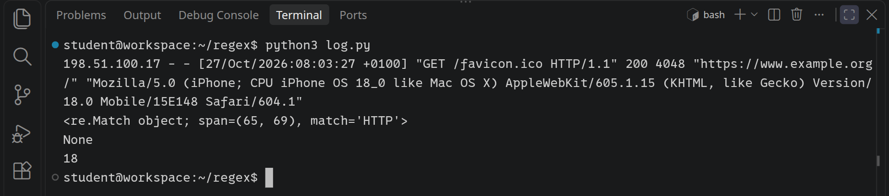
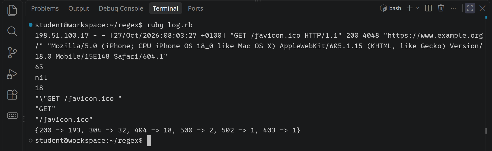
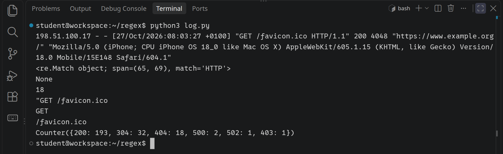
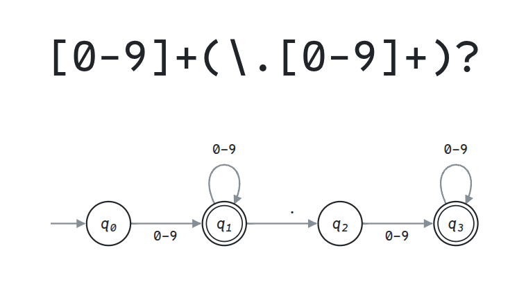

<div class='meta'>
image: teaser.webp:contain
image_alt: 'Der reguläre Ausdruck [0-9]+(\.[0-9]+)? über einem endlichen Automaten mit vier Zuständen q0 bis q3: Ziffern führen von q0 nach q1 und dort im Bogen zurück, ein Punkt von q1 nach q2, Ziffern von q2 nach q3 und dort im Bogen zurück; q1 und q3 haben einen doppelten Rand.'
kind: projekt
language: Ruby / Python
languages: [ruby, python]
duration: 2 Doppelstunden
age: Oberstufe
curriculum: "Oberstufe: Sprachen und Automaten (formale Sprachen, reguläre Ausdrücke, endliche Automaten), Vertiefung Theoretische Informatik (Satz von Kleene, Grenzen regulärer Sprachen)"
topics: [automaten, zeichenketten]
requires: [automata]
reference: [regex, automaten, terminal]
</div>

<div
    class="autotoc-secondary-trigger"
    data-title="Auf dieser Seite"
    data-levels="h2,h3">
</div>

<script src='/include/automaton_layout.js'></script>
<script src='/include/automatron.js'></script>
<script src='/include/automaton_stepper.js'></script>

# Reguläre Ausdrücke

<p class='abstract'>
Im Logfile eines Webservers suchst du mit <code>grep</code> nach Fehlern und nach jemandem, der nach Lücken sucht. Dann prüfst du in Ruby oder Python Postleitzahlen, Daten und Benutzernamen mit regulären Ausdrücken und findest heraus, wo sie aufhören, eine gute Idee zu sein. Am Ende siehst du, dass hinter jedem regulären Ausdruck ein endlicher Automat steckt, und warum darum keiner prüfen kann, ob Klammern richtig stehen.
</p>

Ein Webserver schreibt jede Anfrage, die bei ihm ankommt, als eine Zeile in eine Datei, das **Logfile**: wer gefragt hat, wann, nach welcher Seite, und was er geantwortet hat. An einem ganz normalen Tag kommen so Hunderte Zeilen zusammen, auf einer großen Website Millionen. Niemand liest sie von oben nach unten. Man sucht darin, und zwar selten nach einem bestimmten Wort, sondern nach einem **Muster**: alle Zeilen mit einem Fehler des Servers, jede Adresse, die mehr als zehnmal etwas nicht gefunden hat, jede Anfrage nach einer PHP-Datei. Für solche Muster gibt es eine eigene kleine Sprache, die **regulären Ausdrücke**, auf Englisch *regular expressions*, kurz **Regex**. Du findest sie im Terminal, in jedem Editor und in fast jeder Programmiersprache.

## Einrichten

Lege im Terminal (<kbd>Strg</kbd><kbd>J</kbd>) einen Ordner an, lade das Logfile hinein und öffne den Ordner mit <kbd>Strg</kbd><kbd>K</kbd> <kbd>Strg</kbd><kbd>O</kbd>:

```bash_copy
mkdir /workspace/regex
cd /workspace/regex
wget ${web_root}/regex/starter/access.log
```

`access.log` ist das Logfile der Website einer ausgedachten Schule, von einem Dienstag im Oktober. Die Adressen darin sind erfunden: `10.12.…` ist das Netz der Schule, die anderen stammen aus Bereichen, die für Beispiele reserviert sind ([RFC 5737](https://www.rfc-editor.org/rfc/rfc5737.html)).

<!-- language: ruby -->
Alle Dateien dieser Aktivität kommen in diesen Ordner. Ein Programm startest du im Terminal mit `ruby` und dem Namen der Datei.
<!-- /language -->
<!-- language: python -->
Alle Dateien dieser Aktivität kommen in diesen Ordner. Ein Programm startest du im Terminal mit `python3` und dem Namen der Datei.
<!-- /language -->

## Suchen im Logfile

### Eine Zeile im Logfile

Jede Zeile hat denselben Aufbau, das Format heißt *combined* und ist das, was der Webserver nginx von selbst schreibt:

<pre class='no-copy'>198.51.100.17 - - [27/Oct/2026:08:03:27 +0100] "GET /favicon.ico HTTP/1.1" 200 4048 "https://www.example.org/" "Mozilla/5.0 (iPhone; …)"</pre>

Vorn steht die Adresse, die gefragt hat, in eckigen Klammern die Zeit. In Anführungszeichen folgt die Anfrage selbst: die Methode `GET` (eine Seite holen) oder `POST` (ein Formular abschicken), der Pfad und die Version von HTTP. Dahinter stehen der **Status**, mit dem der Server geantwortet hat, und wie viele Bytes er geschickt hat. `200` heißt »hier ist die Seite«, `304` »du hast sie schon«, `404` »gibt es nicht«, und eine Zahl ab `500` heißt, dass beim Server selbst etwas schiefging. Die letzten zwei Teile sind die Seite, von der jemand kam, und das Programm, mit dem er gefragt hat.

Das einfachste Muster ist ein Wort. `grep` gibt jede Zeile aus, in der es vorkommt:

```bash
grep POST access.log
```

<!-- tutorial-screenshot
# grep POST: die drei Anfragen an das Kontaktformular
viewport: 1029x720
write-file: regex/access.log <- file:starter/access.log
press: Control+K
press: Control+O
wait-for-input-value: /workspace/
type: regex
press: Enter
wait-for-input-value: /workspace/regex/
press: Enter
wait-for-text: access.log
hide-left-sidebar
terminal-open
terminal-maximize
terminal-run: clear
terminal-run: grep POST access.log
terminal-wait-for-prompt
crop-terminal-lines: auto
-->


Drei Leute haben das Kontaktformular abgeschickt. Mit `-c` zählt grep die Zeilen, statt sie auszugeben. Wie viele Seiten wurden nicht gefunden? Bevor du es ausprobierst:

_task(zaehlen-404)

<!-- after: zaehlen-404 -->
```bash
grep -c 404 access.log
grep 404 access.log | grep -v '" 404 '
```

`grep -c 404` zählt 33 Zeilen, aber nur 18 davon hat der Server mit 404 beantwortet. Der zweite Befehl zeigt die anderen: `-v` dreht grep um und gibt die Zeilen aus, auf die das Muster *nicht* passt. Dort steht `404` in der Zahl der Bytes, in `4048` und in `14042`. grep sucht ein Muster überall in der Zeile; es weiß nicht, was ein Status ist. Darum schreibt man dazu, was um den Status herum steht: Das Anführungszeichen am Ende der Anfrage, ein Leerzeichen, `404`, ein Leerzeichen. Das passt nur dort, wo der Status steht.
<!-- /after -->

### Zeichenklassen und Wiederholungen

Für den Status 404 reicht ein festes Muster. Für »alle Fehler, die mit 4 anfangen« nicht mehr: Das sind 400, 403, 404 und so weiter. Hier beginnen die regulären Ausdrücke. Mit `-E` versteht grep sie (E steht für *extended*). `[0-9]` ist eine **Zeichenklasse**: ein einziges Zeichen, eines von 0 bis 9. `{2}` dahinter heißt »das Zeichen davor zweimal«:

```bash
grep -E '" 4[0-9]{2} ' access.log
```

Neben den Zeilen mit 404 steht darin eine mit `403`: Jemand wollte `/lehrerzimmer.html` sehen und durfte nicht. Die einfachen Anführungszeichen um das Muster sorgen dafür, dass das Terminal das Muster so an grep weitergibt, wie es dasteht, mit den Leerzeichen und dem `"`.

Die Bausteine, aus denen reguläre Ausdrücke bestehen, stehen im Handbuch; hier sind sie, damit du nachschlagen kannst:

_include(regex#bausteine)

_task(serverfehler)

### Der Punkt

Programme, die Websites nach Lücken absuchen, fragen nach Dateien, die es auf vielen Websites gibt, etwa nach der Anmeldung von WordPress oder nach phpMyAdmin. Viele davon enden auf `.php`. Wer im Logfile nach solchen Anfragen sucht, muss an den Punkt denken: Was er in einem regulären Ausdruck bedeutet, steht in der Tabelle oben.

_task(php)

### Anfang und Ende der Zeile

`^` ist der Anfang einer Zeile, `$` ihr Ende. Beide passen auf kein Zeichen, sondern auf eine Stelle im Text; sie heißen **Anker**. `^#` passt nur auf Zeilen, die mit `#` beginnen, `^$` auf leere Zeilen. Ohne Anker passt ein Muster überall in der Zeile, auch weit hinten.

_task(schulnetz)

### Herausschneiden und zählen

Mit `-o` gibt grep nicht die ganze Zeile aus, sondern nur das Stück, auf das das Muster passt. Dahinter kann ein `|` die Ausgabe an das nächste Programm weitergeben, eine **Pipe**: `sort` sortiert die Zeilen, `uniq -c` fasst gleiche Zeilen, die untereinanderstehen, zu einer zusammen und schreibt davor, wie oft sie vorkamen. So zählst du, welche Pfade am häufigsten verlangt wurden:

```bash
grep -E -o '"GET [^ ]+' access.log | sort | uniq -c | sort -n
```

`[^ ]` ist eine Zeichenklasse mit `^` am Anfang, also jedes Zeichen außer dem Leerzeichen, und `+` heißt »einmal oder öfter«. `[^ ]+` passt so auf den ganzen Pfad, bis zum Leerzeichen dahinter. Das letzte `sort -n` sortiert nach der Zahl vorn, das Häufigste steht unten.

_task(scanner)

<div class='hint try'>
<strong>Ausprobieren:</strong> Schreib einen Befehl, der zählt, wie oft jeder Status vorkommt, so wie gerade die Pfade. Welcher Teil der Zeile muss in das Muster, damit nur der Status übrig bleibt, und welcher bleibt dann trotzdem mit in der Ausgabe stehen?
</div>

Weitere Schalter von grep, `-i` für Groß und Klein, `-n` für die Nummer jeder Zeile und `-r` für ganze Ordner, stehen im Handbuch unter [Reguläre Ausdrücke mit grep](/reference/regex#mit-grep).

## In deinem Programm

<!-- language: ruby -->
grep beantwortet Fragen, die man einmal stellt. Soll ein Programm das Logfile jede Nacht lesen und am Morgen eine Übersicht schreiben, kommen die Ausdrücke in den Code. In Ruby steht ein regulärer Ausdruck zwischen zwei Schrägstrichen, `/" 404 /`, und ist ein Objekt wie ein String oder eine Zahl. Lege `log.rb` an:

```ruby
# Das Logfile des Webservers, gelesen mit regulären Ausdrücken
lines = File.readlines('access.log', chomp: true)
line = lines[3]

puts line
p line =~ /HTTP/
p line =~ /" 404 /
p lines.count { |l| l =~ /" 404 / }
```

`File.readlines` liest die Datei als Liste von Zeilen, `chomp: true` nimmt jeder ihr Zeilenende ab. `=~` sucht den Ausdruck im String und gibt den **Index** zurück, an dem der erste Treffer beginnt, oder `nil`, wenn es keinen gibt. Weil `nil` in einem `if` als falsch zählt und jede Zahl als wahr, zählt `count` damit die Zeilen mit einem Treffer, wie `grep -c`. Starte das Programm:

```bash
ruby log.rb
```

<!-- tutorial-screenshot
# ruby log.rb: die Zeile, 65, nil, 18
write-file: regex/log.rb <- file:stufen/log.rb
terminal-open
terminal-maximize
terminal-run: clear
terminal-run: ruby log.rb
terminal-wait-for-prompt
crop-terminal-lines: auto
check-task-fails: status
-->


`HTTP` beginnt am Index 65. `" 404 ` kommt in dieser Zeile nicht vor, obwohl `4048` darin steht, und 18 Zeilen haben den Status 404, wie bei grep.
<!-- /language -->
<!-- language: python -->
grep beantwortet Fragen, die man einmal stellt. Soll ein Programm das Logfile jede Nacht lesen und am Morgen eine Übersicht schreiben, kommen die Ausdrücke in den Code. In Python stehen die Funktionen dafür im Modul `re`, und der Ausdruck ist ein String. Man schreibt ihn als **Raw-String** mit einem `r` davor, `r'" 404 '`, damit Python die Backslashes darin nicht selbst auswertet. Lege `log.py` an:

```python
# Das Logfile des Webservers, gelesen mit regulären Ausdrücken
import re

with open('access.log') as f:
    lines = f.read().splitlines()
line = lines[3]

print(line)
print(re.search(r'HTTP', line))
print(re.search(r'" 404 ', line))
print(sum(1 for l in lines if re.search(r'" 404 ', l)))
```

`splitlines` zerlegt die Datei in eine Liste von Zeilen, ohne die Zeilenenden. `re.search` sucht den Ausdruck im String und gibt ein **Match-Objekt** zurück, das sagt, wo der erste Treffer steht, oder `None`, wenn es keinen gibt. Weil `None` in einem `if` als falsch zählt und jedes Match-Objekt als wahr, zählt die letzte Zeile damit die Zeilen mit einem Treffer, wie `grep -c`. Starte das Programm:

```bash
python3 log.py
```

<!-- tutorial-screenshot
# python3 log.py: die Zeile, das Match-Objekt, None, 18
write-file: regex/log.py <- file:stufen/log.py
terminal-open
terminal-maximize
terminal-run: clear
terminal-run: python3 log.py
terminal-wait-for-prompt
crop-terminal-lines: auto
check-task-fails: status python
-->


`span=(65, 69)` sind die Indizes, an denen der Treffer `HTTP` beginnt und hinter dem er endet. `" 404 ` kommt in dieser Zeile nicht vor, obwohl `4048` darin steht, und 18 Zeilen haben den Status 404, wie bei grep.
<!-- /language -->

### Teile herausholen: Gruppen

Ob ein Muster passt, ist oft nur die halbe Frage. Ein Programm will wissen, *was* an dieser Stelle steht: welcher Pfad, welcher Status. Dafür gibt es **Gruppen**: Was im Ausdruck in runden Klammern steht, merkt sich das Match-Objekt einzeln.

<!-- language: ruby -->
Hänge an `log.rb` an:

```ruby
m = line.match(/"(GET|POST) (\S+) /)
p m[0]
p m[1]
p m[2]
```

`match` gibt ein Objekt der Klasse `MatchData` zurück, oder `nil`, wenn der Ausdruck nicht passt. `m[0]` ist der ganze Treffer, mit dem Anführungszeichen vorn, das `p` als `\"` ausgibt; `m[1]` das, worauf die erste Klammer passt, `GET` oder `POST`, und `m[2]` die zweite, `\S+`: ein oder mehr Zeichen, die kein Leerzeichen sind, also der Pfad.
<!-- /language -->
<!-- language: python -->
Hänge an `log.py` an:

```python
m = re.search(r'"(GET|POST) (\S+) ', line)
print(m.group(0))
print(m.group(1))
print(m.group(2))
```

`m.group(0)` ist der ganze Treffer, `m.group(1)` das, worauf die erste Klammer passt, `GET` oder `POST`, und `m.group(2)` die zweite, `\S+`: ein oder mehr Zeichen, die kein Leerzeichen sind, also der Pfad.
<!-- /language -->

<!-- language: ruby -->
<div class='hint own' data-check='status'>
<strong>Jetzt bist du dran:</strong> Schreib in <code>log.rb</code> eine Methode <code>status(line)</code>, die den Status einer Zeile als Zahl zurückgibt, bei der Zeile oben also <code>200</code>. Steht in der Zeile kein Status, gibt sie <code>nil</code> zurück. Achte auf die Zeilen, in denen auch in der Zahl der Bytes drei Ziffern hintereinander stehen.
</div>

<!-- hint -->
Wo steht der Status? Sieh dir die Zeile oben an: hinter dem Anführungszeichen, das die Anfrage schließt, und einem Leerzeichen, und danach kommt wieder ein Leerzeichen. Genau wie bei grep schreibst du das, was um den Status herum steht, mit in den Ausdruck.
<!-- /hint -->
<!-- hint -->
Die drei Ziffern kommen in eine Gruppe. `line.match(…)` gibt `nil`, wenn der Ausdruck nicht passt; sonst ist `m[1]` der Status als String, und `to_i` macht eine Zahl daraus.
<!-- /hint -->
<!-- hint -->
Ein Gerüst:

```ruby
def status(line)
    m = line.match(/" (…) /)
    return nil if m.nil?
    …
end
```
<!-- /hint -->

<!-- solution -->
```ruby
# Der Status einer Zeile als Zahl, oder nil, wenn die Zeile keinen hat
def status(line)
    m = line.match(/" (\d{3}) /)
    return nil if m.nil?
    m[1].to_i
end
```

`\d` ist dasselbe wie `[0-9]`, eine Ziffer.
<!-- /solution -->
<!-- /language -->
<!-- language: python -->
<div class='hint own' data-check='status'>
<strong>Jetzt bist du dran:</strong> Schreib in <code>log.py</code> eine Funktion <code>status(line)</code>, die den Status einer Zeile als Zahl zurückgibt, bei der Zeile oben also <code>200</code>. Steht in der Zeile kein Status, gibt sie <code>None</code> zurück. Achte auf die Zeilen, in denen auch in der Zahl der Bytes drei Ziffern hintereinander stehen.
</div>

<!-- hint -->
Wo steht der Status? Sieh dir die Zeile oben an: hinter dem Anführungszeichen, das die Anfrage schließt, und einem Leerzeichen, und danach kommt wieder ein Leerzeichen. Genau wie bei grep schreibst du das, was um den Status herum steht, mit in den Ausdruck.
<!-- /hint -->
<!-- hint -->
Die drei Ziffern kommen in eine Gruppe. `re.search(…)` gibt `None`, wenn der Ausdruck nicht passt; sonst ist `m.group(1)` der Status als String, und `int(…)` macht eine Zahl daraus.
<!-- /hint -->
<!-- hint -->
Ein Gerüst:

```python
def status(line):
    m = re.search(r'" (…) ', line)
    if m is None:
        return None
    return …
```
<!-- /hint -->

<!-- solution -->
```python
# Der Status einer Zeile als Zahl, oder None, wenn die Zeile keinen hat
def status(line):
    m = re.search(r'" (\d{3}) ', line)
    if m is None:
        return None
    return int(m.group(1))
```

`\d` ist dasselbe wie `[0-9]`, eine Ziffer.
<!-- /solution -->
<!-- /language -->

_task(status)

<!-- language: ruby -->
Mit `status` wird die Übersicht eine Zeile. `tally` zählt, wie oft jeder Wert in einer Liste vorkommt; hänge sie ans Ende von `log.rb` an:

```ruby
p lines.map { |l| status(l) }.tally
```

<!-- tutorial-screenshot
# ruby log.rb mit status und tally
write-file: regex/log.rb <- file:stufen/log-2.rb
terminal-open
terminal-maximize
terminal-run: clear
terminal-run: ruby log.rb
terminal-wait-for-prompt
crop-terminal-lines: auto
check-task: status
-->
 193, 304 => 32, 404 => 18, 500 => 2, 502 => 1 und 403 => 1.'>
<!-- /language -->
<!-- language: python -->
Mit `status` wird die Übersicht eine Zeile. Ein `Counter` aus dem Modul `collections` zählt, wie oft jeder Wert vorkommt; schreib unter `import re` die Zeile `from collections import Counter` und hänge ans Ende von `log.py` an:

```python
print(Counter(status(l) for l in lines))
```

<!-- tutorial-screenshot
# python3 log.py mit status und Counter
write-file: regex/log.py <- file:stufen/log-2.py
terminal-open
terminal-maximize
terminal-run: clear
terminal-run: python3 log.py
terminal-wait-for-prompt
crop-terminal-lines: auto
check-task: status python
-->

<!-- /language -->

<!-- language: ruby -->
<div class='hint try'>
<strong>Ausprobieren:</strong> <code>scan</code> findet nicht nur den ersten Treffer, sondern alle, als Liste. Hänge <code>p File.read('access.log').scan(/\S+\.jpg/)</code> an und dann <code>p File.read('access.log').scan(/\S+\.(jpg|png)/)</code>. Achte darauf, was in der zweiten Liste steht: Hat der Ausdruck Gruppen, liefert <code>scan</code> nur, worauf die Gruppen passen. Mit <code>(?:jpg|png)</code> fasst eine Klammer zusammen, ohne eine Gruppe zu sein. Nimm die Zeilen danach wieder heraus.
</div>
<!-- /language -->
<!-- language: python -->
<div class='hint try'>
<strong>Ausprobieren:</strong> <code>re.findall</code> findet nicht nur den ersten Treffer, sondern alle, als Liste. Hänge <code>print(re.findall(r'\S+\.jpg', open('access.log').read()))</code> an und dann <code>print(re.findall(r'\S+\.(jpg|png)', open('access.log').read()))</code>. Achte darauf, was in der zweiten Liste steht: Hat der Ausdruck Gruppen, liefert <code>findall</code> nur, worauf die Gruppen passen. Mit <code>(?:jpg|png)</code> fasst eine Klammer zusammen, ohne eine Gruppe zu sein. Nimm die Zeilen danach wieder heraus.
</div>
<!-- /language -->

## Eingaben prüfen

Ein Formular fragt nach einer Postleitzahl, einem Geburtsdatum, einem Benutzernamen. Bevor ein Programm damit arbeitet, prüft es, ob die Eingabe so aussieht, wie sie aussehen soll. Das ist die zweite große Arbeit regulärer Ausdrücke, und ein Fehler darin hat einen anderen Fehler als beim Suchen: Eine Suche, die eine Zeile zu viel findet, sieht man; eine Prüfung, die eine falsche Eingabe durchlässt, merkt niemand, bis etwas kaputtgeht.

### Postleitzahlen

Eine deutsche Postleitzahl hat fünf Ziffern, als Ausdruck `\d{5}`. Bevor du ihn in ein Programm schreibst:

_task(anker)

<!-- after: anker -->
<!-- language: ruby -->
`match?` sagt nur, ob der Ausdruck *irgendwo* im String passt, wie grep in einer Zeile. Fünf Ziffern stehen in `D-10115 Berlin` und in `101150`. Für eine Prüfung muss der Ausdruck auf den ganzen String passen, von seinem Anfang bis zu seinem Ende. In Ruby sind das die Anker `\A` und `\z`. Lege `validate.rb` an:

```ruby
# Eingaben prüfen, bevor ein Programm mit ihnen arbeitet
def postcode?(text)
    text.match?(/\A\d{5}\z/)
end

['10115', '1011', 'D-10115 Berlin', '101150'].each do |text|
    puts "#{text.inspect} #{postcode?(text)}"
end
```

Eine Methode, die Ja oder Nein sagt, bekommt in Ruby ein `?` an ihren Namen. Warum nicht `^` und `$` wie bei grep? In Ruby sind sie Anfang und Ende jeder *Zeile* im String. `"10115\n<script>".match?(/^\d{5}$/)` ist `true`, weil die erste Zeile nur aus fünf Ziffern besteht; was in der zweiten steht, prüft der Ausdruck nicht mehr. Für eine Prüfung schreibst du darum immer `\A` und `\z`.
<!-- /language -->
<!-- language: python -->
`re.search` sagt nur, ob der Ausdruck *irgendwo* im String passt, wie grep in einer Zeile. Fünf Ziffern stehen in `D-10115 Berlin` und in `101150`. Für eine Prüfung muss der Ausdruck auf den ganzen String passen, von seinem Anfang bis zu seinem Ende. Genau das prüft `re.fullmatch`. Lege `validate.py` an:

```python
# Eingaben prüfen, bevor ein Programm mit ihnen arbeitet
import re


def is_postcode(text):
    return re.fullmatch(r'\d{5}', text) is not None


for text in ['10115', '1011', 'D-10115 Berlin', '101150']:
    print(repr(text), is_postcode(text))
```

Warum nicht `^` und `$` wie bei grep? `re.search(r'^\d{5}$', '10115\n')` findet einen Treffer: In Python passt `$` auch vor einem Zeilenende ganz am Schluss. Ein Zeichen zu viel kommt so durch die Prüfung. `re.fullmatch` lässt nichts übrig, darum nimmst du es für jede Prüfung.
<!-- /language -->

<!-- language: ruby -->
_include(regex#ruby)
<!-- /language -->
<!-- language: python -->
_include(regex#python)
<!-- /language -->
<!-- /after -->

### Ein Datum

Ein Datum, wie man es in Deutschland schreibt: zwei Ziffern für den Tag, ein Punkt, zwei für den Monat, ein Punkt, vier für das Jahr, `24.12.2026`. `\d{2}\.\d{2}\.\d{4}` beschreibt die Form, nimmt aber auch `45.17.2026` an. Ein besserer Ausdruck lässt nur Tage von 01 bis 31 und Monate von 01 bis 12 durch. Dafür braucht es kein Rechnen, sondern Alternativen: Ein Tag ist eine 0 mit einer Ziffer von 1 bis 9 dahinter, *oder* eine 1 oder 2 mit irgendeiner Ziffer, *oder* eine 3 mit einer 0 oder 1.

<!-- language: ruby -->
<div class='hint own' data-check='datum'>
<strong>Jetzt bist du dran:</strong> Schreib in <code>validate.rb</code> eine Methode <code>date?(text)</code>, die <code>true</code> zurückgibt, wenn <code>text</code> ein Datum in dieser Form ist: Tag 01 bis 31, Monat 01 bis 12, ein Jahr mit vier Ziffern, dazwischen Punkte, davor und dahinter nichts. Ein Tag mit einer Ziffer wie in <code>1.1.2026</code> zählt nicht.
</div>

<!-- hint -->
Nimm dir den Tag allein vor und schreib die Tage von 01 bis 31 in drei Gruppen auf: 01 bis 09, 10 bis 29, 30 und 31. Welche Ziffer steht in jeder Gruppe vorn, und welche dürfen dahinter kommen?
<!-- /hint -->
<!-- hint -->
Die drei Gruppen werden drei Alternativen in einer Klammer, getrennt durch `|`: `(0[1-9]|…|…)`. Den Monat baust du genauso, aus 01 bis 09 und 10 bis 12. Der Punkt dazwischen muss `\.` sein, sonst passt auch `24-12-2026`.
<!-- /hint -->
<!-- hint -->
Ein Gerüst; die Lücken füllst du:

```ruby
def date?(text)
    text.match?(/\A(0[1-9]|…|…)\.(…|…)\.\d{4}\z/)
end
```
<!-- /hint -->

<!-- solution -->
```ruby
# Ein Datum wie 24.12.2026: Tag 01 bis 31, Monat 01 bis 12, ein Jahr mit vier Ziffern
def date?(text)
    text.match?(/\A(0[1-9]|[12][0-9]|3[01])\.(0[1-9]|1[0-2])\.\d{4}\z/)
end
```
<!-- /solution -->
<!-- /language -->
<!-- language: python -->
<div class='hint own' data-check='datum'>
<strong>Jetzt bist du dran:</strong> Schreib in <code>validate.py</code> eine Funktion <code>is_date(text)</code>, die <code>True</code> zurückgibt, wenn <code>text</code> ein Datum in dieser Form ist: Tag 01 bis 31, Monat 01 bis 12, ein Jahr mit vier Ziffern, dazwischen Punkte, davor und dahinter nichts. Ein Tag mit einer Ziffer wie in <code>1.1.2026</code> zählt nicht.
</div>

<!-- hint -->
Nimm dir den Tag allein vor und schreib die Tage von 01 bis 31 in drei Gruppen auf: 01 bis 09, 10 bis 29, 30 und 31. Welche Ziffer steht in jeder Gruppe vorn, und welche dürfen dahinter kommen?
<!-- /hint -->
<!-- hint -->
Die drei Gruppen werden drei Alternativen in einer Klammer, getrennt durch `|`: `(0[1-9]|…|…)`. Den Monat baust du genauso, aus 01 bis 09 und 10 bis 12. Der Punkt dazwischen muss `\.` sein, sonst passt auch `24-12-2026`.
<!-- /hint -->
<!-- hint -->
Ein Gerüst; die Lücken füllst du:

```python
def is_date(text):
    return re.fullmatch(r'(0[1-9]|…|…)\.(…|…)\.\d{4}', text) is not None
```
<!-- /hint -->

<!-- solution -->
```python
# Ein Datum wie 24.12.2026: Tag 01 bis 31, Monat 01 bis 12, ein Jahr mit vier Ziffern
def is_date(text):
    return re.fullmatch(r'(0[1-9]|[12][0-9]|3[01])\.(0[1-9]|1[0-2])\.\d{4}', text) is not None
```
<!-- /solution -->
<!-- /language -->

_task(datum)

<!-- after: datum -->
<!-- language: ruby -->
Probier `date?('31.02.2026')` aus. Der Ausdruck nimmt es an, obwohl es den 31. Februar nie gibt, und auch den 29. Februar nur in manchen Jahren. Ein regulärer Ausdruck prüft die **Form** eines Texts, nicht, ob er etwas bedeutet. Das ist derselbe Unterschied wie zwischen Syntax und Semantik bei Programmiersprachen. Ob es einen Tag gibt, weiß der Kalender: `Date.valid_date?(2026, 2, 31)` ist `false`, nach `require 'date'`. Gut ist darum beides zusammen: Der Ausdruck prüft die Form und holt mit Gruppen Tag, Monat und Jahr heraus, `Date.valid_date?` prüft den Tag.
<!-- /language -->
<!-- language: python -->
Probier `is_date('31.02.2026')` aus. Der Ausdruck nimmt es an, obwohl es den 31. Februar nie gibt, und auch den 29. Februar nur in manchen Jahren. Ein regulärer Ausdruck prüft die **Form** eines Texts, nicht, ob er etwas bedeutet. Das ist derselbe Unterschied wie zwischen Syntax und Semantik bei Programmiersprachen. Ob es einen Tag gibt, weiß der Kalender: `datetime.date(2026, 2, 31)` bricht mit einem `ValueError` ab, nach `import datetime`. Gut ist darum beides zusammen: Der Ausdruck prüft die Form und holt mit Gruppen Tag, Monat und Jahr heraus, `datetime.date` prüft den Tag.
<!-- /language -->
<!-- /after -->

### Ein Benutzername

Die nächste Regel schreibst du ohne Kasten; die Prüfung sagt dir, bei welchem Namen dein Ausdruck sich irrt:

_task(benutzername)

### E-Mail-Adressen

Bei E-Mail-Adressen sieht es aus, als ginge es genauso: ein Name, ein `@` und dahinter ein Name mit Punkten. Bevor du weiterliest:

_task(email)

<!-- after: email -->
Was eine E-Mail-Adresse sein darf, legt [RFC 5322](https://www.rfc-editor.org/rfc/rfc5322.html#section-3.4.1) fest, und es ist erstaunlich viel: `"pip und bello"@example.org` mit Anführungszeichen und Leerzeichen, Kommentare in runden Klammern, ein Pluszeichen wie in `pip+schule@example.org`, das viele Menschen benutzen, um ihre Post zu sortieren. Ein Ausdruck, der alle Regeln einer älteren Fassung genau nachbaut, steht auf der Seite des Perl-Moduls [Mail::RFC822::Address](https://www.ex-parrot.com/pdw/Mail-RFC822-Address.html): Er ist über 6000 Zeichen lang, und ein Programm hat ihn aus den Regeln erzeugt, nicht ein Mensch von Hand. Dabei sagt auch der beste Ausdruck nicht, ob es das Postfach gibt und ob es der Person gehört, die das Formular ausfüllt.

Darum prüft man nur grob, ob ein `@` mit etwas davor und dahinter darin steht, und schickt dann eine E-Mail mit einem Link zum Bestätigen. Wer ihn anklickt, hat eine Adresse, die funktioniert. Selbst das Feld `<input type='email'>` in HTML prüft mit Absicht weniger, als der RFC erlaubt, und nennt das in seiner Beschreibung eine *willful violation*, einen gewollten Verstoß ([HTML Living Standard](https://html.spec.whatwg.org/multipage/input.html#valid-e-mail-address)). Ein regulärer Ausdruck ist das richtige Werkzeug für Formen, die einfach sind; wo die Regeln lang werden, hilft ein Programm, eine Bibliothek oder eine Grammatik.
<!-- /after -->

### Wenn ein Ausdruck hängt

Am 2. Juli 2019 waren viele Websites weltweit für 27 Minuten nicht erreichbar. Die Firma Cloudflare, über deren Rechner sie laufen, hatte eine neue Regel gegen Angriffe eingespielt, und darin stand ein regulärer Ausdruck, der bei manchen Anfragen so lange probierte, dass die Prozessoren nichts anderes mehr taten ([der Bericht von Cloudflare](https://blog.cloudflare.com/details-of-the-cloudflare-outage-on-july-2-2019/)). Die meisten Programmiersprachen prüfen einen Ausdruck nämlich, indem sie einen Weg durch ihn versuchen und, wenn er nicht passt, zurückgehen und den nächsten Weg nehmen, **Backtracking** genannt. `(a+)+b` lässt sich auf `aaaa` auf sehr viele Weisen aufteilen: alle vier a in einem `a+`, oder 3 und 1, oder 2 und 2, oder 1, 1, 1 und 1 … Fehlt am Ende das `b`, probiert ein solches Programm sie alle, und mit jedem a mehr werden es doppelt so viele.

<!-- language: ruby -->
<div class='hint try'>
<strong>Ausprobieren:</strong> Starte im Terminal <code>time ruby -e "p ('a' * 30 + 'cb').match?(/\A(a+)+b\z/)"</code>. Das geht schnell: Ruby merkt sich seit Version 3.2, an welchen Stellen es mit welchem Teil des Ausdrucks schon gescheitert ist, und probiert nichts zweimal (<a href='https://www.ruby-lang.org/en/news/2022/12/25/ruby-3-2-0-released/'>Ruby 3.2, »Regexp improvements against ReDoS«</a>). Mit einem Rückverweis wie <code>\1</code>, der auf das zeigt, was die erste Gruppe gefunden hat, kann es sich das nicht merken: Versuch <code>time ruby -e "p ('a' * 22 + 'cb').match?(/\A(a+)+\1b\z/)"</code> und dann mit 24 und 26 statt 22. Wie ändert sich die Zeit, wenn zwei a dazukommen?
</div>
<!-- /language -->
<!-- language: python -->
<div class='hint try'>
<strong>Ausprobieren:</strong> Starte im Terminal <code>time python3 -c "import re; print(re.fullmatch(r'(a+)+b', 'a' * 22 + 'cb'))"</code> und dann mit 24 und 26 statt 22. Wie ändert sich die Zeit, wenn zwei a dazukommen? Rechne damit aus, wie lange es mit 40 dauern würde, statt es auszuprobieren.
</div>
<!-- /language -->

Wie man Ausdrücke prüft, ohne je zurückzugehen, hat Ken Thompson schon 1968 aufgeschrieben, und das steckt im letzten Teil dieser Seite. Russ Cox erklärt in [Regular Expression Matching Can Be Simple And Fast](https://swtch.com/~rsc/regexp/regexp1.html), warum viele Sprachen es trotzdem anders machen: Rückverweise und andere Erweiterungen gehen nur mit Backtracking.

## Vom Ausdruck zum Automaten

In [Endliche Automaten](/automata) hast du Automaten gebaut, die ein Wort Zeichen für Zeichen lesen und am Ende Ja oder Nein sagen. Ein regulärer Ausdruck sagt auch Ja oder Nein zu einem Wort. Das ist kein Zufall: Aus jedem regulären Ausdruck lässt sich ein endlicher Automat bauen, der genau die Wörter annimmt, auf die der Ausdruck passt. Mit Klassen wie `[0-9]` und `{5}` wird es nur länger; die Bausteine, die man wirklich braucht, sind vier: ein Zeichen, zwei Stücke hintereinander, `|` und `*`.

### Aus Bausteinen wird ein Automat

Für jeden Baustein gibt es ein kleines Stück Automat, und die Stücke werden ineinandergesteckt, wie die Klammern im Ausdruck. Damit das einfach bleibt, dürfen die Stücke **ε-Übergänge** haben: Pfeile mit einem ε, die der Automat nehmen darf, ohne ein Zeichen zu lesen. Ein Automat mit ε-Übergängen ist ein NEA, der zusätzlich raten darf, ob er so einen Pfeil nimmt.

_include(automaten#thompson)

### Ein Wort lesen

Fertig zusammengesetzt hat so ein Automat viele Zustände und ε-Übergänge. Kleiner geht es oft von Hand. Der Ausdruck `a(a|b)*a` passt auf die Wörter aus a und b, die mit einem a anfangen und mit einem a aufhören und mindestens zwei Zeichen haben. Als NEA: Das erste a führt nach q<sub>1</sub>, `(a|b)*` ist die Schleife in q<sub>1</sub>, und bei jedem a rät der Automat, ob es das letzte ist. Schalte durch und ändere das Wort:

<div class='automaton-stepper' data-stepper data-title='NEA zu a(a|b)*a' data-states='q0 q1 q2' data-start='q0' data-accept='q2' data-alphabet='ab' data-transitions='q0 a q1, q1 a-b q1, q1 a q2' data-input='abba'></div>

_task(zustaende)

<!-- after: zustaende -->
Sechs: Der Automat muss nur wissen, wie viele Ziffern er schon gelesen hat, null bis fünf. Nach der fünften akzeptiert er, eine sechste führt in den Fehlerzustand q<sub>F</sub>, der wie immer nicht gezeichnet ist.

<div class='automaton-drawing' role='img' aria-label='Sechs Kreise in einer Reihe, q0 bis q5, der letzte mit doppeltem Rand. Zwischen je zwei Nachbarn führt ein Pfeil mit 0–9 nach rechts.' data-states='q0 q1 q2 q3 q4 q5' data-start='q0' data-accept='q5' data-transitions='q0 0-9 q1, q1 0-9 q2, q2 0-9 q3, q3 0-9 q4, q4 0-9 q5'></div>

Darum ist es egal, wie lang das Logfile ist: Der Automat liest jedes Zeichen genau einmal und merkt sich nie mehr als seinen Zustand. So arbeitet `grep` im Prinzip; die Rechnung mit Mengen von Zuständen aus der [Potenzmengenkonstruktion](/reference/automaten#potenzmengenkonstruktion) macht es, ohne zurückzugehen.
<!-- /after -->

### Vom Automaten zum Ausdruck

Es geht auch umgekehrt: Zu jedem endlichen Automaten gibt es einen regulären Ausdruck, der genau die Wörter beschreibt, die er annimmt. Beides zusammen hat Stephen Kleene 1951 bewiesen, dessen Kasten oben steht; es heißt heute **Satz von Kleene**. Reguläre Ausdrücke und endliche Automaten sind zwei Schreibweisen für dieselben Sprachen, die **regulären Sprachen**: Der Ausdruck ist leichter zu schreiben, der Automat leichter auszuführen.

Dieser Automat liest Binärzahlen:

<div class='automaton-drawing' role='img' aria-label='Drei Kreise. Vom Start q0 führt 0 nach q1 und 1 nach q2; q1 und q2 haben einen doppelten Rand. In q2 führt ein Bogen mit 0 und 1 zu q2 zurück. Von q1 führt kein Pfeil weiter.' data-states='q0 q1 q2' data-start='q0' data-accept='q1 q2' data-transitions='q0 0 q1, q0 1 q2, q2 0-1 q2'></div>

_task(automat-ausdruck)

### Was kein Ausdruck kann

Ein Editor zeigt dir, ob eine Klammer in deinem Programm fehlt. Könnte er das mit einem regulären Ausdruck prüfen?

_task(klammern)

<!-- after: klammern -->
Keiner kann es. Jeder reguläre Ausdruck wird zu einem endlichen Automaten, und der hat eine feste Zahl von Zuständen, sagen wir zehn. Liest er elf `(` hintereinander, war er nach zwei verschiedenen Zahlen von Klammern im selben Zustand, sagen wir nach drei und nach sieben. Von da an weiß er nicht mehr, wie viele offen sind: Kommen jetzt drei `)`, macht er in beiden Fällen dasselbe. Er nimmt drei `(` mit drei `)` und sieben `(` mit drei `)` beide an oder beide nicht, aber nur das erste Wort stimmt. Ein `*` im Ausdruck ist eine Schleife im Automaten, und eine Schleife zählt nicht mit, wie oft sie durchlaufen wurde. Genau ausgeführt, mit dem Schubfachprinzip, steht diese Überlegung in [Kellerautomaten](/kellerautomat): Dort bekommt der Automat einen Stack, und mit ihm kann er Klammern prüfen.

<!-- language: ruby -->
Ruby kann es trotzdem, mit einer Erweiterung: `/\A(?<p>\(\g<p>*\))*\z/` nimmt `(())()` an und `(()` nicht. `(?<p>…)` gibt einer Gruppe einen Namen, und `\g<p>` setzt diese Gruppe an ihrer eigenen Stelle noch einmal ein: Der Ausdruck ruft sich selbst auf. Das ist kein regulärer Ausdruck mehr im Sinne Kleenes, sondern eine Regel, die sich selbst benutzt. Solche Regeln haben einen eigenen Namen, Grammatiken, und in einer davon ist es dieselbe Zeile: `brackets = { "(" brackets ")" }`.
<!-- /language -->
<!-- language: python -->
Manche Programme können es trotzdem, mit einer Erweiterung: Das Modul [`regex`](https://pypi.org/project/regex/), eine Erweiterung von `re`, kennt `(?R)`, das den ganzen Ausdruck an seiner eigenen Stelle noch einmal einsetzt. Der Ausdruck ruft sich selbst auf. Das ist kein regulärer Ausdruck mehr im Sinne Kleenes, sondern eine Regel, die sich selbst benutzt. Solche Regeln haben einen eigenen Namen, Grammatiken, und in einer davon ist es eine einzige Zeile: `brackets = { "(" brackets ")" }`.
<!-- /language -->
<!-- /after -->

## Zusammenfassung

- Ein **regulärer Ausdruck** ist ein Muster für Text: Zeichen stehen für sich, `[0-9]` ist eine **Zeichenklasse**, `*`, `+`, `?` und `{n}` wiederholen, `|` heißt »oder«, Klammern fassen zusammen und bilden **Gruppen**, `\` nimmt einem Sonderzeichen seine Bedeutung.
- **Suchen** heißt: Der Ausdruck passt irgendwo, wie bei `grep` oder `=~`. **Prüfen** heißt: Er passt auf den ganzen Text, mit `\A` und `\z` in Ruby oder `re.fullmatch` in Python.
- Ein Ausdruck prüft die **Form**, nicht die Bedeutung: `31.02.2026` sieht aus wie ein Datum. Wo die Regeln lang werden, wie bei E-Mail-Adressen, prüft man grob und lässt den Rest ein Programm tun.
- **Backtracking** kann bei manchen Ausdrücken unvorstellbar lange dauern. Ein Automat liest jedes Zeichen nur einmal.
- **Satz von Kleene:** Reguläre Ausdrücke und endliche Automaten beschreiben dieselben Sprachen, die **regulären Sprachen**.

## Wie geht es weiter?

- **Kellerautomaten.** Mit einem Stack als Gedächtnis prüft ein Automat Klammern und Wörter wie aaabbb: [Kellerautomaten](/kellerautomat).
- **Grammatiken.** Regeln, die sich selbst benutzen, beschreiben Programmiersprachen; [Grammatiken](/grammatiken) zeigt, wie man sie liest und aus ihnen ein Programm macht, das Ausdrücke prüft.
- **Automatron.** Zu jedem Ausdruck aus `|`, `*`, `+`, `?` und Klammern zeichnet [Automatron](/automatron) den NEA, den DEA und den kleinsten DEA, mit allen Schritten dazwischen.
- **Ausprobieren im Editor.** In VS Code sucht <kbd>Strg</kbd><kbd>F</kbd> mit regulären Ausdrücken, wenn du <kbd>Alt</kbd><kbd>R</kbd> drückst; alle Treffer werden markiert, und beim Ersetzen steht `$1` für die erste Gruppe. Mehr dazu und die Links zum Nachschlagen stehen im Handbuch unter [Reguläre Ausdrücke](/reference/regex).

<div class='book'>
<i class='bi bi-book'></i>
<p><strong>Mastering Regular Expressions</strong>, Jeffrey E. F. Friedl, O'Reilly, 3. Auflage 2006; auf Deutsch als <em>Reguläre Ausdrücke</em>. Das Buch erklärt, wie die Programme, die Ausdrücke ausführen, von innen arbeiten, warum manche Ausdrücke so viel langsamer sind als andere und wie man sie schneller schreibt, für Perl, Java, .NET, PHP und andere Sprachen. Es steht in vielen Bibliotheken; der Verlag hat es auf seiner <a href='https://www.oreilly.com/library/view/mastering-regular-expressions/0596528124/'>Seite des Buchs</a>.</p>
</div>

<!-- tutorial-screenshot
# Teaser: der Ausdruck [0-9]+(\.[0-9]+)? über seinem kleinsten DEA, gezeichnet
# wie in Automatron (hook regex-teaser)
open-site: /automatron
tab: preview
viewport: 1029x700
hook: regex-teaser
crop-element: #output_area .regex-teaser
variants: dark
-->


<!-- tutorial-step
# Die Musterlösungen aus loesung/ lösen jede Programmieraufgabe, in beiden Sprachen
write-file: regex/access.log <- file:starter/access.log
write-file: regex/validate.rb <- file:loesung/validate.rb
write-file: regex/validate.py <- file:loesung/validate.py
check-task: datum
check-task: datum python
check-task: benutzername
check-task: benutzername python
check-task: schulnetz <- 148
check-task: php <- grep -E '\.php' access.log
check-task: serverfehler <- grep -E '" 5[0-9]{2} ' access.log
check-task: scanner <- 198.51.100.66
-->
