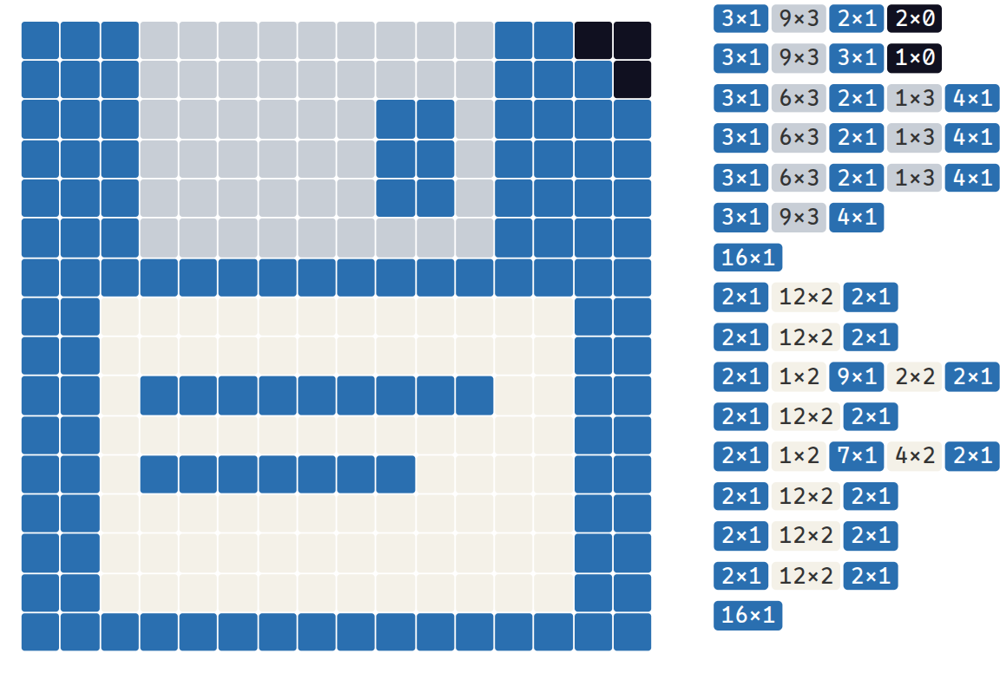

<div class='meta'>
image: teaser.webp:contain
image_alt: "Eine Diskette als Pixelbild in Blau und Grau, daneben jede Zeile als Lauflängen wie 3×1 und 9×3"
kind: labor
language: Ruby / Python
languages: [ruby, python]
duration: 1 Doppelstunde
reference: [bits-und-bytes, ruby-python]
</div>

<div
    class="autotoc-secondary-trigger"
    data-title="Auf dieser Seite"
    data-levels="h2,h3">
</div>

<style>
    .rle-editor {
        display: flex;
        gap: 1.5em;
        flex-wrap: wrap;
        align-items: flex-start;
        margin: 1em 0 1.5em;
    }
    /* 16 cells of 1.4em on a wide screen, so that the rows of runs next to
       it line up; narrower on a phone. */
    .rle-grid {
        display: grid;
        grid-template-columns: repeat(16, 1fr);
        grid-template-rows: repeat(16, 1fr);
        width: min(100%, calc(22.4em + 15px));
        aspect-ratio: 1;
        gap: 1px;
        flex: none;
        cursor: pointer;
        user-select: none;
    }
    .rle-grid div {
        border-radius: 2px;
    }
    .rle-rows {
        font-family: '0xProto Nerd Font Mono', monospace;
        font-size: 0.82em;
        line-height: calc(1.4em / 0.82 + 1px / 0.82);
        white-space: nowrap;
        overflow-x: auto;
        flex: 1 1 18em;
        min-width: 0;
    }
    .rle-rows span.run {
        display: inline-block;
        padding: 0 0.3em;
        margin-right: 0.15em;
        border-radius: 0.2em;
        line-height: 1.3;
    }
    .rle-sum {
        margin-top: 0.6em;
    }
    .rle-palette {
        display: flex;
        gap: 0.4em;
        align-items: center;
        flex-wrap: wrap;
        margin-bottom: 0.5em;
    }
    .rle-palette button {
        width: 2em;
        height: 2em;
        border: 2px solid var(--bs-border-color);
        border-radius: 0.3em;
    }
    .rle-palette button.active {
        border-color: var(--bs-body-color);
        outline: 2px solid #bc2326;
    }
</style>

# Komprimieren mit Lauflängen

<p class='abstract'>
Sechsmal Weiß, dreimal Schwarz, viermal Weiß: Statt jedes Pixel einzeln aufzuschreiben, sagt man, wie lang jeder Lauf gleicher Pixel ist. So schickten Faxgeräte ihre Seiten durch die Telefonleitung, so speicherten frühe Bildformate ihre Bilder, und so packt JPEG die vielen Nullen eines Fotos zusammen. Du schreibst es selbst, in Ruby oder Python, und findest heraus, welche Dateien damit kleiner werden, und welche doppelt so groß.
</p>

## Läufe

Eine Zeile eines Bildes aus wenigen Farben besteht meist aus langen Stücken derselben Farbe: links Hintergrund, dann ein Rand, dann eine Fläche. So ein Stück heißt **Lauf**, und statt »Weiß, Weiß, Weiß, Weiß, Weiß, Weiß« genügt »6 × Weiß«. Diese **Lauflängencodierung** (englisch Run-Length Encoding, RLE) ist das einfachste Verfahren zum Komprimieren, und sie ist verlustfrei: Aus den Läufen kommt genau die Zeile zurück.

Hier ist die Diskette aus dem [GIF-Labor](/gif), 16 × 16 Pixel in 4 Farben. Neben jeder Zeile stehen ihre Läufe. Wähl eine Farbe und klick in das Bild, oder zieh mit gedrückter Maustaste: Die Läufe und die Größe ändern sich mit.

<div class='rle-palette' id='rle-palette'></div>
<div class='rle-editor'>
<div class='rle-grid' id='rle-grid' role='img' aria-label='Ein Bild aus 16 mal 16 Pixeln, das du bemalen kannst; anfangs eine Diskette'></div>
<div class='rle-rows' id='rle-rows' aria-live='polite'></div>
</div>
<p class='rle-sum' id='rle-sum'></p>

Jeder Lauf braucht zwei Bytes, eins für die Länge und eins für die Farbe. Die Diskette hat lange, ruhige Zeilen und wird viel kleiner. Mal ein Schachbrett hinein, und es wird größer als das Bild selbst: Jedes Pixel ist dann ein eigener Lauf und braucht zwei Bytes statt einem.

_task(von-hand)

## Einrichten

Lege im Terminal (<kbd>Strg</kbd><kbd>J</kbd>) einen Ordner an und öffne ihn mit <kbd>Strg</kbd><kbd>K</kbd> <kbd>Strg</kbd><kbd>O</kbd>:

```bash
mkdir /workspace/rle
```

<!-- language: ruby -->
Lege darin die Datei `rle.rb` an:

```ruby
# Lauflängen: statt »AAAA« steht »4A« da.

# Als Text: 'WWWWWWBBBWWWW' wird '6W3B4W'
def rle(text)
end

def unrle(code)
end

# Als Bytes: immer zwei Zahlen, die Länge (1 bis 255) und das Byte
def rle_bytes(data)
end

def unrle_bytes(bytes)
end

puts rle('WWWWWWBBBWWWW')
```

<!-- tutorial-step
# Das Gerüst von der Seite läuft, und noch löst es keine Aufgabe (ruby)
write-file: rle/rle.rb <- previous-code
check-task-fails: rle
check-task-fails: unrle
check-task-fails: bytes
-->
<!-- /language -->
<!-- language: python -->
Lege darin die Datei `rle.py` an:

```python
# Lauflängen: statt »AAAA« steht »4A« da.


def rle(text):
    """Als Text: 'WWWWWWBBBWWWW' wird '6W3B4W'"""
    return ''


def unrle(code):
    return ''


def rle_bytes(data):
    """Als Bytes: immer zwei Zahlen, die Länge (1 bis 255) und das Byte"""
    return []


def unrle_bytes(numbers):
    return b''


print(rle('WWWWWWBBBWWWW'))
```

<!-- tutorial-step
# Das Gerüst von der Seite läuft, und noch löst es keine Aufgabe (python)
write-file: rle/rle.py <- previous-code
check-task-fails: rle python
check-task-fails: unrle python
check-task-fails: bytes python
-->
<!-- /language -->

## Als Text

Schreib `rle`. Es geht den Text Zeichen für Zeichen durch, zählt, wie oft dasselbe Zeichen hintereinander kommt, und schreibt für jeden Lauf die Zahl und das Zeichen hin.

<!-- language: ruby -->
- `text.each_char { |char| … }` geht die Zeichen durch.
- Merk dir das Zeichen des Laufs und seine Länge. Kommt ein anderes Zeichen, ist der Lauf zu Ende: Häng `"#{count}#{char}"` an das Ergebnis und beginne einen neuen Lauf.
- Vergiss den letzten Lauf nicht, und dass ein leerer Text einen leeren Code ergibt.
<!-- /language -->
<!-- language: python -->
- `for char in text:` geht die Zeichen durch.
- Merk dir das Zeichen des Laufs und seine Länge. Kommt ein anderes Zeichen, ist der Lauf zu Ende: Häng `f'{count}{char}'` an das Ergebnis und beginne einen neuen Lauf.
- Vergiss den letzten Lauf nicht, und dass ein leerer Text einen leeren Code ergibt.
<!-- /language -->

_task(rle)

Dann `unrle`, andersherum: aus `'6W3B4W'` wieder `'WWWWWWBBBWWWW'`. Eine Zahl kann mehrere Ziffern haben, `'12A'` sind zwölf A.

<!-- language: ruby -->
- Mit einem regulären Ausdruck geht es in einer Zeile: `code.scan(/(\d+)(\D)/)` findet jede Zahl mit dem Zeichen dahinter, als Paare von Strings, etwa `[['6', 'W'], ['3', 'B'], ['4', 'W']]`.
- `'W' * 6` ist `'WWWWWW'`, und `to_i` macht aus `'6'` eine Zahl.
<!-- /language -->
<!-- language: python -->
- Mit einem regulären Ausdruck geht es kurz: Nach `import re` findet `re.findall(r'(\d+)(\D)', code)` jede Zahl mit dem Zeichen dahinter, als Paare von Strings, etwa `[('6', 'W'), ('3', 'B'), ('4', 'W')]`.
- `'W' * 6` ist `'WWWWWW'`, `int('6')` macht aus `'6'` eine Zahl, und `''.join(parts)` hängt eine Liste von Strings aneinander.
<!-- /language -->

_task(unrle)

## Wenn Ziffern im Text stehen

_task(ziffern)

<!-- after: ziffern -->
Als Text geht es nur, solange der Text selbst keine Ziffern enthält: Sonst weiß niemand, welche Ziffern Längen sind und welche zum Text gehören. Echte Programme schreiben deshalb immer genau zwei Bytes für jeden Lauf, eins mit der Länge und eins mit dem Byte, das sich wiederholt. Dann ist klar, was was ist, egal was in der Datei steht. Weil ein Byte höchstens 255 sein kann, wird ein längerer Lauf geteilt: 300-mal A sind `[255, 65, 45, 65]`.
<!-- /after -->

<!-- language: ruby -->
Schreib `rle_bytes`, das ein Array von Zahlen zurückgibt, und `unrle_bytes`, das daraus wieder den String macht.

- `data.each_byte` liefert die Bytes als Zahlen.
- `bytes.each_slice(2) { |count, byte| … }` geht das Array paarweise durch.
- `[65] * 3` ist `[65, 65, 65]`, und `[65, 65, 65].pack('C*')` macht daraus den String `'AAA'`.
<!-- /language -->
<!-- language: python -->
Schreib `rle_bytes`, das eine Liste von Zahlen zurückgibt, und `unrle_bytes`, das daraus wieder Bytes macht.

- `b'AAAB'` sind Bytes, keine Zeichen, und `for byte in data:` liefert sie als Zahlen: 65, 65, 65, 66.
- `zip(numbers[0::2], numbers[1::2])` geht eine Liste paarweise durch: die Zahlen an geraden und an ungeraden Indizes.
- `[65] * 3` ist `[65, 65, 65]`, und `bytes([65, 65, 65])` macht daraus `b'AAA'`.
<!-- /language -->

_task(bytes)

## Wie gut ist das?

Lade drei Dateien zum Ausprobieren in den Ordner: die Diskette, achtfach vergrößert, als rohe Pixel (128 × 128 Bytes, jedes die Nummer einer Farbe), die Spezifikation von GIF als Text, und ein Foto als JPEG.

```bash_copy
wget ${web_root}/rle/diskette.raw
wget ${web_root}/lzw/spec-gif89a.txt
wget ${web_root}/jpeg/44-baseline.jpg
```

<!-- language: ruby -->
`File.binread('diskette.raw')` liest eine Datei Byte für Byte.
<!-- /language -->
<!-- language: python -->
`open('diskette.raw', 'rb').read()` liest eine Datei als Bytes; das `b` in `'rb'` ist wichtig, sonst bekommst du Text.
<!-- /language -->

Lass dein Programm für jede ausgeben, wie groß sie ist und wie viele Zahlen `rle_bytes` daraus macht, und prüf dabei, ob `unrle_bytes` wieder genau die Datei ergibt.

_task(diskette)

_task(text)

<!-- after: text -->
<div style='max-width: 100%; overflow-x: auto;'>
<table class='table'>
<thead>
<tr><th>Datei</th><th>Bytes</th><th>mit RLE</th></tr>
</thead>
<tbody>
<tr><td><code>diskette.raw</code></td><td>16.384</td><td>dein Ergebnis</td></tr>
<tr><td><code>spec-gif89a.txt</code></td><td>83.003</td><td>125.796</td></tr>
<tr><td><code>44-baseline.jpg</code></td><td>143.206</td><td>284.916</td></tr>
</tbody>
</table>
</div>

In einem Text sind Läufe selten: Außer Leerzeichen und Linien aus `-` und `=` kommt kaum ein Zeichen zweimal hintereinander, und jedes einzelne kostet jetzt zwei Bytes. Im JPEG ist fast jedes Byte ein Lauf der Länge 1.
<!-- /after -->

<!-- language: ruby -->
<div class='hint try'>
<strong>Ausprobieren:</strong> Wende <code>rle_bytes</code> ein zweites Mal an, auf das, was es aus der Diskette gemacht hat. Mit <code>data = File.binread('diskette.raw')</code> ist das <code>rle_bytes(rle_bytes(data).pack('C*')).size</code>. Wird die Diskette noch einmal kleiner? Sieh dir mit <code>p rle_bytes(data).first(20)</code> an, was da steht: Wie viele Läufe findest du darin?
</div>
<!-- /language -->
<!-- language: python -->
<div class='hint try'>
<strong>Ausprobieren:</strong> Wende <code>rle_bytes</code> ein zweites Mal an, auf das, was es aus der Diskette gemacht hat. Mit <code>data = open('diskette.raw', 'rb').read()</code> ist das <code>len(rle_bytes(bytes(rle_bytes(data))))</code>. Wird die Diskette noch einmal kleiner? Sieh dir mit <code>print(rle_bytes(data)[:20])</code> an, was da steht: Wie viele Läufe findest du darin?
</div>
<!-- /language -->

## RLE in Fax und JPEG

Ein Faxgerät tastet eine Seite Zeile für Zeile ab, jede Zeile 1728 Pixel breit, und jedes Pixel ist weiß oder schwarz. Eine Zeile Text besteht dann aus langen weißen Läufen mit kurzen schwarzen dazwischen. Das Fax schickt nur die Längen der Läufe, abwechselnd weiß und schwarz, sodass es die Farbe gar nicht mitschicken muss, und codiert diese Längen mit festen [Huffman-Codes](/huffman): Häufige Längen bekommen kurze Codes.

JPEG macht etwas Ähnliches mit den Nullen. Nach der Quantisierung sind die meisten der 64 Zahlen eines Blocks 0. Jedes Symbol in der AC-Tabelle sagt deshalb zweierlei: wie viele Nullen vor der nächsten Zahl stehen, also einen Lauf, und wie viele Bits diese Zahl hat. Wie das genau aussieht, steht in [Eine JPEG-Datei decodieren](/jpeg).

## Weiter geht's

- **PackBits**: Damit Dateien ohne Läufe nicht doppelt so groß werden, kennt das Verfahren PackBits (von Apple, auch in TIFF) zwei Sorten von Stücken. Ein Byte n von 0 bis 127 heißt: Die nächsten n + 1 Bytes kommen so, wie sie sind. Ein Byte von 129 bis 255 heißt: Das nächste Byte kommt 257 − n-mal. Schreib `packbits` und `unpackbits` und vergleich mit `rle_bytes`.
- **Spalten statt Zeilen**: Lies `diskette.raw` spaltenweise statt zeilenweise. Wird es kleiner oder größer? Warum?
- **Huffman für die Längen**: Zähl, welche Längen in `diskette.raw` vorkommen, und überleg, wie viele Bits sie mit Huffman bräuchten.

<script>
document.addEventListener('DOMContentLoaded', function() {
    // A 16 x 16 picture with four colours that one can paint; next to each
    // row its runs, below the size with two bytes per run.
    const grid = document.getElementById('rle-grid');
    if (!grid) return;
    const rowsBox = document.getElementById('rle-rows');
    const sum = document.getElementById('rle-sum');
    const paletteBox = document.getElementById('rle-palette');
    const PALETTE = ['#101020', '#2a6fb0', '#f4f1e8', '#c8ced6'];
    const INK = ['#fff', '#fff', '#333', '#333'];
    const NAMES = ['Schwarz', 'Blau', 'Weiß', 'Grau'];
    const START = [
        '1113333333331100', '1113333333331110', '1113333331131111', '1113333331131111',
        '1113333331131111', '1113333333331111', '1111111111111111', '1122222222222211',
        '1122222222222211', '1121111111112211', '1122222222222211', '1121111111222211',
        '1122222222222211', '1122222222222211', '1122222222222211', '1111111111111111',
    ];
    let pixels = START.join('').split('').map(Number);
    let colour = 0;
    let painting = false;

    PALETTE.forEach((c, i) => {
        const b = document.createElement('button');
        b.type = 'button';
        b.style.background = c;
        b.setAttribute('aria-label', `Farbe ${i}: ${NAMES[i]}`);
        b.addEventListener('click', () => { colour = i; update(); });
        paletteBox.append(b);
    });
    const reset = document.createElement('button');
    reset.type = 'button';
    reset.className = 'btn btn-sm btn-outline-secondary';
    reset.style.width = 'auto';
    reset.textContent = 'Diskette';
    reset.addEventListener('click', () => { pixels = START.join('').split('').map(Number); update(); });
    const blank = document.createElement('button');
    blank.type = 'button';
    blank.className = 'btn btn-sm btn-outline-secondary';
    blank.style.width = 'auto';
    blank.textContent = 'Leeren';
    blank.addEventListener('click', () => { pixels = pixels.map(() => colour); update(); });
    paletteBox.append(reset, blank);

    for (let i = 0; i < 256; i++) {
        const cell = document.createElement('div');
        cell.dataset.i = i;
        grid.append(cell);
    }
    const paint = (e) => {
        const i = e.target.dataset && e.target.dataset.i;
        if (i === undefined) return;
        pixels[Number(i)] = colour;
        update();
    };
    grid.addEventListener('pointerdown', (e) => { painting = true; grid.setPointerCapture(e.pointerId); paint(e); });
    grid.addEventListener('pointermove', (e) => {
        if (!painting) return;
        const el = document.elementFromPoint(e.clientX, e.clientY);
        if (el && el.parentNode === grid) paint({ target: el });
    });
    grid.addEventListener('pointerup', () => { painting = false; });
    grid.addEventListener('pointercancel', () => { painting = false; });

    function update() {
        paletteBox.querySelectorAll('button').forEach((b, i) => b.classList.toggle('active', i === colour));
        grid.childNodes.forEach((cell, i) => { cell.style.background = PALETTE[pixels[i]]; });
        let runs = 0;
        const lines = [];
        for (let y = 0; y < 16; y++) {
            const row = pixels.slice(y * 16, y * 16 + 16);
            const parts = [];
            let start = 0;
            for (let x = 1; x <= 16; x++) {
                if (x === 16 || row[x] !== row[start]) {
                    const p = row[start];
                    parts.push(`<span class='run' style='background: ${PALETTE[p]}; color: ${INK[p]};'>${x - start}×${p}</span>`);
                    start = x;
                }
            }
            runs += parts.length;
            lines.push(parts.join(''));
        }
        rowsBox.innerHTML = lines.join('<br>');
        const bytes = runs * 2;
        sum.innerHTML = `${runs} Läufe, mit je zwei Bytes ${bytes} Bytes statt 256: ` +
            (bytes < 256 ? `${Math.round(100 * bytes / 256)} % des Bildes.` : `<strong>größer</strong> als das Bild selbst.`);
    }
    update();
});
</script>

<!-- tutorial-step
# Die Musterlösungen aus loesung/ lösen jede Programmieraufgabe, in beiden Sprachen
write-file: rle/rle.rb <- file:loesung/rle.rb
write-file: rle/rle.py <- file:loesung/rle.py
check-task: rle
check-task: rle python
check-task: unrle
check-task: unrle python
check-task: bytes
check-task: bytes python
-->

<!-- tutorial-screenshot
# Das Bild für die Karte: der Editor mit dem Beispielbild und seinen Läufen
open-site: /rle
tab: preview
viewport: 1280x900
variants: dark
hook: widget .rle-editor 0
hook: pad .rle-grid 14
# das Raster und die Läufe bis zum Ende der längsten Zeile (der dritten),
# nicht die leere Breite dahinter
crop-element: .rle-grid
crop-element: .rle-rows .run:nth-child(15)
crop-element: .rle-rows .run:last-child
-->

