<div class='meta'>
image: teaser.webp
image_alt: "Ein Stadtplan von Steglitz mit farbigen Straßen und einer Route vom Botanischen Garten zum Gymnasium Steglitz"
kind: projekt
language: Ruby / Python
languages: [ruby, python]
duration: 6 Doppelstunden
template: https://github.com/specht/routenplaner-starter.git
template_name: der Vorlage des Routenplaners
reference: [graphen, heap, ruby-python]
</div>

<div
    class="autotoc-secondary-trigger"
    data-title="Auf dieser Seite"
    data-levels="h2,h3">
</div>

# Ein Routenplaner für Berlin

<p class='abstract'>
Du baust einen Routenplaner wie den in deinem Handy, mit echten Karten von OpenStreetMap: Dein Programm macht aus den Straßen und Wegen von Berlin einen Graphen und findet darin den kürzesten Weg, von deiner Schule zum Botanischen Garten oder quer durch die Stadt zum Brandenburger Tor. Erst in Steglitz-Zehlendorf, dann in jedem anderen Bezirk und in ganz Berlin, wo der schnelle Weg auch eine schnelle Suche braucht.
</p>

## Einrichten

### Repository klonen

Für diese Anleitung brauchst du die Vorlage des Routenplaners:

_include(workspace#repository-klonen)

### Den Server starten

<!-- language: ruby -->
Der Routenplaner läuft im Browser. Die Seite mit der Karte bekommt er von einem kleinen Server in Ruby, der mit [Sinatra](https://sinatrarb.com/) gebaut ist. Sinatra installierst du einmal, es bleibt in deinem Workspace:

```bash
gem install sinatra rackup puma
```

Dann startest du den Server:

```bash
ruby server.rb
```

<!-- tutorial-screenshot
# Die Vorlage so, wie das Klonen sie anlegt (Dateien aus vorlage/, also
# ohne das Repository auf GitHub), den Ordner öffnen, Sinatra installieren
# und den Server starten
show-left-sidebar
write-file: server.rb <- file:vorlage/server.rb
write-file: routes.rb <- file:vorlage/routes.rb
write-file: server.py <- file:vorlage/server.py
write-file: routes.py <- file:vorlage/routes.py
write-file: README.md <- file:vorlage/README.md
write-file: public/index.html <- file:vorlage/public/index.html
write-file: public/map.css <- file:vorlage/public/map.css
write-file: public/map.js <- file:vorlage/public/map.js
write-file: data/steglitz-zehlendorf.tsv <- file:vorlage/data/steglitz-zehlendorf.tsv
write-file: data/steglitz-zehlendorf-places.tsv <- file:vorlage/data/steglitz-zehlendorf-places.tsv
write-file: data/test.tsv <- file:vorlage/data/test.tsv
write-file: data/detour.tsv <- file:vorlage/data/detour.tsv
press: Control+K
press: Control+O
wait-for-input-value: /workspace/
type: routenplaner-starter
press: Enter
wait-for-input-value: /workspace/routenplaner-starter/
press: Enter
wait-for-text: routes.rb
open-file: routes.rb
close-tab: Welcome
hide-left-sidebar
terminal-open
terminal-maximize
terminal-run: gem install sinatra rackup puma
terminal-wait-for-prompt: 180
terminal-run: clear
terminal-run: ruby server.rb
wait-for-text: Beenden mit Strg+C
check-task-fails: lesen
check-task-fails: abstand
check-task-fails: graph
crop-terminal-lines: auto
-->
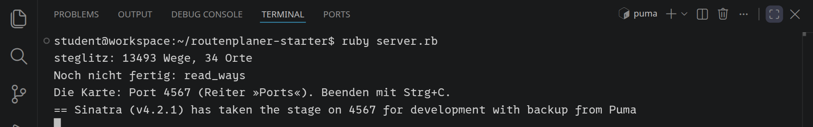
<!-- /language -->
<!-- language: python -->
Der Routenplaner läuft im Browser. Die Seite mit der Karte bekommt er von einem kleinen Server in Python, der mit [Flask](https://flask.palletsprojects.com/) gebaut ist. Flask installierst du einmal, es bleibt in deinem Workspace:

```bash
pip install flask
```

Dann startest du den Server:

```bash
python3 server.py
```

<!-- tutorial-screenshot
# Derselbe Ordner in Python: der Server in Ruby hält an, Flask kommt dazu,
# und server.py startet (er liefert dieselbe Karte für die Bilder danach)
terminal-open
terminal-maximize
press: Control+C
terminal-wait-for-prompt
terminal-run: clear
terminal-run: pip install flask
terminal-wait-for-prompt: 180
terminal-run: clear
terminal-run: python3 server.py
wait-for-text: Beenden mit Strg+C
check-task-fails: lesen python
check-task-fails: abstand python
check-task-fails: graph python
crop-terminal-lines: auto
-->
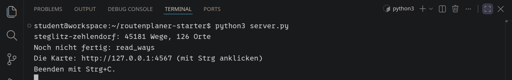
<!-- /language -->

Der Server sagt, was er gefunden hat: 45 181 Wege in Steglitz-Zehlendorf und 126 Orte. Dass `read_ways` noch nicht fertig ist, stimmt: Das schreibst du gleich selbst. Der Server läuft so lange, bis du ihn mit <kbd>Strg</kbd><kbd>C</kbd> anhältst.

Darunter steht die Adresse der Karte, `http://127.0.0.1:4567`. Klicke mit gedrückter <kbd>Strg</kbd>-Taste darauf: Visual Studio Code leitet den Port 4567 an eine Adresse weiter, die dein Browser erreicht, und öffnet sie.

<!-- tutorial-screenshot
preview-port: 4567
tab: preview
variants: dark
-->
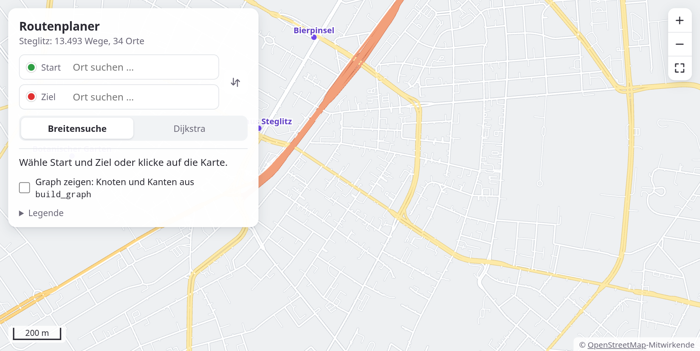

Ziehen verschiebt die Karte, das Mausrad und die Knöpfe rechts oben zoomen, ein Doppelklick holt eine Stelle heran. Oben links wählst du Start und Ziel: Tipp den Anfang eines Namens, und die Seite schlägt Sehenswürdigkeiten, Plätze und Schulen in Steglitz-Zehlendorf vor. Adressen gibt es mit Absicht nicht. Die »Legende« darunter sagt, welche Farbe welche Art von Weg ist. Einen Weg findet die Seite noch nicht; das bringst du ihr bei.

Die Vorlage hat die Karte von Steglitz-Zehlendorf. Jeden anderen Bezirk lädt der Server beim ersten Start selbst herunter, wenn du ihn so startest:

```bash
AREA=mitte ruby server.rb
```

Die Namen der Bezirke: `charlottenburg-wilmersdorf`, `friedrichshain-kreuzberg`, `lichtenberg`, `marzahn-hellersdorf`, `mitte`, `neukoelln`, `pankow`, `reinickendorf`, `spandau`, `steglitz-zehlendorf`, `tempelhof-schoeneberg`, `treptow-koepenick`. Ganz Berlin heißt `berlin`, aber damit warte lieber, bis deine Suche schnell ist.

## Die Karte

Die Karte kommt von [OpenStreetMap](https://www.openstreetmap.org/), einer Karte der ganzen Welt, an der alle mitzeichnen dürfen. Sie besteht aus **Wegen**: Jede Straße, jeder Fußweg, jede Treppe ist eine Folge von Punkten. Wo sich zwei Wege kreuzen, teilen sie sich einen Punkt.

_person(coast)

Öffne `data/steglitz.tsv`. Jede Zeile ist ein Weg, die vier Teile trennt ein Tabulator:

```text
residential		Schloßstraße	26735834 13.326700,52.456700 26735901 13.325300,52.457700 …
```

<table class='table'>
<tr><th>Teil</th><th>Bedeutung</th></tr>
<tr><td>Art</td><td>was für ein Weg: <code>residential</code> (Wohnstraße), <code>primary</code> (Hauptstraße), <code>footway</code> (Fußweg), <code>cycleway</code> (Radweg), <code>steps</code> (Treppe), …</td></tr>
<tr><td>Einbahnstraße</td><td><code>yes</code>, wenn man nur in Richtung der Punkte fahren darf, <code>-1</code> nur dagegen, sonst leer</td></tr>
<tr><td>Name</td><td>der Name der Straße, oft leer</td></tr>
<tr><td>Punkte</td><td>je eine ID und die Lage als Länge und Breite in Grad, mit Komma dazwischen</td></tr>
</table>

Die ID macht den Punkt eindeutig: Zwei Wege mit derselben ID an einem Punkt sind an dieser Stelle verbunden. Länge und Breite sind die Koordinaten, wie in jeder Karten-App: Steglitz liegt bei 13,3 Grad östlicher Länge und 52,45 Grad nördlicher Breite.

_task(fusswege)

<!-- tutorial-step
check-task: fusswege <- 21234
-->

<!-- language: ruby -->
Jetzt liest dein Programm die Datei. `read_ways` in `routes.rb` soll für jeden Weg einen Hash zurückgeben, mit der Art, der Einbahnstraße, dem Namen und den Punkten. Ein Punkt ist ein Array aus ID, Länge und Breite:

<!-- page-code: own -->
```ruby
{ kind: 'residential', oneway: '', name: 'Schloßstraße',
  points: [['26735834', 13.3267, 52.4567], ['26735901', 13.3253, 52.4577]] }
```

`File.readlines(path, chomp: true)` gibt die Zeilen ohne Zeilenumbruch, `split("\t")` teilt eine Zeile an den Tabulatoren. Die Punkte teilst du an den Leerzeichen und nimmst je zwei Teile zusammen: `each_slice(2)`. `to_f` macht aus `'13.326700'` die Zahl 13.3267.
<!-- /language -->
<!-- language: python -->
Jetzt liest dein Programm die Datei. `read_ways` in `routes.py` soll für jeden Weg ein Dictionary zurückgeben, mit der Art, der Einbahnstraße, dem Namen und den Punkten. Ein Punkt ist eine Liste aus ID, Länge und Breite:

<!-- page-code: own -->
```python
{'kind': 'residential', 'oneway': '', 'name': 'Schloßstraße',
 'points': [['26735834', 13.3267, 52.4567], ['26735901', 13.3253, 52.4577]]}
```

`for line in open(path, encoding='utf-8')` geht die Zeilen durch, `line.rstrip('\n')` nimmt den Zeilenumbruch weg, `split('\t')` teilt eine Zeile an den Tabulatoren. Die Punkte teilst du an den Leerzeichen; `items[0::2]` sind dann die IDs, `items[1::2]` die Lagen, und `zip` nimmt beide zusammen. `float` macht aus `'13.326700'` die Zahl 13.3267.
<!-- /language -->

Ausprobieren kannst du `read_ways` mit der kleinen Testkarte `data/test.tsv`: drei Wege, fünf Punkte.

_task(lesen)

## Wie weit ist es?

Für den kürzesten Weg braucht dein Programm Abstände in Metern. Die Koordinaten sind aber in Grad. Die Erde hat einen Radius von etwa 6 371 km; ein Grad ist ein 360stel ihres Umfangs:

$$1° = \frac{2\pi \cdot 6\,371\,000\ \text{m}}{360} \approx 111\,195\ \text{m}$$

Das gilt für die Breite, nach Norden. Nach Osten stimmt es nur am Äquator: In Berlin ist ein Grad Länge nur gut 67 km lang. Überlege, bevor du weiterliest:

_task(grad)

<!-- after: grad -->
Die Längengrade laufen an den Polen zusammen, und je weiter nördlich man ist, desto näher liegen sie beieinander, um den Faktor \\(\cos(\text{Breite})\\).
<!-- /after -->

Auf den paar Kilometern einer Stadt ist die Erde fast flach. Du rechnest beide Unterschiede in Meter um und nimmst den Satz des Pythagoras:

$$d = \sqrt{(\Delta\text{Länge} \cdot \cos(\text{Breite}))^2 + (\Delta\text{Breite})^2} \cdot \frac{\pi}{180} \cdot 6\,371\,000\ \text{m}$$

Die Winkel sind dabei im Bogenmaß: Der Cosinus (`Math.cos` in Ruby, `math.cos` in Python) und die Umrechnung mit \\(\pi / 180\\) erwarten keine Grad. Als Breite nimmst du die Mitte zwischen den beiden Punkten.

_task(abstand)

## Vom Weg zum Graphen

Ein Routenplaner sucht nicht in Wegen, sondern in einem **Graphen**: Punkte, die **Knoten**, und Verbindungen zwischen ihnen, die **Kanten**. Jede Kante hat eine Länge in Metern. Aus jedem Weg werden so viele Kanten, wie er Abschnitte hat: zwischen dem ersten und dem zweiten Punkt, dem zweiten und dem dritten und so weiter. Ein Fußweg, der zwei Straßen verbindet, wird zu Kanten, die über die gemeinsamen Punkte an beide anschließen.

_person(euler)

<!-- language: ruby -->
`build_graph` bekommt die Wege und gibt zwei Hashes zurück: `nodes` mit der Lage jedes Punktes, `edges` mit seinen Nachbarn und dem Abstand zu jedem. Kanten gelten erst einmal in beide Richtungen; um Einbahnstraßen kümmerst du dich später:

<!-- page-code: own -->
```ruby
{ nodes: { '2' => [13.301, 52.45], … },
  edges: { '2' => [['1', 67.8], ['3', 67.8], ['4', 111.2]], … } }
```

`each_cons(2)` gibt immer zwei aufeinanderfolgende Punkte eines Weges. `Hash.new { |hash, id| hash[id] = [] }` ist ein Hash, der für einen neuen Schlüssel von selbst ein leeres Array anlegt.
<!-- /language -->
<!-- language: python -->
`build_graph` bekommt die Wege und gibt zwei Dictionaries zurück: `'nodes'` mit der Lage jedes Punktes, `'edges'` mit seinen Nachbarn und dem Abstand zu jedem. Kanten gelten erst einmal in beide Richtungen; um Einbahnstraßen kümmerst du dich später:

<!-- page-code: own -->
```python
{'nodes': {'2': [13.301, 52.45], …},
 'edges': {'2': [['1', 67.8], ['3', 67.8], ['4', 111.2]], …}}
```

`zip(points, points[1:])` gibt immer zwei aufeinanderfolgende Punkte eines Weges. `edges.setdefault(id, [])` gibt die Liste der Nachbarn von `id` und legt sie an, wenn es sie noch nicht gibt.
<!-- /language -->

_uses(graph)

_task(graph)

Halte den Server mit <kbd>Strg</kbd><kbd>C</kbd> an und starte ihn neu. Er baut jetzt mit deinen Funktionen den Graphen von Steglitz-Zehlendorf. Wähle auf der Seite unter »Ansicht« den »Graph«: Über der blassen Karte siehst du, was `build_graph` gebaut hat, jeden Knoten als Punkt und jede Kante als Linie. Klicke auf eine Kreuzung: Die Seite zeigt den Knoten dort und seine Nachbarn.

<!-- tutorial-step
# Die Lösung der ersten drei Schritte, der Server neu gestartet (im
# Workspace; das Bild danach ist die Vorschau)
write-file: routes.rb <- file:loesung/routes-3.rb
write-file: routes.py <- file:loesung/routes-3.py
check-task: lesen
check-task: abstand
check-task: graph
check-task: lesen python
check-task: abstand python
check-task: graph python
terminal-open
press: Control+C
terminal-wait-for-prompt
terminal-run: clear
terminal-run: ruby server.rb
# »Graph:« schreibt erst der neue Server, mit dem Graphen aus routes.rb
wait-for-text: Graph:
wait-for-text: Beenden mit Strg+C
sleep: 2
-->

<!-- tutorial-scope -->
<!-- tutorial-screenshot
# Auf der Karte nah heran und auf eine Kreuzung geklickt
# (tutorial-screenshot-hooks.mjs)
preview-reload
tab: preview
variants: dark
# die Kreuzung Kuhligkshofstraße / Albrechtstraße, nicht weit von der Schule
hook: show 13.322572 52.456434 220000 graph
wait-for-text: 4 Nachbarn
-->
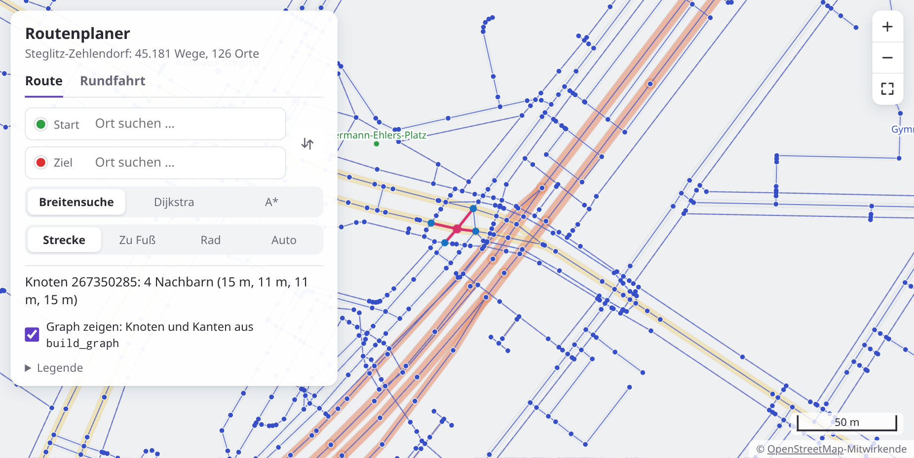

<!-- /tutorial-scope -->

Eine Straße ist im Graphen mehr als ihre Kreuzungen: Wo sie eine Kurve macht, hat sie Punkte, die nur ihre Form zeichnen. Auch das sind Knoten, mit genau zwei Nachbarn.

## Breitensuche

Jetzt sucht dein Programm einen Weg. Die einfachste Suche geht vom Start aus wie eine Welle: erst zu allen Nachbarn des Starts, dann zu deren Nachbarn, dann zu den Nachbarn der Nachbarn. Das heißt **Breitensuche**. Die Knoten, die sie gefunden, aber noch nicht weiterverfolgt hat, stehen in einer **Queue**: Wer zuerst hineinkommt, ist zuerst wieder dran.

<!-- language: ruby -->
`queue.shift` nimmt den ersten Knoten heraus, `queue << node` stellt einen hinten an.

Damit die Suche am Ende den Weg kennt, merkt sie sich für jeden gefundenen Knoten, von welchem aus sie ihn gefunden hat: seinen **Vorgänger**. In `previous` steht für den Start `nil`, für jeden anderen gefundenen Knoten sein Vorgänger:

<!-- page-code: own -->
```ruby
previous = { '11' => nil, '12' => '11', '21' => '11', '13' => '12', … }
```
<!-- /language -->
<!-- language: python -->
`queue.append(node)` stellt einen Knoten hinten an. Vorne herausnehmen ginge mit `queue.pop(0)`, aber das schiebt jedes Mal die ganze Liste nach vorne; schneller merkst du dir in `first`, welcher Knoten als Nächstes dran ist, und zählst weiter: `node = queue[first]`, dann `first += 1`.

Damit die Suche am Ende den Weg kennt, merkt sie sich für jeden gefundenen Knoten, von welchem aus sie ihn gefunden hat: seinen **Vorgänger**. In `previous` steht für den Start `None`, für jeden anderen gefundenen Knoten sein Vorgänger:

<!-- page-code: own -->
```python
previous = {'11': None, '12': '11', '21': '11', '13': '12', …}
```
<!-- /language -->

So weiß die Suche auch, welche Knoten sie schon kennt: Ein Nachbar, der schon in `previous` steht, kommt nicht noch einmal in die Queue.

Ist die Suche am Ziel, geht der Weg vom Ziel aus rückwärts: zum Vorgänger des Ziels, zu dessen Vorgänger und so weiter, bis zum Start, der keinen Vorgänger hat. Das macht `path_to`. Weil du den Weg rückwärts findest, kommt jeder Knoten vorne dazu: `path.unshift(node)` in Ruby, `path.insert(0, node)` in Python.

_task(weg)

Die Breitensuche selbst, Schritt für Schritt:

1. In der Queue steht nur der Start, in `previous` der Start ohne Vorgänger.
2. Nimm den ersten Knoten aus der Queue und schreib ihn in `visited`. Ist es das Ziel, bist du fertig.
3. Jeder Nachbar, der noch nicht in `previous` steht, bekommt den Knoten als Vorgänger und kommt hinten in die Queue.
4. Weiter mit 2, solange die Queue nicht leer ist. Wird sie leer, ohne dass das Ziel dran war, gibt es keinen Weg.

`visited` braucht die Suche selbst nicht: Die Seite zeigt damit, in welcher Reihenfolge die Suche die Knoten besucht hat. Zum Ausprobieren gibt es die Testkarte `data/detour.tsv`: Die Lindenstraße geht in fünf Kanten geradeaus vom Knoten 11 zum Knoten 16, der Eichenweg macht einen Bogen und braucht nur drei.

_uses(weg-zurueck, breitensuche)

_task(breitensuche)

<!-- tutorial-step
# Die Lösung bis zur Breitensuche und zu Dijkstra, der Server neu gestartet
write-file: data/detour.tsv <- file:vorlage/data/detour.tsv
write-file: routes.rb <- file:loesung/routes-5.rb
write-file: routes.py <- file:loesung/routes-5.py
check-task: weg
check-task: breitensuche
check-task: dijkstra
check-task: weg python
check-task: breitensuche python
check-task: dijkstra python
terminal-open
press: Control+C
terminal-wait-for-prompt
terminal-run: clear
terminal-run: ruby server.rb
wait-for-text: Graph:
wait-for-text: Beenden mit Strg+C
sleep: 2
-->

Starte den Server neu, wähle einen Start und ein Ziel und lass die Breitensuche suchen. Die Seite zeigt erst die Suche, jeden besuchten Knoten als Punkt, von Gelb (früh besucht) bis Rot (spät), und dann den Weg, den sie gefunden hat:

<!-- tutorial-scope -->
<!-- tutorial-screenshot
# Vom Gymnasium Steglitz zum Botanischen Garten, mit der Breitensuche
preview-reload
tab: preview
variants: dark
hook: route Gymnasium Steglitz | Botanischer Garten | bfs
-->
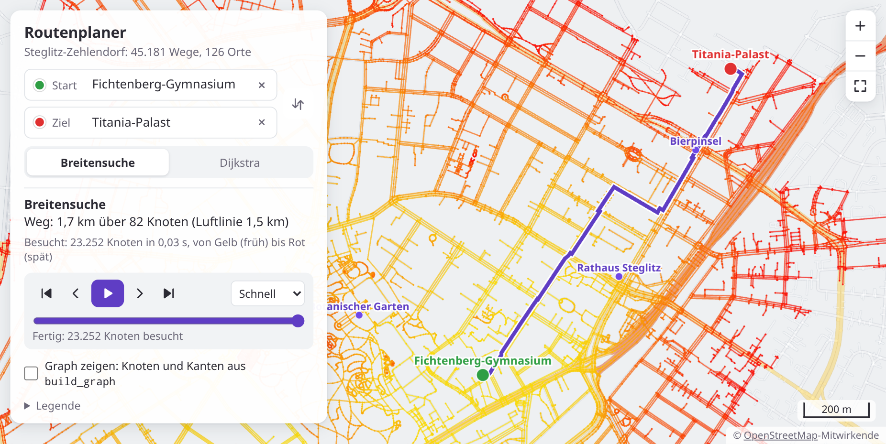

<!-- /tutorial-scope -->

Sieh dir an, wie sich die Welle ausbreitet: Im Botanischen Garten kommt sie langsam voran, auf langen geraden Straßen schnell, und ihr Weg macht Zacken und Umwege.

_task(kanten)

Die Welle breitet sich nach Kanten aus, nicht nach Metern: Im Botanischen Garten haben die Wege viele kurze Kanten, eine lange gerade Straße ist oft nur eine einzige.

## Dijkstra

Den kürzesten Weg in Metern findet die Suche von [Edsger W. Dijkstra](https://de.wikipedia.org/wiki/Edsger_W._Dijkstra) aus dem Jahr 1959. Sie nimmt als Nächstes nicht den Knoten, der am längsten wartet, sondern den, der vom Start aus am nächsten liegt. Dafür merkt sie sich für jeden gefundenen Knoten, wie weit es bis zu ihm ist, auf dem besten Weg, den sie bis jetzt kennt:

_person(dijkstra)

<div class='book'>
<i class='bi bi-file-earmark-text'></i>
<p><strong>A Note on Two Problems in Connexion with Graphs</strong>, Edsger W. Dijkstra, Numerische Mathematik, 1959. Drei Seiten mit zwei Problemen; das zweite ist der kürzeste Weg zwischen zwei Knoten, gelöst mit dem Verfahren dieses Abschnitts: <a href='https://ir.cwi.nl/pub/9256/9256D.pdf'>als PDF beim CWI</a> in Amsterdam, wo Dijkstra damals arbeitete; es hieß noch Mathematisch Centrum.</p>
</div>

1. `metres` sagt, wie weit jeder gefundene Knoten vom Start weg ist, `previous` wieder seinen Vorgänger, `frontier` die Knoten, die gefunden, aber noch nicht dran waren, mit ihrem Abstand. Am Anfang steht in allen dreien nur der Start, mit 0 Metern und ohne Vorgänger.
2. Nimm aus `frontier` den Knoten mit dem kleinsten Abstand und schreib ihn in `visited`. Ist es das Ziel, bist du fertig.
3. Für jeden Nachbarn: Wie weit wäre er über diesen Knoten? Sein Abstand plus die Länge der Kante. Kennst du den Nachbarn noch nicht, oder ist der Weg über diesen Knoten kürzer als der bisher beste, bekommt er den neuen Abstand und diesen Knoten als Vorgänger und kommt (wieder) in `frontier`.
4. Weiter mit 2, solange `frontier` nicht leer ist.

Warum stimmt der Abstand, wenn ein Knoten dran ist? Alle anderen in `frontier` sind weiter weg, und jeder Umweg über sie macht den Weg nur länger: Kanten sind nie kürzer als 0 Meter.

<!-- language: ruby -->
`frontier.min_by { |_id, m| m }` gibt den Knoten mit dem kleinsten Abstand, als Paar aus ID und Metern. `frontier.delete(node)` nimmt ihn heraus. Am Ende baut `path_to` den Weg, genau wie bei der Breitensuche.
<!-- /language -->
<!-- language: python -->
`min(frontier, key=frontier.get)` gibt den Knoten mit dem kleinsten Abstand, `frontier.pop(node)` nimmt ihn heraus und gibt seinen Abstand. Am Ende baut `path_to` den Weg, genau wie bei der Breitensuche.
<!-- /language -->

_uses(dijkstra)

_task(dijkstra)

Starte den Server neu und suche denselben Weg noch einmal, jetzt mit »Dijkstra«:

<!-- tutorial-scope -->
<!-- tutorial-screenshot
# Derselbe Weg mit Dijkstra
preview-reload
tab: preview
variants: dark
hook: route Gymnasium Steglitz | Botanischer Garten | dijkstra
-->
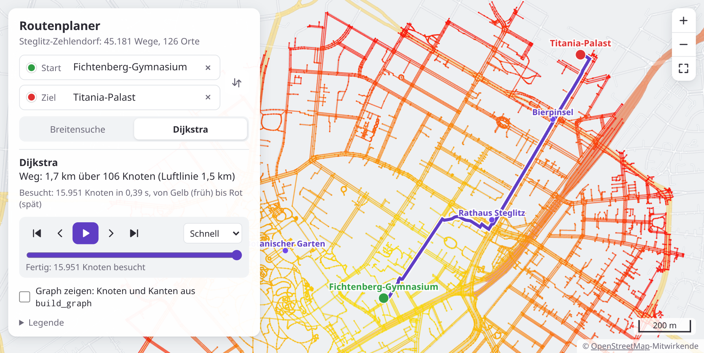

<!-- /tutorial-scope -->

Jetzt breitet sich die Welle in Metern aus, wie Ringe um den Start. Der Weg ist 1,8 km lang statt 2,1 km: Er hat mehr Knoten, aber keine Zacken. Wie verschieden die beiden Wege sein können, zeigt erst ein weiter Weg.

Mit dem Schieber unter dem Ergebnis siehst du dir die Suche Schritt für Schritt an: »Abspielen« spielt sie ab, die Knöpfe »Einen Schritt zurück« und »Einen Schritt vor« gehen einen Knoten zurück und vor, das Tempo »Langsam« zeigt jeden einzelnen. Hast du angehalten, bleibt der Schritt stehen, wenn du die andere Suche wählst. So vergleichst du beide an derselben Stelle.

Probier einen weiten Weg, zur Pfaueninsel ganz im Westen. Dahin kommt man nur mit der Fähre, und auch die ist ein Weg der Karte:

<div class='gallery columns-2'>
<!-- tutorial-scope -->
<!-- tutorial-screenshot
# Zur Pfaueninsel mit der Breitensuche
preview-reload
tab: preview
variants: dark
hook: route Gymnasium Steglitz | Pfaueninsel | bfs
-->
<figure>
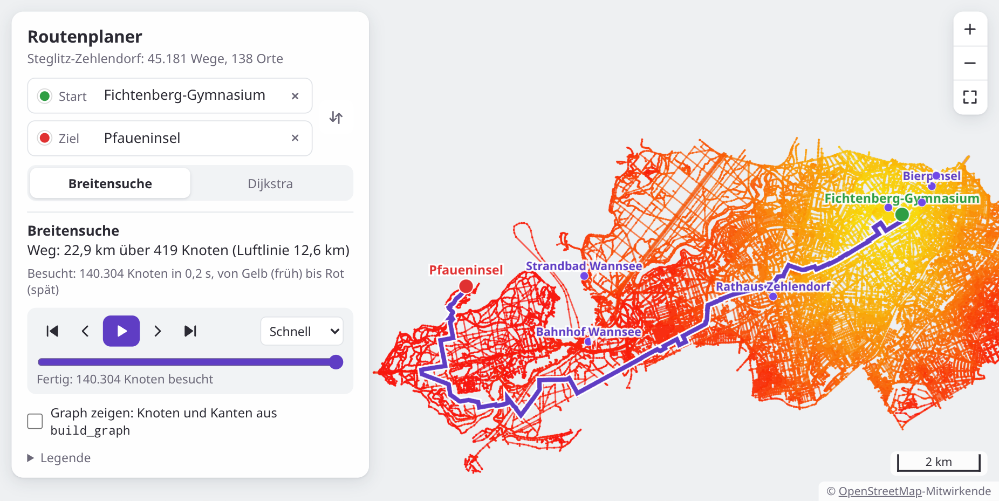
<figcaption>Breitensuche: 23,9 km</figcaption>
</figure>
<!-- /tutorial-scope -->
<!-- tutorial-scope -->
<!-- tutorial-screenshot
# Und mit Dijkstra
preview-reload
tab: preview
variants: dark
hook: route Gymnasium Steglitz | Pfaueninsel | dijkstra
-->
<figure>
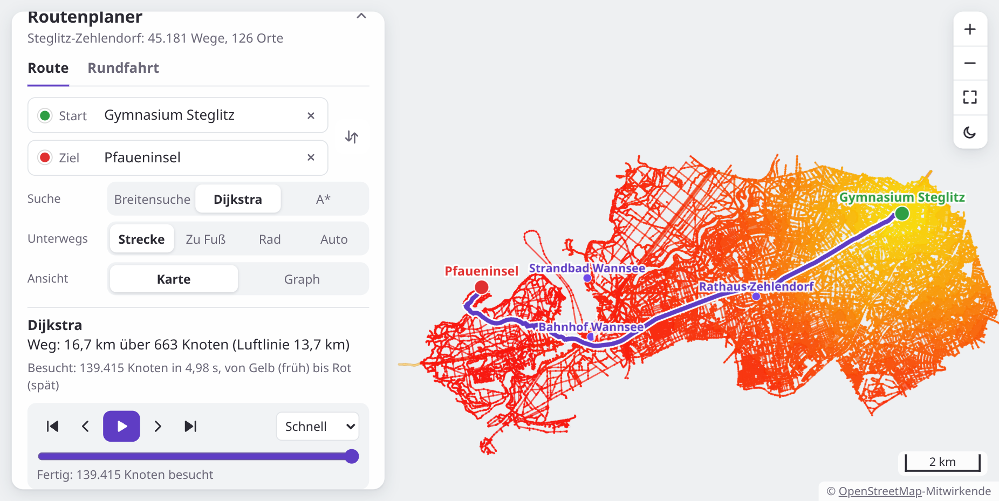
<figcaption>Dijkstra: 16,7 km</figcaption>
</figure>
<!-- /tutorial-scope -->
</div>

Die Breitensuche macht gut 7 Kilometer Umweg. Dijkstra findet den kürzesten Weg, aber schau auf die Zeit: ein paar Sekunden statt Bruchteilen davon. Beide besuchen fast den ganzen Bezirk, der Unterschied ist die Suche nach dem kleinsten Abstand: Sie geht bei jedem Schritt durch die ganze `frontier`, und die wird groß. Wie es schneller geht, kommt als Nächstes.

## Eine Priority Queue

Dijkstra sucht bei jedem Schritt in der ganzen `frontier` nach dem kleinsten Abstand. Stehen dort tausend Knoten, sind das tausend Vergleiche, bei jedem der hunderttausend Schritte. Schneller geht es mit einer **Priority Queue**: Man legt Werte mit einer Priorität hinein und bekommt immer den mit der kleinsten heraus, ohne alle anzusehen.

Ein **binärer Heap** macht das so: Die Einträge stehen in einem Array, aber man denkt sie sich als Baum. Die Kinder des Eintrags am Index `i` stehen an den Indizes `2 * i + 1` und `2 * i + 2`, sein Elternteil am Index `(i - 1) / 2`. Und es gilt immer: Kein Kind ist kleiner als sein Elternteil. Ganz oben, an Index 0, steht deshalb das Kleinste.

- **push:** Hänge den neuen Eintrag hinten an. Solange er kleiner ist als sein Elternteil, tausche die beiden; so steigt er nach oben, bis er passt.
- **pop:** Nimm den Eintrag an Index 0. Setze den letzten an seine Stelle. Solange eines seiner Kinder kleiner ist, tausche ihn mit dem kleineren Kind; so sinkt er nach unten.

Beides braucht nur so viele Schritte, wie der Baum hoch ist: bei hunderttausend Einträgen 17.

<!-- language: ruby -->
In `routes.rb` gibt es die Klasse `MinHeap` schon, mit dem Array `@items` für Paare aus Priorität und Wert. Es fehlen `push` und `pop`.
<!-- /language -->
<!-- language: python -->
In `routes.py` gibt es die Klasse `MinHeap` schon, mit der Liste `self.items` für Paare aus Priorität und Wert. Es fehlen `push` und `pop`. Python hat für so etwas das Modul `heapq`; hier baust du den Heap selbst, damit du siehst, wie er arbeitet.
<!-- /language -->

_uses(priority-queue, heap, heap-push, heap-pop)

_task(heap)

Dann bekommt `dijkstra` den Heap statt `frontier`. Ein Knoten kann jetzt mehrmals im Heap stehen: Findet die Suche einen kürzeren Weg zu ihm, legt sie ihn mit dem neuen Abstand noch einmal hinein, statt den alten Eintrag zu suchen. Kommt später der alte Eintrag heraus, war der Knoten schon dran, und die Suche überspringt ihn. Dafür merkt sie sich in `done`, welche Knoten fertig sind:

<!-- language: ruby -->
<div class='hint own'>
<strong>Jetzt bist du dran:</strong> Bau dein <code>dijkstra</code> auf den Heap um. Statt <code>frontier</code> gibt es am Anfang <code>done = {}</code> und einen <code>MinHeap</code>, in dem der Start mit 0 Metern liegt. Die Schleife läuft, bis der Heap leer ist: <code>pop</code> gibt den Knoten mit dem kleinsten Abstand, ein Knoten aus <code>done</code> wird übersprungen, und ein Nachbar mit einem neuen, kürzeren Abstand kommt mit <code>push</code> in den Heap.
</div>

<!-- hint -->
Was ändert sich gegenüber deiner Fassung mit `frontier`? Nur, woher der
nächste Knoten kommt und wie ein Nachbar hineinkommt. `previous`, `visited`
und das Ende mit `path_to` bleiben. Warum kann derselbe Knoten jetzt zweimal
aus dem Heap kommen, und was soll beim zweiten Mal passieren?
<!-- /hint -->
<!-- hint -->
`heap.pop` gibt ein Paar aus Priorität und Wert, hier Meter und Knoten:
`so_far, node = heap.pop`. Steht `node` schon in `done`, geht es mit `next`
zum nächsten Paar. Sonst kommt er in `done` und `visited`. Bei den Nachbarn
ersetzt `heap.push(total, neighbour)` die Zeile, die ihn in `frontier`
geschrieben hat.
<!-- /hint -->
<!-- hint -->
Ein Gerüst für die Schleife:

```ruby
until heap.empty?
    so_far, node = heap.pop
    # hier: überspringen, wenn node schon fertig ist, sonst als fertig merken
    visited << node
    break if node == goal

    graph[:edges][node].each do |neighbour, length|
        total = so_far + length
        # wie bisher: weiter, wenn neighbour schon einen Weg hat, der nicht länger ist
        # hier: neuer Abstand, neuer Vorgänger, und neighbour mit total in den Heap
    end
end
```
<!-- /hint -->

<!-- solution -->
Am Anfang stehen statt `frontier` diese Zeilen. Den Hash mit den Abständen
nennt die Lösung `costs` statt `metres`, weil später, beim Reisen mit dem
Rad oder dem Auto, auch Sekunden darin stehen:

<!-- page-code: own -->
```ruby
costs = { start => 0 }
previous = { start => nil }
done = {}
heap = MinHeap.new
heap.push(0, start)
visited = []
```

Und die Schleife:

<!-- page-code: own -->
```ruby
until heap.empty?
    so_far, node = heap.pop
    next if done[node]

    done[node] = true
    visited << node
    break if node == goal

    graph[:edges][node].each do |neighbour, length|
        total = so_far + length
        next if costs.key?(neighbour) && costs[neighbour] <= total

        costs[neighbour] = total
        previous[neighbour] = node
        heap.push(total, neighbour)
    end
end
```
<!-- /solution -->
<!-- /language -->
<!-- language: python -->
<div class='hint own'>
<strong>Jetzt bist du dran:</strong> Bau dein <code>dijkstra</code> auf den Heap um. Statt <code>frontier</code> gibt es am Anfang <code>done = set()</code> und einen <code>MinHeap</code>, in dem der Start mit 0 Metern liegt. Die Schleife läuft, bis der Heap leer ist: <code>pop</code> gibt den Knoten mit dem kleinsten Abstand, ein Knoten aus <code>done</code> wird übersprungen, und ein Nachbar mit einem neuen, kürzeren Abstand kommt mit <code>push</code> in den Heap.
</div>

<!-- hint -->
Was ändert sich gegenüber deiner Fassung mit `frontier`? Nur, woher der
nächste Knoten kommt und wie ein Nachbar hineinkommt. `previous`, `visited`
und das Ende mit `path_to` bleiben. Warum kann derselbe Knoten jetzt zweimal
aus dem Heap kommen, und was soll beim zweiten Mal passieren?
<!-- /hint -->
<!-- hint -->
`heap.pop()` gibt ein Paar aus Priorität und Wert, hier Meter und Knoten:
`so_far, node = heap.pop()`. Steht `node` schon in `done`, geht es mit
`continue` zum nächsten Paar. Sonst kommt er in `done` und `visited`. Bei den
Nachbarn ersetzt `heap.push(total, neighbour)` die Zeile, die ihn in
`frontier` geschrieben hat.
<!-- /hint -->
<!-- hint -->
Ein Gerüst für die Schleife:

```python
while not heap.empty():
    so_far, node = heap.pop()
    # hier: überspringen, wenn node schon fertig ist, sonst als fertig merken
    visited.append(node)
    if node == goal:
        break
    for neighbour, length in graph['edges'].get(node, []):
        total = so_far + length
        # wie bisher: weiter, wenn neighbour schon einen Weg hat, der nicht länger ist
        # hier: neuer Abstand, neuer Vorgänger, und neighbour mit total in den Heap
```
<!-- /hint -->

<!-- solution -->
Am Anfang stehen statt `frontier` diese Zeilen. Das dict mit den Abständen
nennt die Lösung `costs` statt `metres`, weil später, beim Reisen mit dem
Rad oder dem Auto, auch Sekunden darin stehen:

<!-- page-code: own -->
```python
costs = {start: 0}
previous = {start: None}
done = set()
heap = MinHeap()
heap.push(0, start)
visited = []
```

Und die Schleife:

<!-- page-code: own -->
```python
while not heap.empty():
    so_far, node = heap.pop()
    if node in done:
        continue
    done.add(node)
    visited.append(node)
    if node == goal:
        break
    for neighbour, length in graph['edges'].get(node, []):
        total = so_far + length
        if neighbour in costs and costs[neighbour] <= total:
            continue
        costs[neighbour] = total
        previous[neighbour] = node
        heap.push(total, neighbour)
```
<!-- /solution -->
<!-- /language -->

Prüfe `dijkstra` mit dem Knopf oben noch einmal, starte den Server neu und such den Weg zur Pfaueninsel wieder mit Dijkstra. Derselbe Weg, dieselben besuchten Knoten, aber statt ein paar Sekunden noch knapp eine.

<!-- tutorial-step
# Die Lösung aller Schritte, der Server neu gestartet
write-file: routes.rb <- file:loesung/routes.rb
write-file: routes.py <- file:loesung/routes.py
check-task: heap
check-task: dijkstra
check-task: heap python
check-task: dijkstra python
terminal-open
press: Control+C
terminal-wait-for-prompt
terminal-run: clear
terminal-run: ruby server.rb
wait-for-text: Graph:
wait-for-text: Beenden mit Strg+C
sleep: 2
-->

## A*: mit dem Ziel vor Augen

Dijkstra sucht in alle Richtungen gleich, auch weg vom Ziel. Dabei weiß die Karte, wo das Ziel liegt. **A*** (gesprochen »A-Stern«) nutzt das: Die Priorität eines Knotens ist nicht nur der Weg bis zu ihm, sondern der Weg bis zu ihm plus eine **Schätzung** für den Rest, die Luftlinie zum Ziel. Knoten in Richtung des Ziels kommen so früher dran, Knoten in der falschen Richtung später oder nie.

_person(hart-nilsson-raphael)

<div class='book'>
<i class='bi bi-file-earmark-text'></i>
<p><strong>A Formal Basis for the Heuristic Determination of Minimum Cost Paths</strong>, Peter Hart, Nils Nilsson und Bertram Raphael, IEEE Transactions on Systems Science and Cybernetics, 1968. Der Aufsatz, in dem A* zum ersten Mal steht, mit dem Beweis, dass der gefundene Weg der kürzeste ist, solange die Schätzung nie zu groß ist: <a href='https://doi.org/10.1109/TSSC.1968.300136'>bei IEEE</a>.</p>
</div>

$$\text{Priorität} = \text{Weg vom Start bis zum Knoten} + \text{Luftlinie vom Knoten zum Ziel}$$

Der Weg bleibt der kürzeste, solange die Schätzung nie zu groß ist: Kein Weg auf der Straße ist kürzer als die Luftlinie. Sonst ist A* genau Dijkstra, mit dem Heap. Nur kommt beim Hineinlegen die Schätzung dazu, und der Abstand eines Knotens steht in `costs`, nicht in der Priorität:

<!-- language: ruby -->
<!-- page-code: own -->
```ruby
heap.push(total + estimate.(neighbour), neighbour)
```

`estimate` ist eine kleine Funktion für die Luftlinie, mit deinem `distance` und der Lage des Ziels, `graph[:nodes][goal]`. In Ruby schreibst du sie als Lambda: `estimate = ->(id) { … }`, aufgerufen mit `estimate.(id)`.
<!-- /language -->
<!-- language: python -->
<!-- page-code: own -->
```python
heap.push(total + estimate(neighbour), neighbour)
```

`estimate` ist eine kleine Funktion für die Luftlinie, mit deinem `distance` und der Lage des Ziels, `graph['nodes'][goal]`. Du kannst sie innerhalb von `a_star` mit `def` schreiben.
<!-- /language -->

_uses(a-stern)

_task(astern)

<!-- tutorial-step
check-task: astern
check-task: astern python
-->

Wie viel A* spart, zeigt ein Weg quer durch die Stadt, zum Brandenburger Tor. Dafür braucht der Server drei Bezirke: Steglitz-Zehlendorf, Tempelhof-Schöneberg und Mitte. Halte ihn an und starte ihn so:

<!-- language: ruby -->
```bash
AREA=steglitz-zehlendorf,tempelhof-schoeneberg,mitte ruby server.rb
```
<!-- /language -->
<!-- language: python -->
```bash
AREA=steglitz-zehlendorf,tempelhof-schoeneberg,mitte python3 server.py
```
<!-- /language -->

Die beiden anderen Bezirke lädt er beim ersten Mal herunter. Der Graph hat dann fast 400 000 Knoten; das Lesen dauert ein paar Sekunden länger.

<!-- tutorial-step
# Drei Bezirke: der Server lädt zwei herunter
terminal-open
press: Control+C
terminal-wait-for-prompt
terminal-run: clear
terminal-run: AREA=steglitz-zehlendorf,tempelhof-schoeneberg,mitte ruby server.rb
sleep: 20
wait-for-text: Graph:
wait-for-text: Beenden mit Strg+C
sleep: 2
-->

<div class='gallery columns-2'>
<!-- tutorial-scope -->
<!-- tutorial-screenshot
# Zum Brandenburger Tor mit Dijkstra
preview-reload
tab: preview
variants: dark
hook: route Gymnasium Steglitz | Brandenburger Tor | dijkstra
-->
<figure>
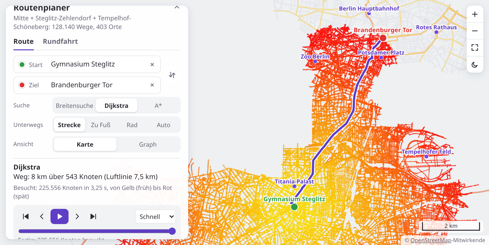
<figcaption>Dijkstra: 225 556 Knoten besucht</figcaption>
</figure>
<!-- /tutorial-scope -->
<!-- tutorial-scope -->
<!-- tutorial-screenshot
# Und mit A*
preview-reload
tab: preview
variants: dark
hook: route Gymnasium Steglitz | Brandenburger Tor | astar
-->
<figure>
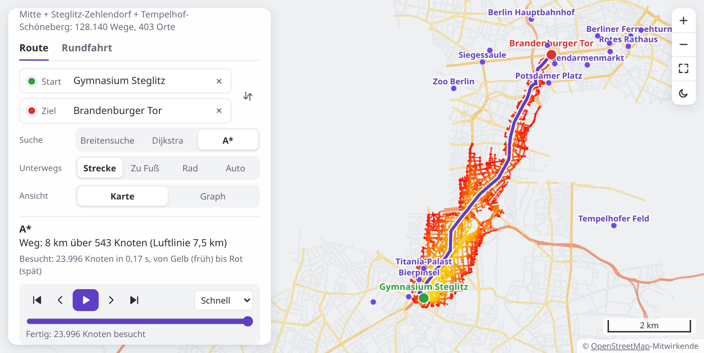
<figcaption>A*: 23 996 Knoten besucht</figcaption>
</figure>
<!-- /tutorial-scope -->
</div>

Derselbe Weg, 8 km, aber A* besucht nur ein Zehntel der Knoten: ein Band zum Ziel hin statt eines Kreises, und ist darum zehnmal so schnell fertig. Mit `AREA=berlin` hast du die ganze Stadt, 1,3 Millionen Knoten. Das Lesen dauert dann gut eine halbe Minute, aber A* findet auch dort einen Weg in Sekunden.

<div class='hint try'>
<strong>Ausprobieren:</strong> Mach die Schätzung absichtlich zu groß: Schreib in <code>a_star</code> in der Zeile mit <code>heap.push</code> ein <code>2 *</code> vor die Schätzung, starte den Server neu und such den Weg zum Brandenburger Tor noch einmal mit A*. Besucht A* jetzt weniger Knoten? Ist der Weg noch so kurz wie mit Dijkstra? Und mit <code>0 *</code> statt <code>2 *</code>: Was für eine Suche ist A* dann? Stell die Zeile danach wieder her.
</div>

## Zu Fuß, mit dem Rad, mit dem Auto

Bisher ist der kürzeste Weg gemeint, in Metern. Wer mit dem Auto fährt, will aber den schnellsten, und darf nicht überall fahren: nicht auf Fußwegen, nicht gegen Einbahnstraßen. Wer zu Fuß geht, kommt auf der Autobahn nicht weit. Dafür bekommt jede Art zu reisen ihren eigenen Graphen: nur mit den Wegen, die man so benutzen darf, und an jeder Kante, wie viele **Sekunden** man für sie braucht.

<!-- language: ruby -->
Wie schnell man wo vorankommt, steht in `routes.rb` in der Tabelle `SPEEDS`, in km/h: `SPEEDS['car']['residential']` ist 25, in einer Wohnstraße fährt man mit dem Auto im Schnitt 25 km/h. Fehlt eine Art von Weg in der Tabelle, darf man ihn so nicht benutzen.
<!-- /language -->
<!-- language: python -->
Wie schnell man wo vorankommt, steht in `routes.py` in der Tabelle `SPEEDS`, in km/h: `SPEEDS['car']['residential']` ist 25, in einer Wohnstraße fährt man mit dem Auto im Schnitt 25 km/h. Fehlt eine Art von Weg in der Tabelle, darf man ihn so nicht benutzen.
<!-- /language -->

`build_travel_graph` ist fast `build_graph`, mit drei Unterschieden:

1. Ein Weg, dessen Art in `SPEEDS[mode]` fehlt, kommt nicht in den Graphen.
2. An jeder Kante stehen Sekunden: die Meter geteilt durch das Tempo in Metern je Sekunde, also km/h geteilt durch 3,6.
3. Für das Auto gelten die Einbahnstraßen: Bei `yes` gibt es nur die Kante in Richtung der Punkte, bei `-1` nur die zurück. Zu Fuß und mit dem Rad gibt es beide.

Dazu gehört in den Graphen noch `fastest`, das größte Tempo der Tabelle in Metern je Sekunde. A* braucht es: Die Luftlinie in Metern geteilt durch `fastest` ist eine Schätzung in Sekunden, die nie zu groß ist, denn schneller als mit dem größten Tempo kommt man nirgends voran. Teile darum in `a_star` die Luftlinie durch `fastest`, wenn der Graph es hat, und sonst durch 1.

_task(reisen)

Dijkstra und A* musst du sonst nicht ändern: Sie zählen zusammen, was an den Kanten steht, ob Meter oder Sekunden. Starte den Server neu. Über den Suchen auf der Seite wählst du jetzt, wie gereist wird:

<!-- tutorial-step
check-task: reisen
check-task: reisen python
-->

<div class='gallery columns-2'>
<!-- tutorial-scope -->
<!-- tutorial-screenshot
# Mit dem Rad zum Brandenburger Tor
preview-reload
tab: preview
variants: dark
hook: route Gymnasium Steglitz | Brandenburger Tor | astar | bike
-->
<figure>
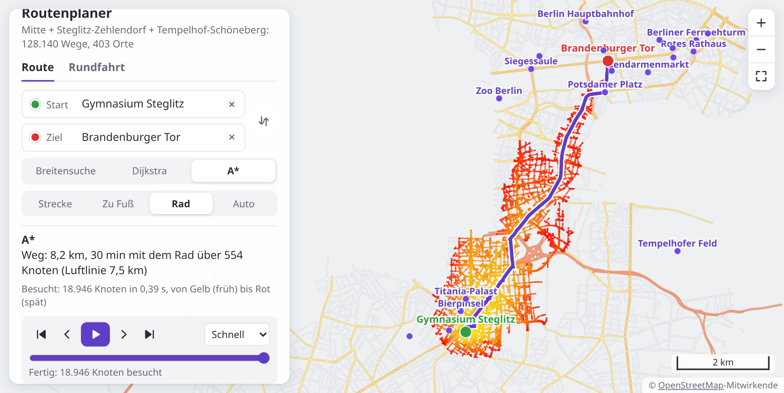
<figcaption>Mit dem Rad</figcaption>
</figure>
<!-- /tutorial-scope -->
<!-- tutorial-scope -->
<!-- tutorial-screenshot
# Mit dem Auto
preview-reload
tab: preview
variants: dark
hook: route Gymnasium Steglitz | Brandenburger Tor | astar | car
-->
<figure>
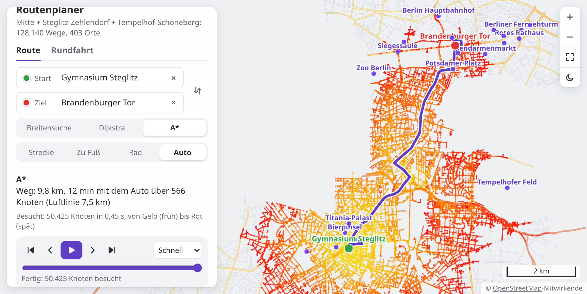
<figcaption>Mit dem Auto</figcaption>
</figure>
<!-- /tutorial-scope -->
</div>

Schau dir an, wie viele Knoten A* mit dem Auto besucht: Zu Fuß ist es ein Zehntel dessen, was Dijkstra besucht, mit dem Auto fast die Hälfte. Die Schätzung rechnet mit 90 km/h, dem Tempo auf der Autobahn, aber in der Stadt kommt man viel langsamer voran. Je weiter die Schätzung unter dem wirklichen Weg liegt, desto weniger hilft sie.

<div class='hint try'>
<strong>Ausprobieren:</strong> Setz in <code>SPEEDS</code> beim Auto das Tempo für <code>motorway</code> von 90 auf 250 und starte den Server neu. Besucht A* mit dem Auto jetzt mehr oder weniger Knoten als vorher, und warum? Ändert sich der Weg? Stell die 90 danach wieder her.
</div>

## Eine Rundfahrt

Jetzt besuchst du mehrere Orte und kommst am Ende zurück: eine Stadtrundfahrt zu den Sehenswürdigkeiten in Mitte. In welcher Reihenfolge ist sie am kürzesten? Das ist das **Problem des Handlungsreisenden**, eines der berühmtesten der Informatik.

Die Seite rechnet erst mit deiner Suche aus, wie weit es von jedem Ort zu jedem anderen ist. Bei acht Orten sind das 56 Suchen. Heraus kommt eine Tabelle `costs`: `costs[i][j]` ist der Weg vom Ort `i` zum Ort `j`. Damit arbeiten deine Funktionen, die Karte brauchen sie nicht mehr. Eine Reihenfolge ist ein Array der Nummern der Orte, das mit 0 beginnt, dem Startort. Am Ende geht es zu ihm zurück.

<!-- page-code: own -->
```text
costs = [[0, 10, 5, 2, 14],     Reihenfolge [0, 3, 2, 1, 4]:
         [10, 0, 9, 8, 4],      0 → 3 → 2 → 1 → 4 → 0
         [5, 9, 0, 7, 11],      2 + 7 + 9 + 4 + 14 = 36
         [2, 8, 7, 0, 12],
         [14, 4, 11, 12, 0]]
```

_uses(rundreise)

_task(rundfahrt)

<!-- tutorial-step
check-task: rundfahrt
check-task: rundfahrt python
-->

Die sichere Art, die beste Reihenfolge zu finden: alle ausprobieren. Der Startort steht fest, die anderen kommen in jeder möglichen Reihenfolge dahinter. Bei fünf Orten sind das 4 · 3 · 2 · 1 = 24, bei neun schon 40 320, bei zwanzig mehr, als ein Computer in deinem Leben ausprobieren kann.

<!-- language: ruby -->
`(1...costs.size).to_a.permutation` gibt alle Reihenfolgen der Orte außer dem Startort, `min_by` die mit der kleinsten Länge.
<!-- /language -->
<!-- language: python -->
`itertools.permutations(range(1, len(costs)))` gibt alle Reihenfolgen der Orte außer dem Startort, `min` mit `key=` die mit der kleinsten Länge.
<!-- /language -->

_task(alle-reihenfolgen)

<!-- tutorial-step
check-task: alle-reihenfolgen
check-task: alle-reihenfolgen python
-->

Schneller, aber ohne Garantie: der **nächste Nachbar**. Vom Startort aus geht es immer zu dem Ort, der am nächsten liegt und an dem die Rundfahrt noch nicht war.

_task(naechster-nachbar)

<!-- tutorial-step
check-task: naechster-nachbar
check-task: naechster-nachbar python
-->

Der nächste Nachbar macht oft einen Fehler: Am Anfang nimmt er die kurzen Wege, am Ende bleiben die langen übrig, und die Rundfahrt kreuzt sich selbst. **2-opt** repariert das: Es nimmt ein Stück der Reihenfolge und dreht es um. Wird die Rundfahrt dadurch kürzer, bleibt es dabei. Das probiert es für jedes Stück, und so lange, bis kein Umdrehen mehr hilft.

<!-- page-code: own -->
```text
[0, 3, 2, 1, 4]   36
[0, 3, 4, 1, 2]   32   das Stück 2, 1, 4 umgedreht
[0, 3, 1, 4, 2]   30   und dann das Stück 4, 1
```

_task(zwei-opt)

<!-- tutorial-step
check-task: zwei-opt
check-task: zwei-opt python
-->

Wechsle auf der Seite zu »Rundfahrt«, füge Orte hinzu und probiere die drei Arten aus. Der erste Ort ist der Anfang. Ist die Rundfahrt berechnet, stehen die Orte in der Liste und auf der Karte in der Reihenfolge, in der sie besucht werden:

<div class='gallery columns-2'>
<!-- tutorial-scope -->
<!-- tutorial-screenshot
# Eine Rundfahrt durch Mitte zu Fuß, mit dem nächsten Nachbarn
preview-reload
tab: preview
variants: dark
hook: tour astar | foot | nearest | Brandenburger Tor | Berliner Fernsehturm | Siegessäule | Gendarmenmarkt | Reichstagsgebäude | Rotes Rathaus | Denkmal für die ermordeten Juden Europas | Berliner Dom
-->
<figure>
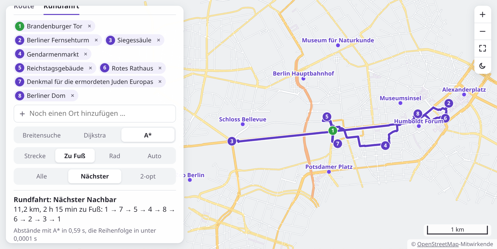
<figcaption>Nächster Nachbar: 11,2 km</figcaption>
</figure>
<!-- /tutorial-scope -->
<!-- tutorial-scope -->
<!-- tutorial-screenshot
# Dieselben Orte, alle Reihenfolgen ausprobiert
preview-reload
tab: preview
variants: dark
hook: tour astar | foot | best | Brandenburger Tor | Berliner Fernsehturm | Siegessäule | Gendarmenmarkt | Reichstagsgebäude | Rotes Rathaus | Denkmal für die ermordeten Juden Europas | Berliner Dom
-->
<figure>
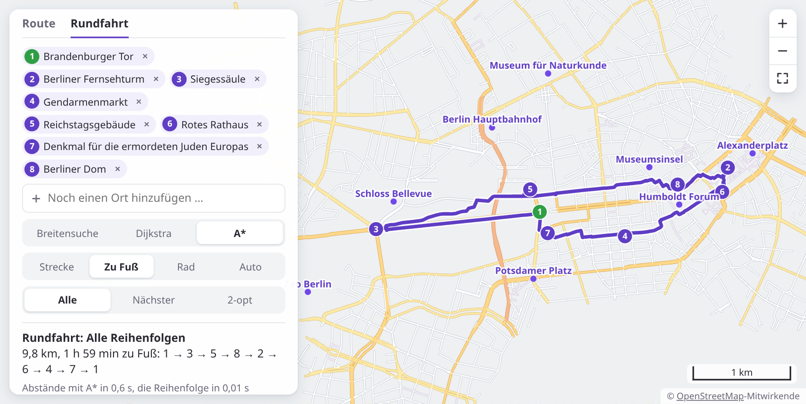
<figcaption>Alle Reihenfolgen: 9,8 km</figcaption>
</figure>
<!-- /tutorial-scope -->
</div>

Der nächste Nachbar kommt auf 11,2 km, das Ausprobieren aller 5 040 Reihenfolgen auf 9,8 km. 2-opt, aus der Reihenfolge des nächsten Nachbarn, kommt bis auf 44 Meter an die beste heran, in einem Bruchteil der Zeit. Ganz die beste ist es nicht: 2-opt hört auf, wenn kein einzelnes Umdrehen mehr hilft, und das ist nicht immer die beste Rundfahrt. Für sehr viele Orte kennt niemand einen schnellen Weg zur besten. Routenplaner, Paketdienste und Busunternehmen arbeiten darum mit Verfahren wie 2-opt: gut genug, und rechtzeitig fertig.

<!-- tutorial-scope -->
<!-- tutorial-screenshot
# Bild für die Karte der Aktivität: A* vom Gymnasium Steglitz zum
# Botanischen Garten, nur die Karte, hell und dunkel
preview-reload
tab: preview
variants: dark
viewport: 720x405
hook: route Gymnasium Steglitz | Botanischer Garten | astar
hook: teaser
-->
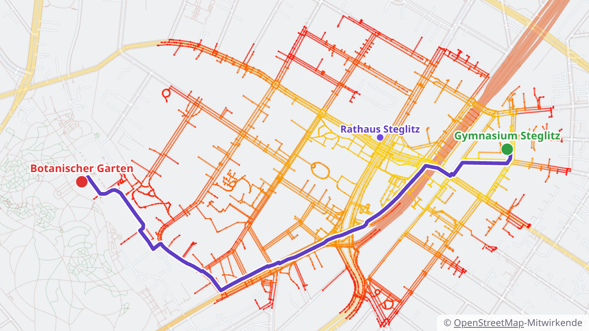

<!-- /tutorial-scope -->
