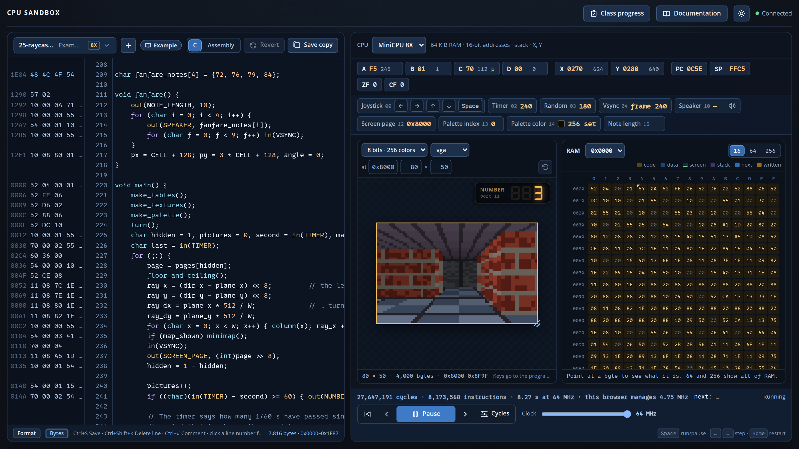
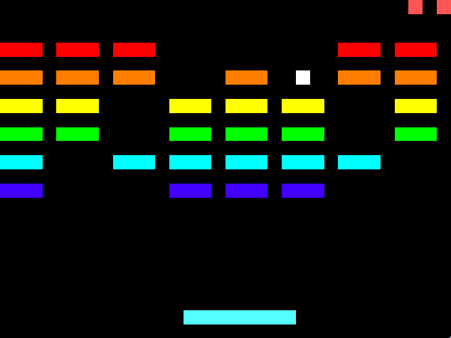
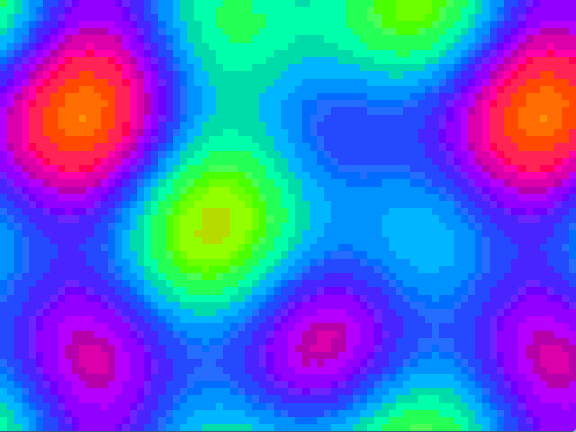
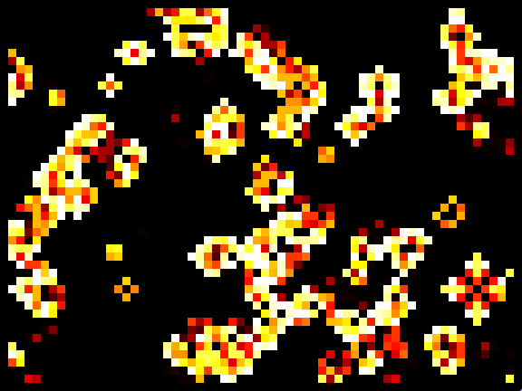
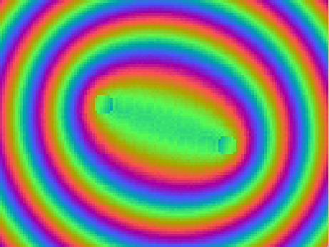
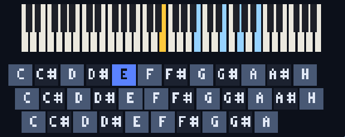
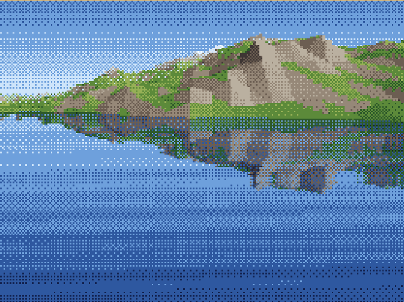
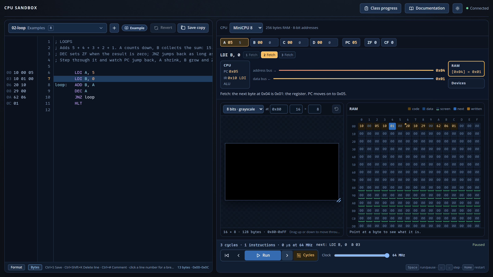
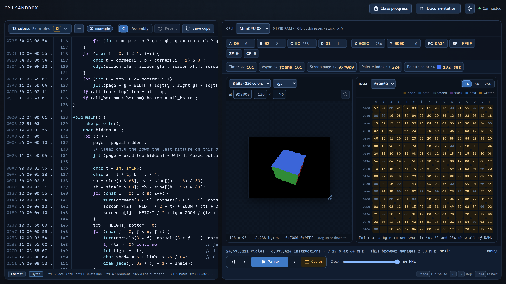

<div class='meta'>
image: cpu-sandbox.webp
image_alt: "Die CPU-Sandbox mit Maschinencode, dem Quelltext, den Registern, dem Speicher und einem kleinen 3D-Labyrinth auf dem Bildschirm"
kind: projekt
language: Assembler / C
topic: computing
reference: [gitlab, minicpu, minicpu-io, minicpu-c]
template: https://github.com/specht/cpu-sandbox.git
class_repo: git@git.nhcham.org:specht/cpu-sandbox-programs-2026.git
template_name: der CPU Sandbox
</div>

<div
    class="autotoc-secondary-trigger"
    data-title="Auf dieser Seite"
    data-levels="h2,h3">
</div>

# Vom Byte zum 3D-Labyrinth

<p class='abstract'>
In der CPU Sandbox programmierst du einen kleinen 8-Bit-Computer, erst in Assembler, später in C. Register, Flags, Speicher, Bildschirm und Geräte sind dabei jederzeit sichtbar, bis hinunter zum einzelnen Takt auf dem Bus. Und am Ende läuft auf derselben Maschine ein 3D-Labyrinth.
</p>

## Worum es geht

Zur CPU Sandbox gehören **26 Beispielprogramme**, von der Addition zweier Zahlen bis zu Spielen und Grafikeffekten. Alles, was auf dem Bildschirm erscheint, berechnet die simulierte Maschine selbst, Pixel für Pixel, ohne versteckte Grafikbefehle.

<!-- tutorial-screenshot
terminal-open
terminal-run: cd /workspace && git clone -q https://github.com/specht/cpu-sandbox.git && cd cpu-sandbox && git checkout -q 976c731d03cf0331898befab7bffd7afb94c81d4
terminal-wait-for-prompt
terminal-run: cd /workspace/cpu-sandbox && mkdir -p programs && (nohup ./run --port 18765 > /tmp/cpu-sandbox.log 2>&1 < /dev/null &)
terminal-wait-for-prompt
preview-port: 18765
tab: preview
viewport: 1600x900
wait-for-text: Class progress
click: selector:#program-picker .picker-button
click: selector:#program-picker .picker-filter
type: 25-raycaster.c
click: selector:#program-picker .picker-option
sleep: 2
click: selector:#clock
press: End
click: selector:#run
sleep: 8
-->


Im Bild läuft `25-raycaster.c`, ein Labyrinth im Stil von Wolfenstein 3D, ganz ohne Gleitkommazahlen. In den Beispielen steckt noch viel mehr; jedes Bild hier ist der Bildschirm eines Beispielprogramms:

<div class='gallery'>
<!-- tutorial-screenshot
tab: preview
viewport: 1600x900
hook: pause
click: selector:#program-picker .picker-button
click: selector:#program-picker .picker-filter
type: 14-mandelbrot.asm
sleep: 1
click: selector:#program-picker .picker-option
sleep: 2
click: selector:#clock
press: End
click: selector:#run
sleep: 10
crop-element: #screen-box
-->
<figure><figcaption><code>14-mandelbrot.asm</code>: Die Mandelbrot-Menge, in Assembler</figcaption></figure>
<!-- tutorial-screenshot
tab: preview
viewport: 1600x900
hook: pause
click: selector:#program-picker .picker-button
click: selector:#program-picker .picker-filter
type: 15-inferno.asm
sleep: 1
click: selector:#program-picker .picker-option
sleep: 2
click: selector:#clock
press: End
click: selector:#run
sleep: 10
# am Anfang eines Bildes anhalten: dann steht ein fertiges Bild im RAM
hook: stop-at frame:
crop-element: #screen-box
-->
<figure><figcaption><code>15-inferno.asm</code>: ein Feuer, in dem jedes Pixel die Hitze seiner Nachbarn aufnimmt</figcaption></figure>
<!-- tutorial-screenshot
tab: preview
viewport: 1600x900
hook: pause
click: selector:#program-picker .picker-button
click: selector:#program-picker .picker-filter
type: 16-breakout.asm
sleep: 1
click: selector:#program-picker .picker-option
sleep: 2
click: selector:#clock
press: End
click: selector:#run
sleep: 2
hook: play-breakout 33
crop-element: #screen-box
-->
<figure><figcaption><code>16-breakout.asm</code>: Breakout, mit Joystick und Ton</figcaption></figure>
<!-- tutorial-screenshot
tab: preview
viewport: 1600x900
hook: pause
click: selector:#program-picker .picker-button
click: selector:#program-picker .picker-filter
type: 20-plasma.c
sleep: 1
click: selector:#program-picker .picker-option
sleep: 2
click: selector:#clock
press: End
click: selector:#run
sleep: 7
crop-element: #screen-box
-->
<figure><figcaption><code>20-plasma.c</code>: Plasma aus Sinuswellen</figcaption></figure>
<!-- tutorial-screenshot
tab: preview
viewport: 1600x900
hook: pause
click: selector:#program-picker .picker-button
click: selector:#program-picker .picker-filter
type: 21-life.c
sleep: 1
click: selector:#program-picker .picker-option
sleep: 2
click: selector:#clock
press: End
click: selector:#run
sleep: 7
crop-element: #screen-box
-->
<figure><figcaption><code>21-life.c</code>: Conways Game of Life</figcaption></figure>
<!-- tutorial-screenshot
tab: preview
viewport: 1600x900
hook: pause
click: selector:#program-picker .picker-button
click: selector:#program-picker .picker-filter
type: 23-color-cycling.c
sleep: 1
click: selector:#program-picker .picker-option
sleep: 2
click: selector:#clock
press: End
click: selector:#run
sleep: 10
crop-element: #screen-box
-->
<figure><figcaption><code>23-color-cycling.c</code>: Color Cycling, Bewegung nur durch die Palette</figcaption></figure>
<!-- tutorial-screenshot
tab: preview
viewport: 1600x900
hook: pause
click: selector:#program-picker .picker-button
click: selector:#program-picker .picker-filter
type: 24-arpeggio-organ.c
sleep: 1
click: selector:#program-picker .picker-option
sleep: 2
click: selector:#clock
press: End
click: selector:#run
sleep: 2
hook: hold-key Shift+KeyT
sleep: 2
crop-element: #screen-box
-->
<figure><figcaption><code>24-arpeggio-organ.c</code>: eine Arpeggio-Orgel mit Akkorden auf der Tastatur</figcaption></figure>
<!-- tutorial-screenshot
tab: preview
viewport: 1600x900
hook: pause
click: selector:#program-picker .picker-button
click: selector:#program-picker .picker-filter
type: 26-landscape.c
sleep: 1
click: selector:#program-picker .picker-option
sleep: 2
click: selector:#clock
press: End
click: selector:#run
sleep: 150
crop-element: #screen-box
-->
<figure><figcaption><code>26-landscape.c</code>: Landschaft mit Wasserspiegelung</figcaption></figure>
</div>

Du arbeitest mit **zwei Git-Repositories**. Im Workspace ist `~` dein Ordner `/workspace`.

<table class='table'>
<tr><th>Ordner</th><th>Inhalt</th><th>Wer ändert es?</th></tr>
<tr><td><code>~/cpu-sandbox/</code></td><td>die App mit den Beispielen</td><td>nur deine Lehrkraft</td></tr>
<tr><td><code>~/cpu-sandbox/programs/</code></td><td>das Klassen-Repository mit euren Programmen</td><td>ihr, jede und jeder im eigenen Ordner</td></tr>
</table>

Die Karten auf dieser Seite schauen in deinem Workspace nach und sagen dir, was sie finden. Sie ändern nichts.

## Einrichten

### Einmalig: Zugang zu GitLab

_include(gitlab#ssh-schluessel)

_task(ssh-schluessel)

_include(gitlab#git-name, done: git-name)

_task(git-name)

### Einmalig: Klonen

Klone die App in dein Home-Verzeichnis:

```bash_copy
git clone ${template} ~/cpu-sandbox
```

Klone das Klassen-Repository in ihren Ordner:

```bash_copy
git clone ${class_repo} ~/cpu-sandbox/programs
```

Das Klassen-Repository muss **in** der App liegen und genau `programs` heißen. Gibt es `programs/` schon, klone es nicht noch einmal und lösche nichts, sondern frag nach.

_task(geklont)

_task(klassen-repository)

## Arbeiten

### Die App starten

Starte die App in einem Terminal und lass es offen. Für Git öffnest du ein zweites Terminal.

```bash
cd ~/cpu-sandbox
./run
```

Ein neues Programm legst du in der App mit **+** neben der Programmauswahl an. Gib als **Student folder** deinen Ordnernamen an, zum Beispiel `anna`, dann einen Dateinamen, die Sprache und die CPU. Das Programm entsteht in `programs/DEIN_NAME/`.

### Drei Ausbaustufen, eine Befehlssprache

Die MiniCPU gibt es in drei Stufen. Jede behält alles von der vorherigen und fügt genau eine Idee hinzu, sodass du nichts umlernen musst:

<table class='table'>
<tr><th>Modell</th><th>Neue Idee</th><th>Speicher und Register</th></tr>
<tr><td><strong>MiniCPU 8</strong></td><td>Daten bewegen, rechnen, vergleichen, springen, Schleifen</td><td>256 Byte; A–D, PC, Flags ZF und CF</td></tr>
<tr><td><strong>MiniCPU 8S</strong></td><td>Stack: Unterprogramme mit <code>CALL</code>/<code>RET</code>, Rekursion</td><td>zusätzlich Stackpointer SP</td></tr>
<tr><td><strong>MiniCPU 8X</strong></td><td>Zeiger, große Programme, Grafik</td><td>64 KiB, 16-Bit-Adressen, Register X und Y</td></tr>
</table>

Die Schreibweise ist einheitlich: Das Ziel steht immer vorne, und **eckige Klammern bedeuten immer »der Speicher an«**. `LDI A, 0x70` lädt die Zahl 0x70, `LDA A, [0x70]` das Byte, das an Adresse 0x70 steht. Wer sich vertut, bekommt eine Fehlermeldung, die genau diesen Unterschied erklärt. So sieht eine erste Schleife aus:

```minicpu
        LDI A, 5
        LDI B, 0
loop:   ADD B, A
        DEC A
        JNZ loop
        HLT
```

<div class='hint think'>
<strong>Zum Weiterdenken:</strong> Das Programm addiert 5 + 4 + 3 + 2 + 1. Was passiert, wenn A mit 0 statt mit 5 startet, und warum steht danach ausgerechnet 128 in B? Wer das beantworten kann, hat Überlauf, Flags und 8-Bit-Arithmetik verstanden.
</div>

Im Handbuch: _uses(stufen, regeln, flags, befehle-8)

### In einen Befehl hineinsehen

**Step** führt einen Befehl aus, **Step back** nimmt ihn zurück. Neben jeder Quelltextzeile stehen Adresse und Maschinenbytes; geänderte Speicherzellen leuchten auf. Im Modus **Cycles** geht es noch eine Ebene tiefer: Jeder Klick ist ein Takt. Du siehst, wie der Opcode geholt und dekodiert wird, wie Operanden gelesen werden, was auf Adress- und Datenbus liegt und wann gesprungen wird.

<!-- tutorial-screenshot
tab: preview
viewport: 1600x900
hook: pause
click: selector:#program-picker .picker-button
click: selector:#program-picker .picker-filter
type: 02-loop.asm
click: selector:#program-picker .picker-option
sleep: 1
click: selector:#cycle-mode
click: selector:#step-next
click: selector:#step-next
click: selector:#step-next
click: selector:#step-next
click: selector:#step-next
-->


<div class='hint task'>
<strong>Takte vorhersagen.</strong> Warum braucht <code>LDA A, [0x80]</code> einen Takt mehr als <code>LDI A, 0x80</code>? Was schreibt <code>CALL</code> in den Speicher, und wohin? Warum kostet ein <code>JZ</code>, das springt, einen Takt mehr als eines, das nicht springt? Stell erst Vermutungen auf und prüf sie dann im Taktmodus.
</div>

Ein paar Dinge, die du in der Sandbox fast von selbst entdeckst:

- Es gibt **nur einen Speicher**. Bildschirm und Stack sind einfach Bereiche darin, und ein Schreibzugriff an die falsche Adresse kann das Programm selbst verändern. Das Beispiel `05-self-modifying` macht das sogar absichtlich.
- Ein Label ist die **Adresse eines Bytes**, keine Zeilennummer.
- 8-Bit-Arithmetik läuft über: 255 + 1 ergibt 0, und das Carry-Flag ist gesetzt.
- Zeit kosten **Takte, nicht Zeilen**.

<div class='hint try'>
<strong>Ausprobieren:</strong> Leg die Schleife von oben als Programm für die MiniCPU 8 an und sieh dir die Maschinenbytes neben <code>JNZ loop</code> an. Setz dann vor <code>LDI A, 5</code> noch eine Zeile <code>LDI C, 1</code>. Welches Byte neben <code>JNZ loop</code> ändert sich, und warum gerade um so viel?
</div>

Im Handbuch: _uses(takte, maschinencode, stack, funktionen)

### Von Assembler zu C

Ab MiniCPU 8S kannst du Programme auch in MiniC schreiben, einer kleinen Variante von C, die schon beim Tippen übersetzt wird. Versteckt wird dabei nichts: Neben jeder C-Zeile stehen ihre Maschinenbytes, und der Reiter **Assembly** zeigt das erzeugte Programm. Du siehst, dass lokale Variablen auf dem Stack liegen, wie ein Funktionsaufruf sein Argument übergibt und wie das Ergebnis zurückkommt.

_person(hopper)

<!-- tutorial-screenshot
tab: preview
viewport: 1600x900
click: selector:#program-picker .picker-button
click: selector:#program-picker .picker-filter
type: 18-cube.c
click: selector:#program-picker .picker-option
sleep: 2
click: selector:#clock
press: End
click: selector:#run
sleep: 8
-->


Der Würfel aus `18-cube.c` nutzt eine Sinustabelle in Festkommaarithmetik, Perspektive, das Ausblenden verdeckter Flächen, Schattierung und Seitenwechsel (page flipping) gegen Flackern, und die Füllroutine ist von Hand in Assembler geschrieben.

Im Handbuch: _uses(c-sprache, c-anders, ports, display)

### Aufgaben, die sich selbst prüfen

Sechzehn Aufgaben prüfen sich selbst: vom Addieren zweier Bytes über Fibonacci, Multiplikation und Sortieren bis zu einem Schachbrettmuster, dazu Aufgaben speziell für C wie Fakultät, größter gemeinsamer Teiler, Primzahlsieb und Linienzeichnen. **+** legt ein Programm zu einer Aufgabe an, **Check** führt alle Testfälle aus und erklärt Fehler wie »0x82 should be 7, but it is 8«, und **Try it** lädt einen Testfall in die Maschine, damit du ihn Schritt für Schritt verfolgst.

**Class progress** sammelt die funktionierenden Lösungen der Klasse und sortiert sie nach **Takten**; das kleinste Programm in Bytes wird zusätzlich markiert. Wer schafft es mit weniger Takten? Wer mit weniger Bytes? Und geht beides gleichzeitig?

Besonders lehrreich ist es, dieselbe Aufgabe zweimal zu lösen, einmal in Assembler und einmal in C. Mit geradlinigen Lösungen ergibt sich etwa:

<table class='table'>
<tr><th>Aufgabe</th><th>Assembler: Bytes · Takte</th><th>C: Bytes · Takte</th></tr>
<tr><td><code>add</code></td><td>12 · 75</td><td>25 · 180</td></tr>
<tr><td><code>maximum</code></td><td>22 · 820</td><td>88 · 3.420</td></tr>
<tr><td><code>sort</code></td><td>42 · 4.260</td><td>176 · 19.271</td></tr>
<tr><td><code>multiply</code></td><td>33 · 5.991</td><td>92 · 1.935</td></tr>
</table>

<div class='hint think'>
<strong>Zum Weiterdenken:</strong> C braucht meist das Zwei- bis Vierfache an Bytes und Takten, dafür ist das Programm viel schneller geschrieben. Bei <code>multiply</code> ist es umgekehrt: Das C-Programm braucht nur ein Drittel der Takte. Woran liegt das? (Tipp: Wie multipliziert der Compiler, und wie die naheliegende Assembler-Lösung?) Ein besserer Algorithmus schlägt handgeschriebene Befehle.
</div>

Mehr zur App steht in ihrer [Anleitung](https://github.com/specht/cpu-sandbox#readme), alle Aufgaben in der [Aufgabenliste](https://github.com/specht/cpu-sandbox/blob/main/docs/tasks.md).

## Veröffentlichen

Deine Lehrkraft sieht deine Programme erst, wenn sie committet **und** gepusht sind. Das machst du im Ordner `programs`, nicht im Ordner der App:

```bash
cd ~/cpu-sandbox/programs
git pull
git add DEIN_NAME/
git commit -m "Aufgabe add von DEIN_NAME"
git push
```

_task(nur-dein-ordner)

_task(veroeffentlicht)

_include(gitlab#push-abgelehnt)

## Beim nächsten Mal

```bash
cd ~/cpu-sandbox && git pull
cd programs && git pull
cd .. && ./run
```

Und am Ende der Stunde: Aufgabe 5 noch einmal prüfen.
