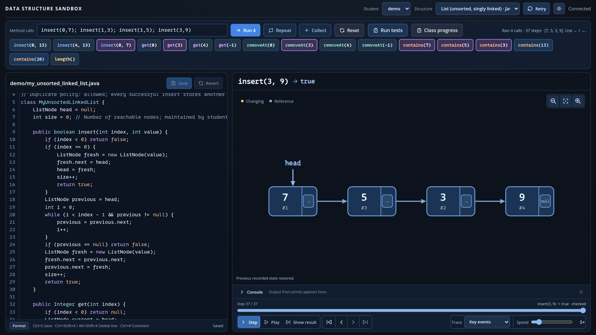

<div class='meta'>
image: data-structures-sandbox.webp
kind: projekt
topic: linux
reference: [workspace]
template: https://github.com/specht/data-structures-sandbox.git
class_repo: git@git.nhcham.org:specht/data-structure-sandbox-structures-2026.git
</div>

<div
    class="autotoc-secondary-trigger"
    data-title="Auf dieser Seite"
    data-levels="h2">
</div>

# Mit der Data Structures Sandbox arbeiten

<p class='abstract'>
In der Data Structures Sandbox programmierst du Stacks, Listen, Bäume und Hash-Tabellen und siehst jedem Schritt zu. Diese Seite begleitet dich beim Einrichten und zeigt dir, ob deine Arbeit wirklich bei deiner Lehrkraft ankommt.
</p>



Du arbeitest mit **zwei Git-Repositories**. Im Workspace ist `~` dein Ordner `/workspace`.

<table class='table'>
<tr><th>Ordner</th><th>Inhalt</th><th>Wer ändert es?</th></tr>
<tr><td><code>~/data-structures-sandbox/</code></td><td>die App</td><td>nur deine Lehrkraft</td></tr>
<tr><td><code>~/data-structures-sandbox/structures/</code></td><td>das Klassen-Repository mit euren Implementierungen</td><td>ihr, jede und jeder im eigenen Ordner</td></tr>
</table>

Die Karten auf dieser Seite schauen in deinem Workspace nach und sagen dir, was sie finden. Sie ändern nichts.

## Einmalig: Zugang zu GitLab

Melde dich auf [git.nhcham.org](https://git.nhcham.org/) an. Erzeuge dann im Terminal einen SSH-Schlüssel, falls `ls ~/.ssh/id_ed25519.pub` noch keinen findet, und bestätige alle Rückfragen mit Enter:

```bash
ssh-keygen -t ed25519 -C "Vorname Nachname"
cat ~/.ssh/id_ed25519.pub
```

Kopiere die ganze Zeile, die mit `ssh-ed25519` beginnt, nach GitLab unter **Edit profile → Access → SSH keys → Add new key**. Die Datei `~/.ssh/id_ed25519` ohne `.pub` ist dein privater Schlüssel. Den gibst du nie weiter.

_task(ssh-schluessel)

Sag Git zum Schluss, wer du bist, und teste die Verbindung:

```bash
git config --global user.name "Vorname Nachname"
git config --global user.email "deine.mail@example.org"
ssh -T git@git.nhcham.org
```

## Einmalig: Klonen

```bash
cd ~
git clone ${template}
cd data-structures-sandbox
git clone ${class_repo} structures
```

Das Klassen-Repository muss **in** der App liegen und genau `structures` heißen. Gibt es `structures/` schon, klone es nicht noch einmal und lösche nichts, sondern frag nach.

_task(geklont)

_task(klassen-repository)

## Arbeiten

Starte die App in einem Terminal und lass es offen. Für Git öffnest du ein zweites Terminal.

```bash
cd ~/data-structures-sandbox
./run
```

Deine erste Datenstruktur legst du im Ordner der App an. Ersetze `DEIN_NAME` durch deinen Ordnernamen:

```bash
cd ~/data-structures-sandbox
./new-structure DEIN_NAME stack array --lang python
```

Das legt `structures/DEIN_NAME/my_array_stack.py` an. Vorhandene Dateien werden nie überschrieben. Alles Weitere zur App steht in ihrer [Anleitung](https://github.com/specht/data-structures-sandbox#readme).

## Veröffentlichen

Deine Lehrkraft sieht deine Arbeit erst, wenn sie committet **und** gepusht ist. Das machst du im Ordner `structures`, nicht im Ordner der App:

```bash
cd ~/data-structures-sandbox/structures
git pull
git add DEIN_NAME/
git commit -m "Array-Stack von DEIN_NAME"
git push
```

_task(nur-dein-ordner)

Lehnt Git den Push ab, lösche nichts und frag nach.

_task(veroeffentlicht)

## Beim nächsten Mal

```bash
cd ~/data-structures-sandbox && git pull
cd structures && git pull
cd .. && ./run
```

Und am Ende der Stunde: Aufgabe 5 noch einmal prüfen.
