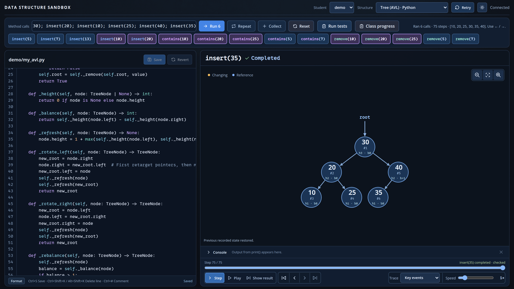
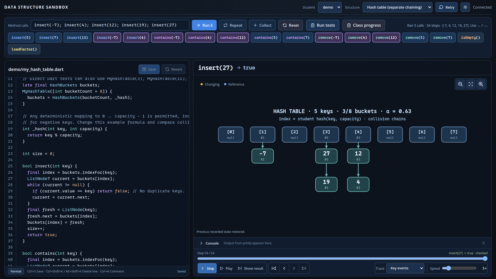

<div class='meta'>
image: data-structures-avl.webp:80:50
image_alt: "Die Datenstruktur-Sandbox mit Python-Code eines AVL-Baums links und dem gezeichneten Baum mit der Wurzel 30 rechts"
kind: projekt
duration: 4 bis 6 Doppelstunden
curriculum: "Oberstufe: Algorithmen und Datenstrukturen (Listen, Stack, Queue, Bäume, Heap, Hash Table)"
topics: [datenstrukturen]
requires: [kata-recursion, supermarkt]
language: Dart / Python / JavaScript / Java
reference: [gitlab, git, listen, baeume, heap, hash-tables]
template: https://github.com/specht/data-structures-sandbox.git
class_repo: group
template_name: der Data Structures Sandbox
</div>

<div
    class="autotoc-secondary-trigger"
    data-title="Auf dieser Seite"
    data-levels="h2,h3">
</div>

# Datenstrukturen von innen sehen

<p class='abstract'>
In der Data Structures Sandbox programmierst du Listen, Stacks, Queues, Bäume, Heaps und Hash Tables selbst, in Dart, Python, JavaScript oder Java, und siehst bei jedem Methodenaufruf, was in deinem Speicher passiert: welche Zelle beschrieben wird, welche Referenz umgebogen wird, welcher Knoten rotiert.
</p>

<div class='hint'>
<strong>Vier Sprachen, eine App:</strong> Du programmierst deine Datenstrukturen in <strong>Dart, Python, JavaScript oder Java</strong>, in der Sprache, die du lernst oder magst. Darstellung und Tests sind für alle vier dieselben. In einer Klasse kann also jede und jeder eine andere Sprache wählen, und ihr vergleicht trotzdem dieselben Strukturen.
</div>

## Worum es geht

Die meisten Programmiersprachen bringen fertige Listen, Mengen und Wörterbücher mit. Gerade deshalb bleibt oft unklar, was darin eigentlich passiert. In der Sandbox gibt es diese Abkürzung nicht: Eine Array-Liste besteht aus **acht festen Speicherzellen**, eine Linked List aus **Knoten mit `next`-Referenz**, und die Größe ist ein Feld `size`, das du selbst pflegst. Die Darstellung zeigt genau diesen Speicher; sie räumt nichts auf und rechnet nichts nach.

Jede Struktur gibt es als unfertigen **Starter** und als vollständiges **Referenzbeispiel**. Du schreibst nur die Logik, keinen Code zum Zeichnen. Ins Eingabefeld oben tippst du Methodenaufrufe wie `insert(30); insert(20)`, drückst Enter und spulst den Ablauf dann Schritt für Schritt vor und zurück.

<!-- if: class_repo -->
Du arbeitest mit **zwei Git-Repositories**. Im Workspace ist `~` dein Ordner `/workspace`.

<table class='table'>
<tr><th>Ordner</th><th>Inhalt</th><th>Wer ändert es?</th></tr>
<tr><td><code>~/data-structures-sandbox/</code></td><td>die App</td><td>nur deine Lehrkraft</td></tr>
<tr><td><code>~/data-structures-sandbox/structures/</code></td><td>das Klassen-Repository mit euren Implementierungen</td><td>ihr, jede und jeder im eigenen Ordner</td></tr>
</table>
<!-- /if -->
<!-- if: !class_repo -->
Im Workspace ist `~` dein Ordner `/workspace`. Die App liegt in `~/data-structures-sandbox/`, deine Implementierungen darin im Ordner `structures/`, in einem Ordner mit deinem Namen. Sie bleiben in deinem Workspace.
<!-- /if -->

Die Karten auf dieser Seite schauen in deinem Workspace nach und sagen dir, was sie finden. Sie ändern nichts.

## Einrichten

<!-- if: class_repo -->
### Einmalig: Zugang zum Git-Server
<!-- /if -->
<!-- if: class_repo_outside -->

Das Klassen-Repository liegt auf dem Git-Server [${git_host}](${git_web}). Deine Lehrkraft lädt dich dorthin ein; mit der Einladung kannst du dort mitmachen.
<!-- /if -->
<!-- if: class_repo_local -->

Das Klassen-Repository liegt auf dem Git-Server des Workspace, `git.workspace`. Ein Konto brauchst du dort nicht.
<!-- /if -->
<!-- if: class_repo_ssh -->

_include(gitlab#ssh-schluessel)

_task(ssh-schluessel)
<!-- /if -->
<!-- if: class_repo_local_keys -->

_include(gitlab#ssh-workspace)

_task(ssh-schluessel)
<!-- /if -->
<!-- if: class_repo_local_auto -->

_include(gitlab#ssh-workspace-auto)
<!-- /if -->
<!-- if: class_repo_https -->

_include(gitlab#https-anmelden)
<!-- /if -->
<!-- if: class_repo -->

_include(gitlab#git-name, done: git-name)

_task(git-name)
<!-- /if -->

### Einmalig: Klonen

Klone die App in dein Home-Verzeichnis:

```bash_copy
git clone ${template} ~/data-structures-sandbox
```

<!-- if: class_repo -->
Klone das Klassen-Repository in ihren Ordner:

```bash_copy
git clone ${class_repo} ~/data-structures-sandbox/structures
```

Das Klassen-Repository muss **in** der App liegen und genau `structures` heißen. Gibt es `structures/` schon, klone es nicht noch einmal und lösche nichts, sondern frag nach.
<!-- /if -->
<!-- if: !class_repo -->
Deine Implementierungen kommen in der App in den Ordner `structures`. Lege ihn an:

```bash
mkdir ~/data-structures-sandbox/structures
```

Der Ordner muss **in** der App liegen und genau `structures` heißen. Meldet `mkdir`, dass es ihn schon gibt, ist alles in Ordnung.
<!-- /if -->

_task(geklont)

<!-- if: class_repo -->
_task(klassen-repository)
<!-- /if -->

## Arbeiten

### Die App starten

<!-- if: class_repo -->
Starte die App in einem Terminal und lass es offen. Für Git öffnest du ein zweites Terminal.
<!-- /if -->
<!-- if: !class_repo -->
Starte die App in einem Terminal und lass es offen.
<!-- /if -->

```bash
cd ~/data-structures-sandbox
./run
```

Deine erste Datenstruktur legst du im Ordner der App an. Ersetze `DEIN_NAME` durch deinen Ordnernamen:

```bash
cd ~/data-structures-sandbox
./new-structure DEIN_NAME stack array --lang python
```

Das legt `structures/DEIN_NAME/my_array_stack.py` an. Vorhandene Dateien werden nie überschrieben. Statt `python` geht auch `dart`, `javascript` oder `java`.

### Ein Datentyp, mehrere Speicherformen

_uses(array-list, linked-list, stack, queue)

Ein **Stack** arbeitet nach dem LIFO-, eine **Queue** nach dem FIFO-Prinzip. Dasselbe Verhalten lässt sich aber mit einem festen Array, einem Ring Buffer oder verketteten Knoten erreichen.

_task(lifo-fifo)

Besonders ergiebig sind die **vier Listen**: unsortiert oder sortiert, jeweils als Array oder als verkettete Knoten. Alle vier haben dieselbe Schnittstelle, und du kannst dieselbe Folge von Aufrufen auf alle vier loslassen. Hier eine Folge von Einfügungen auf einer einfach verketteten Linked List, in Java implementiert:

<!-- tutorial-screenshot
terminal-open
terminal-run: cd /workspace && git clone -q https://github.com/specht/data-structures-sandbox.git && cd data-structures-sandbox && git checkout -q e4ea4fc5e126574ed27e671d20e66d43462909c0
terminal-wait-for-prompt
terminal-run: cd /workspace/data-structures-sandbox && mkdir -p structures && ./new-structure demo list unsorted-nodes --example --lang java && ./new-structure demo tree avl --example --lang python && ./new-structure demo hash chains --example --lang dart
terminal-wait-for-prompt
terminal-run: cd /workspace/data-structures-sandbox && (nohup ./run --port 18081 --no-open > /tmp/data-structures-sandbox.log 2>&1 < /dev/null &)
terminal-wait-for-prompt
preview-port: 18081
tab: preview
viewport: 1600x900
wait-for-text: demo/my_unsorted_linked_list.java
click: selector:#call-input
press: Control+A
type: insert(0,7); insert(1,3); insert(1,5); insert(3,9)
press: Enter
wait-for-text: Ran 4 calls
sleep: 1
click: selector:#last
sleep: 1
click: selector:#fit-scene
move-mouse: selector:.scene-hint
sleep: 1
-->


<div class='hint task'>
<strong>Dieselben Aufrufe, zwei Welten.</strong> Lass <code>insert(0,7); insert(1,3); insert(1,5); insert(3,9)</code> zuerst auf der Array-Liste und dann auf der Linked List laufen. Welche Operation verschiebt Werte, welche biegt nur Referenzen um? Warum geht <code>get(i)</code> beim Array in konstanter Zeit, während die Linked List dafür bis zu <em>n</em> Knoten ablaufen muss? Und was kostet umgekehrt das Einfügen ganz vorne?
</div>

_task(einfuegen-verschieben)

Die Tests sind streng, und das ist gewollt: Eine Liste gilt erst dann als richtig, wenn sie sich nach außen richtig verhält **und** ihr Inneres stimmt, etwa wenn `size` wirklich der Zahl der gespeicherten Werte entspricht oder die Knotenkette keinen Kreis enthält. Ungültige Indizes, volle Arrays und doppelte Werte gehören fest zur Prüfung.

<div class='hint try'>
<strong>Ausprobieren:</strong> Bau in deine Linked List absichtlich einen Fehler ein: Lass in der Methode, die ein Element entfernt, die Zeile weg, die <code>size</code> verkleinert, und speichere. Lass dann <strong>Run tests</strong> laufen: Welchen Fall nennt die Sandbox, und woran hat sie den Fehler bemerkt? Nimm die Zeile danach wieder hinein.
</div>

### Bäume, Rekursion und AVL-Rotationen

_uses(suchbaum, suchbaum-entfernen, avl)

Bei **binären Suchbäumen** wird die Suchregel sichtbar: links das Kleinere, rechts das Größere. Rekursive Aufrufe verfolgst du Schritt für Schritt und siehst, an welchem Knoten gerade gearbeitet wird. **AVL-Bäume** speichern zusätzlich die Höhe ihrer Teilbäume und stellen das Gleichgewicht nach dem Einfügen durch Rotationen wieder her. Hier ein AVL-Baum, in Python implementiert, nach sechs Einfügungen:

<!-- tutorial-screenshot
tab: preview
viewport: 1600x900
select-option: #structure = avl:.py
wait-for-text: demo/my_avl.py
click: selector:#call-input
press: Control+A
type: insert(30); insert(20); insert(10); insert(25); insert(40); insert(35)
press: Enter
wait-for-text: Ran 6 calls
sleep: 1
click: selector:#last
sleep: 1
click: selector:#fit-scene
move-mouse: selector:.scene-hint
sleep: 1
-->


<div class='hint task'>
<strong>Erst skizzieren, dann rotieren.</strong> Skizziere nach <code>insert(30); insert(20); insert(10)</code> zuerst den unbalancierten Baum und begründe, welche Rotation ihn rettet. Dann lass die Sandbox nachrechnen. Zum Vergleich: Was passiert mit einem gewöhnlichen Suchbaum, wenn du 1, 2, 3, … 10 der Reihe nach einfügst?
</div>

_task(avl-rotation)

_person(adelson-velski-landis)

### Hash Tables: Du entscheidest

_uses(hash-funktion, hash-chaining, hash-fuellgrad)

Die Hash Table löst Kollisionen durch **Chaining** (separate chaining). Wie viele Buckets es gibt und welche Hashfunktion verwendet wird, legst du in deiner eigenen Klasse fest; die Tests akzeptieren jede gültige Wahl. So werden Kollisionen und Füllgrad zu etwas, das du gezielt herbeiführen und vermeiden kannst.

<!-- tutorial-screenshot
tab: preview
viewport: 1600x900
select-option: #structure = hash
wait-for-text: demo/my_hash_table.dart
click: selector:#call-input
press: Control+A
type: insert(-7); insert(4); insert(12); insert(19); insert(27)
press: Enter
wait-for-text: Ran 5 calls
sleep: 1
click: selector:#last
sleep: 1
click: selector:#fit-scene
move-mouse: selector:.scene-hint
sleep: 1
-->


<div class='hint task'>
<strong>Kollisionen provozieren.</strong> Finde fünf Schlüssel, die alle im selben Bucket landen. Was passiert mit der Suche? Ändere dann die Zahl der Buckets von 8 auf 7 oder 11 und wiederhole die Folge. Welche Bucketzahlen sind eine schlechte Idee, wenn die Schlüssel zum Beispiel alle gerade sind?
</div>

_task(buckets-belegt)

<div class='hint think'>
<strong>Zum Weiterdenken:</strong> Wohin gehört der Schlüssel −7 bei acht Buckets? Die Antwort hängt von der Sprache ab: In Dart und Python ergibt <code>-7 % 8</code> den Wert 1, in Java und JavaScript −7, also einen ungültigen Index. Die Referenzbeispiele der Sandbox lösen das in jeder Sprache anders (<code>Math.floorMod</code> in Java, eine kleine Formel in JavaScript). Was ist eigentlich ein »Rest«?
</div>

### Werkzeuge der App

- **Repeat** spielt deine Aufruffolge nach jedem Speichern automatisch erneut ab: Du siehst sofort, was deine Änderung bewirkt.
- **Run tests** prüft Methoden und inneren Aufbau gegen unabhängige Vergleichsmodelle und nennt bei einem Fehler den konkreten Fall.
- Ausgaben mit `print` erscheinen in der Konsole genau an dem Schritt, an dem sie entstanden sind; Laufzeitfehler springen auf Wunsch zur passenden Zeile.

Neben den gezeigten Strukturen gibt es Stacks und Queues jeweils als Array und als Knotenkette sowie einen Min-Heap im Array. Mehr zur App steht in ihrer [Anleitung](https://github.com/specht/data-structures-sandbox#readme), was jede Struktur genau können muss in den [Verträgen](https://github.com/specht/data-structures-sandbox/blob/main/docs/contracts.md).

<!-- if: class_repo -->
## Veröffentlichen

Deine Lehrkraft sieht deine Arbeit erst, wenn sie committet **und** gepusht ist. Das machst du im Ordner `structures`, nicht im Ordner der App:

```bash
cd ~/data-structures-sandbox/structures
git pull
git add DEIN_NAME/
git commit -m "Array-Stack von DEIN_NAME"
git push
```

_task(nur-dein-ordner)

_task(veroeffentlicht)

_include(gitlab#push-abgelehnt)

## Beim nächsten Mal

```bash
cd ~/data-structures-sandbox && git pull
cd structures && git pull
cd .. && ./run
```

Und am Ende der Stunde: [»Committet und gepusht«](#aufgabe-veroeffentlicht) noch einmal prüfen.
<!-- /if -->
<!-- if: !class_repo -->
## Beim nächsten Mal

```bash
cd ~/data-structures-sandbox && git pull
./run
```

`git pull` holt die neueste Version der App. Deine Implementierungen in `structures` bleiben dabei, wie sie sind: Das Repository der App lässt diesen Ordner aus.
<!-- /if -->
