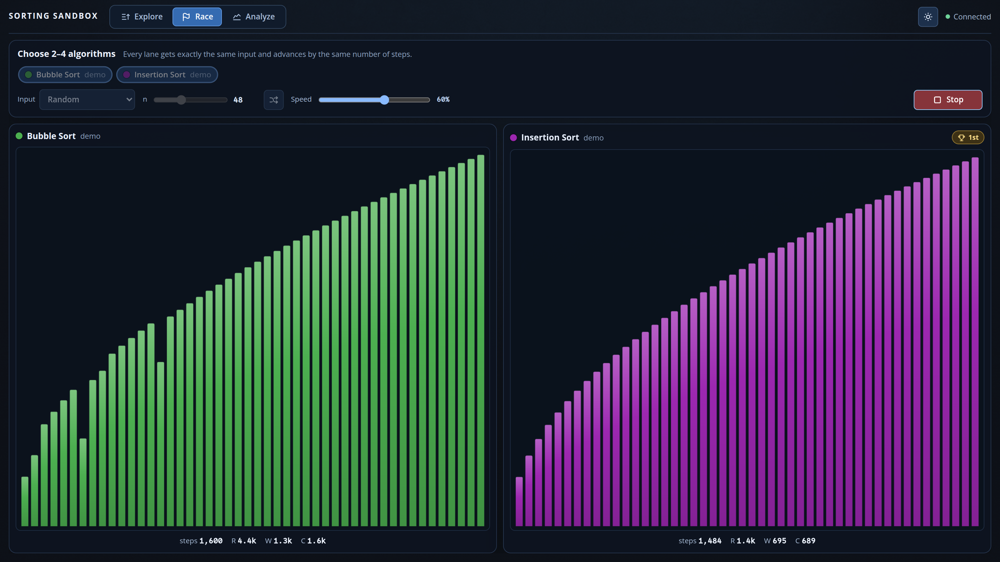
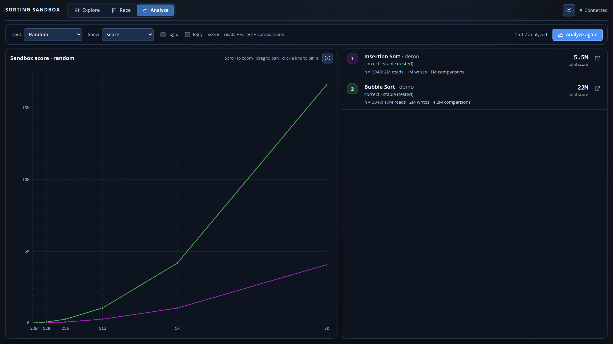
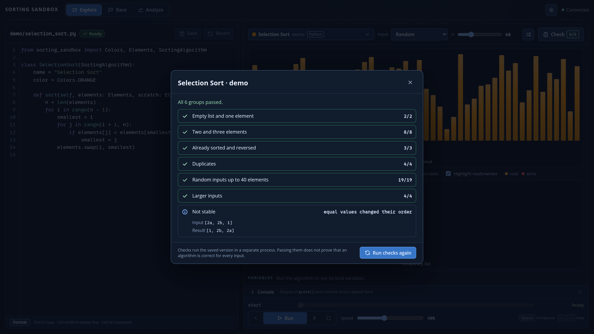

<div class='meta'>
image: sorting-sandbox.webp
image_alt: "Die Sortier-Sandbox mit dem Code von Bubblesort links und den zu sortierenden Zahlen als grüne Balken rechts"
kind: projekt
language: Dart / Python / JavaScript / Java
topic: computing
reference: [gitlab, sortieren, heap]
template: https://github.com/specht/sorting-sandbox.git
class_repo: git@git.nhcham.org:specht/sorting-sandbox-algorithms-2026.git
template_name: der Sorting Sandbox
</div>

<div
    class="autotoc-secondary-trigger"
    data-title="Auf dieser Seite"
    data-levels="h2,h3">
</div>

# Sortieralgorithmen erforschen

<p class='abstract'>
In der Sorting Sandbox schreibst du Sortieralgorithmen in Dart, Python, JavaScript oder Java und siehst dann zu, wie dein eigener Code arbeitet. Du lässt Verfahren gegeneinander antreten, misst ihren Aufwand und findest heraus, warum zwei richtige Algorithmen trotzdem sehr unterschiedlich gut sein können.
</p>

<div class='hint'>
<strong>Vier Sprachen, eine App:</strong> Du schreibst deine Algorithmen in <strong>Dart, Python, JavaScript oder Java</strong>, in der Sprache, die du lernst oder magst. Alle Verfahren treten in derselben App gegeneinander an, egal in welcher Sprache sie geschrieben sind. In einer Klasse kann also jede und jeder eine andere Sprache wählen.
</div>

## Worum es geht

Deine Klasse hat ein gemeinsames Repository, in dem alle eure Algorithmen liegen. Was du veröffentlichst, erscheint ohne Neustart bei allen anderen und muss sich dort im Rennen und in der Messung bewähren.

Dein Algorithmus ist ganz gewöhnlicher Code: Es gibt keine Befehle zum Zeichnen und keine Hilfsfunktionen, die du aufrufen musst, damit etwas sichtbar wird. Ein vollständiger Insertion Sort in Dart sieht so aus:

<!-- screenshot-code: insertion-sort -->
```dart
import 'package:sorting_sandbox_api/sorting_sandbox_api.dart';

class InsertionSort extends SortingAlgorithm {
  String get name => 'Insertion Sort';
  String get color => Colors.purple;

  void sort(Elements list, Elements scratch) {
    for (int i = 1; i < list.length; i++) {
      final current = list[i];
      int j = i;
      while (j > 0 && list[j - 1] > current) {
        list[j] = list[j - 1];
        j--;
      }
      list[j] = current;
    }
  }
}
```

Eine Besonderheit: Die Zahlen selbst sieht dein Algorithmus **nicht**. Elemente lassen sich nur vergleichen, lesen, schreiben und vertauschen. Jeder Algorithmus in der Sandbox sortiert also nur durch Vergleichen. Für Verfahren wie Merge Sort steht eine zweite, gleich lange Liste `scratch` als Zwischenspeicher bereit.

Du arbeitest mit **zwei Git-Repositories**. Im Workspace ist `~` dein Ordner `/workspace`.

<table class='table'>
<tr><th>Ordner</th><th>Inhalt</th><th>Wer ändert es?</th></tr>
<tr><td><code>~/sorting-sandbox/</code></td><td>die App</td><td>nur deine Lehrkraft</td></tr>
<tr><td><code>~/sorting-sandbox/algorithms/</code></td><td>das Klassen-Repository mit euren Algorithmen</td><td>ihr, jede und jeder im eigenen Ordner</td></tr>
</table>

Die Karten auf dieser Seite schauen in deinem Workspace nach und sagen dir, was sie finden. Sie ändern nichts.

## Einrichten

### Einmalig: Zugang zu GitLab

_include(gitlab#ssh-schluessel)

_task(ssh-schluessel)

_include(gitlab#git-name, done: git-name)

_task(git-name)

### Einmalig: Klonen

Klone die App in dein Home-Verzeichnis:

```bash_copy
git clone ${template} ~/sorting-sandbox
```

Klone das Klassen-Repository in ihren Ordner:

```bash_copy
git clone ${class_repo} ~/sorting-sandbox/algorithms
```

Das Klassen-Repository muss **in** der App liegen und genau `algorithms` heißen. Gibt es `algorithms/` schon, klone es nicht noch einmal, sondern hol mit `git pull` darin den aktuellen Stand.

_task(geklont)

_task(klassen-repository)

## Arbeiten

### Die App starten

Starte die App in einem Terminal und lass es offen. Für Git öffnest du ein zweites Terminal.

```bash
cd ~/sorting-sandbox
./run
```

Hol im zweiten Terminal zuerst den Stand der Klasse und lege dann im Ordner der App deinen Algorithmus an. Ersetze `DEIN_NAME` durch deinen Ordnernamen:

```bash
cd ~/sorting-sandbox/algorithms
git pull
cd ~/sorting-sandbox
./new-algorithm DEIN_NAME --lang python
```

Das legt `algorithms/DEIN_NAME/bubble_sort.py` mit einem Bubble Sort als Ausgangspunkt an, mit Absicht noch nicht optimiert. Statt `python` geht auch `dart`, `javascript` oder `java`. Vorhandene Dateien werden nie überschrieben.

### Explore: deinem Code beim Arbeiten zusehen

Im Reiter **Explore** steht links dein Quelltext; du kannst ihn direkt im Browser bearbeiten, formatieren und speichern. Rechts läuft der Algorithmus Schritt für Schritt: Die **aktuelle Zeile** ist markiert, darunter stehen die lokalen Variablen, und Indexvariablen wie `i` und `j` erscheinen als Zeiger unter der Liste. Auf Wunsch leuchten gelesene Elemente orange und geschriebene rot auf. Mit der Zeitleiste spulst du jederzeit zurück.

<!-- tutorial-screenshot
terminal-open
terminal-run: cd /workspace && git clone -q https://github.com/specht/sorting-sandbox.git && cd sorting-sandbox && git checkout -q 153a572734bbb9be57e09fa75980479532324189
terminal-wait-for-prompt
terminal-run: cd /workspace/sorting-sandbox && mkdir -p algorithms && ./new-algorithm demo --lang dart
terminal-wait-for-prompt
write-file: sorting-sandbox/algorithms/demo/insertion_sort.dart <- previous-code (insertion-sort)
terminal-run: cd /workspace/sorting-sandbox && (nohup ./run --port 18080 --no-open > /tmp/sorting-sandbox.log 2>&1 < /dev/null &)
terminal-wait-for-prompt
preview-port: 18080
tab: preview
viewport: 1600x900
wait-for-text: Bubble Sort
click: selector:#show-access
click: selector:#step-next
sleep: 2
click: selector:#step-next
click: selector:#step-next
click: selector:#step-next
click: selector:#step-next
-->


<div class='hint task'>
<strong>Erst vorhersagen, dann klicken.</strong> Bevor du auf <em>Weiter</em> klickst: Welche zwei Elemente werden als Nächstes verglichen? Wird getauscht? Wo stehen <code>i</code> und <code>j</code> danach? Nach ein paar Runden kommt die eigentliche Frage: Muss die innere Schleife wirklich jedes Mal bis ganz nach hinten laufen? Und muss die äußere Schleife weiterlaufen, wenn in einem Durchgang gar nichts mehr getauscht wurde?
</div>

Fehler sind kein Drama, du siehst sie nur deutlich: Ein Übersetzungsfehler erscheint mit Zeilennummer unter dem Editor, ein Laufzeitfehler (etwa ein Index außerhalb der Liste) in der Konsole, und eine Endlosschleife wird nach wenigen Sekunden gestoppt. Ausgaben mit `print(...)` landen ebenfalls in der Konsole.

### Race: gleicher Auftrag, ungleiche Arbeit

Im Reiter **Race** treten zwei bis vier Algorithmen mit **genau derselben Eingabe** gegeneinander an. Jede Bahn macht pro Takt gleich viele Schritte; wer zuerst fertig ist, gewinnt. Als Eingabe gibt es zufällige, sortierte, umgekehrt sortierte und fast sortierte Listen sowie Listen mit wenigen verschiedenen Werten.

<!-- tutorial-screenshot
tab: preview
viewport: 1600x900
click: selector:#tab-race
wait-for-text: Insertion Sort
click: selector:#race-start
wait-for-text: 1st
-->


<div class='hint task'>
<strong>Wetten abschließen.</strong> Sag vor jedem Rennen voraus, wer gewinnt, und begründe es: erst für eine zufällige Liste, dann für eine schon sortierte und eine umgekehrt sortierte. Und dann: Für welche Eingabe könnte dein eigener Algorithmus das Rennen gewinnen? Bau sie!
</div>

Das Rennen zeigt **Arbeitsschritte**, keine Laufzeit auf echter Hardware. Unter jeder Bahn stehen deshalb auch die gezählten Lese-, Schreib- und Vergleichsoperationen. Schritte, Lesen, Schreiben und Vergleichen können zu unterschiedlichen Ranglisten führen. Was heißt dann eigentlich »schneller«?

### Analyze: vom Gefühl zur Wachstumsfunktion

**Analyze** lässt alle Algorithmen der Klasse auf Listen mit 32 bis 2048 Elementen laufen, alle mit denselben Eingaben, und zeichnet den Aufwand als Kurve. Gezählt werden Lesen, Schreiben und Vergleichen; ihre Summe heißt in der App **Sandbox-Score**. Die Kurven lassen sich durch *n*, *n* log *n* oder *n*² teilen und logarithmisch skalieren. Nebenbei prüft Analyze jeden Algorithmus auf Korrektheit und Stabilität.

<!-- tutorial-screenshot
tab: preview
viewport: 1600x900
click: selector:#tab-analyze
click: selector:#analyze-run
wait-for-text: 2 of 2 analyzed
-->


<div class='hint task'>
<strong>Eine Wachstumsvermutung belegen.</strong> Lies die Werte für <em>n</em> = 512, 1024 und 2048 ab: Was passiert mit dem Aufwand, wenn sich <em>n</em> verdoppelt? Stell dann die Anzeige auf <em>score / n²</em>. Wird die Kurve flach, stimmt deine Vermutung, und die Höhe, auf der sie flach wird, verrät noch mehr über den Algorithmus.
</div>

<div class='hint think'>
<strong>Zum Weiterdenken:</strong> Für <em>n</em> = 2048 macht der unoptimierte Bubble Sort genau <em>n</em>·(<em>n</em>−1), also rund 4,2 Millionen Vergleiche, egal, wie die Liste aussieht. Bei den Schreibzugriffen wird es spannender: Jede Vertauschung bei Bubble Sort und jede Verschiebung bei Insertion Sort beseitigt genau einen <em>Fehlstand</em>, also ein Paar, das in falscher Reihenfolge steht. Auf derselben Eingabe tauscht Bubble Sort deshalb genau so oft, wie Insertion Sort verschiebt. Der große Unterschied liegt woanders. Wo?
</div>

### Check: richtig, stabil oder nur zufällig richtig?

**Check** testet einen Algorithmus auf vielen Eingaben und zeigt bei einem Fehler die Liste, an der er scheitert. Außerdem prüft er die **Stabilität**: Behalten gleiche Werte ihre ursprüngliche Reihenfolge? Die Sandbox merkt sich im Hintergrund, woher jedes Element kommt; dein Code braucht dafür keine zusätzliche Zeile.

Hier hat jemand einen Selection Sort in Python geschrieben. Er sortiert richtig, ist aber nicht stabil:

<!-- screenshot-code: selection-sort -->
```python
from sorting_sandbox import Colors, Elements, SortingAlgorithm

class SelectionSort(SortingAlgorithm):
    name = "Selection Sort"
    color = Colors.ORANGE

    def sort(self, elements: Elements, scratch: Elements) -> None:
        n = len(elements)
        for i in range(n - 1):
            smallest = i
            for j in range(i + 1, n):
                if elements[j] < elements[smallest]:
                    smallest = j
            elements.swap(i, smallest)
```

<!-- tutorial-screenshot
write-file: sorting-sandbox/algorithms/demo/selection_sort.py <- previous-code (selection-sort)
tab: preview
viewport: 1600x900
click: selector:#tab-explore
click: selector:#stop
click: selector:#explore-picker .picker-button
type: Selection
wait-for-text: Selection Sort
press: Enter
sleep: 2
click: selector:#explore-check
wait-for-text: Not stable
sleep: 1
-->


<div class='hint think'>
<strong>Zum Weiterdenken:</strong> Das Gegenbeispiel kennzeichnet gleiche Werte mit Buchstaben, sodass man sieht, wer an wem vorbeigesprungen ist. Welche Zeile ist schuld? Lässt sich Selection Sort stabil machen, ohne die Idee des Verfahrens aufzugeben, und was kostet das? Wichtig ist auch, was der Test <em>nicht</em> leistet: »stable (tested)« heißt nur, dass kein Gegenbeispiel gefunden wurde. Ein Beweis ist das nicht.
</div>

Mehr zur App steht in ihrer [Anleitung](https://github.com/specht/sorting-sandbox#readme).

## Veröffentlichen

Deine Klasse und deine Lehrkraft sehen deinen Algorithmus erst, wenn er committet **und** gepusht ist. Das machst du im Ordner `algorithms`, nicht im Ordner der App:

```bash
cd ~/sorting-sandbox/algorithms
git pull
git add DEIN_NAME/
git commit -m "Bubble Sort von DEIN_NAME"
git push
```

Nach dem Push bekommen alle anderen deinen Algorithmus mit `git pull`; er erscheint ohne Neustart in ihrer App. Mehrere Varianten (rekursiv und iterativ, in zwei Sprachen …) legst du einfach als weitere Dateien in deinem Ordner an; ein fehlerhafter Algorithmus stört die anderen nicht.

_task(nur-dein-ordner)

_task(veroeffentlicht)

_include(gitlab#push-abgelehnt)

## Beim nächsten Mal

```bash
cd ~/sorting-sandbox && git pull
cd algorithms && git pull
cd .. && ./run
```

Und am Ende der Stunde: Aufgabe 5 noch einmal prüfen.
