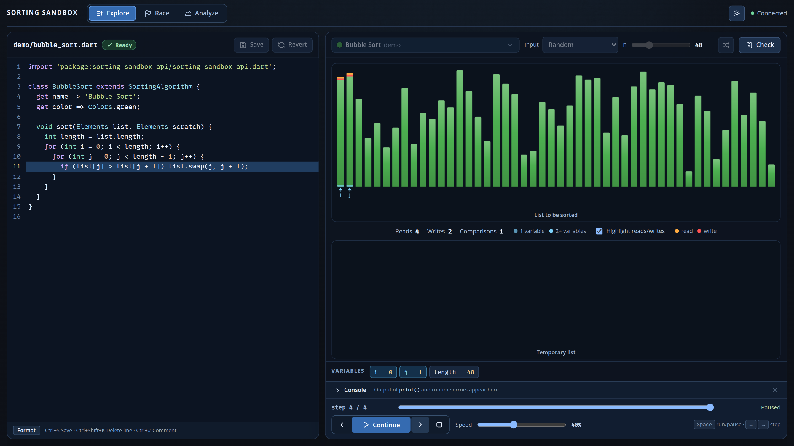

<div class='meta'>
image: sorting-sandbox.webp
kind: projekt
topic: sandboxes
reference: [gitlab]
template: https://github.com/specht/sorting-sandbox.git
class_repo: git@git.nhcham.org:specht/sorting-sandbox-algorithms-2026.git
template_name: der Sorting Sandbox
</div>

<div
    class="autotoc-secondary-trigger"
    data-title="Auf dieser Seite"
    data-levels="h2">
</div>

# Mit der Sorting Sandbox arbeiten

<p class='abstract'>
In der Sorting Sandbox schreibst du Sortieralgorithmen, schaust ihnen Schritt für Schritt zu und lässt sie gegeneinander antreten. Diese Seite begleitet dich beim Einrichten und zeigt dir, ob dein Algorithmus wirklich bei deiner Lehrkraft und deiner Klasse ankommt.
</p>



Du arbeitest mit **zwei Git-Repositories**. Im Workspace ist `~` dein Ordner `/workspace`.

<table class='table'>
<tr><th>Ordner</th><th>Inhalt</th><th>Wer ändert es?</th></tr>
<tr><td><code>~/sorting-sandbox/</code></td><td>die App</td><td>nur deine Lehrkraft</td></tr>
<tr><td><code>~/sorting-sandbox/algorithms/</code></td><td>das Klassen-Repository mit euren Algorithmen</td><td>ihr, jede und jeder im eigenen Ordner</td></tr>
</table>

Die Karten auf dieser Seite schauen in deinem Workspace nach und sagen dir, was sie finden. Sie ändern nichts.

## Einmalig: Zugang zu GitLab

_include(gitlab#ssh-schluessel)

_task(ssh-schluessel)

_include(gitlab#git-name, done: git-name)

_task(git-name)

## Einmalig: Klonen

```bash
cd ~
git clone ${template}
cd sorting-sandbox
git clone ${class_repo} algorithms
```

Das Klassen-Repository muss **in** der App liegen und genau `algorithms` heißen. Gibt es `algorithms/` schon, klone es nicht noch einmal, sondern hol mit `git pull` darin den aktuellen Stand.

_task(geklont)

_task(klassen-repository)

## Arbeiten

Starte die App in einem Terminal und lass es offen. Für Git öffnest du ein zweites Terminal.

```bash
cd ~/sorting-sandbox
./run
```

Hol im zweiten Terminal zuerst den Stand der Klasse und lege dann im Ordner der App deinen Algorithmus an. Ersetze `DEIN_NAME` durch deinen Ordnernamen:

```bash
cd ~/sorting-sandbox/algorithms
git pull
cd ~/sorting-sandbox
./new-algorithm DEIN_NAME --lang python
```

Das legt `algorithms/DEIN_NAME/bubble_sort.py` mit einem Bubble Sort als Ausgangspunkt an. Vorhandene Dateien werden nie überschrieben. Was die App sonst kann (Explore, Race, Analyze, Check), steht in ihrer [Anleitung](https://github.com/specht/sorting-sandbox#readme).

## Veröffentlichen

Deine Klasse und deine Lehrkraft sehen deinen Algorithmus erst, wenn er committet **und** gepusht ist. Das machst du im Ordner `algorithms`, nicht im Ordner der App:

```bash
cd ~/sorting-sandbox/algorithms
git pull
git add DEIN_NAME/
git commit -m "Bubble Sort von DEIN_NAME"
git push
```

Nach dem Push bekommen alle anderen deinen Algorithmus mit `git pull`; er erscheint ohne Neustart in ihrer App.

_task(nur-dein-ordner)

_task(veroeffentlicht)

_include(gitlab#push-abgelehnt)

## Beim nächsten Mal

```bash
cd ~/sorting-sandbox && git pull
cd algorithms && git pull
cd .. && ./run
```

Und am Ende der Stunde: Aufgabe 5 noch einmal prüfen.
