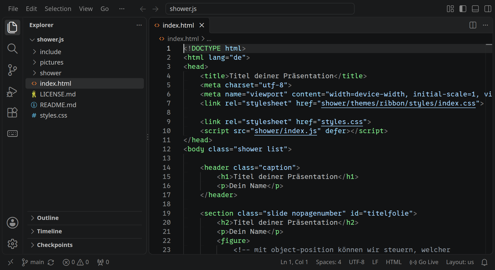
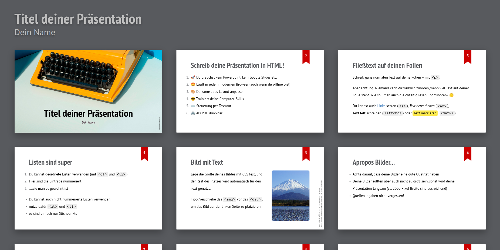
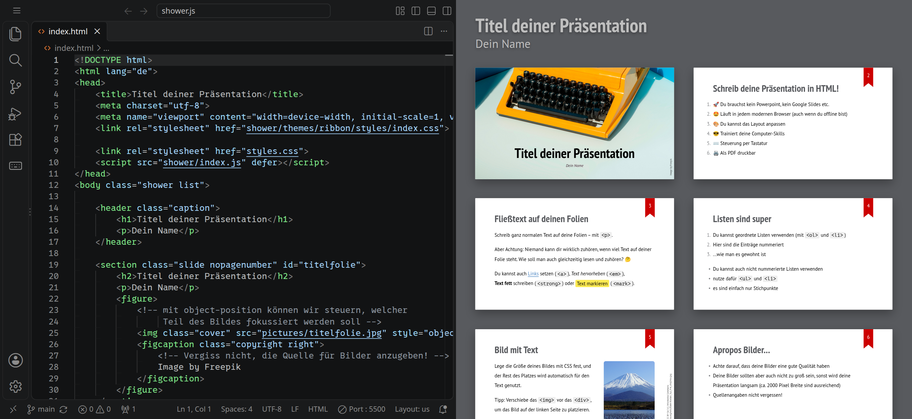

<div class='meta'>
image: showerjs.webp:0:80
kind: projekt
topic: writing
duration: 2 bis 3 Doppelstunden
reference: [workspace, html-folien]
template: https://git.nhcham.org/specht/shower.js.git
template_name: der shower.js-Vorlage
</div>

<div
    class="autotoc-secondary-trigger"
    data-title="Auf dieser Seite"
    data-levels="h2">
</div>

# Eine Präsentation in HTML erstellen

<p class='abstract'>
Erstelle eine Präsentation mit shower.js in HTML und CSS. Mach dich unabhängig von PowerPoint und Keynote und erstelle eine Präsentation, die in jedem modernen Browser vom Stick oder von der Cloud aus funktioniert.
</p>


In diesem Tutorial erstellen wir eine Präsentation mit Hilfe von [shower.js](https://github.com/shower/shower) auf der Grundlage von HTML und CSS. Das heißt, dass jeder Webbrowser deine Präsentation abspielen kann und du keine besondere Software brauchst. Du kannst shower.js hier [in Aktion sehen](https://shwr.me/).

## Repository klonen

Wir holen uns eine Vorlage mit Hilfe von Git, damit du gleich loslegen kannst.

_include(workspace#repository-klonen)

Das Repository liegt jetzt in `/workspace/shower.js`. Dein Workspace sollte ungefähr so aussehen:



Links siehst du die Verzeichnisse und Dateien, die gerade heruntergeladen wurden. Öffne die Datei `index.html`, indem du darauf klickst.

_task(vorlage)

## Vorschau starten

_include(workspace#live-server)

Wenn du alles richtig gemacht hast, sollte dein Fenster so aussehen:



Zieh das Tab aus dem Browser und ordne beide Fenster nebeneinander an, um deine Änderungen live in der Vorschau zu sehen:



_task(adresse)

## Präsentation schreiben

Schau dir die Vorlage an und versuche, sie zu verstehen. Die Präsentation steht in der Datei `index.html`. Sie besteht aus einzelnen Folien, die du verändern, löschen oder ergänzen kannst.

Für diese Präsentation verwendest du zwei Sprachen:

- **HTML** beschreibt den Inhalt: Überschriften, Texte, Listen, Bilder und Folien.
- **CSS** beschreibt das Aussehen: Farben, Größen, Abstände und Positionen.

In der Vorlage sind Inhalt und Aussehen getrennt:

- Deine Folien stehen in der Datei `index.html`.
- Deine eigenen Gestaltungsregeln schreibst du in die Datei `styles.css`.

Öffne deshalb am besten zusätzlich die Datei `styles.css`.
Am Ende der Datei findest du diesen Kommentar:

```css
/*
 * Eigene CSS-Regeln
 *
 * Hier kannst du das Aussehen deiner Folien verändern:
 * Farben, Größen, Abstände, Schatten und Positionen.
 *
 * Schreibe deine eigenen CSS-Regeln unter diese Zeile.
 */
```

Wenn im Handbuch CSS-Beispiele gezeigt werden, gehören sie normalerweise **unter diesen Kommentar in `styles.css`**.
So bleibt `index.html` übersichtlich: Dort stehen die Folien, während `styles.css` für das Aussehen zuständig ist.

Du kannst jetzt damit beginnen, die Vorlage an deine Bedürfnisse anzupassen und deine Präsentation zu schreiben.

Speichere deine Änderungen mit <kbd>Strg</kbd><kbd>S</kbd>, um den Effekt im Vorschaufenster zu sehen, falls dein Workspace Änderungen nicht schon automatisch speichert. Das kannst du im Menü unter »File« / »Auto Save« einstellen.

<div class='hint'>
Wenn du die Datei <code>index.html</code> bearbeitest, musst du vorsichtig sein, weil die Syntax relativ wichtig ist. Schon eine fehlende spitze Klammer kann dazu führen, dass mehrere Folien auf einmal nicht mehr sichtbar sind. Gehe also behutsam vor und verwende zur Not <kbd>Strg</kbd><kbd>Z</kbd>, um Änderungen rückgängig zu machen. Wenn du dir unsicher bist, ob deine Änderungen funktionieren, speichere sie und schau dir das Ergebnis in der Vorschau an. Du kannst sie immer noch rückgängig machen.
</div>

Prüfe zwischendurch, wie weit du bist. Der Workspace liest dafür deine Dateien und sagt dir, was er findet.

_task(titelfolie)

_task(fuenf-folien)

_task(eigene-regel)

## Folien gestalten

Wie du Text, Listen, Formeln, Bilder, Farben, Schriften und Spalten auf deine Folien bekommst, steht im Handbuch unter [HTML-Folien gestalten](/reference/html-folien). Du musst nichts der Reihe nach lesen. Such dir die Stelle heraus, die zu deinem Problem passt:

- [Grundlagen](/reference/html-folien#grundlagen): Aufbau einer Folie, Text, Listen, Hervorhebungen, Formeln
- [Bilddateien](/reference/html-folien#bilddateien): Bilder in den Ordner `pictures` bekommen, Formate, Dateinamen, WebP
- [Bilder auf Folien](/reference/html-folien#img): Pfade, Größe, Zuschnitt, Hintergrund, Text neben Bild
- [Gestaltung](/reference/html-folien#gestaltung): Farben, Schriftgrößen, Seitenzahl, Platzierung, Spalten

_task(umbenennen)

_task(eigenes-bild)

_task(bild-auf-folie)

## Präsentation halten

Wenn du deine Präsentation halten möchtest, kannst du sie einfach im Browser öffnen und mit den Pfeiltasten navigieren. Du kannst auch die Maus benutzen, um durch die Präsentation zu scrollen.

Der besondere Vorteil bei dieser Art von Präsentation ist, dass sie in jedem modernen Browser funktioniert und du keine spezielle Software brauchst. Du kannst einfach das ganze Verzeichnis auf einen Stick kopieren und deine Präsentation überall abspielen, wo es einen modernen Webbrowser gibt.

_task(alles-im-ordner)

_task(file-adresse)

Du kannst deine Präsentation auch online stellen, zum Beispiel direkt in der Hackschule. <a href="/custom-subdomain">Hier erfährst du, wie das geht.</a>

## Abgeben

_task(abgabe)

<script>
// Die Abschnitte zum Gestalten stehen jetzt im Handbuch. Alte Links wie
// /showerjs#bilder-einfügen führen dorthin weiter, wenn es den Abschnitt
// hier nicht mehr gibt.
window.addEventListener('load', function () {
    setTimeout(function () {
        var id = decodeURIComponent(window.location.hash.slice(1));
        if (id && !document.getElementById(id)) {
            window.location.replace('/reference/html-folien' + window.location.hash);
        }
    }, 300);
});
</script>
