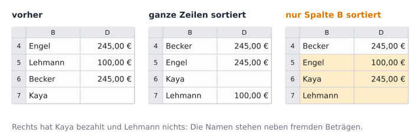

image: teaser.webp
image_alt: "Die Zahlungen aller Familien für die Klassenfahrt, nach Familien sortiert; die Beträge, die noch offen sind, rot hinterlegt"
kind: labor
duration: 1 Stunde (45 Minuten)
curriculum: "Sek I: Standardsoftware (Tabellenkalkulation)"
topics: [standardsoftware]
language: LibreOffice / Excel / Nextcloud Office
languages: [libreoffice, word, nextcloud]
office: sheet
requires: [spreadsheet-functions]
reference: []

# Sortieren, Filtern, Hervorheben

Eine lange Liste wird übersichtlich, wenn sie in der richtigen Reihenfolge steht, nur zeigt, was gerade gebraucht wird, und das Wichtige farbig hervorhebt. Du bringst die Zahlungen aller 27 Familien in Ordnung, ohne eine Zeile zu verlieren.

Inzwischen haben fast alle Familien bezahlt. Das Elternteil, das die Kasse
führt, hat jede Zahlung in die Liste eingetragen, wie sie kam: nach Datum,
die Familien, von denen noch nichts kam, ganz unten. Für den Elternabend
braucht es die Liste anders: nach Familien geordnet, damit jede sich schnell
findet, und mit einem Blick darauf, wer noch etwas zahlen muss. In Spalte E
rechnet `=C4-D4` aus, was noch offen ist: Soll minus Gezahlt.

_task(leer)

<!-- after: leer -->
In einer Rechnung zählt eine leere Zelle als 0: 245 − 0 = 245. Im letzten
Blatt hat MITTELWERT leere Zellen ausgelassen; eine Funktion über einen
Bereich zählt nur, was darin steht, eine Rechnung braucht für jede Zelle eine
Zahl und nimmt für eine leere die 0.
<!-- /after -->

Hol dir die Liste und öffne sie:

<a class='document-starter btn btn-primary' href='/sort-and-filter/05%20Zahlungen.xlsx' download><i class='bi bi-file-earmark-spreadsheet' aria-hidden='true'></i>Vorlage herunterladen:05 Zahlungen.xlsx</a>

## Sortieren

Eine Zeile der Liste gehört zusammen: das Datum, die Familie, was sie
zahlen soll und was sie gezahlt hat. Beim **Sortieren** müssen die Zeilen
deshalb ganz wandern, nicht nur die Spalte, nach der sortiert wird.

_task(spalte)

<!-- after: spalte -->

Wer so sortiert und speichert, hat die Liste kaputt gemacht: Rechts hat Kaya
bezahlt und Lehmann nichts, und niemand sieht der Tabelle an, dass es falsch
ist. Deshalb fragen die Programme nach, wenn neben der markierten Spalte
weitere Daten stehen. Am sichersten ist es, gar nichts zu markieren: Klick
in eine Zelle der Liste, und das Programm nimmt die ganze Liste.
<!-- /after -->

<!-- language: libreoffice -->
In LibreOffice sortierst du über *Daten* <i class='bi bi-chevron-right' aria-hidden='true'></i> *Sortieren…*: Unter *Sortierschlüssel 1* wählst du
die Spalte, nach der sortiert wird, und *Aufsteigend* (A bis Z) oder
*Absteigend*. Die Überschriften in Zeile 3 erkennt LibreOffice und sortiert
sie nicht mit. Hast du doch nur eine Spalte markiert, fragt es nach: *Erweiterte
Auswahl* nimmt die Spalten daneben mit.
<!-- /language -->
<!-- language: word -->
In Excel sortierst du über *Daten* <i class='bi bi-chevron-right' aria-hidden='true'></i> *Sortieren*: Unter *Sortieren nach* wählst du die
Spalte und die Reihenfolge, *A bis Z* oder *Z bis A*. Die Überschriften in
Zeile 3 erkennt Excel und sortiert sie nicht mit. Hast du doch nur eine Spalte
markiert, fragt es nach: *Markierung erweitern* nimmt die Spalten daneben mit.
<!-- /language -->
<!-- language: nextcloud -->
In Nextcloud Office sortierst du über *Daten* <i class='bi bi-chevron-right' aria-hidden='true'></i> *Sortieren…*: Dort wählst du die Spalte, nach der
sortiert wird, und *Aufsteigend* (A bis Z) oder *Absteigend*. Hast du doch nur
eine Spalte markiert, fragt das Programm nach, ob es die Auswahl erweitern
soll: ja.
<!-- /language -->

**Jetzt bist du dran:** Sortiere die Liste nach der Familie, von A bis Z.
Sieh nach, ob bei Kaya, Richter, Wagner und Zimmermann weiter nichts gezahlt
ist.

Sortieren war eine der ersten Aufgaben, für die Menschen Maschinen gebaut
haben, lange vor dem Computer:

_person(hollerith)

## Filtern

Ein **Filter** blendet die Zeilen aus, die du gerade nicht brauchst. Er setzt
in den Kopf jeder Spalte einen kleinen Pfeil; dort wählst du, welche Werte zu
sehen sind, oder eine Bedingung wie »größer als 0«. Gelöscht wird nichts: Die
ausgeblendeten Zeilen sind noch da, ihre Zeilennummern fehlen nur in der
Reihe am Rand. Den Filter einer Spalte nimmst du am selben Pfeil wieder
zurück.

<!-- language: libreoffice -->
Den Filter setzt *Daten* <i class='bi bi-chevron-right' aria-hidden='true'></i>
*AutoFilter* (<kbd>Strg</kbd>+<kbd>Shift</kbd>+<kbd>L</kbd>), wenn eine Zelle
der Liste gewählt ist.
<!-- /language -->
<!-- language: word -->
Den Filter setzt *Daten* <i class='bi bi-chevron-right' aria-hidden='true'></i>
*Filtern* (<kbd>Strg</kbd>+<kbd>Shift</kbd>+<kbd>L</kbd>), wenn eine Zelle der
Liste gewählt ist; eine Bedingung findest du am Pfeil unter *Zahlenfilter*.
<!-- /language -->
<!-- language: nextcloud -->
Den Filter setzt *Daten* <i class='bi bi-chevron-right' aria-hidden='true'></i>
*AutoFilter*, wenn eine Zelle der Liste gewählt ist.
<!-- /language -->

_task(offen)

_task(summe)

<!-- after: summe -->
SUMME zählt jede Zelle ihres Bereichs, auch die ausgeblendeten. Soll eine
Summe nur die sichtbaren Zeilen zählen, gibt es dafür eine eigene Funktion:
`=TEILERGEBNIS(9;E4:E30)`, die 9 steht für »Summe«.
<!-- /after -->

**Jetzt bist du dran:** Nimm den Filter in Spalte E wieder zurück, sodass alle
Familien zu sehen sind; die Pfeile im Kopf der Spalten bleiben.

## Hervorheben

Wer noch zahlen muss, soll man ohne Filter sehen: rot hinterlegt. Färbst du
die sechs Zellen von Hand, stimmt die Farbe nicht mehr, sobald jemand zahlt.
Eine **bedingte Formatierung** färbt eine Zelle selbst, je nachdem, was in ihr
steht: »Ist der Wert größer als 0, dann rot.« Zahlt eine Familie, ist ihre
Zelle gleich wieder weiß.

<!-- language: libreoffice -->
Markiere die Zellen, dann *Format* <i class='bi bi-chevron-right' aria-hidden='true'></i> *Bedingte Formatierung* <i class='bi bi-chevron-right' aria-hidden='true'></i> *Bedingung…* Im Fenster steht die Bedingung als
*Zellwert* *ist größer als* und die Zahl daneben; unter *Vorlage zuweisen*
wählst du, wie die Zelle dann aussieht, etwa *Schlecht*: rot hinterlegt.
<!-- /language -->
<!-- language: word -->
Markiere die Zellen, dann *Start* <i class='bi bi-chevron-right' aria-hidden='true'></i> *Bedingte Formatierung* <i class='bi bi-chevron-right' aria-hidden='true'></i> *Regeln zum Hervorheben von Zellen* <i class='bi bi-chevron-right' aria-hidden='true'></i> *Größer als…* Im Fenster trägst du die
Zahl ein und wählst, wie die Zelle dann aussieht, etwa eine hellrote Füllung.
<!-- /language -->
<!-- language: nextcloud -->
Markiere die Zellen, dann *Format* <i class='bi bi-chevron-right' aria-hidden='true'></i> *Bedingte Formatierung* <i class='bi bi-chevron-right' aria-hidden='true'></i> *Bedingung…* Im Fenster steht die Bedingung, etwa *ist
größer als* und die Zahl daneben, und darunter die Vorlage, die die Zelle dann
bekommt, etwa *Schlecht*: rot hinterlegt.
<!-- /language -->

**Jetzt bist du dran:** Gib E4 bis E30 eine bedingte Formatierung: Beträge
größer als 0 rot.

## Prüfen

Speichere die Tabelle und lass sie prüfen. Die Prüfung vergleicht jede Zeile
mit der Vorlage: Es darf keine Familie neben einer fremden Zahlung stehen.

_task(zahlungen)

<!-- after: zahlungen -->

<strong>Ausprobieren:</strong> Trag bei Familie Kaya in Spalte D eine Zahlung von 245 ein. Achte auf die Farbe in Spalte E und auf die Summe darunter. Lösch die Zahlung danach wieder.

<!-- /after -->
