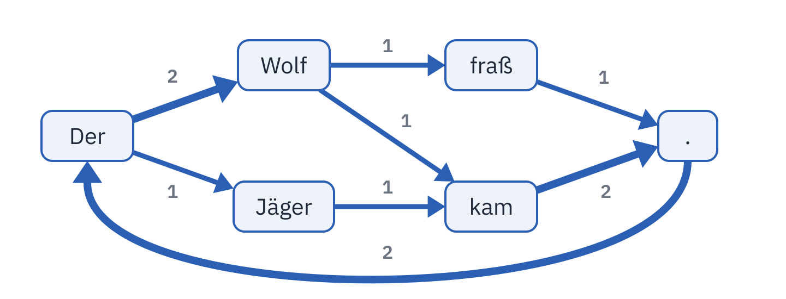
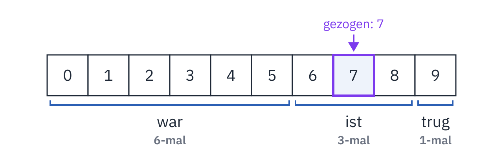
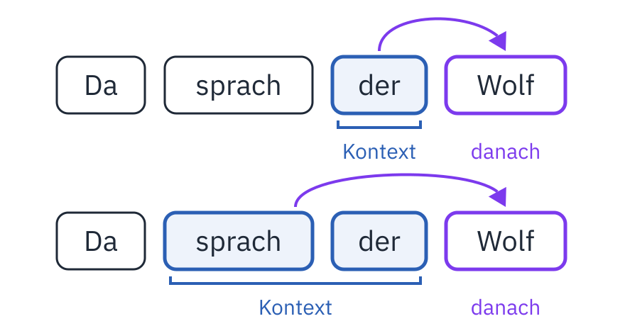

<div class='meta'>
image: teaser.webp
image_alt: "Das Wort »Es« mit Pfeilen zu den Wörtern, die in den Märchen der Brüder Grimm darauf folgen: »war« mit dem dicksten Pfeil und der Zahl 41, dann »ist« mit 21, »trug« mit 13, »soll« und »wird« mit je 5."
kind: projekt
duration: 2 Doppelstunden
languages: [ruby, python]
curriculum: "Sek I: Algorithmisches Problemlösen (Zeichenkettenbearbeitung, Implementieren von Algorithmen), Information und Daten (Daten, Information, Nachricht), Geschichte der Informatik (Lebensläufe und Leistungen bedeutender Persönlichkeiten: Markow und Shannon zählen Buchstaben und Wörter); Oberstufe: Vertiefung Künstliche Intelligenz (ein Sprachmodell aus Wortpaaren), Vertiefung Informatik und Gesellschaft (woher die Texte kommen, was ein Modell daraus übernimmt)"
topics: [ki, zeichenketten, information, gesellschaft, geschichte]
age: Sek I
requires: [kata-dicts]
reference: [regex]
</div>

<div
    class="autotoc-secondary-trigger"
    data-title="Auf dieser Seite"
    data-levels="h2,h3">
</div>

# Ein winziges Sprachmodell

<p class='abstract'>
Wie kann ein Programm einen Satz weiterschreiben? Du zählst in den Märchen der Brüder Grimm, welches Wort auf welches folgt, und lässt dein Programm daraus neue Märchen schreiben, Wort für Wort. Dabei siehst du, was so ein Modell kann, wo es nur abschreibt und was es aus seinem Text übernimmt.
</p>

## Das nächste Wort

Tippst du auf dem Handy eine Nachricht, schlägt die Tastatur über den Buchstaben
drei Wörter vor, die als Nächstes kommen könnten. Ein Chatbot macht im Grunde
dasselbe, nur sehr viel besser: Er schreibt ein Wort, schaut, was bisher
dasteht, schreibt das nächste Wort, und so weiter, bis die Antwort fertig ist.
Ein Programm, das zu einem Text das nächste Wort vorhersagt, heißt
**Sprachmodell**.

Du baust heute ein winziges Sprachmodell. Es lernt aus den Märchen der Brüder Grimm: 54
Märchen mit zusammen etwa 80 000 Wörtern, von »Marienkind« bis »Des Herrn und
des Teufels Getier«. Lernen heißt hier: zählen, welches Wort wie oft auf welches
folgt.

_task(naechstes-wort)

Was so ein Modell zählt, merkt es sich in einem Dictionary, genauer in einem
Dictionary von Dictionaries. Wie Dictionaries gehen, übst du in den
[Katas: Dictionaries](/kata-dicts).

## Einrichten

<!-- language: ruby -->
Lege einen Ordner an und lade die Märchen herunter:

```bash
mkdir -p ~/sprachmodell
cd ~/sprachmodell
wget ${web_root}/sprachmodell/maerchen.txt
touch model.rb story.rb
```

In `model.rb` kommen die Funktionen deines Modells, in `story.rb` das Programm,
das damit Märchen schreibt. Ausprobieren kannst du die Funktionen in `irb`, das
`model.rb` vorher lädt:

```bash
irb -r ./model.rb
```

Nach einer Änderung an `model.rb` beendest du `irb` mit
<kbd>Strg</kbd><kbd>D</kbd> und startest es neu.
<!-- /language -->
<!-- language: python -->
Lege einen Ordner an und lade die Märchen herunter:

```bash
mkdir -p ~/sprachmodell
cd ~/sprachmodell
wget ${web_root}/sprachmodell/maerchen.txt
touch model.py story.py
```

In `model.py` kommen die Funktionen deines Modells, in `story.py` das Programm,
das damit Märchen schreibt. Ausprobieren kannst du die Funktionen in Python
selbst, das `model.py` vorher ausführt:

```bash
python3 -i model.py
```

Nach einer Änderung an `model.py` beendest du Python mit
<kbd>Strg</kbd><kbd>D</kbd> und startest es neu.
<!-- /language -->

Die Märchen stehen in der Schreibweise eines Buchs von 1921: »daß« statt »dass«,
»Türe« statt »Tür«. Der Text kommt von
[Project Gutenberg](https://www.gutenberg.org/ebooks/77905), wo Freiwillige alte
Bücher abtippen, die niemandem mehr gehören; die vier Märchen auf Plattdeutsch
sind herausgenommen, damit das Modell nur eine Sprache lernt.

## Aus Text werden Wörter

Ein Modell zählt Wörter, also muss der Text zuerst in Wörter zerlegt werden.
Satzzeichen zählen dabei als eigene Wörter: Wer weiß, dass nach »König« oft ein
Komma kommt und nach einem Punkt ein neuer Satz, schreibt Sätze, die enden.
Anführungszeichen lässt das Modell weg, denn es kann sich nicht merken, ob es
gerade eines geöffnet hat.

<!-- language: ruby -->
Schreib in `model.rb`:

```ruby
# Der Text als Liste von Wörtern und Satzzeichen
def words(text)
  text.scan(/\p{L}+|[.,;:!?]/)
end
```

`scan` findet im Text alles, was zu dem Muster zwischen den Schrägstrichen
passt, einem [regulären Ausdruck](/reference/regex#in-ruby): `\p{L}+` ist ein
oder mehrere Buchstaben hintereinander, auch Umlaute und ß, `[.,;:!?]` ein
Satzzeichen.
<!-- /language -->
<!-- language: python -->
Schreib in `model.py`:

```python
import random
import re


# Der Text als Liste von Wörtern und Satzzeichen
def words(text):
    return re.findall(r"[^\W\d_]+|[.,;:!?]", text)
```

`re.findall` findet im Text alles, was zu dem Muster passt, einem
[regulären Ausdruck](/reference/regex#in-python): `[^\W\d_]+` ist ein oder
mehrere Buchstaben hintereinander, auch Umlaute und ß, `[.,;:!?]` ein
Satzzeichen. `random` brauchst du später.
<!-- /language -->

<div class='hint try'>
<strong>Ausprobieren:</strong> Ruf <code>words("Es war einmal ein König.")</code>
auf. Achte darauf, was mit dem Punkt am Ende passiert.
</div>

_task(woerter)

## Wer folgt auf wen

Das Modell soll sich für jedes Wort merken, welche Wörter danach kamen und wie
oft. Für den kleinen Text »Der Wolf kam. Der Wolf fraß. Der Jäger kam.« sieht
das so aus:

<!-- language: ruby -->
```ruby
{
  "Der" => { "Wolf" => 2, "Jäger" => 1 },
  "Wolf" => { "kam" => 1, "fraß" => 1 },
  "kam" => { "." => 2 },
  "." => { "Der" => 2 },
  "fraß" => { "." => 1 },
  "Jäger" => { "kam" => 1 }
}
```
<!-- /language -->
<!-- language: python -->
```python
{
    "Der": {"Wolf": 2, "Jäger": 1},
    "Wolf": {"kam": 1, "fraß": 1},
    "kam": {".": 2},
    ".": {"Der": 2},
    "fraß": {".": 1},
    "Jäger": {"kam": 1},
}
```
<!-- /language -->

Ein Dictionary, dessen Werte wieder Dictionaries sind: Unter jedem Wort steht,
was darauf folgte, und unter jedem Nachfolger, wie oft. Nach dem letzten Punkt
kommt nichts mehr, darum zählt er nicht mit.

Als Bild: Jedes Wort steht einmal da, und von ihm führt ein Pfeil zu jedem
Wort, das darauf folgte, umso dicker, je öfter. Wenn dein Programm später
schreibt, geht es an diesen Pfeilen entlang.



_task(von-hand)

<div class='hint own' data-check='zaehlen'>
<strong>Jetzt bist du dran:</strong> Schreib die Funktion <code>follow_counts(tokens)</code>,
die zu einer Liste von Wörtern dieses Dictionary zurückgibt.
</div>

<!-- language: ruby -->
<!-- hint -->
Geh die Liste mit einem Index durch, vom ersten bis zum vorletzten Wort: Das
Wort ist `tokens[i]`, sein Nachfolger `tokens[i + 1]`.
<!-- /hint -->

<!-- hint -->
Kommt ein Wort zum ersten Mal vor, gibt es für es noch kein Dictionary. Leg es
dann an, mit `counts[word] ||= {}`. Ein Nachfolger, der noch fehlt, hat die
Anzahl 0: `(counts[word][following] || 0) + 1`.
<!-- /hint -->

<!-- hint -->
```ruby
def follow_counts(tokens)
  counts = {}
  (0...tokens.size - 1).each do |i|
    word = tokens[i]
    following = tokens[i + 1]
    # hier: das Dictionary für word anlegen, wenn es fehlt, und following zählen
  end
  counts
end
```
<!-- /hint -->

<!-- solution -->
```ruby
# Für jedes Wort: welche Wörter darauf folgen, und wie oft
def follow_counts(tokens)
  counts = {}
  (0...tokens.size - 1).each do |i|
    word = tokens[i]
    following = tokens[i + 1]
    counts[word] ||= {}
    counts[word][following] = (counts[word][following] || 0) + 1
  end
  counts
end
```
<!-- /solution -->
<!-- /language -->
<!-- language: python -->
<!-- hint -->
Geh die Liste mit einem Index durch, vom ersten bis zum vorletzten Wort: Das
Wort ist `tokens[i]`, sein Nachfolger `tokens[i + 1]`.
<!-- /hint -->

<!-- hint -->
Kommt ein Wort zum ersten Mal vor, gibt es für es noch kein Dictionary. Leg es
dann an, wenn `word not in counts` ist. Ein Nachfolger, der noch fehlt, hat die
Anzahl 0: `counts[word].get(following, 0) + 1`.
<!-- /hint -->

<!-- hint -->
```python
def follow_counts(tokens):
    counts = {}
    for i in range(len(tokens) - 1):
        word = tokens[i]
        following = tokens[i + 1]
        # hier: das Dictionary für word anlegen, wenn es fehlt, und following zählen
    return counts
```
<!-- /hint -->

<!-- solution -->
```python
# Für jedes Wort: welche Wörter darauf folgen, und wie oft
def follow_counts(tokens):
    counts = {}
    for i in range(len(tokens) - 1):
        word = tokens[i]
        following = tokens[i + 1]
        if word not in counts:
            counts[word] = {}
        counts[word][following] = counts[word].get(following, 0) + 1
    return counts
```
<!-- /solution -->
<!-- /language -->

_task(zaehlen)

### In die Märchen schauen

Jetzt zählt dein Modell die ganzen Märchen. Damit du nachsehen kannst, was auf
ein Wort folgt, schreib noch diese Funktion dazu; sie gibt die `n` häufigsten
Nachfolger mit ihrer Anzahl zurück:

<!-- language: ruby -->
```ruby
# Die n häufigsten Nachfolger von word, mit ihrer Anzahl
def top(counts, word, n)
  (counts[word] || {}).sort_by { |following, count| -count }.first(n)
end
```

In `irb`:

```ruby
counts = follow_counts(words(File.read("maerchen.txt")))
top(counts, "Es", 5)
```
<!-- /language -->
<!-- language: python -->
```python
# Die n häufigsten Nachfolger von word, mit ihrer Anzahl
def top(counts, word, n):
    followers = counts.get(word, {})
    return sorted(followers.items(), key=lambda pair: -pair[1])[:n]
```

In Python:

```python
counts = follow_counts(words(open("maerchen.txt").read()))
top(counts, "Es", 5)
```
<!-- /language -->

<!-- after: naechstes-wort -->
Auf »Es« folgt 41-mal »war«, 21-mal »ist« und 13-mal »trug«; zusammen kommt
»Es« 150-mal vor.
<!-- /after -->

<div class='hint try'>
<strong>Ausprobieren:</strong> Schau nach, was auf »Wolf«, »Königin« und »Frau«
folgt. Achte darauf, wie oft ein Satzzeichen unter den Nachfolgern ganz oben
steht.
</div>

_task(nach-sprach)

## Ein Märchen schreiben

Ein Modell, das zu jedem Wort seine Nachfolger kennt, kann schreiben: Es
beginnt mit einem Wort, nimmt einen Nachfolger, dann dessen Nachfolger, und so
weiter. Am einfachsten nimmt es jedes Mal den häufigsten.

<div class='hint own' data-check='haeufigstes'>
<strong>Jetzt bist du dran:</strong> Schreib die Funktion <code>most_likely(counts, word)</code>,
die den häufigsten Nachfolger von <code>word</code> zurückgibt, oder
<code>nil</code> (in Python <code>None</code>), wenn das Wort nie vorkam.
</div>

<!-- language: ruby -->
<!-- hint -->
`counts[word]` ist das Dictionary der Nachfolger. Von seinen Paaren suchst du
das mit der größten Anzahl: `max_by { |following, count| count }` gibt dieses
Paar zurück, `[following, count]`.
<!-- /hint -->

<!-- solution -->
```ruby
# Der häufigste Nachfolger von word, nil für ein unbekanntes Wort
def most_likely(counts, word)
  return nil unless counts.key?(word)

  counts[word].max_by { |following, count| count }[0]
end
```
<!-- /solution -->
<!-- /language -->
<!-- language: python -->
<!-- hint -->
`counts[word]` ist das Dictionary der Nachfolger. `max` findet seinen größten
Schlüssel; mit `key=counts[word].get` vergleicht es stattdessen die Anzahlen.
<!-- /hint -->

<!-- solution -->
```python
# Der häufigste Nachfolger von word, None für ein unbekanntes Wort
def most_likely(counts, word):
    if word not in counts:
        return None
    return max(counts[word], key=counts[word].get)
```
<!-- /solution -->
<!-- /language -->

_task(haeufigstes)

Zum Schreiben noch eine Funktion, die eine Liste von Wörtern wieder als Text
ausgibt, ohne Leerzeichen vor einem Satzzeichen:

<!-- language: ruby -->
```ruby
# Wörter als Text, ohne Leerzeichen vor einem Satzzeichen
def text(tokens)
  tokens.join(" ").gsub(/ ([.,;:!?])/, '\1')
end
```
<!-- /language -->
<!-- language: python -->
```python
# Wörter als Text, ohne Leerzeichen vor einem Satzzeichen
def text(tokens):
    return re.sub(r" ([.,;:!?])", r"\1", " ".join(tokens))
```
<!-- /language -->

_task(immer-das-haeufigste)

<!-- language: ruby -->
Schreib das Programm in `story.rb`; es lädt `model.rb` mit `require_relative`:

```ruby
require_relative "model"

counts = follow_counts(words(File.read("maerchen.txt")))
tokens = ["Es"]
30.times do
  tokens << most_likely(counts, tokens.last)
end
puts text(tokens)
```

```bash
ruby story.rb
```
<!-- /language -->
<!-- language: python -->
Schreib das Programm in `story.py`; es holt die Funktionen aus `model.py` mit
`import`:

```python
from model import *

counts = follow_counts(words(open("maerchen.txt").read()))
tokens = ["Es"]
for _ in range(30):
    tokens.append(most_likely(counts, tokens[-1]))
print(text(tokens))
```

```bash
python3 story.py
```
<!-- /language -->

<!-- after: immer-das-haeufigste -->
> Es war, und sprach: Ich bin ich will ich will ich will ich will ich will ich
> will ich will ich will ich will ich will ich will ich

Auf »ich« folgt am häufigsten »will«, auf »will« am häufigsten »ich«: Das
Modell ist in einer Schleife gefangen und kommt nie wieder heraus. Und es
schreibt jedes Mal genau diesen Text, denn es entscheidet nie anders.
<!-- /after -->

## Würfeln statt immer das Häufigste

Ein Modell, das nur das häufigste Wort nimmt, schreibt immer dasselbe. Besser:
Es würfelt, aber so, dass ein häufiger Nachfolger öfter drankommt. Auf »Es«
folgt 41-mal »war« und 21-mal »ist«; dann soll »war« ungefähr doppelt so oft
gewählt werden wie »ist«.

Das geht mit einer Zufallszahl. Folgte auf ein Wort sechsmal »war«, dreimal
»ist« und einmal »trug«, zusammen zehnmal, zieht das Modell eine Zahl von 0 bis
9 und geht die Nachfolger der Reihe nach durch:

<div class='scroll-x'>
<table class='table'>
<tr><th>Zufallszahl</th><th>Nachfolger</th></tr>
<tr><td>0, 1, 2, 3, 4, 5</td><td>war</td></tr>
<tr><td>6, 7, 8</td><td>ist</td></tr>
<tr><td>9</td><td>trug</td></tr>
</table>
</div>

Ist die Zahl kleiner als die Anzahl des ersten Nachfolgers, nimmt das Modell
diesen Nachfolger. Sonst zieht es dessen Anzahl von der Zahl ab und vergleicht
mit der Anzahl des nächsten Nachfolgers.

Bei einer 7: Sie ist nicht kleiner als 6, also bleibt 7 − 6 = 1, und 1 ist
kleiner als 3. Das Modell nimmt »ist«.



<div class='hint own' data-check='wuerfeln'>
<strong>Jetzt bist du dran:</strong> Schreib die Funktion <code>next_word(counts, word)</code>,
die einen Nachfolger von <code>word</code> so zieht, dass jeder so oft drankommt,
wie er gezählt wurde, und <code>nil</code> (in Python <code>None</code>) für ein
Wort, das nie vorkam.
</div>

<!-- language: ruby -->
<!-- hint -->
Die Summe der Anzahlen ist `counts[word].values.sum`. `rand(total)` gibt eine
ganze Zufallszahl von 0 bis `total - 1`.
<!-- /hint -->

<!-- hint -->
```ruby
def next_word(counts, word)
  return nil unless counts.key?(word)

  r = rand(counts[word].values.sum)
  counts[word].each do |following, count|
    # hier: following zurückgeben, wenn r kleiner als count ist,
    # sonst count von r abziehen
  end
end
```
<!-- /hint -->

<!-- solution -->
```ruby
# Ein Nachfolger von word, gezogen nach seiner Anzahl; nil für ein unbekanntes Wort
def next_word(counts, word)
  return nil unless counts.key?(word)

  r = rand(counts[word].values.sum)
  counts[word].each do |following, count|
    return following if r < count

    r -= count
  end
end
```
<!-- /solution -->
<!-- /language -->
<!-- language: python -->
<!-- hint -->
Die Summe der Anzahlen ist `sum(counts[word].values())`. `random.randrange(total)`
gibt eine ganze Zufallszahl von 0 bis `total - 1`.
<!-- /hint -->

<!-- hint -->
```python
def next_word(counts, word):
    if word not in counts:
        return None
    r = random.randrange(sum(counts[word].values()))
    for following, count in counts[word].items():
        # hier: following zurückgeben, wenn r kleiner als count ist,
        # sonst count von r abziehen
        ...
```
<!-- /hint -->

<!-- solution -->
```python
# Ein Nachfolger von word, gezogen nach seiner Anzahl; None für ein unbekanntes Wort
def next_word(counts, word):
    if word not in counts:
        return None
    r = random.randrange(sum(counts[word].values()))
    for following, count in counts[word].items():
        if r < count:
            return following
        r -= count
```

Python kann das auch selbst: `random.choices(list(followers), weights=list(followers.values()))[0]`
zieht genauso. Hier war es dein Code.
<!-- /solution -->
<!-- /language -->

_task(wuerfeln)

<div class='hint own' data-check='schreiben'>
<strong>Jetzt bist du dran:</strong> Schreib die Funktion <code>generate(counts, start, n)</code>,
die mit dem Wort <code>start</code> beginnt und <code>n</code> Wörter mit
<code>next_word</code> anhängt. Sie gibt die Liste zurück und hört früher auf,
wenn ein Wort keinen Nachfolger hat.
</div>

<!-- language: ruby -->
<!-- hint -->
Es ist das Programm aus `story.rb`, mit `next_word` statt `most_likely`, als
Funktion, die die Liste zurückgibt. Aufhören kann eine Schleife mit `break`.
<!-- /hint -->

<!-- solution -->
```ruby
# start und bis zu n gezogene Wörter danach
def generate(counts, start, n)
  tokens = [start]
  n.times do
    following = next_word(counts, tokens.last)
    break if following.nil?

    tokens << following
  end
  tokens
end
```
<!-- /solution -->
<!-- /language -->
<!-- language: python -->
<!-- hint -->
Es ist das Programm aus `story.py`, mit `next_word` statt `most_likely`, als
Funktion, die die Liste zurückgibt. Aufhören kann eine Schleife mit `break`.
<!-- /hint -->

<!-- solution -->
```python
# start und bis zu n gezogene Wörter danach
def generate(counts, start, n):
    tokens = [start]
    for _ in range(n):
        following = next_word(counts, tokens[-1])
        if following is None:
            break
        tokens.append(following)
    return tokens
```
<!-- /solution -->
<!-- /language -->

_task(schreiben)

<!-- language: ruby -->
Ändere `story.rb`, so dass es drei Märchenanfänge schreibt:

```ruby
~ counts = follow_counts(words(File.read("maerchen.txt")))
3.times do
  puts text(generate(counts, "Es", 30))
  puts
end
```
<!-- /language -->
<!-- language: python -->
Ändere `story.py`, so dass es drei Märchenanfänge schreibt:

```python
~ counts = follow_counts(words(open("maerchen.txt").read()))
for _ in range(3):
    print(text(generate(counts, "Es", 30)))
    print()
```
<!-- /language -->

Zum Beispiel:

> Es trug sich um zu dem Richter, dann wollen wir uns doch der König in solche
> Blume, in einer kurzen Marsch haben will gleich nicht zu den sieben Zwerge

<div class='hint try'>
<strong>Ausprobieren:</strong> Lass das Programm ein paarmal laufen. Lies einen
Text Wort für Wort: Passen zwei Wörter nebeneinander zusammen? Und lies ihn dann
als Ganzes: Ergibt er einen Sinn?
</div>

_task(gedaechtnis)

Der Mathematiker Claude Shannon hat 1948 genau solche Texte erzeugt, ohne
Computer: Er schlug ein Buch an einer zufälligen Stelle auf, las bis zu dem Wort,
das er zuletzt aufgeschrieben hatte, und schrieb das Wort dahinter auf. Dann
blätterte er weiter zu einer anderen Stelle, suchte dort dieses Wort, und so
weiter. Ein Buch würfelt so von selbst nach der Häufigkeit: Ein Wort, das oft
folgt, findet man oft.

_person(shannon)

<div class='book'>
<i class='bi bi-file-earmark-text'></i>
<p><strong>A Mathematical Theory of Communication</strong>, Claude E. Shannon, Bell System Technical Journal, 1948. Der Aufsatz, mit dem die Informationstheorie beginnt; in Abschnitt 3 stehen englische Texte aus Buchstaben und aus Wörtern, jedes nach dem vorigen gezogen, wie bei dir: <a href='https://people.math.harvard.edu/~ctm/home/text/others/shannon/entropy/entropy.pdf'>PDF</a>, auch bei <a href='https://doi.org/10.1002/j.1538-7305.1948.tb01338.x'>Wiley</a>.</p>
</div>

Gezählt hatte vor ihm schon Andrei Markow: 1913 ging er die ersten 20 000
Buchstaben von Puschkins Versroman »Eugen Onegin« durch und zählte, wie oft auf
einen Vokal ein Vokal folgt und wie oft ein Konsonant. Eine Kette, in der jedes
Glied nur vom vorigen abhängt, heißt seitdem **Markow-Kette**, und dein Modell
ist eine Markow-Kette: Welches Wort es zieht, hängt nur vom Wort davor ab.

_person(markow)

## Mehr Kontext: zwei Wörter

Dein Modell schaut nur auf das letzte Wort. Was vorher stand, hat es vergessen.
Schaut es auf die letzten zwei, weiß es mehr: Nach »sprach der« kommt ein
anderes Wort als nach »Da sprach«. Der **Kontext** ist jetzt ein Paar von
Wörtern, und als Schlüssel nimmt das Modell beide zusammen, mit einem
Leerzeichen dazwischen: Unter `"sprach der"` steht, was nach »sprach der« kam.



<div class='hint own' data-check='paare'>
<strong>Jetzt bist du dran:</strong> Schreib die Funktion <code>pair_counts(tokens)</code>:
wie <code>follow_counts</code>, aber der Schlüssel sind zwei Wörter
hintereinander, mit einem Leerzeichen dazwischen, und gezählt wird das Wort
danach.
</div>

<!-- language: ruby -->
<!-- hint -->
Der Index läuft jetzt nur bis zum drittletzten Wort. Der Schlüssel ist
`"#{tokens[i]} #{tokens[i + 1]}"`, der Nachfolger `tokens[i + 2]`.
<!-- /hint -->

<!-- solution -->
```ruby
# Für jedes Paar von Wörtern: welche Wörter darauf folgen, und wie oft
def pair_counts(tokens)
  counts = {}
  (0...tokens.size - 2).each do |i|
    pair = "#{tokens[i]} #{tokens[i + 1]}"
    following = tokens[i + 2]
    counts[pair] ||= {}
    counts[pair][following] = (counts[pair][following] || 0) + 1
  end
  counts
end
```
<!-- /solution -->
<!-- /language -->
<!-- language: python -->
<!-- hint -->
Der Index läuft jetzt nur bis zum drittletzten Wort. Der Schlüssel ist
`tokens[i] + " " + tokens[i + 1]`, der Nachfolger `tokens[i + 2]`.
<!-- /hint -->

<!-- solution -->
```python
# Für jedes Paar von Wörtern: welche Wörter darauf folgen, und wie oft
def pair_counts(tokens):
    counts = {}
    for i in range(len(tokens) - 2):
        pair = tokens[i] + " " + tokens[i + 1]
        following = tokens[i + 2]
        if pair not in counts:
            counts[pair] = {}
        counts[pair][following] = counts[pair].get(following, 0) + 1
    return counts
```
<!-- /solution -->
<!-- /language -->

_task(paare)

_task(zwei-woerter)

Zum Schreiben braucht das Modell eine zweite Fassung von `generate`, die mit
zwei Wörtern beginnt und jedes Mal die letzten beiden als Schlüssel nimmt:

<!-- language: ruby -->
```ruby
# first, second und bis zu n gezogene Wörter danach, mit zwei Wörtern Kontext
def generate_pairs(counts, first, second, n)
  tokens = [first, second]
  n.times do
    following = next_word(counts, tokens.last(2).join(" "))
    break if following.nil?

    tokens << following
  end
  tokens
end
```

Und in `story.rb`:

```ruby
pairs = pair_counts(words(File.read("maerchen.txt")))
3.times do
  puts text(generate_pairs(pairs, "Es", "war", 30))
  puts
end
```
<!-- /language -->
<!-- language: python -->
```python
# first, second und bis zu n gezogene Wörter danach, mit zwei Wörtern Kontext
def generate_pairs(counts, first, second, n):
    tokens = [first, second]
    for _ in range(n):
        following = next_word(counts, " ".join(tokens[-2:]))
        if following is None:
            break
        tokens.append(following)
    return tokens
```

Und in `story.py`:

```python
pairs = pair_counts(words(open("maerchen.txt").read()))
for _ in range(3):
    print(text(generate_pairs(pairs, "Es", "war", 30)))
    print()
```
<!-- /language -->

<!-- after: zwei-woerter -->
> Es war da ganz finster und brannte auch kein Schiffchen, antwortete der Wolf
> wollte, ließ er sich auf den Herd und guckte nach dem Sperling. Aber der
> Sperling:

Je zwei, drei Wörter hintereinander klingen jetzt wie ein Märchen, ganze
Satzstücke sogar. Nur ob das Ganze einen Sinn ergibt, weiß das Modell immer
noch nicht.
<!-- /after -->

### Abgeschrieben?

Klingt der Text besser, weil das Modell mehr verstanden hat? Schau nach, wie
viel Auswahl es noch hat. Hat ein Paar von Wörtern in den Märchen nur einen
einzigen Nachfolger, kann das Modell nach diesem Paar nur genau das Wort
schreiben, das im Märchen steht: Es schreibt ab.

_task(abgeschrieben)

<!-- after: abgeschrieben -->
Bei 78 von 100 Paaren gibt es nur einen Nachfolger, bei einzelnen Wörtern nur
bei 55 von 100. Mit zwei Wörtern Kontext schreibt das Modell also meistens ab,
was in den Märchen steht, und nur ab und zu biegt es an einem häufigen Paar wie
»sprach der« in ein anderes Märchen ab. Mit drei Wörtern wäre es fast nur noch
Abschreiben.

Das ist das Dilemma jedes Sprachmodells: Mehr Kontext macht den Text besser,
aber jeder längere Kontext ist im Text seltener, und das Modell hat weniger, aus
dem es lernen kann. Mit 80 000 Wörtern ist bei zwei Wörtern Schluss. Große
Sprachmodelle lernen darum aus Billionen von Wörtern, und auch sie geben
manchmal ganze Absätze aus ihren Texten wörtlich wieder.
<!-- /after -->

## Was das Modell aus seinem Text lernt

Dein Modell kennt nur die Märchen. Was dort oft steht, schreibt es oft; was dort
nie steht, schreibt es nie. Es hat keine Meinung, aber es gibt die Meinungen
seines Textes weiter.

_task(boese)

<!-- after: boese -->
Auf »böse« folgen in den Märchen am häufigsten »Weib« und »Hexe«, je dreimal,
dann »Stiefmutter« und »Buben«, je zweimal: vor allem Frauen. Von den 14 Malen,
die »böse« in den Märchen steht, ist es achtmal eine Frau. Schreibt das Modell »böse«, schreibt es danach also meistens eine
Frau. Die Märchen sind 200 Jahre alt, aber große Sprachmodelle lernen genauso
aus dem, was Menschen geschrieben haben, und übernehmen, was darin häufig ist,
auch Vorurteile. Wer ein solches Modell baut, muss nachsehen, was es gelernt
hat, und entscheiden, was er dagegen tut.
<!-- /after -->

<div class='hint think'>
Woher bekommt jemand, der ein großes Sprachmodell baut, Billionen von Wörtern?
Wer hat diese Texte geschrieben, und hat jemand sie gefragt? Was gehört dir an
einem Text, den du ins Netz gestellt hast, wenn ein Modell daraus lernt?
</div>

<div class='hint think'>
Dein Modell schreibt »Der Anführer war recht klug.«, in richtigem Deutsch, aber
in keinem Märchen steht dieser Satz. Woran erkennt jemand, der so einen Satz
liest, ob er stimmt? Und woran erkennt es das Modell?
</div>

## Was ein großes Sprachmodell anders macht

Ein Chatbot rechnet auch nur aus, welches Wort als Nächstes kommt, und würfelt
dann. Aber fast alles andere ist größer:

<div class='scroll-x'>
<table class='table'>
<tr><th></th><th>Dein Modell</th><th>Ein großes Sprachmodell</th></tr>
<tr><td>Text zum Lernen</td><td>80 000 Wörter Märchen</td><td>Billionen von Wörtern aus dem Netz, aus Büchern, aus Code</td></tr>
<tr><td>Kontext</td><td>das letzte Wort oder die letzten zwei</td><td>Hunderttausende Wörter, das ganze Gespräch bis jetzt</td></tr>
<tr><td>Was es sich merkt</td><td>eine Tabelle: wie oft welches Wort folgte</td><td>ein neuronales Netz mit Milliarden von Zahlen, die beim Training eingestellt werden</td></tr>
<tr><td>Ein unbekannter Kontext</td><td>kein Nachfolger, Schluss</td><td>ein Kontext, der ähnlichen Texten gleicht, bekommt ähnliche Nachfolger</td></tr>
<tr><td>Wörter</td><td>ganze Wörter und Satzzeichen</td><td>Tokens: häufige Wörter ganz, seltene in Stücken</td></tr>
</table>
</div>

Die Tabelle deines Modells kann für einen Kontext, der nie vorkam, nichts sagen.
Ein neuronales Netz kann es, weil es nicht jeden Kontext einzeln speichert,
sondern lernt, welche Kontexte einander ähneln. Gleich bleibt die Idee: aus
vielen Texten lernen, wie es weitergeht, und dann Wort für Wort ziehen.

<!-- extra -->
## Dein eigener Text

Dein Modell lernt aus jedem Text, nicht nur aus Märchen. Lade einen anderen
herunter, etwa ein Buch von [Project Gutenberg](https://www.gutenberg.org/browse/languages/de),
oder nehmt als Klasse eure eigenen Texte, und ersetze `maerchen.txt` in
`story.rb` (in Python `story.py`) durch die neue Datei.

<div class='hint try'>
<strong>Ausprobieren:</strong> Lass das Modell mit einem Text schreiben, der
viel kürzer ist als die Märchen, und dann mit einem, der viel länger ist. Achte
darauf, bei welchem es öfter wörtlich abschreibt.
</div>

## Zum Nachschlagen

- [Katas: Dictionaries](/kata-dicts): Dictionaries anlegen, zählen, nachsehen
- [Reguläre Ausdrücke](/reference/regex) im Handbuch: Muster wie das in `words`
- [Project Gutenberg](https://www.gutenberg.org/ebooks/77905): die Märchen,
  aus denen dein Modell lernt
