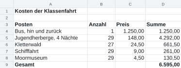
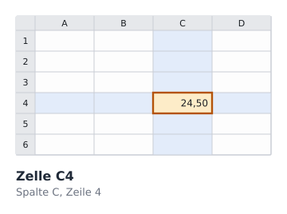
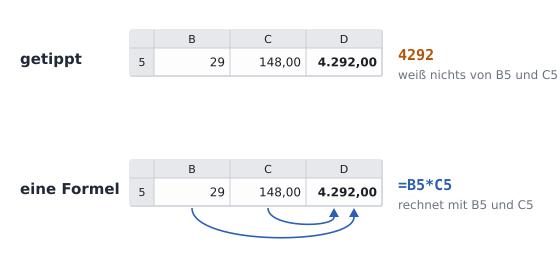
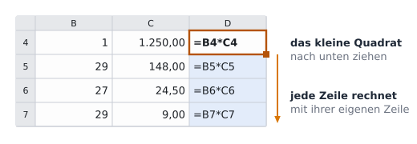

image: teaser.webp
image_alt: "Die Kosten der Klassenfahrt als Tabelle: Posten, Anzahl, Preis und Summe, darunter der Gesamtbetrag"
kind: labor
duration: 1 Stunde (45 Minuten)
curriculum: "Sek I: Standardsoftware (Tabellenkalkulation)"
topics: [standardsoftware]
language: LibreOffice / Excel / Nextcloud Office
languages: [libreoffice, word, nextcloud]
office: sheet
reference: []

# Zellen, die rechnen

In sieben Blättern rechnest du mit einer Tabellenkalkulation: von den Kosten der Klassenfahrt, die ein Taschenrechner ausgerechnet hat, bis zur Abrechnung, die selbst rechnet, mit Diagrammen. Du arbeitest in LibreOffice, Excel oder Nextcloud Office, und die Prüfung zeigt dir auf deiner eigenen Seite, was noch fehlt.

Für die Klassenfahrt der 7b hat ein Elternteil die Kosten zusammengestellt,
in einer Tabelle: jeder Posten, wie oft er bezahlt wird, sein Preis und die
Summe, ganz unten der Gesamtbetrag.

Die Summen und den Gesamtbetrag hat das Elternteil mit dem Taschenrechner
ausgerechnet und in die Tabelle getippt.

_task(vorher)

<!-- after: vorher -->
Nichts ändert sich: In den Summen stehen getippte Zahlen. Die Tabelle weiß
nicht, dass 4.292,00 einmal 29 mal 148,00 war. Wer den Preis ändert, muss
jede Summe, die davon abhängt, selbst neu ausrechnen und tippen, und vergisst
leicht eine.
<!-- /after -->

<strong>Die Tafel, die selbst rechnet</strong>, 1979. Bevor es Tabellenkalkulationen gab, rechnete man solche Tabellen auf Papier, mit dem Taschenrechner, und änderte sich eine Zahl, radierte man jede Zahl aus, die von ihr abhing. Dan Bricklin sah einem Professor zu, der das an der Tafel tat, und schrieb mit Bob Frankston ein Programm, das nach jeder Änderung selbst neu rechnet: VisiCalc.

_person(bricklin-frankston)

## Zellen und Adressen

Eine Tabelle besteht aus **Zellen**. Die Spalten heißen A, B, C …, die Zeilen
1, 2, 3 …, und jede Zelle hat eine **Adresse** aus beidem: erst die Spalte,
dann die Zeile. In C6 steht der Preis des Kletterwalds.

Hol dir die Tabelle und öffne sie:

<a class='document-starter btn btn-primary' href='/spreadsheet-cells/01%20Kosten.xlsx' download><i class='bi bi-file-earmark-spreadsheet' aria-hidden='true'></i>Vorlage herunterladen:01 Kosten.xlsx</a>

_task(ablesen)

## Formeln

Eine **Formel** rechnet mit den Zahlen in anderen Zellen. Sie beginnt mit
einem Gleichheitszeichen; für die Summe der Jugendherberge schreibst du in D5:
`=B5*C5`, Anzahl mal Preis. Das Sternchen `*` ist das Malzeichen, `/` das
Geteiltzeichen. Nach <kbd>Enter</kbd> zeigt die Zelle das Ergebnis, die
Formel steht weiter in ihr. Ändert sich B5 oder C5, rechnet die Zelle neu.

<!-- language: libreoffice -->
Welche Formel in einer Zelle steht, zeigt LibreOffice in der **Eingabezeile**
über der Tabelle, sobald du die Zelle anklickst. Dort kannst du sie auch
ändern.
<!-- /language -->
<!-- language: word -->
Welche Formel in einer Zelle steht, zeigt Excel in der **Bearbeitungsleiste**
über der Tabelle, sobald du die Zelle anklickst. Dort kannst du sie auch
ändern.
<!-- /language -->
<!-- language: nextcloud -->
Welche Formel in einer Zelle steht, zeigt Nextcloud Office in der Zeile über
der Tabelle, sobald du die Zelle anklickst. Dort kannst du sie auch ändern.
<!-- /language -->

**Jetzt bist du dran:** Schreib in D4 die Formel für den Bus, `=B4*C4`, und
in D5 die für die Jugendherberge. Ändere dann den Preis der Jugendherberge in
C5 auf 150 und sieh nach, was in D5 passiert. Setz ihn danach wieder auf 148.

## Nach unten ausfüllen

Für jede Zeile eine Formel zu tippen, wäre mühsam. Unten rechts an der
markierten Zelle sitzt ein kleines Quadrat. Ziehst du es nach unten, schreibt
das Programm die Formel in die Zellen darunter und passt sie an.

_task(kopiert)

<!-- after: kopiert -->

Die Formel merkt sich nicht die Adressen B4 und C4, sondern den Weg dorthin:
»zwei Spalten links und eine links von mir, in meiner Zeile«. In jeder Zeile
führt dieser Weg zu den Zahlen dieser Zeile.
<!-- /after -->

**Jetzt bist du dran:** Füll die Formel aus D4 nach unten aus, bis D8.

## Die Summe

Den Gesamtbetrag könntest du als `=D4+D5+D6+D7+D8` schreiben. Kürzer und
sicherer ist die Funktion **SUMME**: `=SUMME(D4:D8)` zählt alles von D4 bis
D8 zusammen. Der Doppelpunkt heißt »bis«. Kommt eine Zeile dazwischen dazu,
wächst der Bereich mit.

<!-- language: libreoffice -->
In LibreOffice tippst du die Formel selbst, oder du stellst dich in D9 und
klickst über der Tabelle auf **Σ** (*Funktion auswählen*) und dann *Summe*:
LibreOffice schlägt den Bereich darüber vor.
<!-- /language -->
<!-- language: word -->
In Excel tippst du die Formel selbst, oder du stellst dich in D9 und klickst im
Register *Start* auf **Σ** *AutoSumme*: Excel schlägt den Bereich darüber vor.
<!-- /language -->
<!-- language: nextcloud -->
In Nextcloud Office tippst du die Formel selbst, oder du stellst dich in D9
und klickst über der Tabelle auf **Σ** und dann *Summe*: Das Programm schlägt
den Bereich darüber vor.
<!-- /language -->

**Jetzt bist du dran:** Schreib in D9 den Gesamtbetrag mit SUMME.

## Prüfen

Speichere die Tabelle und lass sie prüfen. Die Prüfung ändert in ihrer Kopie
eine Zahl und rechnet neu: Rechnet deine Tabelle mit, stimmt alles.

_task(kosten)

<!-- after: kosten -->

<strong>Ausprobieren:</strong> Füg zwischen Zeile 7 und 8 eine neue Zeile ein (Rechtsklick auf die Zeilennummer 8, <em>Zeilen oberhalb einfügen</em> oder <em>Einfügen</em>) und trag einen Posten ein, etwa »Eis« für 29 Personen zu 2,00. Füll die Formel in D aus und achte auf den Bereich in der SUMME.

<!-- /after -->
