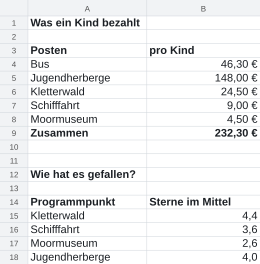
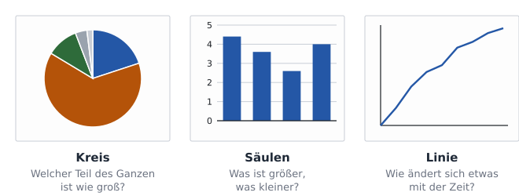
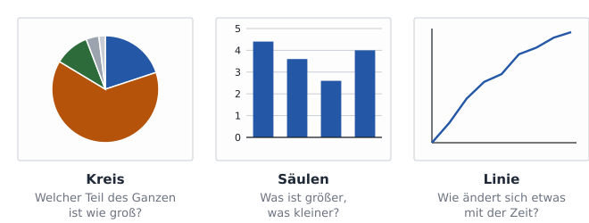
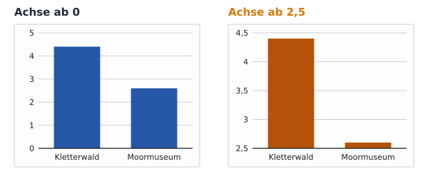
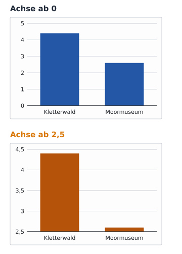
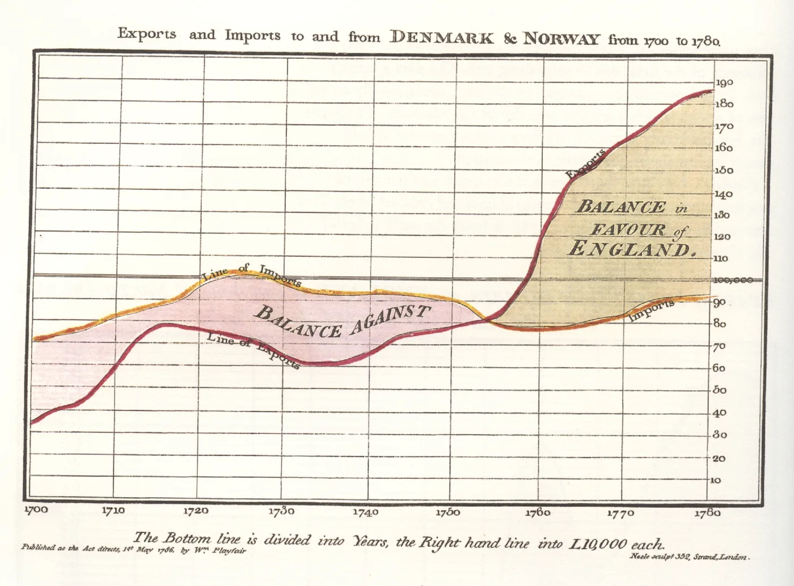

image: teaser.webp
image_alt: "Zwei Diagramme neben einer Tabelle: ein Kreisdiagramm, wofür ein Kind bei der Klassenfahrt bezahlt, die Jugendherberge als größtes Stück, und ein Säulendiagramm, wie die Programmpunkte gefallen haben"
kind: labor
duration: 1 Stunde (45 Minuten)
curriculum: "Sek I: Standardsoftware (Tabellenkalkulation)"
topics: [standardsoftware]
language: LibreOffice / Excel / Nextcloud Office
languages: [libreoffice, word, nextcloud]
office: sheet
requires: [sort-and-filter]
reference: []

# Diagramme

Eine Zahl in einer Tabelle muss man lesen, ein Diagramm sieht man. Du machst aus den Kosten und der Umfrage der Klassenfahrt zwei Diagramme für den Elternabend, wählst für jede Frage das passende und erkennst ein Diagramm, das täuscht.

Auf dem Elternabend nach der Fahrt sollen zwei Fragen beantwortet werden:
Wofür ist das Geld eines Kindes ausgegeben worden? Und was hat der Klasse
gefallen? Beides steht schon in Tabellen, aus dem dritten und vierten Blatt.
Auf einer Leinwand im Klassenraum liest aber niemand Zahlen ab.

Hol dir die Tabelle und öffne sie:

<a class='document-starter btn btn-primary' href='/spreadsheet-charts/06%20Diagramme.xlsx' download><i class='bi bi-file-earmark-spreadsheet' aria-hidden='true'></i>Vorlage herunterladen:06 Diagramme.xlsx</a>

## Welches Diagramm?

Jede Art von Diagramm beantwortet eine andere Frage. Ein **Kreisdiagramm**
zeigt, wie sich ein Ganzes in Teile aufteilt. Ein **Säulendiagramm**
vergleicht Werte miteinander: Was ist größer, was kleiner? Ein
**Liniendiagramm** zeigt, wie sich etwas mit der Zeit ändert. Liegen die
Säulen waagerecht, heißen sie Balken, ein **Balkendiagramm**; es passt, wenn
die Namen lang sind.

_task(welches)

## Ein Kreisdiagramm

Die Kosten eines Kindes sind ein Ganzes, 232,30 €, das sich auf fünf Posten
aufteilt: ein Fall für den Kreis. Ein Diagramm entsteht aus markierten
Zellen. Markiere die Posten mit ihren Beträgen und der Überschrift darüber,
aber nicht die Zeile »Zusammen«: Sie ist kein Teil des Ganzen, sondern das
Ganze, und wäre im Kreis ein zweites, gleich großes Stück.

<!-- language: libreoffice -->
In LibreOffice fügst du ein Diagramm über *Einfügen* <i class='bi bi-chevron-right' aria-hidden='true'></i> *Diagramm…* ein. Der *Diagramm-Assistent* führt in Schritten durch: zuerst der *Diagrammtyp*, dann die Daten, zuletzt die *Diagrammelemente* mit dem *Titel*. Ein Doppelklick auf ein fertiges Diagramm öffnet es wieder zum Bearbeiten.
<!-- /language -->
<!-- language: word -->
In Excel fügst du ein Diagramm im Register *Einfügen* ein, in der Gruppe *Diagramme*; für einen Kreis über *Kreis- oder Ringdiagramm einfügen*. Den Titel schreibst du in das Feld *Diagrammtitel* im Diagramm, weitere Teile fügt das Plus neben dem markierten Diagramm hinzu, *Diagrammelemente*.
<!-- /language -->
<!-- language: nextcloud -->
In Nextcloud Office fügst du ein Diagramm über *Einfügen* <i class='bi bi-chevron-right' aria-hidden='true'></i> *Diagramm…* ein. Ein Fenster führt in Schritten durch: zuerst der *Diagrammtyp*, dann die Daten, zuletzt die *Diagrammelemente* mit dem *Titel*.
<!-- /language -->

**Jetzt bist du dran:** Mach aus A3 bis B8 ein Kreisdiagramm mit dem Titel
»Wofür ein Kind bezahlt«.

Das größte Stück fällt sofort auf. Wie groß ist es genau?

_task(anteil)

## Ein Säulendiagramm

Die Sterne der vier Programmpunkte sind kein Ganzes: Zusammengezählt
bedeuten sie nichts. Sie werden verglichen, also Säulen. Bei Säulen braucht
jede Achse einen **Achsentitel**, sonst weiß niemand, was die Zahlen an der
Achse bedeuten: Euro? Sterne? Prozent?

**Jetzt bist du dran:** Mach aus A14 bis B18 ein Säulendiagramm mit dem
Titel »Wie hat es gefallen?« und den Achsentiteln »Programmpunkt« und
»Sterne im Mittel«. Schieb die beiden Diagramme neben die Tabelle, sodass
sie keine Zahlen verdecken.

## Achsen, die täuschen

Wo die senkrechte Achse anfängt, wählt das Programm selbst, und man kann es
ändern. Das hat Folgen:

_task(achse)

<!-- after: achse -->

Rechts sieht es aus, als hätte das Moormuseum niemandem gefallen. Dabei hat
es im Mittel 2,6 von 5 Sternen. Säulen vergleichen Höhen; fängt die Achse
nicht bei 0 an, stimmen die Höhen nicht mehr mit den Zahlen überein. Solche
Diagramme findest du in der Werbung und in Nachrichten, manchmal aus
Versehen, manchmal mit Absicht. Sieh bei jedem Säulendiagramm zuerst nach,
wo die Achse anfängt.
<!-- /after -->

<strong>Die ersten Diagramme</strong>, 1786. Zahlen zur Wirtschaft standen lange nur in Tabellen. Der schottische Ingenieur William Playfair zeichnete sie in seinem Buch <em>The Commercial and Political Atlas</em> als Linien über den Jahren und als Balken; im Bild darunter, was England an Dänemark und Norwegen verkaufte und von dort kaufte. Wo die rote Linie über der gelben liegt, verkaufte England mehr, als es kaufte. 1801 zeichnete Playfair in seinem <em>Statistical Breviary</em> das wohl erste Kreisdiagramm. Die drei Diagramme dieses Blatts sind also über zweihundert Jahre alt.

<figure><figcaption>William Playfair, 1786: Ausfuhren und Einfuhren Englands nach und aus Dänemark und Norwegen, 1700 bis 1780. Gemeinfrei (<a href='https://commons.wikimedia.org/wiki/File:Playfair_TimeSeries.png'>Wikimedia Commons</a>)</figcaption></figure>

## Prüfen

Speichere die Tabelle und lass sie prüfen. Die Prüfung sieht nach, welche
Diagramme in der Tabelle stehen, aus welchen Zellen sie zeichnen und ob sie
Titel haben.

_task(diagramme)

<!-- after: diagramme -->

<strong>Ausprobieren:</strong> Ändere in B17 die Sterne des Moormuseums auf 4,5. Achte auf das Säulendiagramm, und darauf, ob du dafür etwas am Diagramm tun musstest. Mach die Änderung danach rückgängig (<kbd>Strg</kbd>+<kbd>Z</kbd>).

<!-- /after -->
