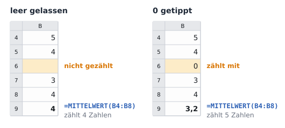
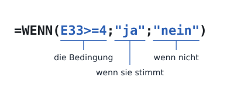

image: teaser.webp
image_alt: "Die Auswertung der Umfrage nach der Klassenfahrt: für Kletterwald, Schifffahrt, Moormuseum und Jugendherberge die Zahl der Antworten, der Mittelwert, der beste und der schlechteste Wert und ob die Klasse wieder hin will"
kind: labor
duration: 1 Stunde (45 Minuten)
curriculum: "Sek I: Standardsoftware (Tabellenkalkulation)"
topics: [standardsoftware]
language: LibreOffice / Excel / Nextcloud Office
languages: [libreoffice, word, nextcloud]
office: sheet
requires: [absolute-references]
reference: []

# Auswerten

Nach der Klassenfahrt hat die 7b eine Umfrage gemacht. Du wertest sie mit Funktionen aus: Wie viele haben geantwortet, was war im Mittel am beliebtesten, was am wenigsten, und wohin soll die nächste Klasse wieder fahren?

Nach der Fahrt hat jedes Kind einen Zettel ausgefüllt: Wie hat dir der
Kletterwald gefallen, die Schifffahrt, das Moormuseum, die Jugendherberge? Ein
bis fünf Sterne, ohne Namen. Die Klassensprecherin und der Klassensprecher
haben die Zettel abgetippt, jeden in eine Zeile mit einer Nummer. Wer eine Frage ausgelassen
hat, bei dem bleibt die Zelle leer.

## Funktionen

SUMME kennst du schon: eine **Funktion**, die einen ganzen Bereich auf einmal
ausrechnet. Ihr Name steht vorn, der Bereich in Klammern dahinter. Für eine
Umfrage gibt es weitere:

<table class='table'>
<tr><th>Funktion</th><th>rechnet aus</th></tr>
<tr><td><code>=ANZAHL(B4:B30)</code></td><td>wie viele Zellen im Bereich eine Zahl enthalten</td></tr>
<tr><td><code>=MITTELWERT(B4:B30)</code></td><td>den Mittelwert: alle Zahlen zusammengezählt, geteilt durch ihre Anzahl</td></tr>
<tr><td><code>=MAX(B4:B30)</code></td><td>die größte Zahl im Bereich</td></tr>
<tr><td><code>=MIN(B4:B30)</code></td><td>die kleinste Zahl im Bereich</td></tr>
</table>

_task(leer)

<!-- after: leer -->

Eine leere Zelle ist keine 0. Wer eine Frage auslässt, hat nicht »0 Sterne«
gegeben, und die Funktionen lassen die leere Zelle aus. Hätten die
beiden für jede ausgelassene Frage eine 0 getippt, sähe jeder
Mittelwert schlechter aus, als die Klasse geantwortet hat.
<!-- /after -->

Hol dir die Umfrage und öffne sie:

<a class='document-starter btn btn-primary' href='/spreadsheet-functions/04%20Umfrage.xlsx' download><i class='bi bi-file-earmark-spreadsheet' aria-hidden='true'></i>Vorlage herunterladen:04 Umfrage.xlsx</a>

**Jetzt bist du dran:** Schreib unter den Antworten zum Kletterwald die vier
Funktionen: in B32 `=ANZAHL(B4:B30)`, in B33 den Mittelwert, in B34 den besten
und in B35 den schlechtesten Wert. Markiere dann B32 bis B35 und zieh sie am
kleinen Quadrat nach rechts bis Spalte E. Die Bezüge wandern mit, wie im
letzten Blatt, und jede Spalte rechnet mit ihren eigenen Antworten.

<!-- language: libreoffice -->
Wer den Namen einer Funktion nicht weiß, findet sie im
**Funktionsassistenten**: über der Tabelle das Zeichen *f*(x) oder
<kbd>Strg</kbd>+<kbd>F2</kbd>. Er zeigt jede Funktion mit einer
Beschreibung und fragt nach ihrem Bereich.
<!-- /language -->
<!-- language: word -->
Wer den Namen einer Funktion nicht weiß, findet sie über **Funktion
einfügen**: das Zeichen *fx* neben der Bearbeitungsleiste. Das Fenster zeigt
jede Funktion mit einer Beschreibung und fragt nach ihrem Bereich.
<!-- /language -->
<!-- language: nextcloud -->
Wer den Namen einer Funktion nicht weiß, findet sie über das Zeichen *f*(x)
neben der Zeile über der Tabelle: Es zeigt jede Funktion mit einer
Beschreibung.
<!-- /language -->

_task(anzahl)

Die Mittelwerte haben viele Nachkommastellen: 4,423076923… Für eine Umfrage
mit Sternen genügt eine. **Jetzt bist du dran:** Gib B33 bis E33 ein
Zahlenformat mit einer Nachkommastelle.

## WENN

Die nächste Klasse soll nur dorthin fahren, wo es im Mittel mindestens vier
Sterne gab. Ob das so ist, entscheidet die Funktion **WENN**. Sie hat drei
Teile, getrennt durch Semikolons: eine Bedingung, was in der Zelle stehen
soll, wenn sie stimmt, und was, wenn nicht. Text steht in
Anführungszeichen.

=4;"ja";"nein"), ihre drei Teile unterstrichen: E33>=4 ist die Bedingung, "ja" steht da, wenn sie stimmt, "nein", wenn nicht'>

In einer Bedingung vergleichst du mit `=` (gleich), `<>` (ungleich), `<`,
`>`, `<=` (kleiner oder gleich) und `>=` (größer oder gleich).

_task(wenn)

<!-- after: wenn -->
Das Zahlenformat aus dem zweiten Blatt spielt hier mit: E33 zeigt 4,0, in
der Zelle steht 3,96. WENN vergleicht die Zahl, nicht das, was die Zelle
zeigt. Die Jugendherberge hat die vier Sterne knapp verfehlt.
<!-- /after -->

**Jetzt bist du dran:** Schreib in B36 `=WENN(B33>=4;"ja";"nein")` und zieh
die Formel nach rechts bis E36.

<strong>Der Bereich, der zu kurz war</strong>, 2013. Drei Jahre zuvor hatten die Ökonomen Carmen Reinhart und Kenneth Rogoff eine Untersuchung veröffentlicht: Länder mit sehr hohen Schulden wüchsen im Mittel kaum noch. Politikerinnen und Politiker in Europa und den USA beriefen sich darauf, als sie Staaten zum Sparen drängten. 2013 bekamen Thomas Herndon, ein Doktorand an der University of Massachusetts Amherst, und zwei seiner Professoren die Tabelle der beiden und rechneten nach. In einem Mittelwert fehlten mehrere Länder, weil die Formel nicht alle Zeilen erfasste, und andere Zahlen waren ausgelassen oder ungewöhnlich gewichtet. Neu gerechnet wuchsen die Länder mit hohen Schulden im Mittel um 2,2 % im Jahr, nicht um −0,1 %.

## Prüfen

Speichere die Tabelle und lass sie prüfen. Die Prüfung trägt in ihrer Kopie
eine fehlende Antwort nach und ändert eine andere; deine Auswertung muss
mitrechnen.

_task(umfrage)

<!-- after: umfrage -->

<strong>Ausprobieren:</strong> Trag in E15, wo bei der Jugendherberge eine Antwort fehlt, 5 Sterne ein. Achte auf E32, E33 und E36. Lösch die 5 danach wieder.

<!-- /after -->
