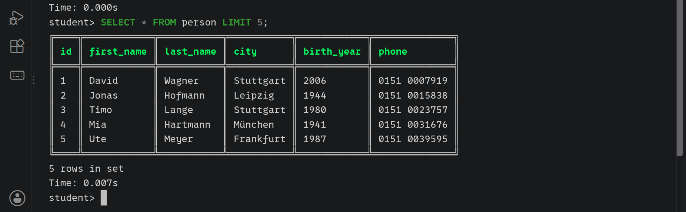
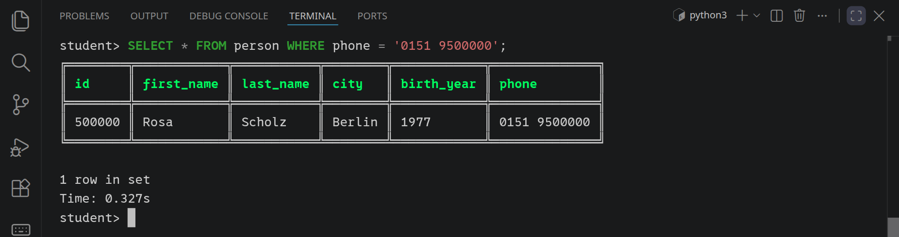
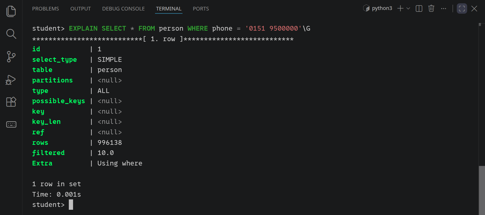
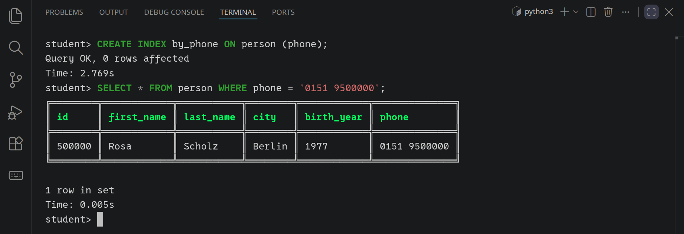
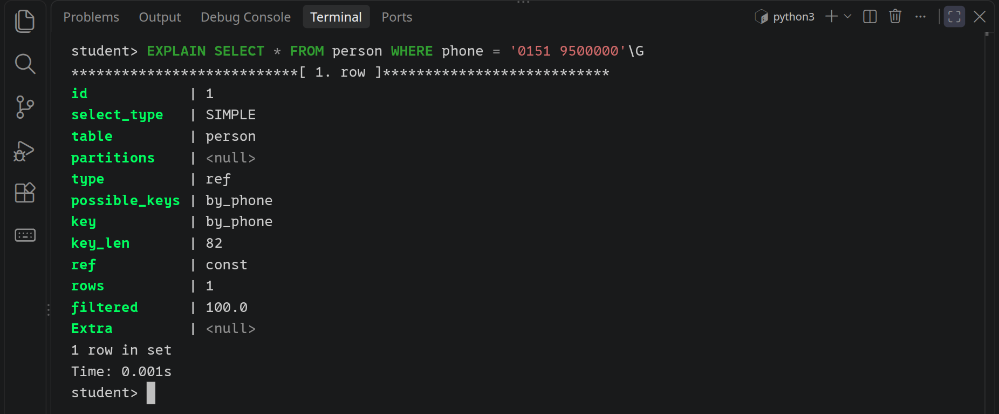
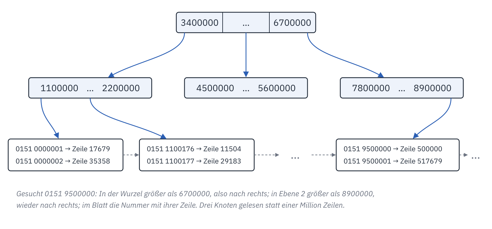
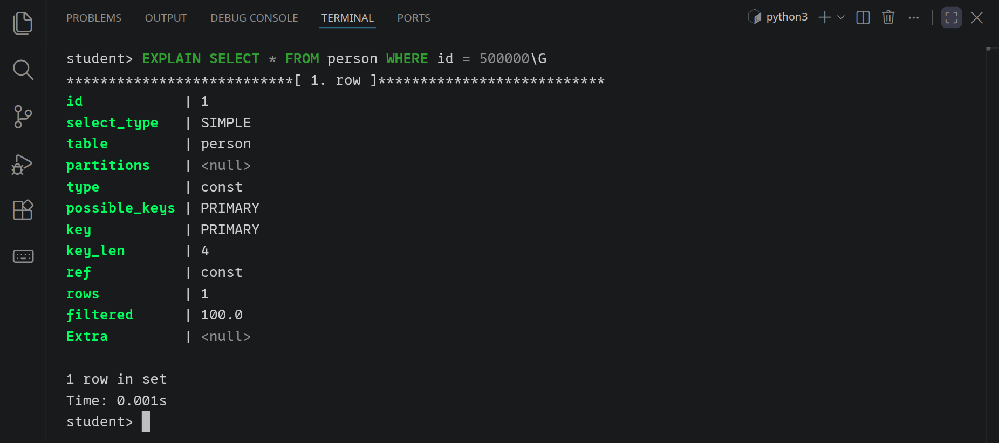
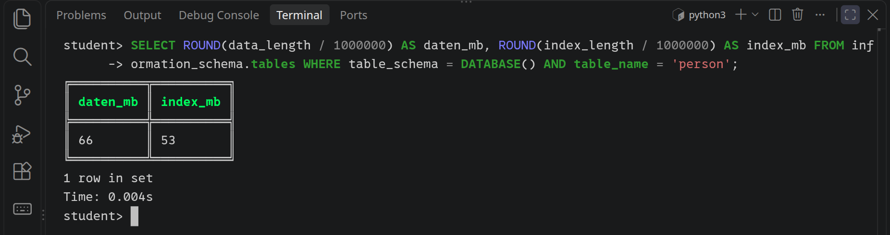

<div class='meta'>
image: b-tree.webp:contain
kind: labor
language: SQL
requires: [mysql]
reference: [sql]
</div>

<div
    class="autotoc-secondary-trigger"
    data-title="Auf dieser Seite"
    data-levels="h2,h3">
</div>

# Indizes: Warum eine Abfrage schnell ist

<p class='abstract'>
Eine Tabelle mit einer Million Menschen. Eine Telefonnummer darin zu finden, dauert eine Drittelsekunde, mit einem Index nur ein paar Millisekunden. Du misst, schaust der Datenbank mit EXPLAIN bei der Arbeit zu, legst einen Index an und findest heraus, wie er aufgebaut ist, warum er hilft und wann nicht.
</p>

## Vorbereitung

Für diese Aktivität brauchst du die Grundlagen aus der [Einführung in SQL](/mysql): `SELECT`, `WHERE` und `mycli`. Öffne mit <kbd>Strg</kbd><kbd>K</kbd> <kbd>Strg</kbd><kbd>O</kbd> einen neuen Ordner `sql-index`; VS Code legt ihn an. Öffne dann ein Terminal und maximiere es.

<!-- tutorial-step
# Der Ordner sql-index und ein Terminal
show-left-sidebar
press: Control+K
press: Control+O
wait-for-input-value: /workspace/
type: sql-index
press: Enter
wait-for-text: create it
press: Enter
sleep: 1
click: Next Up
-->

## Ein Telefonbuch mit einer Million Einträgen

Damit sich ein Unterschied messen lässt, braucht es viele Zeilen. Die Datei unten legt in deiner Datenbank die Tabelle `person` an und füllt sie mit einer Million ausgedachter Menschen, mit Vorname, Nachname, Wohnort, Geburtsjahr und Telefonnummer. Ausgedacht, aber bei allen gleich: Die Namen kommen nicht aus dem Zufall, sondern aus einer Prüfsumme der Zeilennummer (`CRC32`), und jede Telefonnummer gibt es genau einmal.

Lege in VS Code die Datei `telefonbuch.sql` an und kopiere das hinein:

<!-- screenshot-code: telefonbuch -->
```sql_copy
-- Ein Telefonbuch mit einer Million Einträgen, ausgedacht, aber für alle gleich
DROP TABLE IF EXISTS person;
CREATE TABLE person (
  id INT PRIMARY KEY,
  first_name VARCHAR(20) NOT NULL,
  last_name VARCHAR(20) NOT NULL,
  city VARCHAR(20) NOT NULL,
  birth_year INT NOT NULL,
  phone VARCHAR(20) NOT NULL
);
SET SESSION cte_max_recursion_depth = 1000000;
INSERT INTO person
WITH RECURSIVE n (i) AS (SELECT 1 UNION ALL SELECT i + 1 FROM n WHERE i < 1000000)
SELECT
  i,
  ELT(1 + CRC32(CONCAT('v', i)) % 30, 'Ada', 'Ben', 'Clara', 'David', 'Emma', 'Finn', 'Greta', 'Hanna',
      'Ida', 'Jonas', 'Karl', 'Lena', 'Mia', 'Noah', 'Ole', 'Paula', 'Quentin', 'Rosa', 'Sami', 'Tom',
      'Ute', 'Vera', 'Willi', 'Xenia', 'Yusuf', 'Zoe', 'Elif', 'Luca', 'Nele', 'Timo'),
  ELT(1 + CRC32(CONCAT('n', i)) % 50, 'Müller', 'Schmidt', 'Schneider', 'Fischer', 'Weber', 'Meyer',
      'Wagner', 'Becker', 'Schulz', 'Hoffmann', 'Schäfer', 'Koch', 'Bauer', 'Richter', 'Klein', 'Wolf',
      'Schröder', 'Neumann', 'Schwarz', 'Zimmermann', 'Braun', 'Krüger', 'Hofmann', 'Hartmann', 'Lange',
      'Schmitt', 'Werner', 'Schmitz', 'Krause', 'Meier', 'Lehmann', 'Schmid', 'Schulze', 'Maier',
      'Köhler', 'Herrmann', 'König', 'Walter', 'Mayer', 'Huber', 'Kaiser', 'Fuchs', 'Peters', 'Lang',
      'Scholz', 'Möller', 'Weiß', 'Jung', 'Hahn', 'Specht'),
  ELT(1 + CRC32(CONCAT('o', i)) % 12, 'Berlin', 'Hamburg', 'München', 'Köln', 'Frankfurt', 'Stuttgart',
      'Düsseldorf', 'Leipzig', 'Dortmund', 'Essen', 'Bremen', 'Dresden'),
  1940 + CRC32(CONCAT('j', i)) % 70,
  CONCAT('0151 ', LPAD(i * 7919 % 10000000, 7, '0'))
FROM n;
```

`WITH RECURSIVE` zählt von 1 bis 1.000.000, und für jede Zahl `i` entsteht eine Zeile. `ELT(k, …)` nimmt den k-ten Eintrag einer Liste. Die Telefonnummer ist `i · 7919`, nur die letzten sieben Stellen; weil 7919 eine Primzahl ist und mit 10.000.000 keinen Teiler gemeinsam hat, kommt jede Nummer höchstens einmal vor.

Führe die Datei im Terminal aus. Das dauert ein paar Sekunden:

```bash
mysql < telefonbuch.sql
```

<!-- tutorial-step
# Die Datei, ausgeführt, dann mycli
write-file: sql-index/telefonbuch.sql <- previous-code (telefonbuch)
hide-left-sidebar
terminal-open
terminal-maximize
terminal-run: clear
terminal-run: mysql < telefonbuch.sql
terminal-wait-for-prompt: 120
-->

_task(telefonbuch)

Starte `mycli` und sieh dir die ersten Zeilen an:

```sql
SELECT * FROM person LIMIT 5;
```

<!-- tutorial-screenshot
terminal-run: clear
terminal-run: mycli
sleep: 0.5
press: Control+L
terminal-run: SELECT * FROM person LIMIT 5;
wait-for-text: 5 rows in set
sleep: 0.5
terminal-scroll-back: 3
crop-terminal-lines: auto
crop-terminal-skip-top: 4
crop-terminal-skip-bottom: 1
-->



## Eine Nummer suchen

Wem gehört die Nummer `0151 9500000`?

```sql
SELECT * FROM person WHERE phone = '0151 9500000';
```

<!-- tutorial-screenshot
press: Control+L
terminal-run: SELECT * FROM person WHERE phone = '0151 9500000';
wait-for-text: 1 row in set
sleep: 0.5
crop-terminal-lines: auto
crop-terminal-skip-bottom: 1
-->



Unter dem Ergebnis steht, wie lange die Abfrage gedauert hat: etwa eine Drittelsekunde. Das klingt nach wenig. Aber ein Server, der tausend solcher Fragen in der Sekunde beantworten soll, schafft so nur drei.

_task(wessen-nummer)

## Der Datenbank zusehen: EXPLAIN

Wie die Datenbank eine Abfrage ausführen will, sagt `EXPLAIN` davor. Mit `\G` am Ende statt `;` schreibt `mycli` jede Spalte des Ergebnisses in eine eigene Zeile, das ist hier übersichtlicher:

```sql
EXPLAIN SELECT * FROM person WHERE phone = '0151 9500000'\G
```

<!-- tutorial-screenshot
# Taller, so that the whole EXPLAIN fits
viewport: 1029x700
press: Control+L
terminal-run: EXPLAIN SELECT * FROM person WHERE phone = '0151 9500000'\G
wait-for-text: Using where
sleep: 0.5
crop-terminal-lines: auto
crop-terminal-skip-bottom: 1
-->



Drei Zeilen sind wichtig:

- **`type: ALL`** heißt: Die Datenbank liest die ganze Tabelle, Zeile für Zeile, und prüft bei jeder die Bedingung. Man nennt das einen *Full Table Scan*.
- **`key`** ist leer: Es gibt nichts, womit sie schneller ans Ziel käme.
- **`rows`** schätzt, wie viele Zeilen sie dafür anfassen muss: fast eine Million, um eine einzige zu finden.

Stell dir ein Telefonbuch vor, in dem die Einträge in der Reihenfolge stehen, in der sich die Leute angemeldet haben. Eine Nummer findest du darin nur, indem du alles liest.

_task(vollstaendig)

## Ein Index

Ein **Index** ist ein zweites, sortiertes Verzeichnis neben der Tabelle: alle Telefonnummern der Reihe nach, und bei jeder, in welcher Zeile sie steht. So wie das Register am Ende eines Buchs, das zu jedem Stichwort die Seite nennt. Lege einen an:

```sql
CREATE INDEX by_phone ON person (phone);
```

`by_phone` ist sein Name, `(phone)` die Spalte, nach der er sortiert. Das dauert ein paar Sekunden: Die Datenbank liest dafür einmal die ganze Tabelle und sortiert eine Million Nummern. Stelle dieselbe Frage noch einmal:

```sql
SELECT * FROM person WHERE phone = '0151 9500000';
```

<!-- tutorial-screenshot
viewport: 1029x640
press: Control+L
terminal-run: CREATE INDEX by_phone ON person (phone);
wait-for-text: Query OK
terminal-run: SELECT * FROM person WHERE phone = '0151 9500000';
wait-for-text: 1 row in set
sleep: 0.5
crop-terminal-lines: auto
crop-terminal-skip-bottom: 1
-->



Dieselbe Antwort, aber in ein paar Millisekunden statt einer Drittelsekunde, und davon ist das meiste die Zeit, die `mycli` zum Anzeigen braucht. `EXPLAIN` zeigt, warum:

```sql
EXPLAIN SELECT * FROM person WHERE phone = '0151 9500000'\G
```

<!-- tutorial-screenshot
# Taller, so that the whole EXPLAIN fits
viewport: 1029x700
press: Control+L
terminal-run: EXPLAIN SELECT * FROM person WHERE phone = '0151 9500000'\G
wait-for-text: by_phone
sleep: 0.5
crop-terminal-lines: auto
crop-terminal-skip-bottom: 1
-->



Jetzt steht bei `key` der Index `by_phone`, bei `rows` eine 1, und bei `type` steht `ref`: Die Datenbank schlägt die Nummer im Index nach und springt von dort direkt in die eine Zeile.

_task(index-telefon)

## Wie ein Index aufgebaut ist: der B-Baum

Eine sortierte Liste mit einer Million Nummern ließe sich mit binärer Suche durchsuchen, in etwa 20 Schritten. Eine Datenbank liest aber nicht einzelne Nummern von der Festplatte, sondern ganze Blöcke von 16 KB auf einmal, und jeder Block, den sie liest, kostet Zeit. Darum ist ihr Index ein **B-Baum**: ein Baum, in dessen Knoten nicht ein Schlüssel steht, sondern Hunderte, so viele, wie in einen Block passen.



Die Wurzel oben teilt alle Nummern in Bereiche ein und sagt, in welchem Knoten darunter es weitergeht. Jeder Knoten darunter teilt seinen Bereich wieder ein. Erst in den Blättern ganz unten stehen die Nummern selbst, mit dem Verweis auf ihre Zeile. Wer eine Nummer sucht, liest auf jeder Ebene einen Knoten und weiß danach, wo es weitergeht: nach drei, vier Blöcken ist man da.

_task(ebenen)

Die Blätter liegen außerdem der Reihe nach nebeneinander. Darum hilft der Index nicht nur bei `=`, sondern auch bei Bereichen: `phone BETWEEN … AND …` oder `phone LIKE '0151 95%'` springt zum ersten passenden Blatt und liest von dort aus weiter, bis es nicht mehr passt.

## Der Primärschlüssel ist schon ein Index

Sieh dir an, was `EXPLAIN` zur Suche nach der Nummer einer Zeile sagt:

```sql
EXPLAIN SELECT * FROM person WHERE id = 500000\G
```

<!-- tutorial-screenshot
# Taller, so that the whole EXPLAIN fits
viewport: 1029x700
press: Control+L
terminal-run: EXPLAIN SELECT * FROM person WHERE id = 500000\G
wait-for-text: PRIMARY
sleep: 0.5
crop-terminal-lines: auto
crop-terminal-skip-bottom: 1
-->



`key: PRIMARY`: Für den Primärschlüssel legt MySQL von selbst einen Index an, und bei InnoDB ist die Tabelle sogar in diesem B-Baum gespeichert, sortiert nach `id`. `type: const` heißt, dass es höchstens eine passende Zeile geben kann: Ein Primärschlüssel kommt nie zweimal vor.

_task(primaerschluessel)

## Wann ein Index nicht hilft

Der Index `by_phone` ist nach den Nummern sortiert, von vorn nach hinten gelesen. Überlege, bevor du weiterliest:

_task(welche-nutzt)

Probiere alle drei mit `EXPLAIN` aus:

```sql
EXPLAIN SELECT * FROM person WHERE phone LIKE '0151 95%'\G
EXPLAIN SELECT * FROM person WHERE phone LIKE '%500000'\G
EXPLAIN SELECT * FROM person WHERE RIGHT(phone, 6) = '500000'\G
```

Nur die erste nutzt den Index, mit `type: range`: Alle Nummern, die mit `0151 95` anfangen, stehen im Index nebeneinander. Die Nummern, die mit `500000` enden, sind dagegen über den ganzen Index verstreut, so wie im Telefonbuch alle, deren Name auf »mann« endet. Und bei `RIGHT(phone, 6)` muss die Datenbank für jede Zeile erst ausrechnen, was dabei herauskommt; im Index stehen nur die Nummern selbst.

<!-- tutorial-step
press: Control+L
terminal-run: EXPLAIN SELECT * FROM person WHERE phone LIKE '0151 95%'\G
wait-for-text: Using index condition
terminal-run: EXPLAIN SELECT * FROM person WHERE phone LIKE '%500000'\G
terminal-run: EXPLAIN SELECT * FROM person WHERE RIGHT(phone, 6) = '500000'\G
sleep: 0.5
-->

## Zwei Spalten in einem Index

Ein echtes Telefonbuch ist nach dem Nachnamen sortiert, und bei gleichem Nachnamen nach dem Vornamen. So ein Index geht auch über zwei Spalten:

```sql
CREATE INDEX by_name ON person (last_name, first_name);
```

<!-- tutorial-step
press: Control+L
terminal-run: CREATE INDEX by_name ON person (last_name, first_name);
wait-for-text: Query OK
-->

_task(index-name)

Er hilft bei der Suche nach Nachname und Vorname, und auch bei der nach dem Nachnamen allein: Alle Spechts stehen in ihm nebeneinander. Wie viele Ada Specht stehen im Telefonbuch?

_task(ada-specht)

_task(nur-vorname)

## Was ein Index kostet

Ein Index ist nicht umsonst. Er braucht Platz, und wie viel, zeigt `information_schema`, nachdem `ANALYZE TABLE` die Zahlen aufgefrischt hat:

```sql
ANALYZE TABLE person;
SELECT ROUND(data_length / 1000000) AS daten_mb,
       ROUND(index_length / 1000000) AS index_mb
FROM information_schema.tables
WHERE table_schema = DATABASE() AND table_name = 'person';
```

<!-- tutorial-screenshot
press: Control+L
terminal-run: ANALYZE TABLE person;
wait-for-text: OK
press: Control+L
terminal-run: SELECT ROUND(data_length / 1000000) AS daten_mb, ROUND(index_length / 1000000) AS index_mb FROM information_schema.tables WHERE table_schema = DATABASE() AND table_name = 'person';
wait-for-text: 1 row in set
sleep: 0.5
crop-terminal-lines: auto
crop-terminal-skip-bottom: 1
-->



Die beiden Indizes sind zusammen fast so groß wie die Tabelle selbst. Und jede neue, geänderte oder gelöschte Zeile muss die Datenbank nicht nur in die Tabelle schreiben, sondern in jeden Index, an der richtigen Stelle des Baums.

_task(kosten)

Brauchst du das Telefonbuch nicht mehr, gibt `DROP TABLE person;` den Platz wieder frei.

## Zusammenfassung

<div style='max-width: 100%; overflow-x: auto;'>
<table class='table'>
<thead>
<tr><th>Baustein</th><th>Bedeutung</th></tr>
</thead>
<tbody>
<tr><td><code>EXPLAIN SELECT …</code></td><td>Wie will die Datenbank die Abfrage ausführen? Mit <code>\G</code> untereinander.</td></tr>
<tr><td><code>type: ALL</code></td><td>Sie liest die ganze Tabelle (Full Table Scan).</td></tr>
<tr><td><code>type: ref</code>, <code>range</code>, <code>const</code></td><td>Sie springt über einen Index zu den passenden Zeilen, zu einem Bereich, zu der einen Zeile.</td></tr>
<tr><td><code>CREATE INDEX name ON tabelle (spalte, …)</code></td><td>Ein sortiertes Verzeichnis, ein B-Baum, für diese Spalten in dieser Reihenfolge</td></tr>
<tr><td>Primärschlüssel</td><td>bekommt seinen Index von selbst</td></tr>
<tr><td>hilft nicht</td><td><code>LIKE '%…'</code>, eine Funktion um die Spalte, nur die zweite Spalte eines Index</td></tr>
<tr><td>kostet</td><td>Platz und Zeit bei jedem Schreiben</td></tr>
</tbody>
</table>
</div>

## Wie geht es weiter?

- In der [Filmdatenbank](/filmdatenbank) haben die Tabellen zwischen zwei anderen einen zusammengesetzten Primärschlüssel, etwa `(movie_id, genre_id)`. Welche Suchen beschleunigt er, welche nicht? `EXPLAIN` sagt es dir.
- `CREATE UNIQUE INDEX` legt einen Index an, der doppelte Werte verbietet. Bei `by_phone` wäre das richtig, und `EXPLAIN` zeigt dann `const` statt `ref`.

<!-- tutorial-step
# Jede Aufgabe, die in der Datenbank nachsieht, nimmt den Stand der Seite an
check-task: telefonbuch
check-task: wessen-nummer <- Noah Peters
check-task-fails: wessen-nummer <- Rosa Scholz
check-task: index-telefon
check-task: index-name
check-task: ada-specht <- SELECT * FROM person WHERE last_name = 'Specht' AND first_name = 'Ada';
check-task-fails: ada-specht <- SELECT * FROM person WHERE last_name = 'Specht';
check-task: ebenen <- 3
check-task-fails: ebenen <- 20
-->
