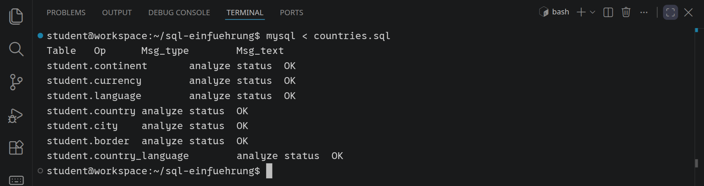
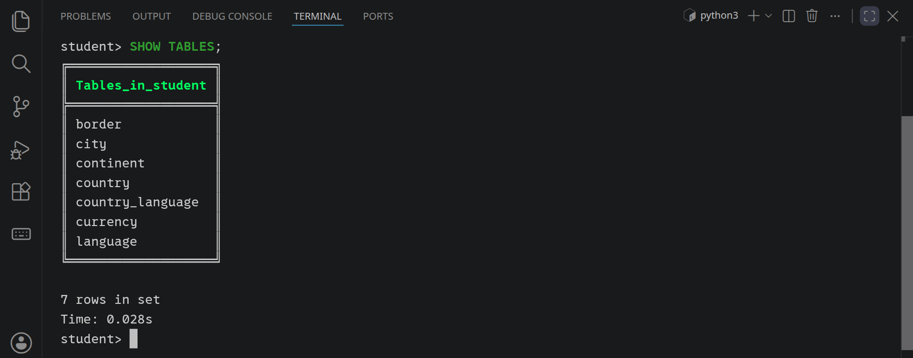
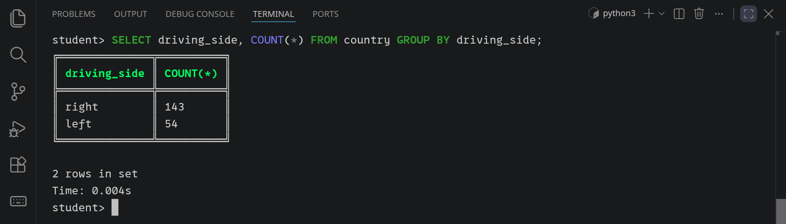
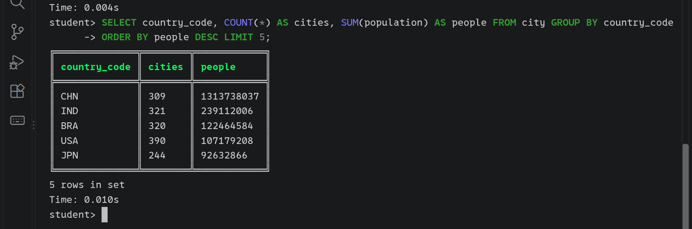
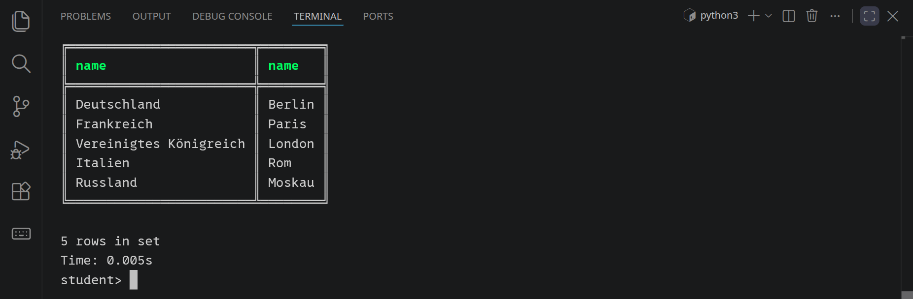
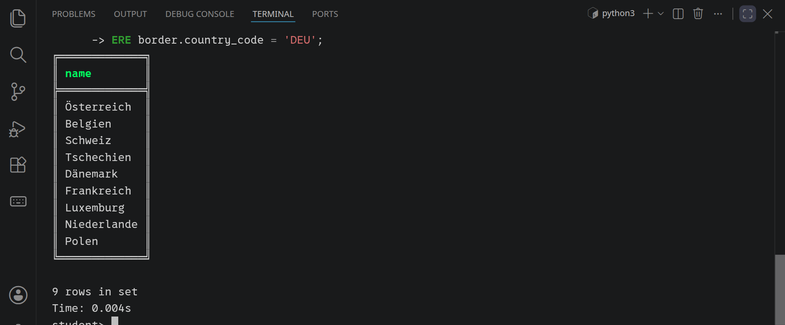
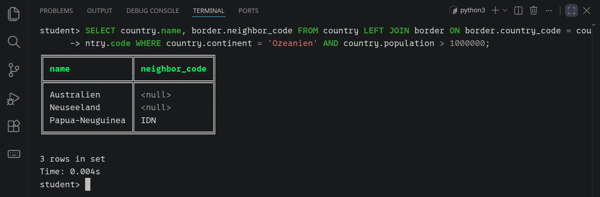
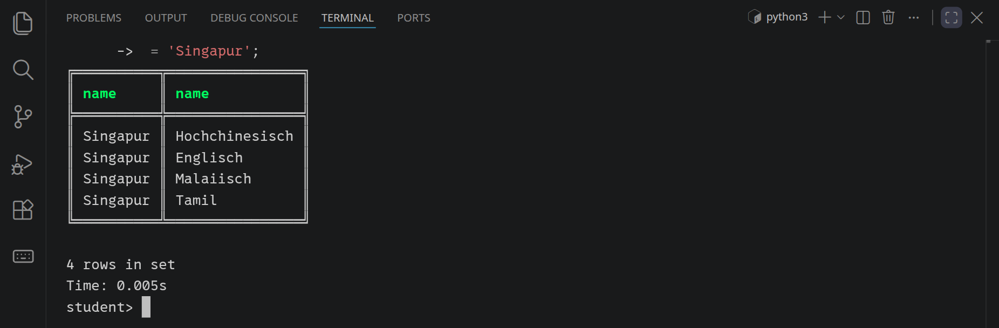
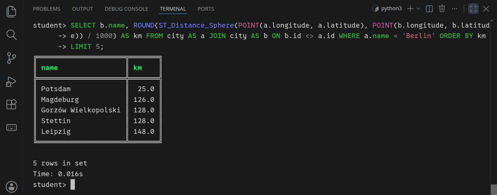

<div class='meta'>
image: teaser.webp:contain
image_alt: "Ein ER-Diagramm mit country in der Mitte und continent, city, currency und language darum herum"
kind: grundlagen
duration: 2 Doppelstunden
curriculum: "Sek I: Datenbanken (verknüpfte Tabellen); Oberstufe: Datenbanken (Abfragen: Projektion, Selektion, Join)"
language: SQL
reference: [sql, datensaetze]
</div>

<div
    class="autotoc-secondary-trigger"
    data-title="Auf dieser Seite"
    data-levels="h2,h3">
</div>

# SQL: Gruppieren und Verbinden

<p class='abstract'>
Welche Hauptstadt hat welches Land? Wer sind die Nachbarn Deutschlands? Wo ist Deutsch Amtssprache? Solche Fragen lesen mehrere Tabellen in einer Abfrage. Du gruppierst Zeilen mit GROUP BY, verbindest Tabellen mit JOIN und rechnest Entfernungen auf der Erde aus, an den Ländern der Welt.
</p>

## Vorbereitung

Diese Aktivität setzt die [Einführung in SQL](/mysql) fort: `SELECT`, `WHERE`, `ORDER BY`, `LIMIT` und `COUNT` solltest du kennen. Öffne den Ordner `sql-einfuehrung` aus der Einführung mit <kbd>Strg</kbd><kbd>K</kbd> <kbd>Strg</kbd><kbd>O</kbd>; gibt es ihn noch nicht, legt VS Code ihn an. Öffne dann ein Terminal und maximiere es, dann passen auch längere Ergebnisse hinein.

<!-- tutorial-step
# Der Ordner sql-einfuehrung und ein Terminal, wie in der Einführung
show-left-sidebar
press: Control+K
press: Control+O
wait-for-input-value: /workspace/
type: sql-einfuehrung
press: Enter
wait-for-text: create it
press: Enter
sleep: 1
hide-left-sidebar
terminal-open
terminal-maximize
-->

## Die ganze Datenbank laden

Lade die ganze Fassung der Länder der Welt herunter und importiere sie in deine Datenbank:

```bash_copy
wget https://github.com/specht/workspace-files/raw/main/country-archive/countries.sql
```

```bash
mysql < countries.sql
```

<!-- tutorial-screenshot
terminal-run: clear
terminal-run: wget -q https://github.com/specht/workspace-files/raw/main/country-archive/countries.sql
terminal-wait-for-prompt
wait-for-file: sql-einfuehrung/countries.sql
terminal-run: clear
terminal-run: mysql < countries.sql
terminal-wait-for-prompt
sleep: 0.5
crop-terminal-lines: auto
-->



`countries.sql` legt sieben Tabellen an. Hast du in der Einführung die kleine Fassung geladen, ersetzt es deren drei Tabellen: Die Länder, Städte und Kontinente sind dieselben, deine Abfragen von dort gehen weiter. Starte `mycli` wieder und sieh dir die Tabellen an:

<!-- tutorial-screenshot
terminal-run: clear
terminal-run: mycli
sleep: 0.5
# No pager in the recipes (mycli's less would swallow the next steps);
# Control+L clears its answer. \n is nopager; a backslash command runs at once
# in multi-line mode. Students see the pager, the page explains it.
terminal-run: \n
sleep: 0.5
press: Control+L
type: SHOW TABLES;
press: Enter
sleep: 0.5
terminal-scroll-back: 2
crop-terminal-lines: auto
crop-terminal-skip-bottom: 1
-->



_schema(countries, rows, new: border currency language country_language)

Neu in `country` sind vier Spalten: `currency_code`, die Währung, ein Fremdschlüssel auf `currency`; `tld`, die Internet-Endung wie `.de`; `calling_code`, die Vorwahl wie `+49`; und `driving_side`, `left` oder `right`, je nachdem, auf welcher Straßenseite gefahren wird. `border` enthält die Grenzen an Land, jede als Paar von zwei Ländern; erst beide Spalten zusammen sind der Primärschlüssel. `language` und `country_language` sagen, welche Sprachen in welchem Land Amtssprache sind.

_task(linksverkehr)

## Gruppen bilden: GROUP BY

`COUNT(*)` hat bisher alle Zeilen gezählt, die übrig blieben. Mit `GROUP BY` teilt die Datenbank die Zeilen vorher in Gruppen ein und rechnet für jede Gruppe einmal. In wie vielen Ländern wird rechts gefahren, in wie vielen links?

```sql
SELECT driving_side, COUNT(*)
FROM country
GROUP BY driving_side;
```

<!-- tutorial-screenshot
press: Control+L
terminal-run: SELECT driving_side, COUNT(*) FROM country GROUP BY driving_side;
sleep: 0.5
crop-terminal-lines: auto
crop-terminal-skip-bottom: 1
-->



Jede Gruppe wird zu einer Zeile. Neben `COUNT` gibt es `SUM` (die Summe), `AVG` (den Durchschnitt), `MIN` und `MAX`. Wie viele Städte jedes Land in `city` hat und wie viele Menschen darin wohnen, die fünf Länder mit den meisten zuerst:

```sql
SELECT country_code, COUNT(*) AS cities, SUM(population) AS people
FROM city
GROUP BY country_code
ORDER BY people DESC
LIMIT 5;
```

<!-- tutorial-screenshot
press: Control+L
terminal-run: SELECT country_code, COUNT(*) AS cities, SUM(population) AS people FROM city GROUP BY country_code ORDER BY people DESC LIMIT 5;
sleep: 0.5
terminal-scroll-back: 2
crop-terminal-skip-top: 1
crop-terminal-lines: auto
crop-terminal-skip-bottom: 1
-->



Hinter `SELECT` dürfen bei `GROUP BY` nur die Spalten stehen, nach denen gruppiert wird, und Funktionen wie `COUNT` oder `SUM`: Welchen `name` sollte die Datenbank für China auch zeigen, es sind 309 Städte? Gruppen filtern kannst du mit `HAVING`; anders als `WHERE`, das einzelne Zeilen prüft, kommt es nach dem Gruppieren. Die Länder mit mehr als 200 Städten:

```sql
SELECT country_code, COUNT(*) AS cities
FROM city
GROUP BY country_code
HAVING cities > 200;
```

Wie die Gruppen entstehen, zeigt der [Query Stepper](/query-stepper): Er färbt bei `GROUP BY` jede Gruppe ein, und `HAVING` streicht ganze Gruppen.

_task(laender-pro-kontinent)

_task(einwohner-pro-kontinent)

_task(grosse-kontinente)

<div class='hint try'>
<strong>Ausprobieren:</strong> Frag trotzdem nach einem Namen: <code>SELECT driving_side, name, COUNT(*) FROM country GROUP BY driving_side;</code> Was antwortet MySQL, und warum? Schreib dann <code>MIN(name)</code> statt <code>name</code>. Welches Land steht jetzt bei jeder Gruppe, und warum gerade dieses?
</div>

## Tabellen verbinden: JOIN

In `country` steht nicht, wie die Hauptstadt eines Landes heißt; das steht in `city`, bei der Stadt mit `is_capital = 1`. Ein `JOIN` setzt die beiden Tabellen zusammen: Zu jeder Zeile von `country` holt er die Zeilen von `city`, für die die Bedingung hinter `ON` stimmt, hier die Städte des Landes.

```sql
SELECT country.name, city.name
FROM country
JOIN city ON city.country_code = country.code
WHERE city.is_capital = 1 AND country.continent = 'Europa'
  AND country.population > 50000000;
```

<!-- tutorial-screenshot
press: Control+L
terminal-run: SELECT country.name, city.name FROM country JOIN city ON city.country_code = country.code WHERE city.is_capital = 1 AND country.continent = 'Europa' AND country.population > 50000000;
sleep: 0.5
terminal-scroll-back: 2
crop-terminal-skip-top: 1
crop-terminal-lines: auto
crop-terminal-skip-bottom: 1
-->



Weil es `name` in beiden Tabellen gibt, steht der Name der Tabelle davor: `country.name`, `city.name`. Die Bedingung hinter `ON` ist fast immer dieselbe Art: Ein Fremdschlüssel ist gleich dem Primärschlüssel, auf den er verweist. So kommt auch der Name der Währung dazu, über `country.currency_code` und `currency.code`. Daten so auf Tabellen zu verteilen und über Schlüssel wieder zusammenzusetzen, ist die Idee des **relationalen Modells**, auf dem jede SQL-Datenbank aufbaut.

_person(codd)

Wie ein `JOIN` arbeitet, zeigt der Query Stepper Schritt für Schritt: Nach `FROM` stehen alle Länder da, nach `JOIN` ist jedes Land so oft da, wie es Städte hat, und erst `WHERE` lässt die Hauptstädte übrig.

<div class='query-stepper' data-stepper data-query="SELECT country.name, city.name
FROM country
JOIN city ON city.country_code = country.code
WHERE city.is_capital = 1 AND country.continent = 'Südamerika'
ORDER BY country.name;">
</div>
<script src='/include/query_stepper.js'></script>

_task(waehrung-japan)

### Die Nachbarn: dieselbe Tabelle zweimal

In `border` stehen nur Kürzel. Für die Namen der Nachbarn verbindest du `border` mit `country`, und zwar über `neighbor_code`. Bekommt eine Tabelle mit `AS` einen eigenen Namen, liest sich das besser:

```sql
SELECT neighbor.name
FROM border
JOIN country AS neighbor ON neighbor.code = border.neighbor_code
WHERE border.country_code = 'DEU';
```

<!-- tutorial-screenshot
press: Control+L
terminal-run: SELECT neighbor.name FROM border JOIN country AS neighbor ON neighbor.code = border.neighbor_code WHERE border.country_code = 'DEU';
sleep: 0.5
terminal-scroll-back: 4
crop-terminal-skip-top: 1
crop-terminal-lines: auto
crop-terminal-skip-bottom: 2
-->



Jede Grenze steht in `border` zweimal, einmal in jeder Richtung: `('DEU', 'FRA')` und `('FRA', 'DEU')`. Das ist Absicht, sonst müsste die Abfrage in beiden Spalten nach Deutschland suchen.

_task(grenze-zweimal)

_task(nachbarn-deutschland)

_task(viele-nachbarn)

### Auch ohne Partner: LEFT JOIN

Ein `JOIN` lässt ein Land weg, für das es keine passende Zeile gibt: Inselstaaten haben keine Nachbarn und tauchen bei einem `JOIN` mit `border` gar nicht auf. Ein `LEFT JOIN` behält jede Zeile der linken Tabelle und füllt die Spalten der rechten mit `NULL`, wenn es keinen Partner gibt:

```sql
SELECT country.name, border.neighbor_code
FROM country
LEFT JOIN border ON border.country_code = country.code
WHERE country.continent = 'Ozeanien' AND country.population > 1000000;
```

<!-- tutorial-screenshot
press: Control+L
terminal-run: SELECT country.name, border.neighbor_code FROM country LEFT JOIN border ON border.country_code = country.code WHERE country.continent = 'Ozeanien' AND country.population > 1000000;
sleep: 0.5
terminal-scroll-back: 1
crop-terminal-lines: auto
crop-terminal-skip-bottom: 1
-->



Australien und Neuseeland bleiben im Ergebnis, mit `NULL`; Papua-Neuguinea hat einen Nachbarn, Indonesien auf derselben Insel. Mit `WHERE border.country_code IS NULL` bleiben die Länder ohne Nachbarn übrig.

_task(kontinent-ohne-laender)

_task(meiste-staedte)

<div class='hint try'>
<strong>Ausprobieren:</strong> Zähle, was das <code>LEFT</code> ausmacht: <code>SELECT COUNT(*) FROM country JOIN border ON border.country_code = country.code;</code> und dieselbe Abfrage mit <code>LEFT JOIN</code>. Um wie viele Zeilen ist das zweite Ergebnis größer, und was zählt dieser Unterschied? Und was kommt beim <code>LEFT JOIN</code> heraus, wenn du <code>COUNT(border.neighbor_code)</code> statt <code>COUNT(*)</code> schreibst?
</div>

## Viele zu viele: Amtssprachen

Ein Land kann mehrere Amtssprachen haben, Singapur etwa gleich vier, und eine Sprache kann in vielen Ländern Amtssprache sein. Das passt weder in eine Spalte von `country` noch in eine von `language`. Deshalb gibt es eine Tabelle dazwischen, `country_language`, mit einer Zeile für jedes Paar aus Land und Sprache. Für die Namen braucht es zwei `JOIN`s:

```sql
SELECT country.name, language.name
FROM country
JOIN country_language ON country_language.country_code = country.code
JOIN language ON language.code = country_language.language_code
WHERE country.name = 'Singapur';
```

<!-- tutorial-screenshot
press: Control+L
terminal-run: SELECT country.name, language.name FROM country JOIN country_language ON country_language.country_code = country.code JOIN language ON language.code = country_language.language_code WHERE country.name = 'Singapur';
wait-for-text: 4 rows in set
sleep: 0.5
terminal-scroll-back: 2
crop-terminal-skip-top: 1
crop-terminal-lines: auto
crop-terminal-skip-bottom: 1
-->



Eine solche Tabelle in der Mitte brauchst du immer, wenn auf beiden Seiten viele stehen: bei Filmen und Genres in der Filmdatenbank genauso.

_task(sprachen-schweiz)

_task(deutsch-amtssprache)

_task(englisch-amtssprache)

## Wie weit ist es? Entfernungen

Jede Stadt hat in `latitude` und `longitude` ihre Lage auf der Erde, Breite und Länge in Grad. Daraus rechnet MySQL die Entfernung zweier Städte aus. `POINT(x, y)` macht aus zwei Zahlen einen Punkt, und auf der Erde kommt die Länge zuerst, wie auf einer Karte x vor y. `ST_Distance_Sphere` gibt die Entfernung zweier Punkte auf einer Kugel, so groß wie die Erde, in Metern: die Luftlinie.

Für zwei Städte braucht die Abfrage die Tabelle `city` zweimal, wie `country` bei den Nachbarn. `CROSS JOIN` setzt jede Zeile der einen mit jeder Zeile der anderen zusammen, und `WHERE` sucht das eine Paar heraus:

```sql
SELECT a.name, b.name,
    ST_Distance_Sphere(POINT(a.longitude, a.latitude), POINT(b.longitude, b.latitude)) / 1000 AS km
FROM city AS a
CROSS JOIN city AS b
WHERE a.name = 'Berlin' AND b.name = 'Paris';
```

Berlin und Paris liegen 876 Kilometer auseinander. Für die Städte in der Nähe von Berlin ist `a` Berlin und `b` jede andere Stadt; `ON b.id <> a.id` lässt das Paar von Berlin mit sich selbst weg. Sortiert nach der Entfernung stehen die nächsten oben:

```sql
SELECT b.name, ROUND(ST_Distance_Sphere(POINT(a.longitude, a.latitude), POINT(b.longitude, b.latitude)) / 1000) AS km
FROM city AS a
JOIN city AS b ON b.id <> a.id
WHERE a.name = 'Berlin'
ORDER BY km
LIMIT 5;
```

<!-- tutorial-screenshot
press: Control+L
terminal-run: SELECT b.name, ROUND(ST_Distance_Sphere(POINT(a.longitude, a.latitude), POINT(b.longitude, b.latitude)) / 1000) AS km FROM city AS a JOIN city AS b ON b.id <> a.id WHERE a.name = 'Berlin' ORDER BY km LIMIT 5;
sleep: 0.5
terminal-scroll-back: 2
crop-terminal-lines: auto
crop-terminal-skip-bottom: 1
-->



_task(naechste-hamburg)

_task(brandenburg)

_task(weiteste-vermutung)

_task(weiteste-berlin)

### Braucht das eine besondere Datenbank?

Für diese Abfragen rechnet MySQL die Entfernung von Berlin zu jeder der 4.748 Städte einmal aus und sortiert. Das dauert ein paar Millisekunden. Eine Karten-App hat aber Millionen Orte, Haltestellen, Restaurants, Ladesäulen, und Tausende fragen in jeder Sekunde: »Was ist in meiner Nähe?« Jedes Mal alle Orte durchzurechnen, wäre zu langsam.

Dafür bekommt die Lage eine eigene Spalte vom Typ `POINT` und einen `SPATIAL INDEX`. Der teilt die Karte in Rechtecke ein, große, die kleinere enthalten, und die wieder kleinere (ein R-Baum). Für eine Frage nach der Nähe sieht die Datenbank nur in den Rechtecken nach, die nah genug liegen, und lässt den Rest der Welt aus. Dieselbe Idee steckt in Datenstrukturen wie dem k-d-Baum, der den Raum abwechselnd längs und quer teilt. Für unsere paar Tausend Städte lohnt sich das nicht: Gerechnet ist hier schneller als nachgeschlagen.

## Zusammenfassung

<div style='max-width: 100%; overflow-x: auto;'>
<table class='table'>
<thead>
<tr><th>Baustein</th><th>Bedeutung</th></tr>
</thead>
<tbody>
<tr><td><code>GROUP&nbsp;BY</code></td><td>Welche Zeilen bilden zusammen eine Gruppe, für die einmal gerechnet wird?</td></tr>
<tr><td><code>SUM</code>, <code>AVG</code>, <code>MIN</code>, <code>MAX</code></td><td>Was wird für jede Gruppe ausgerechnet?</td></tr>
<tr><td><code>HAVING</code></td><td>Welche Gruppen bleiben übrig?</td></tr>
<tr><td><code>JOIN … ON</code></td><td>Welche Zeilen zweier Tabellen gehören zusammen?</td></tr>
<tr><td><code>AS</code> bei einer Tabelle</td><td>Unter welchem Namen steht eine Tabelle in der Abfrage?</td></tr>
<tr><td><code>LEFT&nbsp;JOIN</code></td><td>Welche Zeilen bleiben, auch wenn es keinen Partner gibt?</td></tr>
<tr><td><code>CROSS&nbsp;JOIN</code></td><td>Jede Zeile mit jeder: alle Paare, zum Beispiel aus zwei Städten</td></tr>
<tr><td><code>ST_Distance_Sphere</code></td><td>Wie weit liegen zwei Punkte auf der Erde auseinander, in Metern?</td></tr>
</tbody>
</table>
</div>

Im Handbuch: _uses(aggregieren, join, entfernung)

<!-- tutorial-step
# Jede SQL-Aufgabe nimmt ihre Lösung an und lehnt einen typischen Fehler ab, auf der ganzen Fassung
check-task: linksverkehr <- SELECT name FROM country WHERE continent = 'Europa' AND driving_side = 'left';
check-task-fails: linksverkehr <- SELECT name FROM country WHERE continent = 'Europa' AND driving_side = 'right';
check-task: laender-pro-kontinent <- SELECT continent, COUNT(*) FROM country GROUP BY continent;
check-task-fails: laender-pro-kontinent <- SELECT continent FROM country GROUP BY continent;
check-task: einwohner-pro-kontinent <- SELECT continent, SUM(population) AS people FROM country GROUP BY continent ORDER BY people DESC;
check-task-fails: einwohner-pro-kontinent <- SELECT continent, SUM(population) AS people FROM country GROUP BY continent ORDER BY people;
check-task: grosse-kontinente <- SELECT continent, COUNT(*) FROM country GROUP BY continent HAVING COUNT(*) > 40;
check-task-fails: grosse-kontinente <- SELECT continent, COUNT(*) FROM country GROUP BY continent;
check-task: waehrung-japan <- Yen
check-task-fails: waehrung-japan <- JPY
check-task: nachbarn-deutschland <- SELECT neighbor.name FROM border JOIN country AS neighbor ON neighbor.code = border.neighbor_code WHERE border.country_code = 'DEU';
check-task-fails: nachbarn-deutschland <- SELECT neighbor_code FROM border WHERE country_code = 'DEU';
check-task: viele-nachbarn <- SELECT country.name FROM border JOIN country ON country.code = border.country_code GROUP BY country.code, country.name HAVING COUNT(*) > 8;
check-task-fails: viele-nachbarn <- SELECT country.name FROM border JOIN country ON country.code = border.country_code GROUP BY country.code, country.name HAVING COUNT(*) > 9;
check-task: kontinent-ohne-laender <- SELECT continent.name FROM continent LEFT JOIN country ON country.continent = continent.name WHERE country.code IS NULL;
check-task-fails: kontinent-ohne-laender <- SELECT continent.name FROM continent JOIN country ON country.continent = continent.name WHERE country.code IS NULL;
check-task: meiste-staedte <- SELECT country.name, COUNT(*) AS cities FROM country JOIN city ON city.country_code = country.code GROUP BY country.code, country.name ORDER BY cities DESC LIMIT 1;
check-task-fails: meiste-staedte <- SELECT country.name, COUNT(*) AS cities FROM country JOIN city ON city.country_code = country.code GROUP BY country.code, country.name ORDER BY cities LIMIT 1;
check-task: sprachen-schweiz <- SELECT language.name FROM country_language JOIN language ON language.code = country_language.language_code WHERE country_language.country_code = 'CHE';
check-task-fails: sprachen-schweiz <- SELECT language_code FROM country_language WHERE country_code = 'CHE';
check-task: deutsch-amtssprache <- SELECT country.name FROM country JOIN country_language ON country_language.country_code = country.code JOIN language ON language.code = country_language.language_code WHERE language.name = 'Deutsch';
check-task-fails: deutsch-amtssprache <- SELECT country.name FROM country WHERE continent = 'Europa' AND name LIKE '%reich%';
check-task: englisch-amtssprache <- 59
check-task-fails: englisch-amtssprache <- 372
check-task: naechste-hamburg <- SELECT b.name, ROUND(ST_Distance_Sphere(POINT(a.longitude, a.latitude), POINT(b.longitude, b.latitude)) / 1000) AS km FROM city AS a JOIN city AS b ON b.id <> a.id WHERE a.name = 'Hamburg' ORDER BY km LIMIT 5;
check-task-fails: naechste-hamburg <- SELECT b.name FROM city AS a JOIN city AS b WHERE a.name = 'Hamburg' ORDER BY ST_Distance_Sphere(POINT(a.longitude, a.latitude), POINT(b.longitude, b.latitude)) LIMIT 5;
check-task: weiteste-berlin <- SELECT b.name FROM city AS a CROSS JOIN city AS b WHERE a.name = 'Berlin' ORDER BY ST_Distance_Sphere(POINT(a.longitude, a.latitude), POINT(b.longitude, b.latitude)) DESC LIMIT 1;
check-task-fails: weiteste-berlin <- SELECT b.name FROM city AS a CROSS JOIN city AS b WHERE a.name = 'Berlin' ORDER BY ST_Distance_Sphere(POINT(a.longitude, a.latitude), POINT(b.longitude, b.latitude)) LIMIT 1;
-->
