<div class='meta'>
image: html-css-logo.png
image_alt: "Die Logos von HTML5 und CSS"
kind: projekt
duration: 2 Doppelstunden
language: HTML / CSS
reference: [workspace, html, css, layout]
</div>

<div
    class="autotoc-secondary-trigger"
    data-title="Auf dieser Seite"
    data-levels="h2,h3,h4">
</div>

<!-- Die Beispiele aus dem Handbuch erscheinen hier als Webseite (media_variants.js). -->
<div data-media-context='seite' hidden></div>

# Statische Webseiten mit HTML & CSS

<p class='abstract'>
Baue eine kleine Webseite über etwas, das du magst. Du lernst dabei, wie HTML den Inhalt einer Webseite beschreibt und wie du mit CSS Farben, Abstände und das Layout gestaltest. Am Ende funktioniert deine Seite auch auf kleinen Bildschirmen und du kannst sie veröffentlichen.
</p>

In diesem Tutorial bauen wir als Beispiel eine kleine Seite über **Axolotl**. Du musst aber keine Axolotl-Seite bauen: Sobald deine erste Seite läuft, kannst du Überschrift, Texte, Bild und Farben durch dein eigenes Thema ersetzen. Nimm etwas, das dich interessiert – zum Beispiel ein Spiel, einen Film, ein Tier, einen Sport, eine Band oder einen Ort.

## Projekt anlegen

Stelle zuerst sicher, dass du keinen Ordner geöffnet hast. Um sicherzugehen, drücke einfach den Shortcut für »Ordner schließen«: <kbd>Strg</kbd><kbd>K</kbd> und dann <kbd>F</kbd>. Dein Workspace sollte jetzt ungefähr so aussehen:


### HTML-Datei anlegen

Klicke auf »New File« und wähle als Dateityp »Text File« oder bestätige einfach mit <kbd>Enter</kbd>.

<!-- tutorial-screenshot
# Die Schritte der Seite in einem frischen Workspace: neue Datei, speichern
# in einen neuen Ordner, den Ordner öffnen
click: New File...
wait-for-text: Text File
sleep: 0.5
crop-bottom: 77%
-->

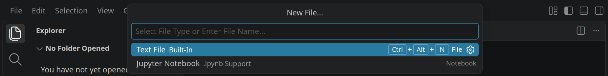

Schreibe nun diesen Code in die neue Datei:

```html
<!DOCTYPE html>
<html lang="de">
<head>
    <meta charset="UTF-8">
    <meta name="viewport" content="width=device-width, initial-scale=1">
    <title>Axolotl</title>
</head>
<body>
    <main>
        <h1>Axolotl</h1>

        <p>
            Axolotl sind Salamander, die normalerweise ihr ganzes Leben
            im Wasser verbringen.
        </p>
    </main>
</body>
</html>
```

Drücke <kbd>Strg</kbd><kbd>S</kbd>, um die Datei zu speichern. Gib als Dateinamen `website-test/index.html` ein. Der vollständige Pfad lautet dann `/workspace/website-test/index.html`.

<!-- tutorial-screenshot
# Zwei Zeilen genügen für den Hintergrund; den ganzen Code schreibt das
# Rezept nach dem Öffnen des Ordners in die Datei.
press: Enter
sleep: 1
type: <!DOCTYPE html>
press: Enter
type: <html lang="de">
press: Control+s
wait-for-text: Save As
press: Control+a
type: /workspace/website-test/index.html
sleep: 1
crop-bottom: 77%
-->

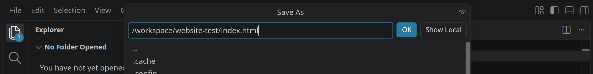

Da das Unterverzeichnis `website-test` noch nicht existiert, wirst du gefragt, ob es erstellt werden soll. Bestätige mit <kbd>Enter</kbd>.

<!-- tutorial-screenshot
press: Enter
wait-for-text: Would you like to create it?
sleep: 0.5
crop-bottom: 77%
-->

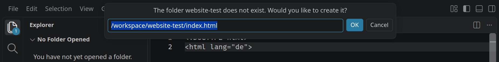

Öffne jetzt dieses Verzeichnis. Wähle dazu im Menü »File« / »Open Folder…« oder drücke <kbd>Strg</kbd><kbd>K</kbd> und dann <kbd>Strg</kbd><kbd>O</kbd>. Wähle den Ordner `website-test` aus:

<!-- tutorial-screenshot
press: Enter
wait-for-file: website-test/index.html
sleep: 1
press: Control+k
press: Control+o
wait-for-text: Open Folder
press: Control+a
type: /workspace/website-test/
sleep: 0.5
crop-bottom: 77%
-->

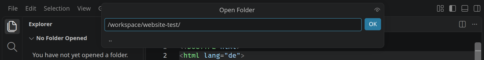

Nachdem das Verzeichnis geöffnet wurde, siehst du links im Explorer deine Datei `index.html`. Klicke darauf, um sie wieder zu öffnen.

<!-- tutorial-screenshot
press: Enter
# VS Code 1.140 writes the folder name in the Explorer in lower case; the
# pause lets the window reload first, as index.html (with website-test in
# its breadcrumbs) is already open.
sleep: 2
wait-for-text: website-test
write-file: website-test/index.html <- previous-code
open-file: index.html
close-tab: Welcome
sleep: 1
-->

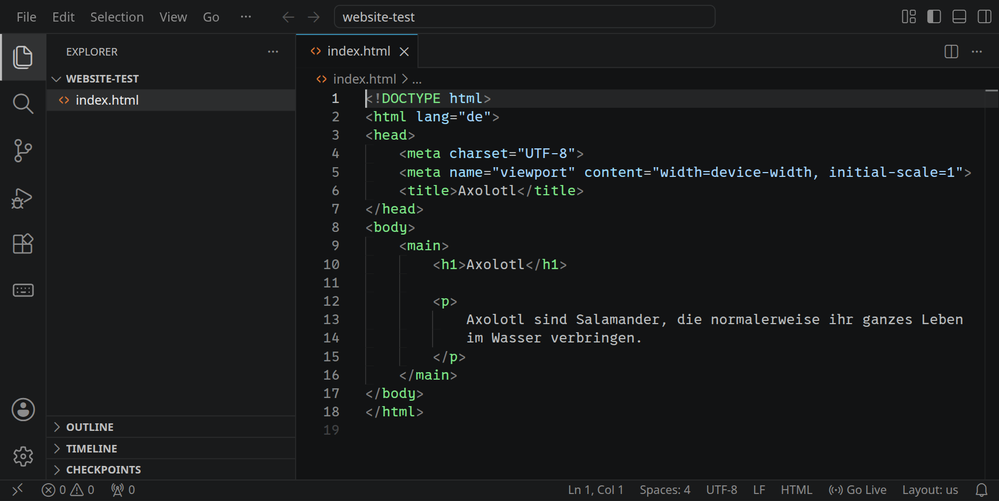

_task(index)

### Vorschau starten


Unten rechts im Fenster findest du »Go Live«. Klicke darauf. In einem neuen Browsertab öffnet sich deine Webseite.

Du solltest jetzt schon die Überschrift »Axolotl« und einen kurzen Text sehen. Mehr ist noch nicht passiert – aber du hast gerade deine erste eigene HTML-Seite im Browser geöffnet.

<div style='clear: both;'></div>

<!-- tutorial-screenshot
# Die Vorschau der Seite; die folgenden Bilder zeigen die Stände aus
# lehrkraft/, Schritt für Schritt
go-live
tab: preview
viewport: 720x405
-->

<button class='tutorial-preview' type='button'>
    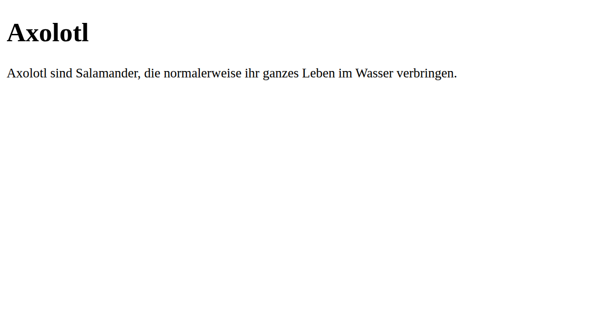
</button>

<div class='hint'>
Tipp: Ziehe den Workspace und die Vorschau nebeneinander. Dann kannst du in <code>index.html</code> etwas ändern, mit <kbd>Strg</kbd><kbd>S</kbd> speichern und sofort sehen, was im Browser passiert.
</div>

<div class='hint melting'>
Falls sich die Vorschau einmal nicht automatisch aktualisiert, lade sie mit <kbd>Strg</kbd><kbd>R</kbd> oder <kbd>F5</kbd> neu.
</div>

_task(live)

## Inhalt mit HTML

Schau dir den Code noch einmal an. Was die einzelnen Teile bedeuten, steht im Handbuch:

_include(html#tags)

_include(html#grundgeruest)

### Dein eigenes Thema

Bevor wir weitermachen, ändere den Inhalt. Wenn du keine Axolotl-Seite bauen möchtest, ersetze jetzt:

- den Text im `<title>`-Tag,
- die Überschrift im `<h1>`-Tag,
- und den ersten Absatz.

Speichere die Datei und schau dir die Änderung in der Vorschau an.

<div class='hint task'>
Such dir spätestens jetzt ein eigenes Thema für deine Seite aus. Du kannst die folgenden Beispiele weiter mit Axolotl ausprobieren und den Inhalt später ersetzen – oder du schreibst ab jetzt direkt über dein eigenes Thema.
</div>

### Eine Liste hinzufügen

<!-- tutorial-screenshot
write-file: website-test/index.html <- file:lehrkraft/2-liste.html
preview-reload
tab: preview
viewport: 720x405
-->

<button class='tutorial-preview' type='button'>
    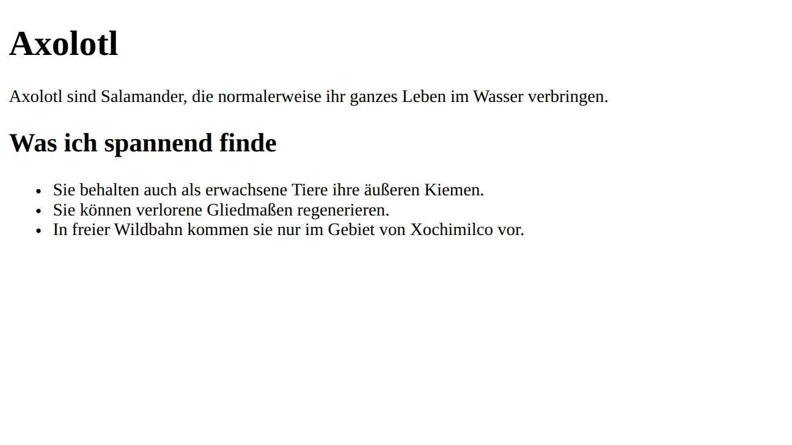
</button>

Auf unserer Beispielseite wollen wir drei Punkte sammeln, die an Axolotl interessant sind. Füge unter dem ersten Absatz Folgendes ein:

```html
~             Axolotl sind Salamander, die normalerweise ihr ganzes Leben
~             im Wasser verbringen.
~         </p>
~
        <h2>Was ich spannend finde</h2>

        <ul>
            <li>Sie behalten auch als erwachsene Tiere ihre äußeren Kiemen.</li>
            <li>Sie können verlorene Gliedmaßen regenerieren.</li>
            <li>In freier Wildbahn kommen sie nur im Gebiet von Xochimilco vor.</li>
        </ul>
~     </main>
~ </body>
~ </html>
```

_include(html#listen)

<div class='hint task'>
Schreibe drei eigene Punkte über dein Thema. Es ist deine Seite – die Beispieltexte sind nur Platzhalter.
</div>

_task(liste)

### Einen Link einfügen

Das **H** in HTML steht für **Hypertext**. Eine der wichtigsten Ideen des World Wide Web ist, dass Dokumente miteinander verlinkt werden können.

Füge unter der Liste einen Link ein:

<div class='tutorial-preview-clear'></div>

<!-- tutorial-screenshot
write-file: website-test/index.html <- file:lehrkraft/3-link.html
preview-reload
tab: preview
viewport: 720x405
-->

<button class='tutorial-preview' type='button'>
    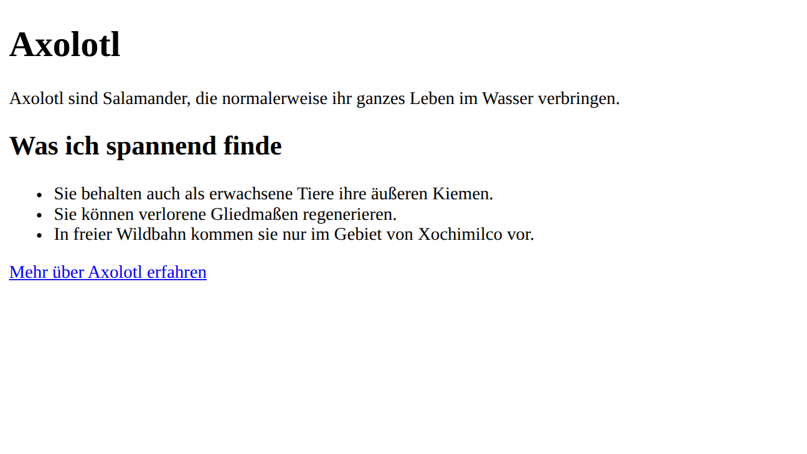
</button>

```html
~             <li>Sie können verlorene Gliedmaßen regenerieren.</li>
~             <li>In freier Wildbahn kommen sie nur im Gebiet von Xochimilco vor.</li>
~         </ul>
~
        <p>
            <a href="https://de.wikipedia.org/wiki/Axolotl">Mehr über Axolotl erfahren</a>
        </p>
~     </main>
~ </body>
~ </html>
```

Bei deinem eigenen Thema verlinkst du natürlich auf eine andere Seite.

_include(html#links)

_task(link)

### Ein Bild einfügen

Für den ersten Versuch verwenden wir ein frei lizenziertes Axolotl-Foto von Wikimedia Commons, damit du noch keine Bilddatei in den Workspace übertragen musst.

Füge das Bild **vor** der Überschrift ein:

<div class='tutorial-preview-clear'></div>

<!-- tutorial-screenshot
write-file: website-test/index.html <- file:lehrkraft/4-bild.html
preview-reload
tab: preview
viewport: 720x405
-->

<button class='tutorial-preview' type='button'>
    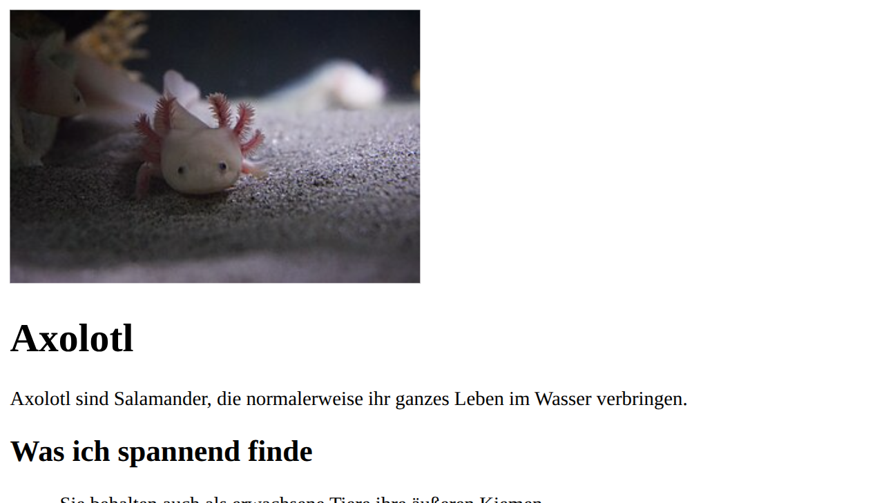
</button>

```html
~ </head>
~ <body>
~     <main>
        
~
~         <h1>Axolotl</h1>
~
~         <p>
~             Axolotl sind Salamander, die normalerweise ihr ganzes Leben
```

Hier steht in `src` statt eines Dateinamens die Adresse eines Bildes im Internet. Wie `` funktioniert und was in den Alt-Text gehört:

_include(html#img)

Das Foto stammt von **Lorenzo Tarocchi** und steht auf Wikimedia Commons unter der Lizenz **CC BY-SA 4.0**. Füge außerdem am Ende deines `<main>`-Bereichs einen Bildnachweis ein:

<!-- tutorial-screenshot
write-file: website-test/index.html <- file:lehrkraft/5-bildnachweis.html
preview-reload
tab: preview
viewport: 720x405
-->

<button class='tutorial-preview' type='button'>
    
</button>

```html
~         <p>
~             <a href="https://de.wikipedia.org/wiki/Axolotl">Mehr über Axolotl erfahren</a>
~         </p>
~
        <p class="credit">
            Foto:
            <a href="https://commons.wikimedia.org/wiki/File:Ambystoma_mexicanum_Natural_History_Museum_University_of_Pisa_2.jpg">
                Lorenzo Tarocchi / Wikimedia Commons
            </a>,
            <a href="https://creativecommons.org/licenses/by-sa/4.0/">CC BY-SA 4.0</a>
        </p>
~     </main>
~ </body>
~ </html>
```

Wikimedia Commons erlaubt, seine Bilder so direkt einzubinden, aber die Lizenz gilt trotzdem: Wer das Bild gemacht hat und unter welcher Lizenz es steht, gehört auf die Seite.

<div class='tutorial-preview-clear'></div>

_task(alt-text)

<div class='hint try'>
<strong>Ausprobieren:</strong> Ändere in der Adresse in <code>src</code> einen Buchstaben, etwa am Ende <code>.jpg</code> zu <code>.jpq</code>, und speichere. Was zeigt der Browser jetzt dort, wo das Bild war? Wer bekommt den Alt-Text sonst noch zu sehen, auch wenn das Bild lädt? Stell die Adresse danach wieder her.
</div>

### Ein eigenes Bild verwenden

Bis jetzt kommt das Axolotl-Foto direkt von Wikimedia Commons. Spannender wird deine Webseite natürlich mit einem eigenen Bild. Das ist im browserbasierten Workspace etwas ungewohnt: Die Datei liegt zunächst auf **deinem Computer oder im Browser**, dein Projekt liegt aber im **Workspace**. Die Bilddatei muss also erst in den Explorer von VS Code gelangen.

Lege die Bilddatei **neben `index.html`**:

_include(html#bilddateien)

#### Von der URL zum Dateinamen

Sobald die Bilddatei neben `index.html` liegt, brauchst du nicht mehr die lange Internetadresse. Angenommen, deine Datei heißt `mein-bild.jpg`. Dann änderst du:

```html

```

zu:

```html

```

`mein-bild.jpg` ist ein **relativer Pfad**: Der Browser sucht die Datei neben `index.html`, deshalb reicht der Dateiname. Erscheint das Bild nicht, prüfe den Pfad so, wie es oben unter »Der Pfad muss genau stimmen« steht.

<div class='hint task'>
Wenn du ein eigenes Bild hast, ersetze jetzt das Axolotl-Foto. Passe auch den Alt-Text an. Wenn du das Bild selbst fotografiert oder gezeichnet hast, brauchst du den Bildnachweis aus unserem Beispiel natürlich nicht mehr.
</div>

_task(eigenes-bild)

_task(bilddatei)

## Aussehen mit CSS

Bis jetzt haben wir mit HTML beschrieben, **was** auf der Seite steht. Der Browser entscheidet noch weitgehend selbst, wie Überschriften, Listen und Links aussehen. Dafür gibt es CSS: **Cascading Style Sheets**. Mit CSS legst du Farben, Schriftarten, Größen, Abstände und das Layout fest. Wir schreiben das CSS in eine eigene Datei, damit Inhalt und Gestaltung getrennt bleiben.

_person(wium-lie)

### CSS-Datei erstellen

Erstelle im Explorer neben `index.html` eine neue Datei namens `styles.css`.

Damit der Browser diese Datei verwendet, fügst du im `<head>` von `index.html` diese Zeile ein:

```html
~     <meta charset="UTF-8">
~     <meta name="viewport" content="width=device-width, initial-scale=1">
~     <title>Axolotl</title>
    <link rel="stylesheet" href="styles.css">
~ </head>
~ <body>
~     <main>
```

Der `<head>` sollte jetzt so aussehen:

```html
<head>
    <meta charset="UTF-8">
    <meta name="viewport" content="width=device-width, initial-scale=1">
    <title>Axolotl</title>
    <link rel="stylesheet" href="styles.css">
</head>
```

Schreibe nun in `styles.css`:

```css
body {
    margin: 0;
    background: #351c2b;
    color: #fff2f6;
    font-family: system-ui, sans-serif;
}

main {
    max-width: 900px;
    margin: 0 auto;
    padding: 2rem;
}

a {
    color: #ff9fbd;
}

img {
    display: block;
    max-width: 100%;
    border-radius: 1rem;
}

.credit {
    font-size: 0.8rem;
    opacity: 0.75;
}
```

Speichere die Datei. Die Änderung sollte sofort deutlich zu sehen sein: dunkler Hintergrund, helle Schrift, eine andere Linkfarbe und ein Bild mit abgerundeten Ecken.

_task(css)

<!-- tutorial-screenshot
write-file: website-test/styles.css <- file:lehrkraft/6-styles.css
write-file: website-test/index.html <- file:lehrkraft/6-css.html
preview-reload
tab: preview
viewport: 720x405
-->

<button class='tutorial-preview' type='button'>
    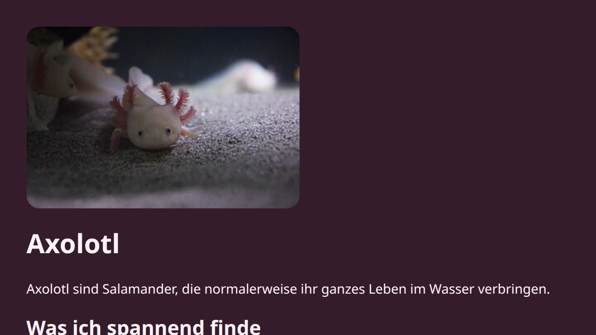
</button>

### Wie eine CSS-Regel funktioniert

_include(css#regeln)

_task(selektor)

Dein Bildnachweis hat die Klasse `credit` bekommen (`<p class="credit">`); die Regel `.credit` gilt deshalb nur für ihn.

<div class='hint try'>
<strong>Ausprobieren:</strong> Bau absichtlich Fehler ein, einen nach dem anderen, und speichere jedes Mal:
<ul>
<li>Schreib in der Regel für <code>body</code> <code>colr</code> statt <code>color</code>.</li>
<li>Ändere in <code>index.html</code> im <code>&lt;link&gt;</code> <code>href="styles.css"</code> zu <code>href="style.css"</code>.</li>
</ul>
Was ändert sich in der Vorschau? Meldet der Browser einen Fehler, und woran könntest du merken, was los ist? Stell danach beides wieder her.
</div>

Mehr zum Gestalten: _uses(selektoren, farben, schrift, abstaende, wirkt-nicht)

<div class='tutorial-preview-clear'></div>

### Layout mit Flexbox

Unsere Seite sieht jetzt schon absichtlicher gestaltet aus, aber Bild und Text stehen immer noch untereinander. Auf einem breiten Bildschirm wäre es schön, wenn das Bild links und der Text rechts stehen würden. Dafür verwenden wir **Flexbox**.

Zuerst müssen Bild und Text zwei getrennte Bereiche innerhalb von `<main>` sein. Packe deshalb den gesamten Text – von `<h1>` bis zum Bildnachweis – in ein `<section>`-Element. Der relevante Teil deiner HTML-Datei sieht dann ungefähr so aus:

```html
<main>
    

    <section>
        <h1>Axolotl</h1>

        <p>
            Axolotl sind Salamander, die normalerweise ihr ganzes Leben
            im Wasser verbringen.
        </p>

        <h2>Was ich spannend finde</h2>

        <ul>
            <li>Sie behalten auch als erwachsene Tiere ihre äußeren Kiemen.</li>
            <li>Sie können verlorene Gliedmaßen regenerieren.</li>
            <li>In freier Wildbahn kommen sie nur im Gebiet von Xochimilco vor.</li>
        </ul>

        <p>
            <a href="https://de.wikipedia.org/wiki/Axolotl">Mehr über Axolotl erfahren</a>
        </p>

        <p class="credit">
            Foto:
            <a href="https://commons.wikimedia.org/wiki/File:Ambystoma_mexicanum_Natural_History_Museum_University_of_Pisa_2.jpg">
                Lorenzo Tarocchi / Wikimedia Commons
            </a>,
            <a href="https://creativecommons.org/licenses/by-sa/4.0/">CC BY-SA 4.0</a>
        </p>
    </section>
</main>
```

Wenn du dein eigenes Thema und Bild verwendest, behältst du natürlich **deine** Texte und deinen Bildnamen. Es geht nur darum, dass das Bild und der Text zwei direkte Kinder von `<main>` werden.

Ergänze nun die vorhandene `main`-Regel in `styles.css`:

```css
~ main {
~     max-width: 900px;
~     margin: 0 auto;
~     padding: 2rem;

    display: flex;
    gap: 2rem;
    align-items: center;
~ }
```

Und füge darunter hinzu:

```css
~     font-size: 0.8rem;
~     opacity: 0.75;
~ }
~
main > img {
    width: 45%;
}

section {
    flex: 1;
}
```

Speichere die Datei. Auf einem breiten Fenster sollten Bild und Text jetzt nebeneinander stehen.

<!-- tutorial-screenshot
write-file: website-test/styles.css <- file:lehrkraft/7-styles.css
write-file: website-test/index.html <- file:lehrkraft/7-flexbox.html
preview-reload
tab: preview
viewport: 720x405
-->

<button class='tutorial-preview' type='button'>
    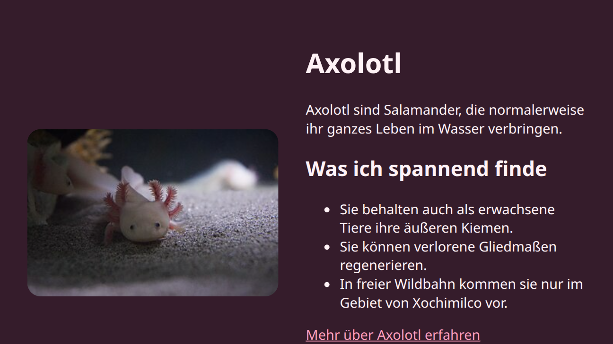
</button>

Was `display: flex`, `gap`, `align-items` und `flex: 1` bewirken:

_include(layout#flexbox)

_task(flexbox)

_task(breite)

<div class='hint try'>
<strong>Ausprobieren:</strong> Ändere bei <code>main &gt; img</code> die Breite auf <code>30%</code> und bei <code>main</code> den Abstand auf <code>gap: 6rem;</code>. Wer gibt den Platz für den größeren Abstand her, das Bild oder der Text, und warum? Behalte danach die Werte, die zu deiner Seite passen.
</div>

<div class='tutorial-preview-clear'></div>

### Auf kleinen Bildschirmen

Ziehe dein Browserfenster jetzt schmaler. Irgendwann wird die Seite unangenehm, weil Bild und Text sich zu wenig Platz teilen. Webseiten werden auf sehr unterschiedlichen Geräten geöffnet, deshalb sollte sich das Layout an die verfügbare Breite anpassen.

Die Zeile

```html
<meta name="viewport" content="width=device-width, initial-scale=1">
```

steht schon seit dem Anfang in unserem `<head>`. Sie sagt mobilen Browsern, dass die Seite in der tatsächlichen Gerätebreite dargestellt werden soll.

Jetzt ergänzen wir am Ende von `styles.css` eine **Media Query**:

```css
~ section {
~     flex: 1;
~ }
~
@media (max-width: 700px) {
    main {
        flex-direction: column;
        padding: 1rem;
    }

    main > img {
        width: 100%;
    }
}
```

_task(kleine-bildschirme)

_task(media-query)

Hier siehst du einen Vergleich vorher / nachher:

<div class='gallery columns-2 portrait'>
    <figure>
<!-- tutorial-screenshot
# dieselbe Seite in einem Fenster, so schmal wie ein Handy
tab: preview
viewport: 390x760
-->
        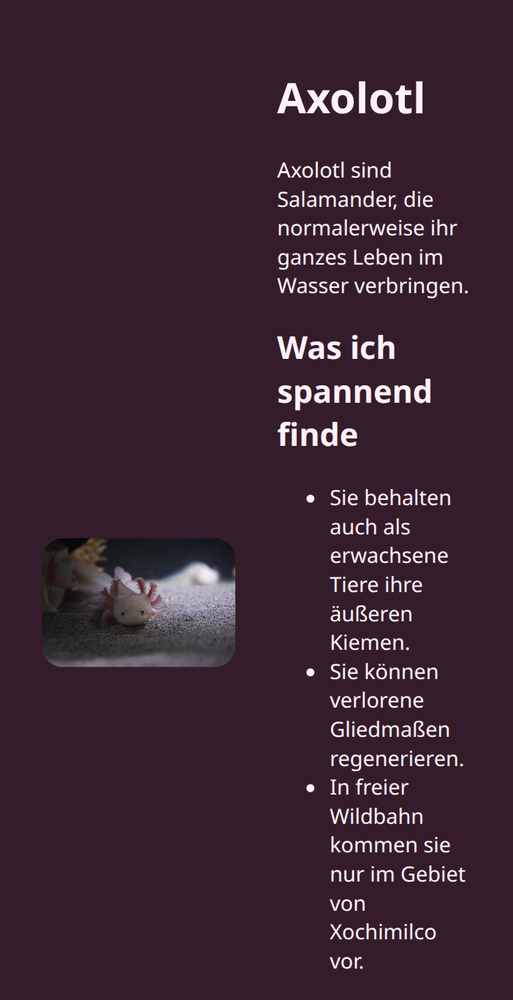
        <figcaption>
            <strong>Vorher:</strong> Das Flexbox-Layout wird zu schmal.
        </figcaption>
    </figure>

    <figure>
<!-- tutorial-screenshot
write-file: website-test/styles.css <- file:lehrkraft/8-styles.css
preview-reload
tab: preview
viewport: 390x760
-->
        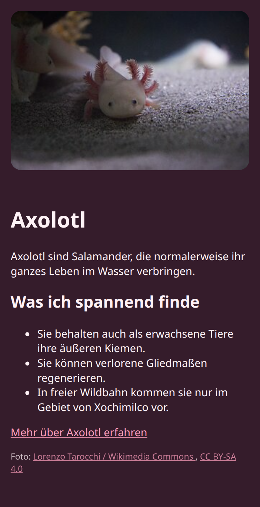
        <figcaption>
            <strong>Nachher:</strong> Die Media Query ordnet alles untereinander an.
        </figcaption>
    </figure>
</div>

Die Regeln innerhalb der Media Query gelten nur, wenn das Browserfenster höchstens 700 Pixel breit ist.

`flex-direction: column` sorgt dann dafür, dass Bild und Text wieder untereinander stehen. Das Bild bekommt mit `width: 100%` die gesamte verfügbare Breite.

Mach dein Browserfenster langsam breiter und schmaler. Du solltest genau sehen können, wann das Layout zwischen den beiden Varianten wechselt.

Im Handbuch: _uses(kleine-bildschirme, spalten, platzieren)

<div class='hint task'>
Ändere testweise die Grenze von <code>700px</code> auf <code>500px</code> oder <code>900px</code>. Welche Einstellung passt zu deiner Seite am besten?
</div>

## Mach die Seite zu deiner

Der technische Teil ist geschafft. Jetzt sollte die Seite nicht mehr wie unser Beispiel aussehen, sondern wirklich zu deinem Thema passen. Verändere dafür mindestens einige dieser Punkte:

- eigenes Thema und eigene Texte
- eigenes Bild und passender Alt-Text
- Überschrift und Seitentitel
- Hintergrund- und Textfarbe
- Linkfarbe
- Breite des Bildes
- Abstand zwischen Bild und Text
- Stärke der abgerundeten Ecken

Du kannst zum Beispiel noch diese CSS-Regel ausprobieren:

```css
h1 {
    font-size: 3rem;
    margin-top: 0;
}
```

Oder Links verändern, wenn der Mauszeiger darüber steht:

```css
a:hover {
    text-decoration: none;
}
```

<div class='hint think'>
Wenn du beim Ausprobieren etwas kaputtmachst, ist das kein Problem. Mit <kbd>Strg</kbd><kbd>Z</kbd> kannst du Änderungen rückgängig machen. Am meisten lernst du hier, wenn du Werte veränderst und beobachtest, was passiert.
</div>

_task(abgabe)

## Deine Seite veröffentlichen

Bis jetzt läuft die Seite nur über »Go Live« in deinem eigenen Workspace. Eine statische Webseite besteht aber nur aus Dateien wie HTML, CSS und Bildern und lässt sich deshalb sehr einfach auf einen Webserver kopieren. Im Workspace kannst du deine Seite kostenlos unter einer Hackschule-Subdomain veröffentlichen; wie das funktioniert, steht in der [Anleitung zum eigenen Webspace](/custom-subdomain).

Die Website ist dann öffentlich und nicht nur für angemeldete Workspace-Nutzer sichtbar. Gib bitte vorher die unterschriebene [Nutzungsvereinbarung](/datenschutz/webhosting) bei deiner Lehrkraft ab; wenn du noch minderjährig bist, unterschreibt auch eine erziehungsberechtigte Person.

Achte beim Veröffentlichen darauf, dass **alle Dateien deines Projekts** mitkommen, die deine Seite benötigt – also zum Beispiel:

```text
index.html
styles.css
mein-bild.jpg
```

Wenn du weiterhin das Wikimedia-Bild per URL einbindest, liegt diese Datei natürlich nicht in deinem Projekt. Dann braucht die veröffentlichte Seite eine Internetverbindung zu Wikimedia, um das Bild zu laden.

_include(workspace#live-apps)

Eine statische Seite hält lange, weil sie nur aus Dateien besteht. Die Website zum Film *Space Jam* ging 1996 online, mit vielen animierten GIFs, und blieb 25 Jahre lang unverändert erreichbar. Als 2021 der zweite Film kam, bekam die Adresse eine neue Seite, und die von 1996 steht noch immer daneben: [spacejam.com/1996](https://www.spacejam.com/1996/).

## Weiter ausprobieren

Deine erste Webseite braucht nicht mehr als HTML und CSS. Genau das ist eine Stärke des Webs: Eine Datei `index.html` und eine Datei `styles.css` reichen schon für eine richtige Webseite. Wenn dein Projekt größer wird, gibt es aber Werkzeuge, die dir Arbeit abnehmen können. Einige davon sind im Workspace bereits installiert oder lassen sich direkt dort verwenden.

### Mehr HTML und CSS

Bevor du ein neues Werkzeug ausprobierst, kannst du deine Seite auch einfach mit dem weiterbauen, was du schon kennst:

- Erstelle eine zweite Datei `zweite-seite.html` und verlinke sie mit `<a href="zweite-seite.html">...</a>`.
- Probiere weitere HTML-Tags aus, zum Beispiel Tabellen, Zitate oder Formulare.
- Informiere dich über **CSS Grid**, wenn du mehrere Bereiche in Zeilen und Spalten anordnen möchtest.
- Lade eine eigene Schriftart herunter und binde sie lokal ein.
- Probiere weitere Selektoren, Farben, Abstände und Layouts aus.

### CSS-Frameworks

Du musst nicht jede CSS-Regel selbst schreiben. **CSS-Frameworks** stellen fertige Regeln und Bausteine für typische Webseiten bereit, zum Beispiel für Layouts, Buttons, Navigationen oder Formulare. Bekannte Frameworks sind zum Beispiel:

- [Bootstrap](https://getbootstrap.com/)
- [Bulma](https://bulma.io/)
- [Tailwind CSS](https://tailwindcss.com/)

Weil du Farben, Abstände und ein responsives Layout vorher selbst mit CSS gebaut hast, kannst du jetzt auch besser einschätzen, was ein solches Framework für dich übernimmt.

<div class='hint think'>
Ein Framework ist kein notwendiger Bestandteil einer Webseite. Verwende es, wenn es dir Arbeit abnimmt – nicht nur, weil moderne Webseiten angeblich eines brauchen.
</div>

Viele Frameworks lassen sich entweder direkt über ein `<link>`-Tag einbinden oder mit einem Paketmanager wie `npm` in ein Projekt installieren.

### Pakete mit npm installieren

Im Workspace sind **Node.js** und der Paketmanager **npm** bereits installiert. Öffne ein Terminal mit <kbd>Strg</kbd><kbd>J</kbd> und probiere aus:

```bash
node --version
npm --version
```

Mit npm kannst du JavaScript-Bibliotheken, CSS-Frameworks und Entwicklungswerkzeuge aus dem Internet in ein Projekt holen. Wenn du in einem neuen Projekt

```bash
npm init -y
```

aufrufst, legt npm eine Datei namens `package.json` an. Darin kann ein Projekt festhalten, welche Pakete es benötigt und welche Befehle dazugehören.

<div class='hint'>
Für die Webseite aus diesem Tutorial brauchst du npm nicht. Es ist nur der nächste Schritt, wenn du mit größeren Webprojekten experimentieren möchtest.
</div>

Viele moderne Werkzeuge bauen auf diesem Prinzip auf. Im [Svelte-Tutorial](/svelte) verwendest du npm, um aus HTML, CSS und JavaScript eine interaktive Webanwendung zu bauen.

### Größere statische Seiten mit Hugo

Eine einzelne HTML-Seite lässt sich gut von Hand schreiben. Stell dir aber eine Webseite mit 50 Artikeln vor, auf denen immer dieselbe Navigation, derselbe Kopfbereich und derselbe Footer stehen sollen. Dafür gibt es **Static Site Generators**: Sie erzeugen aus Vorlagen und Inhalten automatisch fertige HTML-Dateien.

Im Workspace ist [Hugo](https://gohugo.io/) bereits installiert. Im Terminal kannst du das überprüfen:

```bash
hugo version
```

Ein neues Hugo-Projekt kannst du zum Beispiel so anlegen:

```bash
hugo new site meine-seite
```

Hugo legt dann die Grundstruktur einer neuen Webseite an. Inhalte können zum Beispiel in Markdown geschrieben werden, während Vorlagen bestimmen, wie die fertigen HTML-Seiten aussehen. Auf diese Weise musst du wiederkehrende Teile nicht in jeder einzelnen HTML-Datei von Hand pflegen.

<div class='hint think'>
Hugo ersetzt HTML und CSS nicht. Am Ende erzeugt Hugo genau daraus wieder statische Webseiten. Es hilft dir vor allem dabei, viele Seiten und wiederkehrende Bestandteile zu organisieren.
</div>

Wie das geht, zeigt die Aktivität [Eine Website mit Hugo](/hugo): Dort entsteht ein kleines Lexikon über die Planeten mit mehreren Seiten, einer Navigation und Schlagwörtern.

### Und JavaScript?

Mit HTML und CSS kann eine Webseite schon sehr viel darstellen und gestalten. Wenn sie aber auf Eingaben reagieren, etwas berechnen oder ihren Inhalt während der Benutzung verändern soll, kommt meistens **JavaScript** dazu. Dafür brauchst du nicht sofort ein Framework: Eine kleine JavaScript-Datei lässt sich genauso direkt in eine Webseite einbinden wie unsere CSS-Datei. Wenn du später sehen möchtest, wie ein modernes Webprojekt mit Komponenten, Zuständen und Entwicklungswerkzeugen funktioniert, ist das [Svelte-Tutorial](/svelte) ein guter nächster Schritt.

Auch bei größeren Projekten bleibt die Grundlage dieselbe, die du in diesem Tutorial benutzt hast:

- **HTML** beschreibt Inhalt und Struktur.
- **CSS** beschreibt Aussehen und Layout.
- **JavaScript** kann Verhalten und Interaktivität hinzufügen.
- Werkzeuge wie **npm**, **CSS-Frameworks** oder **Hugo** helfen dir bei größeren Projekten – sie sind aber keine Voraussetzung dafür, eine Webseite zu bauen.