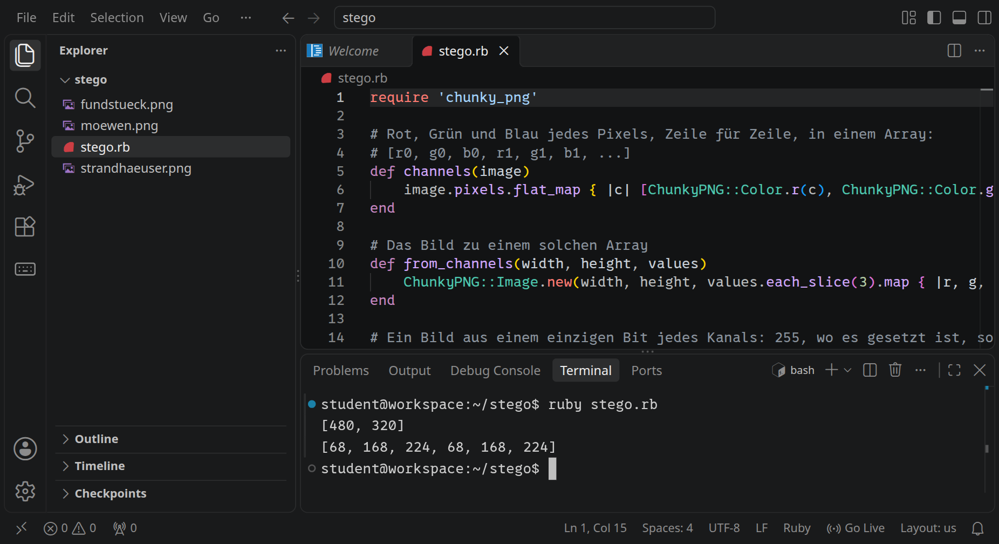
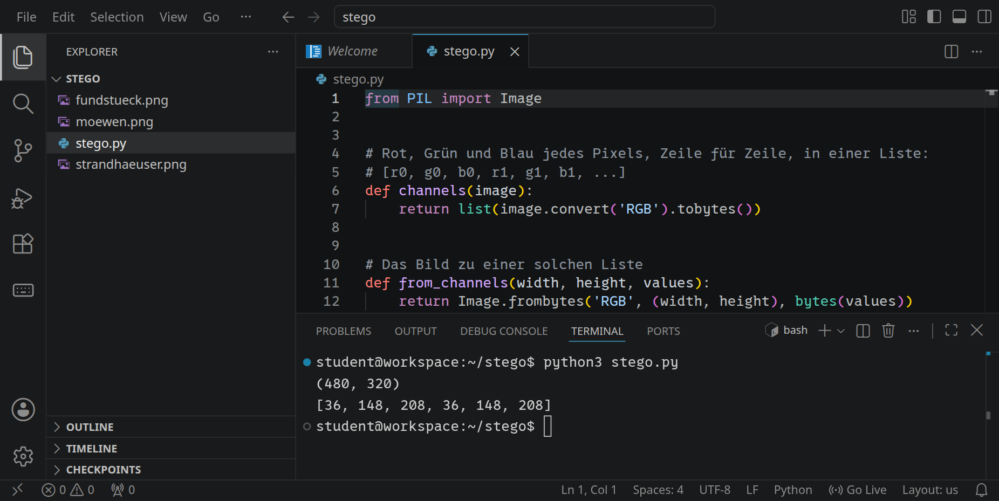
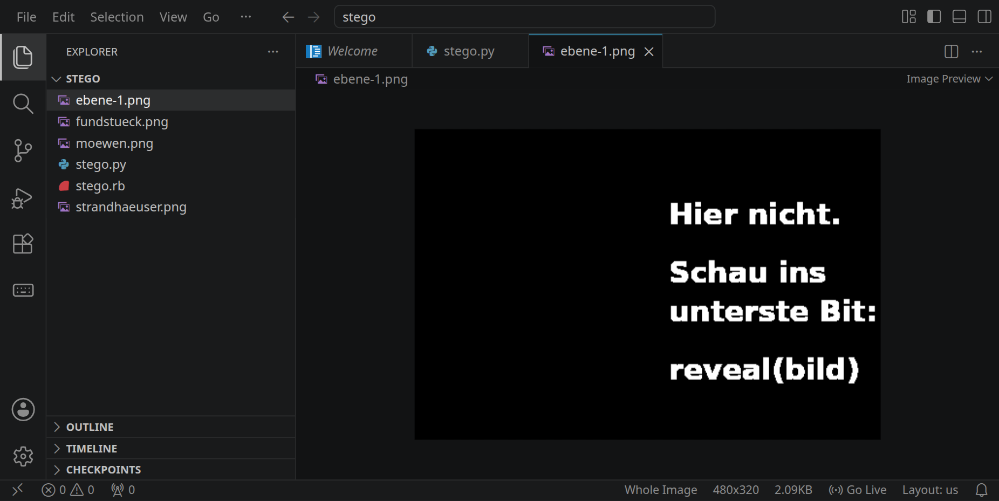
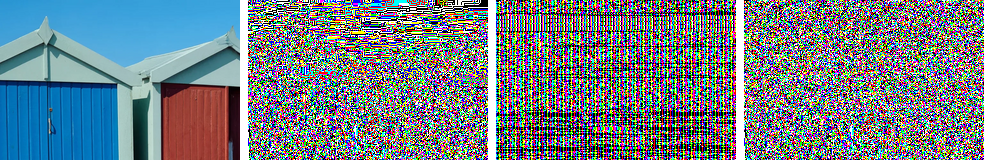
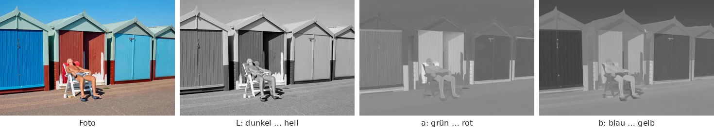
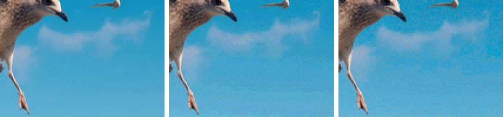

<div class='meta'>
image: teaser.webp
kind: projekt
language: Ruby / Python
languages: [ruby, python]
duration: 3 Doppelstunden
requires: [crypto]
reference: [farbraeume]
</div>

<script src="/include/color_classes.js"></script>

<div
    class="autotoc-secondary-trigger"
    data-title="Auf dieser Seite"
    data-levels="h2,h3">
</div>

# Geheime Botschaften in Bildern

<p class='abstract'>
Verschlüsselung macht eine Nachricht unlesbar, aber jeder sieht, dass es sie gibt. Steganographie versteckt die Nachricht selbst: in einem Foto, das aussieht wie jedes andere. Du liest ein Bild als Liste von Zahlen, versteckst Text in den untersten Bits, findest heraus, wie man so etwas entdeckt, und baust zum Schluss ein Verfahren, das mit Farbklassen und einer Zahl mit wechselnder Basis mehr versteckt, als das Auge je merkt.
</p>

## Verstecken statt verschlüsseln

In [Kryptographie im Terminal](/crypto) hast du Nachrichten verschlüsselt. Wer die verschlüsselte Datei abfängt, kann sie nicht lesen, aber er weiß, dass da etwas Geheimes ist. Manchmal ist schon das zu viel.

**Steganographie** (griechisch für »verdecktes Schreiben«) versteckt, *dass* es eine Nachricht gibt. Früher war das unsichtbare Tinte oder ein winziger Mikropunkt auf einem Brief. Heute ist es oft ein Bild: Ein Foto hat Hunderttausende Pixel, und an jedem kann man ein wenig ändern, ohne dass es jemand sieht. Die Kunst ist, genau so wenig zu ändern, dass niemand Verdacht schöpft, weder ein Mensch noch ein Programm, das danach sucht.

Beides lässt sich kombinieren: erst verschlüsseln, dann verstecken. Dann muss jemand die Nachricht erst finden und kann sie danach noch immer nicht lesen.

## Einrichten

Lege einen Ordner an und öffne ihn mit <kbd>Strg</kbd><kbd>K</kbd> <kbd>Strg</kbd><kbd>O</kbd>:

```bash
mkdir /workspace/stego
```

Hol dir die Bilder dieser Seite: zwei Fotos und ein Fundstück, in dem schon etwas versteckt ist.

```bash_copy
wget ${web_root}/steganography/fundstueck.png
wget ${web_root}/steganography/strandhaeuser.png
wget ${web_root}/steganography/moewen.png
```

<p class='expl'>Die Fotos der Strandhäuser und der Möwen mit freundlicher Genehmigung von Ian Kobylanski · <a href='https://koby.photography/' target='_blank'>https://koby.photography/</a></p>

PNG-Dateien sind komprimiert, aber ohne Verlust: Jedes Pixel kommt genau so wieder heraus, wie es hineingesteckt wurde. Das ist wichtig, denn eine versteckte Botschaft lebt in den kleinsten Unterschieden. Ein JPEG würde sie beim Speichern zerstören. Das Lesen und Schreiben übernimmt eine Bibliothek:

<!-- language: ruby -->
```bash
gem install chunky_png
```

**ChunkyPNG** liest und schreibt PNG-Dateien in Ruby. `ChunkyPNG::Image.from_file('fundstueck.png')` liest ein Bild, `image.save('neu.png')` schreibt es.
<!-- /language -->
<!-- language: python -->
```bash
pip install pillow
```

**Pillow** liest und schreibt Bilder in Python. `Image.open('fundstueck.png')` liest ein Bild, `image.save('neu.png')` schreibt es.
<!-- /language -->

## Ein Bild ist eine Liste von Zahlen

Jedes Pixel hat drei Kanäle, Rot, Grün und Blau, jeder eine Zahl von 0 bis 255. Ein Bild mit 480 × 320 Pixeln ist also nichts anderes als 480 · 320 · 3 = 460.800 Zahlen. Das Gerüst unten holt sie in eine einzige Liste, Zeile für Zeile, und macht aus so einer Liste wieder ein Bild.

<!-- language: ruby -->
Lege die Datei `stego.rb` an:

```ruby_copy
require 'chunky_png'

# Rot, Grün und Blau jedes Pixels, Zeile für Zeile, in einem Array:
# [r0, g0, b0, r1, g1, b1, ...]
def channels(image)
    image.pixels.flat_map { |c| [ChunkyPNG::Color.r(c), ChunkyPNG::Color.g(c), ChunkyPNG::Color.b(c)] }
end

# Das Bild zu einem solchen Array
def from_channels(width, height, values)
    ChunkyPNG::Image.new(width, height, values.each_slice(3).map { |r, g, b| ChunkyPNG::Color.rgb(r, g, b) })
end

# Ein Bild aus einem einzigen Bit jedes Kanals: 255, wo es gesetzt ist, sonst 0
def bit_plane(image, bit = 0)
end

if __FILE__ == $0
    image = ChunkyPNG::Image.from_file('fundstueck.png')
    p [image.width, image.height]
    p channels(image)[0, 6]
end
```

Starte es mit `ruby stego.rb`.

<!-- tutorial-screenshot
# Ordner stego mit dem Gerüst und den Bildern, ChunkyPNG installiert
write-file: stego/stego.rb <- file:stufen/start.rb
write-file: stego/fundstueck.png <- file:beispiele/fundstueck.png
write-file: stego/strandhaeuser.png <- file:beispiele/strandhaeuser.png
write-file: stego/moewen.png <- file:beispiele/moewen.png
press: Control+K
press: Control+O
wait-for-input-value: /workspace/
type: stego
press: Enter
wait-for-input-value: /workspace/stego/
press: Enter
wait-for-text: stego.rb
open-file: stego.rb
terminal-open
terminal-run: gem install chunky_png
terminal-wait-for-prompt: 120
terminal-run: clear
terminal-run: ruby stego.rb
terminal-wait-for-prompt
terminal-expect-no-text: Error
move-mouse: selector:.terminal
sleep: 1
-->

<!-- /language -->
<!-- language: python -->
Lege die Datei `stego.py` an:

```python_copy
from PIL import Image


# Rot, Grün und Blau jedes Pixels, Zeile für Zeile, in einer Liste:
# [r0, g0, b0, r1, g1, b1, ...]
def channels(image):
    return list(image.convert('RGB').tobytes())


# Das Bild zu einer solchen Liste
def from_channels(width, height, values):
    return Image.frombytes('RGB', (width, height), bytes(values))


# Ein Bild aus einem einzigen Bit jedes Kanals: 255, wo es gesetzt ist, sonst 0
def bit_plane(image, bit=0):
    pass


if __name__ == '__main__':
    image = Image.open('fundstueck.png')
    print(image.size)
    print(channels(image)[:6])
```

Starte es mit `python3 stego.py`.

<!-- tutorial-screenshot
# Das Gerüst in Python, Pillow installiert
write-file: stego/stego.py <- file:stufen/start.py
close-tab: stego.rb
terminal-open
terminal-run: rm stego.rb
terminal-run: clear
terminal-run: pip install pillow
terminal-wait-for-prompt: 120
terminal-run: clear
terminal-run: python3 stego.py
terminal-wait-for-prompt
terminal-expect-no-text: Error
open-file: stego.py
move-mouse: selector:.terminal
sleep: 1
-->

<!-- /language -->

Die ersten sechs Zahlen sind die ersten beiden Pixel oben links, ein helles Himmelblau: `68, 168, 224` und noch einmal dasselbe.

### Das unterste Bit

Jede dieser Zahlen ist im Computer acht Bits, eine Zahl im Zweiersystem. 208 ist `11010000`: 128 + 64 + 16. Das Bit ganz rechts, das **unterste Bit**, zählt nur 1. Ändert man es, wird aus 208 die 209, ein Blau, das kein Mensch von 208 unterscheiden kann. Das oberste Bit dagegen zählt 128: Aus 208 würde 80, ein ganz anderes Blau.

<!-- language: ruby -->
In Ruby liefert `v[0]` das unterste Bit einer Zahl `v`, `v[1]` das nächste und so weiter: `208[0]` ist 0, `209[0]` ist 1.
<!-- /language -->
<!-- language: python -->
In Python schiebt `v >> bit` die Zahl um `bit` Stellen nach rechts, und `& 1` behält nur das unterste Bit: `(208 >> 0) & 1` ist 0, `(209 >> 0) & 1` ist 1, `(208 >> 4) & 1` ist 1.
<!-- /language -->

Schreib `bit_plane(image, bit)`: Es macht aus jedem Kanal 255, wenn sein Bit Nummer `bit` gesetzt ist, und sonst 0, und gibt das als neues Bild zurück, mit `from_channels`. Man nennt so ein Bild eine **Bitebene**. Die Bitebene 7 zeigt grob das Bild selbst; je tiefer das Bit, desto mehr sieht es nach Rauschen aus.

_task(bitebene)

Sieh dir die Bitebenen 0 und 1 des Fundstücks an. Speichere sie dafür als Bilder und öffne sie in Visual Studio Code:

<!-- language: ruby -->
```ruby
image = ChunkyPNG::Image.from_file('fundstueck.png')
bit_plane(image, 0).save('ebene-0.png')
bit_plane(image, 1).save('ebene-1.png')
```
<!-- /language -->
<!-- language: python -->
```python
image = Image.open('fundstueck.png')
bit_plane(image, 0).save('ebene-0.png')
bit_plane(image, 1).save('ebene-1.png')
```
<!-- /language -->

<!-- tutorial-step
# bit_plane aus der Musterlösung: Die Bitebene 1 des Fundstücks zeigt den Hinweis
write-file: stego/stego.py <- file:loesung/stego.py
write-file: stego/stego.rb <- file:loesung/stego.rb
check-task: bitebene
check-task: bitebene python
terminal-open
terminal-run: clear
terminal-run: PYTHONDONTWRITEBYTECODE=1 python3 -c "from stego import *; bit_plane(Image.open('fundstueck.png'), 1).save('ebene-1.png')"
terminal-wait-for-prompt
terminal-expect-no-text: Error
-->

<!-- tutorial-screenshot
# Die Bitebene 1 des Fundstücks, in VS Code geöffnet (über die Schnellsuche:
# open-file wartet auf einen Texteditor, ein Bild öffnet die Bildvorschau)
press: Control+P
type: ebene-1.png
sleep: 1
press: Enter
hide-bottom-panel
sleep: 3
-->


In Bitebene 1 steht ein Hinweis, mitten in einem Foto, das ganz normal aussieht. Bitebene 0 sieht dagegen nach Rauschen aus, wie bei jedem Foto, nur dass in ihr diesmal etwas steckt.

## Eine Botschaft im untersten Bit

Das Verfahren heißt **Least Significant Bit**, kurz LSB: Jedes unterste Bit jedes Kanals wird durch ein Bit der Botschaft ersetzt. Damit ein Programm die Botschaft wieder herausholen kann, müssen beide Seiten dieselben Regeln benutzen. Hier sind sie:

1. Die Botschaft ist Text, als Bytes in UTF-8. Vor diese Bytes kommt ihre **Länge** als Zahl mit 32 Bit, also 4 Bytes. So weiß, wer liest, wie viele Bytes kommen.
2. Jedes Byte wird zu 8 Bits, das höchste Bit zuerst: Aus »A« (65) wird `01000001`.
3. Die Bits kommen der Reihe nach in die untersten Bits der Kanäle: das erste in Rot des ersten Pixels, das zweite in Grün, das dritte in Blau, dann das zweite Pixel und so weiter, Zeile für Zeile, genau in der Reihenfolge von `channels`.

Schreib `hide(image, message)`: Es gibt ein neues Bild zurück, in dem die Botschaft steckt, und meldet einen Fehler, wenn sie nicht hineinpasst. Und schreib `reveal(image)`: Es liest zuerst 32 Bits und daraus die Länge, dann so viele Bytes, und macht wieder Text daraus.

<!-- language: ruby -->
- `message.b.bytes` sind die Bytes eines Textes, `[länge].pack('N').bytes` die vier Bytes einer Zahl mit 32 Bit.
- `(v & ~1) | bit` setzt das unterste Bit von `v` auf `bit` und lässt die übrigen, wie sie sind.
- Am Ende macht `bytes.pack('C*').force_encoding('UTF-8')` aus einem Array von Bytes wieder Text, auch mit Umlauten.
<!-- /language -->
<!-- language: python -->
- `message.encode()` sind die Bytes eines Textes, `len(data).to_bytes(4, 'big')` die vier Bytes einer Zahl mit 32 Bit.
- `(v & ~1) | bit` setzt das unterste Bit von `v` auf `bit` und lässt die übrigen, wie sie sind.
- Am Ende macht `bytes(liste).decode()` aus einer Liste von Bytes wieder Text, auch mit Umlauten.
<!-- /language -->

_task(verstecken)

Jetzt kannst du lesen, was im Fundstück steckt:

<!-- language: ruby -->
```ruby
puts reveal(ChunkyPNG::Image.from_file('fundstueck.png'))
```
<!-- /language -->
<!-- language: python -->
```python
print(reveal(Image.open('fundstueck.png')))
```
<!-- /language -->

<!-- tutorial-step
# Das Fundstück verrät sein Codewort, in beiden Sprachen
check-task: verstecken
check-task: verstecken python
terminal-open
terminal-run: clear
terminal-run: PYTHONDONTWRITEBYTECODE=1 python3 -c "from stego import *; print(reveal(Image.open('fundstueck.png')))"
# Die Zeile bricht im Terminal um, mitten im Satz
wait-for-text: STRANDKORB.
terminal-run: ruby -r ./stego -e "puts reveal(ChunkyPNG::Image.from_file('fundstueck.png'))"
terminal-wait-for-prompt
terminal-expect-no-text: Error
-->

_task(codewort)

Versteck eine eigene Botschaft in `strandhaeuser.png`, speichere das Ergebnis als `geheim.png` und öffne beide nebeneinander. Findest du einen Unterschied?

## Wie viel passt hinein?

Ein Bild mit 480 × 320 Pixeln hat 460.800 Kanäle und damit 460.800 unterste Bits: 57.600 Bytes, davon 4 für die Länge. Das ist eine ganze Menge Text, etwa 30 Seiten eines Buchs.

Die Spezifikation des GIF-Formats ist größer, 83.003 Bytes. Hol sie dir und versuch, sie in `strandhaeuser.png` zu verstecken:

```bash
wget ${web_root}/lzw/spec-gif89a.txt
```

<!-- language: ruby -->
`File.binread('spec-gif89a.txt')` liest die Datei als Bytes. `hide` sollte sich jetzt mit einer Fehlermeldung weigern.
<!-- /language -->
<!-- language: python -->
`open('spec-gif89a.txt', 'rb').read()` liest die Datei als Bytes. Damit `hide` auch Bytes nimmt, nicht nur Text, mach aus `message.encode()` ein `message.encode() if isinstance(message, str) else message`. `hide` sollte sich jetzt mit einer Fehlermeldung weigern.
<!-- /language -->

_task(kapazitaet)

Mehr passt hinein, wenn man mehr als ein Bit pro Kanal ersetzt. Gib `hide` und `reveal` einen weiteren Parameter `depth`, wie viele der untersten Bits jeder Kanal trägt, zum Beispiel `hide(image, message, 2)`. Mit 2 Bits passt die Spezifikation hinein. Nur: Mit jedem Bit mehr wird der Unterschied größer. Ein Kanal kann sich mit 1 Bit um höchstens 1 ändern, mit 2 Bits um 3, mit 4 Bits um 15.

_task(sichtbar)

So sieht der Himmel aus `moewen.png` aus, wenn alle untersten Bits voller Daten sind, von links mit 1, 2, 4 und 6 Bits pro Kanal:


Mit 1 und 2 Bits sieht man nichts. Mit 4 Bits sieht man Rauschen und Streifen: Im glatten Verlauf des Himmels behält jeder Kanal nur noch seine oberen 4 Bits, also 16 Stufen statt 256, und der Verlauf zerfällt in **Bänder**. Gerade glatte Flächen verraten zu viele versteckte Daten; in Laub, Wellen oder Stoff fällt dasselbe Rauschen kaum auf.

## Entdecken

Wer nach versteckten Botschaften sucht, hat das Bild ohne Botschaft nicht zum Vergleich. Trotzdem gibt es Spuren.

### Was die Bitebene zeigt

Hier sind die Strandhäuser und daneben ihre Bitebene 0: so, wie sie sind, mit der GIF-Spezifikation als Text im untersten Bit (so viel davon hineinpasst), und mit derselben Spezifikation, aber vorher **komprimiert**:



Text verrät sich: In UTF-8 ist bei den meisten Zeichen das oberste Bit jedes Bytes 0, und Buchstaben, Leerzeichen und Zeilenenden wiederholen sich. Jedes achte Bit ist fast immer gleich, und das ergibt die Streifen. Komprimierte Daten dagegen sehen aus wie Zufall: Ein guter Kompressor nimmt jede Wiederholung heraus, und übrig bleiben Bits, die so oft 0 wie 1 sind. Die Bitebene sieht dann aus wie bei einem gewöhnlichen Foto. Verschlüsselte Daten sehen genauso aus.

Komprimiere eine Botschaft vor dem Verstecken:

<!-- language: ruby -->
```ruby
require 'zlib'
packed = Zlib::Deflate.deflate(File.binread('spec-gif89a.txt'), 9)
```

Aus 83.003 Bytes werden gut 20.000. Zurück geht es mit `Zlib::Inflate.inflate`. Damit `reveal` dafür Bytes liefert statt Text, gib ihm `raw: true`.
<!-- /language -->
<!-- language: python -->
```python
import zlib
packed = zlib.compress(open('spec-gif89a.txt', 'rb').read(), 9)
```

Aus 83.003 Bytes werden gut 20.000. Zurück geht es mit `zlib.decompress`. Damit `reveal` dafür Bytes liefert statt Text, gib ihm `raw=True`.
<!-- /language -->

### Der Chi-Quadrat-Test

Ist die Botschaft damit unauffindbar? Nein, und gerade weil ihre Bits so gleichmäßig sind. Andreas Westfeld und Andreas Pfitzmann haben 1999 gezeigt, wie man das merkt.

Ersetzt man das unterste Bit, wird aus einer 208 entweder 208 oder 209, aus einer 209 ebenso. Die Werte 208 und 209 bilden ein **Paar**, und dasselbe gilt für 0 und 1, 2 und 3, bis 254 und 255. Sind die versteckten Bits zufällig, landet jeder Wert eines Paares mit gleicher Wahrscheinlichkeit auf dem einen oder dem anderen. Nach dem Verstecken kommen deshalb beide Werte eines Paares **gleich oft** vor. In einem gewöhnlichen Foto ist das nicht so: Dort ist 208 vielleicht 300-mal da und 209 nur 250-mal.

Der **Chi-Quadrat-Test** misst, wie weit die Paare von »gleich oft« entfernt sind, verglichen mit dem, was der Zufall allein ergäbe. Für jedes Paar zählst du, wie oft seine beiden Werte vorkommen, `a` und `b`. Gleich oft hieße: jeder \\( e = \frac{a+b}{2} \\)-mal. Dann rechnest du

$$\chi^2 = \sum_{\text{Paare}} \left( \frac{(a-e)^2}{e} + \frac{(b-e)^2}{e} \right)$$

und teilst durch die Zahl der Paare. Paare mit \\( e < 5 \\) lässt du weg, sie sind zu selten, um etwas zu sagen. Kommt etwa 1 heraus, sind die Paare genau so gleich, wie es zufällige unterste Bits machen: verdächtig. Ein Foto ohne Botschaft liegt weit darüber.

Schreib `chi_square(image, top, bottom)`: Es rechnet den Test für die Zeilen `top` bis `bottom` des Bildes. Mit Pillow schneidet `image.crop((0, top, image.width, bottom))` diese Zeilen aus, mit ChunkyPNG `image.crop(0, top, image.width, bottom - top)`.

_task(chi)

Rechne den Test für die Strandhäuser ohne Botschaft und mit der komprimierten Spezifikation, jeweils für die Zeilen 0 bis 40, 40 bis 80, 80 bis 120 und 120 bis 160. Die Botschaft füllt nur die obersten gut 110 Zeilen.

_task(komprimiert)

Der Test findet die Botschaft und sogar, wo sie aufhört: Dort, wo sie steckt, liegt das Ergebnis nahe bei 1, darunter ist es so groß wie ohne Botschaft. Am deutlichsten ist es im Himmel, wo das Foto ohne Botschaft weit über 100 ergibt. Rechne zum Vergleich auch die Zeilen 200 bis 240, die Türen mit ihrer feinen Maserung: Dort ist der Test schon ohne Botschaft klein, denn das Rauschen des Fotos ist dort selbst fast so gleichmäßig wie eine Botschaft. Eine Botschaft in solchen Flächen fällt viel weniger auf. Was hilft noch?

- **Weniger verstecken** und die Bits über das ganze Bild verteilen, an Stellen, die ein Schlüssel auswählt. Dann ist jede Zeile nur ein wenig gleicher als sonst, und der Test wird unsicher.
- **±1 statt Ersetzen**: Passt das unterste Bit nicht, wird der Wert zufällig um 1 erhöht oder erniedrigt, statt das Bit zu setzen. Aus 208 kann dann auch 207 werden, und die Paare gleichen sich nicht mehr an. Andere Tests finden auch das, aber schwerer.
- **Gar nicht mehr Bits ersetzen**, sondern ein anderes Verfahren, das sich nach dem richtet, was das Auge sieht. Darum geht es im Rest dieser Seite.

## Farbklassen

Das LSB-Verfahren lässt sich auch anders beschreiben. Alle Farben, die sich nur im untersten Bit jedes Kanals unterscheiden, bilden eine **Farbklasse**: zum Beispiel die 8 Farben mit Rot 208 oder 209, Grün 148 oder 149 und Blau 36 oder 37. Innerhalb einer Klasse sieht keine Farbe anders aus als die anderen. Ein Pixel darf also jede Farbe seiner Klasse annehmen, und *welche* es annimmt, trägt die Botschaft: 8 Möglichkeiten sind 3 Bits.

Im RGB-Würfel mit 256 × 256 × 256 Farben sind diese Klassen kleine Würfel mit der Kantenlänge 2. Das sind über zwei Millionen; damit man sie sieht, ist der Würfel hier viel gröber geteilt. Zieh mit der Maus, um ihn zu drehen, und mit dem Schieber **Einteilung** wird er feiner:

<div class='color-classes' data-split='rgb' data-views='rgb' data-lock data-plain></div>

Warum nicht Würfel mit der Kantenlänge 3? Dann hat eine Klasse 3 · 3 · 3 = 27 Farben, und jedes Pixel kann eine von 27 Möglichkeiten tragen. Das sind \\( \log\_2 27 \approx 4{,}75 \\) Bits, keine ganze Zahl. Ersetzen kann man da nichts mehr. Man braucht eine andere Idee.

### Eine Zahl mit wechselnder Basis

Du kennst diese Idee von der Uhr. 3725 Sekunden sind 1 Stunde, 2 Minuten und 5 Sekunden: 3725 durch 60 ist 62, Rest **5**; 62 durch 60 ist 1, Rest **2**; übrig bleibt **1**. Die Sekunden und Minuten haben die Basis 60, die Stunden 24. Jede Stelle hat ihre eigene Basis.

Genauso wird die Botschaft eine einzige große Zahl \\( P \\), und jedes Pixel eine Stelle. Seine Basis ist die Größe \\( s \\) seiner Klasse:

1. Die Ziffer für das nächste Pixel ist \\( P \bmod s \\), der Rest beim Teilen. Das Pixel bekommt die Farbe mit dieser Nummer in seiner Klasse.
2. Weiter geht es mit \\( P \,//\, s \\), dem Ergebnis der Division ohne Rest.
3. Das wiederholt sich, bis \\( P \\) null ist.

Zum Lesen geht man rückwärts, vom letzten benutzten Pixel bis zum ersten: \\( P \\) beginnt bei 0, und für jedes Pixel wird \\( P = P \cdot s + \text{Nummer seiner Farbe} \\). Das ist dasselbe wie »1 Stunde ist 60 Minuten, plus 2 Minuten, mal 60, plus 5 Sekunden«. Dafür muss der Leser wissen, wie viele Pixel benutzt wurden; diese Zahl steht vorher in den untersten Bits der ersten 11 Pixel, 33 Bits.

_task(stellen)

Ruby und Python rechnen mit beliebig großen ganzen Zahlen, ohne Bibliothek: Eine Botschaft mit 20.000 Bytes ist eine Zahl mit 160.000 Bits, und `%` und `//` (in Ruby `divmod`) funktionieren genauso wie mit kleinen Zahlen. Je größer die Zahl, desto länger dauert jede Division; für ein paar Sätze merkst du davon nichts.

<!-- language: ruby -->
Schreib eine Klasse `BoxClasses` mit `BoxClasses.new(width)` für Würfel mit `width` Werten pro Kanal:

- `cell(color)` gibt zu einer Farbe `0xRRGGBB` ihre Klasse, etwa `[r / width, g / width, b / width]`.
- `members(cell)` gibt alle Farben dieser Klasse als Array, aufsteigend sortiert. Am Rand des Würfels ist eine Klasse kleiner: 256 ist nicht durch 3 teilbar.

Dann `embed(image, message, classes)` und `extract(image, classes)` nach den Regeln oben, mit den Farben jedes Pixels als `0xRRGGBB` (`image.pixels.map { |c| c >> 8 }`). Die Botschaft wird zur Zahl mit `("\x01".b + message.b).unpack1('H*').to_i(16)`; die 1 davor sorgt dafür, dass Nullen am Anfang nicht verloren gehen. Und `capacity(image, classes)` zählt zusammen, wie viele Bits passen: für jedes Pixel ab dem zwölften `Math.log2` der Größe seiner Klasse.
<!-- /language -->
<!-- language: python -->
Schreib eine Klasse `BoxClasses` mit `BoxClasses(width)` für Würfel mit `width` Werten pro Kanal:

- `cell(color)` gibt zu einer Farbe `0xRRGGBB` ihre Klasse, etwa `(r // width, g // width, b // width)`.
- `members(cell)` gibt alle Farben dieser Klasse als Liste, aufsteigend sortiert. Am Rand des Würfels ist eine Klasse kleiner: 256 ist nicht durch 3 teilbar.

Dann `embed(image, message, classes)` und `extract(image, classes)` nach den Regeln oben, mit den Farben jedes Pixels als `0xRRGGBB`. Die Botschaft wird zur Zahl mit `int.from_bytes(b'\x01' + message.encode(), 'big')`; die 1 davor sorgt dafür, dass Nullen am Anfang nicht verloren gehen. Zurück geht es mit `number.to_bytes((number.bit_length() + 7) // 8, 'big')[1:]`. Und `capacity(image, classes)` zählt zusammen, wie viele Bits passen: für jedes Pixel ab dem zwölften `math.log2` der Größe seiner Klasse.
<!-- /language -->

Mit `BoxClasses(2)` ist das wieder das LSB-Verfahren, 3 Bits pro Pixel. Mit 3 sind es 4,75 Bits, mit 5 schon fast 7. So lässt sich die Menge, die man versteckt, fein einstellen, nicht nur in Schritten von ganzen Bits.

_task(klassen)

## Farben, wie wir sie sehen

Ein Würfel im RGB-Raum ist eine schlechte Farbklasse, denn das Auge sieht RGB nicht gleichmäßig. Ein Unterschied von 4 im Blau eines hellen Himmels sieht man kaum, derselbe Unterschied im Grün eines dunklen Schattens schon. Und Unterschiede in der **Helligkeit** sieht das Auge viel genauer als Unterschiede im **Farbton**. Im RGB-Raum lassen sich beide nicht trennen: Jeder Kanal ändert immer beides.

Der Farbraum **CIELab** ist dafür gemacht: Gleiche Abstände in Lab sehen ungefähr gleich verschieden aus. **L** ist die Helligkeit von 0 (schwarz) bis 100 (weiß), **a** geht von Grün nach Rot, **b** von Blau nach Gelb.

Wie verschieden die beiden Farbräume ein Bild zerlegen, siehst du an den Strandhäusern. Jeder Kanal ist hier ein Graubild, dunkel bei kleinen und hell bei großen Werten. In RGB sieht jeder Kanal aus wie das Foto selbst, denn in jedem steckt die Helligkeit:


In Lab steckt fast das ganze Bild in L. a und b sind gleichmäßig grau, wo kaum Farbe ist, an den blassen Giebeln, und heben die Türen und den Himmel hervor:



Teilt man Lab in Quader statt RGB in Würfel, bekommen die Klassen dort viele Farben, wo das Auge wenig unterscheidet, und wenige, wo es genau hinsieht. Und man kann der Helligkeit mehr Stufen geben als a und b, weil das Auge dort empfindlicher ist.

Hier siehst du beides. Links ist der RGB-Würfel, rechts sind dieselben Farben in Lab, mit L als Höhe. In Lab sind sie kein Würfel, sondern ein schiefer Körper mit einer Spitze bei Schwarz und einer bei Weiß. Schalte um zwischen **Würfeln in RGB** und **Quadern in Lab**: Die Würfel aus RGB sind in Lab krumme Stücke, verschieden groß und verschieden geformt. Die Quader aus Lab sind dort, wo der Körper endet, abgeschnitten, und im RGB-Würfel sind sie gebogene Scheiben, dünn in der Helligkeit, denn L hat die meisten Stufen. Ein Klick auf eine Farbe zeigt ihre Klasse allein, im Glas des ganzen Körpers, in beiden Ansichten.

<div class='color-classes' data-split='lab'></div>

Unter den Ansichten steht, was beim Verstecken aus einer Fläche der gewählten Farbe wird: Jedes Pixel bekommt eine zufällige Farbe seiner Klasse, einmal aus ihrem Würfel in RGB, einmal aus ihrem Quader in Lab. Links in jedem Streifen steht die Farbe selbst. Beide Einteilungen sind gleich fein, im Schnitt liegt eine Farbe in einer Klasse mit gleich vielen Farben, also passt in beide gleich viel. Trotzdem liegen bei etwa drei von vier Farben die Farben ihres Quaders in Lab näher beieinander als die ihres Würfels, vor allem in der Helligkeit: dort nur etwa halb so weit auseinander. Darum rauscht die Fläche mit Lab meist weniger, und je feiner die Einteilung, desto öfter. Probier ein paar Farben aus; bei manchen ist es umgekehrt, je nachdem, wo sie in ihrer Klasse liegen. Im Workspace teilst du noch viel feiner, als es hier zu sehen ist.

_uses(gamma, cielab)

Die Umrechnung von RGB nach Lab ist eine Formel. Du kannst sie so übernehmen:

<!-- language: ruby -->
```ruby_copy
# Ein Kanal von 0 bis 255 als Lichtmenge von 0 bis 1 (sRGB ohne Gamma).
LINEAR = (0..255).map do |v|
    c = v / 255.0
    c <= 0.04045 ? c / 12.92 : ((c + 0.055) / 1.055)**2.4
end

def f(t)
    t > 216.0 / 24389 ? Math.cbrt(t) : (24389.0 / 27 * t + 16) / 116
end

# Die Farbe 0xRRGGBB in CIELab: L ist die Helligkeit (0 bis 100), a und b die Farbe.
def lab(color)
    r, g, b = LINEAR[color >> 16], LINEAR[(color >> 8) & 255], LINEAR[color & 255]
    x = (0.4124 * r + 0.3576 * g + 0.1805 * b) / 0.95047
    y = 0.2126 * r + 0.7152 * g + 0.0722 * b
    z = (0.0193 * r + 0.1192 * g + 0.9505 * b) / 1.08883
    fx, fy, fz = f(x), f(y), f(z)
    [116 * fy - 16, 500 * (fx - fy), 200 * (fy - fz)]
end

# So weit reichen a und b für die Farben des RGB-Würfels.
A_MIN, A_MAX = -86.2, 98.3
B_MIN, B_MAX = -107.9, 94.5
```
<!-- /language -->
<!-- language: python -->
```python_copy
def linear(v):
    """Ein Kanal von 0 bis 255 als Lichtmenge von 0 bis 1 (sRGB ohne Gamma)."""
    c = v / 255
    return c / 12.92 if c <= 0.04045 else ((c + 0.055) / 1.055) ** 2.4


LINEAR = [linear(v) for v in range(256)]


def f(t):
    return t ** (1 / 3) if t > 216 / 24389 else (24389 / 27 * t + 16) / 116


def lab(color):
    """Die Farbe 0xRRGGBB in CIELab: L ist die Helligkeit (0 bis 100), a und b die Farbe."""
    r, g, b = LINEAR[color >> 16], LINEAR[(color >> 8) & 255], LINEAR[color & 255]
    x = (0.4124 * r + 0.3576 * g + 0.1805 * b) / 0.95047
    y = 0.2126 * r + 0.7152 * g + 0.0722 * b
    z = (0.0193 * r + 0.1192 * g + 0.9505 * b) / 1.08883
    fx, fy, fz = f(x), f(y), f(z)
    return 116 * fy - 16, 500 * (fx - fy), 200 * (fy - fz)


# So weit reichen a und b für die Farben des RGB-Würfels.
A_MIN, A_MAX = -86.2, 98.3
B_MIN, B_MAX = -107.9, 94.5
```
<!-- /language -->

- Zuerst wird jeder Kanal zur Lichtmenge, die ein Bildschirm tatsächlich ausgibt: Die Zahlen von 0 bis 255 sind nicht gleichmäßig hell, 128 ist viel weniger als die halbe Helligkeit von 255.
- Dann wird aus Rot, Grün und Blau die Lichtmenge in drei anderen Richtungen, X, Y und Z; Y ist die Helligkeit, so wie das Auge sie empfindet.
- Die Kubikwurzel in `f` macht daraus Werte, in denen gleiche Abstände gleich aussehen.

_task(lab)

### Klassen in Lab

<!-- language: ruby -->
Schreib eine Klasse `LabClasses` mit `LabClasses.new(n_l, n_a, n_b)`: `n_l` Stufen für die Helligkeit, `n_a` und `n_b` für die Farbe.
<!-- /language -->
<!-- language: python -->
Schreib eine Klasse `LabClasses` mit `LabClasses(n_l, n_a, n_b)`: `n_l` Stufen für die Helligkeit, `n_a` und `n_b` für die Farbe.
<!-- /language -->

- `cell(color)` rechnet die Farbe nach Lab um und gibt die Nummer ihres Quaders: Die Stufe von L ist \\( \lfloor L / 100 \cdot n\_L \rfloor \\), die von a ist \\( \lfloor (a - a\_{min}) / (a\_{max} - a\_{min}) \cdot n\_a \rfloor \\), ebenso b, jeweils höchstens \\( n - 1 \\). Die drei Stufen ergeben zusammen eine Zahl, zum Beispiel \\( (i \cdot n\_a + j) \cdot n\_b + k \\).
- `members(cell)` gibt alle Farben des Quaders, aufsteigend sortiert. Hier lässt sich nichts ausrechnen wie bei den Würfeln: Ein Quader in Lab ist im RGB-Würfel ein krummes Gebilde. Also geht `prepare(image)` einmal durch alle 16.777.216 Farben, rechnet jede nach Lab um und merkt sich die Farben jedes Quaders, der im Bild vorkommt. Das dauert eine halbe Minute; danach geht alles schnell.

`embed`, `extract` und `capacity` aus dem letzten Abschnitt funktionieren mit `LabClasses` genauso wie mit `BoxClasses`, denn sie brauchen von einer Klasseneinteilung nur `cell` und `members`. Vor `embed` rufst du `prepare` mit dem Bild auf, in das du versteckst, vor `extract` mit dem Bild, in dem die Botschaft steckt: Jedes Pixel bleibt in seiner Klasse, also braucht der Leser dieselben Klassen.

_task(lab-kapazitaet)

Das ist der Vergleich, auf den es ankommt: der Himmel aus `moewen.png`, links das Original, in der Mitte voll mit Würfeln von 8 Werten pro Kanal (9 Bits pro Pixel), rechts voll mit Lab-Klassen 78 × 48 × 46, die hier ebenfalls auf 9 Bits pro Pixel kommen. Beide tragen gleich viel, das sind gut 40 KB in diesem Ausschnitt:



Mit RGB-Würfeln zerfällt der glatte Verlauf in Flecken und Bänder, wie vorhin mit 4 Bits pro Kanal. Mit Lab-Klassen bleibt er ruhig, weil die Helligkeit fein abgestuft ist und sich nur der Farbton ein wenig ändert, den das Auge weniger genau sieht.

Probier selbst andere Einteilungen: mehr Stufen für L und weniger für a und b, oder umgekehrt. Bei gleicher Kapazität sieht das Ergebnis jedes Mal anders aus.

_task(abgabe)

## Wie geht es weiter?

- **Mit Schlüssel:** Wähle die Pixel nicht der Reihe nach, sondern in einer Reihenfolge, die ein Zufallsgenerator mit einem geheimen Startwert festlegt. Wer den Schlüssel nicht kennt, weiß nicht einmal, welche Pixel er untersuchen soll.
- **Entdecken, Teil 2:** Gleichen sich bei den Lab-Klassen die Farben innerhalb einer Klasse an, so wie beim LSB-Verfahren die Paare? Schreib einen Test dafür.
- **Töne:** Eine WAV-Datei ist eine Liste von Zahlen wie ein Bild, nur in der Zeit. Das unterste Bit eines Tons hört man genauso wenig.
- **JPEG:** In einem JPEG gibt es keine Pixel, die man ändern könnte, nur die Koeffizienten der DCT aus [Ein JPEG-Decoder](/jpeg). Verfahren wie F5 verstecken ihre Bits dort.
