<div class='meta'>
image: svelte5.webp
kind: projekt
duration: 3 Doppelstunden
requires: [static-website]
reference: [workspace, html, css, layout]
</div>

<div
    class="autotoc-secondary-trigger"
    data-title="Auf dieser Seite"
    data-levels="h2,h3">
</div>

# Frontend-Entwicklung mit Svelte

<div class='floatright' style='width: 30em;'>
    
    <p>Rich Harris</p>
</div>

<p class='abstract'>
In diesem Projekt lernst du die Grundlagen von Svelte kennen und baust eine kleine Webanwendung: einen »Rubik's Cube Timer«, also eine Stoppuhr, die misst, wie lange du zum Lösen eines Zauberwürfels brauchst. Svelte ist ein modernes Frontend-Framework für interaktive Webseiten, von kleinen Spielen bis zu großen Anwendungen. Am Ende machst du daraus eine statische Webseite und gibst sie ab.
</p>

<p class='hint'>
Bevor du anfängst, solltest du dich ein wenig mit HTML und CSS auskennen. Wenn du noch nie damit gearbeitet hast, mach zuerst <a href='/static-website'>Statische Webseiten mit HTML & CSS</a>.
</p>

## Was ist Svelte?

Svelte ist ein modernes Frontend-Framework. Es gab vorher schon viele andere Frontend-Frameworks, wie z. B. [React](https://react.dev/) (2013), [Vue](https://vuejs.org/) (2014) und [Angular](https://angular.dev/) (2016). Diese Frameworks haben alle ihre Vor- und Nachteile. [Svelte](https://svelte.dev/) ist ein relativ neues Framework, das 2016 von Rich Harris – einem Journalisten und Softwareentwickler – entwickelt wurde.

Zu Svelte gehört SvelteKit: Es baut aus deinen Komponenten eine ganze Webseite, startet einen Entwicklungsserver, der jede Änderung sofort zeigt, und macht am Ende fertige Dateien daraus.

## Vorbereitung

_include(workspace#terminal-oeffnen)

### Svelte-Erweiterung installieren

Damit Visual Studio Code Svelte-Dateien versteht und farbig darstellt, brauchst du die Erweiterung »Svelte for VS Code« vom Herausgeber `svelte`, Kennung `svelte.svelte-vscode`.

_include(workspace#erweiterung-installieren)

### Svelte-Projekt erstellen

Ein neues Svelte-Projekt legst du im Terminal an, im Ordner `/workspace`:

```bash
npx sv create rubik-timer
```

`npx` lädt das Programm `sv` herunter und startet es. Beim ersten Mal fragt es, ob es das darf:

<!-- tutorial-screenshot
hide-left-sidebar
terminal-open
terminal-maximize
press: Control+l
terminal-run: npx sv create rubik-timer
wait-for-text: Ok to proceed?
sleep: 0.5
crop-terminal-lines: auto
-->

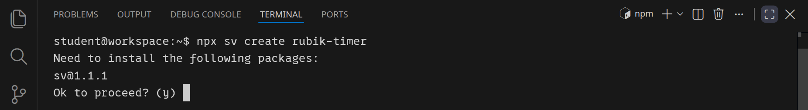

Bestätige mit <kbd>Enter</kbd>. Danach stellt `sv` ein paar Fragen. Mit den Pfeiltasten wählst du eine Antwort, mit <kbd>Enter</kbd> bestätigst du sie. Als Erstes geht es um die Vorlage. Nimm »SvelteKit minimal«, die schon ausgewählt ist:

<!-- tutorial-screenshot
press: Enter
wait-for-text: Which template would you like?
sleep: 0.5
crop-terminal-lines: auto
-->

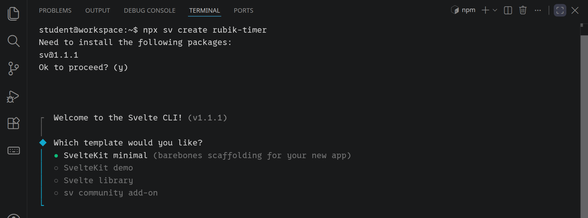

Bei der nächsten Frage geht es um TypeScript. Wir schreiben in diesem Projekt normales JavaScript, deshalb wählst du mit zweimal <kbd>↓</kbd> »No«:

<!-- tutorial-screenshot
press: Enter
wait-for-text: Add type checking with TypeScript?
press: ArrowDown
press: ArrowDown
sleep: 0.5
crop-terminal-lines: auto
-->

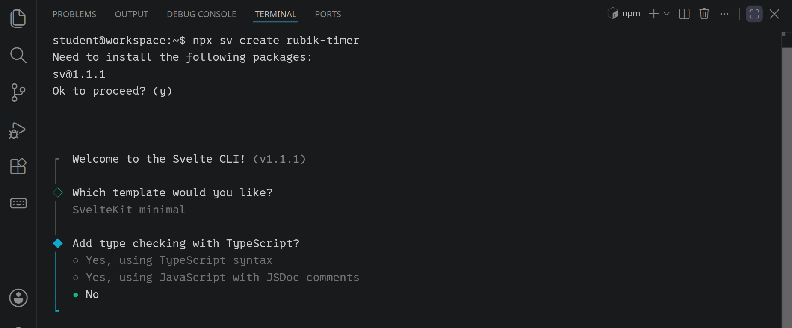

Danach bietet `sv` Erweiterungen für dein Projekt an. Wir brauchen keine; drücke einfach <kbd>Enter</kbd>, ohne etwas anzukreuzen:

<!-- tutorial-screenshot
press: Enter
wait-for-text: What would you like to add to your project?
sleep: 0.5
crop-terminal-lines: auto
-->

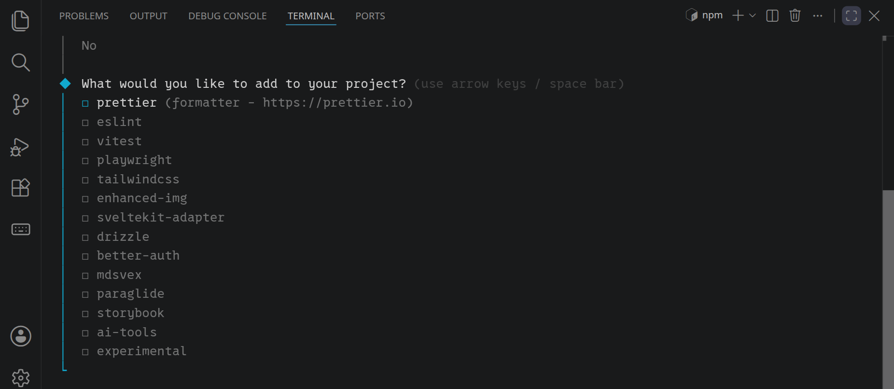

Jetzt ist das Projekt angelegt. Zum Schluss fragt `sv`, womit es die Bibliotheken installieren soll, die das Projekt braucht. Nimm »npm«, das schon ausgewählt ist:

<!-- tutorial-screenshot
press: Enter
wait-for-text: Which one should we use to install dependencies?
sleep: 0.5
crop-terminal-lines: auto
-->

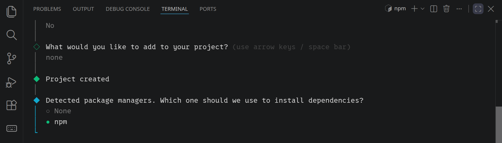

Nach ein paar Sekunden sind alle Bibliotheken installiert. Steht am Ende »You're all set!«, hat alles geklappt:

<!-- tutorial-screenshot
press: Enter
wait-for-text: You're all set!
terminal-wait-for-prompt: 300
crop-terminal-lines: auto
-->

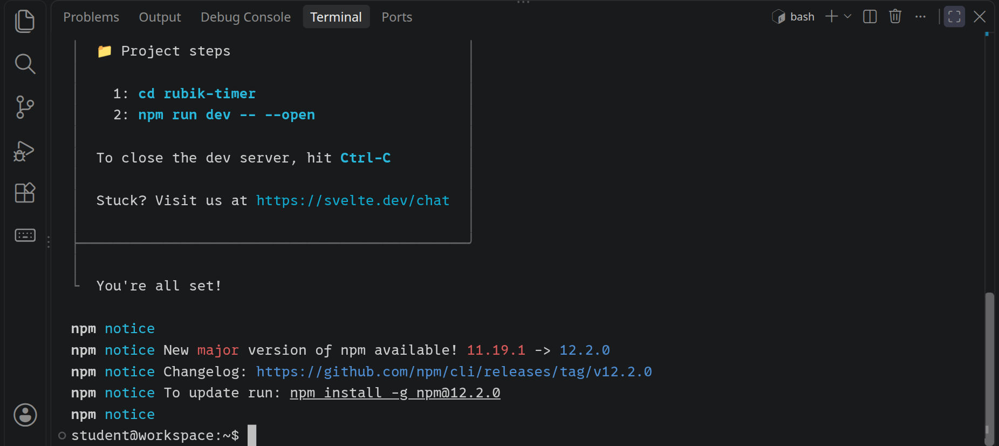

Den Hinweis auf eine neue Version von npm kannst du übergehen.

_task(projekt)

<div class='hint'>
Falls du von vorne beginnen möchtest, kannst du einfach das Verzeichnis <code>/workspace/rubik-timer</code> löschen und von vorn beginnen.
</div>

Öffne nun den Ordner des Projekts, indem du im Menü »File« / »Open Folder…« auswählst oder <kbd>Strg</kbd><kbd>K</kbd> und dann <kbd>Strg</kbd><kbd>O</kbd> drückst. Wähle den Ordner `/workspace/rubik-timer`:

<!-- tutorial-screenshot
click: selector:.part.panel [aria-label*="Restore Panel"]
press: Control+j
press: Control+k
press: Control+o
wait-for-text: Open Folder
press: Control+a
type: /workspace/rubik-timer/
sleep: 1
crop-bottom: 60%
-->

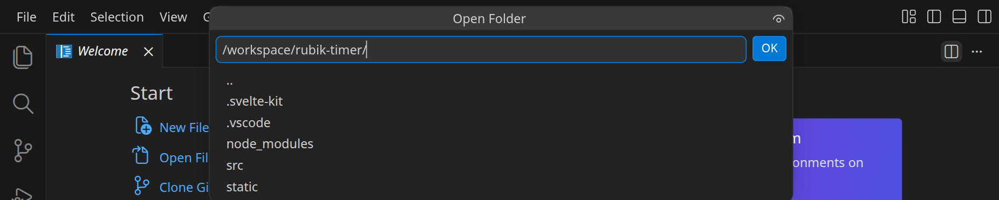

## Den Entwicklungsserver starten

Der Entwicklungsserver zeigt deine Seite im Browser und lädt sie neu, sobald du eine Datei speicherst. Vorher braucht er zwei Einstellungen, damit dein Workspace die Vorschau an deinen Browser weiterleiten kann. Öffne die Datei `vite.config.js` und ergänze nach `export default defineConfig({` den Eintrag `server`:

```js
export default defineConfig({
	server: {
		host: '127.0.0.1',
		allowedHosts: true
	},
	plugins: [
```

- `host: '127.0.0.1'`: Der Server wartet unter dieser Adresse auf Anfragen. Dort sucht ihn die Weiterleitung deines Workspaces. Von außerhalb deines Workspaces ist er so nicht zu erreichen.
- `allowedHosts: true`: Der Server beantwortet auch Anfragen, die über die Adresse der Weiterleitung kommen, nicht nur solche an `localhost`.

<div class='hint'>
Achte auf das Komma nach der schließenden Klammer <code>}</code>: Es trennt <code>server</code> von <code>plugins</code>. Fehlt es, meldet der Server beim Start einen Fehler mit der Zeile.
</div>

So sieht der Anfang der Datei danach aus:

<!-- tutorial-screenshot
# Enter öffnet den Ordner; das Fenster lädt neu
press: Enter
sleep: 5
write-file: vite.config.js <- file:vite.config.js
open-file: vite.config.js
hide-left-sidebar
sleep: 2
crop-bottom: 45%
-->

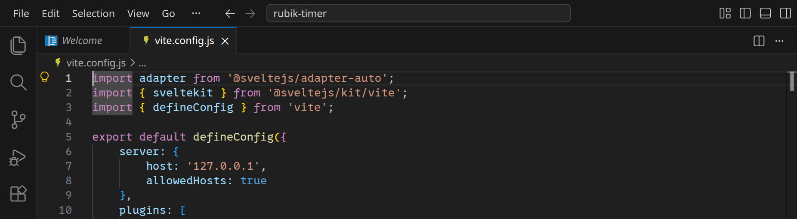

Starte jetzt im Terminal den Entwicklungsserver. Das Terminal öffnet sich im Ordner `rubik-timer`, weil du ihn geöffnet hast:

```bash
npm run dev
```

Der Server läuft auf Port 5173. Visual Studio Code leitet diesen Port an eine Adresse weiter, die dein Browser erreicht. Du findest sie im Reiter »Ports« neben »Terminal«, in der Spalte »Forwarded Address«:

<!-- tutorial-screenshot
terminal-open
press: Control+l
terminal-run: npm run dev
wait-for-text: Local:
sleep: 5
click: Ports
sleep: 2
move-mouse: selector:.part.editor
crop-element: .part.panel
-->

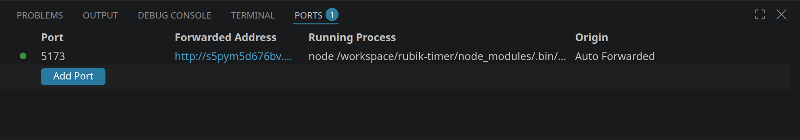

Klicke mit gedrückter <kbd>Strg</kbd>-Taste auf die Adresse. Deine Seite öffnet sich in einem neuen Tab:

<!-- tutorial-screenshot
preview-port: 5173
tab: preview
wait-for-text: Welcome to SvelteKit
sleep: 1
-->

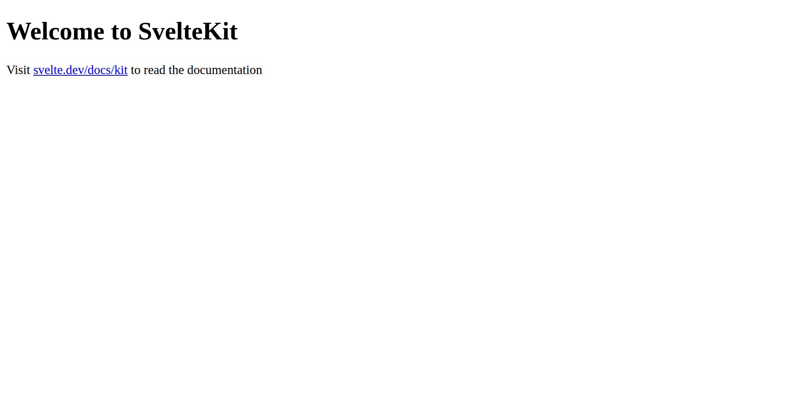

<div class='hint'>
Tipp: Leg deinen Workspace und die Vorschau nebeneinander, damit du beide Fenster gleichzeitig siehst. Den Server beendest du im Terminal mit <kbd>Strg</kbd><kbd>C</kbd>; mit <code>npm run dev</code> startest du ihn wieder. Die Adresse im Reiter »Ports« bleibt dieselbe.
</div>

## Webseite implementieren

Jetzt, wo alles eingerichtet ist, programmieren wir die Stoppuhr.

Du kennst dich bereits mit HTML und CSS aus, und jetzt kommt ein wenig JavaScript dazu, damit die Seite auf Tasten reagiert. Bei Svelte stehen alle drei in einer Datei, einer Komponente. Eine Komponente ist ein Baustein einer Webseite, mit eigenem Inhalt, eigenem Aussehen und eigenem Verhalten. Unsere Komponente ist die Stoppuhr.

Öffne die Datei `src/routes/+page.svelte`. Sie enthält die Startseite, die du gerade im Browser siehst:

```html
<h1>Welcome to SvelteKit</h1>
<p>Visit <a href="https://svelte.dev/docs/kit">svelte.dev/docs/kit</a> to read the documentation</p>
```

<div class='hint'>
Dateien öffnest du am schnellsten mit <kbd>Strg</kbd><kbd>P</kbd> und einem Teil des Namens. Probier es aus: <kbd>Strg</kbd><kbd>P</kbd> und dann »page«.
</div>

Lösche den Code und ersetze ihn durch diesen:

```html
<script>
</script>

<div class="main">
    <h1>Rubik's Cube Timer</h1>
</div>

<style>
</style>
```

Die Datei hat drei Abschnitte:

- `<script>`: Hier kommt der JavaScript-Code hin, der das Verhalten der Seite festlegt.
- `<div class="main">`: Hier steht das HTML, also der Inhalt der Seite: ein `<div>` mit der Klasse `main` und darin die Überschrift.
- `<style>`: Hier kommt das CSS hin, das das Aussehen bestimmt. Es gilt nur für diese Komponente.

Wir beginnen mit dem CSS. Schreib die folgende Regel zwischen `<style>` und `</style>`, um den Inhalt von `.main` in die Mitte der Seite zu rücken:

```css
.main {
    display: flex;
    flex-direction: column;
    align-items: center;
    justify-content: center;
    min-height: 100vh;
    margin: 0 1em;
    user-select: none;
}
```

`display: flex` mit `flex-direction: column` stellt die Elemente untereinander, `align-items: center` rückt sie waagerecht in die Mitte, `justify-content: center` senkrecht. Damit es senkrecht eine Mitte gibt, ist `.main` mit `min-height: 100vh` mindestens so hoch wie das Browserfenster. `user-select: none` verhindert, dass beim Tippen auf dem Handy Text markiert wird.

_uses(flexbox)

<!-- tutorial-screenshot
write-file: src/routes/+page.svelte <- file:page-start.svelte
tab: preview
wait-for-text: Rubik's Cube Timer
sleep: 1
-->

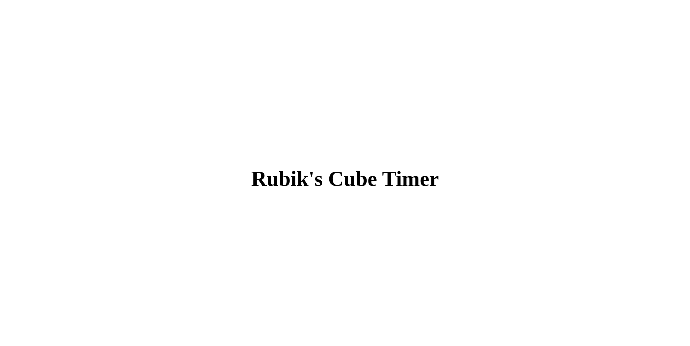

_task(grundgeruest)

Die Überschrift steht jetzt in der Mitte. Rechts erscheint aber ein Scrollbalken: Der Browser gibt der Seite einen Rand von ein paar Pixeln, und zusammen mit den 100 % Höhe von `.main` ist sie dadurch etwas höher als das Fenster. Den Rand entfernst du für die ganze Seite in der Datei `src/app.html`. Sie ist das Gerüst um alle Komponenten. Schreib in ihren `<head>`, vor die Zeile `%sveltekit.head%`:

```html
<style>
    html,
    body {
        margin: 0;
    }
</style>
```

Speichere, und der Scrollbalken ist verschwunden.

### Modellierung

Um die Stoppuhr zu programmieren, brauchen wir eine Idee, wie sie benutzt werden soll – kümmern wir uns um die »Business-Logik«! Die Stoppuhr kann in verschiedenen Zuständen sein:

- **Zustand 0:** Zu Beginn ist die Stoppuhr gestoppt. Wenn man die Leertaste drückt, kommt man in Zustand 1.
- **Zustand 1:** Um Fehlstarts zu vermeiden, wird überprüft, ob die Leertaste mindestens 500 ms lang gedrückt wird. Falls nicht, geht es zurück zu Zustand 0, anderenfalls zu Zustand 2.
- **Zustand 2:** Die Stoppuhr färbt sich grün und ist bereit. Wenn die Leertaste jetzt losgelassen wird, kommt man in Zustand 3.
- **Zustand 3:** Die Stoppuhr läuft. Wenn die Leertaste erneut gedrückt wird, kommt man in Zustand 4.
- **Zustand 4:** Die Stoppuhr wird gestoppt.

Daraus ergibt sich folgender Ablauf:

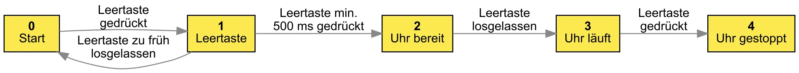

_task(fehlstart)

Um den Zustand zu speichern, deklarieren wir eine Variable `state` im `<script>`-Teil von `src/routes/+page.svelte`:

```js
let state = $state(0);
// 0 : idle
// 1 : space pressed
// 2 : space pressed for 500 ms
// 3 : timer running
// 4 : timer stopped
```

Das ist keine gewöhnliche JavaScript-Variable, sondern ein Zustand von Svelte: Man erkennt es an `$state(` … `)`. Du kannst ihn ins HTML schreiben, und Svelte ändert die Seite von selbst, sobald sich der Wert ändert. Das ist eine der Stärken von Svelte.

Zeig den Zustand auf der Seite an. Schreib unter die Überschrift in `<div class="main">`:

```html
<p>State = {state}</p>
```

Was in geschweiften Klammern steht, ist JavaScript; Svelte setzt seinen Wert ein. In der Vorschau steht jetzt »State = 0«:

<!-- tutorial-screenshot
write-file: src/routes/+page.svelte <- file:page-state.svelte
tab: preview
wait-for-text: State = 0
sleep: 1
-->

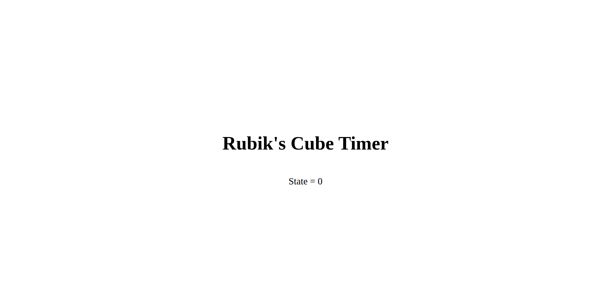

### Tastendruck erkennen

Um zu erkennen, wann die Leertaste gedrückt wird, brauchen wir einen Event-Listener: eine Funktion, die der Browser bei jedem Tastendruck aufruft. Anmelden können wir ihn erst, wenn die Seite im Browser steht. Dafür gibt es in Svelte `onMount`: Was du an `onMount` übergibst, läuft, sobald die Komponente auf der Seite ist. Schreib ganz oben in den `<script>`-Teil:

```js
import { onMount } from 'svelte';
```

Und an das Ende des `<script>`-Teils:

```js
function handleKeyDown() {
    state = 1;
}

onMount(() => {
    document.addEventListener("keydown", (e) => {
        if (e.code === "Space") {
            handleKeyDown();
        }
    });
});
```

Die Funktion `handleKeyDown` setzt den Zustand auf 1; die ganze Logik folgt später. In `onMount` melden wir einen Event-Listener an, der bei jedem Tastendruck nachsieht, ob es die Leertaste war, und dann `handleKeyDown` aufruft.

<div class='hint'>
Achte beim Einfügen von Code darauf, dass du eine einheitliche Einrückung verwendest. Du kannst z. B. mehrere Zeilen markieren und mit <kbd>Tab</kbd> einrücken oder mit <kbd>Shift</kbd><kbd>Tab</kbd> ausrücken. Visual Studio Code kann das ganze Dokument auch selbst ordnen: <kbd>Strg</kbd><kbd>Shift</kbd><kbd>P</kbd> und »Format Document«.
</div>

Drückst du jetzt in der Vorschau die Leertaste, springt der Zustand auf 1. Lässt du sie los, bleibt er bei 1 stehen: Noch setzt ihn nichts zurück. Lade die Seite neu, dann beginnt er wieder bei 0.

_task(dollar-state)

Wir ergänzen eine Funktion `handleKeyUp`, die den Zustand zurücksetzt, wenn die Leertaste losgelassen wird. Schreib sie hinter `handleKeyDown`:

```js
function handleKeyUp() {
    state = 0;
}
```

Und in `onMount` einen zweiten Event-Listener, der beim Loslassen der Leertaste `handleKeyUp` aufruft:

```js
document.addEventListener("keyup", (e) => {
    if (e.code === "Space") {
        handleKeyUp();
    }
});
```

Jetzt springt der Zustand beim Loslassen wieder auf 0.

Damit der Timer auch auf dem Handy funktioniert, wo es keine Leertaste gibt, reagieren zwei weitere Event-Listener in `onMount` auf das Antippen des Bildschirms:

```js
document.addEventListener("touchstart", () => handleKeyDown());
document.addEventListener("touchend", () => handleKeyUp());
```

### Die Zeit messen

Oben im `<script>`-Teil, unter `let state`, kommen drei weitere Variablen dazu:

```js
let t0 = 0;
let timerString = $state("00:00<span class='small'>.00</span>");
let timeoutId = null;
```

- `t0` ist die Startzeit. Daraus berechnen wir später, wie viel Zeit seit dem Start vergangen ist.
- `timerString` ist der Text der Anzeige. Er enthält HTML, damit die Hundertstelsekunden in einem eigenen `<span>` mit der Klasse `small` stehen und kleiner erscheinen. Auch er ist mit `$state` ein Zustand, damit die Anzeige sich ändert, wenn er sich ändert.
- `timeoutId` brauchen wir, um die 500 ms Wartezeit abzubrechen, falls die Leertaste vorher losgelassen wird.

In `.main` kommen eine Anleitung und die eigentliche Anzeige dazu:

```html
<p>
    Halte die Leertaste gedrückt, bis der Timer grün wird. Wenn du dann los lässt, beginnt die Zeit zu laufen.
</p>

<p class="timer">{@html timerString}</p>
```

`{@html …}` setzt den Text als HTML ein. Mit `{timerString}` stünde das `<span>` als Text auf der Seite.

Im `<style>`-Teil formatieren ein paar Regeln die Anzeige:

```css
.timer {
    font-size: 300%;
    font-weight: bold;
    padding: 0.25em 0.5em;
    border-radius: 0.2em;
    background-color: #eeeeec;

    :global(.small) {
        font-size: 75%;
    }

    :global(&.ready) {
        transition: background-color 0.3s ease-in;
        background-color: #73a946;
    }
}
```

Svelte lässt CSS-Regeln weg, die zu nichts im HTML der Komponente passen. Die Klassen `ready` und `small` kommen aber erst später dazu, durch JavaScript. Deshalb stehen sie in `:global(` … `)`: So bleiben die Regeln erhalten.

_task(global)

Jetzt eine Funktion, die die Anzeige, also `timerString`, auf den neuesten Stand bringt. Schreib sie in den `<script>`-Teil, vor `handleKeyDown`:

```js
function updateTimer() {
    if (state != 3) return;

    let t1 = Date.now();
    let duration = (t1 - t0) / 1000.0;

    let minutes = `${Math.floor(duration / 60.0)}`;
    if (minutes.length < 2) minutes = "0" + minutes;

    let seconds = `${Math.floor(duration % 60)}`;
    if (seconds.length < 2) seconds = "0" + seconds;

    let centiseconds = `${Math.floor(duration * 100.0) % 100}`;
    if (centiseconds.length < 2) centiseconds = "0" + centiseconds;

    timerString = `${minutes}:${seconds}<span class='small'>.${centiseconds}</span>`;

    requestAnimationFrame(updateTimer);
}
```

<div class='hint'>
Die Funktion bricht sofort ab, wenn der Zustand nicht 3 ist. Sonst berechnet sie die vergangene Zeit in Sekunden und schreibt sie als Minuten, Sekunden und Hundertstel in <code>timerString</code>. <code>Date.now()</code> ist die aktuelle Zeit in Millisekunden. Zum Schluss bittet sie mit <code>requestAnimationFrame</code> den Browser, sie vor dem nächsten Bild noch einmal aufzurufen. So läuft die Anzeige flüssig mit, ohne den Browser zu überlasten.
</div>

`handleKeyDown` wechselt jetzt richtig zwischen den Zuständen:

```js
function handleKeyDown() {
    if (state === 0) {
        state = 1;
        timeoutId = setTimeout(() => {
            if (state === 1) {
                state = 2;
                document.querySelector(".timer")?.classList.add("ready");
            }
        }, 500);
    } else if (state === 3) {
        state = 4;
    }
}
```

Im Zustand 0 springt sie in Zustand 1 und stellt mit `setTimeout` einen Wecker auf 500 ms. Klingelt er und ist der Zustand dann immer noch 1, geht es in Zustand 2, und die Anzeige bekommt die Klasse `ready`, die sie grün färbt. Im Zustand 3 hält ein Tastendruck die Stoppuhr an: Zustand 4.

Auch `handleKeyUp` bekommt die ganze Logik:

```js
function handleKeyUp() {
    if (state === 1) {
        state = 0;
        clearTimeout(timeoutId);
    } else if (state === 2) {
        state = 3;
        t0 = Date.now();
        requestAnimationFrame(updateTimer);
    }
}
```

Lässt du die Taste im Zustand 1 los, geht es zurück in Zustand 0, und der Wecker wird abgestellt. Im Zustand 2 beginnt die Messung: Zustand 3, die Startzeit kommt in `t0`, und `requestAnimationFrame(updateTimer)` ruft `updateTimer` zum ersten Mal auf.

So sieht `src/routes/+page.svelte` jetzt aus:

_include_file(+page.svelte, svelte)

<!-- tutorial-screenshot
write-file: src/routes/+page.svelte <- file:+page.svelte
tab: preview
wait-for-text: Halte die Leertaste
sleep: 1
-->

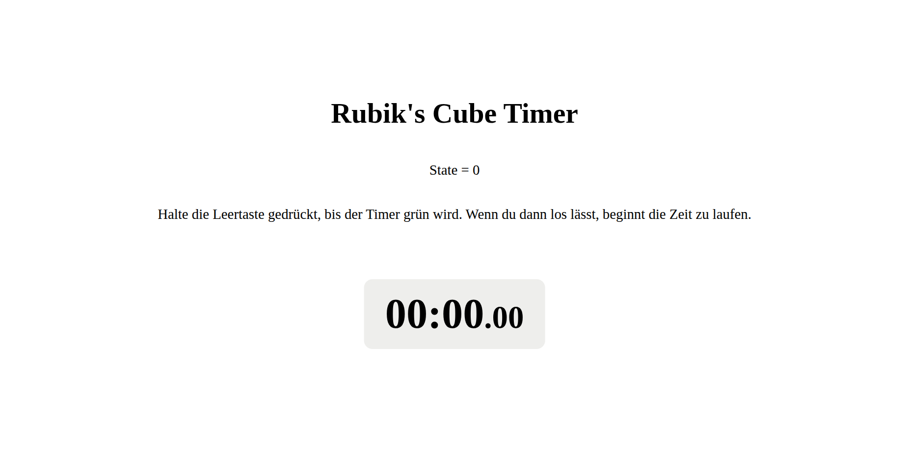

Probier es aus: Halte die Leertaste gedrückt, bis die Anzeige grün wird, lass los, und drück sie noch einmal, um die Zeit anzuhalten.

_task(timer)

## Webseite erweitern

Die Stoppuhr funktioniert. Jetzt kümmern wir uns um das Aussehen.

### Bessere Schriftarten

Schönere Schriften holen wir von Google Fonts. Schreib in den `<head>` von `src/app.html`, vor `%sveltekit.head%`:

```html_copy
<link rel="preconnect" href="https://fonts.googleapis.com">
<link rel="preconnect" href="https://fonts.gstatic.com" crossorigin>
<link href="https://fonts.googleapis.com/css2?family=IBM+Plex+Mono:ital,wght@0,400;0,700;1,400;1,700&family=Quicksand:wght@300..700&display=swap" rel="stylesheet">
```

Ergänze dann in `src/routes/+page.svelte` in der Regel `.main` die Zeile `font-family: Quicksand;` und in der Regel `.timer` die Zeile `font-family: "IBM Plex Mono";`:

```css
.main {
    font-family: Quicksand;
    …
}
.timer {
    font-family: "IBM Plex Mono";
    …
}
```

Nach dem Speichern zeigt die Seite die neuen Schriften:

<!-- tutorial-screenshot
write-file: src/app.html <- file:app.html
write-file: src/routes/+page.svelte <- file:page-fonts.svelte
# Vite braucht einen Moment für die neue app.html
sleep: 3
tab: preview
preview-reload
# Erst wenn Svelte die Seite übernommen hat, hört sie auf die Leertaste
sleep: 2
click: selector:h1
hook: solve 3.9
sleep: 1
-->

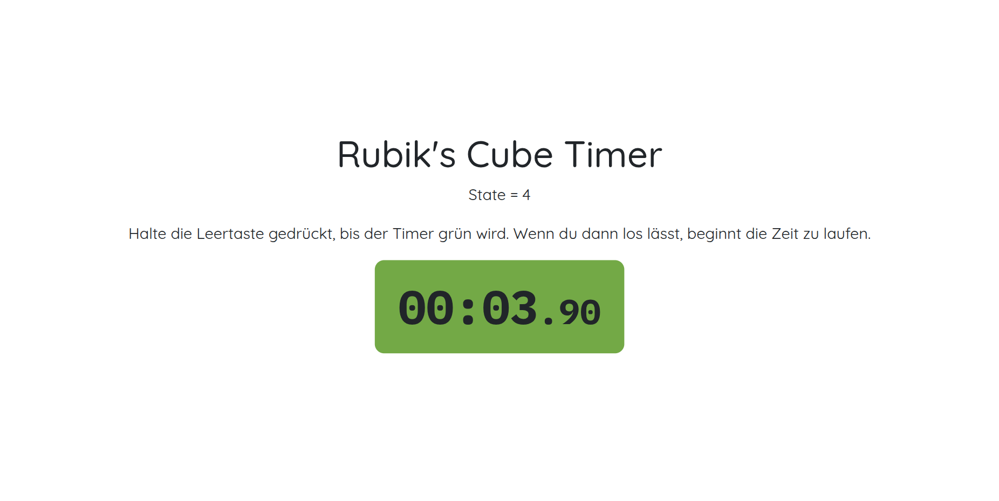

### Bootstrap einbinden und Reset-Button hinzufügen

[Bootstrap](https://getbootstrap.com/) ist ein beliebtes CSS-Framework, das dir hilft, deine Webseite schnell und einfach zu gestalten. Du bindest es ein, indem du in den `<head>` von `src/app.html` schreibst:

```html_copy
<link href="https://cdn.jsdelivr.net/npm/bootstrap@5.3.6/dist/css/bootstrap.min.css" rel="stylesheet" integrity="sha384-4Q6Gf2aSP4eDXB8Miphtr37CMZZQ5oXLH2yaXMJ2w8e2ZtHTl7GptT4jmndRuHDT" crossorigin="anonymous">
```

Bootstrap bringt unter anderem Klassen für Buttons mit. Damit bauen wir einen Reset-Button. Schreib in `<div class="main">`, unter die Anzeige:

```html
<button
    id="bu_reset"
    class="btn btn-lg {state < 3 ? 'btn-outline-secondary' : 'btn-warning'}"
    disabled={state < 3}
    onclick={resetTimer}>
    Reset
</button>
```

Der Button hat die ID `bu_reset` und die Bootstrap-Klasse `btn`. Solange `state` kleiner als 3 ist, bekommt er dazu die Klasse `btn-outline-secondary` (grau umrandet) und ist abgeschaltet (`disabled`), sonst die Klasse `btn-warning` (gelb). Ein Klick ruft die Funktion `resetTimer` auf.

Die fehlt noch. Schreib sie in den `<script>`-Teil, zum Beispiel nach `updateTimer`:

```js
function resetTimer() {
    if (state > 2) {
        state = 0;
        t0 = 0;
        timerString = "00:00<span class='small'>.00</span>";
        document.querySelector(".timer")?.classList.remove("ready");
    }
}
```

### Icons einbinden

Auf dem Reset-Button fehlt noch ein Icon. Dafür verwenden wir [Iconify](https://iconify.design/), eine Sammlung von über 200 000 Icons. Iconify kommt als Paket ins Projekt. Halte dazu den Entwicklungsserver mit <kbd>Strg</kbd><kbd>C</kbd> an und installiere das Paket:

```bash
npm install @iconify/svelte
```

<!-- tutorial-screenshot
terminal-open
terminal-maximize
press: Control+c
terminal-wait-for-prompt
press: Control+l
terminal-run: npm install @iconify/svelte
terminal-wait-for-prompt: 120
crop-terminal-lines: auto
-->

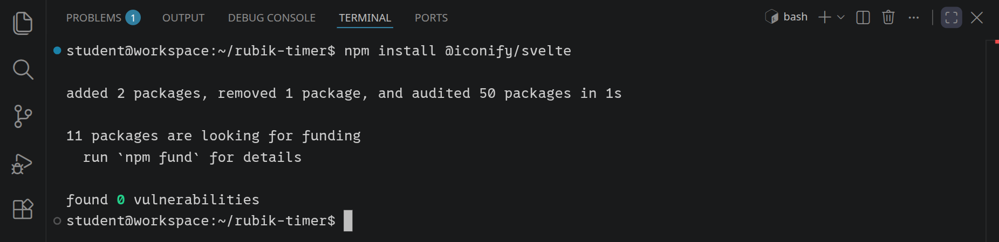

Starte den Server danach wieder mit `npm run dev`. Jetzt kannst du Icons verwenden. Schreib oben in den `<script>`-Teil:

```js
import Icon from '@iconify/svelte';
```

und in den `<button>`, direkt vor »Reset«:

```html
<Icon icon="material-symbols:device-reset-rounded" class="icon" />
```

Mit dieser Regel im `<style>`-Teil bekommt das Icon etwas Abstand und Größe:

```css
:global(.btn .icon) {
    margin-right: 0.25em;
    padding-bottom: 0.1em;
    transform: scale(1.3);
}
```

Nach einer gemessenen Zeit leuchtet der Button gelb:

<!-- tutorial-screenshot
# Den Server wieder starten; preview-port wartet, bis er antwortet
terminal-run: npm run dev
write-file: src/routes/+page.svelte <- file:page-final.svelte
preview-port: 5173
tab: preview
wait-for-text: Reset
sleep: 2
click: selector:h1
hook: solve 2.5
sleep: 1
-->

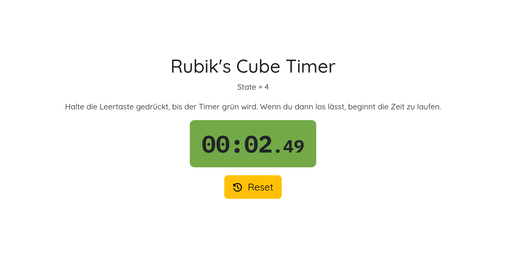

Andere Icons findest du unter [https://icon-sets.iconify.design/](https://icon-sets.iconify.design/). Den Namen eines Icons schreibst du in `icon="…"`, zum Beispiel:

```html
<Icon icon="mdi:home" class="icon" />
```

_task(reset)

## Statische Webseite exportieren

Um deine Webseite online zu stellen, machst du aus ihr eine statische Webseite: fertige HTML-, CSS- und JavaScript-Dateien, die jeder Webserver ausliefern kann, ohne dass dort Svelte läuft. Statische Webseiten sind schnell, brauchen wenig und bieten Angreifern kaum eine Angriffsfläche.

Dafür brauchst du einen anderen Adapter, den statischen. Halte den Entwicklungsserver an und installiere ihn:

```bash
npm install -D @sveltejs/adapter-static
```

Ändere dann in `vite.config.js` die erste Zeile von

```js
import adapter from '@sveltejs/adapter-auto';
```

in

```js
import adapter from '@sveltejs/adapter-static';
```

Außerdem muss SvelteKit wissen, dass es jede Seite schon beim Bauen fertig ausrechnen soll. Lege dazu eine neue Datei `src/routes/+layout.js` an, mit dieser Zeile:

```js
export const prerender = true;
```

Jetzt kannst du die statische Webseite bauen:

```bash
npm run build
```

<!-- tutorial-screenshot
# Mehr Zeilen für die lange Ausgabe von npm run build
viewport: 1029x700
terminal-maximize
press: Control+c
terminal-wait-for-prompt
terminal-run: npm install -D @sveltejs/adapter-static
terminal-wait-for-prompt: 120
terminal-run: sed -i 's#@sveltejs/adapter-auto#@sveltejs/adapter-static#' vite.config.js && echo 'export const prerender = true;' > src/routes/+layout.js
terminal-wait-for-prompt
press: Control+l
terminal-run: npm run build
terminal-wait-for-prompt: 120
crop-terminal-lines: auto
# Die Zeile mit der Eingabeaufforderung steht nur halb im Bild
crop-terminal-skip-bottom: 1
-->

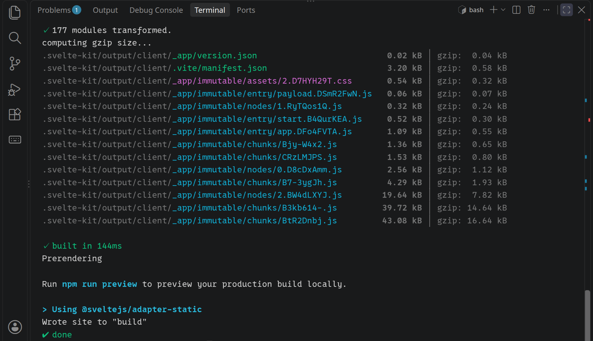

Steht am Ende »Wrote site to "build"«, liegen alle Dateien deiner Webseite im neuen Ordner `build`: eine `index.html` und daneben der Ordner `_app` mit CSS und JavaScript.

<div class='hint'>
Du kannst die gebaute Seite testen: Öffne den Ordner <code>build</code> und starte die <a href='/reference/workspace#live-server'>Live-Vorschau</a>. Sie sollte genauso aussehen und funktionieren wie die Seite vom Entwicklungsserver.
</div>

_task(build)

_task(abgabe)

### Deine Seite veröffentlichen

Du kannst deine Webseite veröffentlichen, indem du sie auf einen Webserver hochlädst. Viele Hosting-Anbieter helfen dir dabei. Du kannst auch kostenlos eine Hackschule-Subdomain bekommen (z. B. `meineseite.hackschule.de`). Dafür verwendest du die gebauten Dateien aus `build`, nicht den laufenden Entwicklungsserver. In der [Anleitung zum eigenen Webspace](/custom-subdomain) erfährst du, wie du die Subdomain beantragst, was bei minderjährigen Schülerinnen und Schülern für die Einverständniserklärung nötig ist und wie du deine fertige Website hochlädst.
