<div class='meta'>
image: teaser.webp:0:50
image_alt: "Ein Terminal, in dem nc eine HTTP-Anfrage an info.cern.ch schickt, darunter die Antwort des Servers"
kind: labor
duration: 2 Doppelstunden
curriculum: "Sek I: Leben in und mit vernetzten Systemen (Datenaustausch im Netzwerk); Oberstufe: Computernetze (Funktionsweise des Internet, Schichtenmodell, Protokolle), Rechner und Netze (Protokolle, Schichtenarchitektur)"
reference: [netzwerk, http, json, terminal]
</div>

<div
    class="autotoc-secondary-trigger"
    data-title="Auf dieser Seite"
    data-levels="h2,h3">
</div>

# TCP/IP-Verbindungen

<p class='abstract'>
Wie findet ein Paket seinen Weg durchs Internet, und wie wird aus einzelnen Paketen eine Verbindung, über die eine ganze Webseite kommt? Du findest die Adresse deines Workspace heraus, misst mit <code>ping</code>, wie weit Server entfernt sind, und verfolgst mit <code>traceroute</code> den Weg der Pakete. Dann siehst du, wie TCP eine Verbindung aufbaut, chattest mit <code>netcat</code> und holst eine Webseite von 1992, indem du HTTP von Hand tippst. Zum Schluss lädst du mit <code>wget</code> und <code>curl</code> Dateien und Daten aus dem Netz.
</p>

## Vorbereitung

_include(workspace#terminal-oeffnen)

## Die eigene Adresse

<div class='hint books'>
In diesem Abschnitt lernst du den Befehl <code>ifconfig</code> kennen.
</div>

Um die IP-Adresse deines Workspace herauszufinden, gib den Befehl `ifconfig` ein und drücke <kbd>Enter</kbd>:

```bash
ifconfig
```

Du solltest nun folgende Ausgabe sehen:

<!-- tutorial-screenshot
# Terminal öffnen: Handbuch »Workspace«, eingebunden oben
hide-left-sidebar
terminal-open
terminal-maximize
terminal-run: clear
terminal-run: ifconfig
terminal-wait-for-prompt
crop-terminal-lines: auto
-->

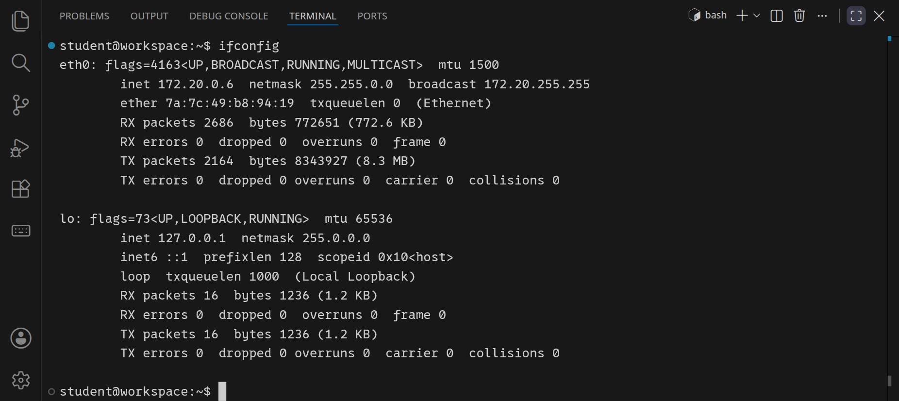

Zu sehen sind zwei Netzwerkadapter:

- `eth0` (»Ethernet«), über den dein Workspace mit dem Internet verbunden ist, mit einer IP-Adresse, die mit `172.` beginnt
- `lo` (»Loopback«) mit der IP-Adresse `127.0.0.1`, der nur für Verbindungen innerhalb des Rechners da ist

<div class='hint'>
Deine IP-Adresse für <code>eth0</code> ist wahrscheinlich eine andere als die hier gezeigte. Das ist in Ordnung, es ist nur ein Beispiel. Schreib dir deine Adresse auf, du brauchst sie später noch.
</div>

Du siehst außerdem die MAC-Adresse des Adapters (`ether`), die Broadcast-Adresse (`broadcast`) und die Subnetzmaske (`netmask`) sowie die Datenmenge, die bisher angekommen (`RX`, »received«) und hinausgegangen ist (`TX`, »transmitted«).

Adressen, die mit `10.`, `172.16.` bis `172.31.` oder `192.168.` beginnen, sind **private Adressen**: Sie gelten nur innerhalb eines Netzes, und viele Netze auf der Welt benutzen dieselben. Im Internet erscheinen alle Workspaces deiner Schule unter einer gemeinsamen öffentlichen Adresse; ein Router übersetzt dazwischen. Auch dein Rechner zu Hause hat meist eine Adresse mit `192.168.`, und der Adapter heißt dort oft anders, zum Beispiel `enp0s3` oder, im WLAN, `wlp2s0`.

_task(adresse)

_task(loopback)

## Wie weit ist es?

### Andere Rechner anpingen

<div class='hint books'>
In diesem Abschnitt lernst du den Befehl <code>ping</code> kennen.
</div>

Ob du einen anderen Rechner erreichst, prüfst du mit `ping`, gefolgt von seiner IP-Adresse. Wir nehmen die Adresse von Googles DNS-Server:

```bash
ping 8.8.8.8
```

Anschließend solltest du eine Ausgabe wie diese sehen:

<!-- tutorial-screenshot
terminal-run: clear
terminal-run: ping 8.8.8.8
sleep: 4.5
press: Control+C
terminal-wait-for-prompt
crop-terminal-lines: auto
-->

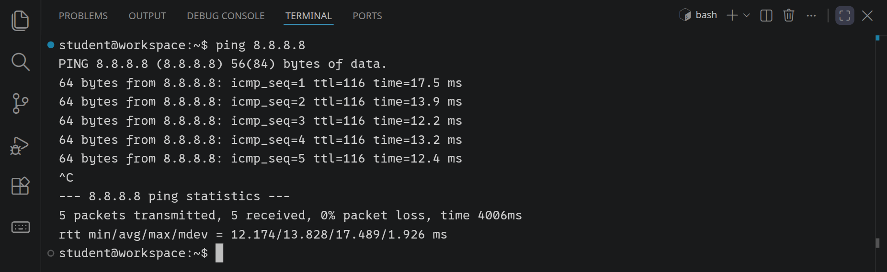

`ping` schickt kleine Pakete an die Adresse (ICMP, ein Hilfsprotokoll von IP) und wartet auf die Antwort. Jede Sekunde geht ein Paket hinaus, bis du mit <kbd>Strg</kbd><kbd>C</kbd> abbrichst. Danach fasst `ping` zusammen, wie viele Pakete angekommen sind und wie lange sie im Schnitt gebraucht haben.

Die Angabe hinter `time` ist die **Roundtrip-Zeit**: wie viele Millisekunden ein Paket zum Ziel und zurück gebraucht hat. Zu Google sind es nur wenige Millisekunden. Google beantwortet die Adresse `8.8.8.8` von vielen Rechenzentren auf der Welt aus, und dir antwortet ein nahes.

_person(muuss)

Pingst du deinen eigenen Rechner an, verlassen die Pakete ihn gar nicht:

```bash
ping 127.0.0.1
```

Die Roundtrip-Zeit liegt jetzt deutlich unter einer Millisekunde:

<!-- tutorial-screenshot
terminal-run: clear
terminal-run: ping 127.0.0.1
sleep: 4.5
press: Control+C
terminal-wait-for-prompt
crop-terminal-lines: auto
-->

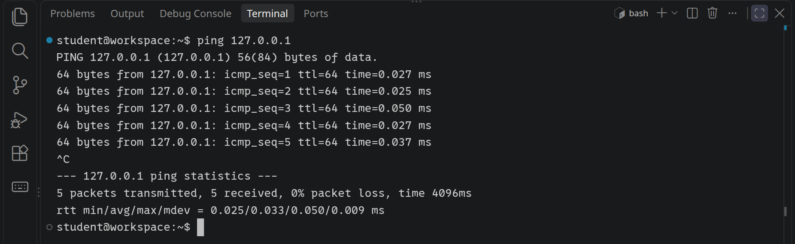

Statt einer IP-Adresse kannst du auch einen Namen angeben, zum Beispiel `google.com`. `ping` fragt dann einen DNS-Server, welche IP-Adresse zu dem Namen gehört. Probier einen Namen mit der Endung `.pe`, die zu Peru gehört, gut 10 000 km von hier:

```bash
ping rubiomonocoat.pe
```

<!-- tutorial-screenshot
terminal-run: clear
terminal-run: ping rubiomonocoat.pe
sleep: 4.5
press: Control+C
terminal-wait-for-prompt
crop-terminal-lines: auto
-->

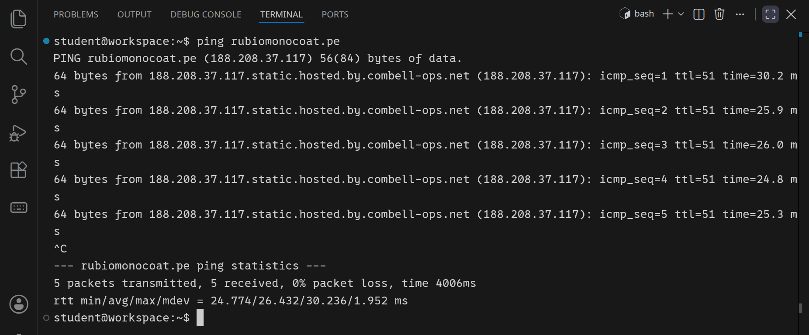

Die Antworten brauchen kaum länger als die von Google. Kann das sein, wenn der Server in Peru steht?

_task(entfernungen)

_task(lichtgeschwindigkeit)

_task(standort)

Die Endung eines Namens sagt nur, wo der Name registriert ist, nicht, wo der Rechner steht. Ein Name ist ein Schild; welcher Rechner dahinter antwortet, entscheidet die IP-Adresse, die DNS dazu nennt.

### Ein Server am anderen Ende der Welt

Ganz anders sieht es aus, wenn ein Server wirklich weit weg steht. Die Australian National University in Canberra betreibt ihre Webseite selbst, in Australien:

```bash
ping www.anu.edu.au
```

<!-- tutorial-screenshot
terminal-run: clear
terminal-run: ping www.anu.edu.au
sleep: 4.5
press: Control+C
terminal-wait-for-prompt
crop-terminal-lines: auto
-->

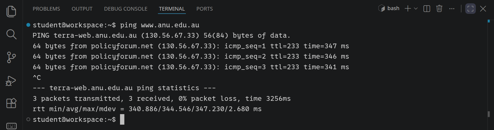

Jetzt braucht jedes Paket für Hin und Zurück mehr als eine Drittelsekunde. Berlin und Canberra liegen gut 16 000 km auseinander; selbst das Licht in einer Glasfaser bräuchte für Hin und Zurück mindestens 160 ms. Den Rest kosten Umwege der Kabel und die Router unterwegs. Dass sich der Rechner als `policyforum.net` meldet, ist übrigens nur ein zweiter Name desselben Servers: Die Adresse `130.56.67.33` gehört der Universität.

### Den Weg der Pakete verfolgen

<div class='hint books'>
In diesem Abschnitt lernst du den Befehl <code>traceroute</code> kennen.
</div>

Ein Paket springt auf seinem Weg von Router zu Router. Welche das sind, zeigt `traceroute`, gefolgt von der IP-Adresse oder dem Namen des Ziels:

```bash
traceroute -q 1 8.8.8.8
```

<div class='hint'>
Mit <code>-q 1</code> schickt <code>traceroute</code> nur ein Paket pro Schritt, das macht die Ausgabe übersichtlicher.
</div>

Anschließend solltest du eine Ausgabe wie diese sehen:

<!-- traceroute zeigt den Weg aus dem Netz des Rechners, auf dem die Bilder
     entstehen. Deshalb gibt das Bild eine Aufnahme aus einem Workspace auf
     code.hackschule.de wieder (14.10.2026, traceroute-8-8-8-8.txt): Das
     Rezept lässt traceroute diese Aufnahme ausgeben. -->
<!-- tutorial-screenshot
write-file: .tcpip/traceroute.txt <- file:traceroute-8-8-8-8.txt
terminal-run: traceroute() { cat ~/.tcpip/traceroute.txt; }
terminal-wait-for-prompt
terminal-run: clear
terminal-run: traceroute -q 1 8.8.8.8
terminal-wait-for-prompt
crop-terminal-lines: auto
-->

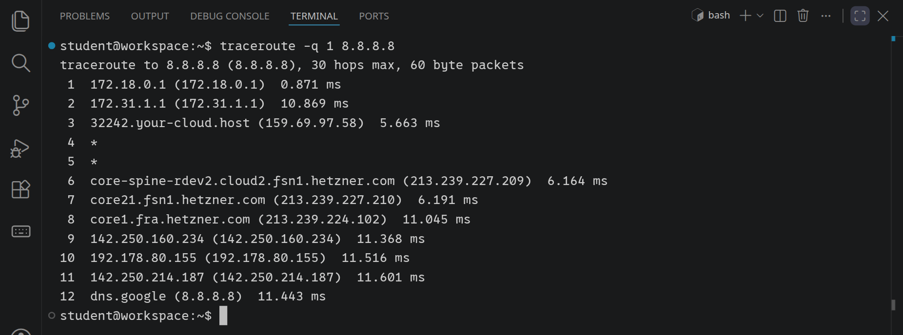

Um `traceroute` zu verstehen, musst du wissen, dass jedes IP-Paket eine »Time To Live« (TTL) mitbringt. Sie sagt, über wie viele Router das Paket höchstens weitergereicht werden darf. Jeder Router zieht eins ab; wer bei null ankommt, verwirft das Paket. So kreist kein Paket ewig im Netz, wenn irgendwo ein Weg falsch eingetragen ist.

_task(ttl-drei)

<!-- after: ttl-drei -->
`traceroute` schickt zuerst ein Paket mit TTL 1 los. Der erste Router verwirft es und schickt eine Fehlermeldung zurück, und damit kennt `traceroute` seine Adresse. Dann schickt es ein Paket mit TTL 2, das beim zweiten Router hängen bleibt, und so weiter, bis ein Paket das Ziel erreicht.
<!-- /after -->

Ein Stern `*` bedeutet, dass ein Router das Paket verworfen hat, ohne sich zu melden; seine Adresse bleibt darum unbekannt. Eine ausführlichere Erklärung findest du in diesem [Blogpost](https://blog.davidvarghese.dev/posts/traceroute-explained/) von David Varghese.

_task(traceroute-erklaeren)

_task(router-zaehlen)

<div class='hint try'>
<strong>Ausprobieren:</strong> Gib einem Paket selbst eine kleine TTL mit: <code>ping -c 3 -t 3 8.8.8.8</code> schickt drei Pakete mit TTL 3. Wer antwortet jetzt, und was meldet er? Erhöhe die TTL Schritt für Schritt: Ab welcher TTL antwortet Google selbst? Kommt bei einer TTL gar nichts zurück, hat sich der Router nicht gemeldet, wie bei einem Stern in <code>traceroute</code>.
</div>

## Pakete, Ports und Verbindungen

### Schichten

Bisher ging es um Pakete, die von einer Adresse zu einer anderen reisen. Darum kümmert sich **IP**, das Internet Protocol: Es reicht ein Paket von Router zu Router bis zum Ziel, aber ohne Garantie. Ein Paket kann verloren gehen, doppelt ankommen oder ein späteres überholen. Für eine Webseite, eine Datei oder einen Chat reicht das nicht. Darum arbeiten mehrere Protokolle übereinander, und jedes hat eine Aufgabe:

<table class='table'>
<tr><th class='text-nowrap'>Schicht</th><th>Aufgabe</th><th>Wer ist gemeint?</th><th>Beispiele</th></tr>
<tr><td class='text-nowrap'>Anwendung</td><td>Was die Programme einander sagen</td><td>ein Pfad, ein Name: <code>/index.html</code></td><td>HTTP, SSH, DNS</td></tr>
<tr><td class='text-nowrap'>Transport</td><td>Daten vollständig und in der richtigen Reihenfolge zum richtigen Programm bringen</td><td>ein Port: <code>443</code></td><td>TCP, UDP</td></tr>
<tr><td class='text-nowrap'>Internet</td><td>Pakete über viele Router zum richtigen Rechner bringen</td><td>eine IP-Adresse: <code>172.20.0.6</code></td><td>IP, ICMP</td></tr>
<tr><td class='text-nowrap'>Netzzugang</td><td>Ein Stück Weg bis zum nächsten Gerät, über Kabel oder Funk</td><td>eine MAC-Adresse: <code>d2:db:7c:26:20:29</code></td><td>Ethernet, WLAN</td>
</tr>
</table>

Jede Schicht benutzt die darunter und weiß nichts von denen darüber: IP trägt ein Paket zum Ziel, ohne zu wissen, dass ein Stück einer Webseite darin steckt. Zwei dieser Adressen hat dir `ifconfig` schon gezeigt, `ether` und `inet`. Die beiden mittleren Schichten geben dem Ganzen seinen Namen: **TCP/IP**.

_person(cerf-kahn)

<div class='book'>
<i class='bi bi-file-earmark-text'></i>
<p><strong>A Protocol for Packet Network Intercommunication</strong>, Vinton G. Cerf und Robert E. Kahn, IEEE Transactions on Communications, 1974. Der Aufsatz, mit dem TCP/IP anfing: wie ein Gateway Pakete zwischen ganz verschiedenen Netzen weiterreicht; TCP und IP sind darin noch ein einziges Protokoll: <a href='https://www.cs.princeton.edu/courses/archive/fall06/cos561/papers/cerf74.pdf'>als PDF</a>.</p>
</div>

_task(schichten)

### Ports

Auf einem Rechner laufen viele Programme, die das Netz benutzen, und sie alle teilen sich seine IP-Adresse. Überlege, bevor du weiterliest:

_task(port)

<!-- after: port -->
Die IP-Adresse bringt ein Paket zum richtigen Rechner, der **Port** zum richtigen Programm: eine Zahl von 1 bis 65 535. Server warten an Ports, die alle kennen: 22 für SSH, 80 für HTTP, 443 für HTTPS. Die Seite, die du gerade liest, kam über Port 443. Der Client bekommt für jede Verbindung irgendeinen freien Port; an ihn gehen die Antworten zurück.
<!-- /after -->

### Der Handshake

Bevor über TCP Daten fließen, bauen Client und Server eine **Verbindung** auf, mit drei Paketen, dem **Handshake**:

<svg viewBox="0 0 440 255" role="img" aria-label="Zwei senkrechte Linien, links der Client, rechts der Server. Drei schräge Pfeile: SYN vom Client zum Server, SYN-ACK zurück, ACK wieder zum Server, dicht gefolgt von den ersten Daten, GET. Eine Klammer links markiert SYN und SYN-ACK als ein Hin und Zurück." style="width: 100%; max-width: 34em; display: block; margin: 1em auto; font-family: inherit; font-size: 14px;">
    <defs>
        <marker id="handshake-arrow" viewBox="0 0 10 10" refX="9" refY="5" markerUnits="userSpaceOnUse" markerWidth="11" markerHeight="11" orient="auto">
            <path d="M0,0 L10,5 L0,10 z" fill="currentColor" />
        </marker>
    </defs>
    <text x="120" y="20" text-anchor="middle" fill="currentColor" font-weight="bold">Client</text>
    <text x="380" y="20" text-anchor="middle" fill="currentColor" font-weight="bold">Server</text>
    <line x1="120" y1="30" x2="120" y2="250" stroke="currentColor" stroke-width="2" />
    <line x1="380" y1="30" x2="380" y2="250" stroke="currentColor" stroke-width="2" />
    <line x1="120" y1="45" x2="380" y2="95" stroke="currentColor" stroke-width="1.5" marker-end="url(#handshake-arrow)" />
    <text x="250" y="63" transform="rotate(10.89 250 70)" text-anchor="middle" fill="currentColor">SYN: »Hallo?«</text>
    <line x1="380" y1="100" x2="120" y2="150" stroke="currentColor" stroke-width="1.5" marker-end="url(#handshake-arrow)" />
    <text x="250" y="118" transform="rotate(-10.89 250 125)" text-anchor="middle" fill="currentColor">SYN-ACK: »Hallo, ich höre dich.«</text>
    <line x1="120" y1="155" x2="380" y2="205" stroke="currentColor" stroke-width="1.5" marker-end="url(#handshake-arrow)" />
    <text x="250" y="173" transform="rotate(10.89 250 180)" text-anchor="middle" fill="currentColor">ACK: »Ich dich auch.«</text>
    <line x1="120" y1="175" x2="380" y2="225" stroke="currentColor" stroke-width="3" marker-end="url(#handshake-arrow)" />
    <text x="250" y="218" transform="rotate(10.89 250 200)" text-anchor="middle" fill="currentColor" font-weight="bold">Daten: GET / …</text>
    <path d="M105,45 L95,45 L95,150 L105,150" fill="none" stroke="currentColor" stroke-width="1.5" />
    <text x="85" y="94" text-anchor="end" fill="currentColor">ein Hin</text>
    <text x="85" y="112" text-anchor="end" fill="currentColor">und Zurück</text>
</svg>

Danach nummeriert TCP jedes Byte, das es schickt, und die Gegenseite bestätigt, was angekommen ist. Was nicht bestätigt wird, schickt TCP noch einmal, und was in falscher Reihenfolge ankommt, sortiert es. So kommt alles vollständig und in der richtigen Reihenfolge an, auch wenn IP unterwegs Pakete verliert.

Der Handshake kostet Zeit: Bevor das erste Byte Daten unterwegs ist, muss ein Paket einmal hin und zurück. Das kannst du messen. Mit `-w` sagt `curl`, wie lange die einzelnen Schritte gedauert haben:

```bash
curl -so /dev/null -w 'Verbindung: %{time_connect} s\n' https://www.anu.edu.au
```

`-s` macht `curl` still, und `-o /dev/null` wirft die Seite weg; uns interessiert nur die Zeit. Überleg vorher, was herauskommen müsste, und führe den Befehl dann zweimal aus. Beim ersten Mal kommt noch die Zeit dazu, in der der Name nachgeschlagen wird.

_task(handshake)

<!-- after: handshake -->
<!-- tutorial-screenshot
terminal-run: clear
terminal-run: curl -so /dev/null -w 'Verbindung: %{time_connect} s\n' https://www.anu.edu.au
terminal-wait-for-prompt
terminal-run: curl -so /dev/null -w 'Verbindung: %{time_connect} s\n' https://www.anu.edu.au
terminal-wait-for-prompt
crop-terminal-lines: auto
-->

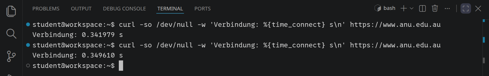

Die Verbindung steht nach etwa 0,34 Sekunden, so lange wie ein `ping` nach Canberra. Bei `https://` folgt danach noch die Verschlüsselung, mit weiteren Paketen hin und zurück. Darum fühlt sich ein Server am anderen Ende der Welt so viel langsamer an, als 0,3 Sekunden vermuten lassen.
<!-- /after -->

## Eine eigene Verbindung: `netcat`

<div class='hint books'>
In diesem Abschnitt lernst du die Befehle <code>netcat</code> und <code>ss</code> kennen.
</div>

`netcat` (kurz `nc`) baut eine TCP-Verbindung auf und tut sonst nichts: Was du tippst, geht hinüber, was ankommt, steht im Terminal. Eine Seite wartet als **Server** an einem Port auf eine Verbindung, die andere verbindet sich als **Client**.

### Allein, mit zwei Terminals

Starte im Terminal einen Server, der an Port 1234 wartet. `-l` steht für »listen«, `-p 1234` für den Port:

```bash
nc -l -p 1234
```

Öffne mit <kbd>Strg</kbd><kbd>Shift</kbd><kbd>5</kbd> ein zweites Terminal daneben. Dort zeigt `ss`, welche Ports auf deinem Rechner auf Verbindungen warten (`-t` TCP, `-l` nur wartende, `-n` Zahlen statt Namen):

```bash
ss -tln
```

```text
State   Recv-Q  Send-Q  Local Address:Port   Peer Address:Port
LISTEN  0       511           0.0.0.0:8443        0.0.0.0:*
LISTEN  0       1             0.0.0.0:1234        0.0.0.0:*
LISTEN  0       4096       127.0.0.11:46137       0.0.0.0:*
```

Port 1234 steht jetzt in der Liste, das ist dein `nc`. Port 8443 ist VS Code, das du gerade im Browser benutzt; die Zeile mit `127.0.0.11` gehört zum Namensdienst des Workspace, ihr Port ist bei dir ein anderer. `0.0.0.0` heißt: Verbindungen über jeden Adapter sind willkommen. Verbinde dich nun als Client mit deinem eigenen Rechner:

```bash
nc localhost 1234
```

`localhost` ist der Name für `127.0.0.1`. Tippe eine Nachricht und drücke <kbd>Enter</kbd>: Sie erscheint links. Klick ins linke Terminal und antworte:

<!-- tutorial-screenshot
# netcat allein: links der Server an Port 1234, rechts ss und der Client
terminal-run: clear
terminal-run: nc -l -p 1234
sleep: 1
press: Control+Shift+5
sleep: 1
terminal-run: nc localhost 1234
sleep: 1
type: Hallo, ist da jemand?
press: Enter
sleep: 1
press: Alt+ArrowLeft
sleep: 1
type: Ja, hier links!
press: Enter
sleep: 2
-->

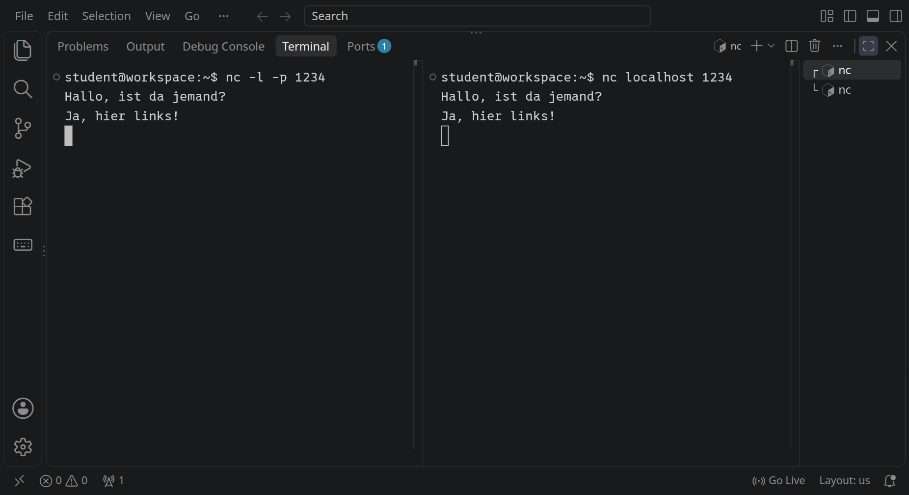

Mit <kbd>Strg</kbd><kbd>C</kbd> in einem der beiden Terminals endet die Verbindung, und beide `nc` hören auf.

### Zu zweit

<div class='hint handshake'>
Hierfür brauchst du eine zweite Person mit einem eigenen Workspace.
</div>

Findet mit `ifconfig` eure beiden IP-Adressen heraus. Eine Person startet den Server:

```bash
nc -l -p 1234
```

Die andere verbindet sich mit der Adresse des Servers, zum Beispiel:

```bash
nc 172.20.0.12 1234
```

Jetzt könnt ihr chatten. Kommt keine Verbindung zustande, prüft die Adresse und ob der Server schon wartet, bevor sich der Client verbindet.

<div class='hint'>
Port <code>1234</code> hat im Workspace eine besondere Rolle: Er ist der einzige TCP-Port, der für direkte Verbindungen zwischen zwei Workspaces freigeschaltet ist. Andere Ports sowie UDP zwischen Workspaces sind nicht erreichbar. Browser-Anwendungen teilt ihr stattdessen über Shared Live Apps im <a href='/profil' target='_blank'>Profil</a>.
</div>

Eigentlich ist `netcat` nicht zum Chatten gedacht. Es schickt Daten ohne weiteres Protokoll und ohne Verschlüsselung von einem Rechner zum anderen, und genau das macht es so nützlich, um auszuprobieren, was andere Programme über eine Verbindung schicken.

## HTTP von Hand

Wenn dein Browser eine Webseite holt, macht er nichts anderes: Er baut eine TCP-Verbindung zu Port 80 oder 443 auf und schreibt Text hinein, nach den Regeln von **HTTP**. Das kannst du auch. Am CERN in Genf, wo das World Wide Web erfunden wurde, liegt die allererste Webseite noch heute auf dem Server `info.cern.ch`, ohne Verschlüsselung an Port 80. Verbinde dich:

```bash
nc -C info.cern.ch 80
```

`-C` beendet jede Zeile so, wie HTTP es verlangt, mit `\r\n`; ohne `-C` antwortet der Server mit `400 Bad Request`. Tippe dann diese zwei Zeilen und danach eine leere Zeile, also noch einmal <kbd>Enter</kbd>:

```text
HEAD /hypertext/WWW/TheProject.html HTTP/1.0
Host: info.cern.ch
```

`HEAD` fragt nur nach den Headern der Seite, `Host` sagt, welche Website auf dem Server gemeint ist, und die leere Zeile sagt: »Fertig, du bist dran.«

<!-- tutorial-screenshot
press: Control+Shift+P
type: Terminal: Kill All Terminals
press: Enter
sleep: 2
press: Control+Shift+Backquote
sleep: 3
terminal-maximize
terminal-wait-for-prompt
terminal-run: clear
terminal-run: nc -C info.cern.ch 80
sleep: 1
type: HEAD /hypertext/WWW/TheProject.html HTTP/1.0
press: Enter
type: Host: info.cern.ch
press: Enter
press: Enter
wait-for-text: Content-Type
sleep: 1
crop-terminal-lines: auto
-->

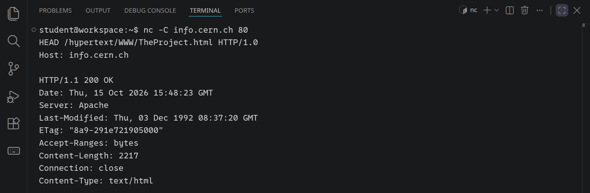

Die Antwort beginnt mit der **Status-Line** `HTTP/1.1 200 OK`: Die Seite gibt es. Danach kommen Header, zum Beispiel `Last-Modified`: Diese Seite wurde zuletzt im Dezember 1992 geändert. `nc` wartet danach weiter auf deine Eingabe; beende es mit <kbd>Strg</kbd><kbd>C</kbd>.

_person(berners-lee)

Hol jetzt die Seite selbst: dieselben Zeilen, nur mit `GET` statt `HEAD`. Nach der leeren Zeile unter den Headern kommt diesmal das HTML der ersten Webseite der Welt.

_uses(http-anfrage, http-antwort)

_task(erste-webseite)

_task(leere-zeile)

<div class='hint try'>
<strong>Ausprobieren:</strong> Schick <code>info.cern.ch</code> Anfragen, die nicht ganz stimmen, jede über eine neue Verbindung mit <code>nc -C info.cern.ch 80</code> und mit einer leeren Zeile am Ende:
<ul>
<li>einen Pfad, den es nicht gibt: <code>HEAD /missing.html HTTP/1.0</code></li>
<li>eine Methode, die es nicht gibt: <code>HAED /hypertext/WWW/TheProject.html HTTP/1.0</code></li>
<li><code>HTTP/1.1</code> statt <code>HTTP/1.0</code>, aber ohne die Zeile <code>Host:</code></li>
</ul>
Welche Status-Line kommt jeweils zurück? Warum besteht ein Server bei <code>HTTP/1.1</code> auf dem <code>Host</code>-Header?
</div>

### Die TCP-Konsole

Bei `https://` liegt zwischen TCP und HTTP noch eine Schicht, **TLS**, die alles verschlüsselt. Mit `nc` kommst du da nicht mehr hinein. Die [TCP-Konsole](/tcp-console) kann es: Sie macht dasselbe wie `nc -C`, nur im Browser, mit einem Schalter für TLS, und sie zeigt, was du geschickt hast, was zurückkam und wann. Die Verbindung beginnt dabei in deinem Workspace, so wie bei `nc`.

_tool(tcp-console)

Öffne die Konsole, klicke auf »example.com, Port 443 mit TLS« und dann auf »Verbinden«. Tippe danach wieder eine Anfrage:

```text
HEAD / HTTP/1.1
Host: example.com
```

und eine leere Zeile. Die Konsole verschlüsselt jede Zeile, bevor sie zum Server geht, und entschlüsselt die Antwort.

<!-- tutorial-screenshot
# TCP-Konsole: HEAD an example.com über TLS
open-site: /tcp-console
tab: preview
viewport: 1029x1300
click: example.com, Port 443 mit TLS
click: selector:#tcp-connect-button
wait-for-text: verschlüsselt mit
click: selector:#tcp-line
type: HEAD / HTTP/1.1
press: Enter
type: Host: example.com
press: Enter
press: Enter
wait-for-text: HTTP/1.1 200
sleep: 2
crop-element: #tcp-log
-->
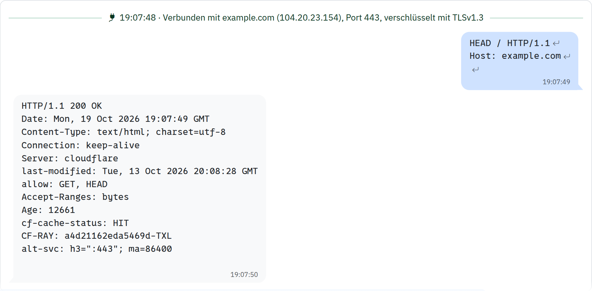

Deine Anfrage steht in einer Sprechblase, jede Zeile mit einem Pfeil für das CR LF an ihrem Ende, die leere Zeile als Pfeil allein. Die Antwort des Servers hat dieselbe Form: Status-Line, Header, leere Zeile. Diesmal schließt der Server die Verbindung nicht gleich: Bei `HTTP/1.1` bleibt sie offen, für die nächste Anfrage. Schick noch eine, oder warte und lies an den Uhrzeiten ab, wie lange der Server wartet, bevor er auflegt.

### Wer zu langsam tippt

Verbinde dich jetzt mit `www.wikipedia.org`, Port 80, ohne TLS, und lass dir Zeit mit der ersten Zeile.

_task(zu-langsam)

<!-- after: zu-langsam -->
Ein Server hält nicht jede Verbindung ewig offen. Jede offene Verbindung kostet ihn Speicher, und wer tausend Verbindungen öffnet und nie etwas schickt, könnte ihn sonst lahmlegen. Darum schließt er Verbindungen, über die eine Weile nichts kommt. Wie lange er wartet, legt jeder Server selbst fest: `www.wikipedia.org` nur wenige Sekunden, `example.com` etwa 15 Sekunden, `info.cern.ch` fast eine Minute. Wer trotzdem in Ruhe tippen möchte, schreibt die Anfrage vorher hin und fügt sie auf einmal ein; die Konsole schickt mehrere Zeilen nacheinander ab.
<!-- /after -->

## Daten aus dem Netz holen

### Dateien herunterladen: `wget`

<div class='hint books'>
In diesem Abschnitt lernst du den Befehl <code>wget</code> kennen.
</div>

Um Dateien aus dem Internet herunterzuladen, kannst du den Befehl `wget` verwenden, gefolgt von der Adresse der Datei:

```bash_copy
wget https://github.com/begilbert-sys/2048-in-C/raw/main/main.c
```

Du solltest sehen, wie die Datei `main.c` heruntergeladen wird:

<!-- tutorial-screenshot
press: Control+C
terminal-wait-for-prompt
terminal-run: clear
terminal-run: wget https://github.com/begilbert-sys/2048-in-C/raw/main/main.c
terminal-wait-for-prompt
wait-for-file: main.c
crop-terminal-lines: auto
-->

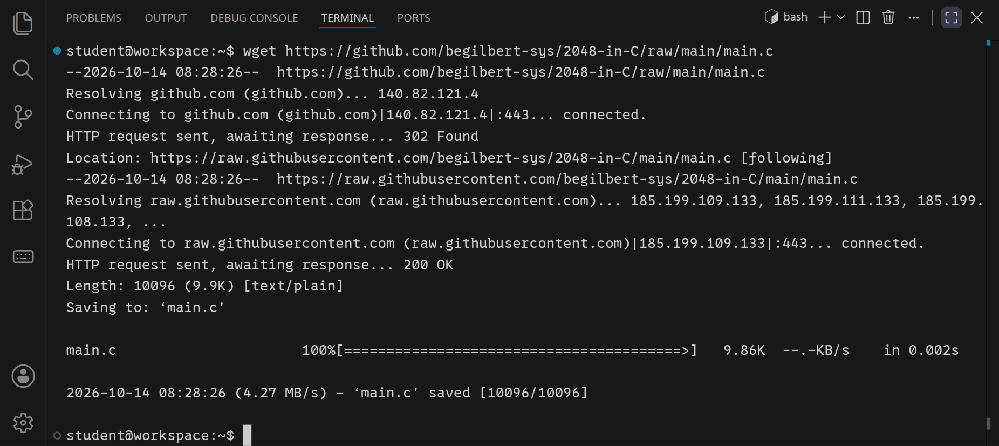

Auch hier siehst du die Schritte von eben: Den Namen nachschlagen (»Resolving«), die Verbindung zu Port 443 aufbauen (»Connecting … connected«), die Anfrage schicken. GitHub antwortet zuerst mit `302 Found`: Die Datei liegt unter einer anderen Adresse, und `wget` folgt ihr.

Du solltest jetzt eine Datei `main.c` in deinem aktuellen Verzeichnis haben (`ls -l`):

<!-- tutorial-screenshot
terminal-run: clear
terminal-run: ls -l
terminal-wait-for-prompt
crop-terminal-lines: auto
-->

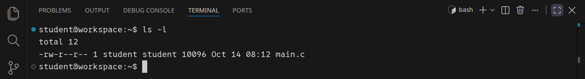

Es handelt sich um ein Mini-Spiel, das in der [Programmiersprache C](/c) programmiert worden ist. Du kannst es mit dem Befehl `gcc` kompilieren und anschließend ausführen.

```bash
gcc main.c -o 2048 -lncurses -lm
```

<div class='hint'>
Das Spiel benötigt die Bibliotheken <code>ncurses</code> und <code>math</code>, weshalb wir dem Compiler mit den Optionen <code>-lncurses</code> und <code>-lm</code> mitteilen, dass er diese Bibliotheken einbinden soll.
</div>

Danach liegt neben `main.c` das Programm `2048`:

<!-- tutorial-screenshot
terminal-run: clear
terminal-run: gcc main.c -o 2048 -lncurses -lm
terminal-wait-for-prompt
wait-for-file: 2048
terminal-run: ls -l
terminal-wait-for-prompt
crop-terminal-lines: auto
-->

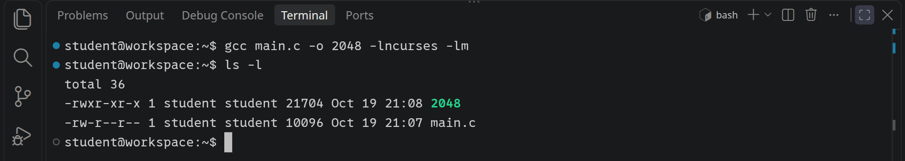

Das Spiel ist jetzt kompiliert und kann mit dem Befehl `./2048` ausgeführt werden:

```bash
./2048
```

<!-- tutorial-screenshot
terminal-run: clear
terminal-run: ./2048
sleep: 1.5
press: ArrowLeft
sleep: 0.3
press: ArrowUp
sleep: 0.3
press: ArrowRight
sleep: 1
crop-terminal-lines: 99
-->

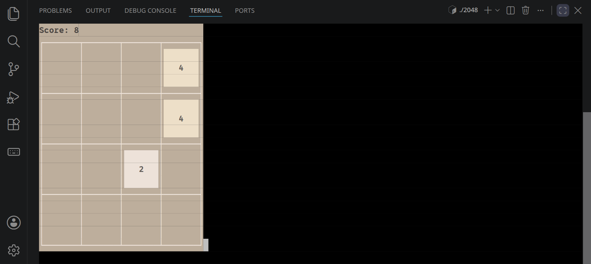

Du kannst das Spiel mit den Pfeiltasten steuern und mit <kbd>Strg</kbd><kbd>C</kbd> beenden.

_task(spiel-2048)

### Webseiten und APIs: `curl`

<div class='hint books'>
In diesem Abschnitt lernst du den Befehl <code>curl</code> kennen.
</div>

Auch `curl` lädt Dateien herunter, gibt sie aber im Terminal aus, statt sie zu speichern. Es spricht HTTP für dich, auch verschlüsselt, und eignet sich darum gut, um mit Webseiten und APIs zu reden. Hol eine Webseite, wie es auch ein Browser tun würde:

```bash
curl -s https://gymnasiumsteglitz.de | less
```

`-s` schaltet die Fortschrittsanzeige ab. Mit den Pfeiltasten scrollst du durch die Seite, <kbd>Q</kbd> beendet `less`.

<!-- tutorial-screenshot
press: Control+C
terminal-wait-for-prompt
terminal-run: clear
terminal-run: curl -s https://gymnasiumsteglitz.de | less
wait-for-text: html
sleep: 1
crop-terminal-lines: 99
-->

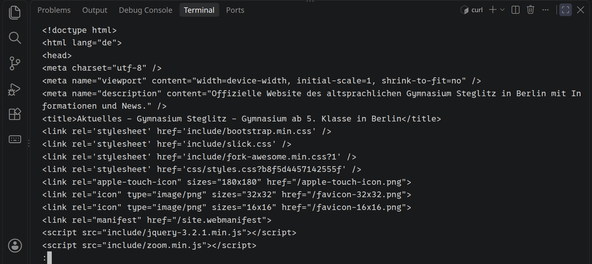

Mit `-I` fragt `curl` wie eben `HEAD` und zeigt nur die Header der Antwort:

```bash
curl -I https://gymnasiumsteglitz.de
```

<!-- tutorial-screenshot
press: q
terminal-wait-for-prompt
terminal-run: clear
terminal-run: curl -I https://gymnasiumsteglitz.de
terminal-wait-for-prompt
crop-terminal-lines: auto
-->

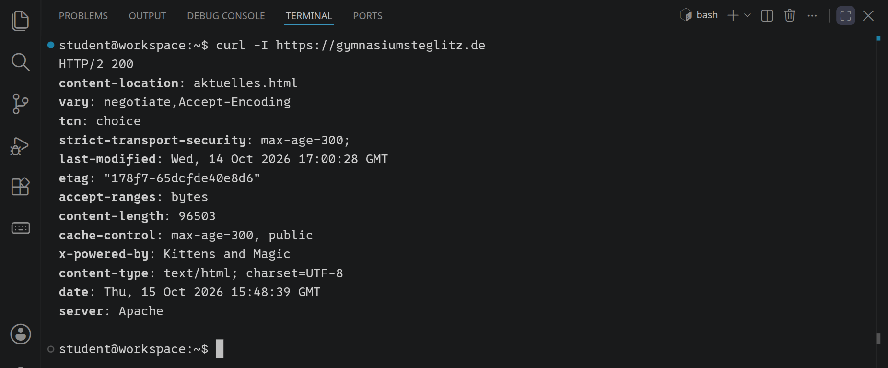

`curl -v` zeigt außerdem alles, was `curl` selbst schickt: dieselben Zeilen, die du eben von Hand getippt hast.

_uses(http-header, curl)

_task(webserver)

<div class='hint try'>
<strong>Ausprobieren:</strong> Dreh es um und sieh dir an, was <code>curl</code> schickt. Starte in einem Terminal <code>nc -C -l -p 1234</code> und im zweiten <code>curl http://localhost:1234/hallo</code>. Was steht im ersten Terminal? <code>curl</code> wartet jetzt auf eine Antwort: Tippe im ersten Terminal <code>HTTP/1.0 200 OK</code>, eine leere Zeile und <code>Hallo zurück!</code> und beende <code>nc</code> dann mit <kbd>Strg</kbd><kbd>C</kbd>. Was gibt <code>curl</code> aus? Gerade warst du ein Webserver.
</div>

_person(stenberg)

Eine API ist eine Adresse, die keine Seite für Menschen liefert, sondern Daten für Programme. Die »Cat Facts«-API zum Beispiel gibt zufällige Fakten über Katzen zurück:

```bash
curl https://catfact.ninja/fact
```

Die Ausgabe ist etwas schwer zu lesen:

<!-- tutorial-screenshot
terminal-run: clear
terminal-run: curl https://catfact.ninja/fact
terminal-wait-for-prompt
crop-terminal-lines: auto
-->

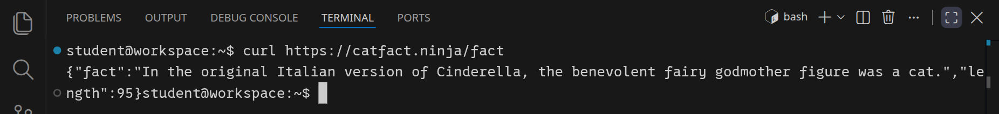

Die Antwort ist im JSON-Format. Dieses Format eignet sich hervorragend, um es in einem Programm oder Skript zu verarbeiten. `jq` gibt JSON übersichtlich und farbig aus:

```bash
curl -s https://catfact.ninja/fact | jq
```

<!-- tutorial-screenshot
terminal-run: clear
terminal-run: curl -s https://catfact.ninja/fact | jq
terminal-wait-for-prompt
crop-terminal-lines: auto
-->

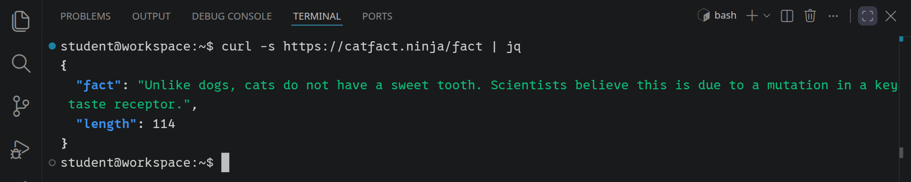

_uses(json-aufbau, jq)

Du kannst die Abfrage beliebig oft wiederholen und solltest jedesmal einen zufälligen, neuen Fakt über Katzen erhalten.

_task(katzenfakt)

Es gibt viele APIs, die du mit `curl` abfragen kannst. Manche sind frei zugänglich, andere verlangen einen API-Schlüssel. Eine lange Liste hat jemand unter [Public APIs](https://github.com/public-apis/public-apis) gesammelt. Wie man eine API aus einem Programm und einer Webseite benutzt, zeigt [Daten aus dem Netz](/wetter) am Beispiel eines Wetterdienstes.

## Zum Ausprobieren: ASCII-Kino

<div class='hint books'>
In diesem Abschnitt lernst du den Befehl <code>telnet</code> kennen, den du aber auf keinen Fall verwenden solltest, um dich bei anderen Servern anzumelden. Wir verwenden ihn hier nur, um die ASCII-Version von Star Wars zu schauen.
</div>

Früher meldete man sich mit `telnet` bei anderen Rechnern an. Wie `netcat` öffnet `telnet` einfach eine TCP-Verbindung, unverschlüsselt: Jeder Router unterwegs könnte Passwörter mitlesen. Heute nimmt man dafür SSH. Einen Zweck hat `telnet` aber noch, die ASCII-Version von Star Wars:

```bash
telnet towel.blinkenlights.nl
```

<!-- tutorial-screenshot
terminal-run: clear
terminal-run: telnet towel.blinkenlights.nl
sleep: 25
crop-terminal-lines: 99
-->

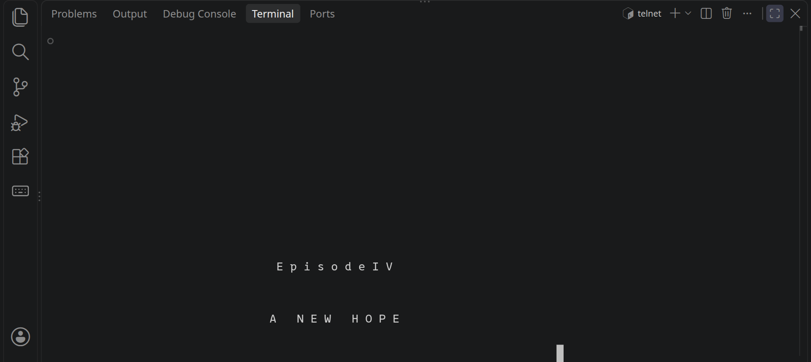

<!-- tutorial-screenshot
# Die Mülltonne über dem Terminal, mit Mauszeiger und Tooltip; nur die
# Titelleiste des Terminals und der Tooltip, der Rest transparent
move-mouse: selector:.part.panel [aria-label*="Kill Terminal"] >> nth=0
sleep: 1.5
show-mouse
# the terminal is maximised here: its title bar is at the top
crop-left: 68%
crop-bottom: 76%
keep-only: .part.panel > .composite.title
keep-only: .workbench-hover
keep-only: .workbench-hover-pointer
-->

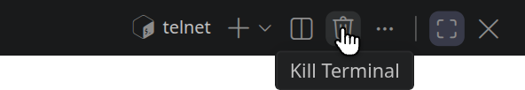

Da `telnet` etwas umständlich zu beenden ist, drücke einfach auf die Mülltonne in der rechten oberen Ecke des Terminals, um das Terminal zu schließen, und anschließend auf das Pluszeichen, um ein neues Terminal zu öffnen.

<div style='clear: both;'></div>

## Zusammenfassung

<table class='table table-sm'>
<tr><th>Adresse</th><td><code>ifconfig</code></td></tr>
<tr><th>Entfernung und Weg</th><td><code>ping</code>, <code>traceroute -q 1</code></td></tr>
<tr><th>Ports und Verbindungen</th><td><code>ss -tln</code> (wartende Ports), <code>curl -w '%{time_connect}'</code> (Dauer des Handshakes)</td></tr>
<tr><th>Eigene Verbindungen</th><td><code>nc -l -p 1234</code> und <code>nc ADRESSE 1234</code>, <code>nc -C info.cern.ch 80</code> (HTTP von Hand), <code>telnet</code> (unverschlüsselt, nur noch fürs Kino)</td></tr>
<tr><th>Herunterladen</th><td><code>wget</code>, <code>curl</code>, <code>curl -I</code> (nur die Header), <code>jq</code> (JSON lesbar machen)</td></tr>
</table>

## Wie geht es weiter?

In [Ein eigener Webserver](/webserver) schreibst du die andere Seite selbst: ein Programm, das wie `nc -l` an einem Port wartet, die Zeilen liest, die du hier getippt hast, und mit HTTP antwortet. In der [Pixelwand](/pixelwand) bleibt die Verbindung offen, und die ganze Klasse malt gleichzeitig an einem Bild. Wie du eine API aus Ruby und aus einer Webseite benutzt, zeigt [Daten aus dem Netz](/wetter).

<!-- tutorial-screenshot
# Bild für die Karte der Aktivität: HTTP von Hand, groß; 700 hoch, weil
# VS Code 1.140 dem Terminal weniger Platz lässt und sonst der Befehl oben
# herausscrollt
zoom: 1.5
viewport: 1029x700
press: Control+Shift+P
type: Terminal: Kill All Terminals
press: Enter
sleep: 2
press: Control+Shift+Backquote
sleep: 3
terminal-maximize
terminal-wait-for-prompt
terminal-run: clear
terminal-run: nc -C info.cern.ch 80
sleep: 1
type: HEAD /hypertext/WWW/TheProject.html HTTP/1.0
press: Enter
type: Host: info.cern.ch
press: Enter
press: Enter
wait-for-text: Content-Type
sleep: 1
crop-terminal-lines: auto
-->
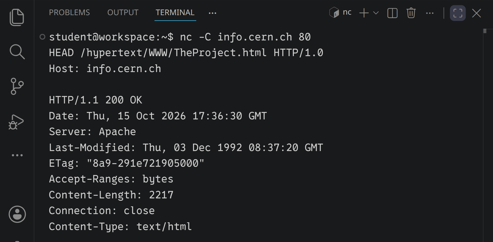
