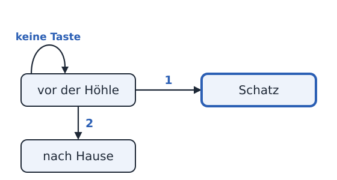
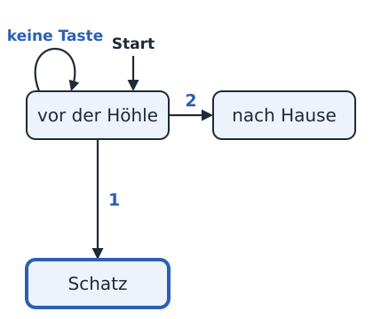
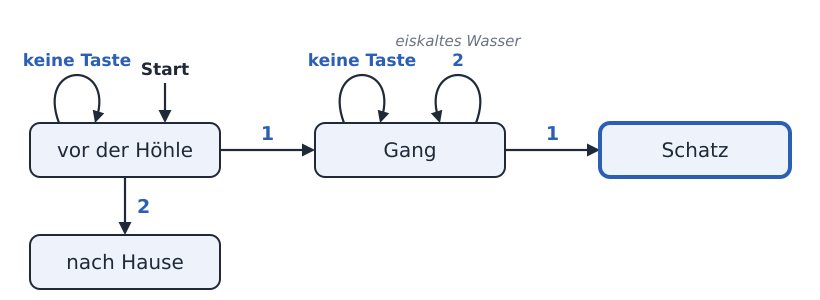
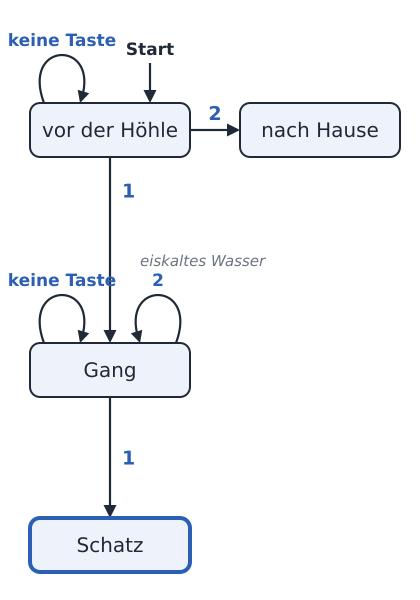
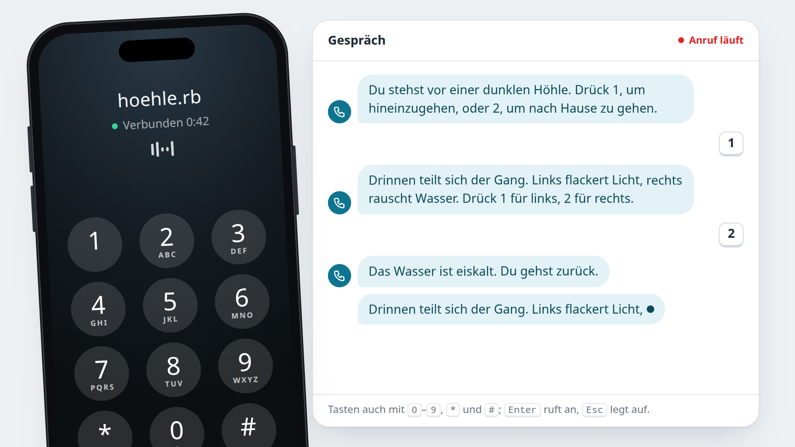

<div class='meta'>
image: teaser.webp
image_alt: "Das Telefon im Browser während eines Anrufs bei der Höhle: links ein Telefon mit Display, Tastenfeld und rotem Hörer zum Auflegen; rechts das Gespräch, die Sätze des Spiels in Blasen, die gedrückten Tasten 1 und 2 als kleine Tasten, und der nächste Satz erscheint gerade Wort für Wort"
kind: projekt
language: Ruby / Python
languages: [ruby, python]
duration: 3 Doppelstunden
curriculum: "Sek I: Algorithmisches Problemlösen (algorithmische Grundstrukturen: Verzweigung, Prozeduren); Oberstufe: Algorithmen und Softwareentwicklung (Sequenz, Auswahl)"
topics: [grundstrukturen, unterprogramme]
age: Sek I
requires: [kata-decisions]
reference: [ruby-python, terminal]
</div>

<div
    class="autotoc-secondary-trigger"
    data-title="Auf dieser Seite"
    data-levels="h2,h3">
</div>

# Ein Spiel am Telefon

<p class='abstract'>
Du programmierst ein Spiel, das man anrufen kann: Es spricht mit einer
echten Stimme, spielt Musik und hört auf die Tasten des Telefons. Erst
begrüßt dich dein Programm, dann stellt es eine Frage, und am Ende führt es
durch eine Höhle voller Gänge. Zum Schluss schreibst du deine eigene
Geschichte, und jemand aus deiner Klasse spielt sie durch.
</p>

## Der erste Anruf

### Ein Telefon im Workspace

»Drücken Sie die 1 für den Kundendienst, die 2 für …«: So ein Telefon, das
spricht und auf Tasten hört, ist ein Programm. Es sagt etwas, wartet auf eine
Taste und macht je nach Taste anders weiter. Genau so ein Programm schreibst
du. Wer anruft, sieht nichts davon: Alles, was dein Spiel zu bieten hat, ist
zu hören.

Im Workspace probierst du dein Spiel mit dem Befehl `telefon` aus. Er startet
dein Programm und zeigt dir im Browser ein Telefon mit Tastenfeld. Daneben
steht, was das Spiel sagt, Wort für Wort, während du es hörst.

Lege im Terminal (<kbd>Strg</kbd><kbd>J</kbd>) einen Ordner an und öffne ihn mit <kbd>Strg</kbd><kbd>K</kbd> <kbd>Strg</kbd><kbd>O</kbd>:

```bash
mkdir /workspace/telefon
```

<!-- language: ruby -->
Lege darin die Datei `hallo.rb` an:

```ruby
require 'telefon'

say 'Hallo! Hier spricht dein erstes Telefonspiel.'
```

`require 'telefon'` lädt die Befehle des Telefons, und `say` sagt einen Text.
Ruby wartet, bis der Satz gesprochen ist, und macht erst dann mit der nächsten
Zeile weiter.
<!-- /language -->
<!-- language: python -->
Lege darin die Datei `hallo.py` an:

```python
from telefon import say

say('Hallo! Hier spricht dein erstes Telefonspiel.')
```

Die erste Zeile holt den Befehl `say` aus der Bibliothek des Telefons, und
`say` sagt einen Text. Python wartet, bis der Satz gesprochen ist, und macht
erst dann mit der nächsten Zeile weiter.
<!-- /language -->

<!-- language: ruby -->
<!-- stage: stufen/1-hallo/hallo.rb as hallo.rb -->
<!-- /language -->
<!-- language: python -->
<!-- stage: stufen/1-hallo/hallo.py as hallo.py -->
<!-- /language -->

### Anrufen

Starte das Telefon im Terminal, im Ordner `telefon`:

<!-- language: ruby -->
```bash
telefon hallo.rb
```
<!-- /language -->
<!-- language: python -->
```bash
telefon hallo.py
```
<!-- /language -->

Das Terminal nennt eine Adresse; sie steht auch im Reiter »Ports« neben
»Terminal«, bei Port 8040. Öffne sie im Browser und klick auf den grünen
Hörer. Jetzt startet dein Programm, und du hörst seine Stimme. Im Terminal
steht jeder Satz in dem Moment, in dem er gesprochen wird.

Nach der letzten Zeile ist das Programm zu Ende, und damit auch der Anruf. Ein
Klick auf den Hörer ruft noch einmal an: Das Programm startet dann von vorn.
Hast du die Datei geändert, hörst du beim nächsten Anruf die neue Fassung;
`telefon` selbst musst du dafür nicht neu starten. Beenden kannst du es im
Terminal mit <kbd>Strg</kbd><kbd>C</kbd>.

_task(hallo)

<div class='hint try'>
<strong>Ausprobieren:</strong> Schreib unter den ersten Satz einen zweiten
mit <code>say</code> und ruf noch einmal an. Achte darauf, wann der zweite
Satz beginnt: Steht er schon da, während der erste noch gesprochen wird?
</div>

## Musik und Pausen

### Musik im Hintergrund

Ein Spiel am Telefon lebt von dem, was man hört. Mit `music` spielt dein
Programm Musik, und mit einer Pause davor hört man sie erst eine Weile allein,
bevor die Stimme einsetzt:

<!-- language: ruby -->
```ruby
~ require 'telefon'
~
music 'https://www.youtube.com/watch?v=-xRD8VmjBQM'
sleep 3
~ say 'Hallo! Hier spricht dein erstes Telefonspiel.'
```
<!-- /language -->
<!-- language: python -->
```python
from telefon import music, say, sleep

music('https://www.youtube.com/watch?v=-xRD8VmjBQM')
sleep(3)
~ say('Hallo! Hier spricht dein erstes Telefonspiel.')
```

In der ersten Zeile stehen jetzt auch `music` und `sleep`, die anderen
beiden Befehle, die dein Programm aus der Bibliothek braucht.
<!-- /language -->

<!-- language: ruby -->
<!-- stage: stufen/2-musik/hallo.rb as hallo.rb -->
<!-- /language -->
<!-- language: python -->
<!-- stage: stufen/2-musik/hallo.py as hallo.py -->
<!-- /language -->

Von einem Video nimmt das Telefon nur den Ton, und es spielt ihn in einer
Schleife, bis dein Programm zu Ende ist. `music` wartet, bis die Musik läuft;
beim ersten Mal kann das einige Sekunden dauern, weil der Workspace das Video
erst holt. Danach liegt es bereit. Statt eines Links geht auch eine Datei aus
deinem Ordner, etwa `music 'hoehle.mp3'`; nimm dafür MP3, das spielt jeder
Browser.

<!-- language: ruby -->
Brauchst du nur eine Stelle aus einem längeren Video, sag, wo sie anfängt
und wo sie aufhört: `music '…', start: '1:15', stop: '1:52'` spielt die
Musik von Minute 1:15 bis 1:52 und dann wieder ab 1:15. Ohne `stop` geht es
ab `start` weiter. Kopierst du bei YouTube mit »Teilen« einen Link ab einer
Stelle, endet er auf `t=75`; auch dann beginnt die Musik dort.
<!-- /language -->
<!-- language: python -->
Brauchst du nur eine Stelle aus einem längeren Video, sag, wo sie anfängt
und wo sie aufhört: `music('…', start='1:15', stop='1:52')` spielt die
Musik von Minute 1:15 bis 1:52 und dann wieder ab 1:15. Ohne `stop` geht es
ab `start` weiter. Kopierst du bei YouTube mit »Teilen« einen Link ab einer
Stelle, endet er auf `t=75`; auch dann beginnt die Musik dort.
<!-- /language -->

`sleep` wartet, so viele Sekunden, wie du angibst. Die Musik spielt dabei
weiter.

_task(musik)

### Leiser, wenn jemand spricht

Hör genau hin, wenn die Stimme einsetzt: Die Musik wird leiser, solange ein
Satz gesprochen wird, und danach wieder laut. So macht es auch das Radio,
wenn jemand über die Musik spricht. Dein Programm muss dafür nichts tun.

<div class='hint try'>
<strong>Ausprobieren:</strong> Gib der Musik eine Lautstärke zwischen
<code>0</code> und <code>1</code>, in Ruby mit
<code>music '…', volume: 0.3</code>, in Python mit
<code>music('…', 0.3)</code>. Ohne Angabe spielt sie mit <code>1</code>, so
laut wie möglich. Achte darauf, ob du die Stimme bei <code>1</code> noch gut
verstehst.
</div>

## Eine Frage mit Tasten

### Auf eine Taste warten

Jetzt soll dein Spiel zuhören. Lege eine neue Datei an:

<!-- language: ruby -->
`frage.rb`:

```ruby
require 'telefon'

say 'Katzen oder Hunde? Drück 1 für Katzen, 2 für Hunde.'
key = keys(1)
if key == '1'
  say 'Miau! Katzen schlafen bis zu sechzehn Stunden am Tag.'
elsif key == '2'
  say 'Wuff! Hunde hören Töne, die für dich zu hoch sind.'
else
  say 'Du hast nichts gedrückt. Schade!'
end
```
<!-- /language -->
<!-- language: python -->
`frage.py`:

```python
from telefon import keys, say

say('Katzen oder Hunde? Drück 1 für Katzen, 2 für Hunde.')
key = keys(1)
if key == '1':
    say('Miau! Katzen schlafen bis zu sechzehn Stunden am Tag.')
elif key == '2':
    say('Wuff! Hunde hören Töne, die für dich zu hoch sind.')
else:
    say('Du hast nichts gedrückt. Schade!')
```
<!-- /language -->

<!-- language: ruby -->
<!-- stage: stufen/3-frage/frage.rb as frage.rb -->
<!-- /language -->
<!-- language: python -->
<!-- stage: stufen/3-frage/frage.py as frage.py -->
<!-- /language -->

`keys(1)` wartet auf eine Taste und gibt sie zurück, als Text: `'1'`, wenn
jemand die 1 drückt. Drückt zehn Sekunden lang niemand etwas, gibt `keys`
einen leeren Text zurück, `''`. Danach entscheidet die Verzweigung, was das
Spiel sagt. Starte das Telefon mit der neuen Datei und probier alle drei Wege
aus: die 1, die 2 und gar keine Taste.

Eine Taste, die jemand drückt, während das Spiel noch spricht, geht nicht
verloren: Sie wartet, bis dein Programm `keys` aufruft. Wer die Frage schon
kennt, muss sie also nicht bis zum Ende anhören.

### Text oder Zahl?

Auf dem Telefon steht eine 1, und `keys` gibt `'1'` zurück, mit
Anführungszeichen. Ist das nicht dasselbe?

_task(text-oder-zahl)

<!-- after: text-oder-zahl -->
Das Spiel sagt »Du hast nichts gedrückt. Schade!«. `keys` gibt einen Text
zurück, auch wenn er nur aus einer Ziffer besteht, und ein Text ist nie
gleich einer Zahl: `'1' == 1` ist falsch. Darum vergleicht dein Programm mit
`'1'` in Anführungszeichen. So kann `keys` auch `*` und `#` zurückgeben, und
mehrere Tasten auf einmal, wie `'472'`.
<!-- /after -->

### Eine dritte Wahl

<div class='hint own' data-check='drei'>
<strong>Jetzt bist du dran:</strong> Biete Fische als dritte Wahl an. Mit
der 3 sagt das Spiel »Blubb! Fische haben keine Augenlider.« Vergiss nicht,
die Frage am Anfang so zu ändern, dass sie die 3 auch nennt.
</div>

<!-- hint -->
Jede Antwort ist ein eigener Zweig der Verzweigung. Für die 3 kommt ein
weiterer dazu, vor dem Zweig für »nichts gedrückt«: Der fängt alles auf, was
die Zweige davor nicht erkannt haben.
<!-- /hint -->
<!-- hint -->
<!-- language: ruby -->
Ein neuer Zweig zwischen dem für die 2 und `else`:

<!-- page-code: own -->
```ruby
elsif key == '…'
  say '…'
```
<!-- /language -->
<!-- language: python -->
Ein neuer Zweig zwischen dem für die 2 und `else:`:

<!-- page-code: own -->
```python
elif key == '…':
    say('…')
```
<!-- /language -->
<!-- /hint -->

<!-- solution -->
<!-- language: ruby -->
```ruby
~ require 'telefon'
~
say 'Katzen, Hunde oder Fische? Drück 1 für Katzen, 2 für Hunde, 3 für Fische.'
~ key = keys(1)
~ …
~ elsif key == '2'
~   say 'Wuff! Hunde hören Töne, die für dich zu hoch sind.'
elsif key == '3'
  say 'Blubb! Fische haben keine Augenlider.'
~ else
```
<!-- /language -->
<!-- language: python -->
```python
~ from telefon import keys, say
~
say('Katzen, Hunde oder Fische? Drück 1 für Katzen, 2 für Hunde, 3 für Fische.')
~ key = keys(1)
~ …
~ elif key == '2':
~     say('Wuff! Hunde hören Töne, die für dich zu hoch sind.')
elif key == '3':
    say('Blubb! Fische haben keine Augenlider.')
~ else:
```
<!-- /language -->
<!-- /solution -->

<!-- language: ruby -->
<!-- stage: stufen/4-drei/frage.rb as frage.rb -->
<!-- /language -->
<!-- language: python -->
<!-- stage: stufen/4-drei/frage.py as frage.py -->
<!-- /language -->

_task(drei)

### Wie lange gewartet wird

Zehn Sekunden sind lang, wenn man schon weiß, was man drücken will, und kurz
für eine schwere Frage. Wie lange `keys` wartet, sagst du in Sekunden:

<!-- language: ruby -->
`keys(1, timeout: 5)` wartet nur fünf Sekunden.
<!-- /language -->
<!-- language: python -->
`keys(1, timeout=5)` wartet nur fünf Sekunden.
<!-- /language -->

Und mit `keys(3)` wartet dein Programm auf bis zu drei Tasten, etwa für eine
Geheimzahl; die Raute <kbd>#</kbd> beendet die Eingabe früher.

<div class='hint try'>
<strong>Ausprobieren:</strong> Gib der Frage zwei Sekunden und ruf an. Achte
darauf, ob du es schaffst, nach dem Ende der Frage noch zu drücken, und was
passiert, wenn du schon während der Frage drückst.
</div>

## Eine Höhle aus Szenen

### Szenen

Ein Abenteuer besteht aus Szenen: Jede sagt, wo man gerade ist, und welche
Taste wohin führt. Auf einer Karte sind die Szenen Kästen und die Tasten
Pfeile. Diese Höhle hat erst einmal drei Szenen: davor, nach Hause und den
Schatz.




Jede Szene wird in deinem Programm eine Funktion. Die Funktion sagt, was in
ihrer Szene zu sagen ist, wartet auf eine Taste und ruft die Funktion der
nächsten Szene auf. Lege `hoehle` an:

<!-- language: ruby -->
`hoehle.rb`:

```ruby
require 'telefon'

def treasure
  say 'Im Licht einer Fackel glänzt eine Kiste voller Gold. Du hast den Schatz gefunden!'
end

def cave
  say 'Du stehst vor einer dunklen Höhle. Drück 1, um hineinzugehen, oder 2, um nach Hause zu gehen.'
  key = keys(1)
  if key == '1'
    treasure
  elsif key == '2'
    say 'Du gehst nach Hause. Vielleicht ein anderes Mal.'
  else
    cave
  end
end

music 'https://www.youtube.com/watch?v=-xRD8VmjBQM'
sleep 3
cave
say 'Ende.'
```
<!-- /language -->
<!-- language: python -->
`hoehle.py`:

```python
from telefon import keys, music, say, sleep


def treasure():
    say('Im Licht einer Fackel glänzt eine Kiste voller Gold. Du hast den Schatz gefunden!')


def cave():
    say('Du stehst vor einer dunklen Höhle. Drück 1, um hineinzugehen, oder 2, um nach Hause zu gehen.')
    key = keys(1)
    if key == '1':
        treasure()
    elif key == '2':
        say('Du gehst nach Hause. Vielleicht ein anderes Mal.')
    else:
        cave()


music('https://www.youtube.com/watch?v=-xRD8VmjBQM')
sleep(3)
cave()
say('Ende.')
```
<!-- /language -->

<!-- language: ruby -->
<!-- stage: stufen/5-hoehle/hoehle.rb as hoehle.rb -->
<!-- /language -->
<!-- language: python -->
<!-- stage: stufen/5-hoehle/hoehle.py as hoehle.py -->
<!-- /language -->

Unten steht, was beim Anruf passiert: Musik, eine Pause, dann die Szene vor
der Höhle. Wenn sie zu Ende ist, sagt das Spiel »Ende.«, und der Anruf ist
vorbei. Die Szene »nach Hause« ist so kurz, dass sie keine eigene Funktion
braucht: Sie ist nur ein Satz.

### Wenn niemand drückt

Steh vor der Höhle und drück gar nichts.

_task(nichts-gedrueckt)

<!-- after: nichts-gedrueckt -->
Nach zehn Sekunden sagt das Spiel den Satz vor der Höhle noch einmal. `keys`
gibt dann `''` zurück, und im Zweig für alles andere ruft `cave` sich selbst
auf: Die Szene beginnt von vorn. Das passt zum Telefon. Wer nicht weiß, was
er drücken soll, hört die Wahl noch einmal. Dasselbe passiert bei einer
Taste, die in dieser Szene nichts bedeutet, etwa der 7.
<!-- /after -->

### Der Gang

Hinter dem Eingang soll sich der Weg teilen. Die 1 vor der Höhle führt dann
nicht mehr direkt zum Schatz, sondern in einen Gang: Links flackert Licht,
dort liegt der Schatz. Rechts rauscht Wasser, das ist eiskalt, und man muss
zurück in den Gang.




<div class='hint own' data-check='gang'>
<strong>Jetzt bist du dran:</strong> Schreib die Szene <code>tunnel</code>
als Funktion zwischen <code>treasure</code> und <code>cave</code>. Sie sagt
»Drinnen teilt sich der Gang. Links flackert Licht, rechts rauscht Wasser.
Drück 1 für links, 2 für rechts.« Mit der 1 geht es zum Schatz. Mit der 2
sagt sie »Das Wasser ist eiskalt. Du gehst zurück.« und beginnt von vorn,
ohne Taste ebenso. In <code>cave</code> führt die 1 jetzt in den Gang.
</div>

<!-- hint -->
Spiel es erst auf der Karte durch: vor der Höhle die 1, im Gang die 2, dann
die 1. Welche Sätze hörst du nacheinander? Die Funktion `tunnel` sieht aus wie
`cave`, nur mit anderen Sätzen und anderen Zielen.
<!-- /hint -->
<!-- hint -->
In Worten: Sag den Satz des Gangs. Warte auf eine Taste. Ist es die 1, geh
zum Schatz. Ist es die 2, sag den Satz vom Wasser und geh in den Gang. Sonst
geh in den Gang. »Geh in den Gang« heißt: ruf `tunnel` auf.
<!-- /hint -->
<!-- hint -->
<!-- language: ruby -->
<!-- page-code: own -->
```ruby
def tunnel
  say '…'
  key = keys(1)
  if key == '1'
    …
  elsif key == '2'
    say '…'
    …
  else
    …
  end
end
```
<!-- /language -->
<!-- language: python -->
<!-- page-code: own -->
```python
def tunnel():
    say('…')
    key = keys(1)
    if key == '1':
        …
    elif key == '2':
        say('…')
        …
    else:
        …
```
<!-- /language -->
<!-- /hint -->

<!-- solution -->
<!-- language: ruby -->
```ruby
def tunnel
  say 'Drinnen teilt sich der Gang. Links flackert Licht, rechts rauscht Wasser. Drück 1 für links, 2 für rechts.'
  key = keys(1)
  if key == '1'
    treasure
  elsif key == '2'
    say 'Das Wasser ist eiskalt. Du gehst zurück.'
    tunnel
  else
    tunnel
  end
end
```

In `cave` führt die 1 in den Gang:

```ruby
~   key = keys(1)
~   if key == '1'
    tunnel
~   elsif key == '2'
```
<!-- /language -->
<!-- language: python -->
```python
def tunnel():
    say('Drinnen teilt sich der Gang. Links flackert Licht, rechts rauscht Wasser. Drück 1 für links, 2 für rechts.')
    key = keys(1)
    if key == '1':
        treasure()
    elif key == '2':
        say('Das Wasser ist eiskalt. Du gehst zurück.')
        tunnel()
    else:
        tunnel()
```

In `cave` führt die 1 in den Gang:

```python
~     key = keys(1)
~     if key == '1':
        tunnel()
~     elif key == '2':
```
<!-- /language -->
<!-- /solution -->

<!-- language: ruby -->
<!-- stage: stufen/6-gang/hoehle.rb as hoehle.rb -->
<!-- /language -->
<!-- language: python -->
<!-- stage: stufen/6-gang/hoehle.py as hoehle.py -->
<!-- /language -->

_task(gang)

## Deine Geschichte

### Erst die Karte

Jetzt erfindest du dein eigenes Abenteuer: eine Burg, ein Raumschiff, ein
Wald, ein Schulgebäude nach Mitternacht. Zeichne zuerst die Karte auf
Papier, mit einem Kasten für jede Szene und einem Pfeil für jede Taste, wie
bei der Höhle. Dabei merkst du, ob jede Szene einen Ausgang hat und ob man
das Ende überhaupt erreichen kann.

Deine Geschichte hat mindestens vier Szenen und zwei verschiedene Enden, ein
gutes und ein schlechtes zum Beispiel. Jede Szene sagt, welche Taste wohin
führt; wer anruft, sieht deine Karte ja nicht.

### Programmieren

<!-- language: ruby -->
Schreib dein Spiel in eine neue Datei `geschichte.rb` im Ordner `telefon`:
eine Funktion für jede Szene, unten die Musik und der Aufruf der ersten
Szene. Ruf nach jeder neuen Szene einmal an und spiel sie durch.
<!-- /language -->
<!-- language: python -->
Schreib dein Spiel in eine neue Datei `geschichte.py` im Ordner `telefon`:
eine Funktion für jede Szene, unten die Musik und der Aufruf der ersten
Szene. Ruf nach jeder neuen Szene einmal an und spiel sie durch.
<!-- /language -->

Was ein Spiel am Telefon gut macht:

- **Kurze Sätze.** Was man hört, kann man nicht noch einmal lesen.
- **Die Tasten zum Schluss.** »Drück 1 für links« am Ende einer Szene merkt
  man sich leichter als am Anfang.
- **Nichts drücken ist auch eine Wahl.** Wiederhol die Szene, oder lass
  etwas passieren: Wer im Wald zu lange wartet, hört Schritte.
- **Musik passend zur Szene.** `music` darf auch mitten im Spiel stehen,
  etwa am Anfang der Funktion einer Szene; dann wechselt die Musik.

_task(geschichte)

### Spieltest

Lass jemanden aus deiner Klasse an deinem Rechner anrufen, ohne dass er
oder sie deinen Code oder deine Karte sieht. Schau zu, ohne zu helfen: Wo
zögert die Person, wo drückt sie etwas, das du nicht erwartet hast, wo
kommt sie nicht weiter? Danach änderst du dein Spiel.

_task(spieltest)

<!-- extra -->
## Ein Zahlenschloss

Am Ende der Höhle könnte eine Tür mit einem Zahlenschloss warten. `keys(3)`
wartet auf bis zu drei Tasten, und wer weniger braucht, drückt danach die
Raute:

<!-- language: ruby -->
```ruby
def door
  say 'Eine Tür mit einem Zahlenschloss. Gib drei Ziffern ein.'
  code = keys(3)
  if code == '472'
    say 'Klick. Die Tür springt auf.'
  else
    say 'Nichts passiert.'
    door
  end
end
```
<!-- /language -->
<!-- language: python -->
```python
def door():
    say('Eine Tür mit einem Zahlenschloss. Gib drei Ziffern ein.')
    code = keys(3)
    if code == '472':
        say('Klick. Die Tür springt auf.')
    else:
        say('Nichts passiert.')
        door()
```
<!-- /language -->

Woher kennt man die Zahl? Vielleicht sagt sie eine andere Szene nebenbei:
»Auf einem Zettel an der Wand steht 472.« Wer gut zuhört, kommt weiter.

<div class='hint try'>
<strong>Ausprobieren:</strong> Gib nur zwei Ziffern ein und warte. Was gibt
<code>keys(3)</code> nach zehn Sekunden zurück? Und was, wenn du nach zwei
Ziffern die Raute drückst?
</div>

## Wie geht es weiter?

Dein Abenteuer merkt sich noch nichts: Wer die Fackel nimmt, hat sie in der
nächsten Szene schon wieder vergessen. Wie eine Welt Gegenstände, Räume und
eine Tasche bekommt, die sich alles merkt, baust du im
[Textadventure aus Objekten](/textadventure). Und wenn du lieber schreibst
als programmierst: Mit [BIF](/bif) erzählst du eine Geschichte mit
Entscheidungen, Seite für Seite.

Sind es viele Szenen, wird jede neue Funktion fast eine Kopie der vorigen.
Dann lohnt es sich, die Szenen als Daten aufzuschreiben: ein Hash
(Dictionary) mit dem Namen jeder Szene, ihrem Text und wohin ihre Tasten
führen, und eine einzige Schleife, die von Szene zu Szene geht. Wie ein Hash
funktioniert, übst du in den [Katas zu Dictionaries](/kata-dicts).

<!-- tutorial-scope -->
<!-- tutorial-screenshot
# Bild für die Karte: das Telefon mitten in der Höhle, in 16:9, hell und
# dunkel; dabei prüft es die Aufgaben mit Tasten an den Lösungen. Erst holt
# der Sprachdienst die Musik (beim ersten Mal von YouTube, das dauert).
# freeze-at hält den Anruf nach »Links flackert Licht,« an: immer dieselben
# Wörter, dieselbe Zeit, stehende Animationen; teaser dreht das Telefon ein
# wenig und rückt beides in die Mitte.
write-file: telefon/frage.rb <- file:stufen/4-drei/frage.rb
write-file: telefon/hoehle.rb <- file:stufen/6-gang/hoehle.rb
check-task: drei
check-task: gang
terminal-open
terminal-run: curl -s -o /dev/null 'http://phone-speech:8000/music?source=https://www.youtube.com/watch?v=-xRD8VmjBQM&format=mp3'
terminal-wait-for-prompt: 300
terminal-run: cd /workspace/telefon && telefon hoehle.rb
preview-port: 8040
tab: preview
viewport: 960x540
wait-for-text: Bereit
click: selector:#call
wait-for-text: nach Hause zu gehen.
sleep: 1
press: 1
wait-for-text: 2 für rechts.
sleep: 1
press: 2
wait-for-text: Du gehst zurück.
hook: freeze-at Links flackert Licht,
hook: teaser -3
variants: dark
-->

<!-- /tutorial-scope -->
