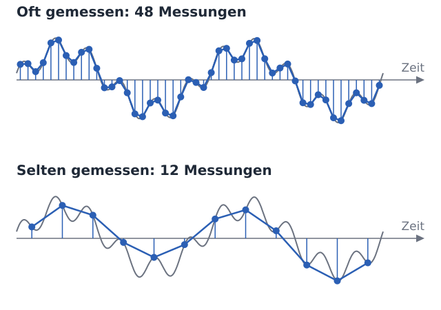
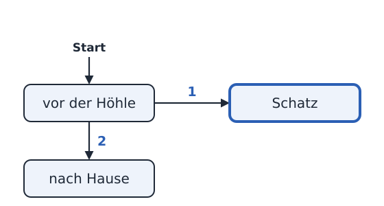
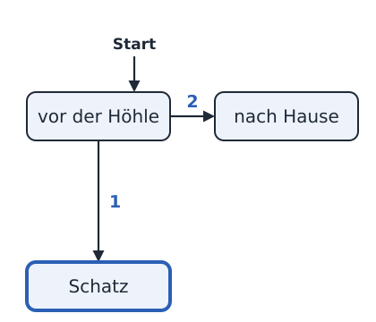

<div class='meta'>
image: teaser.webp
image_alt: "Das Telefon im Browser während eines Anrufs bei der Höhle: links ein Telefon mit Display, Tastenfeld und rotem Hörer zum Auflegen; rechts das Gespräch, die Sätze des Spiels in Blasen, die gedrückten Tasten 1 und 2 als kleine Tasten, und der nächste Satz erscheint gerade Wort für Wort"
kind: projekt
language: Ruby / Python / JavaScript
languages: [ruby, python, javascript]
duration: 3 Doppelstunden
curriculum: "Sek I: Algorithmisches Problemlösen (algorithmische Grundstrukturen: Verzweigung, Prozeduren); Oberstufe: Algorithmen und Softwareentwicklung (Sequenz, Auswahl)"
topics: [grundstrukturen, unterprogramme]
age: Sek I
requires: [kata-decisions]
reference: [telefonspiel, ruby-python, terminal]
</div>

<div
    class="autotoc-secondary-trigger"
    data-title="Auf dieser Seite"
    data-levels="h2,h3">
</div>

# Ein Spiel am Telefon

<p class='abstract'>
Du programmierst ein Spiel, das man anrufen kann: Es spricht mit einer
echten Stimme, spielt Musik und hört auf die Tasten des Telefons. Erst
begrüßt dich dein Programm, dann stellt es eine Frage, und am Ende führt es
durch eine Höhle, in der es flüstert, still wird und Musik spielt, wenn man
den Schatz findet. Zum Schluss schreibst du deine eigene Geschichte: Jemand
aus deiner Klasse spielt sie durch, und im Telefonbuch kann sie jeder
anrufen.
</p>

## Der erste Anruf

### Ein Telefon im Workspace

»Drücken Sie die 1 für den Kundendienst, die 2 für …«: So ein Telefon, das
spricht und auf Tasten hört, ist ein Programm. Es sagt etwas, wartet auf eine
Taste und macht je nach Taste anders weiter. Genau so ein Programm schreibst
du. Wer anruft, sieht nichts davon: Alles, was dein Spiel zu bieten hat, ist
zu hören.

Im Workspace probierst du dein Spiel mit dem Befehl `telefon` aus. Er startet
dein Programm und zeigt dir im Browser ein Telefon mit Tastenfeld. Daneben
steht, was das Spiel sagt, Wort für Wort, während du es hörst.

Fertige Spiele kommen ins [Telefonbuch](/telefonbuch). Dort ruft man sie im
Browser an, auch ohne Workspace: die Nummer eintippen und auf den grünen
Hörer drücken. Steht dort schon ein Spiel, ruf es an, bevor du anfängst, und
hör genau hin: Was davon könntest du selbst programmieren?

<!-- feature: !phone_number -->
Eine echte Telefonnummer gibt es noch nicht. Wir arbeiten daran, dass man die
Spiele auch mit einem Telefon anrufen kann.
<!-- /feature -->
<!-- feature: phone_number -->
Im Telefonbuch steht auch eine echte Telefonnummer: Unter ihr ruft man die
Spiele von jedem Telefon aus an.
<!-- /feature -->

Lege im Terminal (<kbd>Strg</kbd><kbd>J</kbd>) einen Ordner an und öffne ihn mit <kbd>Strg</kbd><kbd>K</kbd> <kbd>Strg</kbd><kbd>O</kbd>:

```bash
mkdir /workspace/telefon
```

<!-- language: ruby -->
Lege darin die Datei `hallo.rb` an:

```ruby
require 'telefon'

say 'Hallo! Hier spricht dein erstes Telefonspiel.'
```

`require 'telefon'` lädt die Befehle des Telefons, und `say` sagt einen Text.
Ruby wartet, bis der Satz gesprochen ist, und macht erst dann mit der nächsten
Zeile weiter.
<!-- /language -->
<!-- language: python -->
Lege darin die Datei `hallo.py` an:

```python
from telefon import say

say('Hallo! Hier spricht dein erstes Telefonspiel.')
```

Die erste Zeile holt den Befehl `say` aus der Bibliothek des Telefons, und
`say` sagt einen Text. Python wartet, bis der Satz gesprochen ist, und macht
erst dann mit der nächsten Zeile weiter.
<!-- /language -->
<!-- language: javascript -->
Lege darin die Datei `hallo.js` an:

```javascript
const { say } = require('telefon');

say('Hallo! Hier spricht dein erstes Telefonspiel.');
```

Die erste Zeile holt den Befehl `say` aus der Bibliothek des Telefons, und
`say` sagt einen Text. JavaScript wartet, bis der Satz gesprochen ist, und
macht erst dann mit der nächsten Zeile weiter.
<!-- /language -->

<!-- language: ruby -->
<!-- stage: stufen/1-hallo/hallo.rb as hallo.rb -->
<!-- /language -->
<!-- language: python -->
<!-- stage: stufen/1-hallo/hallo.py as hallo.py -->
<!-- /language -->
<!-- language: javascript -->
<!-- stage: stufen/1-hallo/hallo.js as hallo.js -->
<!-- /language -->

### Anrufen

Starte das Telefon im Terminal, im Ordner `telefon`:

<!-- language: ruby -->
```bash
telefon hallo.rb
```
<!-- /language -->
<!-- language: python -->
```bash
telefon hallo.py
```
<!-- /language -->
<!-- language: javascript -->
```bash
telefon hallo.js
```
<!-- /language -->

Das Terminal nennt eine Adresse; sie steht auch im Reiter »Ports« neben
»Terminal«, bei Port 8040. Öffne sie im Browser und klick auf den grünen
Hörer. Jetzt startet dein Programm, und du hörst seine Stimme: Es spricht
Thorsten. Im Terminal steht jeder Satz in dem Moment, in dem er gesprochen
wird.

Nach der letzten Zeile ist das Programm zu Ende, und damit auch der Anruf. Ein
Klick auf den Hörer ruft noch einmal an: Das Programm startet dann von vorn.
Hast du die Datei geändert, hörst du beim nächsten Anruf die neue Fassung;
`telefon` selbst musst du dafür nicht neu starten. Beenden kannst du es im
Terminal mit <kbd>Strg</kbd><kbd>C</kbd>.

_task(hallo)

<div class='hint try'>
<strong>Ausprobieren:</strong> Schreib unter den ersten Satz einen zweiten
mit <code>say</code> und ruf noch einmal an. Achte darauf, wann der zweite
Satz beginnt: Steht er schon da, während der erste noch gesprochen wird?
</div>

_person(thorsten-mueller)

## Musik und Pausen

### Musik im Hintergrund

Ein Spiel am Telefon lebt von dem, was man hört. Mit `music` spielt dein
Programm Musik, und mit einer Pause davor hört man sie erst eine Weile allein,
bevor die Stimme einsetzt:

<!-- language: ruby -->
```ruby
~ require 'telefon'
~
music 'https://www.youtube.com/watch?v=-xRD8VmjBQM'
sleep 3
~ say 'Hallo! Hier spricht dein erstes Telefonspiel.'
```
<!-- /language -->
<!-- language: python -->
```python
from telefon import music, say, sleep

music('https://www.youtube.com/watch?v=-xRD8VmjBQM')
sleep(3)
~ say('Hallo! Hier spricht dein erstes Telefonspiel.')
```

In der ersten Zeile stehen jetzt auch `music` und `sleep`, die anderen
beiden Befehle, die dein Programm aus der Bibliothek braucht.
<!-- /language -->
<!-- language: javascript -->
```javascript
const { music, say, sleep } = require('telefon');

music('https://www.youtube.com/watch?v=-xRD8VmjBQM');
sleep(3);
~ say('Hallo! Hier spricht dein erstes Telefonspiel.');
```

In der ersten Zeile stehen jetzt auch `music` und `sleep`, die anderen
beiden Befehle, die dein Programm aus der Bibliothek braucht.
<!-- /language -->

<!-- language: ruby -->
<!-- stage: stufen/2-musik/hallo.rb as hallo.rb -->
<!-- /language -->
<!-- language: python -->
<!-- stage: stufen/2-musik/hallo.py as hallo.py -->
<!-- /language -->
<!-- language: javascript -->
<!-- stage: stufen/2-musik/hallo.js as hallo.js -->
<!-- /language -->

Von einem Video nimmt das Telefon nur den Ton, und es spielt ihn in einer
Schleife, bis dein Programm zu Ende ist. `music` wartet, bis die Musik läuft.
Das Video holt `telefon` schon, sobald es gestartet ist, und es bereitet auch
die Sätze deines Spiels vor; im Terminal steht, wann beides bereit ist. Rufst
du gleich nach dem Start an, dauert der erste Anruf darum etwas länger. Statt
eines Links nimmt `music` auch eine Datei; dazu gleich mehr.

<!-- language: ruby -->
Brauchst du nur eine Stelle aus einem längeren Video, sag, wo sie anfängt
und wo sie aufhört: `music '…', start: '1:15', stop: '1:52'` spielt die
Musik von Minute 1:15 bis 1:52 und dann wieder ab 1:15. Ohne `stop` geht es
ab `start` weiter. Kopierst du bei YouTube mit »Teilen« einen Link ab einer
Stelle, endet er auf `t=75`; auch dann beginnt die Musik dort.
<!-- /language -->
<!-- language: python -->
Brauchst du nur eine Stelle aus einem längeren Video, sag, wo sie anfängt
und wo sie aufhört: `music('…', start='1:15', stop='1:52')` spielt die
Musik von Minute 1:15 bis 1:52 und dann wieder ab 1:15. Ohne `stop` geht es
ab `start` weiter. Kopierst du bei YouTube mit »Teilen« einen Link ab einer
Stelle, endet er auf `t=75`; auch dann beginnt die Musik dort.
<!-- /language -->
<!-- language: javascript -->
Brauchst du nur eine Stelle aus einem längeren Video, sag, wo sie anfängt
und wo sie aufhört: `music('…', { start: '1:15', stop: '1:52' })` spielt die
Musik von Minute 1:15 bis 1:52 und dann wieder ab 1:15. Ohne `stop` geht es
ab `start` weiter. Kopierst du bei YouTube mit »Teilen« einen Link ab einer
Stelle, endet er auf `t=75`; auch dann beginnt die Musik dort.
<!-- /language -->

`sleep` wartet, so viele Sekunden, wie du angibst. Die Musik spielt dabei
weiter.

_task(musik)

### Leiser, wenn jemand spricht

Hör genau hin, wenn die Stimme einsetzt: Die Musik wird leiser, solange ein
Satz gesprochen wird, und danach wieder laut. So macht es auch das Radio,
wenn jemand über die Musik spricht. Dein Programm muss dafür nichts tun.

<div class='hint try'>
<strong>Ausprobieren:</strong> Gib der Musik eine Lautstärke zwischen
<code>0</code> und <code>1</code>, in Ruby mit
<code>music '…', volume: 0.3</code>, in Python und JavaScript mit
<code>music('…', 0.3)</code>. Ohne Angabe spielt sie mit <code>1</code>, so
laut wie möglich. Achte darauf, ob du die Stimme bei <code>1</code> noch gut
verstehst.
</div>

### Musik aus einer Datei

Statt eines Links nimmt `music` auch eine Datei. Sie muss direkt im Ordner
`telefon` liegen, neben deinem Spiel; dann schreibst du nur ihren Namen. Ein
Stück für die Höhle, das wir selbst gemacht haben, holst du im Terminal in
deinen Ordner:

```bash
wget ${web_root}/telefonspiel/hoehle.mp3
```

<!-- language: ruby -->
<div class='hint try'>
<strong>Ausprobieren:</strong> Ersetze in <code>hallo.rb</code> den Link durch den Namen der
Datei, <code>music 'hoehle.mp3'</code>, und ruf an. Achte darauf, ob die Musik nach dem
Satz weiterläuft und ob du hörst, wo sie wieder von vorn beginnt.
</div>
<!-- /language -->
<!-- language: python -->
<div class='hint try'>
<strong>Ausprobieren:</strong> Ersetze in <code>hallo.py</code> den Link durch den Namen der
Datei, <code>music('hoehle.mp3')</code>, und ruf an. Achte darauf, ob die Musik nach dem
Satz weiterläuft und ob du hörst, wo sie wieder von vorn beginnt.
</div>
<!-- /language -->
<!-- language: javascript -->
<div class='hint try'>
<strong>Ausprobieren:</strong> Ersetze in <code>hallo.js</code> den Link durch den Namen der
Datei, <code>music('hoehle.mp3');</code>, und ruf an. Achte darauf, ob die Musik nach dem
Satz weiterläuft und ob du hörst, wo sie wieder von vorn beginnt.
</div>
<!-- /language -->

Eigene Musik oder ein Geräusch ziehst du aus dem Dateimanager deines
Computers in VS Code auf den Ordner `telefon`. Das Telefon spielt vier
Formate, an der Endung der Datei zu erkennen:

<div class='scroll-x'><table class='table table-sm'>
<thead><tr><th>Format</th><th>Endung</th><th></th></tr></thead>
<tbody>
<tr><td>MP3</td><td><code>.mp3</code></td><td>klein, und jeder Browser spielt es: Nimm MP3, wenn du die Wahl hast.</td></tr>
<tr><td>WAV</td><td><code>.wav</code></td><td>jeder Browser spielt es, aber die Datei ist groß; warum, steht im nächsten Abschnitt.</td></tr>
<tr><td>Ogg</td><td><code>.ogg</code></td><td>klein; das Telefon spielt es, im Workspace nicht jeder Browser.</td></tr>
<tr><td>M4A</td><td><code>.m4a</code></td><td>so speichern viele Handys Aufnahmen; das Telefon spielt es, im Workspace nicht jeder Browser.</td></tr>
</tbody>
</table>
</div>

Eine Datei in einem anderen Format oder in einem Unterordner nimmt `music`
nicht an: Sie käme beim Veröffentlichen nicht mit ins Telefonbuch. Dorthin
kommt auch nur, was höchstens 20 MB groß ist, alle Dateien zusammen
höchstens 40 MB. Hörst du im Workspace nichts, öffne die Datei in
[Audacity](https://www.audacityteam.org) und exportiere sie als MP3. Dieselben
Regeln gelten für [eigene Aufnahmen](/reference/telefonspiel#aufnahmen), die
mit `play` statt Thorsten sprechen.

### Wie aus Ton Zahlen werden

Ton ist schwingende Luft: Der Luftdruck steigt und fällt, viele Male in der
Sekunde, und dein Trommelfell schwingt mit. Ein Mikrofon macht daraus eine
elektrische Spannung, die genauso steigt und fällt. Der Computer misst diese
Spannung in gleichen Abständen und speichert jeden Messwert als Zahl. Das heißt
Abtasten, auf Englisch Sampling; jeder Messwert ist ein **Sample**, und wie oft in
der Sekunde gemessen wird, ist die Abtastrate (Sample Rate), angegeben in
Hertz (Hz).



Was zwischen zwei Samples geschieht, weiß der Computer nicht. Eine
Schwingung bleibt nur erhalten, wenn er sie mehr als zweimal pro Schwingung
misst: Mit 8.000 Samples in der Sekunde kommen Töne bis 4.000 Hz an, alles
Höhere fehlt. Der tiefe Ton der Höhlenmusik schwingt 55-mal in der Sekunde,
also mit 55 Hz; das Zischen eines »s« liegt zum großen Teil über 4.000 Hz.

<div class='voice-chat'>
<button class='btn btn-sm btn-outline-secondary voice-all' type='button'><i class='bi bi-play'></i> Alle nacheinander</button>
<div class='voice-item'><button class='voice-line' type='button' aria-label='44.100 Hz, wie auf einer CD: Töne bis 22.050 Hz. Anhören'><span class='voice-mood'>44.100 Hz</span><span class='voice-text'>wie auf einer CD: Töne bis 22.050 Hz</span><span class='voice-state' aria-hidden='true'><i class='bi bi-volume-up'></i><span class='voice-bars'><i></i><i></i><i></i></span></span></button><audio preload='none' src='sounds/abtastung-44100.mp3'></audio></div>
<div class='voice-item'><button class='voice-line' type='button' aria-label='16.000 Hz, wie im Telefonspiel: bis 8.000 Hz. Anhören'><span class='voice-mood'>16.000 Hz</span><span class='voice-text'>wie im Telefonspiel: bis 8.000 Hz</span><span class='voice-state' aria-hidden='true'><i class='bi bi-volume-up'></i><span class='voice-bars'><i></i><i></i><i></i></span></span></button><audio preload='none' src='sounds/abtastung-16000.mp3'></audio></div>
<div class='voice-item'><button class='voice-line' type='button' aria-label='8.000 Hz, wie im alten Telefonnetz: bis 4.000 Hz. Anhören'><span class='voice-mood'>8.000 Hz</span><span class='voice-text'>wie im alten Telefonnetz: bis 4.000 Hz</span><span class='voice-state' aria-hidden='true'><i class='bi bi-volume-up'></i><span class='voice-bars'><i></i><i></i><i></i></span></span></button><audio preload='none' src='sounds/abtastung-8000.mp3'></audio></div>
<div class='voice-item'><button class='voice-line' type='button' aria-label='4.000 Hz, bis 2.000 Hz. Anhören'><span class='voice-mood'>4.000 Hz</span><span class='voice-text'>bis 2.000 Hz</span><span class='voice-state' aria-hidden='true'><i class='bi bi-volume-up'></i><span class='voice-bars'><i></i><i></i><i></i></span></span></button><audio preload='none' src='sounds/abtastung-4000.mp3'></audio></div>
<div class='voice-item'><button class='voice-line' type='button' aria-label='2.000 Hz, bis 1.000 Hz. Anhören'><span class='voice-mood'>2.000 Hz</span><span class='voice-text'>bis 1.000 Hz</span><span class='voice-state' aria-hidden='true'><i class='bi bi-volume-up'></i><span class='voice-bars'><i></i><i></i><i></i></span></span></button><audio preload='none' src='sounds/abtastung-2000.mp3'></audio></div>
</div>
<script src='/include/sound_buttons.js'></script>

<div class='hint try'>
<strong>Ausprobieren:</strong> Thorsten sagt in allen fünf denselben Satz über
der Höhlenmusik: »Sieben Fledermäuse schlafen still an der feuchten
Felswand.« Hör sie nacheinander an und achte auf das »s« in »still«, das »f«
in »Felswand« und auf das helle Glöckchen am Ende. Ab welcher Abtastrate
kannst du »s« und »f« nicht mehr auseinanderhalten?
</div>

Das Telefonspiel rechnet mit 16.000 Samples in der Sekunde, so kommen
Thorsten und die Musik beim Telefon an. Das alte Telefonnetz übertrug nur
8.000; am Telefon buchstabiert man darum mit Wörtern, »S wie Samuel«, weil
»s« und »f« dort ähnlich klingen. Eine CD misst 44.100-mal in der Sekunde,
etwas mehr als doppelt so oft wie die höchsten Töne, die Menschen hören, um
20.000 Hz.

Jedes Sample ist eine Zahl, auf einer CD 2 Byte groß, und eine WAV-Datei
speichert jede einzeln: In einer Sekunde Ton mit 44.100 Hz stecken 88.200
Byte, für zwei Lautsprecher doppelt so viel. `hoehle.mp3` dauert 48 Sekunden
und ist 0,6 MB groß; als WAV wären es 4,2 MB. MP3 lässt weg, was man kaum
hört, und speichert den Rest geschickter.

_person(shannon)

### Telefonieren über das Internet

Früher lief ein Anruf als elektrische Schwingung durch Kupferdrähte, und
Vermittlungsstellen schalteten für jedes Gespräch eine Leitung von einem
Telefon zum anderen durch. Fachleute nennen dieses alte Netz POTS, »plain old
telephone service«. Heute geht fast jeder Anruf als Datenpakete durch das
Internet, Voice over IP: Der Router zu Hause oder das Handy macht aus der
Stimme Zahlen und schickt sie in kleinen Paketen los, eines alle 20
Millisekunden. In Deutschland hat die Telekom bis Ende 2020 alle ihre
Anschlüsse so umgestellt, [Großbritannien schaltet sein altes Netz Ende
Januar 2027 ab](https://www.bt.com/about/all-ip).

<!-- feature: phone_number -->
Auch das Telefonspiel ist so angeschlossen. Wer die Nummer im Telefonbuch
anruft, kommt über das Protokoll SIP bei einem Server an, auf dem
[Asterisk](https://www.asterisk.org) die Anrufe annimmt, und Thorstens Stimme
geht in Paketen zurück, 16.000 Zahlen in der Sekunde.
<!-- /feature -->
<!-- feature: !phone_number -->
So wird auch die Telefonnummer des Telefonspiels angeschlossen, an der wir
arbeiten: Ein Anruf kommt über das Protokoll SIP bei einem Server an, auf dem
[Asterisk](https://www.asterisk.org) ihn annimmt, und Thorstens Stimme geht in
Paketen zurück, 16.000 Zahlen in der Sekunde.
<!-- /feature -->

## Eine Frage mit Tasten

### Auf eine Taste warten

Jetzt soll dein Spiel zuhören. Lege eine neue Datei an:

<!-- language: ruby -->
`frage.rb`:

```ruby
require 'telefon'

say 'Katzen oder Hunde? Drück 1 für Katzen, 2 für Hunde.'
key = keys(1)
if key == '1'
  say 'Miau! Katzen schlafen bis zu sechzehn Stunden am Tag.'
elsif key == '2'
  say 'Wuff! Hunde hören Töne, die für dich zu hoch sind.'
else
  say 'Du hast nichts gedrückt. Schade!'
end
```
<!-- /language -->
<!-- language: python -->
`frage.py`:

```python
from telefon import keys, say

say('Katzen oder Hunde? Drück 1 für Katzen, 2 für Hunde.')
key = keys(1)
if key == '1':
    say('Miau! Katzen schlafen bis zu sechzehn Stunden am Tag.')
elif key == '2':
    say('Wuff! Hunde hören Töne, die für dich zu hoch sind.')
else:
    say('Du hast nichts gedrückt. Schade!')
```
<!-- /language -->
<!-- language: javascript -->
`frage.js`:

```javascript
const { keys, say } = require('telefon');

say('Katzen oder Hunde? Drück 1 für Katzen, 2 für Hunde.');
const key = keys(1);
if (key === '1') {
  say('Miau! Katzen schlafen bis zu sechzehn Stunden am Tag.');
} else if (key === '2') {
  say('Wuff! Hunde hören Töne, die für dich zu hoch sind.');
} else {
  say('Du hast nichts gedrückt. Schade!');
}
```
<!-- /language -->

<!-- language: ruby -->
<!-- stage: stufen/3-frage/frage.rb as frage.rb -->
<!-- /language -->
<!-- language: python -->
<!-- stage: stufen/3-frage/frage.py as frage.py -->
<!-- /language -->
<!-- language: javascript -->
<!-- stage: stufen/3-frage/frage.js as frage.js -->
<!-- /language -->

`keys(1)` wartet auf eine Taste und gibt sie zurück, als Text: `'1'`, wenn
jemand die 1 drückt. Drückt zehn Sekunden lang niemand etwas, gibt `keys`
einen leeren Text zurück, `''`. Danach entscheidet die Verzweigung, was das
Spiel sagt. Starte das Telefon mit der neuen Datei und probier alle drei Wege
aus: die 1, die 2 und gar keine Taste.

Eine Taste, die jemand drückt, während das Spiel noch spricht, geht nicht
verloren: Sie wartet, bis dein Programm `keys` aufruft. Wer die Frage schon
kennt, muss sie also nicht bis zum Ende anhören.

### Text oder Zahl?

Auf dem Telefon steht eine 1, und `keys` gibt `'1'` zurück, mit
Anführungszeichen. Ist das nicht dasselbe?

_task(text-oder-zahl)

<!-- after: text-oder-zahl -->
<!-- language: ruby -->
Das Spiel sagt »Du hast nichts gedrückt. Schade!« Denn `keys` gibt einen Text
zurück, auch wenn er nur aus einer Ziffer besteht, und ein Text ist nie
gleich einer Zahl: `'1' == 1` ist falsch.
<!-- /language -->
<!-- language: python -->
Das Spiel sagt »Du hast nichts gedrückt. Schade!« Denn `keys` gibt einen Text
zurück, auch wenn er nur aus einer Ziffer besteht, und ein Text ist nie
gleich einer Zahl: `'1' == 1` ist falsch.
<!-- /language -->
<!-- language: javascript -->
Das Spiel sagt »Du hast nichts gedrückt. Schade!« Denn `keys` gibt einen Text
zurück, auch wenn er nur aus einer Ziffer besteht, und `===` prüft auch, ob
beides von derselben Art ist: `'1' === 1` ist falsch. Mit `==` wäre es wahr,
weil JavaScript den Text dann erst in eine Zahl verwandelt; darum vergleicht
man in JavaScript mit `===`.
<!-- /language -->

Darum vergleicht dein Programm mit `'1'` in Anführungszeichen. So kann `keys`
auch den Stern `'*'` zurückgeben, und mehrere Tasten auf einmal, wie `'472'`.
Nur die Raute `#` gibt `keys` nie zurück: Sie beendet eine Eingabe aus
mehreren Tasten.
<!-- /after -->

### Eine dritte Wahl

<div class='hint own' data-check='drei'>
<strong>Jetzt bist du dran:</strong> Biete Fische als dritte Wahl an. Mit
der 3 sagt das Spiel »Blubb! Fische haben keine Augenlider.« Vergiss nicht,
die Frage am Anfang so zu ändern, dass sie die 3 auch nennt.
</div>

<!-- hint -->
Jede Antwort ist ein eigener Zweig der Verzweigung. Für die 3 kommt ein
weiterer dazu, vor dem Zweig für »nichts gedrückt«: Der fängt alles auf, was
die Zweige davor nicht erkannt haben.
<!-- /hint -->
<!-- hint -->
<!-- language: ruby -->
Ein neuer Zweig zwischen dem für die 2 und `else`:

<!-- page-code: own -->
```ruby
elsif key == '…'
  say '…'
```
<!-- /language -->
<!-- language: python -->
Ein neuer Zweig zwischen dem für die 2 und `else:`:

<!-- page-code: own -->
```python
elif key == '…':
    say('…')
```
<!-- /language -->
<!-- language: javascript -->
Ein neuer Zweig zwischen dem für die 2 und `else`:

<!-- page-code: own -->
```javascript
} else if (key === '…') {
  say('…');
```
<!-- /language -->
<!-- /hint -->

<!-- solution -->
<!-- language: ruby -->
```ruby
~ require 'telefon'
~
say 'Katzen, Hunde oder Fische? Drück 1 für Katzen, 2 für Hunde, 3 für Fische.'
~ key = keys(1)
~ …
~ elsif key == '2'
~   say 'Wuff! Hunde hören Töne, die für dich zu hoch sind.'
elsif key == '3'
  say 'Blubb! Fische haben keine Augenlider.'
~ else
```
<!-- /language -->
<!-- language: python -->
```python
~ from telefon import keys, say
~
say('Katzen, Hunde oder Fische? Drück 1 für Katzen, 2 für Hunde, 3 für Fische.')
~ key = keys(1)
~ …
~ elif key == '2':
~     say('Wuff! Hunde hören Töne, die für dich zu hoch sind.')
elif key == '3':
    say('Blubb! Fische haben keine Augenlider.')
~ else:
```
<!-- /language -->
<!-- language: javascript -->
```javascript
~ const { keys, say } = require('telefon');
~
say('Katzen, Hunde oder Fische? Drück 1 für Katzen, 2 für Hunde, 3 für Fische.');
~ const key = keys(1);
~ …
~ } else if (key === '2') {
~   say('Wuff! Hunde hören Töne, die für dich zu hoch sind.');
} else if (key === '3') {
  say('Blubb! Fische haben keine Augenlider.');
~ } else {
```
<!-- /language -->
<!-- /solution -->

<!-- language: ruby -->
<!-- stage: stufen/4-drei/frage.rb as frage.rb -->
<!-- /language -->
<!-- language: python -->
<!-- stage: stufen/4-drei/frage.py as frage.py -->
<!-- /language -->
<!-- language: javascript -->
<!-- stage: stufen/4-drei/frage.js as frage.js -->
<!-- /language -->

_task(drei)

### Wie lange gewartet wird

Zehn Sekunden sind lang, wenn man schon weiß, was man drücken will, und kurz
für eine schwere Frage. Wie lange `keys` wartet, sagst du in Sekunden:

<!-- language: ruby -->
`keys(1, timeout: 5)` wartet nur fünf Sekunden.
<!-- /language -->
<!-- language: python -->
`keys(1, timeout=5)` wartet nur fünf Sekunden.
<!-- /language -->
<!-- language: javascript -->
`keys(1, 5)` wartet nur fünf Sekunden.
<!-- /language -->

Und mit `keys(3)` wartet dein Programm auf bis zu drei Tasten, etwa für eine
Geheimzahl; die Raute <kbd>#</kbd> beendet die Eingabe früher. Die Wartezeit
gilt für jede Taste neu: Nach jeder Taste hat man wieder die ganze Zeit für
die nächste.

<div class='hint try'>
<strong>Ausprobieren:</strong> Gib der Frage zwei Sekunden und ruf an. Achte
darauf, ob du es schaffst, nach dem Ende der Frage noch zu drücken, und was
passiert, wenn du schon während der Frage drückst.
</div>

### Wie das Telefon die Tasten hört

Drückst du am Telefon im Workspace eine Taste, hörst du einen kurzen Ton.
Genau genommen sind es zwei Töne zugleich: einer für die Zeile der Taste und
einer für ihre Spalte. Die Taste 5 klingt mit 770 Hz und 1.336 Hz. Daran
erkannte früher die Vermittlungsstelle, welche Taste gedrückt wurde: Sie
suchte in dem, was durch die Leitung kam, nach diesen sieben Frequenzen. Das
Verfahren heißt Mehrfrequenzwahl, auf Englisch DTMF (Dual-Tone
Multi-Frequency).

<script src='/include/dtmf_widget.js'></script>
<div class='dtmf-widget'></div>

<div class='hint try'>
<strong>Ausprobieren:</strong> Drück »Rätsel: drei Tasten« und lies die drei
Tasten im Wasserfall ab. Achte darauf, welche Frequenz der untere Strich hat
und welche der obere: Der untere sagt die Zeile, der obere die Spalte.
</div>

Zwei Töne statt einem, damit eine Stimme oder ein Lied nicht aus Versehen
eine Taste drückt: Dass genau zwei dieser Frequenzen zugleich und allein
klingen, kommt in Sprache und Musik selten vor. Bei Telefonie über das
Internet geht eine Taste heute meist als eigenes kleines Paket mit, das nur
sagt, welche Taste es war; die Töne hörst du im Hörer trotzdem.

## Eine Höhle aus Szenen

### Vor der Höhle

Ein Abenteuer besteht aus Szenen: Jede sagt, wo man gerade ist, und welche
Taste wohin führt. Auf einer Karte sind die Szenen Kästen und die Tasten
Pfeile. Diese Höhle hat erst einmal drei Szenen: davor, nach Hause und den
Schatz.




Vor der Höhle wartet eine Frage wie die nach Katzen und Hunden. Lege
`hoehle` an:

<!-- language: ruby -->
`hoehle.rb`:

```ruby
require 'telefon'

music 'https://www.youtube.com/watch?v=-xRD8VmjBQM'
sleep 3
say 'Du stehst vor einer dunklen Höhle. Drück 1, um hineinzugehen, oder 2, um nach Hause zu gehen.'
key = keys(1)
if key == '1'
  say 'Im Licht einer Fackel glänzt eine Kiste voller Gold. Du hast den Schatz gefunden!'
elsif key == '2'
  say 'Du gehst nach Hause. Vielleicht ein anderes Mal.'
end
say 'Ende.'
```
<!-- /language -->
<!-- language: python -->
`hoehle.py`:

```python
from telefon import keys, music, say, sleep

music('https://www.youtube.com/watch?v=-xRD8VmjBQM')
sleep(3)
say('Du stehst vor einer dunklen Höhle. Drück 1, um hineinzugehen, oder 2, um nach Hause zu gehen.')
key = keys(1)
if key == '1':
    say('Im Licht einer Fackel glänzt eine Kiste voller Gold. Du hast den Schatz gefunden!')
elif key == '2':
    say('Du gehst nach Hause. Vielleicht ein anderes Mal.')
say('Ende.')
```
<!-- /language -->
<!-- language: javascript -->
`hoehle.js`:

```javascript
const { keys, music, say, sleep } = require('telefon');

music('https://www.youtube.com/watch?v=-xRD8VmjBQM');
sleep(3);
say('Du stehst vor einer dunklen Höhle. Drück 1, um hineinzugehen, oder 2, um nach Hause zu gehen.');
const key = keys(1);
if (key === '1') {
  say('Im Licht einer Fackel glänzt eine Kiste voller Gold. Du hast den Schatz gefunden!');
} else if (key === '2') {
  say('Du gehst nach Hause. Vielleicht ein anderes Mal.');
}
say('Ende.');
```
<!-- /language -->

<!-- language: ruby -->
<!-- stage: stufen/5-hoehle/hoehle.rb as hoehle.rb -->
<!-- /language -->
<!-- language: python -->
<!-- stage: stufen/5-hoehle/hoehle.py as hoehle.py -->
<!-- /language -->
<!-- language: javascript -->
<!-- stage: stufen/5-hoehle/hoehle.js as hoehle.js -->
<!-- /language -->

Erst Musik, eine Pause, dann die Frage vor der Höhle; nach der Antwort sagt
das Spiel »Ende.«, und der Anruf ist vorbei. Ruf an und probier die 1 und
die 2.

### Szenen als Funktionen

Bald hat die Höhle mehr Szenen, und zu manchen kommt man mehr als einmal.
Darum bekommt jede Szene einen Namen: Sie wird eine Funktion. Pack den Satz
vom Schatz in die Funktion `treasure` und die Szene vor der Höhle in die
Funktion `cave`:

<!-- language: ruby -->
```ruby
require 'telefon'

def treasure
  say 'Im Licht einer Fackel glänzt eine Kiste voller Gold. Du hast den Schatz gefunden!'
end

def cave
  say 'Du stehst vor einer dunklen Höhle. Drück 1, um hineinzugehen, oder 2, um nach Hause zu gehen.'
  key = keys(1)
  if key == '1'
    treasure
  elsif key == '2'
    say 'Du gehst nach Hause. Vielleicht ein anderes Mal.'
  end
end

music 'https://www.youtube.com/watch?v=-xRD8VmjBQM'
sleep 3
cave
say 'Ende.'
```
<!-- /language -->
<!-- language: python -->
```python
from telefon import keys, music, say, sleep


def treasure():
    say('Im Licht einer Fackel glänzt eine Kiste voller Gold. Du hast den Schatz gefunden!')


def cave():
    say('Du stehst vor einer dunklen Höhle. Drück 1, um hineinzugehen, oder 2, um nach Hause zu gehen.')
    key = keys(1)
    if key == '1':
        treasure()
    elif key == '2':
        say('Du gehst nach Hause. Vielleicht ein anderes Mal.')


music('https://www.youtube.com/watch?v=-xRD8VmjBQM')
sleep(3)
cave()
say('Ende.')
```
<!-- /language -->
<!-- language: javascript -->
```javascript
const { keys, music, say, sleep } = require('telefon');

function treasure() {
  say('Im Licht einer Fackel glänzt eine Kiste voller Gold. Du hast den Schatz gefunden!');
}

function cave() {
  say('Du stehst vor einer dunklen Höhle. Drück 1, um hineinzugehen, oder 2, um nach Hause zu gehen.');
  const key = keys(1);
  if (key === '1') {
    treasure();
  } else if (key === '2') {
    say('Du gehst nach Hause. Vielleicht ein anderes Mal.');
  }
}

music('https://www.youtube.com/watch?v=-xRD8VmjBQM');
sleep(3);
cave();
say('Ende.');
```
<!-- /language -->

<!-- language: ruby -->
<!-- stage: stufen/6-szenen/hoehle.rb as hoehle.rb -->
<!-- /language -->
<!-- language: python -->
<!-- stage: stufen/6-szenen/hoehle.py as hoehle.py -->
<!-- /language -->
<!-- language: javascript -->
<!-- stage: stufen/6-szenen/hoehle.js as hoehle.js -->
<!-- /language -->

Ruf an: Das Spiel klingt genau wie vorher. Die Zeilen sind dieselben, sie
stehen nur an einem anderen Ort.
<!-- language: ruby -->
Von `def cave` bis zu seinem `end` steht, was zu `cave` gehört. Dabei
sagt das Spiel noch nichts: Erst die Zeile `cave` weiter unten ruft die
Funktion auf, und dann laufen ihre Zeilen, eine nach der anderen. Genauso
ruft `cave` die Funktion `treasure` auf, wenn jemand die 1 drückt.
<!-- /language -->
<!-- language: python -->
Was unter `def cave():` eingerückt steht, gehört zu `cave`. Dabei sagt das
Spiel noch nichts: Erst die Zeile `cave()` weiter unten ruft die Funktion
auf, und dann laufen ihre Zeilen, eine nach der anderen. Genauso ruft
`cave` die Funktion `treasure` auf, wenn jemand die 1 drückt.
<!-- /language -->
<!-- language: javascript -->
Was in den geschweiften Klammern von `function cave()` steht, gehört zu
`cave`. Dabei sagt das Spiel noch nichts: Erst die Zeile `cave();` weiter
unten ruft die Funktion auf, und dann laufen ihre Zeilen, eine nach der
anderen. Genauso ruft `cave` die Funktion `treasure` auf, wenn jemand die
1 drückt.
<!-- /language -->
Die Szene »nach Hause« ist so kurz, dass sie keine eigene Funktion braucht:
Sie ist nur ein Satz.

<div class='hint try'>
<!-- language: ruby -->
<strong>Ausprobieren:</strong> Setz ein <code>#</code> vor die Zeile
<code>cave</code> unten, damit sie nicht mehr läuft, und ruf an. Achte
darauf, was du nach der Musik noch hörst. Nimm das <code>#</code> danach
wieder weg.
<!-- /language -->
<!-- language: python -->
<strong>Ausprobieren:</strong> Setz ein <code>#</code> vor die Zeile
<code>cave()</code> unten, damit sie nicht mehr läuft, und ruf an. Achte
darauf, was du nach der Musik noch hörst. Nimm das <code>#</code> danach
wieder weg.
<!-- /language -->
<!-- language: javascript -->
<strong>Ausprobieren:</strong> Setz <code>//</code> vor die Zeile
<code>cave();</code> unten, damit sie nicht mehr läuft, und ruf an. Achte
darauf, was du nach der Musik noch hörst. Nimm die <code>//</code> danach
wieder weg.
<!-- /language -->
</div>

### Wenn niemand drückt

Die Verzweigung in `cave` bekommt einen letzten Zweig, für alles außer der
1 und der 2:

<!-- language: ruby -->
```ruby
~   elsif key == '2'
~     say 'Du gehst nach Hause. Vielleicht ein anderes Mal.'
  else
    cave
~   end
~ end
```
<!-- /language -->
<!-- language: python -->
```python
~     elif key == '2':
~         say('Du gehst nach Hause. Vielleicht ein anderes Mal.')
    else:
        cave()
```
<!-- /language -->
<!-- language: javascript -->
```javascript
~   } else if (key === '2') {
~     say('Du gehst nach Hause. Vielleicht ein anderes Mal.');
  } else {
    cave();
~   }
~ }
```
<!-- /language -->

<!-- language: ruby -->
<!-- stage: stufen/7-hoehle/hoehle.rb as hoehle.rb -->
<!-- /language -->
<!-- language: python -->
<!-- stage: stufen/7-hoehle/hoehle.py as hoehle.py -->
<!-- /language -->
<!-- language: javascript -->
<!-- stage: stufen/7-hoehle/hoehle.js as hoehle.js -->
<!-- /language -->

Was passiert jetzt, wenn vor der Höhle niemand etwas drückt? Überleg es dir,
bevor du anrufst.

_task(nichts-gedrueckt)

<!-- after: nichts-gedrueckt -->
Nach zehn Sekunden sagt das Spiel den Satz vor der Höhle noch einmal. `keys`
gibt dann `''` zurück, und im Zweig für alles andere ruft `cave` sich selbst
auf: Die Szene beginnt von vorn. Das passt zum Telefon. Wer nicht weiß, was
er drücken soll, hört die Wahl noch einmal. Dasselbe passiert bei einer
Taste, die in dieser Szene nichts bedeutet, etwa der 7. Auf der Karte ist
das ein Bogen zurück in denselben Kasten:


<!-- /after -->

### Der Gang

Hinter dem Eingang soll sich der Weg teilen. Die 1 vor der Höhle führt dann
nicht mehr direkt zum Schatz, sondern in einen Gang: Links flackert Licht,
dort liegt der Schatz. Rechts rauscht Wasser, das ist eiskalt, und man muss
zurück in den Gang.


<div class='hint own' data-check='gang'>
<strong>Jetzt bist du dran:</strong> Schreib die Szene <code>tunnel</code>
als Funktion zwischen <code>treasure</code> und <code>cave</code>. Sie sagt
»Drinnen teilt sich der Gang. Links flackert Licht, rechts rauscht Wasser.
Drück 1 für links, 2 für rechts.« Mit der 1 geht es zum Schatz. Mit der 2
sagt sie »Das Wasser ist eiskalt. Du gehst zurück.« und beginnt von vorn,
ohne Taste ebenso. In <code>cave</code> führt die 1 jetzt in den Gang.
</div>

<!-- hint -->
Spiel es erst auf der Karte durch: vor der Höhle die 1, im Gang die 2, dann
die 1. Welche Sätze hörst du nacheinander? Die Funktion `tunnel` sieht aus wie
`cave`, nur mit anderen Sätzen und anderen Zielen.
<!-- /hint -->
<!-- hint -->
In Worten: Sag den Satz des Gangs. Warte auf eine Taste. Ist es die 1, geh
zum Schatz. Ist es die 2, sag den Satz vom Wasser und geh in den Gang. Sonst
geh in den Gang. »Geh in den Gang« heißt: ruf `tunnel` auf.
<!-- /hint -->
<!-- hint -->
<!-- language: ruby -->
<!-- page-code: own -->
```ruby
def tunnel
  say '…'
  key = keys(1)
  if key == '1'
    …
  elsif key == '2'
    say '…'
    …
  else
    …
  end
end
```
<!-- /language -->
<!-- language: python -->
<!-- page-code: own -->
```python
def tunnel():
    say('…')
    key = keys(1)
    if key == '1':
        …
    elif key == '2':
        say('…')
        …
    else:
        …
```
<!-- /language -->
<!-- language: javascript -->
<!-- page-code: own -->
```javascript
function tunnel() {
  say('…');
  const key = keys(1);
  if (key === '1') {
    …
  } else if (key === '2') {
    say('…');
    …
  } else {
    …
  }
}
```
<!-- /language -->
<!-- /hint -->

<!-- solution -->
<!-- language: ruby -->
```ruby
def tunnel
  say 'Drinnen teilt sich der Gang. Links flackert Licht, rechts rauscht Wasser. Drück 1 für links, 2 für rechts.'
  key = keys(1)
  if key == '1'
    treasure
  elsif key == '2'
    say 'Das Wasser ist eiskalt. Du gehst zurück.'
    tunnel
  else
    tunnel
  end
end
```

In `cave` führt die 1 in den Gang:

```ruby
~   key = keys(1)
~   if key == '1'
    tunnel
~   elsif key == '2'
```
<!-- /language -->
<!-- language: python -->
```python
def tunnel():
    say('Drinnen teilt sich der Gang. Links flackert Licht, rechts rauscht Wasser. Drück 1 für links, 2 für rechts.')
    key = keys(1)
    if key == '1':
        treasure()
    elif key == '2':
        say('Das Wasser ist eiskalt. Du gehst zurück.')
        tunnel()
    else:
        tunnel()
```

In `cave` führt die 1 in den Gang:

```python
~     key = keys(1)
~     if key == '1':
        tunnel()
~     elif key == '2':
```
<!-- /language -->
<!-- language: javascript -->
```javascript
function tunnel() {
  say('Drinnen teilt sich der Gang. Links flackert Licht, rechts rauscht Wasser. Drück 1 für links, 2 für rechts.');
  const key = keys(1);
  if (key === '1') {
    treasure();
  } else if (key === '2') {
    say('Das Wasser ist eiskalt. Du gehst zurück.');
    tunnel();
  } else {
    tunnel();
  }
}
```

In `cave` führt die 1 in den Gang:

```javascript
~   const key = keys(1);
~   if (key === '1') {
    tunnel();
~   } else if (key === '2') {
```
<!-- /language -->
<!-- /solution -->

<!-- language: ruby -->
<!-- stage: stufen/8-gang/hoehle.rb as hoehle.rb -->
<!-- /language -->
<!-- language: python -->
<!-- stage: stufen/8-gang/hoehle.py as hoehle.py -->
<!-- /language -->
<!-- language: javascript -->
<!-- stage: stufen/8-gang/hoehle.js as hoehle.js -->
<!-- /language -->

_task(gang)

### Stimmen in der Höhle

Thorsten muss nicht jeden Satz gleich sagen. Bekommt `say` eine Stimmung,
flüstert er, wundert sich oder klingt müde. Wer vor der Höhle die 2 drückt,
geht jetzt müde nach Hause:

<!-- language: ruby -->
```ruby
~   elsif key == '2'
    say 'Du gehst nach Hause. Vielleicht ein anderes Mal.', mood: 'sleepy'
~   else
```
<!-- /language -->
<!-- language: python -->
```python
~     elif key == '2':
        say('Du gehst nach Hause. Vielleicht ein anderes Mal.', mood='sleepy')
~     else:
```
<!-- /language -->
<!-- language: javascript -->
```javascript
~   } else if (key === '2') {
    say('Du gehst nach Hause. Vielleicht ein anderes Mal.', { mood: 'sleepy' });
~   } else {
```
<!-- /language -->

Die Stimmung steht hinter dem Text, durch ein Komma getrennt. Auf der Seite
des Telefons steht sie klein über dem Satz.

_include(telefonspiel#stimmungen)

<div class='hint try'>
<strong>Ausprobieren:</strong> Ruf an und drück die 2. Achte auf Tempo und
Betonung des Satzes. Setz dann <code>drunk</code> statt <code>sleepy</code>
ein und vergleiche beide.
</div>

<div class='hint own' data-check='stimmen'>
<strong>Jetzt bist du dran:</strong> Im Gang ist es dunkel. Lass das Spiel
den Satz im Gang flüstern. Wer das Gold findet, soll es überrascht hören.
</div>

<!-- hint -->
Es sind zwei Sätze: Der eine steht in `tunnel`, der andere in `treasure`.
<!-- /hint -->
<!-- hint -->
<!-- language: ruby -->
An beide kommt hinter den Text ein Komma und die Stimmung:
`mood: 'whisper'` für das Flüstern, `mood: 'surprised'` für die Überraschung.
<!-- /language -->
<!-- language: python -->
An beide kommt hinter den Text ein Komma und die Stimmung:
`mood='whisper'` für das Flüstern, `mood='surprised'` für die Überraschung.
<!-- /language -->
<!-- language: javascript -->
An beide kommt hinter den Text ein Komma und die Stimmung in geschweiften
Klammern: `{ mood: 'whisper' }` für das Flüstern, `{ mood: 'surprised' }` für
die Überraschung.
<!-- /language -->
<!-- /hint -->

<!-- solution -->
<!-- language: ruby -->
```ruby
~ def treasure
  say 'Im Licht einer Fackel glänzt eine Kiste voller Gold. Du hast den Schatz gefunden!', mood: 'surprised'
~ end
~
~ def tunnel
  say 'Drinnen teilt sich der Gang. Links flackert Licht, rechts rauscht Wasser. Drück 1 für links, 2 für rechts.', mood: 'whisper'
```
<!-- /language -->
<!-- language: python -->
```python
~ def treasure():
    say('Im Licht einer Fackel glänzt eine Kiste voller Gold. Du hast den Schatz gefunden!', mood='surprised')
~
~
~ def tunnel():
    say('Drinnen teilt sich der Gang. Links flackert Licht, rechts rauscht Wasser. Drück 1 für links, 2 für rechts.', mood='whisper')
```
<!-- /language -->
<!-- language: javascript -->
```javascript
~ function treasure() {
  say('Im Licht einer Fackel glänzt eine Kiste voller Gold. Du hast den Schatz gefunden!', { mood: 'surprised' });
~ }
~
~ function tunnel() {
  say('Drinnen teilt sich der Gang. Links flackert Licht, rechts rauscht Wasser. Drück 1 für links, 2 für rechts.', { mood: 'whisper' });
```
<!-- /language -->
<!-- /solution -->

<!-- language: ruby -->
<!-- stage: stufen/9-stimmen/hoehle.rb as hoehle.rb -->
<!-- /language -->
<!-- language: python -->
<!-- stage: stufen/9-stimmen/hoehle.py as hoehle.py -->
<!-- /language -->
<!-- language: javascript -->
<!-- stage: stufen/9-stimmen/hoehle.js as hoehle.js -->
<!-- /language -->

_task(stimmen)

### Stille und Musik

<!-- language: ruby -->
Musik erzählt mit, und am deutlichsten, wenn sie sich ändert. Hört sie
plötzlich auf, horcht man auf: Im dunklen Gang soll nur noch das Flüstern zu
hören sein. `music nil` schaltet die Musik aus.
<!-- /language -->
<!-- language: python -->
Musik erzählt mit, und am deutlichsten, wenn sie sich ändert. Hört sie
plötzlich auf, horcht man auf: Im dunklen Gang soll nur noch das Flüstern zu
hören sein. `music(None)` schaltet die Musik aus.
<!-- /language -->
<!-- language: javascript -->
Musik erzählt mit, und am deutlichsten, wenn sie sich ändert. Hört sie
plötzlich auf, horcht man auf: Im dunklen Gang soll nur noch das Flüstern zu
hören sein. `music(null)` schaltet die Musik aus.
<!-- /language -->

Ein neues `music` mitten im Spiel ersetzt die Musik, die gerade läuft. Wer den
Schatz findet, hat Musik verdient, die nach Gewinnen klingt: »No Quarter« aus
dem Spiel Thimbleweed Park, Synthie-Pop im Stil der Achtziger. Für den Schatz
reicht die Stelle von 0:16 bis 0:32, und die wiederholt sich, solange sie
läuft. Sechzehn Sekunden sind bei diesem Stück genau acht Takte, darum springt
die Wiederholung nicht mitten aus dem Takt.

<div class='hint own' data-check='klang'>
<strong>Jetzt bist du dran:</strong> Mach den Gang still: Am Anfang von
<code>tunnel</code> hört die Musik auf. Am Anfang von <code>treasure</code>
spielt »No Quarter« (<code>https://www.youtube.com/watch?v=oR450XGc-j4</code>) von 0:16 bis 0:32.
Damit man die Musik nach dem Satz noch hört, wartet <code>treasure</code>
danach acht Sekunden.
</div>

<!-- hint -->
Für jede der beiden Stellen reicht eine Zeile. Wie `music` nur einen
Ausschnitt spielt, steht oben unter »Musik im Hintergrund«: mit `start` und
`stop`.
<!-- /hint -->
<!-- hint -->
<!-- language: ruby -->
<!-- page-code: own -->
```ruby
def treasure
  music '…', start: '…', stop: '…'
  say '…', mood: 'surprised'
  sleep …
end

def tunnel
  music …
  say '…', mood: 'whisper'
```
<!-- /language -->
<!-- language: python -->
<!-- page-code: own -->
```python
def treasure():
    music('…', start='…', stop='…')
    say('…', mood='surprised')
    sleep(…)


def tunnel():
    music(…)
    say('…', mood='whisper')
```
<!-- /language -->
<!-- language: javascript -->
<!-- page-code: own -->
```javascript
function treasure() {
  music('…', { start: '…', stop: '…' });
  say('…', { mood: 'surprised' });
  sleep(…);
}

function tunnel() {
  music(…);
  say('…', { mood: 'whisper' });
```
<!-- /language -->
<!-- /hint -->

<!-- solution -->
<!-- language: ruby -->
```ruby
~ def treasure
  music 'https://www.youtube.com/watch?v=oR450XGc-j4', start: '0:16', stop: '0:32'
~   say 'Im Licht einer Fackel glänzt eine Kiste voller Gold. Du hast den Schatz gefunden!', mood: 'surprised'
  sleep 8
~ end
~
~ def tunnel
  music nil
```
<!-- /language -->
<!-- language: python -->
```python
~ def treasure():
    music('https://www.youtube.com/watch?v=oR450XGc-j4', start='0:16', stop='0:32')
~     say('Im Licht einer Fackel glänzt eine Kiste voller Gold. Du hast den Schatz gefunden!', mood='surprised')
    sleep(8)
~
~
~ def tunnel():
    music(None)
```
<!-- /language -->
<!-- language: javascript -->
```javascript
~ function treasure() {
  music('https://www.youtube.com/watch?v=oR450XGc-j4', { start: '0:16', stop: '0:32' });
~   say('Im Licht einer Fackel glänzt eine Kiste voller Gold. Du hast den Schatz gefunden!', { mood: 'surprised' });
  sleep(8);
~ }
~
~ function tunnel() {
  music(null);
```
<!-- /language -->
<!-- /solution -->

<!-- language: ruby -->
<!-- stage: stufen/10-klang/hoehle.rb as hoehle.rb -->
<!-- /language -->
<!-- language: python -->
<!-- stage: stufen/10-klang/hoehle.py as hoehle.py -->
<!-- /language -->
<!-- language: javascript -->
<!-- stage: stufen/10-klang/hoehle.js as hoehle.js -->
<!-- /language -->

_task(klang)

### Ungeduld

Wer zum dritten Mal anruft, kennt den Satz vor der Höhle auswendig. Eine
Taste, die man währenddessen drückt, geht zwar nicht verloren, aber den Satz
muss man trotzdem bis zum Ende anhören. Mit `interrupt` bricht er ab, sobald
jemand eine Taste drückt, und das nächste `keys` bekommt genau diese Taste:

<!-- language: ruby -->
```ruby
~ def cave
  say 'Du stehst vor einer dunklen Höhle. Drück 1, um hineinzugehen, oder 2, um nach Hause zu gehen.', interrupt: true
```
<!-- /language -->
<!-- language: python -->
```python
~ def cave():
    say('Du stehst vor einer dunklen Höhle. Drück 1, um hineinzugehen, oder 2, um nach Hause zu gehen.', interrupt=True)
```
<!-- /language -->
<!-- language: javascript -->
```javascript
~ function cave() {
  say('Du stehst vor einer dunklen Höhle. Drück 1, um hineinzugehen, oder 2, um nach Hause zu gehen.', { interrupt: true });
```
<!-- /language -->

Das passt zu Sätzen, die man nach dem ersten Mal kennt, wie der Wahl vor der
Höhle. Ein Satz mit einem Hinweis, den niemand verpassen darf, bleibt besser
ohne `interrupt`.

<div class='hint try'>
<strong>Ausprobieren:</strong> Ruf an und drück schon während des Satzes vor
der Höhle die 1. Achte darauf, an welcher Stelle der Satz abbricht und was
danach in seiner Blase steht.
</div>

### Auflegen

<!-- language: ruby -->
Bisher endet ein Anruf, wenn das Programm zu Ende ist. Manchmal soll er
mittendrin enden: Wer im Gang ins Wasser springt, kommt nicht wieder. `hangup`
legt sofort auf, egal in welcher Szene das Spiel gerade ist. Danach kommt kein
Satz mehr, auch nicht das »Ende.« am Schluss des Programms, und auf dem
Telefon ertönt das Besetztzeichen.
<!-- /language -->
<!-- language: python -->
Bisher endet ein Anruf, wenn das Programm zu Ende ist. Manchmal soll er
mittendrin enden: Wer im Gang ins Wasser springt, kommt nicht wieder.
`hangup()` legt sofort auf, egal in welcher Szene das Spiel gerade ist. Danach
kommt kein Satz mehr, auch nicht das »Ende.« am Schluss des Programms, und auf
dem Telefon ertönt das Besetztzeichen.
<!-- /language -->
<!-- language: javascript -->
Bisher endet ein Anruf, wenn das Programm zu Ende ist. Manchmal soll er
mittendrin enden: Wer im Gang ins Wasser springt, kommt nicht wieder.
`hangup()` legt sofort auf, egal in welcher Szene das Spiel gerade ist. Danach
kommt kein Satz mehr, auch nicht das »Ende.« am Schluss des Programms, und auf
dem Telefon ertönt das Besetztzeichen.
<!-- /language -->

<div class='hint own' data-check='auflegen'>
<strong>Jetzt bist du dran:</strong> Gib dem Gang eine dritte Wahl: Mit der 3
springt man ins Wasser. Das Spiel sagt »Du springst ins Wasser. Die Strömung
reißt dich fort, hinaus in die Nacht.« und legt auf. Vergiss nicht, die 3 im
Satz des Gangs zu nennen.
</div>

<!-- hint -->
Die 3 bekommt einen eigenen Zweig vor dem `else`, wie die Fische in der
Frage nach den Tieren.
<!-- /hint -->
<!-- hint -->
Reicht nicht auch der Satz allein? Spiel es im Kopf durch: Nach dem Satz ist
`tunnel` zu Ende, das Programm macht in `cave` weiter, dann ist auch `cave` zu
Ende, und ganz unten sagt das Programm noch »Ende.« Erst das Auflegen beendet
den Anruf sofort.
<!-- /hint -->
<!-- hint -->
<!-- language: ruby -->
<!-- page-code: own -->
```ruby
  elsif key == '3'
    say '…'
    …
```
<!-- /language -->
<!-- language: python -->
<!-- page-code: own -->
```python
    elif key == '3':
        say('…')
        …
```

In der ersten Zeile holt `from telefon import` dann auch `hangup`.
<!-- /language -->
<!-- language: javascript -->
<!-- page-code: own -->
```javascript
  } else if (key === '3') {
    say('…');
    …
```

In der ersten Zeile holt `require('telefon')` dann auch `hangup`.
<!-- /language -->
<!-- /hint -->

<!-- solution -->
<!-- language: ruby -->
```ruby
~ def tunnel
~   music nil
  say 'Drinnen teilt sich der Gang. Links flackert Licht, rechts rauscht Wasser. Drück 1 für links, 2 für rechts, 3, um ins Wasser zu springen.', mood: 'whisper'
~   …
~   elsif key == '2'
~     say 'Das Wasser ist eiskalt. Du gehst zurück.'
~     tunnel
  elsif key == '3'
    say 'Du springst ins Wasser. Die Strömung reißt dich fort, hinaus in die Nacht.'
    hangup
~   else
```
<!-- /language -->
<!-- language: python -->
```python
from telefon import hangup, keys, music, say, sleep
~ …
~ def tunnel():
~     music(None)
    say('Drinnen teilt sich der Gang. Links flackert Licht, rechts rauscht Wasser. Drück 1 für links, 2 für rechts, 3, um ins Wasser zu springen.', mood='whisper')
~     …
~     elif key == '2':
~         say('Das Wasser ist eiskalt. Du gehst zurück.')
~         tunnel()
    elif key == '3':
        say('Du springst ins Wasser. Die Strömung reißt dich fort, hinaus in die Nacht.')
        hangup()
~     else:
```
<!-- /language -->
<!-- language: javascript -->
```javascript
const { hangup, keys, music, say, sleep } = require('telefon');
~ …
~ function tunnel() {
~   music(null);
  say('Drinnen teilt sich der Gang. Links flackert Licht, rechts rauscht Wasser. Drück 1 für links, 2 für rechts, 3, um ins Wasser zu springen.', { mood: 'whisper' });
~   …
~   } else if (key === '2') {
~     say('Das Wasser ist eiskalt. Du gehst zurück.');
~     tunnel();
  } else if (key === '3') {
    say('Du springst ins Wasser. Die Strömung reißt dich fort, hinaus in die Nacht.');
    hangup();
~   } else {
```
<!-- /language -->
<!-- /solution -->

<!-- language: ruby -->
<!-- stage: stufen/11-auflegen/hoehle.rb as hoehle.rb -->
<!-- /language -->
<!-- language: python -->
<!-- stage: stufen/11-auflegen/hoehle.py as hoehle.py -->
<!-- /language -->
<!-- language: javascript -->
<!-- stage: stufen/11-auflegen/hoehle.js as hoehle.js -->
<!-- /language -->

_task(auflegen)

### Aussprache

_include(telefonspiel#aussprache)

<div class='hint try'>
<strong>Ausprobieren:</strong> Gib dem Sprung ins Wasser ein »Game over«, einmal
als Text und einmal mit »Game« in Lautschrift. Achte auf den Vokal in
»Game«.
</div>

## Deine Geschichte

### Erst die Karte

Jetzt erfindest du dein eigenes Abenteuer: eine Burg, ein Raumschiff, ein
Wald, ein Schulgebäude nach Mitternacht. Zeichne zuerst die Karte auf
Papier, mit einem Kasten für jede Szene und einem Pfeil für jede Taste, wie
bei der Höhle. Dabei merkst du, ob jede Szene einen Ausgang hat und ob man
das Ende überhaupt erreichen kann.

Deine Geschichte hat mindestens vier Szenen und zwei verschiedene Enden, ein
gutes und ein schlechtes zum Beispiel. Jede Szene sagt, welche Taste wohin
führt; wer anruft, sieht deine Karte ja nicht.

Fällt dir noch nichts ein? Alles hier geht mit dem, was du schon kannst:
`say`, `keys`, Musik und eigenen Aufnahmen.

- **Die Hotline, die nie hilft:** »Für Fragen zu Ihrer Frage drücken Sie die
  1.« Jede Abteilung schickt dich woandershin, dazu Warteschleifenmusik und
  »Vor Ihnen warten noch 12 Anrufer«, eine Zahl, die immer größer wird. Ein
  Ende: Du kommst doch noch durch.
- **Pizza beim Drachen:** Du bestellst bei einem Drachen, der alles mit Feuer
  zubereitet. Wähl den Belag, die Größe und ob du lieber abholst. Ein Ende ist
  eine Pizza, das andere ein Häufchen Asche.
- **Ein Krimi zum Hören:** Drei Verdächtige erzählen, wo sie waren, gern mit
  deinen eigenen Aufnahmen. Mit den Tasten entscheidest du, wem du glaubst.
- **Ein Escape-Room:** Aus einem Raum führen Türen in andere. Zahlen, die
  nebenbei fallen, ergeben am Ende den Code für die letzte Tür.
- **Eine Zeitmaschine:** Jede Taste ist ein Jahr. Bei den Dinosauriern, im
  Mittelalter oder in der Zukunft musst du den Weg zurück finden.
- **Ein Quiz mit Folgen:** Eine richtige Antwort führt zur nächsten Frage,
  eine falsche in eine Szene, aus der du erst wieder herausfinden musst.

### Programmieren

<!-- language: ruby -->
Schreib dein Spiel in eine neue Datei `geschichte.rb` im Ordner `telefon`:
eine Funktion für jede Szene, unten die Musik und der Aufruf der ersten
Szene. Ruf nach jeder neuen Szene einmal an und spiel sie durch.
<!-- /language -->
<!-- language: python -->
Schreib dein Spiel in eine neue Datei `geschichte.py` im Ordner `telefon`:
eine Funktion für jede Szene, unten die Musik und der Aufruf der ersten
Szene. Ruf nach jeder neuen Szene einmal an und spiel sie durch.
<!-- /language -->
<!-- language: javascript -->
Schreib dein Spiel in eine neue Datei `geschichte.js` im Ordner `telefon`:
eine Funktion für jede Szene, unten die Musik und der Aufruf der ersten
Szene. Ruf nach jeder neuen Szene einmal an und spiel sie durch.
<!-- /language -->

Was ein Spiel am Telefon gut macht:

- **Kurze Sätze.** Was man hört, kann man nicht noch einmal lesen.
- **Die Tasten zum Schluss.** »Drück 1 für links« am Ende einer Szene merkt
  man sich leichter als am Anfang.
- **Nichts drücken ist auch eine Wahl.** Wiederhol die Szene, oder lass
  etwas passieren: Wer im Wald zu lange wartet, hört Schritte.
- **Musik erzählt mit.** Jede Szene darf ihre eigene haben, am Anfang ihrer
  Funktion; ein Ausschnitt mit `start` und `stop` reicht oft. Und Stille ist
  auch Musik.
- **Stimmungen sparsam.** Ein Flüstern an der richtigen Stelle, eine Hexe, die
  wütend klingt, wenn man sie weckt.
- **Abkürzen erlaubt.** `interrupt` für Sätze, die man beim zweiten Mal schon
  kennt.
- **Auflegen als Ende.** Nach dem Sturz in die Schlucht legt das Spiel mit
  `hangup` auf, und das Besetztzeichen sagt den Rest.

_task(geschichte)

### Spieltest

Lass jemanden aus deiner Klasse an deinem Rechner anrufen, ohne dass er
oder sie deinen Code oder deine Karte sieht. Schau zu, ohne zu helfen: Wo
zögert die Person, wo drückt sie etwas, das du nicht erwartet hast, wo
kommt sie nicht weiter? Danach änderst du dein Spiel.

_task(spieltest)

### Veröffentlichen

Ist dein Spiel fertig, kommt es ins [Telefonbuch](/telefonbuch): Dort steht
es mit seinem Titel und einer Nummer, unter der man es anruft. Such dir die
Nummer aus, mit drei oder vier Ziffern, oder ein Wort aus drei oder vier
Buchstaben wie DINO: Man wählt es mit den Tasten, auf denen die Buchstaben
stehen, hier 3466. Keine Nummer darf der Anfang einer anderen sein: Gibt es
schon 120, geht 1205 nicht, denn wer 1205 wählt, wäre nach 120 schon dort. Bevor es im Telefonbuch steht,
sieht es sich jemand an, und du bekommst eine E-Mail, ob es veröffentlicht
ist. Im Telefonbuch steht nicht, wer es geschrieben hat, nur der Titel, der
Satz dazu und die Nummer.

Vorher gibt dein Spiel sich selbst einen Namen und einen Satz, der im
Telefonbuch unter dem Namen steht. Beides gehört an den Anfang deiner Datei:

<!-- language: ruby -->
<!-- page-code: own -->
```ruby
~ require 'telefon'
~
title 'Die Höhle der Echos'
subtitle 'Ein Abenteuer mit drei Wegen und einem Schatz.'
```
<!-- /language -->
<!-- language: python -->
<!-- page-code: own -->
```python
from telefon import keys, music, say, sleep, subtitle, title

title('Die Höhle der Echos')
subtitle('Ein Abenteuer mit drei Wegen und einem Schatz.')
```
<!-- /language -->
<!-- language: javascript -->
<!-- page-code: own -->
```javascript
const { keys, music, say, sleep, subtitle, title } = require('telefon');

title('Die Höhle der Echos');
subtitle('Ein Abenteuer mit drei Wegen und einem Schatz.');
```
<!-- /language -->

Das Telefon zeigt den Namen an, sobald dein Spiel ihn sagt.

Eingereicht wird eine Kopie deines Spiels und der Dateien daneben, etwa deiner
MP3s: Änderst du danach etwas, reich es noch einmal ein, unter derselben
Nummer; die neue Fassung ersetzt die alte, sobald sie freigegeben ist.
Zurückziehen kannst du dein Spiel jederzeit, dann ist seine Nummer wieder
frei.

Schreibst du mehrere Spiele, gib jedem einen eigenen Ordner in `telefon`,
etwa `telefon/hoehle` und `telefon/quiz`: Mit jedem Spiel wird dann nur sein
eigener Ordner eingereicht, mit seinen MP3s.

Bevor dein Spiel eingereicht wird, sieht der Workspace nach, ob es überhaupt
startet. Hat es einen Fehler in der Schreibweise, steht unten, was die Sprache
meldet, mit der Zeile. Bricht ein veröffentlichtes Spiel bei einem Anruf mit
einem Fehler ab, hört der Anrufer das und kommt zurück ins Telefonbuch. Dein
Spiel wird dann aus dem Telefonbuch genommen, bis du den Fehler behoben hast,
und du bekommst eine E-Mail mit dem, was die Sprache gemeldet hat; es steht
auch hier bei deinem Spiel. Seine Nummer bleibt deine: Reich es unter derselben
Nummer noch einmal ein.

<div class='phone-publish card card-body' id='veroeffentlichen'>
<p class='mb-0 text-muted'>Deine Spiele werden geladen …</p>
</div>
<script src='/include/phone_publish.js'></script>

<!-- extra -->
## Ein Zahlenschloss

Am Ende der Höhle könnte eine Tür mit einem Zahlenschloss warten. `keys(3)`
wartet auf bis zu drei Tasten, und wer weniger braucht, drückt danach die
Raute:

<!-- language: ruby -->
<!-- page-code: own -->
```ruby
def door
  say 'Eine Tür mit einem Zahlenschloss. Gib drei Ziffern ein.'
  code = keys(3)
  if code == '472'
    say 'Klick. Die Tür springt auf.'
  else
    say 'Nichts passiert.'
    door
  end
end
```
<!-- /language -->
<!-- language: python -->
<!-- page-code: own -->
```python
def door():
    say('Eine Tür mit einem Zahlenschloss. Gib drei Ziffern ein.')
    code = keys(3)
    if code == '472':
        say('Klick. Die Tür springt auf.')
    else:
        say('Nichts passiert.')
        door()
```
<!-- /language -->
<!-- language: javascript -->
<!-- page-code: own -->
```javascript
function door() {
  say('Eine Tür mit einem Zahlenschloss. Gib drei Ziffern ein.');
  const code = keys(3);
  if (code === '472') {
    say('Klick. Die Tür springt auf.');
  } else {
    say('Nichts passiert.');
    door();
  }
}
```
<!-- /language -->

Woher kennt man die Zahl? Vielleicht sagt sie eine andere Szene nebenbei:
»Auf einem Zettel an der Wand steht 472.« Wer gut zuhört, kommt weiter.

<div class='hint try'>
<strong>Ausprobieren:</strong> Gib nur zwei Ziffern ein und warte. Was gibt
<code>keys(3)</code> nach zehn Sekunden zurück? Und was, wenn du nach zwei
Ziffern die Raute drückst?
</div>

<!-- extra -->
## Ein Spiel ruft ein anderes

Bisher spricht ein Spiel allein mit dem Menschen am Telefon. Spiele können
aber auch einander anrufen: ein Spiel aus deiner Klasse, eins von dir oder
sich selbst. Dabei geht über die Leitung nur, was auch über eine echte
Telefonleitung geht: das Wählen, das Klingeln und Tastentöne.

### Weiterleiten

Am einfachsten gibt ein Spiel den Anruf ganz ab, wie eine Zentrale, die
weiterverbindet:

<!-- language: ruby -->
<!-- page-code: own -->
```ruby
say 'Einen Würfel? Ich verbinde Sie mit der Würfelbude.'
transfer 'DICE', '6'
```
<!-- /language -->
<!-- language: python -->
<!-- page-code: own -->
```python
say('Einen Würfel? Ich verbinde Sie mit der Würfelbude.')
transfer('DICE', '6')
```
<!-- /language -->
<!-- language: javascript -->
<!-- page-code: own -->
```javascript
say('Einen Würfel? Ich verbinde Sie mit der Würfelbude.');
transfer('DICE', '6');
```
<!-- /language -->

`transfer` wählt die Nummer der Würfelbude, DICE (auf den Tasten 3423), und
dahinter die 6. Was hinter einer Nummer gewählt wird, ist eine
**Durchwahl**: Das andere Spiel liest sie mit `keys` wie jede andere Taste.
Für das erste Spiel ist der Anruf damit vorbei.

### Die Würfelbude

Die Würfelbude würfelt mit so vielen Seiten, wie hinter ihrer Nummer gewählt
wird: DICE und 20 ist ein Würfel mit zwanzig Seiten, DICE allein ein
gewöhnlicher mit sechs. Ruf sie selbst an, im [Telefonbuch](/telefonbuch) mit
342320.

<!-- language: ruby -->
<!-- page-code: own -->
```ruby
~ require 'telefon'
~
title 'Würfelbude'
subtitle 'Wähl nach der Nummer, wie viele Seiten dein Würfel hat, sonst sind es sechs.'

# Was nach der Nummer gewählt wurde, ist schon da.
sides = keys(3, timeout: 0.5).to_i
sides = 6 if sides < 2
roll = rand(1..sides)
say "Würfelbude: #{roll}."
back roll.to_s
```
<!-- /language -->
<!-- language: python -->
<!-- page-code: own -->
```python
import random
from telefon import back, keys, say, subtitle, title

title('Würfelbude')
subtitle('Wähl nach der Nummer, wie viele Seiten dein Würfel hat, sonst sind es sechs.')

# Was nach der Nummer gewählt wurde, ist schon da.
sides = int(keys(3, timeout=0.5) or 0)
if sides < 2:
    sides = 6
roll = random.randint(1, sides)
say(f'Würfelbude: {roll}.')
back(str(roll))
```
<!-- /language -->
<!-- language: javascript -->
<!-- page-code: own -->
```javascript
const { back, keys, say, subtitle, title } = require('telefon');

title('Würfelbude');
subtitle('Wähl nach der Nummer, wie viele Seiten dein Würfel hat, sonst sind es sechs.');

// Was nach der Nummer gewählt wurde, ist schon da.
let sides = Number(keys(3, 0.5));
if (sides < 2) sides = 6;
const roll = 1 + Math.floor(Math.random() * sides);
say(`Würfelbude: ${roll}.`);
back(String(roll));
```
<!-- /language -->

Neu ist `back`: Es schickt die Augenzahl als Tastentöne zurück, mit einer Raute
am Ende, und beendet die Würfelbude. Hat ein Mensch sie angerufen, ist damit
der Anruf vorbei. Hat ein Spiel sie mit `call` angerufen, geht es danach in
diesem Spiel weiter:

<!-- language: ruby -->
<!-- page-code: own -->
```ruby
roll = call('DICE', '6')
say "Du hast eine #{roll} gewürfelt."
```
<!-- /language -->
<!-- language: python -->
<!-- page-code: own -->
```python
roll = call('DICE', '6')
say(f'Du hast eine {roll} gewürfelt.')
```
<!-- /language -->
<!-- language: javascript -->
<!-- page-code: own -->
```javascript
const roll = call('DICE', '6');
say(`Du hast eine ${roll} gewürfelt.`);
```
<!-- /language -->

`call` ist wie eine Rückfrage am Telefon: »Einen Moment, ich frage nach.«
Das eigene Spiel wartet in der Leitung, die Würfelbude antwortet, und `call`
gibt ihre Ziffern zurück, zum Beispiel `'4'`. Die Würfelbude weiß nicht, wer
sie anruft; für sie ist es ein Anruf wie jeder andere.

Die 6 wurde gewählt, bevor die Würfelbude überhaupt angenommen hat. Sie geht
nicht verloren, weil das Telefon Tasten aufhebt, bis das Spiel sie mit `keys`
holt. Echte Telefonanlagen machen das genauso: Was man während einer Ansage
drückt, zählt, sobald gefragt wird. Jede neue Verbindung beginnt dabei leer;
mehr dazu im Handbuch unter [Tasten im Voraus](/reference/telefonspiel#puffer).

### Es klingelt

Jedes Spiel klingelt erst, wie bei einem echten Anruf, ob ein Mensch es
wählt oder ein Spiel es anruft: Man hört den Freiton, mal nur kurz, mal
länger, bis das Spiel etwas sagt, und dann, wie es den Hörer abnimmt. Das
macht das Telefon selbst; dein Spiel muss dafür nichts tun. Legt ein
gerufenes Spiel auf, bevor es etwas gesagt hat, ist **besetzt**, und `call`
gibt einen leeren Text zurück.

Wie lange es klingelt, kann ein Spiel auch selbst bestimmen. `pick_up` muss
vor dem ersten Satz stehen:

<!-- language: ruby -->
<!-- page-code: own -->
```ruby
pick_up 12
say 'Ja, hallo? Entschuldigung, ich war gerade im Keller.'
```
<!-- /language -->
<!-- language: python -->
<!-- page-code: own -->
```python
pick_up(12)
say('Ja, hallo? Entschuldigung, ich war gerade im Keller.')
```
<!-- /language -->
<!-- language: javascript -->
<!-- page-code: own -->
```javascript
pickUp(12);
say('Ja, hallo? Entschuldigung, ich war gerade im Keller.');
```
<!-- /language -->

### Ein Spiel ruft sich selbst

Ein Spiel darf auch sich selbst anrufen. Die Fakultät von 5 ist 5 · 4 · 3 · 2
· 1 = 120. Das Spiel FACT (auf den Tasten 3228) rechnet sie aus, indem es
nach der Fakultät von 4 fragt und das Ergebnis mit 5 multipliziert. Die
Fakultät von 4 fragt nach der von 3, und so weiter bis zur 1, die das Spiel
ohne zu fragen weiß. Die Raute nach der Zahl sagt `keys(3)`, dass sie zu Ende
ist.

<!-- language: ruby -->
<!-- page-code: own -->
```ruby
~ require 'telefon'
~
title 'Fakultät'
subtitle 'Wähl nach der Nummer eine Zahl und dann die Raute.'

n = keys(3).to_i
if n <= 1
  say "Die Fakultät von #{n}? Das ist einfach 1."
  back '1'
end
say "Ich frage nach der Fakultät von #{n - 1}."
previous = call('FACT', "#{n - 1}#").to_i
result = n * previous
say "#{n} mal #{previous} ist #{result}."
back result.to_s
```
<!-- /language -->
<!-- language: python -->
<!-- page-code: own -->
```python
from telefon import back, call, keys, say, subtitle, title

title('Fakultät')
subtitle('Wähl nach der Nummer eine Zahl und dann die Raute.')

n = int(keys(3) or 0)
if n <= 1:
    say(f'Die Fakultät von {n}? Das ist einfach 1.')
    back('1')
say(f'Ich frage nach der Fakultät von {n - 1}.')
previous = int(call('FACT', f'{n - 1}#'))
result = n * previous
say(f'{n} mal {previous} ist {result}.')
back(str(result))
```
<!-- /language -->
<!-- language: javascript -->
<!-- page-code: own -->
```javascript
const { back, call, keys, say, subtitle, title } = require('telefon');

title('Fakultät');
subtitle('Wähl nach der Nummer eine Zahl und dann die Raute.');

const n = Number(keys(3));
if (n <= 1) {
  say(`Die Fakultät von ${n}? Das ist einfach 1.`);
  back('1');
}
say(`Ich frage nach der Fakultät von ${n - 1}.`);
const previous = Number(call('FACT', `${n - 1}#`));
const result = n * previous;
say(`${n} mal ${previous} ist ${result}.`);
back(String(result));
```
<!-- /language -->

Wählst du FACT, 5 und die Raute, sagt das Spiel »Ich frage nach der Fakultät
von 4.« und wartet, während das Spiel mit der 4 fragt, und so weiter. Bei
der 1 warten vier Spiele übereinander. Dann kommen die Antworten zurück, eine
nach der anderen, jede als Töne: 1, 2, 6, 24 und zuletzt 120.

Im Workspace kennt `telefon` nur das Spiel, das du startest. Damit es eine
Nummer erreicht, nennst du sie beim Start: `telefon fakultaet.rb --nummer
FACT` gibt dem Spiel selbst die Nummer FACT, `--nummer DICE=wuerfel/dice.rb`
ein anderes deiner Spiele.

<div class='hint try'>
<strong>Ausprobieren:</strong> Ruf FACT mit 4 an. Achte darauf, in welcher
Reihenfolge die Spiele ihre Zahl nennen und in welcher die Ergebnisse
zurückkommen.
</div>

### Die Fakultätsberatung

Im Telefonbuch steht FACT als rekursive Fakultätsberatung, mit allem, was zu
einer richtigen Hotline gehört:

- Begrüßen, das Ergebnis ansagen und sich verabschieden soll nur das Spiel,
  das ein Mensch angerufen hat, nicht jedes dazwischen. Dafür setzt FACT eine 0
  vor die Zahl, wenn es sich selbst anruft: Eine Zahl mit 0 vorne kommt von
  FACT, eine ohne von einem Menschen.
- Wählt jemand FACT ohne Zahl, fragt es danach. Die Ziffern nach der Nummer
  sind schon da, wenn das Spiel anfängt; darum wartet `keys` auf sie nur eine
  halbe Sekunde.
- Ab und zu ist besetzt: Dann legt die gerufene Fakultät auf, bevor sie etwas
  sagt, und wer angerufen hat, versucht es noch einmal. Und manchmal meldet
  sich, wer abnimmt, erst mit »Hallo?«.
- Die Sätze sucht FACT zufällig aus einer Liste aus, damit es nicht jedes Mal
  gleich klingt. Jeder Satz nennt dabei die Zahlen, so hörst du trotzdem,
  welches Spiel gerade spricht.

<!-- language: ruby -->
<!-- page-code: own -->
```ruby
~ require 'telefon'
~
title 'Fakultät'
subtitle 'Wähl nach der Nummer eine Zahl von 1 bis 20 und dann die Raute.'

# Was nach der Nummer gewählt wurde, ist schon da.
digits = keys(3, timeout: 0.5)
# Ruft FACT sich selbst an, steht eine 0 vorne.
inner = digits.length > 1 && digits.start_with?('0')
# Manchmal ist besetzt: Wer auflegt, bevor er etwas sagt, hat nicht abgenommen.
hangup if inner && rand(15) == 0
# Manchmal meldet sich, wer abnimmt, erst einmal.
say ['Hallo?', 'Ja, bitte?'].sample if inner && rand(10) == 0
unless inner
  say 'Willkommen zur rekursiven Fakultätsberatung.'
  if digits.empty?
    say 'Bitte wählen Sie eine Zahl von 1 bis 20 und dann die Raute.'
    digits = keys(3)
  end
end
n = digits.to_i
if n > 20
  say 'Über 20 wird das Ergebnis zu lang für die Leitung. Auf Wiederhören.'
  hangup
end

if n <= 1
  say "Die Fakultät von #{n}? Das ist einfach 1."
  result = 1
else
  say [
    "Die Fakultät von #{n}? Ich frage nach der Fakultät von #{n - 1}.",
    "Moment bitte. Für die Fakultät von #{n} brauche ich die Fakultät von #{n - 1}.",
    "Die Fakultät von #{n}, sehr gern. Einen Augenblick, ich verbinde mit der Fakultät von #{n - 1}.",
    "Die Fakultät von #{n}? Da muss ich kurz bei der Fakultät von #{n - 1} nachfragen."
  ].sample
  answer = call('FACT', "0#{n - 1}#")
  tries = 1
  while answer.empty? && tries < 5
    say [
      'Hm, da ist besetzt. Ich versuche es gleich noch einmal.',
      'Die Leitung ist belegt. Einen Moment, ich wähle neu.',
      'Besetzt. Da telefoniert wohl gerade jemand. Ich probiere es noch einmal.'
    ].sample
    answer = call('FACT', "0#{n - 1}#")
    tries += 1
  end
  if answer.empty?
    say "Die Fakultät von #{n - 1} ist heute nicht zu erreichen. Auf Wiederhören."
    hangup
  end
  previous = answer.to_i
  result = n * previous
  say [
    "#{n} mal #{previous} ist #{result}.",
    "Danke für Ihre Geduld. #{n} mal #{previous} macht #{result}.",
    "Da bin ich wieder. #{n} mal #{previous} ergibt #{result}.",
    "So, die Antwort ist da: #{n} mal #{previous} sind #{result}."
  ].sample
end

unless inner
  say "Die Fakultät von #{n} ist also #{result}."
  say [
    'Vielen Dank für Ihren Anruf bei der Fakultätsberatung. Wir wünschen Ihnen einen schönen Tag.',
    'Vielen Dank, dass Sie die Fakultätsberatung gewählt haben. Beehren Sie uns bald wieder.',
    'Die Fakultätsberatung bedankt sich für Ihr Vertrauen. Auf Wiederhören.'
  ].sample
end
back result.to_s
```
<!-- /language -->
<!-- language: python -->
<!-- page-code: own -->
```python
import random
from telefon import back, call, hangup, keys, say, subtitle, title

title('Fakultät')
subtitle('Wähl nach der Nummer eine Zahl von 1 bis 20 und dann die Raute.')

# Was nach der Nummer gewählt wurde, ist schon da.
digits = keys(3, timeout=0.5)
# Ruft FACT sich selbst an, steht eine 0 vorne.
inner = len(digits) > 1 and digits.startswith('0')
# Manchmal ist besetzt: Wer auflegt, bevor er etwas sagt, hat nicht abgenommen.
if inner and random.randrange(15) == 0:
    hangup()
# Manchmal meldet sich, wer abnimmt, erst einmal.
if inner and random.randrange(10) == 0:
    say(random.choice(['Hallo?', 'Ja, bitte?']))
if not inner:
    say('Willkommen zur rekursiven Fakultätsberatung.')
    if not digits:
        say('Bitte wählen Sie eine Zahl von 1 bis 20 und dann die Raute.')
        digits = keys(3)
n = int(digits or 0)
if n > 20:
    say('Über 20 wird das Ergebnis zu lang für die Leitung. Auf Wiederhören.')
    hangup()

if n <= 1:
    say(f'Die Fakultät von {n}? Das ist einfach 1.')
    result = 1
else:
    say(random.choice([
        f'Die Fakultät von {n}? Ich frage nach der Fakultät von {n - 1}.',
        f'Moment bitte. Für die Fakultät von {n} brauche ich die Fakultät von {n - 1}.',
        f'Die Fakultät von {n}, sehr gern. Einen Augenblick, ich verbinde mit der Fakultät von {n - 1}.',
        f'Die Fakultät von {n}? Da muss ich kurz bei der Fakultät von {n - 1} nachfragen.',
    ]))
    answer = call('FACT', f'0{n - 1}#')
    tries = 1
    while not answer and tries < 5:
        say(random.choice([
            'Hm, da ist besetzt. Ich versuche es gleich noch einmal.',
            'Die Leitung ist belegt. Einen Moment, ich wähle neu.',
            'Besetzt. Da telefoniert wohl gerade jemand. Ich probiere es noch einmal.',
        ]))
        answer = call('FACT', f'0{n - 1}#')
        tries += 1
    if not answer:
        say(f'Die Fakultät von {n - 1} ist heute nicht zu erreichen. Auf Wiederhören.')
        hangup()
    previous = int(answer)
    result = n * previous
    say(random.choice([
        f'{n} mal {previous} ist {result}.',
        f'Danke für Ihre Geduld. {n} mal {previous} macht {result}.',
        f'Da bin ich wieder. {n} mal {previous} ergibt {result}.',
        f'So, die Antwort ist da: {n} mal {previous} sind {result}.',
    ]))

if not inner:
    say(f'Die Fakultät von {n} ist also {result}.')
    say(random.choice([
        'Vielen Dank für Ihren Anruf bei der Fakultätsberatung. Wir wünschen Ihnen einen schönen Tag.',
        'Vielen Dank, dass Sie die Fakultätsberatung gewählt haben. Beehren Sie uns bald wieder.',
        'Die Fakultätsberatung bedankt sich für Ihr Vertrauen. Auf Wiederhören.',
    ]))
back(str(result))
```
<!-- /language -->
<!-- language: javascript -->
<!-- page-code: own -->
```javascript
const { back, call, hangup, keys, say, subtitle, title } = require('telefon');

// einer der Sätze, zufällig
const pick = (sentences) => sentences[Math.floor(Math.random() * sentences.length)];

title('Fakultät');
subtitle('Wähl nach der Nummer eine Zahl von 1 bis 20 und dann die Raute.');

// Was nach der Nummer gewählt wurde, ist schon da.
let digits = keys(3, 0.5);
// Ruft FACT sich selbst an, steht eine 0 vorne.
const inner = digits.length > 1 && digits.startsWith('0');
// Manchmal ist besetzt: Wer auflegt, bevor er etwas sagt, hat nicht abgenommen.
if (inner && Math.random() < 1 / 15) hangup();
// Manchmal meldet sich, wer abnimmt, erst einmal.
if (inner && Math.random() < 1 / 10) say(pick(['Hallo?', 'Ja, bitte?']));
if (!inner) {
  say('Willkommen zur rekursiven Fakultätsberatung.');
  if (digits === '') {
    say('Bitte wählen Sie eine Zahl von 1 bis 20 und dann die Raute.');
    digits = keys(3);
  }
}
const n = Number(digits);
if (n > 20) {
  say('Über 20 wird das Ergebnis zu lang für die Leitung. Auf Wiederhören.');
  hangup();
}

let result = 1n;
if (n <= 1) {
  say(`Die Fakultät von ${n}? Das ist einfach 1.`);
} else {
  say(pick([
    `Die Fakultät von ${n}? Ich frage nach der Fakultät von ${n - 1}.`,
    `Moment bitte. Für die Fakultät von ${n} brauche ich die Fakultät von ${n - 1}.`,
    `Die Fakultät von ${n}, sehr gern. Einen Augenblick, ich verbinde mit der Fakultät von ${n - 1}.`,
    `Die Fakultät von ${n}? Da muss ich kurz bei der Fakultät von ${n - 1} nachfragen.`,
  ]));
  let answer = call('FACT', `0${n - 1}#`);
  let tries = 1;
  while (answer === '' && tries < 5) {
    say(pick([
      'Hm, da ist besetzt. Ich versuche es gleich noch einmal.',
      'Die Leitung ist belegt. Einen Moment, ich wähle neu.',
      'Besetzt. Da telefoniert wohl gerade jemand. Ich probiere es noch einmal.',
    ]));
    answer = call('FACT', `0${n - 1}#`);
    tries += 1;
  }
  if (answer === '') {
    say(`Die Fakultät von ${n - 1} ist heute nicht zu erreichen. Auf Wiederhören.`);
    hangup();
  }
  const previous = BigInt(answer);
  result = BigInt(n) * previous;
  say(pick([
    `${n} mal ${previous} ist ${result}.`,
    `Danke für Ihre Geduld. ${n} mal ${previous} macht ${result}.`,
    `Da bin ich wieder. ${n} mal ${previous} ergibt ${result}.`,
    `So, die Antwort ist da: ${n} mal ${previous} sind ${result}.`,
  ]));
}

if (!inner) {
  say(`Die Fakultät von ${n} ist also ${result}.`);
  say(pick([
    'Vielen Dank für Ihren Anruf bei der Fakultätsberatung. Wir wünschen Ihnen einen schönen Tag.',
    'Vielen Dank, dass Sie die Fakultätsberatung gewählt haben. Beehren Sie uns bald wieder.',
    'Die Fakultätsberatung bedankt sich für Ihr Vertrauen. Auf Wiederhören.',
  ]));
}
back(String(result));
```
<!-- /language -->

In JavaScript rechnet FACT mit `BigInt` (die Zahl mit einem `n` dahinter): Eine
gewöhnliche Zahl ist ab der Fakultät von 19 nicht mehr genau.

<div class='hint try'>
<strong>Ausprobieren:</strong> Ruf FACT mit 12 an und hör zu, wie die Leitung
klingelt, abnimmt und mit etwas Glück einmal besetzt ist. Nimm dann die 0 aus
<code>call</code> heraus: Was hörst du am Ende jetzt?
</div>

### Ein echter Call Stack

Was du bei FACT hörst, ist ein echter **Call Stack**, wie ihn jede
Programmiersprache hat. Ruft eine Funktion eine andere auf, wartet sie, bis
die andere zurückkehrt, und macht genau dort weiter, mit ihren eigenen
Werten. Bei FACT ist jede wartende Fakultät ein eigenes Programm, das in der
Leitung hängt, mit ihrem eigenen `n`. Die oberste wird zuerst fertig, dann die
darunter, und zuletzt die, die ein Mensch angerufen hat.

Auch das Ende des Stapels kennt jede Sprache. Ruft sich eine Funktion zu oft
selbst auf, meldet Ruby `stack level too deep`, Python `maximum recursion
depth exceeded` und JavaScript `Maximum call stack size exceeded`.

<div class='hint'>
<strong>Hinweis:</strong> Am Telefon dürfen höchstens zwanzig Anrufe
übereinander warten. Beim einundzwanzigsten hört man »Alle Leitungen sind
überlastet«, und der Anruf ist zu Ende. Mit FACT und 20 warten neunzehn.
</div>

### Was du mit `call` bauen kannst

Mit `call` wird das Telefonbuch zu einem Netz: Jedes Spiel hat eine Nummer,
die alle anrufen können. Am meisten Spaß macht das zusammen mit der Klasse.

- **Ein Amt:** Jede Abteilung ist ein Spiel von jemand anderem. Die Anmeldung
  verbindet weiter, die Abteilung fragt bei einer anderen nach, und am Ende
  kommt vielleicht ein Stempel zurück, als Ziffer.
- **Stille Post:** Jedes Spiel verändert eine Zahl ein wenig und ruft das
  nächste an. Am Ende hört man, was aus der 42 geworden ist.
- **Ein Taschenrechner:** Für jede Rechenart gibt es eine Abteilung. »Für das
  Multiplizieren verbinde ich mit der Multiplikation.«
- **Die Türme von Hanoi:** Ein Spiel sagt Zug für Zug an, wie die Scheiben
  wandern, und ruft sich dafür für jeden Turm zweimal selbst an.
- **Fibonacci:** Jede Zahl fragt nach den zwei davor. Hör zu, wie oft dieselbe
  Zahl ausgerechnet wird, und überleg, wie es schneller ginge.
- **Ein Prüfziffern-Dienst:** Wähl eine Nummer, und der Dienst sagt, ob ihre
  Prüfziffer stimmt, wie im Blatt [Prüfziffern](/check-digits).
- **Ein Turnier:** Ein Schiedsrichter ruft abwechselnd zwei Spieler an, gibt
  ihnen den Stand als Ziffern und bekommt ihren Zug zurück. Gut eignet sich
  Nim: drei Haufen Hölzer, zum Beispiel 3, 4 und 5; wer dran ist, nimmt von
  einem Haufen so viele, wie er will, und wer das letzte nimmt, gewinnt. Der
  Stand passt in drei Ziffern (`345`), ein Zug in zwei (`23`: vom zweiten Haufen
  drei). Abmachen müsst ihr nur, wie Stand und Zug als Ziffern aussehen; dann
  schreibt jede und jeder einen Spieler, und der Schiedsrichter lässt sie
  gegeneinander antreten. Für Nim gibt es sogar einen Spieler, der nie
  verliert, wenn er gewinnen kann.

## Wie geht es weiter?

Dein Abenteuer merkt sich noch nichts: Wer die Fackel nimmt, hat sie in der
nächsten Szene schon wieder vergessen. Wie eine Welt Gegenstände, Räume und
eine Tasche bekommt, die sich alles merkt, baust du im
[Textadventure aus Objekten](/textadventure). Und wenn du lieber schreibst
als programmierst: Mit [BIF](/bif) erzählst du eine Geschichte mit
Entscheidungen, Seite für Seite.

Sind es viele Szenen, wird jede neue Funktion fast eine Kopie der vorigen.
Dann lohnt es sich, die Szenen als Daten aufzuschreiben: ein Hash
(Dictionary) mit dem Namen jeder Szene, ihrem Text und wohin ihre Tasten
führen, und eine einzige Schleife, die von Szene zu Szene geht. Wie ein Hash
funktioniert, übst du in den [Katas zu Dictionaries](/kata-dicts).

<!-- tutorial-scope -->
<!-- tutorial-screenshot
# Bild für die Karte: das Telefon mitten in der Höhle, in 16:9, hell und
# dunkel; dabei prüft es die Aufgaben mit Tasten an den Lösungen. Erst holt
# der Sprachdienst die Musik (beim ersten Mal von YouTube, das dauert).
# freeze-at hält den Anruf nach »Links flackert Licht,« an: immer dieselben
# Wörter, dieselbe Zeit, stehende Animationen; teaser dreht das Telefon ein
# wenig und rückt beides in die Mitte.
write-file: telefon/frage.rb <- file:stufen/4-drei/frage.rb
write-file: telefon/hoehle.rb <- file:stufen/8-gang/hoehle.rb
check-task: drei
check-task: gang
terminal-open
terminal-run: curl -s -o /dev/null 'http://phone-speech:8000/music?source=https://www.youtube.com/watch?v=-xRD8VmjBQM&format=mp3'
terminal-wait-for-prompt: 300
terminal-run: cd /workspace/telefon && telefon hoehle.rb
preview-port: 8040
tab: preview
viewport: 960x540
wait-for-text: Bereit
click: selector:#call
wait-for-text: nach Hause zu gehen.
sleep: 1
press: 1
wait-for-text: 2 für rechts.
sleep: 1
press: 2
wait-for-text: Du gehst zurück.
hook: freeze-at Links flackert Licht,
hook: teaser -3
variants: dark
-->


<!-- /tutorial-scope -->
