<div class='meta'>
image: teaser.webp
image_alt: "VS Code mit dem Ordner bitstein und dem Brief der Kriminalpolizei über die gestohlene Goldene Diskette"
kind: projekt
language: Bash
duration: 2 Doppelstunden
curriculum: "Sek I: Informatiksysteme (Bedienen von Hard- und Software, Netzwerkkommunikation); Oberstufe: Grundlagen informatischen Arbeitens (Arbeitsumgebung im Rechnernetz, Betriebssysteme)"
topics: [betriebssystem]
requires: [working-with-files, git]
reference: [netzwerk, terminal, git]
</div>

<div
    class="autotoc-secondary-trigger"
    data-title="Auf dieser Seite"
    data-levels="h2,h3">
</div>

# Ein Krimi im Terminal

<p class='abstract'>
In der Nacht zum 15. März verschwindet aus dem Stadtmuseum Bitstein die Goldene Diskette. Die Polizei hat Akten, aber viel zu viele: einen Bericht mit über tausend Zeilen, 1500 Befragungen, alle Autos und alle Leute der Stadt. Mit <code>grep</code>, <code>head</code>, <code>tail</code>, <code>sort</code>, <code>uniq</code> und Git siebst du heraus, was zählt, und findest, wer es war.
</p>

## Der Fall

Bitstein ist eine kleine Stadt an der Küste, mit Hafen, Leuchtturm und einem Stadtmuseum. Dessen ganzer Stolz ist die **Goldene Diskette**: eine Diskette aus Gold, auf der das erste Programm steht, das je in Bitstein geschrieben wurde, 1987 in der Computer-AG der Hafenschule. In der Nacht vom 14. auf den 15. März ist die Vitrine leer. Kein Fenster ist eingeschlagen, und die Alarmanlage hat geschwiegen.

Kommissarin Weber hat alles gesammelt, was es gibt, und schickt es dir. Hol dir die Akten in dein Home-Verzeichnis und pack sie aus:

```bash_copy
cd
wget ${web_root}/terminal-mystery/bitstein.tar.gz
tar xzf bitstein.tar.gz
cd bitstein
```

Mit `ls` siehst du, was im Ordner liegt. Öffne ihn auch in VS Code mit <kbd>Strg</kbd><kbd>K</kbd> <kbd>Strg</kbd><kbd>O</kbd>, dann hast du links immer im Blick, was es alles gibt. Fang mit dem Brief der Kommissarin an:

```bash
cat LIESMICH.txt
```

<!-- tutorial-screenshot
# Die Akten, entpackt und als Ordner geöffnet, mit dem Brief der Kommissarin
write-file: bitstein.tar.gz <- file:beispiele/bitstein.tar.gz
terminal-open
terminal-run: cd /workspace && tar xzf bitstein.tar.gz
terminal-wait-for-prompt
wait-for-file: bitstein/LIESMICH.txt
press: Control+K
press: Control+O
wait-for-input-value: /workspace/
type: bitstein
press: Enter
wait-for-input-value: /workspace/bitstein/
press: Enter
wait-for-text: fahrzeuge.txt
open-file: LIESMICH.txt
hide-bottom-panel
check-task: entpackt
-->

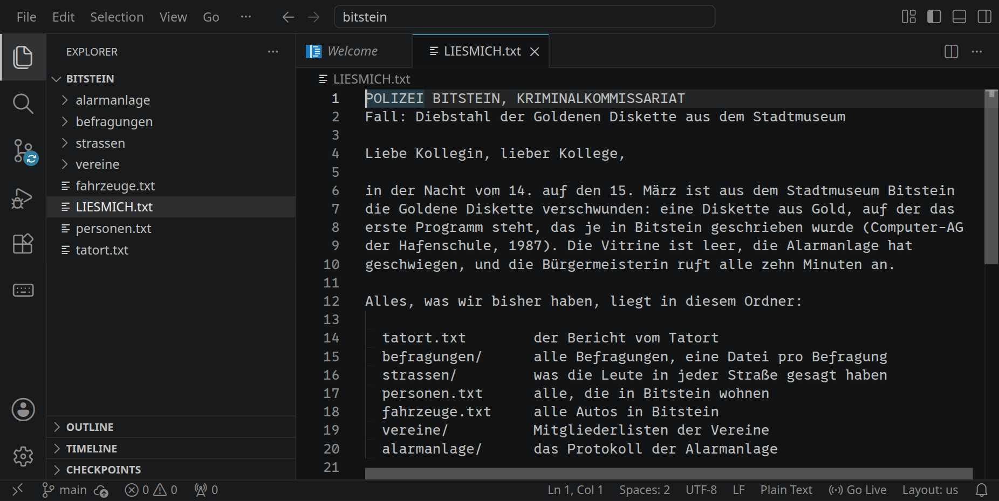

<!-- tutorial-scope -->
<!-- tutorial-screenshot
# Bild für die Karte der Aktivität: dasselbe Fenster in 16:9, so dass
# die Karte nichts abschneidet
viewport: 1029x579
sleep: 1
-->
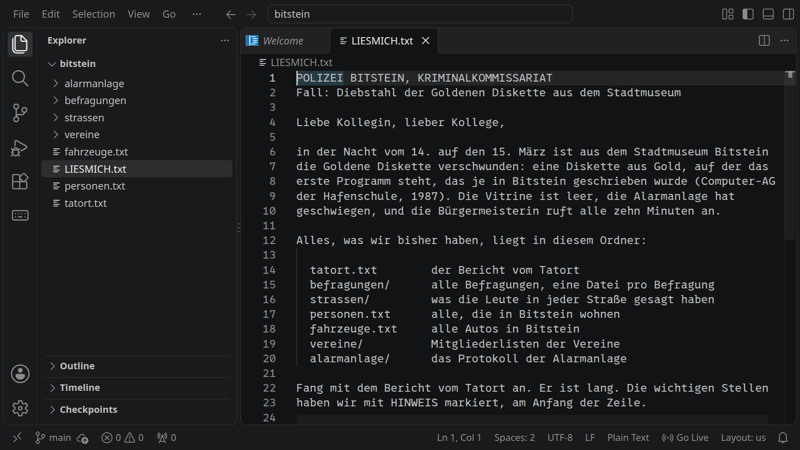

<!-- /tutorial-scope -->

_task(entpackt)

<div class='hint'>
Lös den Fall im Terminal. Du könntest jede Datei in VS Code öffnen, aber 1500 Befragungen liest niemand durch, und genau darum geht es: Die Werkzeuge finden in Sekunden, wofür du Tage bräuchtest. Raten gilt nicht. Jeder Schritt soll sich aus den Akten ergeben, und am Ende kannst du sagen, warum es nur eine Person gewesen sein kann.
</div>

Schreib dir unterwegs auf, was du herausfindest, zum Beispiel in eine Datei `notizen.txt`. Wie man die Ausgabe eines Befehls direkt dort hineinschreibt, kommt gleich.

## Der Tatort

_uses(grep, pipelines)

Der Bericht vom Tatort ist lang. Wie lang, sagt `wc -l`, das die Zeilen zählt:

```bash
wc -l tatort.txt
```

Über 1200 Zeilen, in denen vier Leute von der Polizei aufgeschrieben haben, was sie den ganzen Tag gemacht haben. Zum Durchlesen ist das zu viel. `grep` gibt nur die Zeilen aus, in denen ein Muster vorkommt. Wie oft hat die Polizei Kaffee getrunken?

```bash
grep Kaffee tatort.txt
```

<!-- tutorial-screenshot
# Ab hier das Terminal allein, so breit wie möglich
hide-left-sidebar
terminal-maximize
terminal-run: cd /workspace/bitstein
terminal-run: clear
terminal-run: grep Kaffee tatort.txt
terminal-wait-for-prompt
crop-terminal-lines: auto
-->

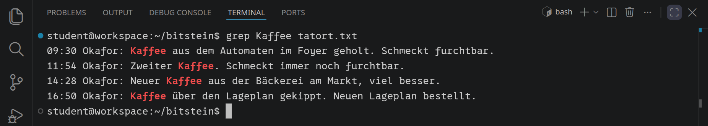

Die wichtigen Stellen hat Kommissarin Weber mit `HINWEIS` markiert, am Anfang der Zeile. Probier `grep HINWEIS tatort.txt` und sieh dir jede Zeile genau an. Steht in allen ein Hinweis?

Ein Muster für `grep` darf mit `^` anfangen. Das heißt »am Anfang der Zeile«: `grep '^Kaffee'` findet nur Zeilen, die mit `Kaffee` beginnen. Die Anführungszeichen schützen das Muster vor der Shell; bei Mustern mit Sonderzeichen oder Leerzeichen gehören sie immer dazu.

_task(hinweise)

<!-- tutorial-step
check-task-fails: hinweise <- grep HINWEIS tatort.txt
check-task: hinweise <- grep '^HINWEIS' tatort.txt
check-task: gross-klein <- 181
-->

Mit `>` landet die Ausgabe eines Befehls in einer Datei statt im Terminal. So hast du die Hinweise immer zur Hand:

```bash
grep '^HINWEIS' tatort.txt > notizen.txt
```

_task(noch-einmal)

<!-- after: noch-einmal -->
Es bleiben fünf Zeilen. `>` schreibt die Datei jedes Mal neu und wirft weg, was vorher darin stand. `>>` hängt an ihr Ende an. Was du später findest, kommt also mit `>>` dazu.
<!-- /after -->

`grep` unterscheidet Groß- und Kleinschreibung: `HINWEIS` ist nicht `Hinweis`. Mit `-i` (»ignore case«) ist das egal, und mit `-c` (»count«) gibt `grep` statt der Zeilen nur ihre Zahl aus.

_task(gross-klein)

Lies die fünf Hinweise genau. Jeder führt in einen anderen Teil der Akten.

## Die Zeugin

In `strassen/` liegt eine Datei für jede Straße. Jede Zeile ist ein Haus, in der Reihenfolge der Hausnummern: Zeile 1 ist Hausnummer 1, Zeile 2 Hausnummer 2. Jede Straße fängt bei 1 an, keine Nummer fehlt, auch wenn niemand zu Hause war, und es gibt kein 1a oder 1b: Hausnummer 23 steht also in Zeile 23. Die ersten drei Häuser der Hafenstraße:

```bash
head -n 3 strassen/hafenstrasse.txt
```

`head -n 3` gibt die ersten drei Zeilen aus, `tail -n 1` die letzte. Mit `|` (gesprochen »Pipe«) wird die Ausgabe des einen Befehls zur Eingabe des nächsten. `tail` bekommt dann nicht die ganze Datei, sondern nur, was `head` übrig lässt:

```bash
head -n 3 strassen/hafenstrasse.txt | tail -n 1
```

<!-- tutorial-screenshot
terminal-run: clear
terminal-run: head -n 3 strassen/hafenstrasse.txt
terminal-run: head -n 3 strassen/hafenstrasse.txt | tail -n 1
terminal-wait-for-prompt
crop-terminal-lines: auto
-->

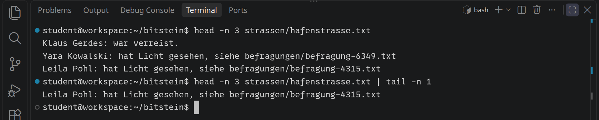

Die zweite Ausgabe ist genau eine Zeile: Hausnummer 3. In welcher Straße und in welchem Haus die Zeugin wohnt, steht in den Hinweisen.

_task(zeugin)

<!-- tutorial-step
check-task-fails: zeugin <- head -n 23 strassen/moewenweg.txt
check-task: zeugin <- head -n 23 strassen/moewenweg.txt | tail -n 1
-->

Die Zeile nennt die Datei mit ihrer Befragung. Lies sie mit `cat` und schreib dir auf, was die Zeugin gesehen hat.

## Der Nachtwächter

Welche der 1500 Befragungen die des Nachtwächters ist, hat niemand notiert. `grep` kann in vielen Dateien auf einmal suchen. Wer hatte Besuch aus Hamburg?

```bash
grep Hamburg befragungen/*
```

Das `*` setzt die Shell ein, bevor `grep` überhaupt startet: `befragungen/*` wird zu den Namen aller 1500 Dateien im Ordner. Vor jede Fundstelle schreibt `grep` dann, aus welcher Datei sie stammt. Mit `-l` (»list«) gibt es nur noch die Dateinamen aus, jeden einmal; `head -n 5` zeigt die ersten fünf davon:

```bash
grep -l Hamburg befragungen/* | head -n 5
```

Wie viele es sind, zählt `wc -l`, wenn du die Ausgabe statt an `head` an `wc` schickst:

```bash
grep -l Hamburg befragungen/* | wc -l
```

<!-- tutorial-screenshot
terminal-run: clear
terminal-run: grep -l Hamburg befragungen/* | head -n 5
terminal-run: grep -l Hamburg befragungen/* | wc -l
terminal-wait-for-prompt
crop-terminal-lines: auto
-->

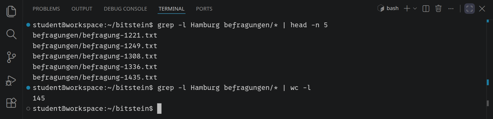

<div class='hint try'>
<strong>Ausprobieren:</strong> <code>grep -rl Hamburg befragungen | wc -l</code> zählt dieselben 145 Dateien. Mit <code>-r</code> öffnet <code>grep</code> den Ordner selbst und durchsucht alles darin, auch Unterordner, und die Shell muss keine 1500 Namen in die Zeile einsetzen. Das zählt bei sehr vielen Dateien: Wird die Zeile, die die Shell aus <code>befragungen/*</code> macht, zu lang, bricht sie mit »Argument list too long« ab; <code>grep -r</code> nicht.
</div>

Such so nach dem Nachtwächter. Ein Name mit Leerzeichen gehört in Anführungszeichen, sonst sucht `grep` nach dem Vornamen in einer Datei, die so heißt wie der Nachname. Nicht jede Datei, in der er vorkommt, ist seine eigene Befragung: Wer befragt wurde, steht in der zweiten Zeile.

_task(nachtwaechter)

<!-- tutorial-step
check-task-fails: nachtwaechter <- 3315
check-task: nachtwaechter <- 1290
-->

## Das Auto

In `fahrzeuge.txt` steht jedes Auto der Stadt in einer Zeile: Kennzeichen, Farbe, Art und wem es gehört.

```bash
head -n 3 fahrzeuge.txt
```

Mehrere `grep` hintereinander sieben immer feiner. Alle blauen Autos, deren Kennzeichen mit `BS-M` anfängt:

```bash
grep '^BS-M' fahrzeuge.txt | grep blau
```

<!-- tutorial-screenshot
terminal-run: clear
terminal-run: head -n 3 fahrzeuge.txt
terminal-run: grep '^BS-M' fahrzeuge.txt | grep blau
terminal-wait-for-prompt
crop-terminal-lines: auto
-->

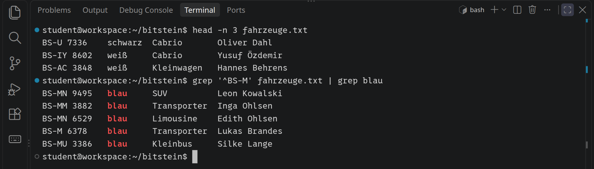

Was hat die Zeugin über das Auto gesagt? Bau daraus eine Kette von `grep`, bis nur noch die Autos übrig sind, die passen. Hängst du `| wc -l` an, siehst du, wie viele es nach jedem Schritt noch sind.

_task(autos)

<!-- tutorial-step
check-task-fails: autos <- grep '^BS-K' fahrzeuge.txt | grep gelb
check-task: autos <- grep '^BS-K' fahrzeuge.txt | grep gelb | grep '7 '
-->

Vier Autos, vier Leute: Wer von ihnen könnte es gewesen sein?

## Die Vereine

In `vereine/` liegen die Mitgliederlisten von vier Vereinen, ein Name pro Zeile, in der Reihenfolge, in der die Leute eingetreten sind.

`sort` sortiert Zeilen. Gibst du ihm zwei Dateien, sortiert es beide zusammen. Wer in beiden Vereinen ist, steht danach zweimal, direkt untereinander.

`uniq` (von »unique«, einmalig) fasst gleiche Zeilen, die direkt untereinander stehen, zu einer zusammen: Aus der sortierten Liste wird eine, in der jeder Name nur einmal vorkommt. Mit `-d` (»duplicate«, doppelt; ausgeschrieben `--repeated`) gibt `uniq` nur die Zeilen aus, die mehr als einmal hintereinander standen, jede einmal: hier also genau die Leute, die in beiden Vereinen sind. Wer singt im Chor und kegelt?

```bash
sort vereine/chor.txt vereine/kegelclub.txt | uniq -d
```

<!-- tutorial-screenshot
terminal-run: clear
terminal-run: sort vereine/chor.txt vereine/kegelclub.txt | uniq -d
terminal-wait-for-prompt
crop-terminal-lines: auto
-->

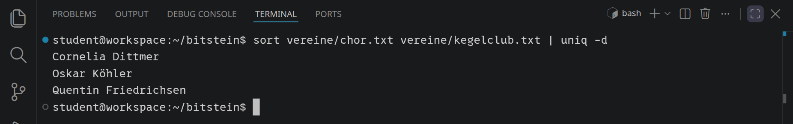

`uniq` vergleicht immer nur eine Zeile mit der davor. Ohne `sort` stehen die beiden Einträge derselben Person irgendwo in den Listen und nie nebeneinander, und `uniq -d` findet nichts.

Welche Vereine für dich zählen, sagen ein Hinweis und die Befragung des Nachtwächters.

_task(beide-vereine)

<!-- tutorial-step
check-task-fails: beide-vereine <- cat vereine/schachclub.txt vereine/muskelkater.txt | uniq -d
check-task: beide-vereine <- sort vereine/schachclub.txt vereine/muskelkater.txt | uniq -d
check-task: verdaechtige <- 0
-->

Leg die Namen neben die vier Autobesitzer. Wer steht auf beiden Listen?

_task(verdaechtige)

## Die Alarmanlage

Zwei Verdächtige, und beide passen zu allem, was du bisher weißt. Was jetzt noch fehlt, weiß die Alarmanlage. Sie schreibt jeden Zugang mit einer Schlüsselkarte in eine Datei und macht dafür sofort einen Commit, in einem Git-Repository:

```bash
cd alarmanlage
ls
cat LIESMICH.txt
```

`git log` zeigt alle Commits, den neuesten zuerst. Es sind über 90, deshalb kommen sie in `less`: Die Leertaste blättert weiter, <kbd>Q</kbd> beendet. Mit `--oneline` passt jeder Commit in eine Zeile, mit `--author=…` bleiben nur die Commits einer Person. Was hat die Museumsleiterin committet?

```bash
git log --oneline --author=Hollerbach
```

Vorn in jeder Zeile steht der Anfang des **Hashs**, der Kennung des Commits. `git show` mit diesem Anfang zeigt den ganzen Commit: wer, wann, die Nachricht und darunter, was sich geändert hat. Zeilen mit `+` sind dazugekommen, Zeilen mit `-` sind weggefallen.

```bash
git show a3ac34a
```

<!-- tutorial-screenshot
terminal-run: cd alarmanlage
terminal-run: clear
terminal-run: git log --oneline --author=Hollerbach
terminal-run: git show a3ac34a
terminal-wait-for-prompt
crop-terminal-lines: auto
terminal-expect-no-text: fatal:
-->

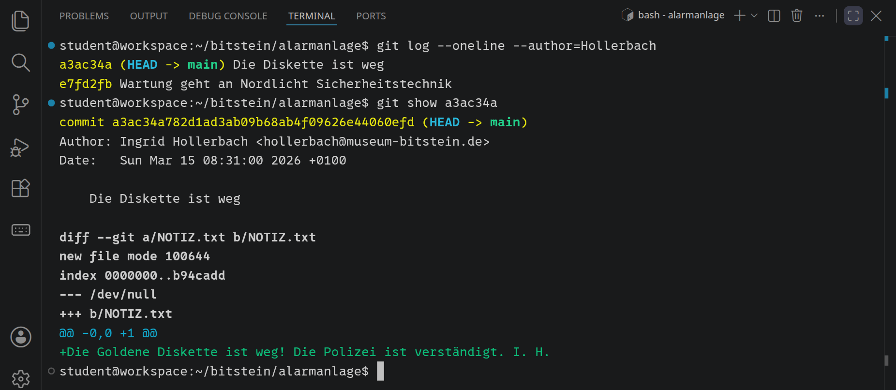

Beides auf einmal zeigt `git log -p` (»patch«, die Änderung): jeden Commit mit dem, was er geändert hat, ohne dass du Hashs abschreiben musst. Mit `--author=…` bleiben auch hier nur die Commits einer Person. Die Ausgabe kommt wieder in `less`; dort suchst du mit <kbd>/</kbd>, einem Wort und <kbd>Enter</kbd>, mit <kbd>n</kbd> springst du zur nächsten Stelle.

```bash
git log -p --author=Hollerbach
```

Eine Commit-Nachricht schreibt, wer committet, und sie kann behaupten, was sie will. Was der Commit wirklich geändert hat, zeigt erst `git show`. Schau dir an, was in der Nacht passiert ist. In `zugaenge.log` steht heute nichts Verdächtiges mehr, aber Git vergisst nichts, was einmal committet war.

_task(karte)

<!-- tutorial-step
check-task: karte <- 4471
-->

## Wer war es?

Du hast eine Karte. Wem sie gehört, steht in `karten.txt`, und wer in Bitstein was arbeitet, in `personen.txt`. Leg alles zusammen: das Auto, die Vereine, die Karte. Es bleibt eine einzige Person.

_task(taeter)

<!-- tutorial-step
check-task-fails: taeter <- Marlene Voss
check-task: taeter <- Konstantin Reuter
-->

Am Nachmittag des 15. März klingelt Kommissarin Weber an einer Tür in Bitstein. Die Goldene Diskette liegt noch in einer Sporttasche, unbeschädigt, in Zeitungspapier gewickelt. Die Zugangsdaten der Wartung hatte jemand seit dem Einbau der Anlage, und die alte Karte hat nie jemand zurückverlangt. Das Museum ändert noch am selben Abend alle Passwörter und sperrt jede Karte, die es nicht mehr braucht.

<!-- feature: case_server -->
## Beweise vom Server

Konstantin Reuter streitet alles ab. Er sei die ganze Nacht zu Hause gewesen, und an die Alarmanlage komme man ohnehin nur im Museum heran. Ganz stimmt das nicht: Das Museum hat einen Server, über den man sich von außen verbinden kann, und es hat der Polizei einen Zugang gegeben. Für dich gibt es einen eigenen, und Kommissarin Weber hat dir den Zettel dazu gegeben:

<div class='case-note'>
<p>Kriminalpolizei Bitstein, Kommissarin Weber</p>
<p>Das Stadtmuseum hat uns einen Zugang zu seinem Server gegeben, <code>museum.bitstein</code>. Dieser ist für dich:</p>
<pre>Benutzer   CASE_NOTE_USER
Passwort   CASE_NOTE_PASSWORD

ssh CASE_NOTE_USER@museum.bitstein</pre>
<p>Gib ihn nicht weiter.</p>
</div>

### Anmelden mit ssh

`ssh` (»Secure Shell«) öffnet ein Terminal auf einem anderen Rechner. Alles, was du tippst und was zurückkommt, geht verschlüsselt durchs Netz.

```bash
ssh e123@museum.bitstein
```

Statt `e123` steht dort dein Benutzer vom Zettel. Vor dem `@` steht, wer du dort bist, dahinter der Rechner. Beim ersten Mal fragt `ssh`, ob du dem Rechner traust, und zeigt seinen **Fingerabdruck**, eine Prüfsumme seines Schlüssels. Mit `yes` merkt sich `ssh` ihn in `~/.ssh/known_hosts`. Gibt sich später ein anderer Rechner als `museum.bitstein` aus, passt der Fingerabdruck nicht mehr, und `ssh` warnt laut. Dann fragt es nach dem Passwort. Beim Tippen erscheint nichts, auch keine Sternchen. Einfügen geht mit <kbd>Strg</kbd><kbd>Umschalt</kbd><kbd>V</kbd>.

<!-- tutorial-step
# ssh_askpass tippt die Passwörter: für das Museum das aus $CASE_PASSWORD
# (dasselbe wie auf dem Zettel), für die Alarmanlage das der Wartung. Die
# Fingerabdrücke beider Rechner sind danach bekannt: Mit
# SSH_ASKPASS_REQUIRE=force ginge auch die Frage danach an askpass.
terminal-open
terminal-run: printf '#!/bin/sh\ncase "$1" in *alarmanlage*) echo Leuchtturm-2024 ;; *) echo "$CASE_PASSWORD" ;; esac\n' > /tmp/askpass && chmod +x /tmp/askpass
terminal-run: export SSH_ASKPASS=/tmp/askpass SSH_ASKPASS_REQUIRE=force
terminal-run: ssh -o StrictHostKeyChecking=accept-new $CASE_USER@museum.bitstein true
terminal-wait-for-prompt: 30
terminal-run: ssh -o StrictHostKeyChecking=accept-new -J $CASE_USER@museum.bitstein $CASE_USER@alarmanlage.bitstein true
terminal-wait-for-prompt: 30
terminal-expect-no-text: Permission denied
-->

<!-- tutorial-screenshot
# Angemeldet auf museum.bitstein
terminal-run: clear
terminal-run: ssh $CASE_USER@museum.bitstein
wait-for-text: [museum]
terminal-run: ls
terminal-run: cat LIESMICH.txt
wait-for-text: Ingrid Hollerbach
crop-terminal-lines: auto
-->

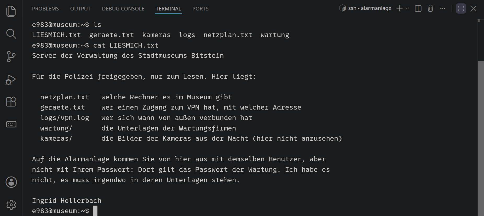

Die Eingabeaufforderung sieht jetzt anders aus und sagt doch dasselbe. In deinem Workspace steht `student@workspace:~$`: wer du bist, nach dem `@` auf welchem Rechner, nach dem `:` in welchem Ordner. Auf dem Museum steht `[museum] e123:~$`: der Rechner vorn, gelb und in Klammern, damit du ihn nicht übersiehst, dann wieder du und der Ordner. Das `~` ist jetzt dein Home auf dem Museum, nicht das im Workspace, und jeder Befehl läuft dort. `hostname` sagt, auf welchem Rechner du bist, `whoami`, wer du dort bist. Schreiben kannst du hier nichts, lesen alles, mit denselben Werkzeugen wie in Bitstein. `exit` oder <kbd>Strg</kbd><kbd>D</kbd> bringt dich zurück.

_task(vpn)

_task(geraet)

### Von Rechner zu Rechner

Laut `netzplan.txt` hängt die Alarmanlage nur im Netz des Museums. Aus deinem Workspace findest du sie gar nicht, nur von `museum.bitstein` aus. Melde dich dort an und von dort aus weiter:

```bash
ssh alarmanlage.bitstein
```

Ohne Namen vor dem `@` nimmt `ssh` den, unter dem du gerade angemeldet bist, und den kennt die Alarmanlage auch. Nach dem Passwort fragt sie trotzdem, und deins gilt dort nicht: Laut `LIESMICH.txt` gilt auf der Alarmanlage das Passwort der Wartung. Irgendwo auf `museum.bitstein` muss es stehen.

_task(wartungspasswort)

Mit dem Passwort der Wartung bist du drin, zwei Rechner weit weg: dein Workspace, darin eine Verbindung zum Museum, darin eine zur Alarmanlage. Die Eingabeaufforderung beginnt jetzt mit einem roten `[alarmanlage]`. Jedes `exit` geht einen Schritt zurück.

<!-- tutorial-screenshot
# Von museum.bitstein weiter auf die Alarmanlage, mit dem Passwort der Wartung
terminal-run: clear
terminal-run: ssh alarmanlage.bitstein
wait-for-text: password:
terminal-run: Leuchtturm-2024
wait-for-text: [alarmanlage]
terminal-run: hostname
terminal-run: ls -a /home/wartung
wait-for-text: .bash_history
crop-terminal-lines: auto
-->

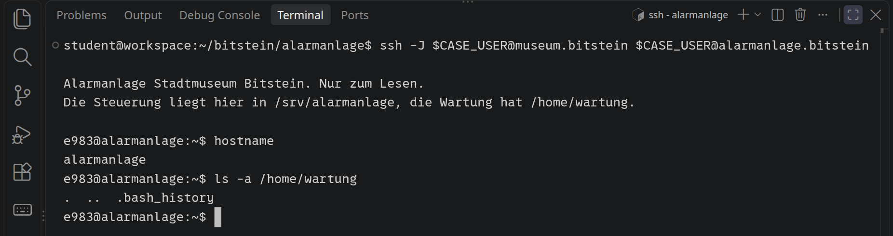

### Nicht allein

Bevor du dich umsiehst: Bist du hier allein? `who` zeigt, wer gerade angemeldet ist und von wo, `ps aux` jeden Prozess auf dem Rechner mit dem Benutzer, dem er gehört:

```bash
who
ps aux
```

<!-- tutorial-screenshot
# Auf der Alarmanlage ist noch jemand: wartung, von 10.8.0.23; was er tut,
# zeigt ps aux erst den Lernenden
terminal-run: clear
terminal-run: who
crop-terminal-lines: auto
-->

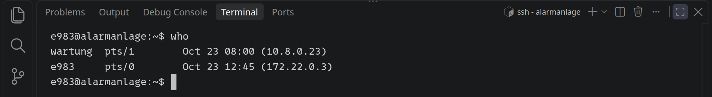

_task(eindringling)

Die Adresse kennst du aus `geraete.txt`. `rm -i` fragt vor dem Löschen nach, und die Antwort ist noch nicht gekommen. Löschen könnte er die Datei ohnehin nicht: Sie gehört `root`, so wie das Verzeichnis. Das zeigt `ls -la /home/wartung`, wo `.` für das Verzeichnis selbst steht. Beenden kannst du seinen Prozess auch nicht; `kill` darf nur Prozesse des eigenen Benutzers beenden. Verlass dich trotzdem nicht darauf: Hol dir eine Kopie der Datei in deinen Workspace, bevor er einen anderen Weg findet. Wie das geht, steht gleich unter »Beweise sichern«.

Die Steuerung kennst du schon: `/srv/alarmanlage` ist das Repository aus deinen Akten. Neu ist `/home/wartung`. Die Bash schreibt in die versteckte Datei `.bash_history`, was jemand getippt hat, Befehl für Befehl. Über jedem Befehl steht, wann er kam, als Zeile mit `#` und den Sekunden seit dem 1. Januar 1970. `date -d @1773526140` macht daraus eine Uhrzeit.

_task(loeschbefehl)

`sed` (»stream editor«) bearbeitet eine Datei Zeile für Zeile, ganz ohne Editor: `/4471/` wählt jede Zeile, in der `4471` steht, `d` (»delete«) löscht sie, und `-i` (»in place«) schreibt das Ergebnis gleich in die Datei zurück, statt es nur auszugeben. Mit `tail -n 3 zugaenge.log` hat er davor und danach nachgesehen, ob die Zeilen weg sind.

### Beweise sichern

`scp` (»secure copy«) kopiert Dateien über `ssh`. Vor dem `:` steht der Rechner, dahinter der Pfad dort, und das Letzte ist das Ziel bei dir. Aus deinem Workspace erreichst du die Alarmanlage nicht direkt, darum springt `scp` mit `-J` (»jump«) über das Museum. Das Passwort fragt es dann für beide Rechner, erst deins für das Museum, dann das der Wartung:

```bash
scp -J e123@museum.bitstein e123@alarmanlage.bitstein:/home/wartung/.bash_history ~/bitstein/beweis.txt
```

Das kommt in deinem Workspace an, nicht auf einem der Server. Führ den Befehl darum in deinem Workspace aus, nicht in einer Verbindung zum Museum.

_task(beweis)

<!-- tutorial-step
# Zurück im Workspace (von der Alarmanlage über das Museum): die Beweise
# kopieren, die Aufgaben lösen
terminal-run: exit
wait-for-text: logout
terminal-run: exit
wait-for-text: Connection to museum.bitstein closed
terminal-run: scp -J $CASE_USER@museum.bitstein $CASE_USER@alarmanlage.bitstein:/home/wartung/.bash_history ~/bitstein/beweis.txt
terminal-wait-for-prompt: 30
check-task: beweis
check-task-fails: vpn <- 10.8.0.31
check-task: vpn <- 10.8.0.23
check-task: geraet <- Elektro Reuter
check-task: loeschbefehl <- sed -i '/4471/d' zugaenge.log
check-task-fails: wartungspasswort <- Leuchtturm
check-task: wartungspasswort <- Leuchtturm-2024
check-task-fails: eindringling <- 1
check-task: eindringling <- 0
-->

### Die Kameras

Offen ist noch Reuters Ausrede, er sei die ganze Nacht zu Hause gewesen. Im Museum hängen drei Kameras, in der Ausstellung, am Hintereingang und am Parkplatz. Sie nehmen auf, sobald sich etwas bewegt, dann alle drei Sekunden ein Bild, und laut `LIESMICH.txt` liegen ihre Bilder aus der Nacht in `kameras/`. Melde dich am Museum an und sieh nach, wie viele es sind:

```bash
ls kameras | head -n 4
ls kameras | wc -l
```

<!-- tutorial-screenshot
# Die Bilder der Kameras auf museum.bitstein
terminal-run: clear
terminal-run: ssh $CASE_USER@museum.bitstein
wait-for-text: [museum]
terminal-run: clear
terminal-run: ls kameras | head -n 4
terminal-run: ls kameras | wc -l
terminal-run: ls kameras/cam2_*
wait-for-text: cam2_20260314_233810.jpg
crop-terminal-lines: auto
-->

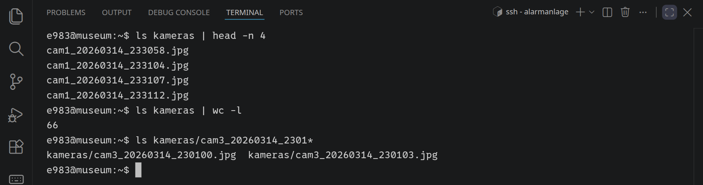

Der Name jedes Bildes sagt, welche Kamera es wann aufgenommen hat: `cam2_20260314_231202.jpg` ist Kamera 2 am 14. März um 23:12:02. Darum zeigt `ls kameras/cam2_*` alle Bilder der Kamera 2 am Hintereingang: Das `*` steht für jeden Rest des Namens, hier Datum, Zeit und `.jpg`. Sie hat zweimal aufgenommen, um 23:12 und kurz vor 23:38, genau als die Karte 4471 die Tür geöffnet hat.

Ein Bild kann das Terminal nicht zeigen, und der Server hat keinen Bildschirm. Hol die Bilder darum mit `scp` in deinen Workspace, wieder mit `exit` zurück und ohne Verbindung zum Museum. Mit einem `*` kommen viele auf einmal, alle Bilder der Kamera 1 etwa:

```bash
mkdir -p ~/bitstein/kameras
scp 'e123@museum.bitstein:kameras/cam1_*' ~/bitstein/kameras/
```

Ohne `/` vorn sucht `scp` den Pfad im Home-Verzeichnis auf dem Museum, dem Ordner mit `LIESMICH.txt`. Die Anführungszeichen schicken das `*` unverändert dorthin: Die Namen der passenden Bilder setzt dann die Shell auf dem Museum ein, nicht deine, in deren Ordnern es diese Bilder noch gar nicht gibt.

_task(kamera-bilder)

<!-- tutorial-step
terminal-run: exit
wait-for-text: Connection to museum.bitstein closed
terminal-run: clear
terminal-run: mkdir -p ~/bitstein/kameras
terminal-run: scp "$CASE_USER@museum.bitstein:kameras/cam1_*" ~/bitstein/kameras/
terminal-wait-for-prompt: 30
check-task: kamera-bilder
-->

Im Explorer liegen die Bilder jetzt unter `kameras`, und ein Klick öffnet eins im Editor. Geh sie der Reihe nach durch: Was passiert in der Ausstellung, und wann?

<!-- tutorial-screenshot
# Ein Bild der Kamera 1 im Editor
open-file: kameras/cam1_20260314_233118.jpg
hide-bottom-panel
-->

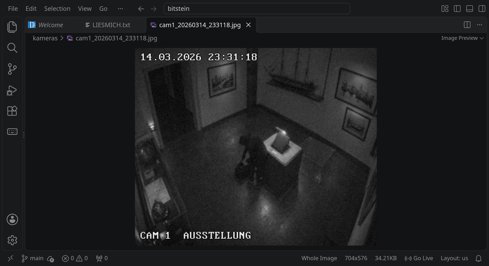

Kamera 3 am Parkplatz springt auch bei Regen an, darum hat sie 49 Bilder über die ganze Stunde. Statt alle durchzuklicken: Die Karte hat den Hintereingang um 23:38 geöffnet. Hol von Kamera 3 nur die Bilder aus dieser Minute.

_task(kamera-auto)

<!-- tutorial-step
terminal-run: scp "$CASE_USER@museum.bitstein:kameras/cam3_20260314_2338*" ~/bitstein/kameras/
terminal-wait-for-prompt: 30
check-task: kamera-bilder
check-task-fails: kamera-auto <- 1
check-task: kamera-auto <- 0
-->

Im Verhör bleibt Konstantin Reuter dabei: Er war die ganze Nacht zu Hause. Kommissarin Weber legt ihm ein Blatt nach dem anderen hin. Sein Laptop, um 23:02 im VPN des Museums. Ein gelber Kombi, um 23:38 ohne Licht vom Parkplatz. Dann seine eigenen Befehle aus der Nacht, Zeile für Zeile. Bei `sed -i '/4471/d' zugaenge.log` sieht er lange auf das Blatt. »Die Karte«, sagt er schließlich, »hätte ich zurückgeben sollen.«

Sein `rm -i` auf der Alarmanlage wartet übrigens noch immer auf ein »yes«.
<!-- /feature -->

## Fall abgeschlossen

Zwei Wochen später liegt die Goldene Diskette wieder in ihrer Vitrine. Zur Wiedereröffnung kommen auch die, die 1987 in der Computer-AG der Hafenschule das Programm darauf geschrieben haben, heute um die fünfzig. Und bei dir liegt ein letzter Zettel:

<div class='case-note'>
<p>Kriminalpolizei Bitstein, Kommissarin Weber</p>
<p>1265 Zeilen Bericht, 1503 Befragungen, 1515 Autos, 1800 Leute. Durchgelesen hast du davon kaum etwas, und am Ende stand trotzdem ein einziger Name. Danke für deine Hilfe, der Fall ist abgeschlossen.</p>
</div>

Jeder Schritt war ein Sieb: `grep '^HINWEIS'` machte aus 1265 Zeilen fünf, eine einzige Zeile in einer Straßendatei aus 1503 Befragungen eine Zeugin, eine Kette aus `grep` aus 1515 Autos vier, `sort | uniq -d` aus zwei Vereinen sechs Leute, von denen zwei eins der Autos haben, und eine gelöschte Zeile in Git aus zwei Verdächtigen einen Täter. So geht man mit Dateien um, die zu groß zum Lesen sind, mit den Logdateien eines Servers genauso wie mit einer Tabelle für ein Referat: nicht durchlesen, sondern fragen, und jede Antwort führt zur nächsten Frage.

## Spickzettel

<table class='table table-sm'>
<tr><th>Befehl</th><th>Was er tut</th></tr>
<tr><td><code>wc -l datei</code></td><td>zählt die Zeilen</td></tr>
<tr><td><code>grep muster datei</code></td><td>die Zeilen, in denen das Muster vorkommt</td></tr>
<tr><td><code>grep '^muster' datei</code></td><td>nur Zeilen, die mit dem Muster anfangen</td></tr>
<tr><td><code>grep -i</code>, <code>grep -c</code></td><td>Groß und Klein egal; nur die Zahl der Zeilen</td></tr>
<tr><td><code>grep -l muster ordner/*</code></td><td>die Dateien, in denen das Muster vorkommt</td></tr>
<tr><td><code>head -n 23 datei | tail -n 1</code></td><td>genau Zeile 23</td></tr>
<tr><td><code>sort a b | uniq -d</code></td><td>die Zeilen, die in beiden Dateien stehen</td></tr>
<tr><td><code>befehl &gt; datei</code>, <code>&gt;&gt; datei</code></td><td>Ausgabe in eine Datei schreiben; an sie anhängen</td></tr>
<tr><td><code>git log --oneline --author=name</code></td><td>die Commits einer Person, jeder in einer Zeile</td></tr>
<tr><td><code>git show hash</code></td><td>ein Commit mit allem, was er geändert hat</td></tr>
<tr><td><code>git log -p --author=name</code></td><td>die Commits einer Person mit allem, was sie geändert haben</td></tr>
<!-- feature: case_server -->
<tr><td><code>ssh name@rechner</code>, <code>exit</code></td><td>ein Terminal auf einem anderen Rechner; zurück</td></tr>
<tr><td><code>scp -J name@a name@b:pfad ziel</code></td><td>eine Datei vom Rechner b holen, über den Rechner a</td></tr>
<tr><td><code>scp name@rechner:pfad ziel</code></td><td>eine Datei von dort zu dir kopieren</td></tr>
<tr><td><code>scp 'name@rechner:ordner/a*' ziel</code></td><td>alle Dateien, deren Name mit a anfängt</td></tr>
<!-- /feature -->
</table>

## Wie geht es weiter?

- `git log -S 4471 --oneline` findet jeden Commit, in dem `4471` dazukommt oder verschwindet, auch wenn seine Nachricht nichts davon sagt. So findest du in einem großen Repository, wann eine Zeile dazukam und wann sie wieder ging.
- `grep -E` versteht reguläre Ausdrücke: `grep -E '^BS-K[A-Z]* [0-9]*7 +gelb'` erledigt die ganze Kette mit dem Auto in einem Schritt. Wie solche Muster funktionieren, zeigt [Endliche Automaten](/automata).
- Die Idee zu dieser Seite stammt aus [The Command Line Murders](https://github.com/veltman/clmystery) von Noah Veltman, einem Krimi auf Englisch, den man auch nur im Terminal lösen kann. Er ist größer und schwerer als der Fall in Bitstein und braucht noch ein paar Werkzeuge mehr.
