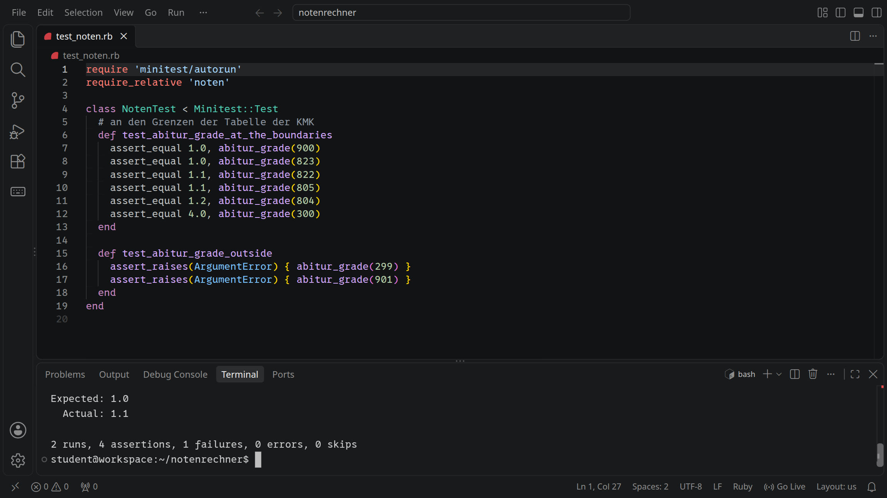
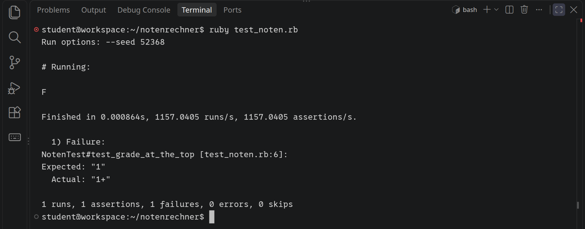
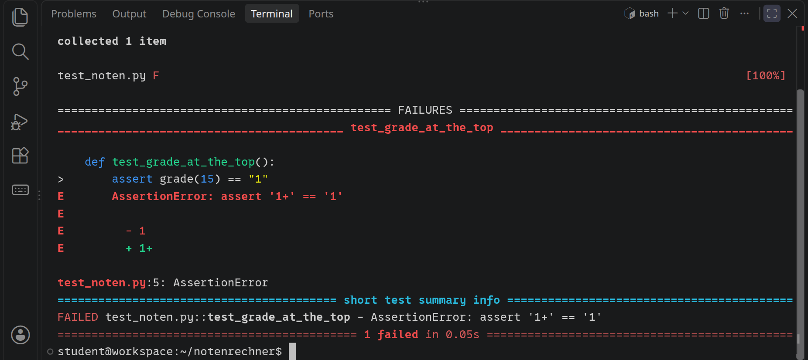
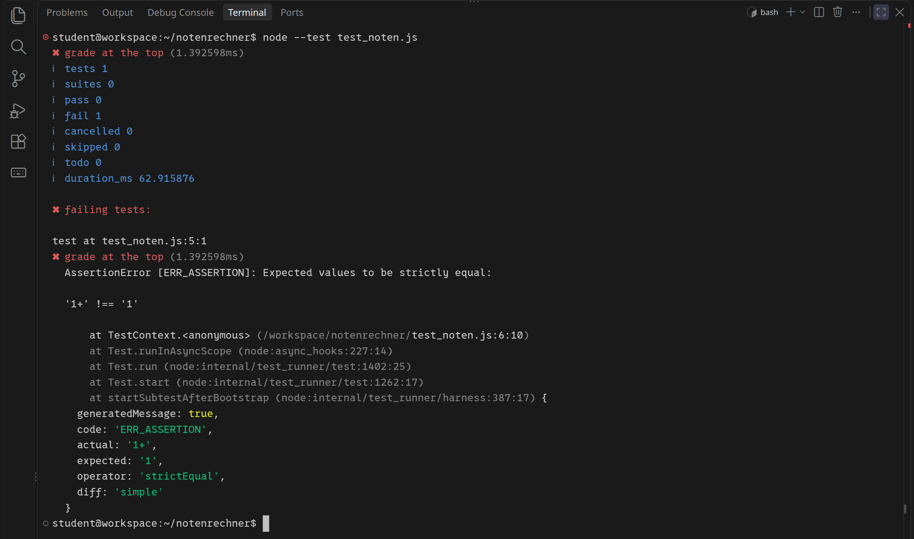

<div class='meta'>
image: teaser.webp
image_alt: "VS Code mit einer Testdatei für den Notenrechner; im Terminal darunter scheitert ein Test: erwartet 1.0, tatsächlich 1.1."
kind: projekt
duration: 2 Doppelstunden
languages: [ruby, python, javascript]
curriculum: "Oberstufe: Softwareprojekt (systematische Softwareentwicklung: Testen)"
topics: [testen]
requires: [kata-lists]
</div>

<div
    class="autotoc-secondary-trigger"
    data-title="Auf dieser Seite"
    data-levels="h2,h3">
</div>

# Testen: der Notenrechner

<p class='abstract'>
Ein Notenrechner für die Oberstufe sagt bei 805 Punkten eine 1,2 voraus, im
Zeugnis steht später eine 1,1. Du schreibst Tests, die solche Fehler finden,
mit dem Testwerkzeug deiner Sprache, und lernst, wo sich Fehler verstecken: an
den Grenzen. Am Ende schreibst du für eine neue Funktion zuerst die Tests und
dann den Code.
</p>

<!-- tutorial-scope -->
<!-- tutorial-screenshot
# Das Bild für die Karte, als erstes Rezept, solange das Terminal noch nicht
# maximiert ist: VS Code mit den Tests für den Abi-Schnitt (nur diese, aus
# bilder/test_noten.rb, damit sie oben stehen), darunter
# das Terminal, in dem sie mit dem noten.rb mit dem Rundungsfehler scheitern
tab: workspace
viewport: 1280x720
write-file: notenrechner/noten.rb <- file:beispiele/noten.rb
write-file: notenrechner/test_noten.rb <- file:bilder/test_noten.rb
press: Control+K
press: Control+O
wait-for-input-value: /workspace/
type: notenrechner
press: Enter
wait-for-input-value: /workspace/notenrechner/
press: Enter
wait-for-text: test_noten.rb
open-file: test_noten.rb
close-tab: Welcome
hide-left-sidebar
terminal-open
terminal-run: cd /workspace/notenrechner && clear
terminal-run: ruby test_noten.rb --seed 1
terminal-wait-for-prompt
-->


<!-- /tutorial-scope -->

## Die Geschichte

Ein Abiturjahrgang rechnet mit einem kleinen Programm aus, welcher Schnitt sich
aus den Punkten ergibt. Eine Schülerin kommt auf 805 Punkte, und das Programm
sagt 1,2. Im Zeugnis steht später 1,1.

Wer recht hat, steht in der
[Vereinbarung der Kultusministerkonferenz zur gymnasialen Oberstufe](https://www.kmk.org/fileadmin/Dateien/veroeffentlichungen_beschluesse/1972/1972_07_07-VB-gymnasiale-Oberstufe-Abiturpruefung.pdf),
Anlage 4: eine Formel für die Durchschnittsnote \\(N\\) aus den Punkten \\(E\\)
und eine Tabelle, die für jede Punktzahl die Note nennt. Das Programm hat sich
an die Formel gehalten und trotzdem eine falsche Note ausgerechnet. Einen
solchen Fehler findet man nicht, indem man den Code liest und nickt, sondern
mit **Tests**: kleinen Programmen, die den Code mit Werten aufrufen, deren
Ergebnis man kennt, und vergleichen.

## Einrichten

<!-- language: ruby -->
Lade das Programm in einen neuen Ordner `notenrechner`:

```bash
mkdir -p ~/notenrechner
cd ~/notenrechner
wget ${web_root}/testen/noten.rb
```

Öffne den Ordner mit <kbd>Strg</kbd><kbd>K</kbd> <kbd>Strg</kbd><kbd>O</kbd>.
In `noten.rb` stehen drei Methoden: `grade` macht aus 0 bis 15 Punkten eine
Note, `deficit?` sagt, ob ein Kurs mit so vielen Punkten ein Defizit ist, und
`abitur_grade` rechnet die Durchschnittsnote im Abitur aus. Probier sie im
Terminal aus:

```bash
ruby -r ./noten -e 'puts abitur_grade(805)'
```
<!-- /language -->
<!-- language: python -->
Lade das Programm in einen neuen Ordner `notenrechner`:

```bash
mkdir -p ~/notenrechner
cd ~/notenrechner
wget ${web_root}/testen/noten.py
```

Öffne den Ordner mit <kbd>Strg</kbd><kbd>K</kbd> <kbd>Strg</kbd><kbd>O</kbd>.
In `noten.py` stehen drei Funktionen: `grade` macht aus 0 bis 15 Punkten eine
Note, `is_deficit` sagt, ob ein Kurs mit so vielen Punkten ein Defizit ist, und
`abitur_grade` rechnet die Durchschnittsnote im Abitur aus. Probier sie im
Terminal aus:

```bash
python3 -c 'from noten import abitur_grade; print(abitur_grade(805))'
```
<!-- /language -->
<!-- language: javascript -->
Lade das Programm in einen neuen Ordner `notenrechner`:

```bash
mkdir -p ~/notenrechner
cd ~/notenrechner
wget ${web_root}/testen/noten.js
```

Öffne den Ordner mit <kbd>Strg</kbd><kbd>K</kbd> <kbd>Strg</kbd><kbd>O</kbd>.
In `noten.js` stehen drei Funktionen: `grade` macht aus 0 bis 15 Punkten eine
Note, `isDeficit` sagt, ob ein Kurs mit so vielen Punkten ein Defizit ist, und
`abiturGrade` rechnet die Durchschnittsnote im Abitur aus. Am Ende gibt
`module.exports` sie heraus, damit andere Dateien sie mit `require` holen
können. Probier sie im Terminal aus:

```bash
node -e 'console.log(require("./noten").abiturGrade(805))'
```
<!-- /language -->

Da steht die 1,2 aus der Geschichte. Ob das stimmt, klärst du später; zuerst
lernst du, wie ein Test aussieht.

## Ein erster Test

<!-- language: ruby -->
Ruby bringt ein Testwerkzeug mit, **minitest**. Ein Test ist eine Methode,
deren Name mit `test_` beginnt, in einer Klasse, die von `Minitest::Test`
erbt. Darin vergleicht `assert_equal` einen erwarteten Wert mit dem, was der
Code liefert, zuerst den erwarteten. Leg im Ordner `notenrechner` die Datei
`test_noten.rb` an:

```ruby
require 'minitest/autorun'
require_relative 'noten'

class NotenTest < Minitest::Test
  def test_grade_at_the_top
    assert_equal '1+', grade(15)
  end
end
```

`require 'minitest/autorun'` sorgt dafür, dass die Tests laufen, sobald du die
Datei startest; `require_relative 'noten'` holt die Methoden aus `noten.rb`.
Starte sie im Terminal:

```bash
ruby test_noten.rb
```

Für jeden bestandenen Test steht ein Punkt in der Ausgabe, und am Ende zählt
minitest: `1 runs, 1 assertions, 0 failures, 0 errors, 0 skips`.
<!-- /language -->
<!-- language: python -->
Für Python gibt es das Testwerkzeug **pytest**. Ein Test ist eine Funktion,
deren Name mit `test_` beginnt, in einer Datei, deren Name mit `test_`
beginnt. Darin prüft `assert`, ob ein Vergleich stimmt. Leg im Ordner
`notenrechner` die Datei `test_noten.py` an:

```python
from noten import grade


def test_grade_at_the_top():
    assert grade(15) == "1+"
```

Starte pytest im Terminal, im Ordner `notenrechner`:

```bash
pytest
```

pytest sucht sich die Dateien und Funktionen, deren Name mit `test_` beginnt,
führt sie aus und zählt am Ende: `1 passed`.
<!-- /language -->
<!-- language: javascript -->
Node bringt ein Testwerkzeug mit, **node --test**. Ein Test ist ein Aufruf von
`test` mit einem Namen und einer Funktion. Darin vergleicht
`assert.strictEqual` den Wert, den der Code liefert, mit dem erwarteten. Leg im
Ordner `notenrechner` die Datei `test_noten.js` an:

```javascript
const test = require('node:test');
const assert = require('node:assert');
const { grade } = require('./noten');

test('grade at the top', () => {
  assert.strictEqual(grade(15), '1+');
});
```

Starte sie im Terminal:

```bash
node --test test_noten.js
```

Für jeden bestandenen Test steht ein Haken mit seinem Namen in der Ausgabe, und
am Ende zählt Node: `tests 1`, `pass 1`, `fail 0`.
<!-- /language -->

<!-- language: ruby -->
<!-- stage: stufen/1-erster-test/test_noten.rb as test_noten.rb -->
<!-- /language -->
<!-- language: python -->
<!-- stage: stufen/1-erster-test/test_noten.py as test_noten.py -->
<!-- /language -->
<!-- language: javascript -->
<!-- stage: stufen/1-erster-test/test_noten.js as test_noten.js -->
<!-- /language -->

_task(erster-test)

Ein Test, der besteht, sagt wenig, solange du nicht weißt, wie er aussieht,
wenn er scheitert.

_task(rot)

<!-- after: rot -->
Der Test scheitert und sagt, was er erwartet hat, was herauskam und in welcher
Zeile. Wer recht hat, entscheidet das Testwerkzeug nicht: Diesmal ist der Test
falsch, nicht `grade`. Ein scheiternder Test heißt **rot**, ein bestandener
**grün**, nach den Farben, in denen viele Werkzeuge sie anzeigen.

<!-- language: ruby -->
<!-- tutorial-scope -->
<!-- tutorial-screenshot
# Der erste Test mit der falschen Erwartung (ruby): minitest meldet die Zeile,
# Expected und Actual
tab: workspace
write-file: notenrechner/noten.rb <- file:beispiele/noten.rb
write-file: notenrechner/test_noten.rb <- file:stufen/1-erster-test/test_noten.rb
hide-left-sidebar
terminal-maximize
terminal-run: cd /workspace/notenrechner && sed -i "s/'1+', grade/'1', grade/" test_noten.rb && clear
terminal-run: ruby test_noten.rb
terminal-wait-for-prompt
crop-terminal-lines: auto
-->


<!-- /tutorial-scope -->
<!-- /language -->
<!-- language: python -->
<!-- tutorial-scope -->
<!-- tutorial-screenshot
# Der erste Test mit der falschen Erwartung (python): pytest zeigt die Zeile
# und beide Werte
tab: workspace
write-file: notenrechner/noten.py <- file:beispiele/noten.py
write-file: notenrechner/test_noten.py <- file:stufen/1-erster-test/test_noten.py
hide-left-sidebar
terminal-maximize
terminal-run: cd /workspace/notenrechner && sed -i 's/== "1+"/== "1"/' test_noten.py && clear
terminal-run: pytest
terminal-wait-for-prompt
crop-terminal-lines: auto
-->


<!-- /tutorial-scope -->
<!-- /language -->
<!-- language: javascript -->
<!-- tutorial-scope -->
<!-- tutorial-screenshot
# Der erste Test mit der falschen Erwartung (javascript): node --test nennt
# beide Werte und die Zeile; ein hohes Fenster, damit die ganze Ausgabe passt
tab: workspace
viewport: 1280x1400
write-file: notenrechner/noten.js <- file:beispiele/noten.js
write-file: notenrechner/test_noten.js <- file:stufen/1-erster-test/test_noten.js
hide-left-sidebar
terminal-maximize
terminal-run: cd /workspace/notenrechner && sed -i "s/, '1+')/, '1')/" test_noten.js && clear
terminal-run: node --test test_noten.js
terminal-wait-for-prompt
crop-terminal-lines: auto
-->


<!-- /tutorial-scope -->
<!-- /language -->

Setz die Erwartung danach wieder auf `1+`.
<!-- /after -->

## Wo sich Fehler verstecken

### Klassen und Grenzen

Alle Eingaben auszuprobieren geht selten. Bei `grade` wären es nur 16
Punktzahlen und dazu alles, was keine ist; bei der Durchschnittsnote schon 601,
und eine Liste von 36 Ergebnissen hat mehr Möglichkeiten, als es Sekunden seit
dem Urknall gibt. Man teilt die Eingaben darum in **Klassen**, die das Programm
gleich behandelt. Bei `grade` sind das die Punktzahlen von 0 bis 15, die eine
Note bekommen, und alles darunter und darüber, das einen Fehler auslösen soll.
Für eine Klasse genügt ein Vertreter: Klappt es mit einem, sollte es mit den
anderen auch klappen.

Fehler sitzen aber besonders gern dort, wo eine Klasse aufhört und die nächste
beginnt: ein `<` statt `<=`, eine 15, wo 16 gemeint war. Darum testet man an
jeder **Grenze** beide Seiten, den letzten Wert der einen Klasse und den ersten
der anderen.

_task(grenzen)

### Fehler erwarten

Ein Test kann auch prüfen, dass etwas schiefgeht. Gibt es eine Punktzahl
nicht, soll `grade` einen Fehler melden, statt still eine falsche Note zu
liefern. So sieht ein Test dafür aus, für einen Text statt einer Zahl:

<!-- language: ruby -->
<!-- page-code: own -->
```ruby
def test_grade_of_text
  assert_raises(ArgumentError) { grade('zwölf') }
end
```

`assert_raises` führt den Block aus und besteht nur, wenn darin ein
`ArgumentError` geworfen wird.
<!-- /language -->
<!-- language: python -->
<!-- page-code: own -->
```python
def test_grade_of_text():
    with pytest.raises(ValueError):
        grade("zwölf")
```

Der Block `with pytest.raises(ValueError):` besteht nur, wenn darin ein
`ValueError` geworfen wird. Dafür kommt `import pytest` oben in die Datei.
<!-- /language -->
<!-- language: javascript -->
<!-- page-code: own -->
```javascript
test('grade of text', () => {
  assert.throws(() => grade('zwölf'), RangeError);
});
```

`assert.throws` ruft die Funktion auf und besteht nur, wenn darin ein
`RangeError` geworfen wird.
<!-- /language -->

<div class='hint own' data-check='grade-tests'>
<strong>Jetzt bist du dran:</strong> Schreib Tests für <code>grade</code>, in
drei Tests: die beiden Enden, ein paar Punktzahlen dazwischen und die Werte
gleich neben den Enden, bei denen es einen Fehler geben muss. Lass sie laufen,
bis alle grün sind.
</div>

<!-- language: ruby -->
<!-- hint -->
Bei 5 Punkten liegt mitten im Bereich noch eine Grenze, die in der Oberstufe
zählt: Darunter ist ein Kurs ein Defizit. Welche Note gehört zu 5 Punkten?
<!-- /hint -->

<!-- solution -->
```ruby
# die Enden: 0 und 15 Punkte
def test_grade_at_the_ends
  assert_equal '6', grade(0)
  assert_equal '1+', grade(15)
end

def test_grade_in_between
  assert_equal '1-', grade(13)
  assert_equal '4', grade(5)
end

# gleich neben den Enden: Punkte, die es nicht gibt
def test_grade_outside
  assert_raises(ArgumentError) { grade(-1) }
  assert_raises(ArgumentError) { grade(16) }
end
```
<!-- /solution -->
<!-- /language -->
<!-- language: python -->
<!-- hint -->
Bei 5 Punkten liegt mitten im Bereich noch eine Grenze, die in der Oberstufe
zählt: Darunter ist ein Kurs ein Defizit. Welche Note gehört zu 5 Punkten?
<!-- /hint -->

<!-- solution -->
```python
# die Enden: 0 und 15 Punkte
def test_grade_at_the_ends():
    assert grade(0) == "6"
    assert grade(15) == "1+"


def test_grade_in_between():
    assert grade(13) == "1-"
    assert grade(5) == "4"


# gleich neben den Enden: Punkte, die es nicht gibt
def test_grade_outside():
    with pytest.raises(ValueError):
        grade(-1)
    with pytest.raises(ValueError):
        grade(16)
```
<!-- /solution -->
<!-- /language -->
<!-- language: javascript -->
<!-- hint -->
Bei 5 Punkten liegt mitten im Bereich noch eine Grenze, die in der Oberstufe
zählt: Darunter ist ein Kurs ein Defizit. Welche Note gehört zu 5 Punkten?
<!-- /hint -->

<!-- solution -->
```javascript
// die Enden: 0 und 15 Punkte
test('grade at the ends', () => {
  assert.strictEqual(grade(0), '6');
  assert.strictEqual(grade(15), '1+');
});

test('grade in between', () => {
  assert.strictEqual(grade(13), '1-');
  assert.strictEqual(grade(5), '4');
});

// gleich neben den Enden: Punkte, die es nicht gibt
test('grade outside', () => {
  assert.throws(() => grade(-1), RangeError);
  assert.throws(() => grade(16), RangeError);
});
```
<!-- /solution -->
<!-- /language -->

<!-- language: ruby -->
<!-- stage: stufen/2-grade/test_noten.rb as test_noten.rb -->
<!-- /language -->
<!-- language: python -->
<!-- stage: stufen/2-grade/test_noten.py as test_noten.py -->
<!-- /language -->
<!-- language: javascript -->
<!-- stage: stufen/2-grade/test_noten.js as test_noten.js -->
<!-- /language -->

_task(grade-tests)

<div class='hint try'>
<strong>Ausprobieren:</strong> Bau in <code>grade</code> absichtlich einen
Fehler ein, etwa eine 16 statt der 15 in der Prüfung der Punkte, und lass die
Tests laufen. Welcher Test wird rot, und welche bleiben grün? Mach die Änderung
danach rückgängig.
</div>

## Der Fehler im Abi-Schnitt

### Die Tabelle der KMK

Die Durchschnittsnote im Abitur kommt aus den Punkten \\(E\\) der
Gesamtqualifikation, 300 bis 900:

$$N = \frac{17}{3} - \frac{E}{180}$$

Daneben steht in der Vereinbarung eine Tabelle, die für jede Punktzahl die Note
nennt. Ein Ausschnitt:

<table class='table'>
<thead>
<tr><th>Punkte</th><th>Note</th></tr>
</thead>
<tbody>
<tr><td>900 bis 823</td><td>1,0</td></tr>
<tr><td>822 bis 805</td><td>1,1</td></tr>
<tr><td>804 bis 787</td><td>1,2</td></tr>
<tr><td>786 bis 769</td><td>1,3</td></tr>
<tr><td>…</td><td>…</td></tr>
<tr><td>336 bis 319</td><td>3,8</td></tr>
<tr><td>318 bis 301</td><td>3,9</td></tr>
<tr><td>300</td><td>4,0</td></tr>
</tbody>
</table>

Jede Note gilt für 18 Punktzahlen, bis auf die 1,0, die bis 900 reicht: Besser
als 1,0 gibt es nicht, auch wenn die Formel bei 900 Punkten 0,67 ergibt.

_task(runden)

<!-- after: runden -->
Die Formel ergibt bei 823 Punkten 1,094 und bei 805 Punkten 1,194. Gerundet
auf eine Nachkommastelle sind das 1,1 und 1,2, und genau das tut `noten`. Die
Tabelle schneidet nach der ersten Nachkommastelle ab und kommt auf 1,0 und
1,1. Im Kommentar über der Funktion steht es sogar richtig, »abgeschnitten,
nicht gerundet«; der Code darunter tut etwas anderes. Ein Kommentar prüft
nichts, ein Test schon.
<!-- /after -->

### Tests aus der Tabelle

<div class='hint own' data-check='abitur-tests'>
<strong>Jetzt bist du dran:</strong> Schreib Tests für die Durchschnittsnote
nach der Tabelle: an einer oder zwei Grenzen, auf beiden Seiten, an den Enden
und gleich daneben, wo es einen Fehler geben muss. Diesmal werden sie rot, denn
<code>noten</code> hat einen Fehler, und dafür sind sie da.
</div>

<!-- language: ruby -->
<!-- hint -->
823 und 822 liegen auf den beiden Seiten einer Grenze. Zwei Kommazahlen
vergleicht `assert_equal` wie zwei ganze: `assert_equal 1.0, abitur_grade(823)`.
<!-- /hint -->

<!-- solution -->
```ruby
# an den Grenzen der Tabelle der KMK
def test_abitur_grade_at_the_boundaries
  assert_equal 1.0, abitur_grade(900)
  assert_equal 1.0, abitur_grade(823)
  assert_equal 1.1, abitur_grade(822)
  assert_equal 1.1, abitur_grade(805)
  assert_equal 1.2, abitur_grade(804)
  assert_equal 4.0, abitur_grade(300)
end

def test_abitur_grade_outside
  assert_raises(ArgumentError) { abitur_grade(299) }
  assert_raises(ArgumentError) { abitur_grade(901) }
end
```
<!-- /solution -->
<!-- /language -->
<!-- language: python -->
<!-- hint -->
823 und 822 liegen auf den beiden Seiten einer Grenze. `abitur_grade` holst du
dir mit `from noten import abitur_grade, grade`.
<!-- /hint -->

<!-- solution -->
```python
# an den Grenzen der Tabelle der KMK
def test_abitur_grade_at_the_boundaries():
    assert abitur_grade(900) == 1.0
    assert abitur_grade(823) == 1.0
    assert abitur_grade(822) == 1.1
    assert abitur_grade(805) == 1.1
    assert abitur_grade(804) == 1.2
    assert abitur_grade(300) == 4.0


def test_abitur_grade_outside():
    with pytest.raises(ValueError):
        abitur_grade(299)
    with pytest.raises(ValueError):
        abitur_grade(901)
```
<!-- /solution -->
<!-- /language -->
<!-- language: javascript -->
<!-- hint -->
823 und 822 liegen auf den beiden Seiten einer Grenze. `abiturGrade` holst du
dir in derselben Zeile wie `grade`: `const { grade, abiturGrade } = require('./noten');`.
<!-- /hint -->

<!-- solution -->
```javascript
// an den Grenzen der Tabelle der KMK
test('abiturGrade at the boundaries', () => {
  assert.strictEqual(abiturGrade(900), 1.0);
  assert.strictEqual(abiturGrade(823), 1.0);
  assert.strictEqual(abiturGrade(822), 1.1);
  assert.strictEqual(abiturGrade(805), 1.1);
  assert.strictEqual(abiturGrade(804), 1.2);
  assert.strictEqual(abiturGrade(300), 4.0);
});

test('abiturGrade outside', () => {
  assert.throws(() => abiturGrade(299), RangeError);
  assert.throws(() => abiturGrade(901), RangeError);
});
```
<!-- /solution -->
<!-- /language -->

<!-- language: ruby -->
<!-- stage: stufen/3-abitur/test_noten.rb as test_noten.rb -->
<!-- /language -->
<!-- language: python -->
<!-- stage: stufen/3-abitur/test_noten.py as test_noten.py -->
<!-- /language -->
<!-- language: javascript -->
<!-- stage: stufen/3-abitur/test_noten.js as test_noten.js -->
<!-- /language -->

Deine Tests sind rot, weil `noten` falsch rechnet. Die Prüfung der Aufgabe
führt sie deshalb nicht mit deinem `noten` aus, sondern mit einem richtigen,
mit dem alle grün sein müssen, und mit fehlerhaften, darunter dem, das rundet.

_task(abitur-tests)

### Den Fehler beheben

<div class='hint own' data-check='repariert'>
<strong>Jetzt bist du dran:</strong> Ändere die Durchschnittsnote in
<code>noten</code> so, dass sie nach der ersten Nachkommastelle abschneidet,
statt zu runden. Lass nach jeder Änderung die Tests laufen, bis alle grün sind.
</div>

<!-- language: ruby -->
<!-- hint -->
Abschneiden auf eine Nachkommastelle heißt mal 10 rechnen, nach unten runden
und wieder durch 10 teilen. Es geht auch ohne Kommazahlen: Die Note in Zehnteln
ist `(1020 - total) / 18`, ganzzahlig geteilt. Prüf das mit einer Punktzahl aus
der Tabelle nach.
<!-- /hint -->

<!-- solution -->
```ruby
~ def abitur_grade(total)
~   unless total.between?(300, 900)
~     raise ArgumentError, "#{total} Punkte: Die Gesamtqualifikation liegt zwischen 300 und 900"
~   end
~
  # in Zehnteln: (1020 - total) / 18, ganzzahlig geteilt, also abgeschnitten
  tenths = (1020 - total) / 18
  [tenths, 10].max / 10.0
~ end
```
<!-- /solution -->
<!-- /language -->
<!-- language: python -->
<!-- hint -->
Abschneiden auf eine Nachkommastelle heißt mal 10 rechnen, nach unten runden
und wieder durch 10 teilen. Es geht auch ohne Kommazahlen: Die Note in Zehnteln
ist `(1020 - total) // 18`. Prüf das mit einer Punktzahl aus der Tabelle nach.
<!-- /hint -->

<!-- solution -->
```python
~ def abitur_grade(total):
~     if not 300 <= total <= 900:
~         raise ValueError(f"{total} Punkte: Die Gesamtqualifikation liegt zwischen 300 und 900")
    # in Zehnteln: (1020 - total) // 18, ganzzahlig geteilt, also abgeschnitten
    tenths = (1020 - total) // 18
    return max(tenths, 10) / 10
```
<!-- /solution -->
<!-- /language -->
<!-- language: javascript -->
<!-- hint -->
Abschneiden auf eine Nachkommastelle heißt mal 10 rechnen, nach unten runden
(`Math.floor` statt `Math.round`) und wieder durch 10 teilen. Es geht auch ohne
Kommazahlen: Die Note in Zehnteln ist `Math.floor((1020 - total) / 18)`. Prüf
das mit einer Punktzahl aus der Tabelle nach.
<!-- /hint -->

<!-- solution -->
```javascript
~ function abiturGrade(total) {
~   if (total < 300 || total > 900) {
~     throw new RangeError(`${total} Punkte: Die Gesamtqualifikation liegt zwischen 300 und 900`);
~   }
  // in Zehnteln: (1020 - total) / 18, nach unten abgeschnitten
  const tenths = Math.floor((1020 - total) / 18);
  return Math.max(tenths, 10) / 10;
~ }
```
<!-- /solution -->
<!-- /language -->

1020 ist 17/3 mal 180, und durch 18 statt 180 zu teilen gibt gleich Zehntel.
Mit ganzen Zahlen gibt es nichts zu runden und keine Kommazahl, die eine
Winzigkeit danebenliegt.

<!-- language: ruby -->
<!-- stage: stufen/4-repariert/noten.rb as noten.rb -->
<!-- /language -->
<!-- language: python -->
<!-- stage: stufen/4-repariert/noten.py as noten.py -->
<!-- /language -->
<!-- language: javascript -->
<!-- stage: stufen/4-repariert/noten.js as noten.js -->
<!-- /language -->

_task(repariert)

## Zuerst der Test

### Rot, grün, aufräumen

Bisher gab es den Code schon, und du hast Tests dazugeschrieben. Man kann es
auch umgekehrt machen: zuerst den Test für etwas, das es noch nicht gibt, dann
den Code. Das heißt **testgetriebene Entwicklung** und geht in drei Schritten,
immer wieder:

1. **Rot:** Schreib einen Test, der scheitert, weil der Code fehlt.
2. **Grün:** Schreib gerade so viel Code, dass der Test besteht.
3. **Aufräumen:** Mach den Code lesbarer, ohne dass sich etwas ändert. Die
   Tests bleiben grün und sagen dir, ob es stimmt.

Wer so arbeitet, überlegt vor dem Code, was er tun soll, und hat am Ende zu
allem einen Test.

_person(beck)

### Die Zulassung zur Prüfung

Zur Abiturprüfung zugelassen wird nach der Vereinbarung der KMK (Ziffer 9.5.7),
wer in der Qualifikationsphase genug Punkte hat. Etwas vereinfacht, wenn jedes
Ergebnis eines Halbjahrs einfach zählt:

- **Block I:** Der Durchschnitt der Ergebnisse mal 40, gerundet, ist mindestens
  200. 36 Ergebnisse mit je 5 Punkten sind genau 200.
- **Unter 5 Punkten:** Höchstens 20 Prozent der Ergebnisse haben weniger als
  5 Punkte, ein Defizit.
- **Keine 0:** Kein Ergebnis hat 0 Punkte.

<!-- language: ruby -->
Die Methode dafür soll `admitted?(results)` heißen und für eine Liste von
Ergebnissen `true` oder `false` liefern. Für solche Werte hat minitest
`assert` und `refute`: `assert admitted?([5] * 36)` besteht, wenn
`admitted?` wahr ist, `refute` bei falsch.
<!-- /language -->
<!-- language: python -->
Die Funktion dafür soll `is_admitted(results)` heißen und für eine Liste von
Ergebnissen `True` oder `False` liefern. `assert is_admitted([5] * 36)`
besteht, wenn das Ergebnis wahr ist, `assert not …` bei falsch.
<!-- /language -->
<!-- language: javascript -->
Die Funktion dafür soll `isAdmitted(results)` heißen und für eine Liste von
Ergebnissen `true` oder `false` liefern. `assert.ok(isAdmitted(…))` besteht,
wenn das Ergebnis wahr ist, `assert.ok(!isAdmitted(…))` bei falsch.
<!-- /language -->

<div class='hint own' data-check='zulassung-tests'>
<strong>Jetzt bist du dran, rot:</strong> Schreib die Tests für die Zulassung,
bevor es den Code gibt: für jede der drei Regeln einen Fall, der gerade noch
zugelassen wird, und einen, der gerade nicht mehr zugelassen wird. Lass sie
laufen; sie scheitern, weil es die Funktion noch nicht gibt.
</div>

<!-- language: ruby -->
<!-- hint -->
Bei 40 Ergebnissen sind 20 Prozent genau 8. Damit Block I nicht der Grund ist,
brauchen die übrigen genug Punkte: `[4] * 8 + [6] * 32`.
<!-- /hint -->

<!-- solution -->
```ruby
# die Zulassung: Block I, Ergebnisse unter 5 Punkten, 0 Punkte
def test_admitted
  assert admitted?([5] * 36)                 # genau 200 Punkte in Block I
  refute admitted?([5] * 35 + [4])           # 199 Punkte
  assert admitted?([4] * 8 + [6] * 32)       # 8 von 40 unter 5 Punkten: genau 20 Prozent
  refute admitted?([4] * 9 + [6] * 31)       # 9 von 40
  assert admitted?([5] * 9 + [6] * 31)       # 5 Punkte liegen nicht unter 5
  refute admitted?([0] + [15] * 35)          # ein Ergebnis mit 0 Punkten
end
```
<!-- /solution -->
<!-- /language -->
<!-- language: python -->
<!-- hint -->
Bei 40 Ergebnissen sind 20 Prozent genau 8. Damit Block I nicht der Grund ist,
brauchen die übrigen genug Punkte: `[4] * 8 + [6] * 32`. `is_admitted` kommt
in die Zeile `from noten import …`.
<!-- /hint -->

<!-- solution -->
```python
# die Zulassung: Block I, Ergebnisse unter 5 Punkten, 0 Punkte
def test_admitted():
    assert is_admitted([5] * 36)                     # genau 200 Punkte in Block I
    assert not is_admitted([5] * 35 + [4])           # 199 Punkte
    assert is_admitted([4] * 8 + [6] * 32)           # 8 von 40 unter 5 Punkten: genau 20 Prozent
    assert not is_admitted([4] * 9 + [6] * 31)       # 9 von 40
    assert is_admitted([5] * 9 + [6] * 31)           # 5 Punkte liegen nicht unter 5
    assert not is_admitted([0] + [15] * 35)          # ein Ergebnis mit 0 Punkten
```
<!-- /solution -->
<!-- /language -->
<!-- language: javascript -->
<!-- hint -->
Bei 40 Ergebnissen sind 20 Prozent genau 8. Eine kleine Funktion spart
Tipparbeit: `const results = (points, count) => Array(count).fill(points);`
macht `count` Ergebnisse mit je `points` Punkten.
<!-- /hint -->

<!-- solution -->
```javascript
// count Ergebnisse mit je points Punkten
const results = (points, count) => Array(count).fill(points);

// die Zulassung: Block I, Ergebnisse unter 5 Punkten, 0 Punkte
test('isAdmitted', () => {
  assert.ok(isAdmitted(results(5, 36)));                                  // genau 200 Punkte in Block I
  assert.ok(!isAdmitted([...results(5, 35), 4]));                         // 199 Punkte
  assert.ok(isAdmitted([...results(4, 8), ...results(6, 32)]));           // 8 von 40 unter 5 Punkten: genau 20 Prozent
  assert.ok(!isAdmitted([...results(4, 9), ...results(6, 31)]));          // 9 von 40
  assert.ok(isAdmitted([...results(5, 9), ...results(6, 31)]));           // 5 Punkte liegen nicht unter 5
  assert.ok(!isAdmitted([0, ...results(15, 35)]));                        // ein Ergebnis mit 0 Punkten
});
```
<!-- /solution -->
<!-- /language -->

<!-- language: ruby -->
<!-- stage: stufen/5-zulassung/test_noten.rb as test_noten.rb -->
<!-- /language -->
<!-- language: python -->
<!-- stage: stufen/5-zulassung/test_noten.py as test_noten.py -->
<!-- /language -->
<!-- language: javascript -->
<!-- stage: stufen/5-zulassung/test_noten.js as test_noten.js -->
<!-- /language -->

_task(zulassung-tests)

### Grün

<div class='hint own' data-check='zulassung'>
<strong>Jetzt bist du dran, grün:</strong> Schreib jetzt die Funktion für die
Zulassung in <code>noten</code>, bis alle Tests grün sind.
</div>

<!-- language: ruby -->
<!-- hint -->
Rechne zuerst die drei Werte aus, die die Regeln brauchen, und verknüpf dann
die drei Bedingungen mit `&&`. Block I ist
`(results.sum * 40.0 / results.size).round`; die 20 Prozent gehen ohne
Kommazahlen: Anzahl unter 5 mal 5 ist höchstens so groß wie die Anzahl aller.
<!-- /hint -->

<!-- solution -->
```ruby
def admitted?(results)
  # Block I: der Durchschnitt mal 40, gerundet
  block_one = (results.sum * 40.0 / results.size).round
  deficits = results.count { |points| deficit?(points) }
  block_one >= 200 && deficits * 5 <= results.size && !results.include?(0)
end
```
<!-- /solution -->
<!-- /language -->
<!-- language: python -->
<!-- hint -->
Rechne zuerst die drei Werte aus, die die Regeln brauchen, und verknüpf dann
die drei Bedingungen mit `and`. Block I ist
`math.floor(sum(results) * 40 / len(results) + 0.5)`, denn Pythons `round`
rundet ,5 zur geraden Zahl. Die 20 Prozent gehen ohne Kommazahlen: Anzahl unter
5 mal 5 ist höchstens so groß wie die Anzahl aller.
<!-- /hint -->

<!-- solution -->
```python
def is_admitted(results):
    # Block I: der Durchschnitt mal 40, ab ,5 aufgerundet
    block_one = math.floor(sum(results) * 40 / len(results) + 0.5)
    deficits = len([points for points in results if is_deficit(points)])
    return block_one >= 200 and deficits * 5 <= len(results) and 0 not in results
```

`import math` kommt dazu ganz oben in die Datei.
<!-- /solution -->
<!-- /language -->
<!-- language: javascript -->
<!-- hint -->
Rechne zuerst die drei Werte aus, die die Regeln brauchen, und verknüpf dann
die drei Bedingungen mit `&&`. Block I ist
`Math.round(sum * 40 / results.length)`; die 20 Prozent gehen ohne Kommazahlen:
Anzahl unter 5 mal 5 ist höchstens so groß wie die Anzahl aller.
<!-- /hint -->

<!-- solution -->
```javascript
function isAdmitted(results) {
  // Block I: der Durchschnitt mal 40, gerundet
  const sum = results.reduce((total, points) => total + points, 0);
  const blockOne = Math.round(sum * 40 / results.length);
  const deficits = results.filter(isDeficit).length;
  return blockOne >= 200 && deficits * 5 <= results.length && !results.includes(0);
}
```

In `module.exports` kommt `isAdmitted` dazu.
<!-- /solution -->
<!-- /language -->

<!-- language: ruby -->
<!-- stage: loesung/noten.rb as noten.rb -->
<!-- /language -->
<!-- language: python -->
<!-- stage: loesung/noten.py as noten.py -->
<!-- /language -->
<!-- language: javascript -->
<!-- stage: loesung/noten.js as noten.js -->
<!-- /language -->

_task(zulassung)

<div class='hint try'>
<strong>Ausprobieren, aufräumen:</strong> Schreib die Zulassung anders, etwa
mit drei Zeilen, die jede für sich früh zurückgeben, wenn eine Regel verletzt
ist. Lass nach jeder Änderung die Tests laufen: Solange alle grün sind, verhält
sich der Code wie vorher. Welche Fassung liest sich leichter?
</div>

## Was Tests nicht können

Die Prüfung dieser Seite hat deine Tests selbst getestet: mit Fassungen von
`noten`, in die je ein kleiner Fehler eingebaut war, ein `>` statt `>=`, eine
16 statt einer 15. Ein Test, der jeden dieser Fehler findet, ist gut, und so
prüft man Tests auch außerhalb der Schule: Das heißt **Mutationstest**, die
fehlerhaften Fassungen heißen Mutanten.

Wie viele Tests auch grün sind, ein Beweis sind sie nicht. Edsger W. Dijkstra
schrieb 1969 in seinen
[»Notes on Structured Programming«](https://www.cs.utexas.edu/~EWD/transcriptions/EWD02xx/EWD249/EWD249.html):
»Program testing can be used to show the presence of bugs, but never to show
their absence!« Tests zeigen, dass ein Programm Fehler hat, aber nie, dass es
keine hat. Darum testet man dort, wo Fehler wahrscheinlich sind: an den
Grenzen.

_person(dijkstra)

## Wie geht es weiter?

- In den [Katas: Tests schreiben](/kata-tests) findest du mehr Funktionen, für
  die du Tests schreibst, die jeden eingebauten Fehler finden.
- Im [Klassen-Quiz](/class-quiz) arbeitet ihr zu vielen an einem Programm. Tests
  sagen dir dort, ob deine Änderung etwas kaputt macht, das jemand anderes
  geschrieben hat.
- Für die Funktionen aus den [Prüfziffern](/check-digits) kannst du Tests nach
  derselben Idee schreiben: An welchen Grenzen kann eine Prüfziffer falsch sein?

<!-- tutorial-step
# Die Aufgaben mit Prüfung (ruby): Jede Stufe der Seite besteht die Aufgabe
# ihres Kapitels im Workspace, als Gast, und die nächste noch nicht
tab: workspace
write-file: notenrechner/noten.rb <- file:beispiele/noten.rb
write-file: notenrechner/test_noten.rb <- file:stufen/1-erster-test/test_noten.rb
check-task: erster-test
check-task-fails: grade-tests
write-file: notenrechner/test_noten.rb <- file:stufen/2-grade/test_noten.rb
check-task: grade-tests
check-task-fails: abitur-tests
check-task-fails: repariert
write-file: notenrechner/test_noten.rb <- file:stufen/3-abitur/test_noten.rb
check-task: abitur-tests
write-file: notenrechner/noten.rb <- file:stufen/4-repariert/noten.rb
check-task: repariert
check-task-fails: zulassung-tests
check-task-fails: zulassung
write-file: notenrechner/test_noten.rb <- file:stufen/5-zulassung/test_noten.rb
check-task: zulassung-tests
write-file: notenrechner/noten.rb <- file:loesung/noten.rb
check-task: zulassung
-->

<!-- tutorial-step
# Die Aufgaben mit Prüfung (python): Jede Stufe der Seite besteht die Aufgabe
# ihres Kapitels im Workspace, als Gast, und die nächste noch nicht
tab: workspace
write-file: notenrechner/noten.py <- file:beispiele/noten.py
write-file: notenrechner/test_noten.py <- file:stufen/1-erster-test/test_noten.py
check-task: erster-test python
check-task-fails: grade-tests python
write-file: notenrechner/test_noten.py <- file:stufen/2-grade/test_noten.py
check-task: grade-tests python
check-task-fails: abitur-tests python
check-task-fails: repariert python
write-file: notenrechner/test_noten.py <- file:stufen/3-abitur/test_noten.py
check-task: abitur-tests python
write-file: notenrechner/noten.py <- file:stufen/4-repariert/noten.py
check-task: repariert python
check-task-fails: zulassung-tests python
check-task-fails: zulassung python
write-file: notenrechner/test_noten.py <- file:stufen/5-zulassung/test_noten.py
check-task: zulassung-tests python
write-file: notenrechner/noten.py <- file:loesung/noten.py
check-task: zulassung python
-->

<!-- tutorial-step
# Die Aufgaben mit Prüfung (javascript): Jede Stufe der Seite besteht die Aufgabe
# ihres Kapitels im Workspace, als Gast, und die nächste noch nicht
tab: workspace
write-file: notenrechner/noten.js <- file:beispiele/noten.js
write-file: notenrechner/test_noten.js <- file:stufen/1-erster-test/test_noten.js
check-task: erster-test javascript
check-task-fails: grade-tests javascript
write-file: notenrechner/test_noten.js <- file:stufen/2-grade/test_noten.js
check-task: grade-tests javascript
check-task-fails: abitur-tests javascript
check-task-fails: repariert javascript
write-file: notenrechner/test_noten.js <- file:stufen/3-abitur/test_noten.js
check-task: abitur-tests javascript
write-file: notenrechner/noten.js <- file:stufen/4-repariert/noten.js
check-task: repariert javascript
check-task-fails: zulassung-tests javascript
check-task-fails: zulassung javascript
write-file: notenrechner/test_noten.js <- file:stufen/5-zulassung/test_noten.js
check-task: zulassung-tests javascript
write-file: notenrechner/noten.js <- file:loesung/noten.js
check-task: zulassung javascript
-->
