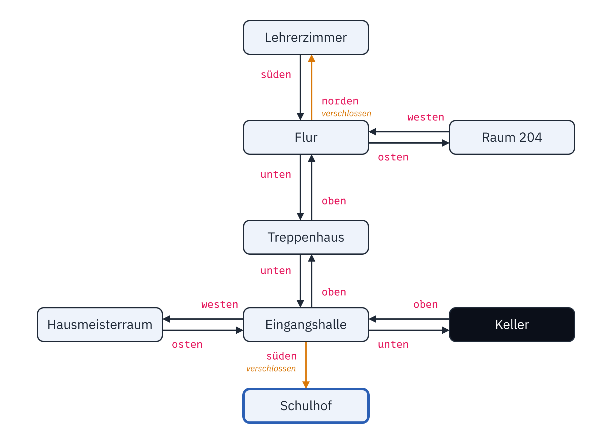
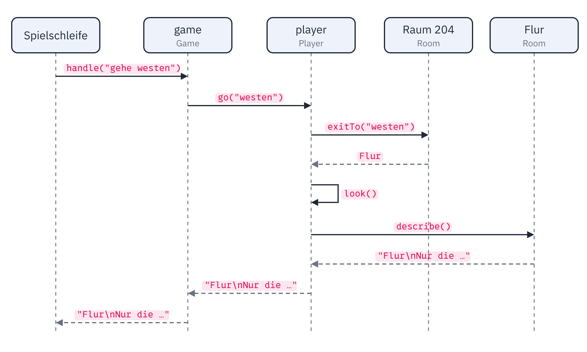
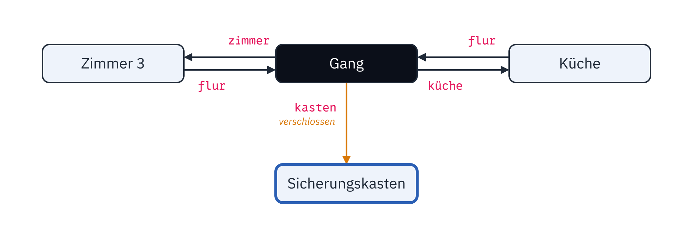

<div class='meta'>
image: teaser.webp
image_alt: "Ein Terminal, in dem das Textadventure »Nachts in der Schule« läuft: die Spielerin schließt mit dem Haustürschlüssel die Glastür auf und steht auf dem Schulhof"
kind: projekt
languages: [ruby, python, dart, java]
duration: 4 Doppelstunden
curriculum: "Sek I: Algorithmisches Problemlösen (Grundlagen der Objektorientierung); Oberstufe: objektorientierte Modellierung (UML-Klassendiagramme), objektorientierte Programmierung (Objekte, die Objekte kennen, Kapselung, Vererbung, Polymorphie)"
topics: [objektorientierung]
requires: [kata-objects]
reference: [uml, terminal]
</div>

<div
    class="autotoc-secondary-trigger"
    data-title="Auf dieser Seite"
    data-levels="h2,h3">
</div>

# Ein Textadventure aus Objekten

<p class='abstract'>
Du bist nach der letzten Stunde eingeschlafen, und jetzt ist die Schule
abgeschlossen. Dieses Spiel spielst du zuerst, dann baust du es nach: aus
Räumen, die einander kennen, Gegenständen, die etwas können, einer
Spielerin mit einer Tasche und einem Spiel, das Befehle versteht. Zum
Schluss baust du deine eigene Welt, und jemand aus deiner Klasse spielt
sie.
</p>

## Das Spiel

### Nachts in der Schule

Probier es aus. Du tippst, was du tun willst, etwa `gehe westen`,
`nimm zettel` oder `untersuche zettel`, und drückst Enter:

<div class='adventure-demo'></div>
<script src='/include/textadventure_demo.js'></script>

<div class='hint try'>
<strong>Ausprobieren:</strong> Spiel, bis du draußen bist. Achte darauf,
was dich weiterbringt: eine Beschreibung, die neugierig macht, ein
Gegenstand, den du erst später brauchst, ein Raum, in dem du zuerst
nichts siehst.
</div>

Solche Spiele heißen **Textadventures**. Das erste bekannte, »Colossal Cave
Adventure«, schrieb Will Crowther 1975 und 1976, nach seinen eigenen Karten
der Mammoth Cave in Kentucky, durch die er selbst gekrochen war; nach ihm
heißt die ganze Gattung Adventure.

_person(crowther)

### Ein Ordner für das Projekt

Leg einen Ordner für dieses Projekt an:

<!-- language: ruby -->
```bash_copy
mkdir /workspace/textadventure
cd /workspace/textadventure
touch adventure.rb
```

Deine Klassen schreibst du in `adventure.rb`.
<!-- /language -->
<!-- language: python -->
```bash_copy
mkdir /workspace/textadventure
cd /workspace/textadventure
touch adventure.py
```

Deine Klassen schreibst du in `adventure.py`.
<!-- /language -->
<!-- language: dart -->
```bash_copy
mkdir /workspace/textadventure
cd /workspace/textadventure
touch adventure.dart
```

Deine Klassen schreibst du in `adventure.dart`.
<!-- /language -->
<!-- language: java -->
```bash_copy
mkdir /workspace/textadventure
cd /workspace/textadventure
```

Jede Klasse schreibst du in eine eigene Datei, die heißt wie sie: `Room`
in `Room.java`, `Player` in `Player.java`. Alle liegen im Ordner
`textadventure`, so finden sie einander.
<!-- /language -->

## Erst der Plan

Bevor du programmierst, such die Objekte im Spiel. Ein Ausschnitt:

```text
Raum 204
Du bist über deinem Heft eingeschlafen. Draußen ist es dunkel, die Schule ist still.
Hier liegt: zettel, apfel
Ausgänge: westen
> nimm zettel
Du nimmst zettel.
> gehe westen
Flur
Nur die grünen Notausgangsschilder leuchten.
Ausgänge: osten, norden (verschlossen), unten
```

Die Hauptwörter, die immer wieder vorkommen, werden Klassen: der Raum, der
Gegenstand und die, die spielt, die Spielerin. Was ein Objekt über sich
weiß, wird ein Attribut: Ein Raum hat einen Namen und eine Beschreibung.
Was es tut, wird eine Methode: Die Spielerin geht und nimmt. Und wer wen
kennt, wird eine Beziehung: Ein Raum kennt seine Gegenstände, die
Spielerin kennt den Raum, in dem sie steht. Zeichne das als
Klassendiagramm in der UML-Werkstatt (wie sie funktioniert, steht im
[Handbuch](/reference/uml)):

_task(modell)

## Räume und Gegenstände

### Ein Raum

Ein Raum hat einen Namen und eine Beschreibung. Und er kennt seine Ausgänge:
In jeder Richtung, in der es weitergeht, liegt ein anderer Raum. Ein
Ausgang ist also ein Paar aus einer Richtung und einem Raum.
<!-- language: ruby, python -->
Dafür gibt es ein Dictionary: Die Richtung ist der Schlüssel, der Raum der
Wert. Im Dictionary steht dabei nicht eine Kopie des anderen Raums, sondern
der Raum selbst.
<!-- /language -->
<!-- language: dart, java -->
Dafür gibt es eine Map: Die Richtung ist der Schlüssel, der Raum der Wert.
In der Map steht dabei nicht eine Kopie des anderen Raums, sondern der Raum
selbst.
<!-- /language -->

Zwei Räume, die einander kennen, sind zwei Objekte, die aufeinander zeigen.

_task(raum)

_task(einweg)

<!-- after: einweg -->
`connect` legt einen Ausgang an, nur in eine Richtung: Der Flur kennt
jetzt die Küche, die Küche aber nicht den Flur. Soll man auch zurückgehen
können, verbindet man beide Räume: `kitchen.connect("süden", hall)`. Das
ist kein Fehler, sondern eine Möglichkeit: Eine Rutsche in den Keller führt
nur nach unten.

So hängt die Schule zusammen, in der du oben gespielt hast: Jeder Pfeil ist
ein `connect`, zwischen zwei Räumen sind es also meist zwei. Vom Schulhof
führt keiner zurück; wer draußen ist, hat gewonnen.

<div class='gallery single'>
<figure><figcaption>Die Nacht in der Schule: jeder Pfeil ein <code>connect</code>, verschlossene Türen in Orange, der Keller dunkel, das Ziel blau umrandet</figcaption></figure>
</div>
<!-- /after -->

### Gegenstände

Ein Gegenstand hat einen Namen und eine Beschreibung, wie ein Raum. Ein Raum
hat eine Liste seiner Gegenstände. Hebt jemand etwas auf, nimmt der Raum es
aus seiner Liste und gibt es heraus.

_task(gegenstaende)

### Ein Raum beschreibt sich

Was die Spielerin sieht, wenn sie einen Raum betritt, setzt der Raum selbst
zusammen, aus seinem Namen, seiner Beschreibung, seinen Gegenständen und
seinen Ausgängen. Nur er kennt alle vier; wer ihn fragt, bekommt fertigen
Text.

_task(beschreibung)

## Die Spielerin

### Gehen und die Tasche

Die Spielerin steht in einem Raum und hat eine Tasche. Geht sie in eine
Richtung, fragt sie ihren Raum nach dem Ausgang; gibt es einen, steht sie
danach im nächsten Raum. Ihr Raum ist ein Attribut wie jedes andere: Sie
wechselt den Raum, indem sie dem Attribut einen anderen Raum zuweist.

Ihre Tasche gibt sie dagegen nicht heraus. Wer wissen will, ob sie einen
Schlüssel hat, fragt sie, und sie schaut selbst nach.

_task(spielerin)

### Was nur die Spielerin angeht

Die Tasche ist eine Liste, und eine Liste ließe sich von überall ändern,
wenn man an sie herankäme. Dann könnte jede Klasse Gegenstände hinein- und
herausnehmen, und wenn die Tasche einmal anders gebaut wird, nach Namen
sortiert oder mit einer Grenze, wie viel hineinpasst, müsste man jede
dieser Stellen finden. Darum bleibt sie bei der Spielerin: Wer etwas von
der Tasche will, bittet die Spielerin darum, und nur sie ändert die Liste.
Das heißt **Kapselung**.

<!-- language: ruby -->
In Ruby kommt ohnehin niemand von außen an `@bag`, solange es keinen
`attr_reader :bag` gibt.
<!-- /language -->
<!-- language: python -->
In Python kommt jeder an jedes Attribut. Ein Unterstrich am Anfang,
`self._bag`, ist die Abmachung, dass nur die eigene Klasse es anfasst:
Python verbietet es nicht, aber wer `player._bag` schreibt, sieht, dass er
etwas tut, das nicht vorgesehen ist.
<!-- /language -->
<!-- language: dart -->
In Dart ist alles privat, was mit einem Unterstrich beginnt: An `_bag` kommt
außerhalb der Datei `adventure.dart` niemand heran, und die Spielerin gibt
die Liste mit keinem Getter heraus.
<!-- /language -->
<!-- language: java -->
In Java sagt `private`, dass nur die eigene Klasse ein Attribut anfasst; der
Compiler hält sich daran. Solange `Player` keinen Getter für `bag` hat,
kommt niemand von außen an die Liste.
<!-- /language -->

_task(wegraeumen)

<!-- after: wegraeumen -->
Der Apfel bittet die Spielerin: `player.remove(self)`. Er weiß, dass er
gegessen wird, die Spielerin weiß, wie ihre Tasche gebaut ist. Holte er
sich die Liste und löschte sich selbst, hinge er davon ab, wie die Tasche
gebaut ist. Die Spielschleife wüsste nicht, ob ein Gegenstand beim
Benutzen verschwindet, ein Schlüssel tut es ja nicht. Und ein gegessener
Apfel, der in der Tasche bleibt, müsste von allen übersprungen werden, die
sie zeigen.
<!-- /after -->

## Gegenstände, die etwas können

### Verschlossene Türen

Jetzt wird es ein Spiel: Eine Tür ist verschlossen, und man braucht den
passenden Schlüssel. Ein Apfel lässt sich essen. Beide sind Gegenstände,
aber `benutze` tut bei jedem etwas anderes. Darum bekommt jede Art von
Gegenstand eine eigene Klasse, die von `Item` erbt und die Methode `use`
überschreibt: Die Spielerin ruft nur `use` auf und muss nicht wissen, was
sie in der Hand hat. Dasselbe gilt im nächsten Abschnitt für eine
Taschenlampe und einen dunklen Raum. Zeichne den Plan für beide zuerst:

_task(diagramm)

Eine Tür ist dabei kein eigenes Objekt: Der Raum merkt sich zu jeder
verschlossenen Richtung, welcher Schlüssel passt. Ob eine Tür offen ist,
weiß nur er; die Spielerin fragt ihn, bevor sie durchgeht, und der Schlüssel
bittet ihn, aufzuschließen.

_task(schloss)

### Im Dunkeln

Der Keller ist dunkel: Ohne Licht sieht man dort nichts und findet nichts.
Ob die Spielerin Licht hat, könnte sie herausfinden, indem sie in ihrer
Tasche nach einem Gegenstand der Klasse `Lamp` sucht. Dann aber hätte ein
Handy oder eine Kerze, die man später erfindet, kein Licht, bis jemand
die Spielerin ändert. Besser fragt sie jeden Gegenstand, ob er leuchtet,
und jeder antwortet für sich: `Item` sagt nein, `Lamp` sagt ja, und eine
Kerze, die später dazukommt, sagt es selbst. Ebenso fragt die Spielerin
ihren Raum, ob er dunkel ist, statt nach seiner Klasse.

Dass derselbe Aufruf bei jedem Objekt das tut, was zu seiner Klasse passt,
heißt **Polymorphie**: Die Spielerin ruft `use` oder das Leuchten auf, und
was dabei geschieht, entscheidet das Objekt.

_task(leuchten)

<!-- after: leuchten -->
`Key` hat kein eigenes Leuchten und erbt es von `Item`: Ein Schlüssel
leuchtet nicht, ohne dass jemand es ihm sagen muss. Nur wer etwas anders
macht als die Klasse über ihm, schreibt es selbst.
<!-- /after -->

_task(dunkel)

## Das Spiel als Objekt

### Zeilen verstehen

Noch fehlt, was die getippten Zeilen versteht und an die Spielerin
weitergibt. Auch das wird ein Objekt, ein `Game`: Es bekommt eine Zeile und
gibt die Antwort zurück. Dass es selbst nichts liest und nichts ausgibt,
macht es prüfbar: Man kann ihm einen ganzen Lösungsweg geben, ohne zu
tippen. Und es weiß, wann das Spiel zu Ende ist: wenn jemand `ende` tippt
oder die Spielerin am Ziel steht.

_task(spiel)

### Mit deinen Klassen spielen

Jetzt kannst du spielen, mit deinen eigenen Klassen. Die Spielschleife und
die Nacht in der Schule sind fertig:

<!-- language: ruby -->
```bash_copy
cd /workspace/textadventure
wget ${web_root}/textadventure/starter/play.rb
wget ${web_root}/textadventure/starter/schule.rb
ruby play.rb schule
```

`play.rb` holt sich mit `require_relative 'adventure'` deine Klassen und mit
`require_relative 'schule'` die Welt aus `schule.rb`, die aus deinen Klassen
gebaut ist. Dann liest es Zeile für Zeile und gibt jede an `game.handle`.
<!-- /language -->
<!-- language: python -->
```bash_copy
cd /workspace/textadventure
wget ${web_root}/textadventure/starter/play.py
wget ${web_root}/textadventure/starter/schule.py
python3 play.py schule
```

`play.py` holt sich mit `from adventure import Game` deine Klassen und mit
`from schule import build_school` die Welt aus `schule.py`, die aus deinen
Klassen gebaut ist. Dann liest es Zeile für Zeile und gibt jede an
`game.handle`.
<!-- /language -->
<!-- language: dart -->
```bash_copy
cd /workspace/textadventure
wget ${web_root}/textadventure/starter/schule.dart
dart run schule.dart
```

`schule.dart` holt sich mit `import 'adventure.dart';` deine Klassen und
baut aus ihnen die Schule. Sein `main` liest Zeile für Zeile und gibt jede an
`game.handle`. Dart übersetzt das ganze Programm, bevor es losgeht: Fehlt
in `adventure.dart` noch etwas, das die Schule braucht, sagt es das zuerst.
<!-- /language -->
<!-- language: java -->
```bash_copy
cd /workspace/textadventure
wget ${web_root}/textadventure/starter/School.java
java School.java
```

`School.java` baut aus deinen Klassen die Schule. Sein `main` liest Zeile
für Zeile und gibt jede an `game.handle`. `java School.java` übersetzt die
Datei und findet die Klassen, die sie braucht, in den anderen Dateien des
Ordners; fehlt dort noch etwas, sagt der Compiler das zuerst.
<!-- /language -->

Es ist dasselbe Spiel wie oben auf der Seite, nur dass jetzt dein Code es
spielt. Antwortet es irgendwo anders, liegt der Unterschied in deinen
Klassen.

Was mit einer Zeile geschieht, die du tippst, zeigt das Bild: Die
Spielschleife gibt sie dem Spiel, das Spiel der Spielerin, die Spielerin
fragt ihren Raum nach dem Ausgang und den neuen Raum nach seiner
Beschreibung. Der Text geht denselben Weg zurück, und erst die
Spielschleife gibt ihn aus.

<!-- language: ruby, python -->
<div class='gallery single'>
<figure><figcaption>Was mit <code>gehe westen</code> in Raum 204 geschieht: durchgezogen die Aufrufe, gestrichelt, was zurückkommt</figcaption></figure>
</div>
<!-- /language -->
<!-- language: dart, java -->
<div class='gallery single'>
<figure><figcaption>Was mit <code>gehe westen</code> in Raum 204 geschieht: durchgezogen die Aufrufe, gestrichelt, was zurückkommt</figcaption></figure>
</div>
<!-- /language -->

## Deine Welt

### Eine kleine Welt

Jetzt erfindest du deine eigene. So sieht eine kleine Welt aus, mit vier
Räumen, einem dunklen Gang, einem Ziel hinter einer verschlossenen Tür und
dem Weg dorthin, zuerst als Karte:

<div class='gallery single'>
<figure><figcaption>Eine kleine Welt: Zeichne deine zuerst so, ein Pfeil je <code>connect</code></figcaption></figure>
</div>

Und als Code:

<!-- language: ruby -->
<!-- page-code: own -->
```ruby
def build_world
  room = Room.new("Zimmer 3", "Dein Zimmer im Wohnheim. Der Strom ist weg.")
  corridor = DarkRoom.new("Gang", "Ein langer Gang mit Türen links und rechts.")
  kitchen = Room.new("Küche", "Im Kühlschrank brummt nichts mehr.")
  fuse = GoalRoom.new("Sicherungskasten", "Du legst den Schalter um, und überall geht das Licht an. Geschafft!")
  room.connect("flur", corridor)
  corridor.connect("zimmer", room)
  corridor.connect("küche", kitchen)
  kitchen.connect("flur", corridor)
  corridor.connect("kasten", fuse)
  corridor.lock("kasten", "kastenschlüssel")
  room.add_item(Lamp.new("kerze", "Eine Kerze, die schon brennt."))
  kitchen.add_item(Key.new("kastenschlüssel", "Ein kleiner Schlüssel mit einem Blitz darauf."))
  Player.new(room)
end

WALKTHROUGH = ["nimm kerze", "gehe flur", "gehe küche", "nimm kastenschlüssel",
               "gehe flur", "benutze kastenschlüssel", "gehe kasten"].freeze
```

Spielen kannst du sie mit `ruby play.rb`, ohne `schule`.
<!-- /language -->
<!-- language: python -->
<!-- page-code: own -->
```python
def build_world():
    room = Room("Zimmer 3", "Dein Zimmer im Wohnheim. Der Strom ist weg.")
    corridor = DarkRoom("Gang", "Ein langer Gang mit Türen links und rechts.")
    kitchen = Room("Küche", "Im Kühlschrank brummt nichts mehr.")
    fuse = GoalRoom("Sicherungskasten", "Du legst den Schalter um, und überall geht das Licht an. Geschafft!")
    room.connect("flur", corridor)
    corridor.connect("zimmer", room)
    corridor.connect("küche", kitchen)
    kitchen.connect("flur", corridor)
    corridor.connect("kasten", fuse)
    corridor.lock("kasten", "kastenschlüssel")
    room.add_item(Lamp("kerze", "Eine Kerze, die schon brennt."))
    kitchen.add_item(Key("kastenschlüssel", "Ein kleiner Schlüssel mit einem Blitz darauf."))
    return Player(room)


WALKTHROUGH = ["nimm kerze", "gehe flur", "gehe küche", "nimm kastenschlüssel",
               "gehe flur", "benutze kastenschlüssel", "gehe kasten"]
```

Spielen kannst du sie mit `python3 play.py`, ohne `schule`.
<!-- /language -->
<!-- language: dart -->
<!-- page-code: own -->
```dart
Player buildWorld() {
  final room = Room('Zimmer 3', 'Dein Zimmer im Wohnheim. Der Strom ist weg.');
  final corridor = DarkRoom('Gang', 'Ein langer Gang mit Türen links und rechts.');
  final kitchen = Room('Küche', 'Im Kühlschrank brummt nichts mehr.');
  final fuse = GoalRoom('Sicherungskasten', 'Du legst den Schalter um, und überall geht das Licht an. Geschafft!');
  room.connect('flur', corridor);
  corridor.connect('zimmer', room);
  corridor.connect('küche', kitchen);
  kitchen.connect('flur', corridor);
  corridor.connect('kasten', fuse);
  corridor.lock('kasten', 'kastenschlüssel');
  room.addItem(Lamp('kerze', 'Eine Kerze, die schon brennt.'));
  kitchen.addItem(Key('kastenschlüssel', 'Ein kleiner Schlüssel mit einem Blitz darauf.'));
  return Player(room);
}

const walkthrough = ['nimm kerze', 'gehe flur', 'gehe küche', 'nimm kastenschlüssel',
    'gehe flur', 'benutze kastenschlüssel', 'gehe kasten'];
```

Spielen kannst du sie mit `play.dart`, das sein `main` hat wie `schule.dart`,
aber deine Welt baut:

```bash_copy
wget ${web_root}/textadventure/starter/play.dart
dart run play.dart
```
<!-- /language -->
<!-- language: java -->
<!-- page-code: own -->
```java
import java.util.List;

public class World {
    public static final List<String> WALKTHROUGH = List.of("nimm kerze", "gehe flur",
        "gehe küche", "nimm kastenschlüssel", "gehe flur", "benutze kastenschlüssel", "gehe kasten");

    public static Player build() {
        Room room = new Room("Zimmer 3", "Dein Zimmer im Wohnheim. Der Strom ist weg.");
        Room corridor = new DarkRoom("Gang", "Ein langer Gang mit Türen links und rechts.");
        Room kitchen = new Room("Küche", "Im Kühlschrank brummt nichts mehr.");
        Room fuse = new GoalRoom("Sicherungskasten", "Du legst den Schalter um, und überall geht das Licht an. Geschafft!");
        room.connect("flur", corridor);
        corridor.connect("zimmer", room);
        corridor.connect("küche", kitchen);
        kitchen.connect("flur", corridor);
        corridor.connect("kasten", fuse);
        corridor.lock("kasten", "kastenschlüssel");
        room.addItem(new Lamp("kerze", "Eine Kerze, die schon brennt."));
        kitchen.addItem(new Key("kastenschlüssel", "Ein kleiner Schlüssel mit einem Blitz darauf."));
        return new Player(room);
    }
}
```

Spielen kannst du sie mit `Play.java`, das sein `main` hat wie
`School.java`, aber deine Welt baut:

```bash_copy
wget ${web_root}/textadventure/starter/Play.java
java Play.java
```
<!-- /language -->

Die Namen der Gegenstände schreibst du klein, so wie man sie im Spiel tippt,
und die Richtungen auch: Das Spiel schreibt alles klein, was getippt wird.
Eine Richtung muss keine Himmelsrichtung sein, `flur` oder `kasten` geht
genauso.

_task(welt)

### Spieltest

<div class='hint try'>
<strong>Ausprobieren:</strong> Lass jemanden aus deiner Klasse dein Spiel
spielen, ohne etwas zu erklären. Achte darauf, wo sie oder er hängen bleibt:
bei einem Befehl, den das Spiel nicht versteht, bei einem Ausgang, der in
der Beschreibung fehlt, oder bei einem Schlüssel, den man nicht findet.
</div>

_task(spieltest)

## Abgabe

_task(abgabe)

<!-- extra -->
## Eine Kiste mit Inhalt

Gegenstände können selbst Gegenstände enthalten: eine Kiste, ein Rucksack,
ein Schrank. Eine Kiste ist ein Gegenstand, der eine Liste hat, wie ein
Raum. Öffnet man sie, legt sie ihren Inhalt in den Raum.

_task(kiste)

<!-- extra -->
## Farbe im Terminal

Im Spiel oben auf der Seite ist der Name eines Raums fett, die Gegenstände
sind grün und die Ausgänge blau: Man sieht auf einen Blick, was man nehmen
und wohin man gehen kann. Das Terminal kann das auch.

### Escape-Sequenzen

Nicht jedes Zeichen, das ein Programm ausgibt, zeigt das Terminal an. Das
Zeichen ESC (Nummer 27) leitet eine Anweisung ein: `ESC[32m` heißt »ab hier
grün«, `ESC[1m` »ab hier fett« und `ESC[0m` »zurück zum Normalen«. Solche
Folgen heißen **ANSI-Escape-Sequenzen**; die Zahl sagt, was sich ändert.
`printf` schreibt ESC als `\e`:

```bash_copy
printf '\e[1mFlur\e[0m\nAusgänge: \e[34mosten\e[0m, \e[34munten\e[0m\n'
```

<table class='table'>
<tr><th>Zahl</th><th>ab hier</th><th>Zahl</th><th>ab hier</th></tr>
<tr><td><code>0</code></td><td>wieder normal</td><td><code>32</code></td><td>grün</td></tr>
<tr><td><code>1</code></td><td>fett</td><td><code>33</code></td><td>gelb</td></tr>
<tr><td><code>4</code></td><td>unterstrichen</td><td><code>34</code></td><td>blau</td></tr>
<tr><td><code>31</code></td><td>rot</td><td><code>36</code></td><td>türkis</td></tr>
</table>

Alle Zahlen, auch helle Farben, Hintergründe und jede Farbe aus Rot, Grün und Blau, stehen im Handbuch unter [Farben im Terminal](/reference/terminal#farben).

<div class='hint try'>
<strong>Ausprobieren:</strong> Ändere <code>34</code> in <code>31</code>
oder <code>33</code> und <code>1</code> in <code>4</code>. Lass dann das
<code>\e[0m</code> hinter <code>osten</code> weg. Achte darauf, welche
Zeichen danach blau sind.
</div>

### Wohin gehört die Farbe?

_task(farbe-wohin)

<!-- after: farbe-wohin -->
In die Spielschleife. Die Prüfungen vergleichen die Texte von `describe`
und `handle` genau; mit Escape-Sequenzen darin stimmte keiner mehr. Und
nicht nur sie lesen diese Texte: Eine Webseite, die das Spiel zeigt, oder
ein Programm, das es vorliest, könnte mit ESC nichts anfangen. Farbe gehört
zur Ausgabe, und ausgeben tut nur die Spielschleife, ganz links im Bild
von oben. Sie bemalt, was sie ins Terminal schreibt; das Spiel bleibt, wie
es ist.
<!-- /after -->

### Farbe um einen Text

Zuerst eine kleine Funktion, die einen Text in eine Farbe setzt und danach
zurückschaltet. Sie kommt in eine neue Datei neben deine Klassen:
<!-- language: ruby -->
`colors.rb`. Ruby schreibt ESC in einem String mit doppelten
Anführungszeichen als `\e`.
<!-- /language -->
<!-- language: python -->
`colors.py`. Python schreibt ESC in einem String als `\033`.
<!-- /language -->
<!-- language: dart -->
`colors.dart`. Dart schreibt ESC in einem String als `\x1B`.
<!-- /language -->
<!-- language: java -->
`Colors.java`, als Methode der Klasse `Colors`. Java schreibt ESC in einem
String als `\u001B`.
<!-- /language -->

_task(farbe)

### Eine Antwort bemalen

Die Antworten des Spiels haben eine feste Form: Ein Raum beschreibt sich mit
seinem Namen in der ersten Zeile und `Ausgänge:` in der letzten, die Tasche
beginnt mit `In deiner Tasche:`. Daran erkennt `paint`, was es bemalt, ohne
das Spiel zu fragen.

_task(bemalen)

### In der Spielschleife

Jetzt bemalt die Spielschleife alles, was sie ausgibt.
<!-- language: ruby -->
In `play.rb` ändern sich die beiden Zeilen, die ausgeben, und eine kommt
dazu:

```ruby
~ require_relative 'adventure'
require_relative 'colors'
```

```ruby
puts paint(game.start)
~ until game.over?
~   print "> "
~   line = $stdin.gets
~   break if line.nil?
  puts paint(game.handle(line))
~ end
```

<!-- stage: farbe/play.rb as play.rb -->

Dann spielst du wie vorher, mit `ruby play.rb schule`.
<!-- /language -->
<!-- language: python -->
In `play.py` ändern sich die beiden Zeilen, die ausgeben, und eine kommt
dazu:

```python
~ from adventure import Game
from colors import paint
```

```python
print(paint(game.start()))
~ while not game.is_over():
~     try:
~         line = input("> ")
~     except EOFError:
~         break
    print(paint(game.handle(line)))
```

<!-- stage: farbe/play.py as play.py -->

Dann spielst du wie vorher, mit `python3 play.py schule`.
<!-- /language -->
<!-- language: dart -->
In `schule.dart` und ebenso in `play.dart` ändern sich die beiden Zeilen, die
ausgeben, und eine kommt dazu:

```dart
~ import 'adventure.dart';
import 'colors.dart';
```

```dart
  print(paint(game.start()));
~   while (!game.isOver) {
~     stdout.write('> ');
~     final line = stdin.readLineSync();
~     if (line == null) break;
    print(paint(game.handle(line)));
~   }
```

<!-- stage: farbe/schule.dart as schule.dart -->
<!-- stage: farbe/play.dart as play.dart -->

Dann spielst du wie vorher, mit `dart run schule.dart`.
<!-- /language -->
<!-- language: java -->
In `School.java` und ebenso in `Play.java` ändern sich die beiden Zeilen, die
ausgeben; `Colors` liegt im selben Ordner und braucht kein `import`:

```java
        System.out.println(Colors.paint(game.start()));
~         Scanner input = new Scanner(System.in);
~         while (!game.isOver()) {
~             System.out.print("> ");
~             if (!input.hasNextLine()) {
~                 break;
~             }
            System.out.println(Colors.paint(game.handle(input.nextLine())));
~         }
```

<!-- stage: farbe/School.java as School.java -->
<!-- stage: farbe/Play.java as Play.java -->

Dann spielst du wie vorher, mit `java School.java`.
<!-- /language -->

<div class='hint try'>
<strong>Ausprobieren:</strong> Färbe <code>(verschlossen)</code> hinter
einem Ausgang rot (<code>31</code>) statt blau. Achte darauf, dass das
Komma danach wieder ohne Farbe ist.
</div>

## Wie geht es weiter?

- **Figuren:** ein Hausmeister, der im Keller sitzt und nur gegen einen
  Apfel den Schlüssel herausgibt. Wer kennt wen, und welche Klasse
  bekommt den neuen Befehl `gib`?
- **Punkte:** Jeder Gegenstand, den man zum ersten Mal findet, bringt
  Punkte. Wer zählt mit, die Spielerin, das Spiel oder jeder Gegenstand?
- **Eine Karte:** `all_rooms` findet alle Räume. Wie ließe sich daraus eine
  Karte zeichnen, die zeigt, wo man schon war?
- **Speichern:** Wie ließe sich ein Spielstand in eine Datei schreiben und
  wieder laden, mit allen Räumen, die aufeinander zeigen?

## Zum Nachschlagen

- [Klassendiagramme](/reference/uml) im Handbuch: die Schreibweise der
  UML-Werkstatt.
- [Klassen entwerfen: die Expresskasse](/supermarkt): wie man Klassen aus
  einer Geschichte findet.

<!-- tutorial-scope -->
<!-- tutorial-screenshot
# Bild für die Karte der Aktivität: das fertige Spiel im Terminal, in 16:9;
# dabei prüft es jede Aufgabe mit Code an der Lösung
write-file: textadventure/adventure.rb <- file:loesung/adventure.rb
write-file: textadventure/play.rb <- file:starter/play.rb
write-file: textadventure/schule.rb <- file:starter/schule.rb
write-file: textadventure/adventure.py <- file:loesung/adventure.py
write-file: textadventure/play.py <- file:starter/play.py
write-file: textadventure/schule.py <- file:starter/schule.py
write-file: textadventure/textadventure.uml <- file:loesung/textadventure.uml
write-file: textadventure/adventure.dart <- file:loesung/adventure.dart
write-file: textadventure/Room.java <- file:loesung/java/Room.java
write-file: textadventure/DarkRoom.java <- file:loesung/java/DarkRoom.java
write-file: textadventure/GoalRoom.java <- file:loesung/java/GoalRoom.java
write-file: textadventure/Item.java <- file:loesung/java/Item.java
write-file: textadventure/Key.java <- file:loesung/java/Key.java
write-file: textadventure/Food.java <- file:loesung/java/Food.java
write-file: textadventure/Lamp.java <- file:loesung/java/Lamp.java
write-file: textadventure/Chest.java <- file:loesung/java/Chest.java
write-file: textadventure/Player.java <- file:loesung/java/Player.java
write-file: textadventure/Game.java <- file:loesung/java/Game.java
write-file: textadventure/World.java <- file:loesung/java/World.java
write-file: textadventure/colors.rb <- file:farbe/colors.rb
write-file: textadventure/colors.py <- file:farbe/colors.py
write-file: textadventure/colors.dart <- file:farbe/colors.dart
write-file: textadventure/Colors.java <- file:farbe/Colors.java
viewport: 1029x579
zoom: 1.4
hide-left-sidebar
terminal-maximize
terminal-run: cd /workspace/textadventure && clear
terminal-run: ruby play.rb schule
wait-for-text: eingeschlafen
terminal-run: gehe westen
terminal-run: gehe unten
terminal-run: gehe unten
terminal-run: gehe westen
terminal-run: nimm taschenlampe
terminal-run: gehe osten
terminal-run: gehe unten
terminal-run: nimm lehrerschlüssel
terminal-run: gehe oben
terminal-run: gehe oben
terminal-run: gehe oben
terminal-run: benutze lehrerschlüssel
terminal-run: gehe norden
terminal-run: nimm haustürschlüssel
terminal-run: gehe süden
terminal-run: gehe unten
terminal-run: gehe unten
terminal-run: benutze haustürschlüssel
terminal-run: gehe süden
wait-for-text: Geschafft
sleep: 1
check-task: modell
check-task: raum
check-task: gegenstaende
check-task: beschreibung
check-task: spielerin
check-task: diagramm
check-task: schloss
check-task: dunkel
check-task: spiel
check-task: welt
check-task: kiste
check-task: farbe
check-task: bemalen
check-task: raum python
check-task: gegenstaende python
check-task: beschreibung python
check-task: spielerin python
check-task: schloss python
check-task: dunkel python
check-task: spiel python
check-task: welt python
check-task: kiste python
check-task: farbe python
check-task: bemalen python
check-task: raum dart
check-task: gegenstaende dart
check-task: beschreibung dart
check-task: spielerin dart
check-task: schloss dart
check-task: dunkel dart
check-task: spiel dart
check-task: welt dart
check-task: kiste dart
check-task: farbe dart
check-task: bemalen dart
check-task: raum java
check-task: gegenstaende java
check-task: beschreibung java
check-task: spielerin java
check-task: schloss java
check-task: dunkel java
check-task: spiel java
check-task: welt java
check-task: kiste java
check-task: farbe java
check-task: bemalen java
-->


<!-- /tutorial-scope -->
