<div class='meta'>
image: sky.webp:0:50
image_alt: "Ein Retro-Spiel: eine kleine Figur auf grünem Boden, von oben fallen Sterne; oben »Score: 0« und »Lives: 3«"
kind: projekt
language: TIC-80 / Lua
duration: 3 Doppelstunden
curriculum: "Sek I: Algorithmisches Problemlösen (algorithmische Grundstrukturen, Variablenkonzept), Digitale Bilder und Visualisierung (Figuren und Animationen); Oberstufe: Algorithmen und Softwareentwicklung (Sequenz, Auswahl, Wiederholung, Variablenkonzept)"
reference: [tic80, workspace]
</div>

<div
    class="autotoc-secondary-trigger"
    data-title="Auf dieser Seite"
    data-levels="h2,h3,h4">
</div>

# Ein Spiel in 64 KB

<p class='abstract'>
TIC-80 ist ein kleiner Computer, den es nur als Programm gibt: ein Bildschirm mit 240 × 136 Pixeln, 16 Farben und Platz für 64 KB. Alles, was man für ein Spiel braucht, ist eingebaut: ein Editor für den Code, einer für Figuren, einer für Töne. In diesem Projekt programmierst du in Lua ein kleines Spiel, »Star Catcher«: Sterne fallen vom Himmel, und du fängst sie.
</p>

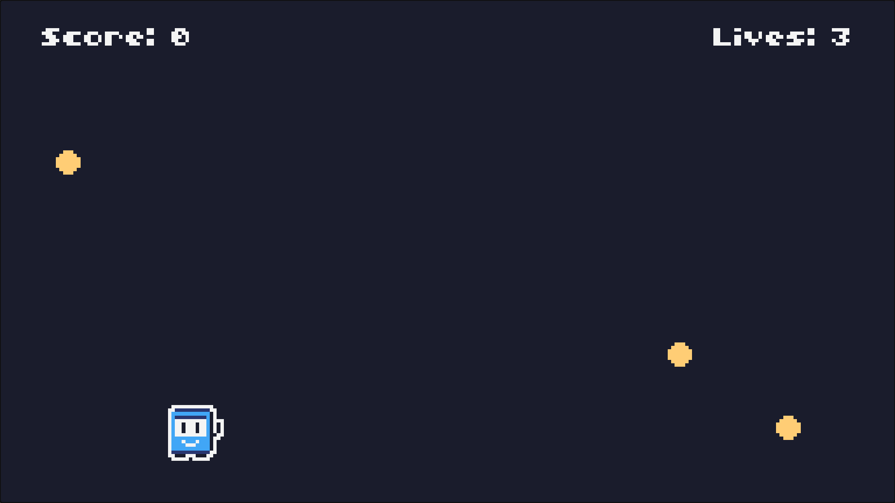

## TIC-80 kennenlernen

### Was ist TIC-80?

TIC-80 ist eine »Fantasy-Konsole«: ein ausgedachter Computer im Stil der Heimcomputer aus den 1980er-Jahren. Seine Grenzen sind gewollt. Mit nur 16 Farben und einem kleinen Bildschirm musst du dich entscheiden, was wirklich wichtig ist, und ein fertiges Spiel passt in eine einzige Datei, die »Cartridge« (Steckmodul).

Programmiert wird in Lua, einer kleinen Sprache, die auch in vielen großen Spielen steckt. Was du über Variablen, `if` und Schleifen aus anderen Sprachen kennst, findest du hier wieder.

_person(ierusalimschy-celes-figueiredo)

### TIC-80 starten

<a class='btn btn-primary' href='/tic80/' target='_blank'><svg class='bi' width='16' height='16' viewBox='0 0 16 16' fill='currentColor' aria-hidden='true' style='width: 1em; height: 1em; vertical-align: -0.125em; margin-right: 0.55em;'><path fill-rule='evenodd' d='M2 .5h11A1.5 1.5 0 0 1 14.5 2v9a1.5 1.5 0 0 1-1.5 1.5H2A1.5 1.5 0 0 1 .5 11V2A1.5 1.5 0 0 1 2 .5Zm0 1a.5.5 0 0 0-.5.5v1h12V2a.5.5 0 0 0-.5-.5H2Zm11.5 2.5h-12v7a.5.5 0 0 0 .5.5h11a.5.5 0 0 0 .5-.5V4Z'/><path d='M5 5.5h1V8H5zM9 5.5h1V8H9zM4.5 9h1v.5h4V9h1v1.5h-6z'/><path d='M3 12.5h2V15H3zM10 12.5h2V15h-2z'/><path d='M14.5 5H16v3h-1.5V7h.5V6h-.5z'/></svg>TIC-80 öffnen</a>

TIC-80 öffnet sich in einem neuen Tab. Klicke auf »KLICKEN ZUM STARTEN«. Damit du TIC-80 auch später schnell findest, kannst du es in deinem [Profil](/profil) ins Menü holen: »TIC-80 im Menü anzeigen«.

<!-- tutorial-screenshot
open-site: /tic80/
tab: preview
viewport: 1024x576
sleep: 1
-->

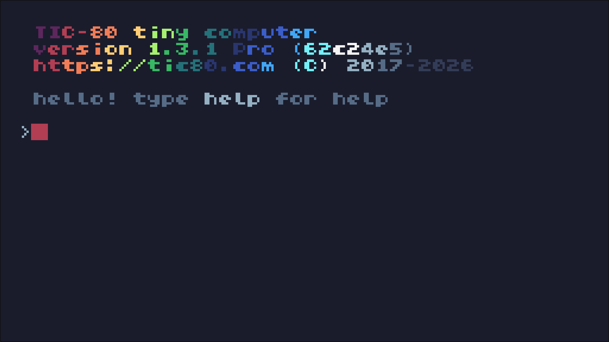

Das ist die **Konsole**. Hier gibst du Befehle ein, zum Beispiel `help`, und drückst <kbd>Enter</kbd>.

### Das erste Programm

Gib in der Konsole ein:

```text
new lua
```

Das legt ein neues Spiel an, in Lua. Drücke dann <kbd>Esc</kbd>: Du bist im **Code-Editor** und siehst das Programm, das TIC-80 für jedes neue Spiel mitbringt.

<!-- tutorial-screenshot
open-site: /tic80/
tab: preview
viewport: 1024x576
hook: tic new lua
hook: key Escape
sleep: 0.5
-->

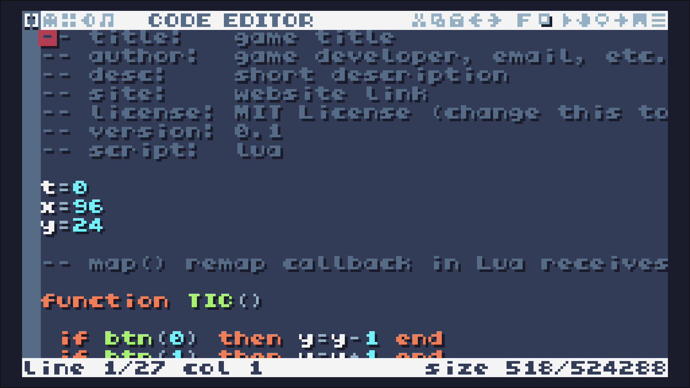

Starte es mit <kbd>Strg</kbd><kbd>R</kbd>. Mit den Pfeiltasten bewegst du die kleine Figur:

<!-- tutorial-screenshot
open-site: /tic80/
tab: preview
viewport: 1024x576
hook: tic new lua
hook: key Escape
hook: key Control+r
hook: hold ArrowDown 0.6
hook: hold ArrowRight 0.8
sleep: 0.5
-->

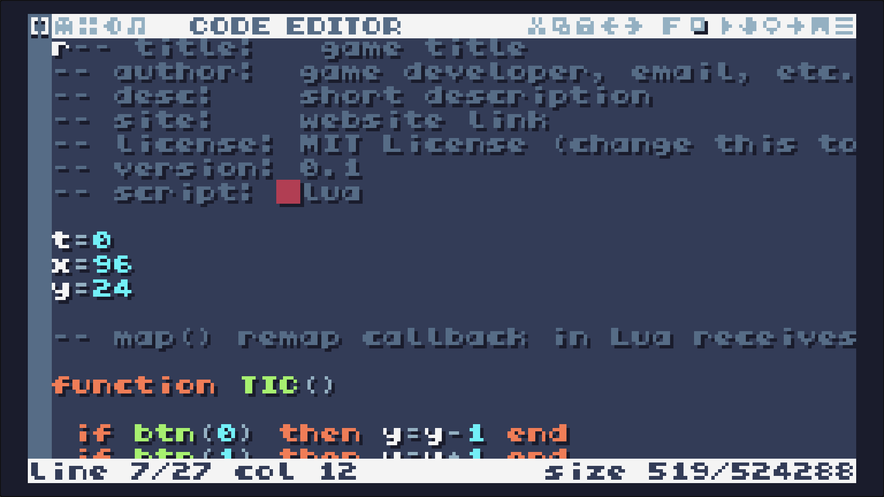

Mit <kbd>Esc</kbd> kommst du zurück in die Konsole, mit einem weiteren <kbd>Esc</kbd> in den Code-Editor.

Das Herz jedes TIC-80-Programms ist die Funktion `TIC()`. TIC-80 ruft sie **60-mal in der Sekunde** auf, und jedes Mal zeichnet sie das ganze Bild neu:

- `btn(0)` bis `btn(3)` sind wahr, solange die Pfeiltaste oben, unten, links oder rechts gedrückt ist. Dann ändert sich `x` oder `y`, und die Figur steht beim nächsten Bild woanders.
- `cls(13)` löscht den Bildschirm mit der Farbe 13.
- `spr(…)` zeichnet eine Figur aus dem Sprite-Editor an die Stelle `x`, `y`.
- `print("HELLO WORLD!", 84, 84)` schreibt einen Text.

Die wichtigsten Tasten:

<table class='table'>
<tr><th>Taste</th><th>Was sie tut</th></tr>
<tr><td><kbd>Esc</kbd></td><td>zwischen Konsole und Editor wechseln; ein laufendes Spiel beenden</td></tr>
<tr><td><kbd>Strg</kbd><kbd>R</kbd></td><td>das Spiel starten</td></tr>
<tr><td><kbd>Strg</kbd><kbd>S</kbd></td><td>speichern</td></tr>
<tr><td><kbd>F1</kbd></td><td>Code-Editor</td></tr>
<tr><td><kbd>F2</kbd></td><td>Sprite-Editor (Figuren)</td></tr>
<tr><td><kbd>F3</kbd></td><td>Map-Editor (Spielfelder)</td></tr>
<tr><td><kbd>F4</kbd></td><td>SFX-Editor (Töne)</td></tr>
<tr><td><kbd>F5</kbd></td><td>Musik-Editor</td></tr>
</table>

<div class='hint'>
TIC-80 kennt keine Umlaute: <code>ä</code>, <code>ö</code>, <code>ü</code> und <code>ß</code> erscheinen als Kästchen. Schreib in Texten für den Bildschirm <code>ae</code>, <code>oe</code>, <code>ue</code> und <code>ss</code>, oder gleich Englisch, wie das Spiel auf dieser Seite.
</div>

### Speichern im Workspace

Gib in der Konsole ein:

```text
save stars.lua
```

TIC-80 speichert dein Spiel als Textdatei, mit dem Code oben und den Figuren und Tönen als Kommentare darunter. Ab jetzt reicht <kbd>Strg</kbd><kbd>S</kbd>, und TIC-80 speichert in dieselbe Datei.

<!-- tutorial-screenshot
open-site: /tic80/
tab: preview
viewport: 1024x576
hook: tic new lua
hook: tic save stars.lua
sleep: 1
-->

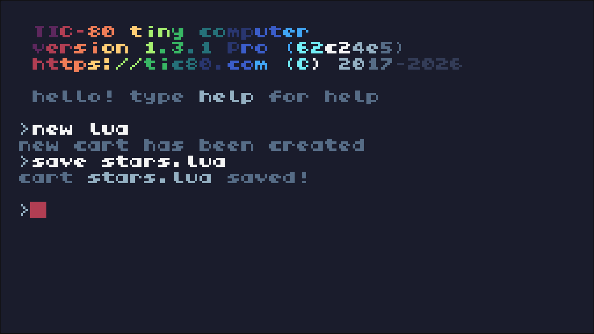

Die Datei liegt in deinem Workspace, im Ordner `/workspace/TIC-80`. Dort siehst du sie auch in Visual Studio Code, und dort findet sie die Prüfung der Aufgaben:

<!-- tutorial-screenshot
# Datei › Datei öffnen, wie man es selbst täte (ohne offenen Ordner kennt
# die Schnellsuche nur zuletzt geöffnete Dateien)
tab: workspace
hide-left-sidebar
press: Control+o
wait-for-text: Open File
press: Control+a
type: /workspace/TIC-80/stars.lua
press: Enter
wait-for-text: stars.lua
sleep: 1.5
crop-bottom: 35%
-->

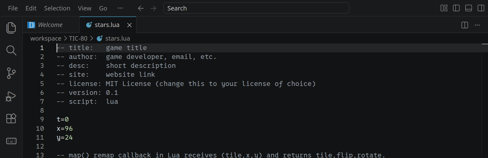

<div class='hint'>
Arbeite an einem Spiel entweder in TIC-80 oder in Visual Studio Code, nicht in beiden gleichzeitig. Ändert sich eine Datei außerhalb von TIC-80, während du in TIC-80 an derselben arbeitest, überschreibt TIC-80 sie nicht: Dein Stand aus TIC-80 landet dann daneben, zum Beispiel in <code>stars (TIC-80).lua</code>, und TIC-80 sagt dir das.
</div>

_task(gespeichert)

### Der Bildschirm

Der Bildschirm ist 240 Pixel breit und 136 Pixel hoch. Der Punkt (0, 0) ist oben links; `x` wird nach rechts größer, `y` nach **unten**. Farben sind Nummern von 0 bis 15:

<div class='swatches'>
<span style='background-color: #1a1c2c;'><span>0</span></span>
<span style='background-color: #5d275d;'><span>1</span></span>
<span style='background-color: #b13e53;'><span>2</span></span>
<span style='background-color: #ef7d57;'><span>3</span></span>
<span style='background-color: #ffcd75;'><span>4</span></span>
<span style='background-color: #a7f070;'><span>5</span></span>
<span style='background-color: #38b764;'><span>6</span></span>
<span style='background-color: #257179;'><span>7</span></span>
<span style='background-color: #29366f;'><span>8</span></span>
<span style='background-color: #3b5dc9;'><span>9</span></span>
<span style='background-color: #41a6f6;'><span>10</span></span>
<span style='background-color: #73eff7;'><span>11</span></span>
<span style='background-color: #f4f4f4;'><span>12</span></span>
<span style='background-color: #94b0c2;'><span>13</span></span>
<span style='background-color: #566c86;'><span>14</span></span>
<span style='background-color: #333c57;'><span>15</span></span>
</div>

_task(pixel)

_task(ohne-cls)

## Star Catcher

Jetzt baust du das Spiel Schritt für Schritt. Lösche dafür im Code-Editor das Beispielprogramm bis auf die Kommentare ganz oben. Die Figur aus dem Sprite-Editor bleibt, du brauchst sie gleich.

### Die Figur

Die Figur steht unten und lässt sich mit den Pfeiltasten nach links und rechts bewegen:

```lua
~ -- script:  lua
~
x = 112

function TIC()
	if btn(2) then x = x - 2 end
	if btn(3) then x = x + 2 end

	cls(0)
	spr(1, x, 112, 14, 1, 0, 0, 2, 2)
end
```

`spr(1, x, 112, 14, 1, 0, 0, 2, 2)` zeichnet das Sprite Nummer 1 an die Stelle (`x`, 112). Die 14 ist die Farbe, die durchsichtig bleibt, die 1 die Vergrößerung, die beiden Nullen heißen »nicht spiegeln, nicht drehen«, und `2, 2` nimmt 2 × 2 Sprites zusammen, also 16 × 16 Pixel.

<!-- tutorial-screenshot
write-file: TIC-80/stars.lua <- file:step1.lua
open-site: /tic80/
tab: preview
viewport: 1024x576
hook: tic load stars.lua
hook: tic run
hook: hold ArrowRight 0.6
sleep: 0.5
check-task: gespeichert
check-task-fails: ein-stern
-->

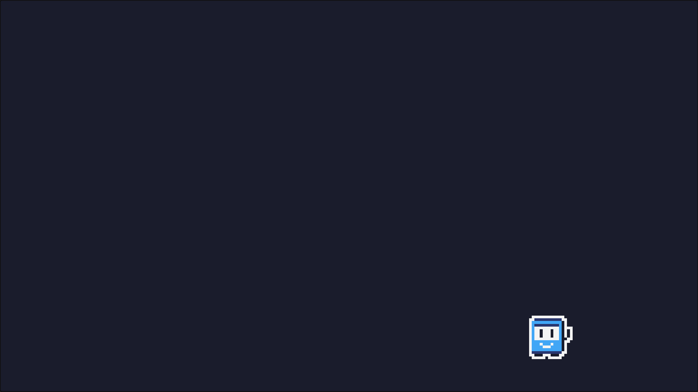

### Ein Stern fällt

Ein Stern hat eine Position `sx`, `sy`. In jedem Bild fällt er ein Pixel tiefer; ist er unten aus dem Bild, fängt er oben wieder an, an einer zufälligen Stelle. `math.random(0, 232)` ist eine zufällige ganze Zahl von 0 bis 232.

Und gefangen ist er, wenn er die Figur berührt: wenn er tief genug ist (`sy` zwischen 104 und 128) und nicht links oder rechts an ihr vorbei (`sx + 8 > x` und `sx < x + 16`; der Stern ist 8 Pixel breit, die Figur 16). Dann gibt es einen Punkt, und der Stern fängt oben neu an.

Schreib die neuen Zeilen in dein Programm; was der Stern in jedem Bild tut, schreibst du gleich selbst:

```lua
~ x = 112
sx = 120
sy = 0
score = 0
~
~ function TIC()
~ 	if btn(2) then x = x - 2 end
~ 	if btn(3) then x = x + 2 end
~
	-- hier: der Stern fällt, fängt unten neu an und wird gefangen
~
~ 	cls(0)
~ 	spr(1, x, 112, 14, 1, 0, 0, 2, 2)
	circ(sx + 4, sy + 4, 3, 4)
	print("Score: " .. score, 4, 4, 12)
~ end
```

`circ(sx + 4, sy + 4, 3, 4)` zeichnet den Stern als gefüllten Kreis: Mitte, Radius 3, Farbe 4, gelb. `print` schreibt den Punktestand oben links hin; `..` hängt zwei Texte aneinander.

<div class='hint own' data-check='fangen'>
<strong>Jetzt bist du dran:</strong> Schreib an die Stelle von <code>-- hier</code>, was der Stern in jedem Bild tut: ein Pixel tiefer fallen; unten aus dem Bild, also bei <code>sy</code> über 136, oben neu anfangen, an einer zufälligen Stelle. Berührt er die Figur, wie oben beschrieben, gibt es einen Punkt, und er fängt auch oben neu an. Führ das Spiel aus und fang ein paar Sterne.
</div>

<!-- hint -->
Zwei `if` hintereinander: eines für »unten aus dem Bild«, eines für
»gefangen«. In beiden passiert am Ende dasselbe: `sy` wird 0, und `sx` wird
eine Zufallszahl. Was muss vor beiden geschehen, damit der Stern überhaupt
fällt?
<!-- /hint -->
<!-- hint -->
Ein Gerüst; die Lücken mit `…` füllst du:

```lua
	sy = sy + …
	if sy > 136 then
		sy = 0
		sx = math.random(0, 232)
	end

	if sy > 104 and sy < 128 and … and … then
		score = …
		sy = 0
		sx = math.random(0, 232)
	end
```
<!-- /hint -->

<!-- solution -->
```lua
~ 	if btn(3) then x = x + 2 end
~
	sy = sy + 1
	if sy > 136 then
		sy = 0
		sx = math.random(0, 232)
	end

	if sy > 104 and sy < 128 and sx + 8 > x and sx < x + 16 then
		score = score + 1
		sy = 0
		sx = math.random(0, 232)
	end
~
~ 	cls(0)
```
<!-- /solution -->

_task(fangen)

<!-- tutorial-screenshot
write-file: TIC-80/stars.lua <- file:step2.lua
open-site: /tic80/
tab: preview
viewport: 1024x576
hook: tic load stars.lua
hook: tic run
hook: hold ArrowRight 0.4
sleep: 1
check-task: ein-stern
check-task-fails: viele-sterne
check-task-fails: ton
-->

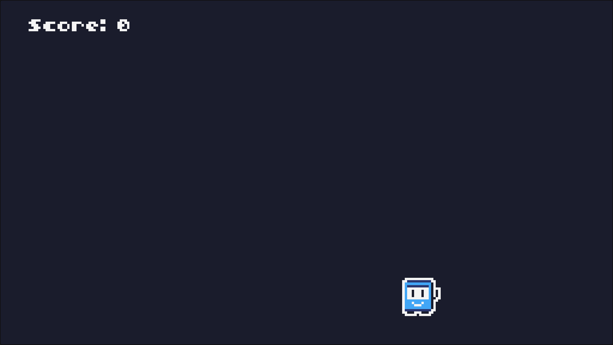

_task(fallzeit)

_task(ein-stern)

### Eine eigene Figur

Drücke <kbd>F2</kbd>: Das ist der **Sprite-Editor**. Links zeichnest du, rechts siehst du alle Sprites. Die Figur besteht aus vier Sprites, Nummer 1, 2, 17 und 18. Wähle rechts Sprite 1, nimm unten eine Farbe und male deine eigene Figur. Mit dem kleinen Schieberegler links neben der Zeichenfläche stellst du 16 × 16 Pixel ein, dann malst du an allen vier Teilen zugleich.

<!-- tutorial-screenshot
write-file: TIC-80/stars.lua <- file:step2.lua
open-site: /tic80/
tab: preview
viewport: 1024x576
hook: tic load stars.lua
hook: key Escape
hook: key F2
sleep: 0.5
-->

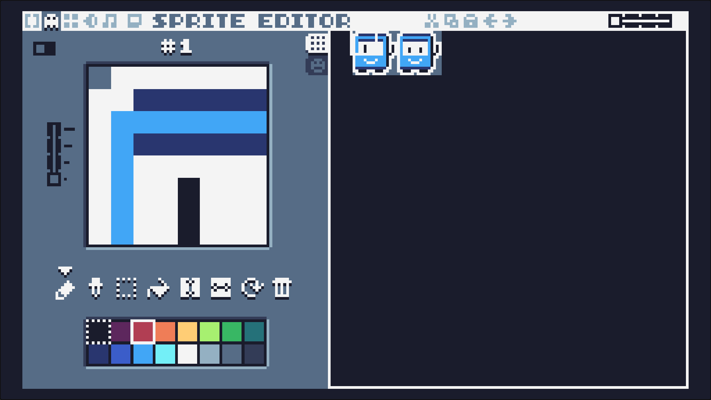

Die Farbe 14 bleibt durchsichtig, weil `spr` sie als vierte Zahl bekommt. Speichern nicht vergessen: <kbd>Strg</kbd><kbd>S</kbd>.

_task(eigene-figur)

### Viele Sterne und drei Leben

Ein einzelner Stern ist schnell langweilig. Jetzt fallen drei gleichzeitig, und jeder, der unten ankommt, kostet ein Leben. Damit man viele Sterne nicht einzeln aufschreiben muss, stehen sie in einer **Tabelle**: `stars[1]`, `stars[2]`, `stars[3]`, und jeder Stern ist selbst eine kleine Tabelle mit `x` und `y`. `for i, s in ipairs(stars) do` geht sie der Reihe nach durch; in `s` steht der Stern, in `i` seine Nummer.

Wer einen Stern fängt, macht das Spiel ein wenig schneller (`speed`). Sind alle Leben weg, steht »GAME OVER« da, und mit <kbd>Z</kbd> beginnt eine neue Runde; `btnp(4)` ist im ersten Bild wahr, in dem die Taste gedrückt ist.

_include_file(step3.lua, lua_copy)

<!-- tutorial-screenshot
write-file: TIC-80/stars.lua <- file:step3.lua
open-site: /tic80/
tab: preview
viewport: 1024x576
hook: tic load stars.lua
# Die Sterne starten über dem Bild; nach gut anderthalb Sekunden sind die
# meisten zu sehen und noch keiner unten durch.
hook: tic run
hook: hold ArrowLeft 0.6
sleep: 0.4
check-task: viele-sterne
check-task: ton
check-task-fails: himmel
-->


<!-- tutorial-screenshot
write-file: TIC-80/stars.lua <- file:step3.lua
open-site: /tic80/
tab: preview
viewport: 1024x576
hook: tic load stars.lua
hook: tic run
sleep: 16
-->

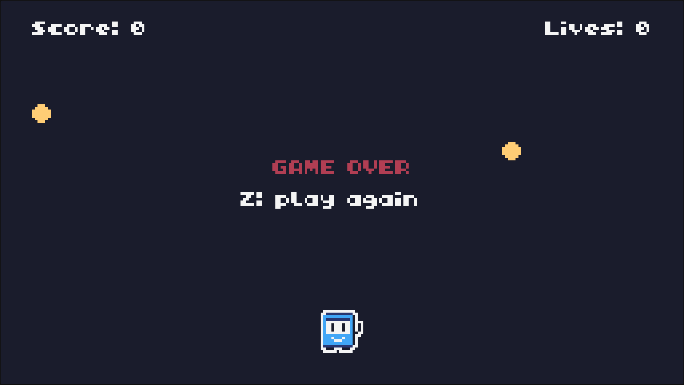

_task(viele-sterne)

<div class='hint try'>
<strong>Ausprobieren:</strong> Dreh an zwei Zahlen:
<ul>
<li>Ändere in <code>newGame()</code> die Zeile <code>for i = 1, 3 do</code> in <code>for i = 1, 10 do</code>: Wie viele Sterne fallen jetzt? Warum reicht es, eine einzige Zahl zu ändern?</li>
<li>Ändere <code>speed = speed + 0.05</code> in <code>speed = speed + 0.5</code>: Wie viele Sterne fängst du, bevor es zu schnell wird?</li>
</ul>
Stell die Zahlen danach wieder her.
</div>

### Ein Ton

Drücke <kbd>F4</kbd>: Im **SFX-Editor** baust du Töne. Ton 0 ist schon da. Klicke unten auf die Tasten des Klaviers, um ihn zu hören, und verändere oben die Lautstärke (VOL) und die Tonhöhe (PITCH) über die Zeit.

<!-- tutorial-screenshot
write-file: TIC-80/stars.lua <- file:step3.lua
open-site: /tic80/
tab: preview
viewport: 1024x576
hook: tic load stars.lua
hook: key Escape
hook: key F4
sleep: 0.5
-->

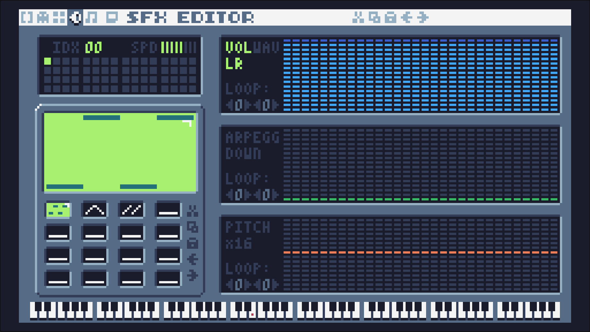

Im Spiel steht der Ton schon an der Stelle, an der ein Stern gefangen wird: `sfx(0, "C-6", 8)` spielt Ton 0 als hohes C, 8 Bilder lang. Probier andere Noten, zum Beispiel `"E-5"`, oder baue einen zweiten Ton für ein verlorenes Leben.

_task(ton)

### Ein Himmel

Noch fallen die Sterne vor einem leeren Bildschirm. Ein Himmel mit funkelnden Punkten und eine Wiese machen daraus eine Nacht. Die Punkte werden nur einmal ausgewürfelt, beim Start, und stehen in einer Tabelle `sky`. Würfelte das Spiel sie in jedem Bild neu, würden sie wild flackern. Schreibe das vor `newGame()`:

```lua
~ function newStar(i)
~ 	stars[i] = { x = math.random(0, 232), y = -math.random(0, 120) }
~ end
~
-- Der Himmel: 60 Punkte an festen Stellen, einmal ausgewürfelt
sky = {}
for i = 1, 60 do
	sky[i] = { x = math.random(0, 239), y = math.random(0, 127) }
end
t = 0
~
~ newGame()
~
~ function TIC()
~ 	t = t + 1
```

`t` zählt die Bilder. Erhöhe es in der ersten Zeile von `TIC()` mit `t = t + 1`. Ersetze dann in `TIC()` alles zwischen `cls(0)` und `spr(…)` durch:

```lua_copy
~ 	newGame()
~ end
~
~ cls(0)
-- Jeder Punkt wechselt alle halbe Sekunde den Blauton: Der Himmel funkelt
for i, p in ipairs(sky) do
	pix(p.x, p.y, 13 + (i + t // 30) % 3)
end
for i, s in ipairs(stars) do
	-- der Schweif: nach oben immer dunkler
	line(s.x + 4, s.y - 2, s.x + 4, s.y - 4, 3)
	line(s.x + 4, s.y - 6, s.x + 4, s.y - 8, 2)
	line(s.x + 4, s.y - 10, s.x + 4, s.y - 11, 1)
	-- der Stern: ein Kreuz, ein Kreis und ein heller Kern
	line(s.x + 4, s.y, s.x + 4, s.y + 8, 4)
	line(s.x, s.y + 4, s.x + 8, s.y + 4, 4)
	circ(s.x + 4, s.y + 4, 2, 4)
	pix(s.x + 4, s.y + 4, 12)
end
-- Die Wiese, auf der die Figur steht
rect(0, 128, 240, 8, 6)
line(0, 128, 239, 128, 5)
~ spr(1, x, 112, 14, 1, 0, 0, 2, 2)
~ print("Score: " .. score, 4, 4, 12)
~ print("Lives: " .. lives, 196, 4, 12)
```

- `pix(x, y, farbe)` setzt einen einzelnen Pixel. Die Farben 13, 14 und 15 sind drei Blautöne.
- `t // 30` teilt ohne Rest: Es wird alle 30 Bilder, also jede halbe Sekunde, um eins größer. `% 3` macht daraus reihum 0, 1, 2. Weil jeder Punkt seine Nummer `i` dazuzählt, wechseln nicht alle gleichzeitig.
- `line(x1, y1, x2, y2, farbe)` zeichnet eine Linie. Ein senkrechter und ein waagrechter Strich ergeben das Kreuz, das den Stern funkeln lässt; der Schweif sind drei kurze Striche in Orange, Rot und Lila.
- Was später gezeichnet wird, liegt oben. Darum kommt die Wiese nach den Sternen: Ein Stern, der unten ankommt, verschwindet im Gras.

<!-- tutorial-screenshot
write-file: TIC-80/stars.lua <- file:stars.lua
open-site: /tic80/
tab: preview
viewport: 1024x576
hook: tic load stars.lua
# Nach knapp zwei Sekunden sind die Sterne über den ganzen Himmel verteilt
# und noch keiner ist unten angekommen.
hook: tic run
hook: hold ArrowLeft 0.6
sleep: 0.6
check-task: himmel
-->

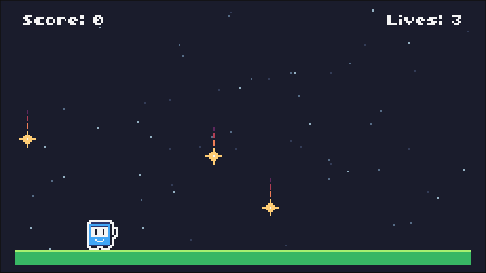

_task(himmel)

<div class='hint try'>
<strong>Ausprobieren:</strong>
<ul>
<li>Ändere <code>t // 30</code> in <code>t // 5</code>: Wie funkelt der Himmel jetzt?</li>
<li>Lass <code>i +</code> weg, also <code>13 + (t // 30) % 3</code>: Was ist jetzt anders, und warum?</li>
<li>Schieb die beiden Zeilen der Wiese, <code>rect</code> und <code>line</code>, vor die Schleife über die Sterne: Was siehst du, wenn ein Stern unten ankommt?</li>
</ul>
Stell den Code danach wieder her.
</div>

## Dein Spiel

Jetzt ist es dein Spiel. Ein paar Ideen:

- **Gefahren:** Neben den Sternen fallen rote Steine; wer einen fängt, verliert ein Leben.
- **Ein Rekord:** `pmem(0)` merkt sich eine Zahl über das Ende des Spiels hinaus. Speichere dort den höchsten Punktestand und zeige ihn an.
- **Eine Landschaft:** Im Map-Editor (<kbd>F3</kbd>) baust du ein Bild aus Kacheln, Berge oder eine Stadt; `map()` zeichnet es statt der Wiese.
- **Musik:** Im Musik-Editor (<kbd>F5</kbd>) schreibst du eine Melodie, `music(0)` spielt sie ab.
- **Mehr Bewegung:** Die Figur springt mit <kbd>↑</kbd>, oder die Sterne fallen schräg.

Alle Befehle stehen im [TIC-80-Wiki](https://github.com/nesbox/TIC-80/wiki), zum Beispiel unter [API](https://github.com/nesbox/TIC-80/wiki/API).

_task(abgabe)
