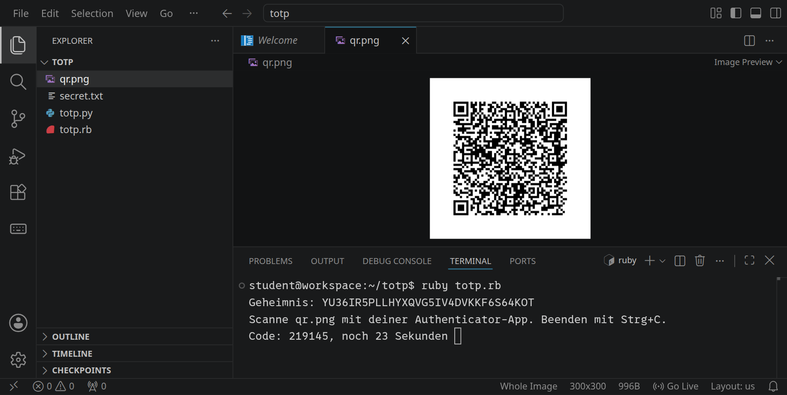
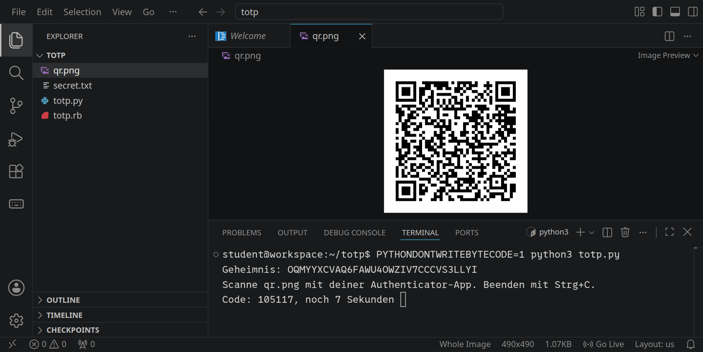

<div class='meta'>
image: totp-app.webp
image_alt: "VS Code mit einem QR-Code und im Terminal einem Programm, das sechsstellige Codes wie eine Authenticator-App erzeugt"
kind: projekt
language: Ruby / Python
languages: [ruby, python]
duration: 2 Doppelstunden
requires: [crypto]
reference: [kryptographie, bits-und-bytes]
</div>

<div
    class="autotoc-secondary-trigger"
    data-title="Auf dieser Seite"
    data-levels="h2,h3">
</div>

# Zwei Faktoren: Einmalcodes selbst gebaut

<p class='abstract'>
Viele Konten fragen nach dem Passwort noch nach einem sechsstelligen Code aus einer App, der alle 30 Sekunden wechselt. Du baust das Verfahren dahinter selbst, in Ruby oder Python: einen Schlüssel in Base32, einen Code aus Schlüssel und Zähler, einen Zähler aus der Uhrzeit. Am Ende scannst du deinen eigenen Schlüssel mit dem Handy, und deine App zeigt dieselben Codes wie dein Programm.
</p>

## Etwas, das du weißt, und etwas, das du hast

Ein Passwort ist etwas, das du **weißt**. Das Problem: Andere können es auch erfahren. Es taucht in einem Datenleck auf, weil eine Website es schlecht gespeichert hat, jemand hat dir über die Schulter geschaut, oder du hast es bei mehreren Diensten benutzt. Ein **zweiter Faktor** ist etwas anderes: etwas, das du **hast**, zum Beispiel dein Handy. Der Server fragt dann nach dem Passwort und nach einem Code, den nur das Handy kennt.

Wie kann das Handy einen Code kennen, den der Server nachprüfen kann, ohne dass die beiden miteinander reden? Beim Einrichten bekommen beide denselben geheimen **Schlüssel**, meistens über einen QR-Code. Danach rechnen beide unabhängig voneinander aus dem Schlüssel und der Uhrzeit einen Code aus. Weil sie dieselbe Rechnung mit denselben Zahlen machen, kommt dasselbe heraus. Wer den Schlüssel nicht hat, kann den Code nicht ausrechnen, auch nicht, wenn er hundert frühere Codes gesehen hat.

_task(zweiter-faktor)

Das Verfahren heißt **TOTP** (»Time-based One-Time Password«) und steht in zwei kurzen Standards, RFC 4226 und RFC 6238. Jede Authenticator-App kann es. Deshalb funktioniert dein eigenes Programm am Ende mit ihr zusammen.

## Einrichten

Lege einen Ordner an und öffne ihn mit <kbd>Strg</kbd><kbd>K</kbd> <kbd>Strg</kbd><kbd>O</kbd>:

```bash
mkdir /workspace/totp
```

<!-- language: ruby -->
Lege darin `totp.rb` an:

```ruby
# Einmalcodes wie in einer Authenticator-App
require 'openssl'
require 'securerandom'

ALPHABET = 'ABCDEFGHIJKLMNOPQRSTUVWXYZ234567'

# Base32 in Bytes: jedes Zeichen sind 5 Bits, je 8 Bits ein Byte.
def base32_decode(text)
    ''.b
end

# Bytes in Base32, ohne = am Ende.
def base32_encode(data)
    ''
end

# Der Code für einen Zähler.
def hotp(key, counter, digits = 6)
    '000000'
end

p base32_decode('JBSWY3DPEHPK3PXP')
```

<!-- tutorial-step
# Das Gerüst von der Seite läuft, und noch löst es keine Aufgabe (ruby)
write-file: totp/totp.rb <- previous-code
check-task-fails: base32
check-task-fails: hotp
-->

Mit `ruby totp.rb` läuft das Programm unten in der Datei; die Prüfungen der Aufgaben laden nur deine Methoden und rufen sie direkt auf.
<!-- /language -->
<!-- language: python -->
Lege darin `totp.py` an:

```python
# Einmalcodes wie in einer Authenticator-App
import hashlib
import hmac
import os
import secrets
import time

ALPHABET = 'ABCDEFGHIJKLMNOPQRSTUVWXYZ234567'


def base32_decode(text):
    """Base32 in Bytes: jedes Zeichen sind 5 Bits, je 8 Bits ein Byte."""
    return b''


def base32_encode(data):
    """Bytes in Base32, ohne = am Ende."""
    return ''


def hotp(key, counter, digits=6):
    """Der Code für einen Zähler."""
    return '000000'


print(base32_decode('JBSWY3DPEHPK3PXP'))
```

<!-- tutorial-step
# Das Gerüst von der Seite läuft, und noch löst es keine Aufgabe (python)
write-file: totp/totp.py <- previous-code
check-task-fails: base32 python
check-task-fails: hotp python
-->

Mit `python3 totp.py` läuft das Programm unten in der Datei; die Prüfungen der Aufgaben laden nur deine Funktionen und rufen sie direkt auf.
<!-- /language -->

## Der Schlüssel in Base32

Der Schlüssel sind 20 zufällige Bytes. Damit man ihn auch abtippen kann, wenn der QR-Code nicht geht, schreiben Apps ihn in **Base32**: 32 Zeichen, die Großbuchstaben `A` bis `Z` und die Ziffern `2` bis `7`. Die 0, die 1, die 8 und die 9 fehlen mit Absicht, weil man sie mit O, I und l, B und g verwechseln kann. Und Groß- und Kleinschreibung spielt keine Rolle.

32 Zeichen sind \\(2^5\\): Jedes Zeichen steht für genau **5 Bits**, `A` für 00000, `B` für 00001, … `7` für 11111. Zum Lesen hängst du die Bits aller Zeichen aneinander und nimmst je 8 davon als ein Byte. Bleiben am Ende weniger als 8 Bits übrig, gehören sie zu keinem Byte mehr. Zum Schreiben geht es umgekehrt: die Bits aller Bytes aneinander, am Ende mit Nullen auffüllen, bis die Zahl durch 5 teilbar ist, und je 5 Bits ein Zeichen.

_task(bytes)

<!-- language: ruby -->
Am einfachsten rechnest du mit den Bits als Text aus Nullen und Einsen: `5.to_s(2).rjust(5, '0')` ist `"00101"`, und `"01001000".to_i(2)` ist 72. `scan(/.{8}/)` teilt einen Text in Stücke zu 8 Zeichen, `pack('C*')` macht aus einer Liste von Zahlen Bytes. Kleinbuchstaben, Leerzeichen und `=` am Ende, die in echten Schlüsseln vorkommen, sollen dich nicht stören.
<!-- /language -->
<!-- language: python -->
Am einfachsten rechnest du mit den Bits als Text aus Nullen und Einsen: `format(5, '05b')` ist `'00101'`, und `int('01001000', 2)` ist 72. `bytes([72, 105])` macht aus einer Liste von Zahlen Bytes. Kleinbuchstaben, Leerzeichen und `=` am Ende, die in echten Schlüsseln vorkommen, sollen dich nicht stören. Python hat mit `base64.b32decode` schon eine fertige Funktion; die darfst du benutzen, um deine zu prüfen.
<!-- /language -->

_task(base32)

## Ein Code aus Schlüssel und Zähler

Der Code kommt aus einer **HMAC**. Das ist eine Prüfsumme wie SHA-1 aus [Kryptographie im Terminal](/crypto), nur mit einem Schlüssel gemischt: Wer den Schlüssel nicht kennt, kann sie nicht ausrechnen, und an der Prüfsumme sieht man dem Schlüssel nichts an. Für einen Zähler, der bei jeder Anmeldung um 1 weiterzählt, geht **HOTP** so:

1. Schreib den Zähler als 8 Bytes, das höchste zuerst. Zähler 1 sind die Bytes `00 00 00 00 00 00 00 01`.
2. Rechne die HMAC mit SHA-1 aus Schlüssel und diesen 8 Bytes. Heraus kommen 20 Bytes.
3. Die untersten 4 Bits des letzten Bytes sind eine Zahl von 0 bis 15, der **Offset**. Ab dort nimmst du 4 Bytes als eine Zahl, das höchste zuerst, und löschst ihr oberstes Bit, damit sie nie negativ ist.
4. Der Code sind die letzten 6 Ziffern dieser Zahl, also der Rest beim Teilen durch \\(10^6\\), vorn mit Nullen aufgefüllt.

Mit dem Schlüssel `12345678901234567890` aus dem Standard und dem Zähler 1 ist die HMAC `75a48a19d4cbe100644e8ac1397eea747a2d33ab`. Das letzte Byte ist `ab`, seine untersten 4 Bits sind `b`, also 11. Die 4 Bytes ab Byte 11 sind `c1 39 7e ea`; ohne das oberste Bit wird aus `c1` eine `41`, und `41397eea` ist 1094287082. Der Code ist **287082**.

<!-- language: ruby -->
`OpenSSL::HMAC.digest('SHA1', key, data)` rechnet die HMAC aus. Den Zähler als 8 Bytes macht `[counter].pack('Q>')`, und `bytes[o, 4].unpack1('N')` liest 4 Bytes ab Index `o` als Zahl, das höchste zuerst. Das oberste Bit löschst du mit `& 0x7fffffff`.
<!-- /language -->
<!-- language: python -->
`hmac.new(key, data, hashlib.sha1).digest()` rechnet die HMAC aus. Den Zähler als 8 Bytes macht `counter.to_bytes(8, 'big')`, und `int.from_bytes(hash[o:o + 4], 'big')` liest 4 Bytes ab Index `o` als Zahl, das höchste zuerst. Das oberste Bit löschst du mit `& 0x7fffffff`.
<!-- /language -->

_task(hotp)

## Der Zähler ist die Uhr

Ein Zähler, der nur bei jeder Anmeldung weiterzählt, hat einen Haken: Handy und Server müssen sich einig sein, wie weit er schon ist. TOTP nimmt stattdessen die Uhrzeit als Zähler. Computer zählen die Zeit in Sekunden seit dem 1. Januar 1970, der **Unix-Zeit**; `date +%s` im Terminal zeigt sie. Geteilt durch 30 und abgerundet ist das der Zähler: Er wird alle 30 Sekunden um 1 größer, und genau so oft wechselt der Code in deiner App.

Schreib `totp(key, time)`, das mit deinem `hotp` den Code für eine Unix-Zeit ausrechnet; ohne Zeit nimmt es die aktuelle. Die Prüfung vergleicht mit den Testwerten aus RFC 6238.

_task(totp)

## Mit dem Handy

Jetzt kommt dein Programm mit einer echten App zusammen. Es braucht dafür einen eigenen Schlüssel und einen QR-Code, den die App scannen kann. Im QR-Code steht eine Adresse, die jede Authenticator-App versteht:

```text
otpauth://totp/TOTP-Test:mein-Programm?secret=JBSWY3DPEHPK3PXP&issuer=TOTP-Test
```

Vor dem Doppelpunkt steht der Name, unter dem die App den Eintrag zeigt: »TOTP-Test«, damit du ihn nicht mit einem echten Konto verwechselst.

<!-- language: ruby -->
Den QR-Code macht eine Bibliothek:

```bash
gem install rqrcode
```

Ersetze das Programm unten in der Datei, alles nach der letzten Methode, durch dieses:

```ruby_copy
require 'rqrcode'
path = File.join(__dir__, 'secret.txt')
File.write(path, base32_encode(SecureRandom.random_bytes(20)) + "\n") unless File.exist?(path)
secret = File.read(path).strip
uri = "otpauth://totp/TOTP-Test:mein-Programm?secret=#{secret}&issuer=TOTP-Test"
RQRCode::QRCode.new(uri).as_png(size: 300).save(File.join(__dir__, 'qr.png'))
puts "Geheimnis: #{secret}"
puts 'Scanne qr.png mit deiner Authenticator-App. Beenden mit Strg+C.'
begin
    loop do
        now = Time.now.to_i
        print "\rCode: #{totp(base32_decode(secret), now)}, noch #{30 - now % 30} Sekunden "
        sleep 1
    end
rescue Interrupt
    puts
end
```

Beim ersten Start würfelt das Programm einen Schlüssel aus 20 Bytes und speichert ihn in `secret.txt`; danach nimmt es immer denselben. Starte es mit `ruby totp.rb` und öffne `qr.png` in VS Code.

<!-- tutorial-screenshot
# Das fertige Programm, rqrcode installiert, der QR-Code daneben (ruby)
write-file: totp/totp.rb <- file:loesung/totp.rb
# Der Ordner totp offen, wie die Seite es sagt; erst dann findet die
# Schnellsuche qr.png
press: Control+K
press: Control+O
wait-for-input-value: /workspace/
type: totp
press: Enter
wait-for-input-value: /workspace/totp/
press: Enter
wait-for-text: totp.rb
terminal-open
terminal-run: cd /workspace/totp && clear
terminal-run: gem install rqrcode
terminal-wait-for-prompt: 180
terminal-run: clear
terminal-run: ruby totp.rb
wait-for-text: Sekunden
press: Control+P
type: qr.png
sleep: 1
press: Enter
sleep: 2
move-mouse: selector:.terminal
sleep: 1
terminal-expect-no-text: Error
-->


<!-- /language -->
<!-- language: python -->
Den QR-Code macht eine Bibliothek:

```bash
pip install "qrcode[pil]"
```

Ersetze das Programm unten in der Datei, alles nach der letzten Funktion, durch dieses:

```python_copy
import qrcode
path = os.path.join(os.path.dirname(os.path.abspath(__file__)), 'secret.txt')
if not os.path.exists(path):
    with open(path, 'w') as f:
        f.write(base32_encode(secrets.token_bytes(20)) + '\n')
with open(path) as f:
    secret = f.read().strip()
uri = f'otpauth://totp/TOTP-Test:mein-Programm?secret={secret}&issuer=TOTP-Test'
qrcode.make(uri).save(os.path.join(os.path.dirname(path), 'qr.png'))
print(f'Geheimnis: {secret}')
print('Scanne qr.png mit deiner Authenticator-App. Beenden mit Strg+C.')
try:
    while True:
        now = int(time.time())
        print(f'\rCode: {totp(base32_decode(secret), now)}, noch {30 - now % 30} Sekunden ', end='', flush=True)
        time.sleep(1)
except KeyboardInterrupt:
    print()
```

Beim ersten Start würfelt das Programm einen Schlüssel aus 20 Bytes und speichert ihn in `secret.txt`; danach nimmt es immer denselben. Starte es mit `python3 totp.py` und öffne `qr.png` in VS Code.

<!-- tutorial-screenshot
# Das fertige Programm, qrcode installiert, der QR-Code daneben (python)
write-file: totp/totp.py <- file:loesung/totp.py
# The Ruby program still runs; the focus is on qr.png in the editor
terminal-open
press: Control+C
terminal-wait-for-prompt
terminal-run: clear
terminal-run: pip install "qrcode[pil]"
terminal-wait-for-prompt: 180
terminal-run: clear
terminal-run: PYTHONDONTWRITEBYTECODE=1 python3 totp.py
wait-for-text: Sekunden
press: Control+P
type: qr.png
sleep: 1
press: Enter
sleep: 2
move-mouse: selector:.terminal
sleep: 1
terminal-expect-no-text: Traceback
-->


<!-- /language -->

Scanne den QR-Code mit einer Authenticator-App auf deinem Handy, zum Beispiel FreeOTP, Aegis oder der App, die du schon hast. Nach ein paar Sekunden zeigt sie dieselben sechs Ziffern wie dein Programm und wechselt im selben Augenblick. Dein Handy und dein Workspace haben nie miteinander geredet; sie rechnen nur dasselbe.

<div class='hint'>
<code>secret.txt</code> ist ein echter Schlüssel: Wer ihn hat, kann deine Codes ausrechnen. Für dieses Programm schadet das nicht, es schützt ja nichts. Ein echter Server bewahrt solche Schlüssel aber so sorgfältig auf wie Passwörter, und in ein Git-Repository gehören sie nie. Den Eintrag in deiner App kannst du danach wieder löschen.
</div>


<div class='hint try'>
<strong>Ausprobieren:</strong> Ändere in <code>secret.txt</code> ein einziges Zeichen in ein anderes aus dem Alphabet und starte das Programm neu. Wie viele der sechs Ziffern stimmen noch mit der App überein? Schreib danach statt eines Großbuchstabens denselben Buchstaben klein: Was passiert jetzt, und warum? Stell <code>secret.txt</code> danach wieder her.
</div>

## Prüfen wie ein Server

Der Server hat dieselbe Rechnung und prüft, ob der eingetippte Code stimmt. Ganz so einfach ist es aber nicht.

_task(uhr)


<div class='hint try'>
<strong>Ausprobieren:</strong> Lass die Uhr deines Programms nachgehen: Ersetze in der Schleife <code>totp(base32_decode(secret), now)</code> durch <code>totp(base32_decode(secret), now - 20)</code> und starte es neu. Beobachte eine halbe Minute lang Programm und App nebeneinander: Wie viele Sekunden lang zeigen beide denselben Code? Stell die Zeile danach wieder her.
</div>

Server nehmen deshalb auch den Code des Zeitfensters davor und danach an, also insgesamt 90 Sekunden. Viele Apps zeigen den Code außerdem mit einem Leerzeichen in der Mitte, `287 082`; auch das soll nicht stören.

_task(pruefen)

_task(einmal)

## Wovor der zweite Faktor schützt

Ein zweiter Faktor macht ein Passwort allein wertlos: Taucht es in einem Datenleck auf, kann niemand etwas damit anfangen, solange er dein Handy nicht hat. Das ist der häufigste Fall, und dafür lohnt sich der zweite Faktor bei jedem wichtigen Konto.

Er hat aber Grenzen. Wer dein entsperrtes Handy in der Hand hat, hat beide Faktoren. Und tippst du den Code selbst auf einer gefälschten Seite ein, die genauso aussieht wie die echte, kann sie ihn sofort weiterreichen; der Code weiß nicht, auf welcher Seite er eingetippt wird. Dagegen helfen **Passkeys**: Dort prüft das Handy selbst, mit welcher Adresse es redet, und antwortet nur der echten. Codes per SMS sind schwächer als eine App, weil eine Telefonnummer leichter auf jemand anderen umgeleitet werden kann als ein Schlüssel auf deinem Handy.

_task(wovor)

<!-- tutorial-step
# Die Musterlösungen lösen jede Programmieraufgabe, in beiden Sprachen
write-file: totp/totp.rb <- file:loesung/totp.rb
write-file: totp/totp.py <- file:loesung/totp.py
check-task: base32
check-task: base32 python
check-task: hotp
check-task: hotp python
check-task: totp
check-task: totp python
check-task: pruefen
check-task: pruefen python
check-task: zweiter-faktor <- 0
check-task: bytes <- 10
check-task: uhr <- 0
check-task: einmal <- 0
-->

## Wie geht es weiter?

- **Backup-Codes**: Was passiert, wenn das Handy verloren geht? Dienste geben beim Einrichten eine Liste von Codes, die je einmal gelten. Wie würdest du sie speichern, damit auch ein Datenleck sie nicht verrät? [Kryptographie im Terminal](/crypto) hat dazu die Idee.
- **Ein eigener Server**: Bau `verify` in den Server aus [Ein eigener Webserver](/webserver) ein, mit einer Anmeldeseite, die erst das Passwort und dann den Code verlangt, und merk dir benutzte Codes.
- **HOTP mit Zähler**: Manche Schlüsselanhänger zählen statt der Zeit bei jedem Knopfdruck weiter. Wie bleiben Anhänger und Server im Gleichschritt, wenn jemand den Knopf drückt, ohne sich anzumelden?
