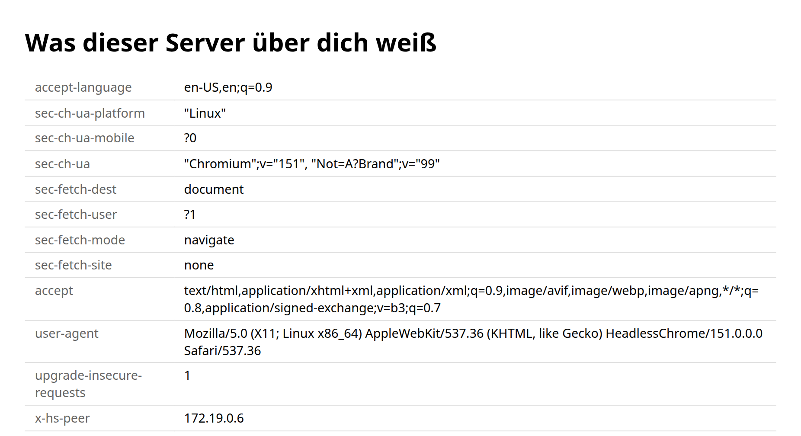
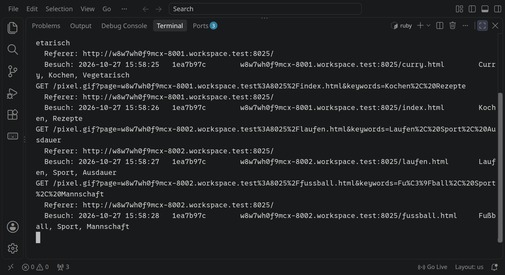
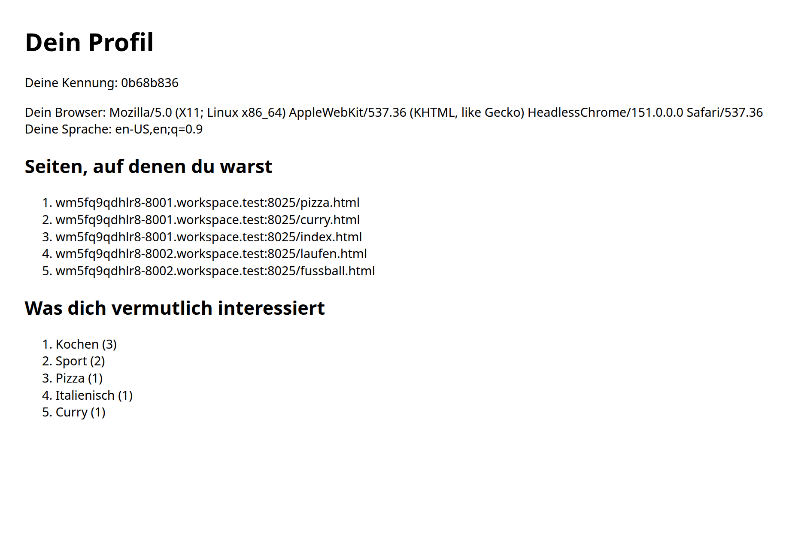

<div class='meta'>
image: teaser.webp
image_alt: "Zwei Websites, »Rezepte für jeden Tag« und »Laufend fit«, mit Pfeilen zu einem Tracker; der erkennt an einem Cookie dieselbe Kennung auf beiden und macht daraus ein Profil: Kochen 3, Sport 2"
kind: projekt
language: Ruby / Python
languages: [ruby, python]
duration: 2 Doppelstunden
curriculum: "Sek I: Leben in und mit vernetzten Systemen (Datenschutz, rechtliche Grundlagen); Oberstufe: Datenbanken und Datenschutz (Datenschutz), Vertiefung Informatik und Gesellschaft (Tracking, Profile, Einwilligung)"
requires: [webserver]
reference: [http]
</div>

<div
    class="autotoc-secondary-trigger"
    data-title="Auf dieser Seite"
    data-levels="h2,h3">
</div>

# Was eine Webseite über dich erfährt

<p class='abstract'>
Auf vielen Websites steckt ein unsichtbares Bild, das gar nicht von der Website selbst kommt. Du baust den Server, von dem es kommt: einen Tracker, der mit einem Cookie wiedererkennt, wer welche Seiten besucht, auch auf zwei verschiedenen Websites, und daraus ein Profil macht. Danach siehst du nach, was das Gesetz dazu sagt.
</p>

## Was ein Server sieht

Öffnest du eine Webseite, schickt dein Browser eine HTTP-Anfrage an einen
Server. In [Ein eigener Webserver](/webserver) hast du gesehen, dass darin mehr
steht als nur der Pfad: Header wie `Host` und `User-Agent`. Was davon erfährt
ein Server, ohne dass du etwas eintippst?

_task(vermutung)

## Einrichten

Lege einen Ordner an und lade zwei kleine Websites herunter, auf denen du
später unterwegs bist:

```bash_copy
mkdir -p ~/tracking
cd ~/tracking
wget -qO- ${web_root}/tracking/websites.tar.gz | tar xz
```

Im Ordner liegen jetzt `rezepte` und `sport`, je vier HTML-Seiten. Sieh sie dir
im Editor an; gleich bekommen sie Besuch.

<!-- language: ruby -->
Der Server, den du baust, heißt **Tracker**. Lege daneben `tracker.rb` an. Der
Anfang ist ein Webserver, wie du ihn schon kennst: Er liest die Anfrage, legt
die Header in einen Hash und antwortet unter `/` mit einer Seite, auf der alle
Header stehen.

```ruby_copy
require 'socket'
require 'uri'
require 'cgi'

# Schickt eine vollständige HTTP-Antwort, auf Wunsch mit weiteren Headern
def respond(client, status, type, body, extra = {})
  client.print "HTTP/1.1 #{status}\r\n"
  client.print "Content-Type: #{type}\r\n"
  client.print "Content-Length: #{body.bytesize}\r\n"
  extra.each { |name, value| client.print "#{name}: #{value}\r\n" }
  client.print "Connection: close\r\n"
  client.print "\r\n"
  client.print body
  client.close
end

# Text, der in HTML sicher ist: aus < wird &lt; und so weiter
def h(text)
  CGI.escapeHTML(text.to_s)
end

# Die Seite unter /: alle Header, die der Browser geschickt hat
def headers_page(headers)
  rows = headers.map { |name, value| "<tr><th>#{h(name)}</th><td>#{h(value)}</td></tr>" }
  "<!DOCTYPE html><meta charset='utf-8'><title>Was ich über dich weiß</title>\n" \
    "<h1>Was dieser Server über dich weiß</h1>\n<table>\n#{rows.join("\n")}\n</table>\n"
end

server = TCPServer.new(8000)
puts "Der Tracker wartet auf Port 8000 ..."

loop do
  Thread.new(server.accept) do |client|
    method, target = client.gets.to_s.split(' ')
    # Die Header in einen Hash: »Name: Wert«
    headers = {}
    while (line = client.gets) && line != "\r\n"
      name, value = line.split(':', 2)
      headers[name.strip.downcase] = value.to_s.strip
    end
    path, query = target.to_s.split('?', 2)
    params = URI.decode_www_form(query.to_s).to_h
    puts "#{method} #{target}"
    puts "  Referer: #{headers['referer']}" if headers['referer']

    case path
    when '/'
      respond(client, '200 OK', 'text/html; charset=utf-8', headers_page(headers))
    else
      respond(client, '404 Not Found', 'text/plain; charset=utf-8', "Die Seite #{path} gibt es nicht.\n")
    end
  end
end
```

Neu gegenüber deinem Webserver sind zwei Kleinigkeiten:

- `respond` nimmt als fünften Parameter einen Hash mit weiteren Headern, etwa
  `'Cache-Control' => 'no-store'`. Ohne ihn bleibt alles wie bisher.
- `h` macht Text sicher für HTML. Was im Browser eingestellt ist, landet hier
  auf einer Seite, und ein `<` darin würde sonst als Tag gelesen.

Starte den Tracker:

```bash
ruby tracker.rb
```

<!-- stage: stufen/1.rb as tracker.rb -->
<!-- /language -->
<!-- language: python -->
Der Server, den du baust, heißt **Tracker**. Lege daneben `tracker.py` an. Der
Anfang ist ein Webserver, wie du ihn schon kennst: Er liest die Anfrage, legt
die Header in ein `dict` und antwortet unter `/` mit einer Seite, auf der alle
Header stehen.

```python_copy
import html
import socket
import threading
from urllib.parse import parse_qsl


def respond(client, status, content_type, body, extra=None):
    """Schickt eine vollständige HTTP-Antwort, auf Wunsch mit weiteren Headern."""
    data = body.encode() if isinstance(body, str) else body
    head = (f'HTTP/1.1 {status}\r\n'
            f'Content-Type: {content_type}\r\n'
            f'Content-Length: {len(data)}\r\n')
    for name, value in (extra or {}).items():
        head += f'{name}: {value}\r\n'
    head += 'Connection: close\r\n\r\n'
    client.sendall(head.encode() + data)


def h(text):
    """Text, der in HTML sicher ist: aus < wird &lt; und so weiter"""
    return html.escape(str(text if text is not None else ''))


def headers_page(headers):
    """Die Seite unter /: alle Header, die der Browser geschickt hat"""
    rows = '\n'.join(f'<tr><th>{h(name)}</th><td>{h(value)}</td></tr>' for name, value in headers.items())
    return ("<!DOCTYPE html><meta charset='utf-8'><title>Was ich über dich weiß</title>\n"
            f'<h1>Was dieser Server über dich weiß</h1>\n<table>\n{rows}\n</table>\n')


def handle(client):
    with client, client.makefile('rb') as reader:
        request_line = reader.readline().decode()
        method, _, rest = request_line.partition(' ')
        target, _, version = rest.partition(' ')
        # Die Header in ein dict: »Name: Wert«
        headers = {}
        for line in reader:
            if line == b'\r\n':
                break
            name, _, value = line.decode().partition(':')
            headers[name.strip().lower()] = value.strip()
        path, _, query = target.partition('?')
        params = dict(parse_qsl(query))
        print(method, target)
        if 'referer' in headers:
            print('  Referer:', headers['referer'])

        if path == '/':
            respond(client, '200 OK', 'text/html; charset=utf-8', headers_page(headers))
        else:
            respond(client, '404 Not Found', 'text/plain; charset=utf-8', f'Die Seite {path} gibt es nicht.\n')


server = socket.create_server(('', 8000))
print('Der Tracker wartet auf Port 8000 ...')

while True:
    client, address = server.accept()
    threading.Thread(target=handle, args=(client,), daemon=True).start()
```

Neu gegenüber deinem Webserver sind zwei Kleinigkeiten:

- `respond` nimmt als fünften Parameter ein `dict` mit weiteren Headern, etwa
  `{'Cache-Control': 'no-store'}`. Ohne es bleibt alles wie bisher.
- `h` macht Text sicher für HTML. Was im Browser eingestellt ist, landet hier
  auf einer Seite, und ein `<` darin würde sonst als Tag gelesen.

Starte den Tracker:

```bash
python3 tracker.py
```

<!-- stage: stufen/1.py as tracker.py -->
<!-- /language -->

Öffne im Browser die Adresse aus »Forwarded Address« für Port 8000. Der
Tracker zeigt dir, was dein Browser ihm geschickt hat:

<!-- tutorial-screenshot
# Der Tracker der Stufe 1: was der Browser ihm schickt
write-file: tracking/tracker.rb <- file:stufen/1.rb
hide-left-sidebar
terminal-open
terminal-run: cd ~/tracking && ruby tracker.rb
preview-port: 8000 /
tab: preview
viewport: 1029x560
wait-for-text: Was dieser Server
-->


- `user-agent`: welcher Browser in welcher Version, auf welchem Betriebssystem.
- `accept-language`: welche Sprachen du eingestellt hast, die liebste zuerst.
- `accept` und `accept-encoding`: welche Formate dein Browser versteht.
- Bei manchen Browsern Header, die mit `sec-` beginnen: ob die Seite in einem
  Tab oder in einem Bild geladen wird und von wo.

Ein Server im Internet sieht außerdem die IP-Adresse, von der die Anfrage
kommt, und damit ungefähr, wo du bist. Dein Tracker sieht sie nicht: Die
Anfrage erreicht ihn über den Workspace, und der gibt sie nicht weiter. Die
Zeile `x-hs-peer` hat der Workspace selbst dazugeschrieben; darin steht die
Adresse eines seiner eigenen Server, nicht deine.

_uses(http-header)

<div class='hint try'>
<strong>Ausprobieren:</strong> Ruf die Seite im Terminal mit <code>curl -s localhost:8000</code> auf und vergleiche: Welche Header schickt <code>curl</code>, und welche schickt nur der Browser? Achte auf die Zeile <code>user-agent</code>.
</div>

## Ein Bild, das niemand sieht

Sieh dir eine der Seiten in `rezepte` an, etwa `pizza.html`. Unten steht ein
kurzes Stück JavaScript, wie es auf sehr vielen Websites steckt:

```html
<script>
  const tracker = location.origin.replace(/-\d+\./, '-8000.');
  const keywords = document.querySelector('meta[name="keywords"]').content;
  new Image().src = tracker + '/pixel.gif?page=' + encodeURIComponent(location.host + location.pathname) +
    '&keywords=' + encodeURIComponent(keywords);
</script>
```

- Die erste Zeile baut die Adresse deines Trackers: In der Adresse der Website
  steht `-8001.` für Port 8001, daraus wird `-8000.`.
- Die zweite liest die Stichwörter der Seite. Oben im Kopf jeder Seite stehen
  sie in `<meta name="keywords">`, für die Pizza `Pizza, Kochen, Italienisch`.
- Die dritte lädt ein Bild vom Tracker, `/pixel.gif`. Hinter dem `?` hängen die
  Adresse der Seite und ihre Stichwörter.

Das Bild zeigt die Seite nie an. Es ist nur dazu da, dass der Browser eine
Anfrage an den Tracker schickt, und in dieser Anfrage steht, wer gerade welche
Seite liest. So ein Bild heißt **Tracking-Pixel**; die Firma, der der Tracker
gehört, hat den Schnipsel geschrieben, und die Website hat ihn eingebaut.

Noch kennt dein Tracker `/pixel.gif` nicht. Er bekommt jetzt ein Bild aus einem
einzigen durchsichtigen Pixel und schreibt jeden Besuch in eine Datei,
`visits.log`. Das Bild ist eine vollständige GIF-Datei von 42 Bytes; was in so
einer Datei steht, zeigt [»Eine GIF-Datei decodieren«](/gif).

<!-- language: ruby -->
Unter die `require`-Zeilen kommen das Bild und der Name der Datei:

```ruby
~ require 'cgi'

# Ein Bild, das niemand sieht: ein einziges durchsichtiges Pixel im Format GIF
PIXEL = 'R0lGODlhAQABAIAAAAAAAP///yH5BAEAAAAALAAAAAABAAEAAAIBRAA7'.unpack1('m')

# Hier schreibt der Tracker jeden Besuch auf, eine Zeile pro Besuch
LOG = File.expand_path('visits.log', __dir__)
$log_lock = Mutex.new
```

Die 42 Bytes des Bildes stehen hier in Base64, einer Schreibweise für Bytes in
lauter druckbaren Zeichen; `unpack1('m')` macht wieder Bytes daraus. Unter
`headers_page` kommt eine Funktion, die einen Besuch aufschreibt:

```ruby
~   "<h1>Was dieser Server über dich weiß</h1>\n<table>\n#{rows.join("\n")}\n</table>\n"
~ end

# Eine Zeile im Protokoll: wann, wer, welche Seite, worum es dort geht
def log_visit(visitor, page, keywords)
  line = [Time.now.strftime('%Y-%m-%d %H:%M:%S'), visitor, page, keywords].join("\t")
  $log_lock.synchronize { File.write(LOG, line + "\n", mode: 'a') }
  puts "  Besuch: #{line}"
end
```

Jede Zeile hat vier Spalten, getrennt durch Tabs (`"\t"`): die Zeit, wer
besucht hat, welche Seite, und ihre Stichwörter. Wer besucht hat, weiß der
Tracker noch nicht; bis dahin steht dort ein `-`. Der Lock sorgt dafür, dass
zwei Threads nicht gleichzeitig in die Datei schreiben. Vor `else` kommt der
neue Pfad:

```ruby
~     when '/'
~       respond(client, '200 OK', 'text/html; charset=utf-8', headers_page(headers))
    when '/pixel.gif'
      # no-store: Der Browser soll das Bild jedes Mal neu holen
      log_visit('-', params['page'], params['keywords'])
      respond(client, '200 OK', 'image/gif', PIXEL, 'Cache-Control' => 'no-store')
~     else
```

<!-- stage: stufen/2.rb as tracker.rb -->
<!-- /language -->
<!-- language: python -->
Zu den `import`-Zeilen kommen `base64`, `os` und `time`, darunter das Bild und
der Name der Datei:

```python
import base64
~ import html
import os
~ import socket
~ import threading
import time
~ from urllib.parse import parse_qsl

# Ein Bild, das niemand sieht: ein einziges durchsichtiges Pixel im Format GIF
PIXEL = base64.b64decode('R0lGODlhAQABAIAAAAAAAP///yH5BAEAAAAALAAAAAABAAEAAAIBRAA7')

# Hier schreibt der Tracker jeden Besuch auf, eine Zeile pro Besuch
LOG = os.path.join(os.path.dirname(os.path.abspath(__file__)), 'visits.log')
log_lock = threading.Lock()
```

Die 42 Bytes des Bildes stehen hier in Base64, einer Schreibweise für Bytes in
lauter druckbaren Zeichen; `b64decode` macht wieder Bytes daraus. Unter `headers_page` kommt eine
Funktion, die einen Besuch aufschreibt:

```python
def log_visit(visitor, page, keywords):
    """Eine Zeile im Protokoll: wann, wer, welche Seite, worum es dort geht"""
    line = '\t'.join([time.strftime('%Y-%m-%d %H:%M:%S'), visitor, page or '', keywords or ''])
    with log_lock:
        with open(LOG, 'a') as f:
            f.write(line + '\n')
    print('  Besuch:', line)
```

Jede Zeile hat vier Spalten, getrennt durch Tabs (`'\t'`): die Zeit, wer
besucht hat, welche Seite, und ihre Stichwörter. Wer besucht hat, weiß der
Tracker noch nicht; bis dahin steht dort ein `-`. Der Lock sorgt dafür, dass
zwei Threads nicht gleichzeitig in die Datei schreiben. Vor `else` kommt der
neue Pfad:

```python
~         if path == '/':
~             respond(client, '200 OK', 'text/html; charset=utf-8', headers_page(headers))
        elif path == '/pixel.gif':
            # no-store: Der Browser soll das Bild jedes Mal neu holen
            log_visit('-', params.get('page'), params.get('keywords'))
            respond(client, '200 OK', 'image/gif', PIXEL, {'Cache-Control': 'no-store'})
~         else:
```

<!-- stage: stufen/2.py as tracker.py -->
<!-- /language -->

Starte den Tracker neu und frag ihn mit `curl` nach dem Bild. `-o /dev/null`
wirft das Bild weg, `-w` schreibt stattdessen den Statuscode und den
`Content-Type` der Antwort:

```bash
curl -s -o /dev/null -w '%{http_code} %{content_type}\n' localhost:8000/pixel.gif
```

_task(pixel)

### Zwei Websites mit Besuch

Jetzt brauchen die Websites einen Server. Öffne mit
<kbd>Strg</kbd><kbd>Shift</kbd><kbd>5</kbd> zwei weitere Terminals und starte
in jedem einen. Pythons eingebauter Webserver liefert einfach die Dateien
eines Ordners aus, das genügt hier:

```bash
cd ~/tracking
python3 -m http.server 8001 --directory rezepte
```

```bash
cd ~/tracking
python3 -m http.server 8002 --directory sport
```

Öffne die »Forwarded Address« für Port 8001 und klick dich durch die Rezepte,
dann die für Port 8002 und ein paar Seiten über Sport. Schau dabei ins Terminal
deines Trackers: Zu jeder Seite, die du öffnest, kommt dort eine Anfrage nach
`/pixel.gif` an, mit der Seite und ihren Stichwörtern, und eine Zeile in
`visits.log`.

<div class='hint try'>
<strong>Ausprobieren:</strong> Öffne auf einer der Seiten mit <kbd>F12</kbd> die Entwicklerwerkzeuge, wähle den Reiter »Network« und lade die Seite neu. Such die Anfrage nach <code>pixel.gif</code>: Achte darauf, wie groß sie ist und was hinter dem <code>?</code> in ihrer Adresse steht.
</div>

_uses(netzwerk-tab)

Unter jeder Anfrage steht im Terminal des Trackers auch die Zeile `Referer`.
Dieser Header sagt, von welcher Seite aus der Browser fragt. Vergleiche ihn mit
dem, was der Schnipsel hinter `page=` anhängt.

_task(referer)

<!-- after: referer -->
Schickt eine Seite eine Anfrage an einen anderen Server, steht im `Referer`
nur die Website, etwa `https://…-8001.…/`, ohne den Pfad. So halten es die
großen Browser seit 2020 und 2021 von sich aus, damit fremde Server nicht
erfahren, welche Seite genau jemand liest. Der Schnipsel umgeht das, indem er die Seite selbst
an die Adresse des Bildes hängt: Er läuft auf der Seite und kennt sie.
<!-- /after -->

## Wiedererkennen mit einem Cookie

Dein Tracker weiß jetzt, welche Seiten gelesen werden, aber nicht, ob es
dieselbe Person war. Dafür gibt es **Cookies**. Ein Server kann in seiner
Antwort einen Header `Set-Cookie` mitschicken:

```text
Set-Cookie: visitor=3f9a1c2b; Max-Age=31536000; Path=/
```

Der Browser merkt sich das, ein Jahr lang (`Max-Age`, in Sekunden), und
schickt es bei jeder weiteren Anfrage an denselben Server zurück, im Header
`Cookie`. Hat er von einem Server mehrere Cookies, stehen sie dort
hintereinander, getrennt durch `;`:

```text
Cookie: visitor=3f9a1c2b; theme=dark
```

Der Tracker vergibt beim ersten Besuch eine zufällige Kennung und erkennt sie
bei jedem weiteren wieder. Dazu muss er den Header `Cookie` erst in seine
Teile zerlegen.

<!-- language: ruby -->
<div class='hint own' data-check='cookies'>
<strong>Jetzt bist du dran:</strong> Schreib unter <code>log_visit</code> die Funktion <code>parse_cookies(header)</code>. Sie bekommt den Header <code>Cookie</code> als String und gibt einen Hash zurück, für <code>"visitor=3f9a1c2b; theme=dark"</code> also <code>{ "visitor" => "3f9a1c2b", "theme" => "dark" }</code>. Für einen leeren String gibt sie einen leeren Hash zurück.
</div>

<!-- hint -->
Zerlege den Header zuerst an jedem `;` in Paare. Jedes Paar teilst du dann am
`=` in Name und Wert. Vor einem Namen kann ein Leerzeichen stehen.
<!-- /hint -->

<!-- hint -->
`split(';')` gibt die Paare, `strip` nimmt die Leerzeichen weg, und
`split('=', 2)` teilt am ersten `=`: Ein Wert darf selbst ein `=` enthalten.
Ein Paar ohne Namen lässt du aus.
<!-- /hint -->

<!-- hint -->
```ruby
def parse_cookies(header)
  cookies = {}
  header.split(';').each do |pair|
    name, value = pair.strip.split('=', 2)
    # hier: den Wert unter dem Namen eintragen, wenn es einen Namen gibt
  end
  cookies
end
```
<!-- /hint -->

<!-- solution -->
```ruby
# Aus dem Header Cookie (»visitor=3f9a1c2b; theme=dark«) ein Hash
def parse_cookies(header)
  cookies = {}
  header.split(';').each do |pair|
    name, value = pair.strip.split('=', 2)
    cookies[name] = value.to_s if name && !name.empty?
  end
  cookies
end
```
<!-- /solution -->
<!-- /language -->
<!-- language: python -->
<div class='hint own' data-check='cookies'>
<strong>Jetzt bist du dran:</strong> Schreib unter <code>log_visit</code> die Funktion <code>parse_cookies(header)</code>. Sie bekommt den Header <code>Cookie</code> als String und gibt ein <code>dict</code> zurück, für <code>'visitor=3f9a1c2b; theme=dark'</code> also <code>{'visitor': '3f9a1c2b', 'theme': 'dark'}</code>. Für einen leeren String gibt sie ein leeres <code>dict</code> zurück.
</div>

<!-- hint -->
Zerlege den Header zuerst an jedem `;` in Paare. Jedes Paar teilst du dann am
`=` in Name und Wert. Vor einem Namen kann ein Leerzeichen stehen.
<!-- /hint -->

<!-- hint -->
`split(';')` gibt die Paare, `strip()` nimmt die Leerzeichen weg, und
`partition('=')` teilt am ersten `=`: Ein Wert darf selbst ein `=` enthalten.
Ein Paar ohne Namen lässt du aus.
<!-- /hint -->

<!-- hint -->
```python
def parse_cookies(header):
    cookies = {}
    for pair in header.split(';'):
        name, _, value = pair.strip().partition('=')
        # hier: den Wert unter dem Namen eintragen, wenn es einen Namen gibt
    return cookies
```
<!-- /hint -->

<!-- solution -->
```python
def parse_cookies(header):
    """Aus dem Header Cookie (»visitor=3f9a1c2b; theme=dark«) ein dict"""
    cookies = {}
    for pair in header.split(';'):
        name, _, value = pair.strip().partition('=')
        if name:
            cookies[name] = value
    return cookies
```
<!-- /solution -->
<!-- /language -->

_task(cookies)

Jetzt kann der Tracker Besuche auseinanderhalten.

<!-- language: ruby -->
Er braucht dafür Zufall, `require 'securerandom'` kommt zu den anderen
`require`-Zeilen. Unter `/pixel.gif` sucht er die Kennung im Cookie; fehlt
sie, würfelt er eine neue und schickt sie mit `Set-Cookie` mit:

```ruby
~     when '/pixel.gif'
      visitor = parse_cookies(headers['cookie'].to_s)['visitor']
~       # no-store: Der Browser soll das Bild jedes Mal neu holen
      extra = { 'Cache-Control' => 'no-store' }
      if visitor.to_s.empty?
        visitor = SecureRandom.hex(4)
        # Ein Jahr lang schickt der Browser die Kennung bei jeder Anfrage mit
        extra['Set-Cookie'] = "visitor=#{visitor}; Max-Age=31536000; Path=/"
      end
      log_visit(visitor, params['page'], params['keywords'])
      respond(client, '200 OK', 'image/gif', PIXEL, extra)
~     else
```

`SecureRandom.hex(4)` sind vier zufällige Bytes als acht Hexziffern, etwa
`3f9a1c2b`. Ohne Header `Cookie` ist `headers['cookie']` `nil`, und `to_s`
macht daraus einen leeren String.

<!-- stage: stufen/3.rb as tracker.rb -->
<!-- /language -->
<!-- language: python -->
Er braucht dafür Zufall, `import secrets` kommt zu den anderen
`import`-Zeilen. Unter `/pixel.gif` sucht er die Kennung im Cookie; fehlt sie,
würfelt er eine neue und schickt sie mit `Set-Cookie` mit:

```python
~         elif path == '/pixel.gif':
            visitor = parse_cookies(headers.get('cookie', '')).get('visitor')
~             # no-store: Der Browser soll das Bild jedes Mal neu holen
            extra = {'Cache-Control': 'no-store'}
            if not visitor:
                visitor = secrets.token_hex(4)
                # Ein Jahr lang schickt der Browser die Kennung bei jeder Anfrage mit
                extra['Set-Cookie'] = f'visitor={visitor}; Max-Age=31536000; Path=/'
            log_visit(visitor, params.get('page'), params.get('keywords'))
            respond(client, '200 OK', 'image/gif', PIXEL, extra)
~         else:
```

`secrets.token_hex(4)` sind vier zufällige Bytes als acht Hexziffern, etwa
`3f9a1c2b`.

<!-- stage: stufen/3.py as tracker.py -->
<!-- /language -->

Starte den Tracker neu. Bevor du ihn im Browser besuchst, frag ihn zweimal mit
`curl` nach dem Bild; `-D -` zeigt die Header der Antwort, und `-o /dev/null`
wirft das Bild weg:

```bash
curl -s -D - -o /dev/null localhost:8000/pixel.gif
```

_task(zweimal)

<!-- after: zweimal -->
`curl` hebt keine Cookies auf. Jede Anfrage kommt ohne Header `Cookie`, und
der Tracker hält sie jedes Mal für einen neuen Besuch. Mit `-b` schickt
`curl` einen Cookie mit, so wie ein Browser es tut:
<!-- /after -->

```bash
curl -s -D - -o /dev/null -b 'visitor=probe123' localhost:8000/pixel.gif
```

_task(erkannt)

Jetzt mit dem Browser: Lade ein paar Rezepte und ein paar Seiten über Sport.
Im Terminal des Trackers steht bei der ersten Seite eine neue Kennung, danach
bei jeder Seite dieselbe, auf der Rezept-Website genauso wie auf der über
Sport.

<!-- tutorial-step
# Stufe 3 und die beiden Websites starten
write-file: tracking/tracker.rb <- file:stufen/3.rb
write-file: tracking/rezepte/index.html <- file:websites/rezepte/index.html
write-file: tracking/rezepte/pizza.html <- file:websites/rezepte/pizza.html
write-file: tracking/rezepte/curry.html <- file:websites/rezepte/curry.html
write-file: tracking/sport/laufen.html <- file:websites/sport/laufen.html
write-file: tracking/sport/fussball.html <- file:websites/sport/fussball.html
tab: workspace
terminal-open
press: Control+C
sleep: 1
terminal-run: cd ~/tracking && rm -f visits.log && (python3 -m http.server 8001 --directory rezepte > /dev/null 2>&1 &) && (python3 -m http.server 8002 --directory sport > /dev/null 2>&1 &) && clear && ruby tracker.rb
sleep: 2
-->

<!-- tutorial-step
# Drei Rezepte und zwei Seiten über Sport lesen
tab: preview
preview-port: 8001 /pizza.html
wait-for-text: Pizza aus der Pfanne
sleep: 1
preview-port: 8001 /curry.html
wait-for-text: Linsencurry
sleep: 1
preview-port: 8001 /index.html
wait-for-text: Heute neu
sleep: 1
preview-port: 8002 /laufen.html
wait-for-text: fünf Kilometer
sleep: 1
preview-port: 8002 /fussball.html
wait-for-text: Rucksäcke
sleep: 1
-->

<!-- tutorial-screenshot
# Im Terminal des Trackers dieselbe Kennung auf beiden Websites
tab: workspace
terminal-open
terminal-maximize
-->


Für deinen Browser sind die drei Adressen eine einzige Site, weil sie auf
derselben Domain enden; darum schickt er dem Tracker sein Cookie von beiden
Websites aus. Gehört der Tracker einer Firma mit eigener Domain, wie bei
echter Werbung, heißt so ein Cookie **Third-Party-Cookie**: Es stammt nicht
von der Website, die man gerade liest. Manche Browser sperren solche Cookies
inzwischen oder halten sie für jede Website getrennt. Die Firmen weichen dann
auf anderes aus, zum Beispiel auf eine Anmeldung, die auf vielen Websites
gilt.

<div class='hint try'>
<strong>Ausprobieren:</strong> Öffne in einem privaten Fenster deines Browsers noch einmal die Rezepte. Achte im Terminal des Trackers darauf, welche Kennung dort bei diesen Besuchen steht.
</div>

## Ein Profil

In `visits.log` steht jetzt für jede Kennung, welche Seiten sie gelesen hat.
Daraus macht der Tracker ein **Profil**: was diese Person vermutlich
interessiert. Dazu braucht er zwei Funktionen.

<!-- language: ruby -->
<div class='hint own' data-check='besuche'>
<strong>Jetzt bist du dran:</strong> Schreib unter <code>parse_cookies</code> die Funktion <code>visits_of(lines, visitor)</code>. Sie bekommt die Zeilen von <code>visits.log</code> als Liste von Strings und eine Kennung und gibt die Besuche dieser Kennung zurück, in der Reihenfolge der Zeilen, jeden als Paar aus Seite und Stichwörtern: <code>[["a.test/pizza.html", "Pizza, Kochen"], …]</code>.
</div>

<!-- hint -->
Geh die Zeilen durch und zerlege jede an den Tabs in ihre vier Spalten. Die
zweite Spalte ist die Kennung; passt sie, kommen die dritte und die vierte in
die Liste.
<!-- /hint -->

<!-- hint -->
```ruby
def visits_of(lines, visitor)
  visits = []
  lines.each do |line|
    time, id, page, keywords = line.split("\t")
    # hier: das Paar anhängen, wenn id die gesuchte Kennung ist
  end
  visits
end
```
<!-- /hint -->

<!-- solution -->
```ruby
# Die Besuche einer Kennung im Protokoll, als Paare aus Seite und Stichwörtern
def visits_of(lines, visitor)
  visits = []
  lines.each do |line|
    time, id, page, keywords = line.split("\t")
    visits << [page, keywords] if id == visitor
  end
  visits
end
```
<!-- /solution -->
<!-- /language -->
<!-- language: python -->
<div class='hint own' data-check='besuche'>
<strong>Jetzt bist du dran:</strong> Schreib unter <code>parse_cookies</code> die Funktion <code>visits_of(lines, visitor)</code>. Sie bekommt die Zeilen von <code>visits.log</code> als Liste von Strings und eine Kennung und gibt die Besuche dieser Kennung zurück, in der Reihenfolge der Zeilen, jeden als Paar aus Seite und Stichwörtern: <code>[['a.test/pizza.html', 'Pizza, Kochen'], …]</code>.
</div>

<!-- hint -->
Geh die Zeilen durch und zerlege jede an den Tabs in ihre vier Spalten. Die
zweite Spalte ist die Kennung; passt sie, kommen die dritte und die vierte in
die Liste.
<!-- /hint -->

<!-- hint -->
```python
def visits_of(lines, visitor):
    visits = []
    for line in lines:
        fields = line.split('\t')
        # hier: [Seite, Stichwörter] anhängen, wenn die Zeile vier Spalten hat
        # und ihre zweite die gesuchte Kennung ist
    return visits
```
<!-- /hint -->

<!-- solution -->
```python
def visits_of(lines, visitor):
    """Die Besuche einer Kennung im Protokoll, als Paare aus Seite und Stichwörtern"""
    visits = []
    for line in lines:
        fields = line.split('\t')
        if len(fields) == 4 and fields[1] == visitor:
            visits.append([fields[2], fields[3]])
    return visits
```
<!-- /solution -->
<!-- /language -->

_task(besuche)

Die Stichwörter einer Seite sind ein String wie `"Laufen, Sport, Ausdauer"`.
Wer viele Seiten liest, auf denen »Sport« steht, interessiert sich vermutlich
für Sport.

_task(sport-zaehlen)

<!-- language: ruby -->
<div class='hint own' data-check='stichwoerter'>
<strong>Jetzt bist du dran:</strong> Schreib die Funktion <code>count_keywords(texts)</code>. Sie bekommt eine Liste solcher Strings und gibt einen Hash zurück, der für jedes Stichwort sagt, wie oft es vorkommt: Für <code>["Pizza, Kochen", "Curry, Kochen"]</code> ist das <code>{ "Pizza" => 1, "Kochen" => 2, "Curry" => 1 }</code>. Leerzeichen um die Stichwörter zählen nicht mit.
</div>

<!-- hint -->
Zwei Schleifen ineinander: außen über die Strings, innen über die Stichwörter
eines Strings, die du mit `split(',')` bekommst. Jedes Stichwort zählst du so
wie in den [Katas: Dictionaries](/kata-dicts).
<!-- /hint -->

<!-- hint -->
```ruby
def count_keywords(texts)
  counts = {}
  texts.each do |text|
    text.to_s.split(',').each do |keyword|
      keyword = keyword.strip
      # hier: leere Stichwörter auslassen, die anderen zählen
    end
  end
  counts
end
```
<!-- /hint -->

<!-- solution -->
```ruby
# Wie oft jedes Stichwort vorkommt; jeder Text sind Stichwörter mit Komma
def count_keywords(texts)
  counts = {}
  texts.each do |text|
    text.to_s.split(',').each do |keyword|
      keyword = keyword.strip
      next if keyword.empty?

      counts[keyword] = (counts[keyword] || 0) + 1
    end
  end
  counts
end
```
<!-- /solution -->
<!-- /language -->
<!-- language: python -->
<div class='hint own' data-check='stichwoerter'>
<strong>Jetzt bist du dran:</strong> Schreib die Funktion <code>count_keywords(texts)</code>. Sie bekommt eine Liste solcher Strings und gibt ein <code>dict</code> zurück, das für jedes Stichwort sagt, wie oft es vorkommt: Für <code>['Pizza, Kochen', 'Curry, Kochen']</code> ist das <code>{'Pizza': 1, 'Kochen': 2, 'Curry': 1}</code>. Leerzeichen um die Stichwörter zählen nicht mit.
</div>

<!-- hint -->
Zwei Schleifen ineinander: außen über die Strings, innen über die Stichwörter
eines Strings, die du mit `split(',')` bekommst. Jedes Stichwort zählst du so
wie in den [Katas: Dictionaries](/kata-dicts).
<!-- /hint -->

<!-- hint -->
```python
def count_keywords(texts):
    counts = {}
    for text in texts:
        for keyword in (text or '').split(','):
            keyword = keyword.strip()
            # hier: leere Stichwörter auslassen, die anderen zählen
    return counts
```
<!-- /hint -->

<!-- solution -->
```python
def count_keywords(texts):
    """Wie oft jedes Stichwort vorkommt; jeder Text sind Stichwörter mit Komma"""
    counts = {}
    for text in texts:
        for keyword in (text or '').split(','):
            keyword = keyword.strip()
            if keyword:
                counts[keyword] = counts.get(keyword, 0) + 1
    return counts
```
<!-- /solution -->
<!-- /language -->

_task(stichwoerter)

### Die Seite mit deinem Profil

Zum Schluss bekommt der Tracker eine Seite, `/profil`, die zeigt, was er über
die Kennung im Cookie gesammelt hat: die Seiten, die fünf häufigsten
Stichwörter und dazu Browser und Sprache.

<!-- language: ruby -->
Unter `count_keywords` kommt die Funktion, die die Seite baut:

```ruby_copy
# Die Seite unter /profil: was der Tracker über diese Kennung gesammelt hat
def profile_page(visitor, visits, counts, headers)
  pages = visits.map { |page, keywords| "<li>#{h(page)}</li>" }
  interests = counts.sort_by { |keyword, count| -count }.first(5).map do |keyword, count|
    "<li>#{h(keyword)} (#{count})</li>"
  end
  "<!DOCTYPE html><meta charset='utf-8'><title>Dein Profil</title>\n" \
    "<h1>Dein Profil</h1>\n" \
    "<p>Deine Kennung: <code>#{h(visitor || 'keine')}</code></p>\n" \
    "<p>Dein Browser: #{h(headers['user-agent'])}<br>Deine Sprache: #{h(headers['accept-language'])}</p>\n" \
    "<h2>Seiten, auf denen du warst</h2>\n<ol>\n#{pages.join("\n")}\n</ol>\n" \
    "<h2>Was dich vermutlich interessiert</h2>\n<ol>\n#{interests.join("\n")}\n</ol>\n"
end
```

und vor `else` der Pfad:

```ruby
~       respond(client, '200 OK', 'image/gif', PIXEL, extra)
    when '/profil'
      visitor = parse_cookies(headers['cookie'].to_s)['visitor']
      lines = File.exist?(LOG) ? File.readlines(LOG, chomp: true) : []
      visits = visits_of(lines, visitor)
      counts = count_keywords(visits.map { |page, keywords| keywords })
      respond(client, '200 OK', 'text/html; charset=utf-8', profile_page(visitor, visits, counts, headers))
~     else
```

<!-- stage: loesung/tracker.rb as tracker.rb -->
<!-- /language -->
<!-- language: python -->
Unter `count_keywords` kommt die Funktion, die die Seite baut:

```python_copy
def profile_page(visitor, visits, counts, headers):
    """Die Seite unter /profil: was der Tracker über diese Kennung gesammelt hat"""
    pages = '\n'.join(f'<li>{h(page)}</li>' for page, keywords in visits)
    top = sorted(counts.items(), key=lambda pair: -pair[1])[:5]
    interests = '\n'.join(f'<li>{h(keyword)} ({count})</li>' for keyword, count in top)
    return ("<!DOCTYPE html><meta charset='utf-8'><title>Dein Profil</title>\n"
            '<h1>Dein Profil</h1>\n'
            f"<p>Deine Kennung: <code>{h(visitor or 'keine')}</code></p>\n"
            f"<p>Dein Browser: {h(headers.get('user-agent'))}<br>Deine Sprache: {h(headers.get('accept-language'))}</p>\n"
            f'<h2>Seiten, auf denen du warst</h2>\n<ol>\n{pages}\n</ol>\n'
            f'<h2>Was dich vermutlich interessiert</h2>\n<ol>\n{interests}\n</ol>\n')
```

und vor `else` der Pfad:

```python
~             respond(client, '200 OK', 'image/gif', PIXEL, extra)
        elif path == '/profil':
            visitor = parse_cookies(headers.get('cookie', '')).get('visitor')
            lines = []
            if os.path.exists(LOG):
                with open(LOG) as f:
                    lines = f.read().splitlines()
            visits = visits_of(lines, visitor)
            counts = count_keywords([keywords for page, keywords in visits])
            respond(client, '200 OK', 'text/html; charset=utf-8', profile_page(visitor, visits, counts, headers))
~         else:
```

<!-- stage: loesung/tracker.py as tracker.py -->
<!-- /language -->

Starte den Tracker neu, besuche noch ein paar Seiten auf beiden Websites und
öffne dann die »Forwarded Address« für Port 8000 mit `/profil` dahinter. Dein
Browser schickt dem Tracker sein Cookie mit, und der zeigt dir, was er über
dich weiß.

<!-- tutorial-step
# Fertig: der Tracker mit /profil
write-file: tracking/tracker.rb <- file:loesung/tracker.rb
tab: workspace
terminal-open
press: Control+C
sleep: 1
terminal-run: ruby tracker.rb
sleep: 2
-->

<!-- tutorial-screenshot
# Das Profil, im selben Browser wie die Besuche davor
tab: preview
preview-port: 8000 /profil
viewport: 1029x700
wait-for-text: Was dich vermutlich interessiert
check-task: besuche
check-task: stichwoerter
-->


<div class='hint try'>
<strong>Ausprobieren:</strong> Lösche in den Entwicklerwerkzeugen (<kbd>F12</kbd>, Reiter »Application« oder »Speicher«) das Cookie <code>visitor</code> des Trackers und lade dein Profil neu. Achte darauf, welche Kennung danach dasteht und welche Zeilen in <code>visits.log</code> bleiben.
</div>

## Was daraus wird

Dein Tracker kennt zwei Websites und acht Seiten. Ein echter steckt auf vielen
tausend Websites, oft mehrere auf einer Seite: Werbenetze, Statistikdienste,
Knöpfe zum Teilen in sozialen Netzwerken, eingebettete Videos. Jeder von ihnen
sieht, wie dein Tracker, welche Seiten eine Kennung liest.

- Aus Stichwörtern werden Kategorien: ob jemand gerade umzieht, ein Auto sucht,
  oder Seiten über eine Krankheit liest.
- Werbung wird nach dem Profil verkauft. Bei vielen Seitenaufrufen versteigert
  eine Werbebörse in Sekundenbruchteilen den Platz für eine Anzeige, und die
  Bieter bekommen dafür zu sehen, was über die Kennung bekannt ist.
- Ohne Cookie geht es auch, schlechter: Browser, Version, Sprache,
  Bildschirmgröße und eingebaute Schriften zusammen sind bei vielen Menschen
  so selten, dass sie fast wie eine Kennung wirken. Das heißt
  **Fingerprinting**.

Dein Profil steht nur in deinem Workspace. Das Muster ist dasselbe wie bei den
großen Diensten.

<div class='hint try'>
<strong>Ausprobieren:</strong> Vergleiche mit jemandem neben dir die Seite unter <code>/</code> eures Trackers. Achte darauf, welche Zeilen sich unterscheiden und welche bei euch beiden gleich sind.
</div>

<div class='book'>
<i class='bi bi-book'></i>
<p><strong>Das Zeitalter des Überwachungskapitalismus</strong>, Shoshana Zuboff, Campus, 2018. Wie Firmen aus dem, was Menschen im Netz tun, Vorhersagen über sie machen und verkaufen; ein dickes Buch für alle, die das Thema weiterverfolgen wollen, beim <a href='https://campus.de/wirtschaft-gesellschaft/wirtschaftssachbuch/das-zeitalter-des-ueberwachungskapitalismus/CAM50930'>Campus Verlag</a>.</p>
</div>

## Was das Gesetz sagt

In der Europäischen Union regeln zwei Gesetze, was dein Tracker darf.

Die **Datenschutz-Grundverordnung** (DSGVO) gilt für personenbezogene Daten.
Wer solche Daten verarbeitet, braucht dafür einen Grund, den das Gesetz nennt,
etwa einen Vertrag oder eine Einwilligung, und muss sagen, was er speichert und
wozu. Dein Tracker kennt keinen einzigen Namen.

_task(personenbezug)

<!-- after: personenbezug -->
Personenbezogen ist alles, was sich einer Person zuordnen lässt, auch ohne
Namen. Die DSGVO nennt in ihrem Erwägungsgrund 30 ausdrücklich Kennungen wie
Cookies und IP-Adressen: Mit ihnen lassen sich Profile bilden und Menschen
erkennen.
<!-- /after -->

In Deutschland sagt außerdem § 25 des
**Telekommunikation-Digitale-Dienste-Datenschutz-Gesetzes** (TDDDG), wann eine
Website überhaupt etwas im Browser ablegen oder von dort lesen darf, also auch
ein Cookie: nur mit Einwilligung, außer es ist unbedingt nötig für das, was die
Person ausdrücklich nutzen will. Ein Warenkorb im Onlineshop ist so ein Fall,
eine Anmeldung auch. Daher kommen die Banner, die beim ersten Besuch einer
Website fragen.

_task(einwilligung)

Für eine Einwilligung hat der Europäische Gerichtshof 2019 im Fall
[Planet49](https://curia.europa.eu/juris/liste.jsf?num=C-673/17) entschieden,
dass ein Häkchen, das schon gesetzt ist, keine Einwilligung ist: Die Person
muss selbst etwas tun. Und die DSGVO verlangt, dass man eine Einwilligung so
leicht zurücknehmen kann, wie man sie gegeben hat.

Wie es der Workspace selbst hält, steht in seiner
[Datenschutzerklärung](/impressum#datenschutz), im Abschnitt »Cookies und
Speicher im Browser«.

_task(banner)

## Zum Nachschlagen

- [§ 25 TDDDG](https://www.gesetze-im-internet.de/ttdsg/__25.html): wann eine
  Website etwas im Browser speichern oder lesen darf
- [DSGVO, Erwägungsgrund 30](https://dsgvo-gesetz.de/erwaegungsgruende/nr-30/):
  Kennungen wie Cookies und IP-Adressen, aus denen Profile entstehen können
- [Katas: Dictionaries](/kata-dicts): zählen mit einem Dictionary
