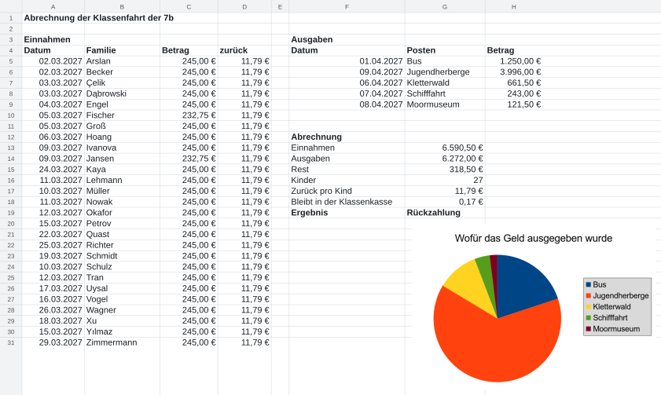

image: teaser.webp
image_alt: "Die Abrechnung der Klassenfahrt: links die Einnahmen aller Familien, rechts die Ausgaben, darunter Einnahmen, Ausgaben, Rest und was jedes Kind zurückbekommt, daneben ein Kreisdiagramm der Ausgaben"
kind: projekt
duration: 1 Stunde (45 Minuten)
curriculum: "Sek I: Standardsoftware (Tabellenkalkulation)"
topics: [standardsoftware]
language: LibreOffice / Excel / Nextcloud Office
languages: [libreoffice, word, nextcloud]
office: sheet
requires: [spreadsheet-charts]
reference: []

# Die Abrechnung der Klassenfahrt

Die Klassenfahrt ist vorbei, alle 27 Familien haben bezahlt, und alle
Rechnungen sind da. Das Elternteil, das die Kasse führt, bittet die 7b um
die Abrechnung für den Elternabend: Was ist eingenommen worden, was
ausgegeben, und wie viel bekommt jedes Kind zurück? Diesmal rechnet in der
Vorlage noch nichts. Du baust die Abrechnung selbst, mit allem, was du in
dieser Reihe gelernt hast, und gibst sie als PDF weiter.

## Was deine Abrechnung braucht

Die Prüfung sieht nach allem, was in den sechs Blättern vorkam. Wenn du bei
einem Punkt nicht weiterweißt, steht er auf dem Blatt daneben.

<table class='table'>
<thead><tr><th>Deine Abrechnung</th><th>Erklärt in</th></tr></thead>
<tbody>
<tr><td>Einnahmen und Ausgaben mit SUMME, der Rest als Formel</td><td><a href='/spreadsheet-cells'>Zellen, die rechnen</a></td></tr>
<tr><td>Beträge als Währung, die Tage der Zahlungen und Rechnungen als Datum</td><td><a href='/number-formats'>Zahlen in Form</a></td></tr>
<tr><td>die Spalte »zurück« mit einem festen Bezug auf die Rückzahlung pro Kind</td><td><a href='/absolute-references'>Feste Bezüge</a></td></tr>
<tr><td>die Zahl der Kinder mit ANZAHL, das Ergebnis mit WENN</td><td><a href='/spreadsheet-functions'>Auswerten</a></td></tr>
<tr><td>die Einnahmen nach der Familie sortiert, ohne dass eine Zeile auseinanderfällt</td><td><a href='/sort-and-filter'>Sortieren, Filtern, Hervorheben</a></td></tr>
<tr><td>ein Kreisdiagramm der Ausgaben mit Titel</td><td><a href='/spreadsheet-charts'>Diagramme</a></td></tr>
</tbody>
</table>

## Rechnen

Hol dir die Vorlage:

<a class='document-starter btn btn-primary' href='/trip-accounts/07%20Abrechnung.xlsx' download><i class='bi bi-file-earmark-spreadsheet' aria-hidden='true'></i>Vorlage herunterladen:07 Abrechnung.xlsx</a>

Links stehen die Einnahmen, jede Zahlung mit ihrem Tag, so wie sie kamen;
die Tage sind wieder aus dem Kontoauszug kopiert. Rechts stehen die
Rechnungen der Fahrt, darunter die Abrechnung: die Namen ihrer Zeilen von
»Einnahmen« bis »Ergebnis«, daneben in Spalte G noch nichts. Jede Zelle dort
rechnet mit den Zellen darüber oder mit den Listen links. »Ergebnis« zeigt
mit WENN »Rückzahlung«, wenn etwas übrig ist, sonst »Nachzahlung«.

Bei der Rückzahlung pro Kind kommt es auf den Cent an:

_task(rundung)

<!-- after: rundung -->
Rundet die Tabelle auf, bekommt jedes Kind einen Bruchteil eines Cents zu
viel, und 27 Bruchteile machen 10 Cent, die in der Kasse fehlen. Die Funktion
**ABRUNDEN** rundet immer nach unten: `=ABRUNDEN(G15/G16;2)` schneidet nach
der zweiten Nachkommastelle ab, 11,79 €. Was übrig bleibt, 17 Cent, bleibt in
der Klassenkasse; auch das gehört in die Abrechnung. (`RUNDEN` rundet wie in
der Schule, `AUFRUNDEN` immer nach oben.)
<!-- /after -->

**Jetzt bist du dran:** Bau die Abrechnung in G13 bis G19, dann die Spalte
»zurück«, die Formate, die sortierte Liste und das Diagramm. Prüf
zwischendurch: Die Prüfung zeigt dir auf deiner Seite, was noch fehlt. Sie
ändert in ihrer Kopie auch eine Rechnung, einmal so, dass Geld übrig bleibt,
einmal so, dass es fehlt; deine Abrechnung muss beide Male mitrechnen.

## Abgeben

_task(abrechnung)

<!-- after: abrechnung -->
So kann eine fertige Abrechnung aussehen:

<!-- /after -->

## Als PDF weitergeben

Auf dem Elternabend soll niemand die Tabelle ändern können, und nicht jede
Familie hat ein Programm für Tabellen. Ein **PDF** sieht überall gleich aus
und lässt sich drucken, wie es ist.

_task(formeln)

<!-- after: formeln -->
Im PDF steht, was die Zellen zeigen; die Formeln bleiben in deiner Tabelle.
Ändert sich später eine Rechnung, änderst du die Tabelle und exportierst ein
neues PDF.
<!-- /after -->

Eine Tabelle hat keine Seiten, ein PDF schon. Damit die Abrechnung auf eine
Seite passt, stellst du die Seite quer und lässt das Programm die Tabelle auf
eine Seite verkleinern.

<!-- language: libreoffice -->
In LibreOffice: *Format* <i class='bi bi-chevron-right' aria-hidden='true'></i> *Seitenvorlage…*, im Register *Seite* das *Querformat*, im Register *Tabelle* unter *Skalierungsmodus* »Druckbereich(e) auf Breite/Höhe verkleinern« mit *Breite in Seiten* 1 und *Höhe in Seiten* 1. Exportieren: *Datei* <i class='bi bi-chevron-right' aria-hidden='true'></i> *Exportieren als* <i class='bi bi-chevron-right' aria-hidden='true'></i> *Als PDF exportieren…*
<!-- /language -->
<!-- language: word -->
In Excel: Register *Seitenlayout*, *Ausrichtung* <i class='bi bi-chevron-right' aria-hidden='true'></i> *Querformat*, und in der Gruppe *An Format anpassen* *Breite* und *Höhe* je »1 Seite«. Exportieren: *Datei* <i class='bi bi-chevron-right' aria-hidden='true'></i> *Exportieren* <i class='bi bi-chevron-right' aria-hidden='true'></i> *PDF/XPS-Dokument erstellen*.
<!-- /language -->
<!-- language: nextcloud -->
In Nextcloud Office: *Format* <i class='bi bi-chevron-right' aria-hidden='true'></i> *Seitenvorlage…*, wie in LibreOffice: *Querformat* und die Tabelle auf eine Seite verkleinert. Herunterladen: *Datei* <i class='bi bi-chevron-right' aria-hidden='true'></i> *Herunterladen als* <i class='bi bi-chevron-right' aria-hidden='true'></i> *PDF-Dokument (.pdf)*.
<!-- /language -->

_task(pdf)
