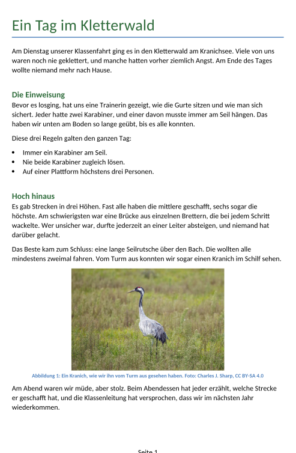

image: teaser.webp
image_alt: "Der Anfang eines Artikels »Ein Tag im Kletterwald«: Titel, ein Absatz, eine Zwischenüberschrift und eine Liste mit Regeln"
kind: projekt
duration: 1 Stunde (45 Minuten)
curriculum: "Sek I: Standardsoftware (Umgang mit Textverarbeitungssoftware); Medienbildung: Produzieren (Medienproduktion als planvoller Prozess, Herstellung von Medienprodukten)"
topics: [standardsoftware]
language: Word / LibreOffice / Nextcloud Office
languages: [word, libreoffice, nextcloud]
requires: [pages-and-contents]
reference: []

# Die Zeitung der Klassenfahrt

Nach der Klassenfahrt macht die 7b eine Zeitung, und jede und jeder schreibt
einen Artikel: über einen Tag der Fahrt, ein Erlebnis oder etwas, das ihr
gesehen habt. Hattet ihr keine Fahrt, dann über einen Ausflug oder einen Tag
mit der Klasse. Diesmal steht nichts in der Vorlage, was falsch gebaut ist:
Der Text ist deiner, und du baust ihn von Anfang an so, wie du es in dieser
Reihe gelernt hast.

## Was dein Artikel braucht

Die Prüfung sieht nach allem, was in den sieben Blättern vorkam. Wenn du bei
einem Punkt nicht weiterweißt, steht er auf dem Blatt daneben.

<table class='table'>
<thead><tr><th>Dein Artikel</th><th>Erklärt in</th></tr></thead>
<tbody>
<tr><td>mindestens 200 Wörter, eigener Text</td><td></td></tr>
<tr><td>keine Leerzeichen hintereinander, keine leeren Absätze, keine Zeilenumbrüche von Hand</td><td><a href='/formatting-marks'>Was das Auge nicht sieht</a></td></tr>
<tr><td>höchstens zwei Schriftarten, nichts unterstrichen, keine Großbuchstaben als Format</td><td><a href='/character-formatting'>Schrift mit Absicht</a></td></tr>
<tr><td>eine Liste, wenn du eine brauchst, die das Programm führt</td><td><a href='/lists-and-tabs'>Listen und Tabstopps</a></td></tr>
<tr><td>mindestens ein Bild, nicht verzerrt, mit Bildunterschrift und Alternativtext</td><td><a href='/pictures-in-text'>Bilder im Text</a></td></tr>
<tr><td>mindestens zwei Zwischenüberschriften mit Formatvorlage, keine Ebene übersprungen, nicht von Hand formatiert</td><td><a href='/paragraph-styles'>Formatvorlagen</a></td></tr>
<tr><td>die Seitenzahl als Feld in der Fußzeile</td><td><a href='/pages-and-contents'>Seiten und Verzeichnisse</a></td></tr>
</tbody>
</table>

Ein Foto, das nicht von dir ist, braucht in der Bildunterschrift seine Quelle:
wer es gemacht hat und unter welcher Lizenz es steht, so wie beim Kranich im
Blatt <a href='/pictures-in-text'>Bilder im Text</a>.

## Schreiben

Hol dir die Vorlage:

<a class='document-starter btn btn-primary' href='/trip-newspaper/08%20Artikel.docx' download><i class='bi bi-file-earmark-word' aria-hidden='true'></i>Vorlage herunterladen:08 Artikel.docx</a>

Ersetze den Titel und die Zeile darunter durch deinen Artikel. Schreib zuerst
den Text, dann gib den Zwischenüberschriften ihre Formatvorlagen, setz das Bild
mit seiner Unterschrift und zuletzt die Seitenzahl. Prüf zwischendurch: Die
Prüfung zeigt dir auf deiner Seite, was noch fehlt.

## Abgeben

_task(artikel)

<!-- after: artikel -->
So kann ein fertiger Artikel aussehen:

<!-- /after -->
