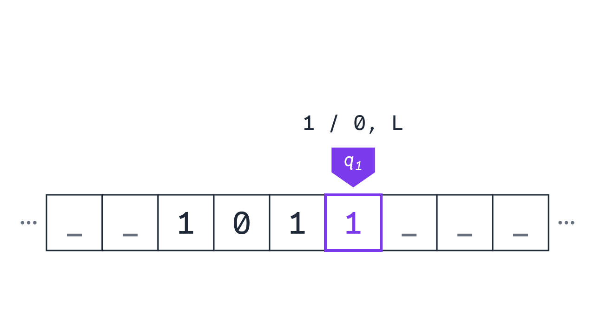

<div class='meta'>
image: teaser.webp
image_alt: "Ein Band aus Feldern, das nach beiden Seiten weitergeht, mit _ _ 1 0 1 1 _ _ _ darauf. Über der letzten 1 steht ein violetter Kopf mit q1, darüber der Übergang »1 / 0, L«."
kind: projekt
language: Ruby / Python
languages: [ruby, python]
duration: 2 Doppelstunden
curriculum: "Oberstufe: Sprachen und Automaten (formale Sprachen, Turingmaschinen), Vertiefung Theoretische Informatik (Turingmaschine, Halteproblem, Church-Turing-These)"
requires: [automata]
reference: [automaten, ruby-python]
</div>

<div
    class="autotoc-secondary-trigger"
    data-title="Auf dieser Seite"
    data-levels="h2,h3">
</div>

# Turingmaschinen

<p class='abstract'>
Ein Band, ein Kopf, der darauf liest und schreibt, und eine kleine Tabelle: Mehr braucht man nicht, um alles zu berechnen, was dein Computer berechnen kann. Du baust in Ruby oder Python Turingmaschinen, die Binärzahlen hochzählen, addieren und Wörter wie aaabbbccc prüfen, zählst ihre Schritte und findest mit einem Gedankenexperiment eine Frage, die kein Programm der Welt beantworten kann.
</p>

Ein [endlicher Automat](/automata) merkt sich nur seinen Zustand. Ein [Kellerautomat](/kellerautomat) hat dazu einen Stack, aber auch er sieht immer nur dessen oberstes Zeichen. Wörter wie aaabbbccc, mit gleich vielen a, b und c, prüft darum keiner von beiden: Hat ein Kellerautomat beim Zählen der a seinen Stack gefüllt und beim Vergleichen mit den b wieder geleert, weiß er nicht mehr, wie viele c kommen müssen.

1936 fragte sich der britische Mathematiker Alan Turing, was »berechnen« überhaupt heißt. Seine Antwort war eine Maschine, die so arbeitet wie ein Mensch mit Bleistift und Papier: Sie sieht auf ein Feld, schreibt etwas hinein, geht ein Feld weiter und merkt sich dabei nur, an welcher Stelle ihres Verfahrens sie gerade ist. Heute heißt sie **Turingmaschine**.

_person(turing)

## Einrichten

Lege im Terminal (<kbd>Strg</kbd><kbd>J</kbd>) einen Ordner an und öffne ihn mit <kbd>Strg</kbd><kbd>K</kbd> <kbd>Strg</kbd><kbd>O</kbd>:

```bash
mkdir /workspace/turingmaschine
```

<!-- language: ruby -->
Alle Dateien dieser Aktivität kommen in diesen Ordner. Ein Programm startest du im Terminal mit `ruby` und dem Namen der Datei.
<!-- /language -->
<!-- language: python -->
Alle Dateien dieser Aktivität kommen in diesen Ordner. Ein Programm startest du im Terminal mit `python3` und dem Namen der Datei.
<!-- /language -->

## Band, Kopf und Zustand

Eine Turingmaschine hat ein **Band** aus Feldern, das nach links und rechts ohne Ende weitergeht. In jedem Feld steht ein Zeichen; ein leeres Feld schreiben wir als `_`. Am Anfang steht die Eingabe auf dem Band, und der **Kopf** steht auf ihrem ersten Zeichen. Die Maschine ist außerdem in einem **Zustand**, am Anfang in q<sub>0</sub>.

In jedem Schritt liest der Kopf das Zeichen unter sich. Zu ihrem Zustand und diesem Zeichen schlägt die Maschine in ihrer Tabelle nach, und dort stehen drei Angaben: welches Zeichen sie in das Feld schreibt, ob der Kopf ein Feld nach links (L) oder nach rechts (R) geht, und ihr neuer Zustand. Erreicht sie den Zustand q<sub>H</sub>, hält sie an, und was dann auf dem Band steht, ist ihr Ergebnis.

Die erste Maschine zählt 1 zu einer Binärzahl dazu. Im Bild steht an jedem Pfeil das gelesene Zeichen, hinter dem Schrägstrich das geschriebene und die Richtung:

<div class='automaton-drawing' role='img' aria-label='Drei Zustände nebeneinander: q0 mit Startpfeil, q1 und qH mit doppeltem Rand. q0 hat einen Pfeil zu sich selbst mit »0 / 0, R« und »1 / 1, R«, ein Pfeil von q0 nach q1 trägt »_ / _, L«. q1 hat einen Pfeil zu sich selbst mit »1 / 0, L«, ein Pfeil von q1 nach qH trägt »0 / 1, L« und »_ / 1, L«.' data-states='q0 q1 qH' data-start='q0' data-accept='qH' data-arrows='q0 | 0 / 0, R | q0; q0 | 1 / 1, R | q0; q0 | _ / _, L | q1; q1 | 1 / 0, L | q1; q1 | 0 / 1, L | qH; q1 | _ / 1, L | qH'></div>
<script src='/include/automaton_layout.js'></script>

<!-- language: ruby -->
Lege `plus_one.rb` an:

```ruby
# Eine Turingmaschine zählt 1 zu einer Binärzahl dazu. Sie hat ein Band aus
# Feldern, einen Kopf, der auf einem Feld steht, und einen Zustand. _ ist
# ein leeres Feld; das Band geht nach beiden Seiten ohne Ende weiter.
START = 'q0'
HALT = 'qH'
# [Zustand, gelesenes Zeichen] => [was sie schreibt, wohin der Kopf geht
# (L links, R rechts), neuer Zustand]
TRANSITIONS = {
    # q0: nach rechts bis hinter die letzte Ziffer
    ['q0', '0'] => ['0', 'R', 'q0'],
    ['q0', '1'] => ['1', 'R', 'q0'],
    ['q0', '_'] => ['_', 'L', 'q1'],
    # q1: von hinten 1 dazu, mit Übertrag
    ['q1', '1'] => ['0', 'L', 'q1'],
    ['q1', '0'] => ['1', 'L', HALT],
    ['q1', '_'] => ['1', 'L', HALT],
}

# Das Band ab dem ersten bis zum letzten beschriebenen Feld, der Kopf in [ ]
def show(tape, head)
    used = tape.keys.reject { |i| tape[i] == '_' } + [head]
    (used.min..used.max).map { |i| i == head ? "[#{tape[i]}]" : tape[i] }.join
end

def run(input, trace: false, max_steps: 1000)
    tape = Hash.new('_')
    input.each_char.with_index { |symbol, i| tape[i] = symbol }
    head = 0
    state = START
    steps = 0
    puts "#{state.ljust(3)} #{show(tape, head)}" if trace
    until state == HALT
        raise "Nach #{max_steps} Schritten hat die Maschine nicht angehalten." if steps == max_steps
        write, move, state = TRANSITIONS.fetch([state, tape[head]])
        tape[head] = write
        head += move == 'R' ? 1 : -1
        steps += 1
        puts "#{state.ljust(3)} #{show(tape, head)}" if trace
    end
    used = tape.keys.reject { |i| tape[i] == '_' }
    used.empty? ? '' : (used.min..used.max).map { |i| tape[i] }.join
end

run('1011', trace: true)
['0', '1', '1011', '111'].each do |word|
    puts "#{word} → #{run(word)}"
end
```

Das Band ist ein Hash von der Nummer des Feldes zum Zeichen darin. `Hash.new('_')` gibt für jedes Feld, in das noch nie etwas geschrieben wurde, `_` zurück; so ist das Band ohne Ende, auch nach links, wo die Nummern negativ werden. `run` macht Schritte, bis die Maschine in `HALT` ist, und gibt dann das Band ohne die leeren Felder am Rand zurück. Mit `trace: true` zeigt es nach jedem Schritt den Zustand und das Band, den Kopf in eckigen Klammern. Nach `max_steps` Schritten gibt `run` auf.
<!-- /language -->
<!-- language: python -->
Lege `plus_one.py` an:

```python
# Eine Turingmaschine zählt 1 zu einer Binärzahl dazu. Sie hat ein Band aus
# Feldern, einen Kopf, der auf einem Feld steht, und einen Zustand. _ ist
# ein leeres Feld; das Band geht nach beiden Seiten ohne Ende weiter.
START = 'q0'
HALT = 'qH'
# (Zustand, gelesenes Zeichen) -> (was sie schreibt, wohin der Kopf geht
# (L links, R rechts), neuer Zustand)
TRANSITIONS = {
    # q0: nach rechts bis hinter die letzte Ziffer
    ('q0', '0'): ('0', 'R', 'q0'),
    ('q0', '1'): ('1', 'R', 'q0'),
    ('q0', '_'): ('_', 'L', 'q1'),
    # q1: von hinten 1 dazu, mit Übertrag
    ('q1', '1'): ('0', 'L', 'q1'),
    ('q1', '0'): ('1', 'L', HALT),
    ('q1', '_'): ('1', 'L', HALT),
}


# Das Band ab dem ersten bis zum letzten beschriebenen Feld, der Kopf in [ ]
def show(tape, head):
    used = [i for i in tape if tape[i] != '_'] + [head]
    return ''.join(f'[{tape.get(i, "_")}]' if i == head else tape.get(i, '_') for i in range(min(used), max(used) + 1))


def run(word, trace=False, max_steps=1000):
    tape = dict(enumerate(word))
    head = 0
    state = START
    steps = 0
    if trace:
        print(f'{state:<3} {show(tape, head)}')
    while state != HALT:
        if steps == max_steps:
            raise RuntimeError(f'Nach {max_steps} Schritten hat die Maschine nicht angehalten.')
        write, move, state = TRANSITIONS[(state, tape.get(head, '_'))]
        tape[head] = write
        head += 1 if move == 'R' else -1
        steps += 1
        if trace:
            print(f'{state:<3} {show(tape, head)}')
    used = [i for i in tape if tape[i] != '_']
    return ''.join(tape.get(i, '_') for i in range(min(used), max(used) + 1)) if used else ''


run('1011', trace=True)
for word in ['0', '1', '1011', '111']:
    print(f'{word} → {run(word)}')
```

Das Band ist ein `dict` von der Nummer des Feldes zum Zeichen darin. `tape.get(i, '_')` gibt für jedes Feld, in das noch nie etwas geschrieben wurde, `_` zurück; so ist das Band ohne Ende, auch nach links, wo die Nummern negativ werden. `run` macht Schritte, bis die Maschine in `HALT` ist, und gibt dann das Band ohne die leeren Felder am Rand zurück. Mit `trace=True` zeigt es nach jedem Schritt den Zustand und das Band, den Kopf in eckigen Klammern. Nach `max_steps` Schritten gibt `run` auf.
<!-- /language -->

Bevor du es startest: Die letzte Zeile lässt die Maschine auch auf `111` los.

_task(vorhersage-plus)

<!-- after: vorhersage-plus -->
<!-- language: ruby -->
Starte es mit `ruby plus_one.rb`:
<!-- /language -->
<!-- language: python -->
Starte es mit `python3 plus_one.py`:
<!-- /language -->

```text
q0  [1]011
q0  1[0]11
q0  10[1]1
q0  101[1]
q0  1011[_]
q1  101[1]
q1  10[1]0
q1  1[0]00
qH  [1]100
0 → 1
1 → 10
1011 → 1100
111 → 1000
```

In q<sub>0</sub> läuft der Kopf nach rechts, ohne etwas zu ändern, bis er auf dem leeren Feld hinter der Zahl steht. Dann rechnet q<sub>1</sub> von hinten, wie du schriftlich addierst: Aus einer 1 wird 0 mit Übertrag, und der Kopf geht weiter nach links; die erste 0 wird zu 1, und die Maschine hält. Bei `111` gibt es keine 0, und die 1 landet auf dem leeren Feld vor der Zahl.
<!-- /after -->

<div class='hint try'>
<strong>Ausprobieren:</strong> Lass die Maschine mit <code>trace</code> auf <code>0111</code> laufen statt auf <code>1011</code>. Achte darauf, auf welchem Feld sie die 1 schreibt und ob die Zahl danach länger ist als vorher.
</div>

_task(minus-eins)

### Rechnen mit Strichlisten

Turingmaschinen rechnen nicht nur mit Binärzahlen. Am einfachsten ist es mit Strichlisten, wie beim Zählen von Stimmen an der Tafel: `111` ist 3. Schreibt man zwei davon mit einem `+` dazwischen auf das Band, kann eine Maschine sie addieren.

_task(addieren)

## Gleich viele a, b und c

Die Sprache a<sup>n</sup>b<sup>n</sup>c<sup>n</sup>, alle Wörter aus einer Reihe a, gleich vielen b und gleich vielen c, prüft kein Kellerautomat. Eine Turingmaschine kann es, weil sie auf ihr Band schreiben und darauf hin und her laufen kann. Sie streicht in jeder Runde ein a, ein b und ein c durch, indem sie X, Y und Z darüber schreibt, und läuft zurück zum Anfang. Ist kein a mehr übrig, darf auch kein b und kein c mehr übrig sein.

Diese Maschine hält auf zwei Arten an: im Zustand q<sub>J</sub> (»ja«), wenn sie das Wort annimmt, oder wenn es für ihren Zustand und das gelesene Zeichen keinen Übergang gibt; dann lehnt sie es ab.

<!-- language: ruby -->
Lege `anbncn.rb` an. `show` ist dasselbe wie in `plus_one.rb`:

```ruby
# Eine Turingmaschine prüft a^n b^n c^n: erst n-mal a, dann n-mal b, dann
# n-mal c. In jeder Runde streicht sie ein a, ein b und ein c durch (X, Y,
# Z). Steht kein a mehr da, prüft sie, dass auch nichts anderes übrig ist.
START = 'q0'
ACCEPT = 'qJ'
TRANSITIONS = {
    # q0: das nächste a durchstreichen; keins mehr: zur Prüfung
    ['q0', 'a'] => ['X', 'R', 'q1'],
    ['q0', 'Y'] => ['Y', 'R', 'q4'],
    ['q0', '_'] => ['_', 'R', ACCEPT],
    # q1: nach rechts zum ersten b, durchstreichen
    ['q1', 'a'] => ['a', 'R', 'q1'],
    ['q1', 'Y'] => ['Y', 'R', 'q1'],
    ['q1', 'b'] => ['Y', 'R', 'q2'],
    # q2: weiter zum ersten c, durchstreichen
    ['q2', 'b'] => ['b', 'R', 'q2'],
    ['q2', 'Z'] => ['Z', 'R', 'q2'],
    ['q2', 'c'] => ['Z', 'L', 'q3'],
    # q3: zurück bis hinter das letzte X
    ['q3', 'a'] => ['a', 'L', 'q3'],
    ['q3', 'b'] => ['b', 'L', 'q3'],
    ['q3', 'Y'] => ['Y', 'L', 'q3'],
    ['q3', 'Z'] => ['Z', 'L', 'q3'],
    ['q3', 'X'] => ['X', 'R', 'q0'],
    # q4: hinter den a nur noch Y und Z
    ['q4', 'Y'] => ['Y', 'R', 'q4'],
    ['q4', 'Z'] => ['Z', 'R', 'q4'],
    ['q4', '_'] => ['_', 'L', ACCEPT],
}

# Das Band ab dem ersten bis zum letzten beschriebenen Feld, der Kopf in [ ]
def show(tape, head)
    used = tape.keys.reject { |i| tape[i] == '_' } + [head]
    (used.min..used.max).map { |i| i == head ? "[#{tape[i]}]" : tape[i] }.join
end

# Nimmt die Maschine das Wort an? Ohne passenden Übergang hält sie und
# lehnt ab. steps zählt die Schritte bis dahin.
def accepts(word, trace: false)
    tape = Hash.new('_')
    word.each_char.with_index { |symbol, i| tape[i] = symbol }
    head = 0
    state = START
    steps = 0
    puts "#{state} #{show(tape, head)}" if trace
    while state != ACCEPT
        move = TRANSITIONS[[state, tape[head]]]
        break if move.nil?
        write, direction, state = move
        tape[head] = write
        head += direction == 'R' ? 1 : -1
        steps += 1
        puts "#{state} #{show(tape, head)}" if trace
    end
    puts "#{steps} Schritte" if trace
    state == ACCEPT
end

accepts('aabbcc', trace: true)
['abc', 'aabbcc', 'aabbc', 'abcabc', ''].each do |word|
    puts "#{word.inspect} #{accepts(word)}"
end
```
<!-- /language -->
<!-- language: python -->
Lege `anbncn.py` an. `show` ist dasselbe wie in `plus_one.py`:

```python
# Eine Turingmaschine prüft a^n b^n c^n: erst n-mal a, dann n-mal b, dann
# n-mal c. In jeder Runde streicht sie ein a, ein b und ein c durch (X, Y,
# Z). Steht kein a mehr da, prüft sie, dass auch nichts anderes übrig ist.
START = 'q0'
ACCEPT = 'qJ'
TRANSITIONS = {
    # q0: das nächste a durchstreichen; keins mehr: zur Prüfung
    ('q0', 'a'): ('X', 'R', 'q1'),
    ('q0', 'Y'): ('Y', 'R', 'q4'),
    ('q0', '_'): ('_', 'R', ACCEPT),
    # q1: nach rechts zum ersten b, durchstreichen
    ('q1', 'a'): ('a', 'R', 'q1'),
    ('q1', 'Y'): ('Y', 'R', 'q1'),
    ('q1', 'b'): ('Y', 'R', 'q2'),
    # q2: weiter zum ersten c, durchstreichen
    ('q2', 'b'): ('b', 'R', 'q2'),
    ('q2', 'Z'): ('Z', 'R', 'q2'),
    ('q2', 'c'): ('Z', 'L', 'q3'),
    # q3: zurück bis hinter das letzte X
    ('q3', 'a'): ('a', 'L', 'q3'),
    ('q3', 'b'): ('b', 'L', 'q3'),
    ('q3', 'Y'): ('Y', 'L', 'q3'),
    ('q3', 'Z'): ('Z', 'L', 'q3'),
    ('q3', 'X'): ('X', 'R', 'q0'),
    # q4: hinter den a nur noch Y und Z
    ('q4', 'Y'): ('Y', 'R', 'q4'),
    ('q4', 'Z'): ('Z', 'R', 'q4'),
    ('q4', '_'): ('_', 'L', ACCEPT),
}


# Das Band ab dem ersten bis zum letzten beschriebenen Feld, der Kopf in [ ]
def show(tape, head):
    used = [i for i in tape if tape[i] != '_'] + [head]
    return ''.join(f'[{tape.get(i, "_")}]' if i == head else tape.get(i, '_') for i in range(min(used), max(used) + 1))


# Nimmt die Maschine das Wort an? Ohne passenden Übergang hält sie und
# lehnt ab. steps zählt die Schritte bis dahin.
def accepts(word, trace=False):
    tape = dict(enumerate(word))
    head = 0
    state = START
    steps = 0
    if trace:
        print(state, show(tape, head))
    while state != ACCEPT:
        move = TRANSITIONS.get((state, tape.get(head, '_')))
        if move is None:
            break
        write, direction, state = move
        tape[head] = write
        head += 1 if direction == 'R' else -1
        steps += 1
        if trace:
            print(state, show(tape, head))
    if trace:
        print(steps, 'Schritte')
    return state == ACCEPT


accepts('aabbcc', trace=True)
for word in ['abc', 'aabbcc', 'aabbc', 'abcabc', '']:
    print(repr(word), accepts(word))
```
<!-- /language -->

Starte es und lies die Spur mit: Wo steht der Kopf, wenn ein b durchgestrichen wird, und wie weit läuft er danach zurück? Am Ende der Spur steht, wie viele Schritte die Maschine für `aabbcc` gebraucht hat: 23.

<div class='hint try'>
<strong>Ausprobieren:</strong> Lass die Maschine mit <code>trace</code> auf <code>aabbbcc</code> laufen, mit einem b zu viel. Achte darauf, in welchem Zustand und auf welchem Zeichen sie stehen bleibt, und such in <code>TRANSITIONS</code>, warum es dafür keinen Übergang gibt.
</div>

_task(wachstum)

<!-- after: wachstum -->
Jede Runde streicht ein a durch, also gibt es so viele Runden, wie a da sind. In jeder Runde läuft der Kopf vom durchgestrichenen a bis zum nächsten c und zurück, und dieser Weg wird mit dem Wort länger. Doppelt so viele Runden, jede etwa doppelt so lang: Für `aaaabbbbcccc` sind es 77 Schritte, gut dreimal so viele, und je länger das Wort, desto näher kommt das Verhältnis an viermal. Turingmaschinen sind nicht schnell, und darum geht es auch nicht. Es geht darum, ob sie etwas überhaupt können.
<!-- /after -->

_task(schritte)

## Was eine Turingmaschine kann

Eine Turingmaschine ist sehr einfach: ein Band, ein Kopf, eine Tabelle. Trotzdem kann man mit ihr alles berechnen, was dein Computer berechnen kann. Man kann sogar eine einzige Turingmaschine bauen, die die Tabelle einer anderen Maschine vom Band liest und dann tut, was diese tun würde. Turing nannte sie die **universelle Maschine**. Dein Computer, der jedes Programm ausführt, das man ihm gibt, folgt derselben Idee: Das Programm ist für ihn nur ein Text im Speicher.

Fast gleichzeitig mit Turing beschrieb der amerikanische Mathematiker Alonzo Church das Berechnen auf eine ganz andere Art, nur mit Funktionen (dem Lambda-Kalkül), und beide Wege können genau dasselbe. Dass jedes Verfahren, das man überhaupt Schritt für Schritt ausführen kann, auch eine Turingmaschine ausführen kann, heißt **Church-Turing-These**: Beweisen kann man sie nicht, weil »Verfahren« kein mathematischer Begriff ist, aber jedes Modell vom Rechnen, das seitdem jemand erfunden hat, kann nicht mehr als eine Turingmaschine.

<div class='book'>
<i class='bi bi-file-earmark-text'></i>
<p><strong>On Computable Numbers, with an Application to the Entscheidungsproblem</strong>, Alan Turing, Proceedings of the London Mathematical Society, 1936. Der Aufsatz, in dem Turing seine Maschine beschreibt, die universelle Maschine baut und zeigt, dass manche Fragen keine Maschine beantworten kann; die ersten Seiten lesen sich gut, ab der Mitte wird es Mathematik: <a href='https://doi.org/10.1112/plms/s2-42.1.230'>bei der London Mathematical Society</a>, als <a href='https://www.cs.virginia.edu/~robins/Turing_Paper_1936.pdf'>PDF</a>.</p>
</div>

## Maschinen, die nicht anhalten

Alle Maschinen bisher hielten irgendwann an. Das muss nicht so sein.

_task(endlos)

<!-- after: endlos -->
Probier es aus: Ändere den Übergang in deiner `plus_one`-Datei und starte sie. Die Maschine läuft über leere Felder nach rechts, Schritt für Schritt, ohne Ende. Dass `run` nach 1000 Schritten aufgibt, ist keine Antwort auf die Frage, ob sie je anhält: Vielleicht hätte sie nach 1001 Schritten angehalten. Setz den Übergang danach wieder auf `L` und `q1`.
<!-- /after -->

### Das Halteproblem

Ein Programm, das sich aufhängt, ist ärgerlich. Wäre es nicht praktisch, wenn ein Werkzeug vorher sagen könnte, ob ein Programm anhält? Stell dir vor, jemand hätte es geschrieben: eine Funktion `halts(program)`, die jedes Programm ansieht, ohne es zu starten, und immer richtig `true` oder `false` antwortet, je nachdem, ob es anhält. Mit ihr schreibst du dieses Programm:

<!-- language: ruby -->
```ruby
def paradox
    if halts(method(:paradox))
        loop {}          # ohne Ende
    end
end
```
<!-- /language -->
<!-- language: python -->
```python
def paradox():
    if halts(paradox):
        while True:      # ohne Ende
            pass
```
<!-- /language -->

`paradox` fragt `halts` über sich selbst und tut dann das Gegenteil von dem, was `halts` sagt.

_task(halteproblem)

<!-- after: halteproblem -->
Was auch immer `halts` über `paradox` sagt, `paradox` macht es falsch. Also kann es `halts` nicht geben, egal wie klug man es programmiert. Das ist das **Halteproblem**, und es war Turings Antwort auf eine Frage seiner Zeit: Es gibt Fragen, die genau gestellt sind und eine Antwort Ja oder Nein haben, die aber kein Verfahren für jede Eingabe beantworten kann. Werkzeuge, die vor Endlosschleifen warnen, gibt es trotzdem; sie finden manche, aber nie alle.
<!-- /after -->

## Zusammenfassung

- Eine **Turingmaschine** hat ein Band ohne Ende, einen Kopf, der darauf liest, schreibt und sich ein Feld nach links oder rechts bewegt, und eine Tabelle von Übergängen: zu Zustand und gelesenem Zeichen das neue Zeichen, die Richtung und den neuen Zustand.
- Weil sie auf ihr Band schreiben und darauf hin und her laufen kann, kann sie mehr als ein Kellerautomat, etwa a<sup>n</sup>b<sup>n</sup>c<sup>n</sup> prüfen.
- Die **Church-Turing-These** sagt: Was sich überhaupt berechnen lässt, berechnet auch eine Turingmaschine. Ein Computer berechnet nichts, was sie nicht auch berechnen könnte; er ist nur schneller.
- Manche Maschinen halten nie an. Ob eine Maschine anhält, kann keine Maschine für alle anderen entscheiden: das **Halteproblem**.

## Wie geht es weiter?

- **Die Stufen der Automaten.** Endliche Automaten, Kellerautomaten und Turingmaschinen erkennen Sprachen, die immer schwieriger werden: reguläre, kontextfreie und alle, die man überhaupt prüfen kann. Wenn du die anderen noch nicht kennst: [Endliche Automaten](/automata) und [Kellerautomaten](/kellerautomat).
- **Schnell oder langsam.** Dass eine Maschine etwas kann, heißt nicht, dass sie es schnell kann. Wie die Zahl der Schritte mit der Länge der Eingabe wächst, ist die Frage der Komplexitätstheorie, mit der berühmten offenen Frage, ob P gleich NP ist.



<!-- tutorial-step
# Die Musterlösungen aus loesung/ lösen jede Programmieraufgabe, in beiden Sprachen
write-file: turingmaschine/minus_one.rb <- file:loesung/minus_one.rb
write-file: turingmaschine/minus_one.py <- file:loesung/minus_one.py
write-file: turingmaschine/add.rb <- file:loesung/add.rb
write-file: turingmaschine/add.py <- file:loesung/add.py
check-task: minus-eins
check-task: minus-eins ruby
check-task: addieren
check-task: addieren ruby
-->
