<div class='meta'>
image: teaser.webp
image_alt: "Ein Bild aus dem Film Spring: ein Mädchen mit Wanderstab und ein kleiner Hund auf einem Pfad zwischen Felsen im Abendlicht, dahinter ein Berg. Darüber liegen Quadrate, die Blöcke eines Codecs: große im ruhigen Himmel und am unscharfen Berg, kleine an Felsen, Gras und den beiden Figuren."
kind: labor
language: Python
duration: 9 Doppelstunden
curriculum: "Oberstufe: Algorithmen und Datenstrukturen (Diskrete Kosinustransformation, Bewegungsschätzung), Vertiefung Technische Informatik (Videokompression)"
topics: [kompression, codierung]
requires: [jpeg, audio-compression]
reference: [bits-und-bytes]
</div>

<div
    class="autotoc-secondary-trigger"
    data-title="Auf dieser Seite"
    data-levels="h2,h3">
</div>

# Video komprimieren

<p class='abstract'>
Eine Sekunde Video in Full HD braucht unkomprimiert über 150 MB, ein Stream nur ein paar Hundert Kilobyte. Du liest Videos Bild für Bild in Python, sparst an der Farbe, sagst Blöcke aus ihren Nachbarn und aus dem vorigen Bild voraus, schätzt Bewegung und vergleichst, was H.264, AV1 und die Codecs von heute daraus machen.
</p>

## Bilder pro Sekunde

Ein Video ist eine Folge von Bildern, die schnell genug nacheinander kommen, dass das Auge eine Bewegung sieht. Jedes Bild hat Pixel, jedes Pixel drei Zahlen für Rot, Grün und Blau. Das ist viel: Ein Bild in Full HD hat 1.920 × 1.080 Pixel mit je 3 Bytes, über 6 MB, und davon kommen 25 in jeder Sekunde.

_task(full-hd)

### Das Pferd in Bewegung

Berührt ein galoppierendes Pferd immer mit einem Huf den Boden? Das wollte Leland Stanford wissen, früher Gouverneur von Kalifornien und Besitzer von Rennpferden. Der Fotograf Eadweard Muybridge stellte dafür im Juni 1878 auf Stanfords Rennbahn in Palo Alto zwölf Kameras nebeneinander auf. Unter der Bahn lagen Drähte, und das Pferd riss im Vorbeilaufen einen nach dem anderen ab; jeder Draht löste eine Kamera aus. Auf den Bildern sieht man: Für einen Moment schwebt das Pferd, alle vier Hufe in der Luft, und zwar mit den Beinen unter dem Körper, nicht weit nach vorn und hinten gestreckt, wie Maler es bis dahin gemalt hatten.

<figure><figcaption>»The Horse in Motion«, Eadweard Muybridge, 1878 (gemeinfrei, <a href='https://commons.wikimedia.org/wiki/File:The_Horse_in_Motion_high_res.jpg'>Wikimedia Commons</a>, verkleinert)</figcaption></figure>

Unter der Tafel steht, dass die Fotos etwa eine fünfundzwanzigstel Sekunde auseinander liegen: 25 Bilder pro Sekunde, so viele wie später beim europäischen Fernsehen. Die ersten elf Fotos zeigen einen Galoppsprung. Ausgeschnitten und nacheinander gezeigt, werden sie zu einem Film. Muybridge tat das ab 1880 mit einer Scheibe, auf die er die Bilder malte und die er drehte. Das machst du gleich selbst, mit Python.

### Einrichten

Lege einen Ordner an und hol dir die Tafel mit Muybridges Fotos:

```bash_copy
mkdir -p ~/video && cd ~/video
wget ${web_root}/video/muybridge.jpg
```

<!-- tutorial-step
terminal-open
terminal-run: mkdir -p /workspace/video && cd /workspace/video && (test -f muybridge.jpg || curl -sO http://workspace_nginx_1/video/muybridge.jpg) && ls
terminal-wait-for-prompt: 60
wait-for-text: muybridge.jpg
-->

### Bilder in Python

Python liest kein Video, aber ffmpeg kann es: Es packt die Bilder aus und schreibt die Pixel, ein Byte nach dem anderen, in eine **Pipe**, aus der Python liest. Umgekehrt nimmt ffmpeg Pixel aus einer Pipe und macht daraus ein Video. Lege `video.py` an:

```python
import subprocess

import numpy as np

WIDTH = 960
HEIGHT = 400


def read_frames(path):
    command = ['ffmpeg', '-v', 'error', '-i', path, '-f', 'rawvideo', '-pix_fmt', 'rgb24', '-']
    data = subprocess.run(command, capture_output=True, check=True).stdout
    return np.frombuffer(data, dtype=np.uint8).reshape(-1, HEIGHT, WIDTH, 3)


def write_video(path, frames, fps=24):
    count, height, width, _ = frames.shape
    command = ['ffmpeg', '-v', 'error', '-y', '-f', 'rawvideo', '-pix_fmt', 'rgb24',
               '-s', f'{width}x{height}', '-r', str(fps), '-i', '-',
               '-c:v', 'libx264', '-crf', '18', '-pix_fmt', 'yuv420p', path]
    subprocess.run(command, input=frames.astype(np.uint8).tobytes(), check=True)
```

`read_frames` startet ffmpeg mit `-f rawvideo -pix_fmt rgb24`: keine Datei, nur Pixel, drei Bytes je Pixel, und `-` heißt, in die Pipe statt in eine Datei. `subprocess.run` wartet, bis ffmpeg fertig ist, und gibt in `stdout` alle Bytes. `reshape(-1, HEIGHT, WIDTH, 3)` macht daraus ein Array mit vier Achsen: Bild, Zeile, Spalte, Farbe. `-1` heißt, numpy soll die Zahl der Bilder selbst ausrechnen. `WIDTH` und `HEIGHT` passen zu den Videos, die nach dem Pferd kommen: Sie haben 960 × 400 Pixel. `frames[10, 200, 480]` ist dann das Pixel in der Mitte des elften Bildes, drei Zahlen von 0 bis 255.

`write_video` geht den Weg zurück: ffmpeg bekommt die Größe der Bilder (`-s`) und die Bilder pro Sekunde (`-r`), liest die Pixel aus der Pipe (`-i -`) und schreibt mit H.264 eine MP4-Datei. Was `-crf 18` und `yuv420p` heißen, kommt in den nächsten Kapiteln.

### Ein Film aus elf Fotos

Lege `horse.py` an:

```python
import numpy as np
from PIL import Image

from video import write_video

plate = np.asarray(Image.open('muybridge.jpg').convert('L'))
frames = []
for k in range(11):
    row, column = divmod(k, 4)
    y = 40 + 218 * row
    x = 36 + 335 * column
    frames.append(plate[y:y + 200, x:x + 316])
frames = np.stack(frames)
rgb = np.stack([frames, frames, frames], axis=-1)
write_video('horse.mp4', np.tile(rgb, (10, 1, 1, 1)), fps=25)
```

`Image.open(…).convert('L')` liest die Tafel als Graustufen, ein Byte je Pixel, und `np.asarray` macht ein Array mit Zeilen und Spalten daraus. Die Fotos liegen in einem Raster: `divmod(k, 4)` gibt für Foto `k` die Reihe und die Spalte, und alle 218 Zeilen und 335 Spalten beginnt ein neues Foto. `plate[y:y + 200, x:x + 316]` schneidet eines aus, 200 Zeilen hoch und 316 Spalten breit. `np.stack` legt die elf Fotos zu einem Array mit drei Achsen übereinander, und noch einmal `np.stack` macht aus dem Grau drei gleiche Farben, Rot, Grün und Blau. `np.tile` wiederholt den Galoppsprung zehnmal.

```bash
python3 horse.py
```

<!-- tutorial-step
write-file: video/video.py <- file:stufen/video.py
write-file: video/horse.py <- file:stufen/horse.py
terminal-run: cd /workspace/video && python3 horse.py && ls -l horse.mp4
terminal-wait-for-prompt: 60
wait-for-text: horse.mp4
-->

Öffne `horse.mp4`: Das Pferd galoppiert, so schnell wie 1878 in Palo Alto.

<div class='hint try'>
<strong>Ausprobieren:</strong> Ändere <code>fps</code> auf 12 und auf 50. Bei welcher Zahl sieht der Galopp für dich echt aus? Und was passiert, wenn du mit <code>range(12)</code> auch das zwölfte Foto mitnimmst?
</div>

### Vier Ausschnitte aus Spring

Muybridges Pferd hat elf Bilder in Grau. Für den Rest der Seite gibt es Videos von heute, Ausschnitte aus **Spring**, einem Film der Blender Foundation von 2019, Regie Andy Goralczyk: © Blender Foundation | [cloud.blender.org/spring](https://studio.blender.org/films/spring/), unter der Lizenz [CC BY 4.0](https://creativecommons.org/licenses/by/4.0/deed.de). Es sind vier Stücke von je vier Sekunden, verkleinert auf 960 × 400 Pixel, 24 Bilder in der Sekunde. Gemacht sind sie aus der Fassung, die Blender auf YouTube zeigt und die auf Wikimedia Commons liegt: Der Film ist also schon einmal komprimiert, mit 2.048 Pixeln Breite. Verkleinert auf weniger als die Hälfte fällt davon kaum noch etwas auf. Hol sie dir:

```bash_copy
wget ${web_root}/video/glance.mp4 ${web_root}/video/pan.mp4 ${web_root}/video/slope.mp4 ${web_root}/video/tilt.mp4
```

<!-- tutorial-step
terminal-run: cd /workspace/video && for c in glance pan slope tilt; do test -f $c.mp4 || curl -sO http://workspace_nginx_1/video/$c.mp4; done; ls *.mp4
terminal-wait-for-prompt: 60
wait-for-text: pan.mp4
-->

<script src='/include/video_in_view.js'></script>
<div class='gallery columns-2'>
<figure><video src='/video/glance.mp4' poster='/video/glance.webp' data-play-in-view muted loop playsinline preload='none' role='img' aria-label='Eine Nahaufnahme des Mädchens mit dunklen Haaren, großen grünen Augen und einem Wanderstab; sie schaut besorgt zur Seite, nur ihre Augen bewegen sich ein wenig.'></video><figcaption><code>glance.mp4</code>: Das Mädchen schaut zur Seite; fast nur ihre Augen bewegen sich.</figcaption></figure>
<figure><video src='/video/pan.mp4' poster='/video/pan.webp' data-play-in-view muted loop playsinline preload='none' role='img' aria-label='Die Kamera gleitet langsam an einem verschneiten Bergkamm entlang, vor ziehenden Wolken.'></video><figcaption><code>pan.mp4</code>: Die Kamera gleitet langsam an einem Bergkamm entlang.</figcaption></figure>
<figure><video src='/video/slope.mp4' poster='/video/slope.webp' data-play-in-view muted loop playsinline preload='none' role='img' aria-label='Ein Hang im Abendlicht mit Felsen und Gras; das Mädchen mit Wanderstab und ihr kleiner Hund gehen einen Pfad entlang.'></video><figcaption><code>slope.mp4</code>: Ein Hang im Abendlicht, das Mädchen und ihr Hund gehen vorbei.</figcaption></figure>
<figure><video src='/video/tilt.mp4' poster='/video/tilt.webp' data-play-in-view muted loop playsinline preload='none' role='img' aria-label='Die Kamera fährt schnell eine Felswand mit gelben Pflanzen hinauf.'></video><figcaption><code>tilt.mp4</code>: Die Kamera fährt schnell eine Felswand hinauf.</figcaption></figure>
</div>

Öffne die Dateien auch im Explorer: VS Code spielt sie ab.

### Weniger Bilder

Wie viele Bilder pro Sekunde braucht es? Beim Ton bestimmte die Abtastrate, welche Frequenzen ankommen; beim Video bestimmt die Zahl der Bilder, wie flüssig eine Bewegung aussieht. Stummfilme liefen in vielen Kinos mit 22 bis 26 Bildern pro Sekunde, je nach Kino und Vorführer. Mit dem Tonfilm ging das nicht mehr, denn der Ton musste in derselben Geschwindigkeit laufen: Zwischen 1927 und 1930 einigte man sich auf 24 Bilder pro Sekunde, und dabei ist es im Kino bis heute geblieben.

Lege `frames.py` an. `held` soll zeigen, wie ein Video mit weniger Bildern aussieht, aber gleich lang bleibt: Es nimmt nur jedes `step`-te Bild und zeigt jedes davon `step`-mal.

<!-- page-code: own -->
```python
import numpy as np
from PIL import Image

from video import read_frames, write_video


def held(frames, step):
    # hier: jedes step-te Bild, jedes step-mal


if __name__ == '__main__':
    frames = read_frames('pan.mp4')
    print(frames.shape, frames.nbytes, 'Bytes')
    write_video('pan-6.mp4', held(frames, 4))
```

<div class='hint own' data-check='held'>
<strong>Jetzt bist du dran:</strong> Schreib <code>held(frames, step)</code>: ein Array mit genauso vielen Bildern wie <code>frames</code>, in dem die Bilder 0, <code>step</code>, <code>2 * step</code>, … je <code>step</code>-mal hintereinander stehen. Bei 24 Bildern pro Sekunde und <code>step = 4</code> sieht der Schwenk aus wie mit 6 Bildern pro Sekunde.
</div>

<!-- hint -->
`frames[::step]` sind die Bilder 0, `step`, `2 * step`, …, wie bei den Samples in »Audio komprimieren«. `np.repeat(a, n, axis=0)` wiederholt jedes Element entlang der ersten Achse `n`-mal.
<!-- /hint -->
<!-- hint -->
Ist die Zahl der Bilder kein Vielfaches von `step`, ist das Ergebnis von `np.repeat` etwas zu lang: Schneid es mit `[:len(frames)]` ab.

```python
return np.repeat(frames[::step], step, axis=0)[:len(frames)]
```
<!-- /hint -->

<!-- solution -->
```python
def held(frames, step):
    return np.repeat(frames[::step], step, axis=0)[:len(frames)]
```
<!-- /solution -->

_task(held)

```bash
python3 frames.py
```

<!-- tutorial-step
write-file: video/video.py <- file:stufen/video.py
write-file: video/frames.py <- file:stufen/frames-1.py
check-task: held
terminal-run: python3 frames.py
terminal-wait-for-prompt: 60
wait-for-text: 110592000 Bytes
-->

96 Bilder, je 400 Zeilen mit 960 Pixeln und 3 Farben: 110.592.000 Bytes für vier Sekunden, als MP4 sind es 1,3 MB. Öffne `pan-6.mp4` und `pan.mp4` nacheinander: Mit 6 Bildern pro Sekunde ruckelt der Schwenk, die Wolken springen.

<div class='hint try'>
<strong>Ausprobieren:</strong> Versuch <code>step</code> 2 und 3, also 12 und 8 Bilder pro Sekunde. Ab wann sieht der Schwenk für dich flüssig aus? Mach dasselbe mit <code>glance.mp4</code>: Warum fällt es dort viel weniger auf?
</div>

### Halbbilder

Das Fernsehen hatte ein anderes Problem. Ein Bild nach dem anderen zu übertragen, hätte zu viel Bandbreite gebraucht, und mit nur 25 Bildern in der Sekunde flackerte die Röhre. Darum sendete es in **Halbbildern**: erst alle geraden Zeilen, dann alle ungeraden, 50-mal in der Sekunde, im Takt des Stromnetzes mit 50 Hz. Die beiden Halbbilder eines Bildes sind aber zu verschiedenen Zeiten aufgenommen, eine fünfzigstel Sekunde auseinander. Das heißt auf Englisch **Interlacing**.

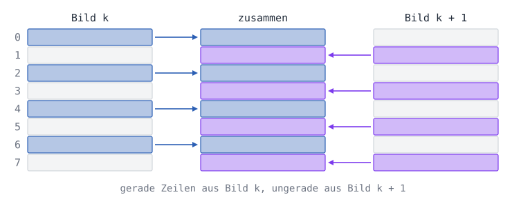
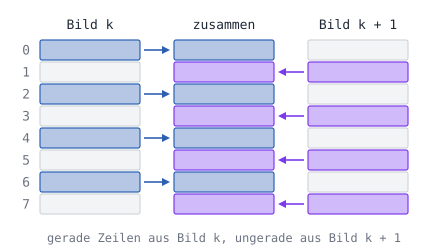

<div class='hint own' data-check='interlace'>
<strong>Jetzt bist du dran:</strong> Schreib <code>interlace(frames)</code>: Bild <code>k</code> des Ergebnisses hat die geraden Zeilen (0, 2, 4, …) von Bild <code>k</code> und die ungeraden (1, 3, 5, …) von Bild <code>k + 1</code>. Das Ergebnis hat ein Bild weniger als <code>frames</code>, und <code>frames</code> selbst bleibt unverändert.
</div>

<!-- hint -->
Fang mit einer Kopie aller Bilder außer dem letzten an, `out = frames[:-1].copy()`: Darin stehen die geraden Zeilen schon richtig.
<!-- /hint -->
<!-- hint -->
Die ungeraden Zeilen aller Bilder sind `out[:, 1::2]`; sie kommen aus den ungeraden Zeilen der Bilder 1 bis zum letzten, `frames[1:, 1::2]`.
<!-- /hint -->

<!-- solution -->
```python
def interlace(frames):
    out = frames[:-1].copy()
    out[:, 1::2] = frames[1:, 1::2]
    return out
```
<!-- /solution -->

_task(interlace)

Unten ins Programm kommt, was die Halbbilder der schnellen Fahrt zeigt. Von einem davon speichert es einen Ausschnitt, die oberen 200 Zeilen und die Spalten 300 bis 699, doppelt so groß und mit scharfen Pixeln (`Image.NEAREST`):

```python
~     write_video('pan-6.mp4', held(frames, 4))
    fast = read_frames('tilt.mp4')
    combed = interlace(fast)
    Image.fromarray(combed[48, :200, 300:700]).resize((800, 400), Image.NEAREST).save('combing.png')
    write_video('tilt-interlaced.mp4', combed)
```

_task(combing)

<!-- after: combing -->
<!-- tutorial-step
write-file: video/frames.py <- file:stufen/frames-2.py
check-task: interlace
terminal-run: python3 frames.py && ls -l tilt*.mp4
terminal-wait-for-prompt: 60
wait-for-text: tilt-interlaced.mp4
-->

Öffne `combing.png`: Wo sich etwas bewegt, sind die Kanten in feine Streifen zerfranst, jede zweite Zeile ein Stück verschoben. Das sieht aus wie die Zinken eines Kamms und heißt darum **Combing** (englisch *comb*, der Kamm). Wo das Bild still steht, fällt nichts auf.

<!-- tutorial-screenshot
image-file: video/combing.png 1
-->


Und noch etwas zeigt `ls -l`: `tilt-interlaced.mp4` ist größer als `tilt.mp4`, obwohl es kein Bild mehr hat. Die feinen Streifen sind für einen Codec schwer zu speichern. Streams im Internet senden ganze Bilder; Halbbilder gibt es noch im Fernsehen, etwa bei Sendern mit 1080i, dem i für interlaced.
<!-- /after -->

<!-- stage: stufen/frames-2.py as frames.py -->

## Farbe sparen

Das Auge sieht Unterschiede in der Helligkeit viel feiner als Unterschiede in der Farbe. Darauf baut jeder Codec für Video: Er trennt zuerst die Helligkeit von der Farbe und speichert die Farbe gröber.

Die Idee ist älter als jeder Codec. Als das Farbfernsehen kam, sollten die alten Schwarz-Weiß-Fernseher weiter ein Bild zeigen. Darum blieb das Signal für die Helligkeit, wie es war, und die Farbe kam als zwei zusätzliche Signale dazu, mit viel weniger Bandbreite. In den USA sendete man so ab 1954 nach der Norm NTSC. In der Bundesrepublik begann das Farbfernsehen am 25. August 1967 mit PAL, das Walter Bruch bei Telefunken in Hannover entwickelt hatte.

### Helligkeit und Farbe trennen

Statt Rot, Grün und Blau speichert ein Codec drei andere Zahlen: **Y** ist die Helligkeit, auf Englisch **Luma**. **Cb** sagt, wie viel blauer das Pixel ist als ein Grau derselben Helligkeit, und **Cr**, wie viel röter; zusammen heißen die beiden **Chroma**. Die Formeln sind dieselben wie bei JPEG:

$$Y = 0{,}299\,R + 0{,}587\,G + 0{,}114\,B$$

$$Cb = 128 - 0{,}168736\,R - 0{,}331264\,G + 0{,}5\,B$$

$$Cr = 128 + 0{,}5\,R - 0{,}418688\,G - 0{,}081312\,B$$

Grün zählt für die Helligkeit am meisten, weil das Auge für Grün am empfindlichsten ist, Blau am wenigsten. Bei einem Grau sind R, G und B gleich: Dann ist Y genau dieser Wert, und Cb und Cr sind 128, denn die Zahlen vor R, G und B ergeben in beiden Zeilen zusammen 0. Fernsehen in HD rechnet mit etwas anderen Gewichten (die Norm BT.709) und lässt Y nur von 16 bis 235 laufen; die Idee ist dieselbe. Wie die drei Teile zusammen ein Foto ergeben, zeigt <a href='/colorspace' target='_blank' rel='noopener'>Trennung von Helligkeit und Farbe</a>.

Für dieses Kapitel gibt es ein einzelnes Bild als PNG, das Mädchen von Nahem, aus derselben Stelle des Films wie `glance.mp4`. Warum kein Bild aus `glance.mp4`, steht am Ende des Kapitels.

```bash_copy
wget ${web_root}/video/portrait.png
```

Lege `chroma.py` an:

<!-- page-code: own -->
```python
import numpy as np
from PIL import Image


def to_ycbcr(rgb):
    # hier: Y, Cb und Cr aus R, G und B


def save_grey(path, plane):
    Image.fromarray(plane.round().clip(0, 255).astype(np.uint8)).save(path)


if __name__ == '__main__':
    frame = np.asarray(Image.open('portrait.png').convert('RGB'))
    ycbcr = to_ycbcr(frame)
    save_grey('y.png', ycbcr[..., 0])
    save_grey('cb.png', ycbcr[..., 1])
    save_grey('cr.png', ycbcr[..., 2])
```

`save_grey` speichert eine Ebene als Graubild: runden, auf 0 bis 255 begrenzen, in Bytes umwandeln.

<div class='hint own' data-check='ycbcr'>
<strong>Jetzt bist du dran:</strong> Schreib <code>to_ycbcr(rgb)</code>. Es bekommt ein Array, dessen letzte Achse R, G und B sind, für ein Pixel, ein Bild oder ein ganzes Video, und gibt ein Array derselben Form zurück, dessen letzte Achse Y, Cb und Cr sind.
</div>

<!-- hint -->
`rgb[..., 0]` sind alle Werte für Rot, egal wie viele Achsen davor stehen: Die drei Punkte heißen »alle Achsen davor«. Mit `r`, `g` und `b` rechnest du die Formeln oben für alle Pixel auf einmal.
<!-- /hint -->
<!-- hint -->
`np.stack([y, cb, cr], axis=-1)` legt die drei wieder zusammen, als neue letzte Achse.

```python
r, g, b = rgb[..., 0], rgb[..., 1], rgb[..., 2]
y = 0.299 * r + 0.587 * g + 0.114 * b
```
<!-- /hint -->

<!-- solution -->
```python
def to_ycbcr(rgb):
    r, g, b = rgb[..., 0], rgb[..., 1], rgb[..., 2]
    y = 0.299 * r + 0.587 * g + 0.114 * b
    cb = 128 - 0.168736 * r - 0.331264 * g + 0.5 * b
    cr = 128 + 0.5 * r - 0.418688 * g - 0.081312 * b
    return np.stack([y, cb, cr], axis=-1)
```
<!-- /solution -->

_task(ycbcr)

Das Mädchen in `portrait.png` trägt eine rote Jacke. Bevor du das Programm startest:

_task(jacket)

```bash
python3 chroma.py
```

<!-- tutorial-step
terminal-run: cd /workspace/video && (test -f portrait.png || curl -sO http://workspace_nginx_1/video/portrait.png) && ls -l portrait.png
terminal-wait-for-prompt: 30
wait-for-text: portrait.png
-->

<!-- after: jacket -->
<!-- tutorial-step
write-file: video/chroma.py <- file:stufen/chroma-1.py
check-task: ycbcr
terminal-run: python3 chroma.py && ls *.png
terminal-wait-for-prompt: 60
wait-for-text: y.png
-->

Öffne `y.png`, `cb.png` und `cr.png`:

<div class='gallery side-by-side'>
<figure>
<!-- tutorial-screenshot
image-file: video/y.png 1
-->

<figcaption>Y: Helligkeit</figcaption></figure>
<figure>
<!-- tutorial-screenshot
image-file: video/cb.png 1
-->

<figcaption>Cb: wie viel blauer</figcaption></figure>
<figure>
<!-- tutorial-screenshot
image-file: video/cr.png 1
-->

<figcaption>Cr: wie viel röter</figcaption></figure>
</div>

`y.png` sieht aus wie ein Schwarz-Weiß-Foto, mit allen Einzelheiten. `cb.png` und `cr.png` sind fast überall ein mittleres Grau nahe 128, denn die meisten Farben in der Natur sind nicht sehr bunt. Die Jacke ist in Cr deutlich heller, im Mittel 150, weil sie viel röter ist als ein Grau derselben Helligkeit, und in Cb nur wenig dunkler, im Mittel 121, weil sie kaum Blau hat. Das Gesicht ist in Cr ebenso hell: Haut ist röter als Grau. Am dunkelsten in Cb sind die gelbgrünen Augen und der Stab im Abendlicht, denn Gelb hat kaum Blau. Die Felsen und der Reif im Hintergrund sind bläulich und darum in Cb etwas heller.
<!-- /after -->

### Chroma Subsampling

Wenn das Auge die Farbe nicht so scharf sieht, genügt sie gröber: für jedes Quadrat aus 2 × 2 Pixeln ein Cb und ein Cr, der Mittelwert aus vier. Y bleibt für jedes Pixel. Das heißt **Chroma Subsampling**, und so, wie es fast jedes Video macht, **4:2:0**. Die Zahlen kommen aus der Fernsehtechnik: In einem Streifen aus 4 Pixeln Breite und 2 Zeilen hat die erste Zeile 2 Werte für die Farbe und die zweite 0 neue. Bei 4:4:4 bleibt alles, bei 4:2:2 wird die Farbe nur halb so breit.


_task(bytes-420)

Erweitere `chroma.py`. `subsample(plane, n)` soll eine Ebene gröber machen, `upsample` macht sie wieder so groß wie vorher, indem es jeden Wert `n`-mal nach unten und `n`-mal nach rechts wiederholt. `from_ycbcr` rechnet zurück nach R, G und B, mit den Formeln aus <a href='/jpeg' target='_blank' rel='noopener'>der JPEG-Aktivität</a>, und `save_detail` speichert einen Ausschnitt um das Mädchen, dreimal so groß:

<!-- page-code: own -->
```python
def from_ycbcr(ycbcr):
    y, cb, cr = ycbcr[..., 0], ycbcr[..., 1] - 128, ycbcr[..., 2] - 128
    r = y + 1.402 * cr
    g = y - 0.344136 * cb - 0.714136 * cr
    b = y + 1.772 * cb
    return np.stack([r, g, b], axis=-1).round().clip(0, 255).astype(np.uint8)


def subsample(plane, n=2):
    # hier: der Mittelwert jedes Quadrats aus n × n Werten


def upsample(plane, n=2):
    return np.repeat(np.repeat(plane, n, axis=0), n, axis=1)


def save_detail(path, rgb):
    Image.fromarray(rgb[130:310, 390:630]).resize((720, 540), Image.NEAREST).save(path)
```

Und unten im Hauptprogramm, nach den drei Graubildern:

```python
    small_chroma = ycbcr.copy()
    small_chroma[..., 1] = upsample(subsample(ycbcr[..., 1]))
    small_chroma[..., 2] = upsample(subsample(ycbcr[..., 2]))
    small_luma = ycbcr.copy()
    small_luma[..., 0] = upsample(subsample(ycbcr[..., 0]))
    save_detail('detail.png', frame)
    save_detail('detail-chroma.png', from_ycbcr(small_chroma))
    save_detail('detail-luma.png', from_ycbcr(small_luma))
```

`small_chroma` hat die Farbe gröber, `small_luma` zum Vergleich die Helligkeit.

<div class='hint own' data-check='subsample'>
<strong>Jetzt bist du dran:</strong> Schreib <code>subsample(plane, n)</code>: Es bekommt eine Ebene mit zwei Achsen, deren Höhe und Breite Vielfache von <code>n</code> sind, und gibt eine Ebene zurück, die <code>n</code>-mal kleiner ist, in jeder Richtung. Jeder Wert ist der Mittelwert eines Quadrats aus <code>n</code> × <code>n</code> Werten.
</div>

<!-- hint -->
Nur jeden <code>n</code>-ten Wert zu nehmen, `plane[::n, ::n]`, wäre einfacher, aber dann bestimmt ein Pixel allein die Farbe von vier. Für den Mittelwert hilft `reshape`: Eine Ebene der Höhe `height` und Breite `width` lässt sich als Array mit vier Achsen lesen, `plane.reshape(height // n, n, width // n, n)`. Die zweite Achse ist dann die Zeile innerhalb eines Quadrats, die vierte die Spalte.
<!-- /hint -->
<!-- hint -->
`mean(axis=(1, 3))` mittelt über die Zeilen und Spalten innerhalb jedes Quadrats und lässt die beiden anderen Achsen stehen.

```python
height, width = plane.shape
```
<!-- /hint -->

<!-- solution -->
```python
def subsample(plane, n=2):
    height, width = plane.shape
    return plane.reshape(height // n, n, width // n, n).mean(axis=(1, 3))
```
<!-- /solution -->

_task(subsample)

```bash
python3 chroma.py
```

<!-- tutorial-step
write-file: video/chroma.py <- file:stufen/chroma-2.py
check-task: subsample
terminal-run: python3 chroma.py && ls detail*
terminal-wait-for-prompt: 60
wait-for-text: detail-luma.png
-->

Öffne die drei Ausschnitte:

<div class='gallery columns-3'>
<figure>
<!-- tutorial-screenshot
image-file: video/detail.png 1
-->

<figcaption>Das Original</figcaption></figure>
<figure>
<!-- tutorial-screenshot
image-file: video/detail-chroma.png 1
-->

<figcaption>Farbe gröber: Cb und Cr in 2 × 2 gemittelt</figcaption></figure>
<figure>
<!-- tutorial-screenshot
image-file: video/detail-luma.png 1
-->

<figcaption>Helligkeit gröber: Y in 2 × 2 gemittelt</figcaption></figure>
</div>

Mit gröberer Farbe sieht der Ausschnitt aus wie das Original. Mit gröberer Helligkeit ist er sichtbar unscharf, obwohl er sogar mehr Zahlen behält: Y für jedes vierte Pixel und Cb und Cr für jedes Pixel sind 96.000 + 2 · 384.000 = 864.000 Werte, bei 4:2:0 sind es 576.000.

<div class='hint try'>
<strong>Ausprobieren:</strong> Mach die Farbe noch gröber: <code>upsample(subsample(ycbcr[..., 1], 4), 4)</code>, ebenso für Cr, und dann mit 8. Ab wann siehst du einen Unterschied? Achte auf die grünen Augen, auf das kleine Blatt am Stab und auf den Rand des Tuchs vor der roten Jacke.
</div>

### Schon gespart

Warum `portrait.png` und kein Bild aus `glance.mp4`? In `write_video` steht `-pix_fmt yuv420p`: Jede MP4-Datei dieser Seite ist schon 4:2:0, wie fast jedes Video im Internet, auf Blu-ray und im Fernsehen. Ein Bild aus `glance.mp4` hat Cb und Cr also schon gemittelt, und `subsample` fände nichts mehr zu sparen. `portrait.png` ist auch aus dem Film von YouTube gemacht, der seine Farbe in 4:2:0 hat, aber für 2.048 Pixel Breite: 1.024 Werte je Zeile. Verkleinert auf 960 Pixel bekommt fast jedes Pixel wieder eine eigene Farbe.

<div class='hint try'>
<strong>Ausprobieren:</strong> Gib im Hauptprogramm aus, wie weit <code>small_chroma</code> im Mittel vom Original abweicht: <code>print(np.abs(from_ycbcr(small_chroma).astype(int) - frame).mean())</code>. Dann nimm statt <code>portrait.png</code> dasselbe Bild aus <code>glance.mp4</code>, das Bild 72, <code>read_frames('glance.mp4')[72]</code> mit <code>from video import read_frames</code>. Wie ändert sich die Zahl?
</div>

<!-- stage: stufen/chroma-2.py as chroma.py -->

## Innerhalb eines Bildes

Bevor ein Codec Bilder miteinander vergleicht, muss er ein einzelnes Bild gut speichern können: das erste eines Videos und jedes, mit dem eine neue Szene beginnt. Dafür macht er fast dasselbe wie JPEG. Er teilt das Bild in Blöcke, zerlegt jeden Block in Frequenzen und rundet sie grob. Neu ist ein Trick: Jeder Block wird aus den Pixeln vorhergesagt, die schon gespeichert sind, und nur der Rest kommt in die Datei.

### Blöcke und Frequenzen

Ein Block aus 8 × 8 Helligkeiten lässt sich als Summe von 64 **Basisbildern** schreiben: Muster aus Kosinus-Wellen, vom ganz glatten Block bis zum feinen Schachbrett. Die **DCT** (Diskrete Kosinustransformation) rechnet aus, wie stark jedes Muster im Block vorkommt; diese 64 Zahlen heißen **Koeffizienten**. Das ist dieselbe Idee wie bei der MDCT in »Audio komprimieren«, nur in zwei Richtungen; ausführlich steht es in <a href='/jpeg' target='_blank' rel='noopener'>der JPEG-Aktivität</a>.

_person(ahmed)

Hier ist ein Ausschnitt aus `portrait.png`, der Nahaufnahme aus »Farbe sparen«, in Blöcken aus 8 × 8 Pixeln. Markiert ist der obere Rand des Auges rechts im Bild: das dunkle Lid, die Iris mit einem hellen Lichtpunkt und das Weiße daneben. Die Koeffizienten des Blocks sind schon auf Vielfache von 8 gerundet, und 58 der 64 sind nicht 0: Helle und dunkle Kanten quer durch einen Block brauchen viele Muster. Schritt für Schritt kommt ein Basisbild nach dem anderen dazu. Neben dem Bild steht der Block, wie er werden soll, unten rechts der Fehler: orange, wo der Block bisher noch zu dunkel ist, blau, wo er zu hell ist, und darunter, wie groß der Fehler im Mittel ist. Zieh den Block an eine andere Stelle und vergleich, wie viele Koeffizienten übrig bleiben und wie groß der erste ist, der für die mittlere Helligkeit. Schalte auch auf Cb und Cr. Dort steht ein Block für 16 × 16 Pixel, denn wie bei 4:2:0 hat die Farbe in jeder Richtung die halbe Auflösung: Jeder Wert ist der Mittelwert aus 2 × 2 Pixeln, wie bei `subsample`. Obwohl ein solcher Block viermal so viele Pixel abdeckt, braucht er meist weniger Koeffizienten als einer in Y, denn die Farbe ändert sich langsamer als die Helligkeit.

<script src='/include/idct_stepper.js'></script>
<div class='idct-stepper' data-stepper data-picture data-quantize='8' data-block='144 48' data-coef='-216 -240 72 32 32 8 8 16 -8 16 -184 8 -48 -16 -16 -16 -56 192 -8 -56 40 0 16 8 -72 56 64 -40 -48 8 -16 0 -64 16 48 16 -16 -32 16 -8 -32 -16 56 24 16 -16 -8 8 -24 -24 16 8 8 0 -8 0 -8 -16 8 0 8 8 0 -8'></div>

Die ersten Koeffizienten bringen die mittlere Helligkeit und die grobe Form, die späteren machen Kanten schärfer; der Fehler unten rechts wird dabei von Schritt zu Schritt kleiner. Was zuletzt kommt, sind feine Muster, und gerade bei denen sieht das Auge Fehler kaum. Darum rundet ein Codec sie grob, und viele werden 0.

Lege `blocks.py` an. Es nimmt wieder `portrait.png` und braucht `to_ycbcr` aus `chroma.py`:

<!-- page-code: own -->
```python
import numpy as np
from PIL import Image

from chroma import to_ycbcr


def dct_matrix(n):
    k = np.arange(n)[:, None]
    i = np.arange(n)[None, :]
    d = np.cos((2 * i + 1) * k * np.pi / (2 * n)) * np.sqrt(2 / n)
    d[0] /= np.sqrt(2)
    return d


def split(plane, n):
    height, width = plane.shape
    return plane.reshape(height // n, n, width // n, n).swapaxes(1, 2)


def join(blocks):
    rows, columns, n, _ = blocks.shape
    return blocks.swapaxes(1, 2).reshape(rows * n, columns * n)


def dct(blocks):
    d = dct_matrix(blocks.shape[-1])
    return d @ blocks @ d.T


def idct(coefficients):
    d = dct_matrix(coefficients.shape[-1])
    return d.T @ coefficients @ d


def bits(levels):
    n = levels.shape[-1]
    flat = levels.reshape(-1, n * n)
    total = 0
    for k in range(n * n):
        _, counts = np.unique(flat[:, k], return_counts=True)
        p = counts / len(flat)
        total += -(p * np.log2(p)).sum() * len(flat)
    return total


def quantize(blocks, step):
    # hier: die Koeffizienten, durch step geteilt und gerundet


def restore(levels, step):
    # hier: zurück zu Pixeln


def save_detail(path, plane):
    grey = plane.round().clip(0, 255).astype(np.uint8)
    Image.fromarray(grey[130:310, 390:630]).resize((720, 540), Image.NEAREST).save(path)


if __name__ == '__main__':
    luma = to_ycbcr(np.asarray(Image.open('portrait.png').convert('RGB')))[..., 0]
    blocks = split(luma - 128, 8)
    for step in (8, 32, 64):
        levels = quantize(blocks, step)
        share = np.count_nonzero(levels) / levels.size
        print(f'Schritt {step}: {share:.1%} nicht 0, {bits(levels) / luma.size:.2f} Bits je Pixel')
        save_detail(f'step-{step}.png', join(restore(levels, step)) + 128)
```

`dct_matrix(n)` hat in Zeile `k` das `k`-te Kosinus-Muster mit `n` Werten. `split` legt eine Ebene in Blöcke, mit demselben `reshape` wie `subsample`; `swapaxes(1, 2)` tauscht zwei Achsen, sodass `blocks[r, c]` der Block in Reihe `r` und Spalte `c` ist, mit `n` × `n` Pixeln. `join` setzt die Blöcke wieder zusammen. `dct` multipliziert jeden Block von links und von rechts mit der Matrix, einmal für die Zeilen und einmal für die Spalten; der Operator `@` macht das für alle Blöcke auf einmal. `idct` rechnet zurück: Die Matrix ist so gebaut, dass ihre Transponierte `d.T` ihre Inverse ist.

`bits` schätzt, wie viele Bits die gerundeten Koeffizienten brauchen, mit der Entropie wie bei FLAC in »Audio komprimieren«. Weil der Koeffizient oben links fast immer groß ist und die rechts unten fast immer 0, zählt `bits` für jede Position im Block eine eigene Tabelle, so wie es die Codecs machen. Vor der DCT zieht das Hauptprogramm von jeder Helligkeit 128 ab, damit ein mittleres Grau 0 ist.

<div class='hint own' data-check='quantize'>
<strong>Jetzt bist du dran:</strong> Schreib <code>quantize(blocks, step)</code> und <code>restore(levels, step)</code>. <code>quantize</code> gibt die Koeffizienten aller Blöcke zurück, durch <code>step</code> geteilt und auf ganze Zahlen gerundet. <code>restore</code> macht daraus wieder Pixel: mit <code>step</code> multiplizieren und zurückrechnen.
</div>

<!-- hint -->
`dct(blocks)` gibt die Koeffizienten aller Blöcke auf einmal, `np.round` rundet ein ganzes Array.
<!-- /hint -->
<!-- hint -->
`restore` ist der Weg zurück: `levels * step` sind die gerundeten Koeffizienten, und `idct` macht aus Koeffizienten Pixel.

```python
def quantize(blocks, step):
    return np.round(dct(blocks) / step)
```
<!-- /hint -->

<!-- solution -->
```python
def quantize(blocks, step):
    return np.round(dct(blocks) / step)


def restore(levels, step):
    return idct(levels * step)
```
<!-- /solution -->

_task(quantize)

Das Programm speichert für die Schritte 8, 32 und 64 einen Ausschnitt um das Gesicht des Mädchens. Bevor du es startest:

_task(tiles)

```bash
python3 blocks.py
```

<!-- tutorial-step
write-file: video/blocks.py <- file:stufen/blocks-1.py
check-task: quantize
terminal-run: python3 blocks.py
terminal-wait-for-prompt: 60
wait-for-text: Schritt 64
-->

<!-- after: tiles -->
<div class='gallery columns-3'>
<figure>
<!-- tutorial-screenshot
image-file: video/step-8.png 1
-->

<figcaption>Schritt 8: 14,4 % der Koeffizienten nicht 0</figcaption></figure>
<figure>
<!-- tutorial-screenshot
image-file: video/step-32.png 1
-->

<figcaption>Schritt 32: 5,2 %</figcaption></figure>
<figure>
<!-- tutorial-screenshot
image-file: video/step-64.png 1
-->

<figcaption>Schritt 64: 3,0 %</figcaption></figure>
</div>

Bei Schritt 64 zerfallen die Wange, das Tuch und der Hintergrund in Kacheln aus 8 × 8 Pixeln. In jedem Block blieb kaum mehr als der Koeffizient für die mittlere Helligkeit, und benachbarte Blöcke treffen sich mit einer Kante. Das ist das bekannteste Artefakt von JPEG und von Videos mit zu wenigen Bits. Bei Schritt 32 braucht das Bild 0,29 Bits je Pixel statt 8, weniger als ein Zwanzigstel, und ist noch gut zu erkennen.
<!-- /after -->

### Vorhersage im Bild

Ein Codec speichert die Blöcke nacheinander, Zeile für Zeile. Wenn er an einen Block kommt, kennen er und später der Decoder schon die Pixel darüber und links davon. Aus ihnen sagt er den Block voraus und speichert nur, was von der Vorhersage abweicht: den Rest, auf Englisch **Residual**. Für 4 × 4 Pixel kennt H.264 (2003) neun Arten der Vorhersage, H.265 (2013) 35, AV1 (2018) über 60. Die drei einfachsten:


Bei einer senkrechten Kante passt `vertical`, bei einem waagerechten Horizont `horizontal`, bei einer ruhigen Fläche `dc`. Der Encoder probiert alle und nimmt die, deren Rest am kleinsten ist; welche er nahm, schreibt er mit in die Datei.

H.264 kennt für Blöcke aus 4 × 4 Pixeln neun Arten: diese drei und sechs schräge. Die beiden, die von rechts oben kommen, brauchen außer den vier Pixeln über dem Block auch die vier rechts daneben; die sind in ihren Zeichnungen gestrichelt. In den Zeichnungen haben die Nachbarn je eine helle Zelle, so sieht man, wohin jede Art sie trägt; je kräftiger eine Zelle, desto heller ihr Pixel. Sie rechnen vereinfacht: H.264 glättet die Nachbarn vorher ein wenig, die Richtungen sind dieselben.

<div class='gallery carousel'>
<figure>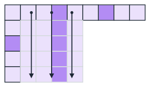<figcaption>0 vertical: von oben</figcaption></figure>
<figure>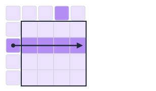<figcaption>1 horizontal: von links</figcaption></figure>
<figure>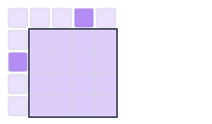<figcaption>2 dc: der Mittelwert der Nachbarn</figcaption></figure>
<figure>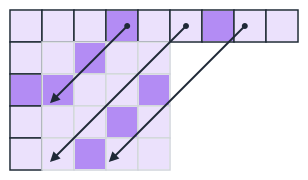<figcaption>3 diagonal down left: schräg von rechts oben, mit den vier Pixeln rechts über dem Block (gestrichelt)</figcaption></figure>
<figure>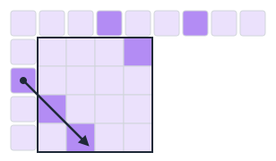<figcaption>4 diagonal down right: schräg von links oben</figcaption></figure>
<figure>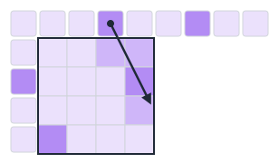<figcaption>5 vertical right: steil von links oben</figcaption></figure>
<figure>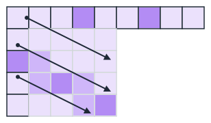<figcaption>6 horizontal down: flach von links oben</figcaption></figure>
<figure>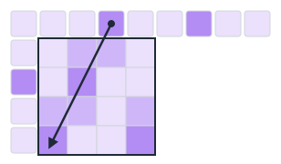<figcaption>7 vertical left: steil von rechts oben, mit den vier Pixeln rechts über dem Block (gestrichelt)</figcaption></figure>
<figure>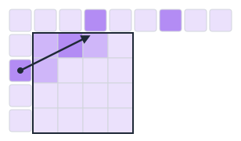<figcaption>8 horizontal up: von links, nach oben</figcaption></figure>
</div>

Erweitere `blocks.py` um die Vorhersage:

<!-- page-code: own -->
```python
MODES = ['vertical', 'horizontal', 'dc']


def predict(above, left, mode):
    # hier: ein Block aus n × n Pixeln, vorhergesagt aus above und left


def best_mode(block, above, left):
    # hier: die Art der Vorhersage mit dem kleinsten Rest


def residual(plane, n):
    height, width = plane.shape
    rest = np.zeros_like(plane)
    for y in range(0, height, n):
        for x in range(0, width, n):
            block = plane[y:y + n, x:x + n]
            above = plane[y - 1, x:x + n] if y > 0 else np.full(n, 128.0)
            left = plane[y:y + n, x - 1] if x > 0 else np.full(n, 128.0)
            rest[y:y + n, x:x + n] = block - predict(above, left, best_mode(block, above, left))
    return rest
```

`residual` geht die Blöcke durch. `above` ist die Zeile über dem Block, `left` die Spalte links davon; am oberen und linken Rand gibt es keine Nachbarn, dort nimmt es ein mittleres Grau. Ein echter Encoder sagt aus den Pixeln voraus, die der Decoder schon hat, also aus den gerundeten. Hier nehmen wir die Originale: Das ist einfacher und macht die Vorhersage etwas zu gut.

<div class='hint own' data-check='predict'>
<strong>Jetzt bist du dran:</strong> Schreib <code>predict(above, left, mode)</code>. <code>above</code> und <code>left</code> sind Arrays mit je <code>n</code> Werten. Das Ergebnis ist ein Block aus <code>n</code> × <code>n</code> Pixeln wie in der Zeichnung: bei <code>'vertical'</code> in jeder Zeile <code>above</code>, bei <code>'horizontal'</code> in jeder Spalte <code>left</code>, bei <code>'dc'</code> überall der Mittelwert aller <code>2 * n</code> Nachbarn.
</div>

<!-- hint -->
`np.tile(a, (n, 1))` legt ein Array `n`-mal untereinander. Für `'horizontal'` muss `left` eine Spalte werden: `left[:, None]` hat die Form `(n, 1)`.
<!-- /hint -->
<!-- hint -->
`np.full((n, n), value)` ist ein Block, in dem überall `value` steht.

```python
n = len(above)
if mode == 'vertical':
    return np.tile(above, (n, 1))
```
<!-- /hint -->

<!-- solution -->
```python
def predict(above, left, mode):
    n = len(above)
    if mode == 'vertical':
        return np.tile(above, (n, 1))
    if mode == 'horizontal':
        return np.tile(left[:, None], (1, n))
    return np.full((n, n), (above.sum() + left.sum()) / (2 * n))
```
<!-- /solution -->

_task(predict)

<div class='hint own' data-check='best-mode'>
<strong>Jetzt bist du dran:</strong> Schreib <code>best_mode(block, above, left)</code>: Es probiert jede Art aus <code>MODES</code> und gibt die zurück, bei der die Summe der Beträge von <code>block - predict(above, left, mode)</code> am kleinsten ist.
</div>

<!-- hint -->
`np.abs(a).sum()` ist die Summe der Beträge. Merk dir in einer Schleife über `MODES` die beste Art und ihren Fehler.
<!-- /hint -->
<!-- hint -->
```python
best, best_error = None, None
for mode in MODES:
    error = np.abs(block - predict(above, left, mode)).sum()
```
<!-- /hint -->

<!-- solution -->
```python
def best_mode(block, above, left):
    best, best_error = None, None
    for mode in MODES:
        error = np.abs(block - predict(above, left, mode)).sum()
        if best is None or error < best_error:
            best, best_error = mode, error
    return best
```
<!-- /solution -->

_task(best-mode)

Und unten im Hauptprogramm:

```python
    rest = residual(luma, 4)
    Image.fromarray((rest + 128).round().clip(0, 255).astype(np.uint8)).save('residual.png')
    for name, plane, n in [('8 × 8 ohne Vorhersage', luma - 128, 8),
                           ('4 × 4 ohne Vorhersage', luma - 128, 4),
                           ('4 × 4 mit Vorhersage ', rest, 4)]:
        print(f'{name}: {bits(quantize(split(plane, n), 32)) / luma.size:.2f} Bits je Pixel')
```

`residual.png` zeigt den Rest für Blöcke aus 4 × 4 Pixeln, 128 ist dort ein Rest von 0. Bevor du es öffnest:

_task(residual-look)

```bash
python3 blocks.py
```

<!-- tutorial-step
write-file: video/blocks.py <- file:stufen/blocks-2.py
check-task: predict
check-task: best-mode
terminal-run: python3 blocks.py
terminal-wait-for-prompt: 60
wait-for-text: mit Vorhersage
-->

<!-- after: residual-look -->
<!-- tutorial-screenshot
image-file: video/residual.png 1
-->


Fast alles ist mittelgrau: Wo das Bild ruhig ist, sagen die Nachbarn den Block gut voraus. Was bleibt, sind Kanten und feine Muster wie die Haare. Die Zahlen:

```text
8 × 8 ohne Vorhersage: 0.29 Bits je Pixel
4 × 4 ohne Vorhersage: 0.42 Bits je Pixel
4 × 4 mit Vorhersage : 0.18 Bits je Pixel
```

Kleine Blöcke folgen den Kanten besser, aber ohne Vorhersage kosten sie mehr: Jeder Block braucht seine eigene mittlere Helligkeit. Mit Vorhersage kommt diese fast umsonst aus den Nachbarn, und die kleinen Blöcke kosten weniger als die Hälfte, sogar weniger als die großen ohne Vorhersage. Darum kann H.264 bei Kanten kleine Blöcke nehmen und bei ruhigen Flächen große.

<div class='hint try'>
<strong>Ausprobieren:</strong> Nimm in <code>residual</code> und der letzten Zeile Blöcke aus 8 × 8 Pixeln statt 4 × 4. Hilft die Vorhersage dann noch so viel? Und was ändert sich, wenn du <code>MODES</code> auf <code>['dc']</code> kürzt?
</div>
<!-- /after -->

<!-- stage: stufen/blocks-2.py as blocks.py -->

## Von Bild zu Bild

Zwei Bilder hintereinander sind sich meist sehr ähnlich, zwischen ihnen liegt nur eine vierundzwanzigstel Sekunde. Statt jedes Bild für sich zu speichern, kann ein Codec speichern, was sich geändert hat. Die Idee ist fast hundert Jahre alt: 1929 schlug R. D. Kell in Großbritannien vor, beim Fernsehen nur die Teile eines Bildes zu übertragen, die sich seit dem vorigen geändert haben.

### Unterschiede

Ein Bild aus `read_frames` besteht aus Bytes, Zahlen von 0 bis 255 (`uint8`). Was passiert, wenn man zwei davon voneinander abzieht?

_task(wrap)

<!-- after: wrap -->
Bytes können nicht negativ werden: numpy rechnet `3 - 5` modulo 256 und kommt auf 254. Aus einem kleinen Unterschied wird so ein riesiger. Vor dem Abziehen muss man die Bytes darum in größere Zahlen umwandeln, mit `astype(int)`.
<!-- /after -->

Lege `difference.py` an:

<!-- page-code: own -->
```python
import numpy as np
from PIL import Image

from video import read_frames

CLIPS = ['glance', 'pan', 'slope', 'tilt']


def luma(frames):
    return frames @ np.array([0.299, 0.587, 0.114])


def differences(frames):
    # hier: jedes Bild minus das vorige


if __name__ == '__main__':
    for name in CLIPS:
        frames = read_frames(f'{name}.mp4')[:24]
        d = differences(frames)
        print(f'{name}: im Mittel {np.abs(d).mean():.2f} Unterschied je Wert')
        grey = (luma(d[11]) + 128).round().clip(0, 255).astype(np.uint8)
        Image.fromarray(grey).save(f'{name}-diff.png')
```

`luma` rechnet nur Y aus, die Helligkeit, mit den Gewichten aus `to_ycbcr`; `@` multipliziert die letzte Achse, R, G und B, mit den drei Gewichten. Das Programm nimmt die erste Sekunde jedes Ausschnitts und speichert den Unterschied von Bild 11 zu Bild 12 als Graubild, ein Unterschied von 0 ist mittelgrau.

<div class='hint own' data-check='differences'>
<strong>Jetzt bist du dran:</strong> Schreib <code>differences(frames)</code>: ein Array mit einem Bild weniger als <code>frames</code>, in dem Bild <code>k</code> der Unterschied von Bild <code>k + 1</code> zu Bild <code>k</code> ist, als ganze Zahlen, auch negative.
</div>

<!-- hint -->
`frames[1:]` sind alle Bilder ab dem zweiten, `frames[:-1]` alle bis auf das letzte. Zieht man das eine vom anderen ab, steht an jedem Index der Unterschied zum vorigen Bild.
<!-- /hint -->
<!-- hint -->
Wandle vor dem Abziehen in ganze Zahlen um, sonst rechnet numpy modulo 256:

```python
frames[1:].astype(int)
```
<!-- /hint -->

<!-- solution -->
```python
def differences(frames):
    return frames[1:].astype(int) - frames[:-1]
```
<!-- /solution -->

_task(differences)

```bash
python3 difference.py
```

<!-- tutorial-step
write-file: video/difference.py <- file:stufen/difference-1.py
check-task: differences
terminal-run: python3 difference.py
terminal-wait-for-prompt: 120
wait-for-text: tilt: im Mittel
-->

```text
glance: im Mittel 0.46 Unterschied je Wert
pan: im Mittel 3.94 Unterschied je Wert
slope: im Mittel 5.57 Unterschied je Wert
tilt: im Mittel 12.51 Unterschied je Wert
```

<div class='gallery columns-2'>
<figure>
<!-- tutorial-screenshot
image-file: video/glance-diff.png 1
-->

<figcaption><code>glance.mp4</code>: fast nichts</figcaption></figure>
<figure>
<!-- tutorial-screenshot
image-file: video/pan-diff.png 1
-->

<figcaption><code>pan.mp4</code>: die Kanten des Bergkamms</figcaption></figure>
<figure>
<!-- tutorial-screenshot
image-file: video/slope-diff.png 1
-->

<figcaption><code>slope.mp4</code>: das Mädchen und der Hund, schwach die Felsen</figcaption></figure>
<figure>
<!-- tutorial-screenshot
image-file: video/tilt-diff.png 1
-->

<figcaption><code>tilt.mp4</code>: alles</figcaption></figure>
</div>

Im Blick des Mädchens ändert sich fast nichts. Beim Hang gehen das Mädchen und der Hund, und die Kamera bewegt sich ein wenig mit. Beim Schwenk ändert sich jede Kante, obwohl sich nichts im Bild bewegt außer der Kamera, und bei der schnellen Fahrt die Wand hinauf ändert sich alles.

### Was der Unterschied kostet

Der Unterschied ist eine Ebene wie jede andere: Man kann ihn in Blöcke teilen, mit der DCT zerlegen und runden, mit den Funktionen aus `blocks.py`. Ein Bild allein bekommt dabei die Vorhersage aus den Nachbarn wie in »Innerhalb eines Bildes«.

_task(pan-bits)

Beim Speichern von Unterschieden gibt es eine Falle. Der Decoder kennt das vorige Bild nicht, wie es war, sondern nur, wie er es selbst aus gerundeten Zahlen gebaut hat. `encode_naive` rechnet den Unterschied trotzdem zum Original:

<!-- page-code: own -->
```python
STEP = 32


def code(plane, step):
    return join(restore(quantize(split(plane, 4), step), step))


def encode_naive(planes, step):
    decoded = [code(planes[0] - 128, step) + 128]
    for k in range(1, len(planes)):
        decoded.append(decoded[-1] + code(planes[k] - planes[k - 1], step))
    return np.array(decoded)


def encode(planes, step):
    # hier: der Unterschied zum Bild, das der Decoder hat


def frame_bits(plane, step):
    return bits(quantize(split(plane, 4), step)) / plane.size
```

`code` macht, was Encoder und Decoder zusammen mit einer Ebene tun: teilen, zerlegen, runden und zurück. `decoded` ist die Liste der Bilder, die der Decoder baut, das erste aus dem ersten Bild allein, jedes weitere aus dem vorigen und dem gerundeten Unterschied. `frame_bits` gibt die Bits je Pixel. Oben kommt dazu:

```python
from blocks import split, join, quantize, restore, bits, residual
```

_task(drift)

<div class='hint own' data-check='encode'>
<strong>Jetzt bist du dran:</strong> Schreib <code>encode(planes, step)</code> wie <code>encode_naive</code>, aber so, dass sich der Fehler nicht aufsummiert: Der Unterschied wird zu dem Bild gerechnet, das der Decoder zuletzt gebaut hat, nicht zum Original. Das Ergebnis ist ein Array aller gebauten Bilder.
</div>

<!-- hint -->
Das zuletzt gebaute Bild ist `decoded[-1]`. Der Unterschied des nächsten Bildes zu ihm ist `plane - decoded[-1]`.
<!-- /hint -->
<!-- hint -->
```python
for plane in planes[1:]:
    decoded.append(decoded[-1] + code(plane - decoded[-1], step))
```
<!-- /hint -->

<!-- solution -->
```python
def encode(planes, step):
    decoded = [code(planes[0] - 128, step) + 128]
    for plane in planes[1:]:
        decoded.append(decoded[-1] + code(plane - decoded[-1], step))
    return np.array(decoded)
```
<!-- /solution -->

_task(encode)

Und unten im Hauptprogramm:

```python
    for name in CLIPS:
        planes = luma(read_frames(f'{name}.mp4')[:24])
        alone = frame_bits(residual(planes[12], 4), STEP)
        change = frame_bits(planes[12] - planes[11], STEP)
        print(f'{name}: Bild allein {alone:.2f}, Unterschied {change:.2f} Bits je Pixel')

    planes = luma(read_frames('pan.mp4')[:24])
    for coder in (encode_naive, encode):
        decoded = coder(planes, STEP)
        errors = np.abs(decoded - planes).mean(axis=(1, 2))
        print(coder.__name__, ' '.join(f'{e:.1f}' for e in errors[::4]))
```

Die letzte Schleife gibt für beide Arten den mittleren Fehler der Bilder 0, 4, 8, … aus.

```bash
python3 difference.py
```

<!-- tutorial-step
write-file: video/difference.py <- file:stufen/difference-2.py
check-task: encode
terminal-run: python3 difference.py
terminal-wait-for-prompt: 180
wait-for-text: encode 3.3
-->

<!-- after: drift -->
```text
glance: Bild allein 0.18, Unterschied 0.00 Bits je Pixel
pan: Bild allein 0.32, Unterschied 0.33 Bits je Pixel
slope: Bild allein 0.62, Unterschied 0.55 Bits je Pixel
tilt: Bild allein 0.74, Unterschied 0.98 Bits je Pixel
encode_naive 3.3 5.8 8.0 9.8 11.6 13.2
encode 3.3 3.4 3.4 3.4 3.4 3.5
```

Beim Blick kostet der Unterschied fast nichts: Bei Schritt 32 wird er überall 0. Beim Hang spart er ein wenig. Beim Schwenk kostet er so viel wie das Bild allein, und bei der Fahrt die Wand hinauf sogar mehr. Ein Schwenk verschiebt das ganze Bild; abziehen hilft dann nicht, denn an jeder Kante steht nun etwas anderes.

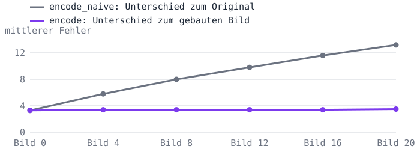
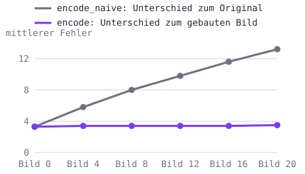

`encode_naive` verliert in einer Sekunde den Anschluss: Jeder gerundete Unterschied hat einen kleinen Fehler, und der Decoder zählt alle zusammen. Der Fehler wächst von 3,3 auf 13,2 und wüchse weiter, bis zum nächsten Bild, das allein gespeichert ist. `encode` rechnet den Unterschied zum Bild, das der Decoder wirklich hat; was einmal falsch gerundet wurde, steckt im nächsten Unterschied und wird dort ausgeglichen. Darum enthält jeder Encoder einen Decoder. Auch was zu klein war und zu 0 gerundet wurde, geht nicht verloren: Der Unterschied wächst von Bild zu Bild, bis er groß genug ist, und kommt dann an.

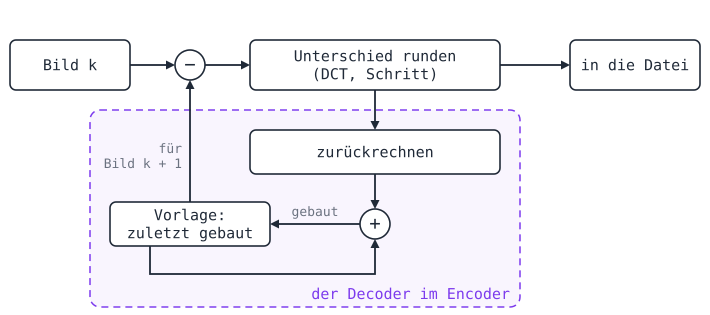
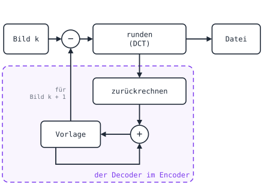
<!-- /after -->

<div class='hint try'>
<strong>Ausprobieren:</strong> Rechne die Unterschiede nicht zum vorigen Bild, sondern zum ersten: <code>planes[12] - planes[0]</code>. Bei welchem Ausschnitt wird das teurer, bei welchem kaum?
</div>

<!-- stage: stufen/difference-2.py as difference.py -->

## Bewegung schätzen

Beim Schwenk kostet der Unterschied so viel wie das Bild allein, weil alles ein Stück verschoben ist. Ein Codec sucht darum zu jedem Block des neuen Bildes die Stelle im vorigen Bild, an der derselbe Inhalt war, und zieht erst dann ab. Die Verschiebung heißt **Bewegungsvektor**, das Verfahren **Bewegungskompensation**. Vorgeschlagen haben es Forscher des japanischen Rundfunks NHK 1959, Y. Taki, M. Hatori und S. Tanaka; seit H.261 von 1988 steckt es in jedem Codec für Video.

### Den Block wiederfinden

Für einen Block probiert der Encoder Verschiebungen aus. Für jede rechnet er die **Summe der Unterschiede** aus, auf Englisch **SAD** (Sum of Absolute Differences): Er legt den Block über das Stück des vorigen Bildes, zieht Pixel für Pixel ab und zählt die Beträge zusammen. Die Verschiebung mit der kleinsten Summe gewinnt. Probier es hier mit zwei Bildern vom Hang, direkt hintereinander, aus dem Film in voller Auflösung:

<script src='/include/motion_widget.js'></script>
<div class='motion-widget' data-block='208 80' data-presets='Hintergrund: 400 64 | Kopf: 208 80 | Stab: 112 32 | Hund: 400 288 | Bein: 192 272'>
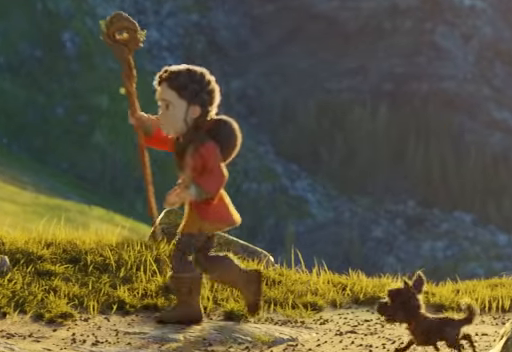
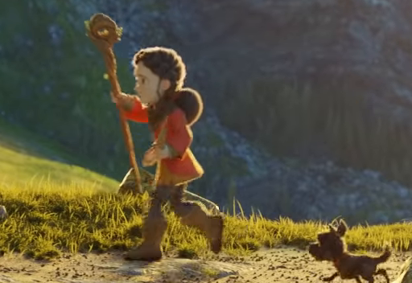
</div>

Zieh das Quadrat dorthin, wo du den Block im Bild davor vermutest. Im vergrößerten Unterschied ist orange, wo der Block heller ist, und blau, wo er dunkler ist; liegen ein oranger und ein blauer Streifen nebeneinander, ist das Quadrat an dieser Kante etwas verschoben. Achte auf die Summe: Je kleiner, desto besser passt es. Dann lass die Suche alle Verschiebungen ausprobieren und vergleich ihre Summe mit deiner. Hast du das Widget einmal angefasst, schieben auch die Pfeiltasten das Quadrat, mit Shift den Block.

Die Knöpfe über den Bildern setzen den Block an Stellen, die sich verschieden bewegen. Der Hintergrund wandert höchstens um ein Pixel, weil die Kamera langsam mitschwenkt. Der Kopf des Mädchens kommt um 10 Pixel von rechts und 6 von oben: Sie geht nach links und wippt dabei auf und ab. Ihr Stab schwingt anders als ihr Körper, der Hund läuft für sich. Für das Bein findet die Suche keine Stelle, die gut passt: Es ändert beim Gehen seine Form, und keine Verschiebung macht daraus denselben Block.

Lege `motion.py` an. Es nimmt `luma` aus `difference.py` und die Funktionen aus `blocks.py`:

<!-- page-code: own -->
```python
import numpy as np
from PIL import Image, ImageDraw

from blocks import split, join, quantize, restore, bits, residual
from difference import luma
from video import read_frames

N = 16
RADIUS = 4


def best_vector(current, reference, y, x, n, radius):
    # hier: die Verschiebung (dx, dy) mit der kleinsten Summe der Unterschiede


def motion_field(current, reference, n, radius):
    height, width = current.shape
    vectors = np.zeros((height // n, width // n, 2), dtype=int)
    for r in range(height // n):
        for c in range(width // n):
            vectors[r, c] = best_vector(current, reference, r * n, c * n, n, radius)
    return vectors


def draw_vectors(plane, vectors, n, path):
    picture = Image.fromarray(plane.round().clip(0, 255).astype(np.uint8)).convert('RGB')
    draw = ImageDraw.Draw(picture)
    for r, c in np.ndindex(vectors.shape[:2]):
        dx, dy = vectors[r, c]
        cy, cx = r * n + n // 2, c * n + n // 2
        draw.line([(cx, cy), (cx + 4 * dx, cy + 4 * dy)], fill=(255, 210, 0), width=2)
        draw.ellipse([cx - 1, cy - 1, cx + 1, cy + 1], fill=(255, 210, 0))
    picture.save(path)


if __name__ == '__main__':
    for name in ['pan', 'tilt']:
        planes = luma(read_frames(f'{name}.mp4')[:24])
        vectors = motion_field(planes[12], planes[11], N, RADIUS)
        draw_vectors(planes[12], vectors, N, f'{name}-vectors.png')
        values, counts = np.unique(vectors.reshape(-1, 2), axis=0, return_counts=True)
        print(f'{name}: am häufigsten {tuple(int(v) for v in values[counts.argmax()])}')
```

`motion_field` sucht für jeden Block aus 16 × 16 Pixeln den Vektor, `vectors[r, c]` ist der des Blocks in Reihe `r` und Spalte `c`. `draw_vectors` malt in jeden Block einen gelben Strich von seiner Mitte aus, viermal so lang wie der Vektor. `np.unique` zählt, welche Vektoren wie oft vorkommen.

<div class='hint own' data-check='best-vector'>
<strong>Jetzt bist du dran:</strong> Schreib <code>best_vector(current, reference, y, x, n, radius)</code>. Der Block ist <code>current[y:y + n, x:x + n]</code>. Probier jede Verschiebung <code>dx</code> und <code>dy</code> von <code>-radius</code> bis <code>radius</code>: Das Stück von <code>reference</code> beginnt bei <code>y + dy</code> und <code>x + dx</code>. Gib die Verschiebung mit der kleinsten Summe der Unterschiede als <code>(dx, dy)</code> zurück, erst die Spalten, dann die Zeilen, wie bei x und y. Stücke, die über den Rand von <code>reference</code> hinausgehen, lässt du aus.
</div>

<!-- hint -->
Zwei Schleifen ineinander, über `range(-radius, radius + 1)`. Die Summe der Unterschiede ist `np.abs(block - reference[top:top + n, left:left + n]).sum()`, mit `top = y + dy` und `left = x + dx`. Merk dir die beste Verschiebung und ihre Summe, wie in `best_mode`.
<!-- /hint -->
<!-- hint -->
Ein Stück liegt im Bild, wenn `top` und `left` nicht negativ sind und `top + n` und `left + n` nicht größer als Höhe und Breite. Sonst überspring es mit `continue`; ein negativer Index würde in numpy von hinten zählen.

```python
height, width = reference.shape
if top < 0 or left < 0 or top + n > height or left + n > width:
    continue
```
<!-- /hint -->

<!-- solution -->
```python
def best_vector(current, reference, y, x, n, radius):
    block = current[y:y + n, x:x + n]
    height, width = reference.shape
    best, best_sad = (0, 0), None
    for dy in range(-radius, radius + 1):
        for dx in range(-radius, radius + 1):
            top, left = y + dy, x + dx
            if top < 0 or left < 0 or top + n > height or left + n > width:
                continue
            sad = np.abs(block - reference[top:top + n, left:left + n]).sum()
            if best_sad is None or sad < best_sad:
                best, best_sad = (dx, dy), sad
    return best
```
<!-- /solution -->

_task(best-vector)

Das Programm malt die Vektoren für Bild 12 des Schwenks und der Fahrt die Wand hinauf. Ein Vektor zeigt vom Block dorthin, wo sein Inhalt im vorigen Bild war.

_task(arrows)

```bash
python3 motion.py
```

<!-- tutorial-step
write-file: video/motion.py <- file:stufen/motion-1.py
check-task: best-vector
terminal-run: python3 motion.py
terminal-wait-for-prompt: 120
wait-for-text: tilt: am häufigsten
-->

<!-- after: arrows -->
```text
pan: am häufigsten (-2, 0)
tilt: am häufigsten (0, -1)
```

<!-- tutorial-screenshot
image-file: video/tilt-vectors.png 1
-->
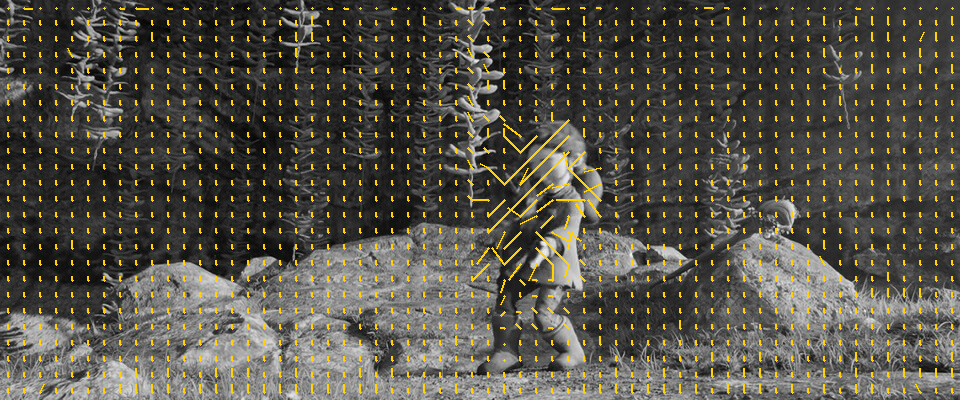

Die Kamera fährt nach oben, also wandert das Bild nach unten: Was jetzt an einer Stelle ist, war im vorigen Bild weiter oben, und der Vektor zeigt nach oben. Beim Schwenk ist es ein Pixel oder zwei nach links. Wo sich das Mädchen bewegt und ihre Form ändert, findet jeder Block irgendeine Stelle, und die Pfeile zeigen kreuz und quer; dort bleibt später mehr Rest übrig.
<!-- /after -->

### Wie H.264 sucht

ffmpeg kann die Vektoren zeigen, die der Encoder von H.264 für `tilt.mp4` gefunden hat:

```bash
ffmpeg -flags2 +export_mvs -i tilt.mp4 -vf 'select=eq(n\,13),codecview=mv=pf' -frames:v 1 tilt-h264.png
```

<!-- tutorial-step
terminal-run: ffmpeg -v error -y -flags2 +export_mvs -i tilt.mp4 -vf 'select=eq(n\,13),codecview=mv=pf' -frames:v 1 tilt-h264.png && ls tilt-h264.png
terminal-wait-for-prompt: 60
wait-for-text: tilt-h264.png
-->

`-flags2 +export_mvs` lässt den Decoder die Vektoren mitliefern, `select` nimmt Bild 13, und `codecview` malt die Vektoren in das Bild.

<!-- tutorial-screenshot
image-file: video/tilt-h264.png 1
-->
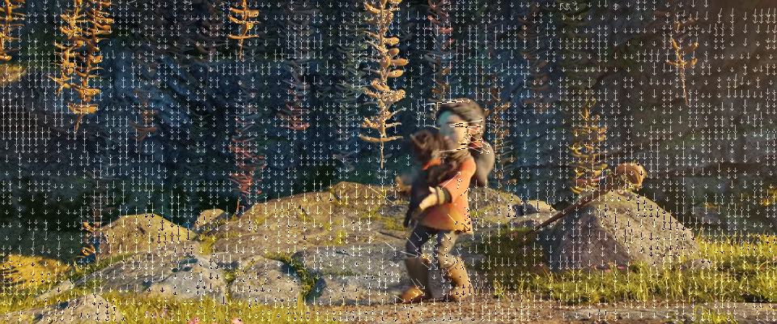

Die Pfeile zeigen nach unten: ffmpeg malt sie vom Ort im vorigen Bild zum Block, also so, wie sich der Inhalt bewegt, andersherum als `draw_vectors`. Der Encoder von H.264 macht mehr als `motion_field`. Er teilt einen Block von 16 × 16 Pixeln in kleinere, wo das hilft (mehr dazu in »Große und kleine Blöcke«), und er sucht nicht nur ganze Pixel, sondern Viertel davon: Der Schwenk bewegt sich etwa anderthalb Pixel je Bild, nicht eines oder zwei. Und er probiert nicht alle Verschiebungen aus, sondern geht vom Vektor der Nachbarn aus und sucht in kleinen Schritten weiter, wo die Summe kleiner wird.

Ein Viertelpixel gibt es im Bild nicht; der Decoder rechnet es aus den Pixeln daneben aus. Um einen Viertelpixel verschoben, ist jeder neue Wert drei Viertel des Pixels, über dem er liegt, und ein Viertel des nächsten:

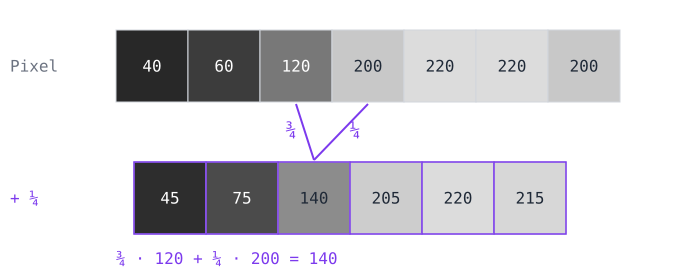
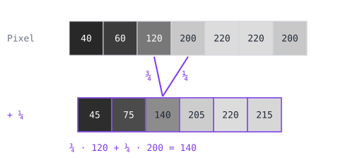

H.264 rechnet etwas genauer: Halbe Pixel macht es aus sechs Nachbarn, Viertel dann aus zwei. Die Idee ist dieselbe, und so kann ein Vektor auch 1,25 oder 1,5 Pixel weit zeigen.

### Was übrig bleibt

Mit den Vektoren baut der Decoder aus dem vorigen Bild eine Vorhersage: Jeder Block wird aus dem vorigen Bild kopiert, um seinen Vektor verschoben. Dazu kommt der gerundete Rest. Erweitere `motion.py`:

<!-- page-code: own -->
```python
def compensate(reference, vectors, n):
    # hier: jeder Block aus reference, um seinen Vektor verschoben


def vector_bits(vectors):
    total = 0
    for k in range(2):
        _, counts = np.unique(vectors[..., k], return_counts=True)
        p = counts / counts.sum()
        total += -(p * np.log2(p)).sum() * counts.sum()
    return total


def save_grey(path, plane):
    Image.fromarray(plane.round().clip(0, 255).astype(np.uint8)).save(path)
```

`vector_bits` schätzt die Bits der Vektoren wie `bits`, mit einer Tabelle für `dy` und einer für `dx`.

<div class='hint own' data-check='compensate'>
<strong>Jetzt bist du dran:</strong> Schreib <code>compensate(reference, vectors, n)</code>: eine Ebene so groß wie <code>reference</code>, in der jeder Block aus <code>n</code> × <code>n</code> Pixeln an Reihe <code>r</code> und Spalte <code>c</code> das Stück von <code>reference</code> ist, das um <code>vectors[r, c]</code> verschoben liegt.
</div>

<!-- hint -->
`np.ndindex(vectors.shape[:2])` geht alle Paare `r, c` durch, wie in `draw_vectors`. Der Block beginnt bei `y = r * n` und `x = c * n`, das Stück in `reference` bei `y + dy` und `x + dx`.
<!-- /hint -->
<!-- hint -->
```python
predicted = np.zeros_like(reference)
for r, c in np.ndindex(vectors.shape[:2]):
    dx, dy = vectors[r, c]
```
<!-- /hint -->

<!-- solution -->
```python
def compensate(reference, vectors, n):
    predicted = np.zeros_like(reference)
    for r, c in np.ndindex(vectors.shape[:2]):
        dx, dy = vectors[r, c]
        y, x = r * n, c * n
        predicted[y:y + n, x:x + n] = reference[y + dy:y + dy + n, x + dx:x + dx + n]
    return predicted
```
<!-- /solution -->

_task(compensate)

Unten im Hauptprogramm kommt dazu, für Bild 12 vom Hang:

```python
    planes = luma(read_frames('slope.mp4')[:24])
    previous, current = planes[11], planes[12]
    vectors = motion_field(current, previous, N, RADIUS)
    predicted = compensate(previous, vectors, N)
    rest = current - predicted
    levels = quantize(split(rest, 4), 32)
    decoded = predicted + join(restore(levels, 32))
    save_grey('mc-previous.png', previous)
    save_grey('mc-predicted.png', predicted)
    save_grey('mc-rest.png', rest + 128)
    save_grey('mc-decoded.png', decoded)
    alone = bits(quantize(split(residual(current, 4), 4), 32))
    change = bits(quantize(split(current - previous, 4), 32))
    moved = bits(levels) + vector_bits(vectors)
    print(f'Bild allein:      {alone / 8:7.0f} Bytes')
    print(f'Unterschied:      {change / 8:7.0f} Bytes')
    print(f'mit Bewegung:     {moved / 8:7.0f} Bytes, davon Vektoren {vector_bits(vectors) / 8:.0f}')
```

Alles hier ist unsere eigene Suche und unsere Schätzung der Bits, nicht die Datei von H.264. Die Vorhersage kommt aus dem Original von Bild 11; ein echter Encoder nimmt das Bild, das der Decoder gebaut hat, wie `encode` in »Von Bild zu Bild«. Der Rest wird in Blöcken aus 4 × 4 Pixeln gerundet, mit Schritt 32 wie zuvor.

_task(mc-bytes)

```bash
python3 motion.py
```

<!-- tutorial-step
write-file: video/motion.py <- file:stufen/motion-2.py
check-task: compensate
terminal-run: python3 motion.py
terminal-wait-for-prompt: 120
wait-for-text: mit Bewegung
-->

<!-- after: mc-bytes -->
```text
Bild allein:        29694 Bytes
Unterschied:        26294 Bytes
mit Bewegung:        6127 Bytes, davon Vektoren 239
```

<div class='gallery columns-2'>
<figure>
<!-- tutorial-screenshot
image-file: video/mc-previous.png 1
-->
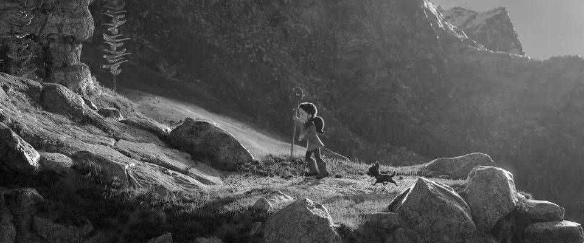
<figcaption>Bild 11, das Bild davor</figcaption></figure>
<figure>
<!-- tutorial-screenshot
image-file: video/mc-predicted.png 1
-->
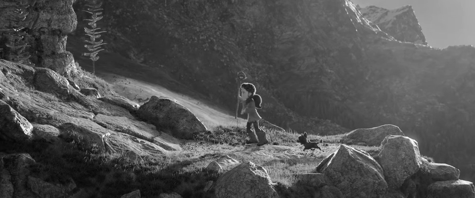
<figcaption>Bild 11, jeder Block um seinen Vektor verschoben</figcaption></figure>
<figure>
<!-- tutorial-screenshot
image-file: video/mc-rest.png 1
-->
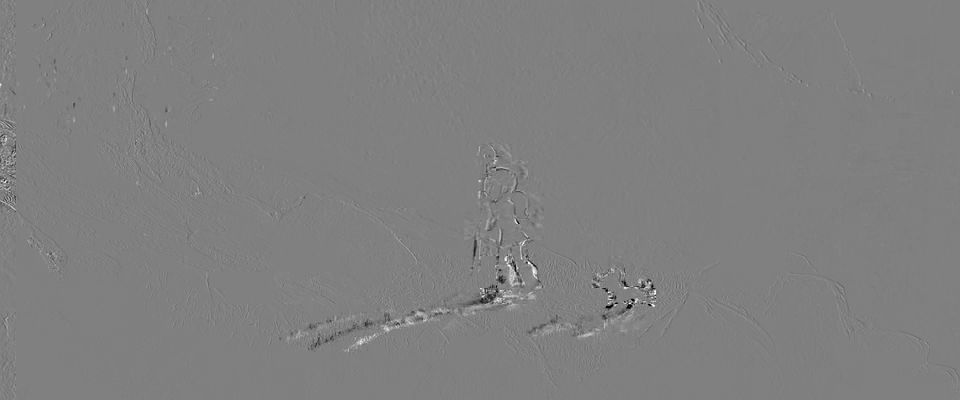
<figcaption>was übrig bleibt: Bild 12 minus die Vorhersage</figcaption></figure>
<figure>
<!-- tutorial-screenshot
image-file: video/mc-decoded.png 1
-->
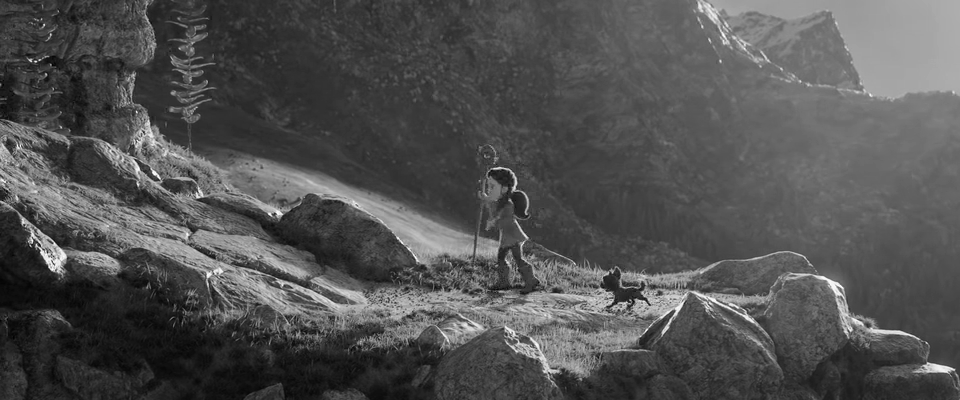
<figcaption>Bild 12, wie der Decoder es baut</figcaption></figure>
</div>

Die Vorhersage sieht schon aus wie Bild 12. Übrig bleibt, was sich nicht nur verschoben hat: die Beine des Mädchens, die sich anders bewegen als ihr Körper, und der Hund. Das Bild, das der Decoder daraus baut, kostet etwa 6.100 Bytes statt fast 30.000 für das Bild allein, ein Fünftel; die 1.500 Vektoren davon nur 239 Bytes, weil fast alle gleich sind.
<!-- /after -->

<div class='hint try'>
<strong>Ausprobieren:</strong> Setz <code>RADIUS</code> auf 1 und auf 8. Wie ändern sich die Bytes und wie lange braucht das Programm? Achte bei <code>tilt.mp4</code> darauf, welche Blöcke mit kleinem Radius keine gute Stelle mehr finden.
</div>

<!-- stage: stufen/motion-2.py as motion.py -->

### Große und kleine Blöcke

Bisher hat jeder Block 16 × 16 Pixel und einen Vektor. Liegt ein Block halb auf dem Mädchen und halb auf dem Hang hinter ihr, passt sein Vektor nur zu einer der beiden Hälften, und die andere bleibt als Rest übrig. Kleinere Blöcke folgen der Bewegung genauer, aber jeder braucht seinen eigenen Vektor.

_task(block-size)

<div class='hint try'>
<strong>Ausprobieren:</strong> Setz in <code>motion.py</code> <code>N</code> auf 8 und lass das Programm laufen, dann auf 4; mit 4 dauert es eine Weile. Achte in der letzten Zeile auf die Bytes und darauf, wie viele davon die Vektoren brauchen. Setz <code>N</code> danach wieder auf 16.
</div>

<!-- after: block-size -->
Für Bild 12 vom Hang kommt Folgendes heraus:

<table class='table'>
<tr><th>Blöcke</th><th>Rest</th><th>Vektoren</th><th>zusammen</th></tr>
<tr><td>16 × 16</td><td>5.888 Bytes</td><td>239 Bytes</td><td>6.127 Bytes</td></tr>
<tr><td>8 × 8</td><td>5.221 Bytes</td><td>1.182 Bytes</td><td>6.404 Bytes</td></tr>
<tr><td>4 × 4</td><td>4.333 Bytes</td><td>6.330 Bytes</td><td>10.663 Bytes</td></tr>
</table>

Der Rest wird mit kleineren Blöcken kleiner, aber die Vektoren werden schneller teurer: Bei 8 × 8 gibt es viermal so viele, bei 4 × 4 sechzehnmal so viele, und dort stecken mehr Bytes in den Vektoren als im Rest. Eine einzige Größe für das ganze Bild ist darum nie die beste. Kleine Blöcke lohnen sich nur dort, wo sich in einem großen Block Verschiedenes verschieden bewegt; überall sonst ist ein großer Block mit einem Vektor billiger.

Ein Encoder entscheidet deshalb für jeden Makroblock aus 16 × 16 Pixeln einzeln, ob er ganz bleibt oder geteilt wird. Mit unserer Suche kann man das so machen: einen Makroblock nur dann in vier Blöcke aus 8 × 8 Pixeln teilen, wenn die vier mit ihren eigenen Vektoren die Summe der Unterschiede um mehr als 400 senken. Dann werden 54 der 1.500 Makroblöcke von Bild 12 geteilt, und das Bild braucht 5.753 Bytes statt 6.127, obwohl jeder Makroblock jetzt ein Bit mehr kostet, das sagt, ob er geteilt ist. Beim Schwenk lohnt es sich nicht: Dort bewegt sich alles gleich, und das eine Bit je Makroblock kostet mehr, als das Teilen spart.

x264 geht genauer vor. Für jede Art, einen Makroblock zu teilen, rechnet er aus, wie viele Bits Vektoren und Rest kosten und wie groß der Fehler bleibt, und nimmt die, bei der beides zusammen am kleinsten ist. Wie viel ein Bit dabei gegen den Fehler zählt, hängt von der Qualität ab. Erlaubt sind in H.264 Teile von 16 × 8, 8 × 16 und 8 × 8 Pixeln und darin noch kleinere bis 4 × 4; x264 nimmt für die Bewegung von sich aus höchstens 8 × 8. So hat er Bild 12 vom Hang mit `-crf 30` geteilt, hier der Ausschnitt um das Mädchen und den Hund, viermal vergrößert:

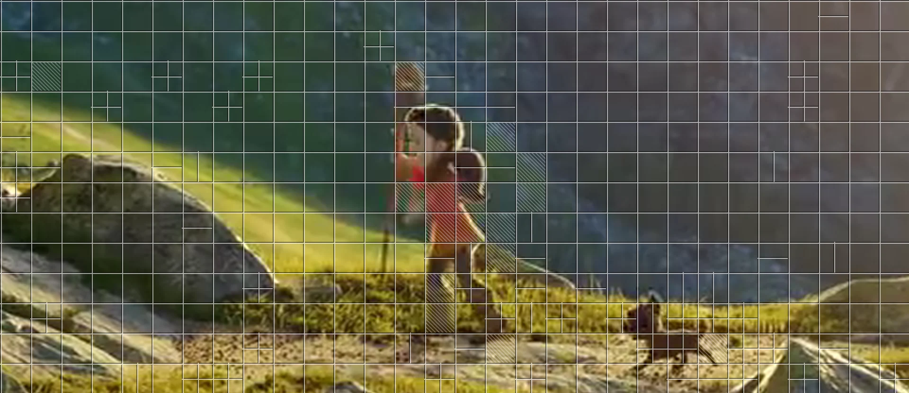

Im ganzen Bild bleiben 1.266 der 1.500 Makroblöcke ganz, 194 sind geteilt. Sie liegen am Mädchen, das sich anders bewegt als der Hang hinter ihr, an den Rändern der Felsen und im Gras: Wo ein Bild viele Einzelheiten hat, kostet jeder kleine Fehler der Vorhersage viele Bits, und ein eigener Vektor für ein kleineres Stück lohnt sich eher. Die 40 schraffierten hat x264 im Bild selbst vorhergesagt wie in einem I-Frame, weil das billiger war als jeder Vektor. Mit `-crf 18`, der Qualität der Ausschnitte, teilt x264 fast überall: Bits sind dann billig, und schon ein wenig weniger Rest ist die Vektoren wert.

## I-, P- und B-Frames

Ein Video besteht also aus drei Arten von Bildern. Ein **I-Frame** (intra) steht für sich allein, wie in »Innerhalb eines Bildes«. Ein **P-Frame** (predicted) wird aus einem früheren Bild vorhergesagt, mit Bewegungsvektoren und Rest wie in »Bewegung schätzen«. Ein **B-Frame** (bidirectional) darf aus einem früheren und einem späteren Bild vorhersagen und für jeden Block das bessere nehmen oder beide mitteln. H.261 kannte nur die ersten beiden, B-Frames kamen 1993 mit MPEG-1.

Jeder Pfeil führt von einem Bild zu einem, aus dem es vorhergesagt wird; über der Reihe zeigt er auf ein früheres Bild, unter ihr auf ein späteres:

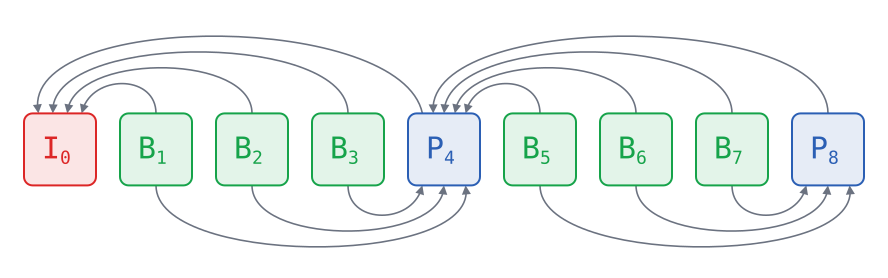
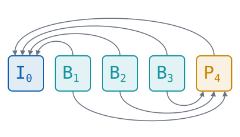

Das I-Frame braucht kein anderes Bild, ein P-Frame eines, ein B-Frame zwei. Danach wiederholt sich die Gruppe: P4 ist für B5 bis P8, was I0 für B1 bis P4 war.

### Wie groß ist jedes Bild?

ffprobe, das mit ffmpeg kommt, zeigt für jedes Bild einer Datei seine Art und wie viele Bytes es braucht. Mit `-of json` gibt es das so aus, dass Python es mit dem Modul `json` lesen kann. Lege `gop.py` an:

<!-- page-code: own -->
```python
import json
import subprocess

from PIL import Image, ImageDraw, ImageFont

CLIPS = ['glance', 'pan', 'slope', 'tilt']
COLOURS = {'I': (13, 96, 174), 'P': (201, 133, 0), 'B': (18, 149, 159)}


def frame_sizes(path):
    # hier: für jedes Bild (Art, Bytes), in der Reihenfolge, in der es gezeigt wird


def draw_bars(frames, path, width=960, height=320):
    picture = Image.new('RGB', (width, height), 'white')
    draw = ImageDraw.Draw(picture)
    font = ImageFont.load_default(size=18)
    largest = max(size for _, size in frames)
    step = width / len(frames)
    for k, (kind, size) in enumerate(frames):
        top = height - 10 - (height - 50) * size / largest
        draw.rectangle([k * step + 1, top, (k + 1) * step - 2, height - 10], fill=COLOURS[kind])
    draw.text((8, 8), f'{largest // 1000} KB', fill='black', font=font)
    for n, kind in enumerate('IPB'):
        x = width - 150 + 50 * n
        draw.rectangle([x, 12, x + 14, 26], fill=COLOURS[kind])
        draw.text((x + 20, 8), kind, fill='black', font=font)
    picture.save(path)


if __name__ == '__main__':
    for name in CLIPS:
        frames = frame_sizes(f'{name}.mp4')
        kinds = ''.join(kind for kind, _ in frames)
        print(name, kinds[:25])
        for kind in 'IPB':
            sizes = [size for k, size in frames if k == kind]
            if sizes:
                print(f'   {kind}: {len(sizes):2} Bilder, im Mittel {sum(sizes) // len(sizes):6} Bytes')
        draw_bars(frames, f'{name}-bars.png')
```

`draw_bars` malt für jedes Bild einen Balken, so hoch wie seine Bytes, blau für I, bernsteinfarben für P, türkis für B. Probier ffprobe zuerst im Terminal:

```bash
ffprobe -v error -select_streams v -show_entries frame=pict_type,pkt_size -of json glance.mp4 | head -20
```

`-select_streams v` nimmt nur das Video, `-show_entries frame=pict_type,pkt_size` von jedem Bild nur seine Art und seine Größe in Bytes.

<div class='hint own' data-check='frame-sizes'>
<strong>Jetzt bist du dran:</strong> Schreib <code>frame_sizes(path)</code>: Es ruft ffprobe wie oben für die Datei <code>path</code> auf und gibt eine Liste zurück, für jedes Bild ein Paar <code>(Art, Bytes)</code>, etwa <code>('I', 93849)</code>, die Bytes als ganze Zahl.
</div>

<!-- hint -->
`subprocess.run(command, capture_output=True, text=True, check=True).stdout` gibt die Ausgabe als Text, wie in `video.py`. `json.loads(text)` macht daraus ein Dictionary; unter `'frames'` steht eine Liste, in der jedes Bild ein Dictionary mit `'pict_type'` und `'pkt_size'` ist.
<!-- /hint -->
<!-- hint -->
`pkt_size` steht dort als Text, `int(...)` macht eine Zahl daraus.

```python
command = ['ffprobe', '-v', 'error', '-select_streams', 'v', '-show_entries', 'frame=pict_type,pkt_size',
           '-of', 'json', path]
data = json.loads(subprocess.run(command, capture_output=True, text=True, check=True).stdout)
```
<!-- /hint -->

<!-- solution -->
```python
def frame_sizes(path):
    command = ['ffprobe', '-v', 'error', '-select_streams', 'v', '-show_entries', 'frame=pict_type,pkt_size',
               '-of', 'json', path]
    data = json.loads(subprocess.run(command, capture_output=True, text=True, check=True).stdout)
    return [(frame['pict_type'], int(frame['pkt_size'])) for frame in data['frames']]
```
<!-- /solution -->

_task(frame-sizes)

_task(biggest)

```bash
python3 gop.py
```

<!-- tutorial-step
write-file: video/gop.py <- file:stufen/gop-1.py
check-task: frame-sizes
terminal-run: python3 gop.py
terminal-wait-for-prompt: 60
wait-for-text: tilt IBBB
-->

<!-- after: biggest -->
```text
glance IBBBPBBBPBBBPBBBPBBBPBBBP
   I:  1 Bilder, im Mittel  93849 Bytes
   P: 36 Bilder, im Mittel  11737 Bytes
   B: 59 Bilder, im Mittel    610 Bytes
pan IBBBPBBBPBBBPBBBPBBBPBBBP
   I:  1 Bilder, im Mittel  80126 Bytes
   P: 24 Bilder, im Mittel  36331 Bytes
   B: 71 Bilder, im Mittel   4266 Bytes
slope IBBBPBBBPBBBPBBBPBBBPBBBP
   I:  1 Bilder, im Mittel 141237 Bytes
   P: 24 Bilder, im Mittel  50849 Bytes
   B: 71 Bilder, im Mittel   6308 Bytes
tilt IBBBPPBBBPBBBPBBBPBBBPBBB
   I:  1 Bilder, im Mittel 181021 Bytes
   P: 25 Bilder, im Mittel  58457 Bytes
   B: 70 Bilder, im Mittel   7831 Bytes
```

<div class='gallery columns-2'>
<figure>
<!-- tutorial-screenshot
image-file: video/glance-bars.png 1
-->
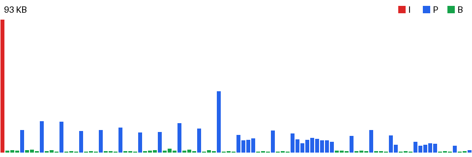
<figcaption>glance.mp4: ein großes I-Frame, dann fast nur winzige B-Frames</figcaption></figure>
<figure>
<!-- tutorial-screenshot
image-file: video/tilt-bars.png 1
-->
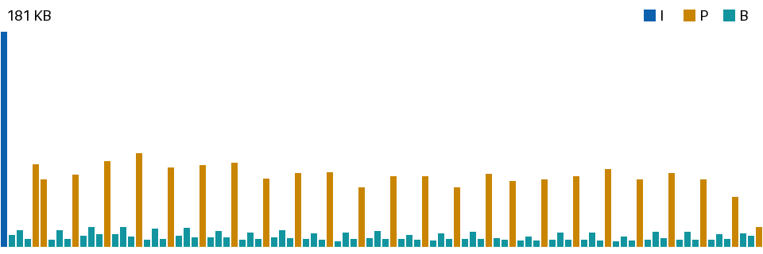
<figcaption>tilt.mp4: auch die P-Frames sind groß, die Kamera fährt schnell</figcaption></figure>
</div>

Jeder Ausschnitt beginnt mit einem I-Frame, und es bleibt das einzige: x264 setzt höchstens alle 250 Bilder eines, und die Ausschnitte haben 96. Danach wechseln sich P-Frames und meist je drei B-Frames ab. Ein I-Frame braucht so viel wie zwei bis sieben P-Frames, ein B-Frame nur einen Bruchteil eines P-Frames, beim Blick sogar nur ein Zwanzigstel. Ein B-Frame kann für jeden Block das passendere von zwei Bildern nehmen, und weil kein anderes Bild aus ihm vorhergesagt wird, darf der Encoder es gröber runden: Ein Fehler darin wandert nicht weiter.
<!-- /after -->

### Die Reihenfolge in der Datei

Ein B-Frame braucht das Bild nach ihm. Also muss der Decoder dieses spätere Bild zuerst bekommen, und die Datei speichert die Bilder in einer anderen Reihenfolge, als sie gezeigt werden: Nach dem I-Frame kommt das P-Frame, dann die B-Frames, die davor gezeigt werden.

<div class='hint own' data-check='decode-order'>
<strong>Jetzt bist du dran:</strong> Schreib <code>decode_order(kinds)</code>: <code>kinds</code> ist ein Text wie <code>'IBBBP'</code>, die Arten der Bilder in der Reihenfolge, in der sie gezeigt werden. Gib die Nummern der Bilder in der Reihenfolge zurück, in der der Decoder sie braucht: jedes I- und P-Frame vor den B-Frames, die vor ihm gezeigt werden. Für <code>'IBBBP'</code> ist das <code>[0, 4, 1, 2, 3]</code>. B-Frames am Ende ohne ein Bild danach kommen zuletzt.
</div>

<!-- hint -->
Geh die Bilder der Reihe nach durch und sammle B-Frames in einer Liste, die wartet. Kommt ein I- oder P-Frame, kommt es in die Reihenfolge, und danach die wartenden B-Frames.
<!-- /hint -->
<!-- hint -->
```python
order = []
waiting = []
for k, kind in enumerate(kinds):
    if kind == 'B':
        waiting.append(k)
```
<!-- /hint -->

<!-- solution -->
```python
def decode_order(kinds):
    order = []
    waiting = []
    for k, kind in enumerate(kinds):
        if kind == 'B':
            waiting.append(k)
        else:
            order.append(k)
            order += waiting
            waiting = []
    return order + waiting
```
<!-- /solution -->

_task(decode-order)

<!-- after: decode-order -->
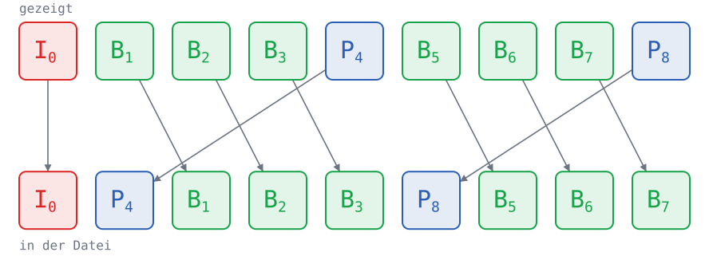
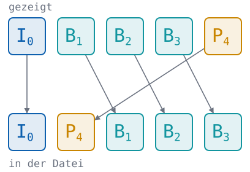
<!-- /after -->

Wie die Datei die Bilder wirklich speichert, zeigt ffprobe mit `-show_entries packet=pts`: Jedes Paket hat einen Zeitstempel, wann sein Bild gezeigt wird, und die Pakete stehen in der Reihenfolge, in der der Decoder sie liest. Erweitere `gop.py` um `decode_order` und diese Funktion:

```python
def stored_order(path, count):
    command = ['ffprobe', '-v', 'error', '-select_streams', 'v', '-show_entries', 'packet=pts',
               '-of', 'json', path]
    data = json.loads(subprocess.run(command, capture_output=True, text=True, check=True).stdout)
    times = [int(packet['pts']) for packet in data['packets']]
    step = sorted(times)[1] - sorted(times)[0]
    return [(t - min(times)) // step for t in times[:count]]
```

`stored_order` rechnet die Zeitstempel in Nummern von Bildern um: Der kleinste ist Bild 0, und der Abstand zwischen zwei Bildern ist überall gleich. Unten im Hauptprogramm:

```python
    kinds = ''.join(kind for kind, _ in frame_sizes('glance.mp4'))[:13]
    print('Zeigen:     ', list(range(13)))
    print('Typen:      ', ' '.join(kinds))
    print('Gerechnet:  ', decode_order(kinds))
    print('In der Datei:', stored_order('glance.mp4', 13))
```

<!-- tutorial-step
write-file: video/gop.py <- file:stufen/gop-2.py
check-task: decode-order
terminal-run: python3 gop.py | tail -4
terminal-wait-for-prompt: 60
wait-for-text: In der Datei
-->

```text
Zeigen:      [0, 1, 2, 3, 4, 5, 6, 7, 8, 9, 10, 11, 12]
Typen:       I B B B P B B B P B B B P
Gerechnet:   [0, 4, 1, 2, 3, 8, 5, 6, 7, 12, 9, 10, 11]
In der Datei: [0, 4, 2, 1, 3, 8, 6, 5, 7, 12, 10, 9, 11]
```

Fast: x264 nimmt von drei B-Frames das mittlere zuerst, Bild 2 vor 1 und 3. Das mittlere wird nämlich selbst zur Vorlage für die beiden anderen, die so näher an einem Bild liegen, aus dem sie vorhersagen. Das heißt **B-Pyramide**.

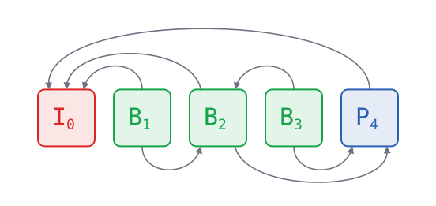
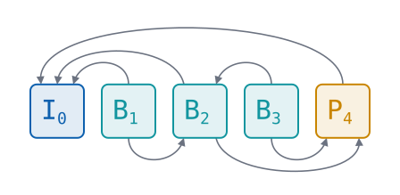

### Ein Decoder bei der Arbeit

Hier baut ein Decoder 17 Bilder vom Hang zusammen, mit einem I-Frame am Anfang, in der Mitte und am Ende. Die Leiste oben zeigt, was die Datei für jedes Bild speichert, und wie viele Bytes es braucht: Ein I-Frame ist ein ganzes Bild, ein P- oder B-Frame nur sein Rest, dazu Vektoren, die man in der Leiste nicht sieht. Die Pfeile, die Pfeiltasten und die Leiste unter ihnen gehen von Bild zu Bild; ein Klick auf ein Bild der Leiste oben springt dorthin. Mit dem Schalter »Zwischenschritte« gehen sie auch durch die Schritte, in denen ein Bild entsteht: erst die Vorlage, dann die Blöcke, die um ihre Vektoren verschoben werden, zuletzt der Rest. Bei einem P- oder B-Frame stehen die drei Schritte in drei Feldern darunter, und ein Klick auf eines springt zu seinem Schritt. Achte darauf, wie viele Bytes die Bilder zwischen zwei I-Frames brauchen und wie wenig in ihrem Rest zu sehen ist.

<script src='/include/gop_stepper.js'></script>
<div class='gop-stepper' data-stepper data-src='/video/gop-steps'></div>

Die 17 Bilder sind dafür eigens codiert, mit demselben Muster wie in den Ausschnitten, aber mit genau einer Vorlage in jede Richtung, damit klar ist, auf welches Bild ein Vektor zeigt, mit einem I-Frame alle 8 Bilder und mit festem Quantisierer, damit sich die Bytes vergleichen lassen. In den Ausschnitten darf ein Bild auf bis zu fünf Vorlagen schauen, und nur das erste von 96 Bildern ist ein I-Frame. Arten, Vektoren und Bytes sind die von x264; die Stücke, die sich die Blöcke holen, und den Rest haben wir aus den Vektoren nachgerechnet.

### Springen

Ein Player kann nur bei einem I-Frame zu zeigen anfangen: Jedes andere Bild braucht Bilder davor. Springt man in die Mitte eines Videos, sucht der Player das I-Frame davor und rechnet von dort aus. Darum setzen Encoder für Streams regelmäßig I-Frames, für Live-Streams empfiehlt YouTube eines alle zwei Sekunden, und bei jedem Schnitt in eine neue Szene eines, weil dort die Vorhersage ohnehin nichts taugt. Probier aus, was das kostet, mit `slope.mp4` und immer derselben Qualität:

```bash
ffmpeg -v error -y -i slope.mp4 -c:v libx264 -crf 18 slope-default.mp4
ffmpeg -v error -y -i slope.mp4 -c:v libx264 -crf 18 -g 24 slope-g24.mp4
ffmpeg -v error -y -i slope.mp4 -c:v libx264 -crf 18 -bf 0 slope-bf0.mp4
ffmpeg -v error -y -i slope.mp4 -c:v libx264 -crf 18 -g 1 slope-intra.mp4
ls -l slope-*.mp4
```

Mit einem I-Frame alle 8 Bilder sieht ein Sprung zu Bild 13 so aus; jeder Pfeil zeigt auf das Bild, aus dem ein P-Frame vorhergesagt wird:

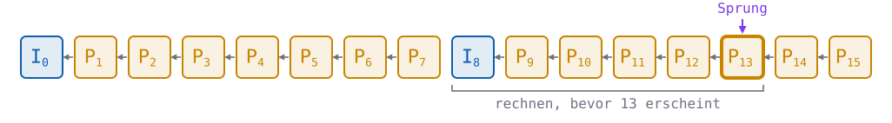
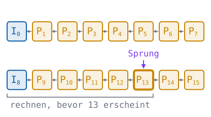

Der Player rechnet sechs Bilder, bevor er eines zeigt; ohne I8 wären es vierzehn. Je seltener I-Frames, desto länger kann ein Sprung dauern.

`-g 24` setzt höchstens alle 24 Bilder ein I-Frame, also jede Sekunde eines; `-bf 0` verbietet B-Frames; `-g 1` macht jedes Bild zum I-Frame.

_task(intra-size)

<!-- tutorial-step
terminal-run: for o in default:'' g24:'-g 24' bf0:'-bf 0' intra:'-g 1'; do ffmpeg -v error -y -i slope.mp4 -c:v libx264 -crf 18 ${o#*:} slope-${o%%:*}.mp4; done; ls -l slope-*.mp4
terminal-wait-for-prompt: 120
wait-for-text: slope-intra.mp4
-->

<!-- after: intra-size -->
```text
1477186 slope-bf0.mp4
1037368 slope-default.mp4
1287764 slope-g24.mp4
4685365 slope-intra.mp4
```

Ein I-Frame jede Sekunde kostet ein Viertel mehr, ohne B-Frames sind es zwei Fünftel mehr, und nur aus I-Frames wird die Datei viereinhalbmal so groß.
<!-- /after -->

### Ohne I-Frame

Was passiert, wenn ein I-Frame fehlt? Probier es mit dem Schwenk und der Fahrt die Wand hinauf: Beide werden ohne B-Frames codiert und als roher H.264-Strom hintereinandergehängt, dann wirft ffmpeg jedes I-Frame außer dem ersten weg. Der Decoder bekommt also nach dem letzten Bild des Schwenks gleich das erste P-Frame der Fahrt.

_task(mosh)

```bash
for c in pan tilt; do ffmpeg -v error -y -i $c.mp4 -c:v libx264 -crf 18 -bf 0 -g 1000 -sc_threshold 0 -bsf:v h264_mp4toannexb -f h264 $c.h264; done
cat pan.h264 tilt.h264 > both.h264
ffmpeg -v error -y -fflags +genpts -r 24 -i both.h264 -c copy -bsf:v 'noise=drop=key*gt(n\,0)' mosh.h264
ffmpeg -v error -y -r 24 -i mosh.h264 -c:v libx264 -crf 18 -pix_fmt yuv420p mosh.mp4
```

`-g 1000 -sc_threshold 0` sorgt dafür, dass jeder Ausschnitt nur am Anfang ein I-Frame hat, `-f h264` schreibt den rohen Strom ohne MP4 drumherum. `cat` hängt die beiden Ströme aneinander, und der Filter `noise` wirft jedes Paket weg, das ein I-Frame ist (`key`) und nicht das erste (`gt(n,0)`). Zuletzt macht ffmpeg wieder eine MP4-Datei daraus, die VS Code abspielt.

<!-- tutorial-step
terminal-run: for c in pan tilt; do ffmpeg -v error -y -i $c.mp4 -c:v libx264 -crf 18 -bf 0 -g 1000 -sc_threshold 0 -bsf:v h264_mp4toannexb -f h264 $c.h264; done; cat pan.h264 tilt.h264 > both.h264; ffmpeg -v error -y -fflags +genpts -r 24 -i both.h264 -c copy -bsf:v 'noise=drop=key*gt(n\,0)' mosh.h264; ffmpeg -v error -y -r 24 -i mosh.h264 -c:v libx264 -crf 18 -pix_fmt yuv420p mosh.mp4; ffmpeg -v error -y -i mosh.mp4 -vf 'select=eq(n\,96)+eq(n\,110)+eq(n\,130)+eq(n\,160),tile=2x2' -frames:v 1 mosh-sheet.png; ls mosh*
terminal-wait-for-prompt: 180
wait-for-text: mosh-sheet.png
-->

<!-- after: mosh -->
<!-- tutorial-screenshot
image-file: video/mosh-sheet.png 1
-->
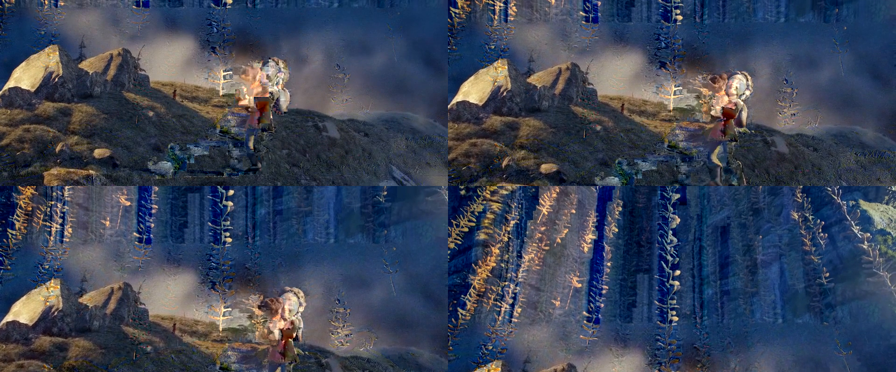

Der Decoder setzt die Vektoren und Reste des nächsten P-Frames auf das Bild, das er gerade hat, auch wenn es aus einer ganz anderen Szene ist:

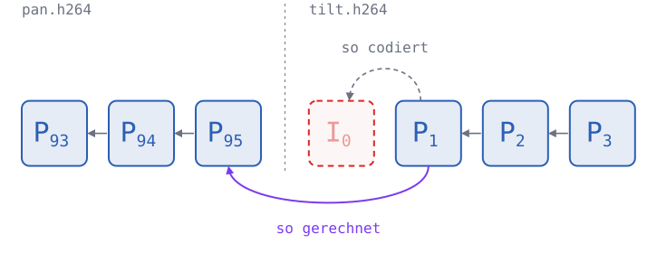
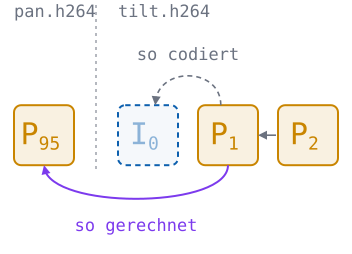

Das sieht aus, als male die Bewegung der einen Szene über das Bild der anderen, und heißt **Datamoshing**. Ab dem Übergang bekommt der Decoder nur noch Vektoren und Reste der Fahrt die Wand hinauf. Er schiebt die Blöcke des Bergkamms damit nach unten und zählt die Reste dazu, als wäre es die Felswand. Das Mädchen erscheint aus den Resten, Stück für Stück, wo die Vorhersage nichts Passendes fand. Erst ein neues I-Frame würde aufräumen.
<!-- /after -->

<!-- stage: stufen/gop-2.py as gop.py -->

## Artefakte und Filter

Wird ein Video zu stark komprimiert, sieht man es: Blöcke, Stufen im Himmel, Gesichter wie aus Plastik. Solche Fehler heißen **Artefakte**. Codecs haben Filter, die sie verstecken, und für manches einen Trick, der sie gar nicht erst entstehen lässt.

### Blöcke

Bei groben Schritten bleibt von einem Block oft nur der DC-Koeffizient übrig, der Mittelwert. Der Block wird eine Fläche in einer Farbe, und zwei Nachbarn passen an ihrer Kante nicht mehr zusammen. In einem ruhigen Himmel wird so aus einem sanften Verlauf eine Treppe aus Flächen; das heißt **Banding**.

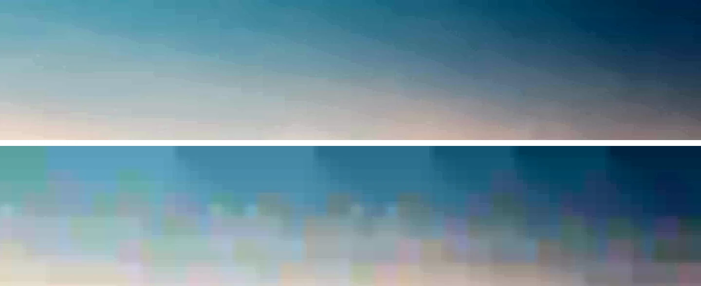

Oben ein Streifen Himmel aus dem Film, unten derselbe mit dem groben Quantisierer, der gleich folgt, beide dreimal vergrößert und mit dreifachem Kontrast, damit man die Stufen sieht. Probier es mit dem Blick des Mädchens, `glance.mp4`, und einem festen, groben Quantisierer:

```bash
ffmpeg -v error -y -i glance.mp4 -c:v libx264 -qp 42 glance-deblock.mp4
ffmpeg -v error -y -i glance.mp4 -c:v libx264 -qp 42 -x264-params no-deblock=1 glance-blocky.mp4
ls -l glance-deblock.mp4 glance-blocky.mp4
```

`-qp 42` rundet jedes Bild mit demselben groben Schritt. Er geht von 0 bis 51, und jede 6 mehr verdoppelt den Schritt. Die zweite Datei schaltet den **Deblocking-Filter** von H.264 aus, den die erste hat wie jede gewöhnliche Datei. Er glättet die Kanten zwischen den Blöcken, im Encoder und im Decoder.

_task(deblock-size)

<!-- tutorial-step
terminal-run: ffmpeg -v error -y -i glance.mp4 -c:v libx264 -qp 42 glance-deblock.mp4 && ffmpeg -v error -y -i glance.mp4 -c:v libx264 -qp 42 -x264-params no-deblock=1 glance-blocky.mp4 && ls -l glance-deblock.mp4 glance-blocky.mp4
terminal-wait-for-prompt: 120
wait-for-text: glance-blocky.mp4
-->

<!-- after: deblock-size -->
```text
20682 glance-blocky.mp4
19131 glance-deblock.mp4
```

Mit Filter ist die Datei um etwa 7 % kleiner. Der Filter steht nämlich in der Schleife des Decoders, wie das Runden in `encode` aus »Von Bild zu Bild«: Das nächste Bild wird aus dem gefilterten Bild vorhergesagt, und weil das dem Original näher ist, bleibt weniger Rest. Darum muss der Encoder genau so filtern wie der Decoder; ein Filter, der nur beim Anschauen glättet, spart keine Bytes.
<!-- /after -->

Einen einfachen Filter schreibst du selbst. Er schaut an jeder Kante zwischen zwei Blöcken die beiden Pixel direkt daneben an. Ist der Sprung zwischen ihnen klein, kommt er vom Runden, und der Filter verteilt ihn gleichmäßig auf die acht Pixel um die Kante: aus einer Stufe wird eine Rampe. Ist der Sprung groß, ist es eine echte Kante im Bild, etwa der Rand ihres Gesichts vor dem dunklen Hintergrund, und sie bleibt.

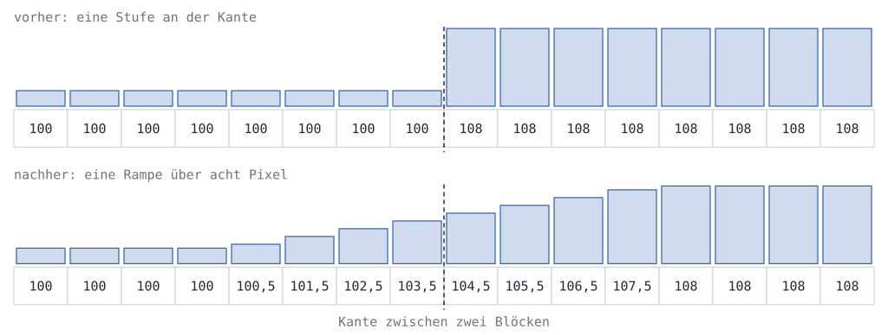
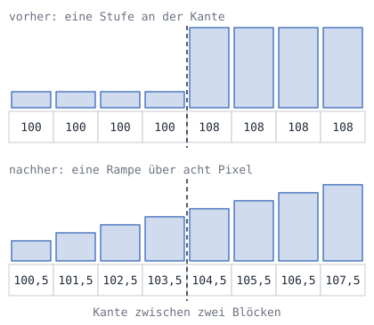

Lege `artifacts.py` an:

<!-- page-code: own -->
```python
import numpy as np
from PIL import Image

from video import read_frames

FRAME = 30


def smooth_edges(plane, limit, n=8):
    # hier: kleine Stufen an den Kanten zwischen Blöcken zu Rampen machen


def save_detail(path, frame):
    detail = np.clip(frame, 0, 255).round().astype(np.uint8)[120:280, 352:640]
    Image.fromarray(detail).resize((864, 480), Image.NEAREST).save(path)


if __name__ == '__main__':
    for name in ['glance', 'glance-blocky', 'glance-deblock']:
        save_detail(f'{name}-detail.png', read_frames(f'{name}.mp4')[FRAME])
    frame = read_frames('glance-blocky.mp4')[FRAME]
    smoothed = np.stack([smooth_edges(frame[..., c], 24) for c in range(3)], axis=-1)
    save_detail('glance-smoothed-detail.png', smoothed)
    print('Vier Ausschnitte gespeichert')
```

`save_detail` speichert einen Ausschnitt um das Gesicht des Mädchens, dreimal so groß und ohne Glätten, damit man die Blöcke sieht. Das Hauptprogramm filtert jeden der drei Kanäle R, G und B für sich.

<div class='hint own' data-check='smooth-edges'>
<strong>Jetzt bist du dran:</strong> Schreib <code>smooth_edges(plane, limit, n=8)</code>. Die Kanten liegen zwischen Spalte <code>n - 1</code> und <code>n</code>, <code>2n - 1</code> und <code>2n</code> und so weiter. Für jede rechnet die Funktion die Stufe <code>step</code>: das Pixel rechts der Kante minus das links davon. Ist sie kleiner als <code>limit</code>, steigen die vier Pixel links um 7/16, 5/16, 3/16 und 1/16 der Stufe, von der Kante aus gezählt, und die vier rechts sinken um dieselben Anteile. Danach dasselbe zwischen den Zeilen. Gib ein neues Array mit Kommazahlen zurück und lass das, das du bekommst, wie es ist.
</div>

<!-- hint -->
Die Spalten rechts der Kanten sind `edges = np.arange(n, plane.shape[1], n)`, die links davon `edges - 1`. `plane[:, edges] - plane[:, edges - 1]` gibt alle Stufen auf einmal, eine Spalte je Kante. `np.where(np.abs(step) < limit, step, 0)` setzt die großen auf 0, dann ändern sie nichts.
<!-- /hint -->
<!-- hint -->
Für das Pixel im Abstand `j` von der Kante (0, 1, 2, 3) ist der Anteil `(7 - 2 * j) / 16`: Links ist es die Spalte `edges - 1 - j`, rechts `edges + j`. `plane.T` ist dasselbe Array mit Zeilen und Spalten vertauscht, keine Kopie: Was du dort änderst, ändert `plane`. So machst du die Zeilen mit demselben Code:

```python
plane = plane.astype(float)
for view in (plane, plane.T):
    edges = np.arange(n, view.shape[1], n)
```
<!-- /hint -->

<!-- solution -->
```python
def smooth_edges(plane, limit, n=8):
    plane = plane.astype(float)
    for view in (plane, plane.T):
        edges = np.arange(n, view.shape[1], n)
        step = view[:, edges] - view[:, edges - 1]
        step = np.where(np.abs(step) < limit, step, 0)
        for j in range(4):
            view[:, edges - 1 - j] += step * (7 - 2 * j) / 16
            view[:, edges + j] -= step * (7 - 2 * j) / 16
    return plane
```
<!-- /solution -->

_task(smooth-edges)

```bash
python3 artifacts.py
```

<!-- tutorial-step
write-file: video/artifacts.py <- file:stufen/artifacts-1.py
check-task: smooth-edges
terminal-run: python3 artifacts.py
terminal-wait-for-prompt: 60
wait-for-text: Vier Ausschnitte
-->

<div class='gallery columns-2'>
<figure>
<!-- tutorial-screenshot
image-file: video/glance-detail.png 1
-->
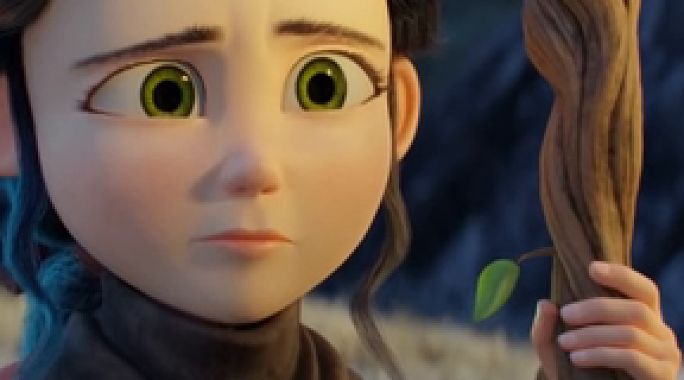
<figcaption>glance.mp4</figcaption></figure>
<figure>
<!-- tutorial-screenshot
image-file: video/glance-blocky-detail.png 1
-->

<figcaption>-qp 42 ohne Filter</figcaption></figure>
<figure>
<!-- tutorial-screenshot
image-file: video/glance-smoothed-detail.png 1
-->

<figcaption>ohne Filter, danach smooth_edges</figcaption></figure>
<figure>
<!-- tutorial-screenshot
image-file: video/glance-deblock-detail.png 1
-->
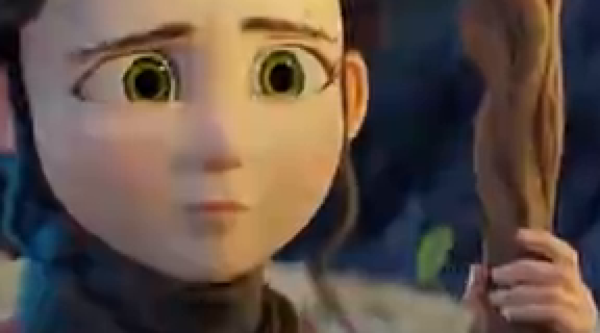
<figcaption>-qp 42 mit dem Filter von H.264</figcaption></figure>
</div>

Dein Filter macht die Stufen weicher, aber die Blöcke bleiben zu sehen; der von H.264 lässt sie fast verschwinden. Er arbeitet auf jedem Bild im Decoder, bevor es zur Vorlage für das nächste wird, und entscheidet an jeder Kante neu: wie grob gerundet wurde, ob ein Block im Bild vorhergesagt wurde oder aus einem anderen, ob er einen Rest hat. Danach ändert er bis zu drei Pixel auf jeder Seite. Weil das Ergebnis in die Vorlagen eingeht, erben die nächsten Bilder keine Stufen. Dein Filter glättet dagegen ein fertiges Bild, dessen Vorlagen schon voller Blöcke waren.

### Filmkorn

Echte Filme haben Korn: auf Film die Körner der Fotoschicht, bei einer Digitalkamera das Rauschen des Sensors. Manche Filme setzen es mit Absicht ein, weil es lebendiger aussieht. Für einen Codec ist Korn das Schwierigste, was es gibt: Es ist Zufall, und Zufall lässt sich weder aus den Nachbarn erraten noch aus dem Bild davor vorhersagen. Leg Korn über den Blick des Mädchens und codiere beide mit derselben Qualität:

```bash
ffmpeg -v error -y -i glance.mp4 -c:v libx264 -crf 23 glance-clean.mp4
ffmpeg -v error -y -i glance.mp4 -vf noise=alls=14:allf=t -c:v libx264 -crf 23 glance-grain.mp4
ls -l glance-clean.mp4 glance-grain.mp4
```

Der Filter `noise=alls=14:allf=t` legt Rauschen der Stärke 14 auf alle drei Ebenen, Y, Cb und Cr, in jedem Bild ein anderes (`allf=t`, `t` für die Zeit).

_task(grain-size)

<!-- tutorial-step
terminal-run: ffmpeg -v error -y -i glance.mp4 -c:v libx264 -crf 23 glance-clean.mp4 && ffmpeg -v error -y -i glance.mp4 -vf noise=alls=14:allf=t -c:v libx264 -crf 23 glance-grain.mp4 && ls -l glance-clean.mp4 glance-grain.mp4
terminal-wait-for-prompt: 120
wait-for-text: glance-grain.mp4
-->

<!-- after: grain-size -->
```text
 146408 glance-clean.mp4
6929524 glance-grain.mp4
```

Mit Korn wird die Datei fast 47-mal so groß. Dieselbe Qualität heißt auch: dasselbe Korn, Pixel für Pixel, und das lässt sich nur speichern, indem man es speichert.
<!-- /after -->

AV1 hat dafür einen Trick, **Film Grain Synthesis**. Der Encoder entfernt das Korn vor dem Codieren, misst, wie stark es war und wie es aussah, und schreibt nur diese wenigen Zahlen in die Datei. Der Player rechnet das glatte Bild und legt neues Korn darüber, das genauso aussieht, aber nicht dasselbe ist. Niemand bemerkt, dass es anderer Zufall ist. Probier es mit `libaom-av1`, dem Encoder von AOMedia, einmal ohne und einmal mit dem Trick:

```bash
ffmpeg -v error -y -i glance-grain.mp4 -c:v libaom-av1 -crf 40 -b:v 0 -cpu-used 8 -row-mt 1 glance-av1.mkv
ffmpeg -v error -y -i glance-grain.mp4 -c:v libaom-av1 -crf 40 -b:v 0 -cpu-used 8 -row-mt 1 -denoise-noise-level 60 glance-av1-grain.mkv
ls -l glance-av1.mkv glance-av1-grain.mkv
```

`-crf 40 -b:v 0` codiert mit fester Qualität, `-cpu-used 8` am schnellsten, `-row-mt 1` auf mehreren Kernen. `-denoise-noise-level 60` schaltet Film Grain Synthesis ein; die Zahl sagt, wie kräftig das Korn ist, das der Encoder entfernt und beschreibt. Jeder Befehl braucht ein paar Sekunden. Den Unterschied zeigt am besten ein stehendes Bild aus jeder Datei:

```bash
for f in glance-grain.mp4 glance-av1.mkv glance-av1-grain.mkv; do ffmpeg -v error -y -i $f -vf "select=eq(n\,40),crop=240:160:420:100,scale=720:480:flags=neighbor" -frames:v 1 ${f%.*}-detail.png; done
```

<!-- tutorial-step
terminal-run: ffmpeg -v error -y -i glance-grain.mp4 -c:v libaom-av1 -crf 40 -b:v 0 -cpu-used 8 -row-mt 1 glance-av1.mkv && ffmpeg -v error -y -i glance-grain.mp4 -c:v libaom-av1 -crf 40 -b:v 0 -cpu-used 8 -row-mt 1 -denoise-noise-level 60 glance-av1-grain.mkv && ls -l glance-av1.mkv glance-av1-grain.mkv
terminal-wait-for-prompt: 240
wait-for-text: glance-av1-grain.mkv
terminal-run: for f in glance-grain.mp4 glance-av1.mkv glance-av1-grain.mkv; do ffmpeg -v error -y -i $f -vf "select=eq(n\,40),crop=240:160:420:100,scale=720:480:flags=neighbor" -frames:v 1 ${f%.*}-detail.png; done; ls *-detail.png
terminal-wait-for-prompt: 60
wait-for-text: glance-av1-grain-detail.png
-->

```text
37941 glance-av1.mkv
55341 glance-av1-grain.mkv
```

<div class='gallery columns-3'>
<figure>
<!-- tutorial-screenshot
image-file: video/glance-grain-detail.png 1
-->
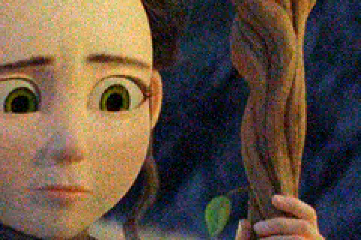
<figcaption>H.264 mit Korn: 6.929.524 Bytes</figcaption></figure>
<figure>
<!-- tutorial-screenshot
image-file: video/glance-av1-detail.png 1
-->
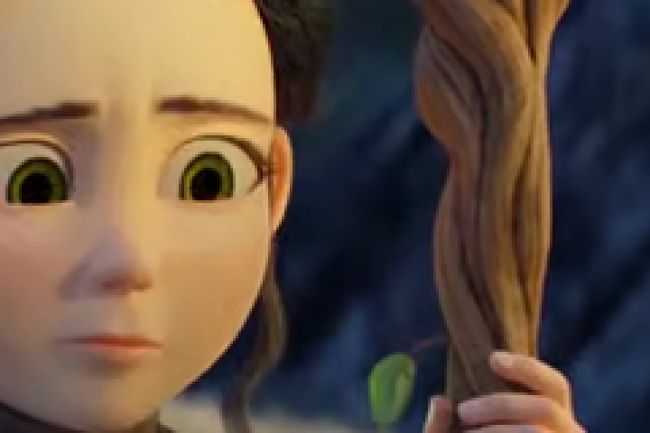
<figcaption>AV1 ohne Trick: 37.941 Bytes</figcaption></figure>
<figure>
<!-- tutorial-screenshot
image-file: video/glance-av1-grain-detail.png 1
-->
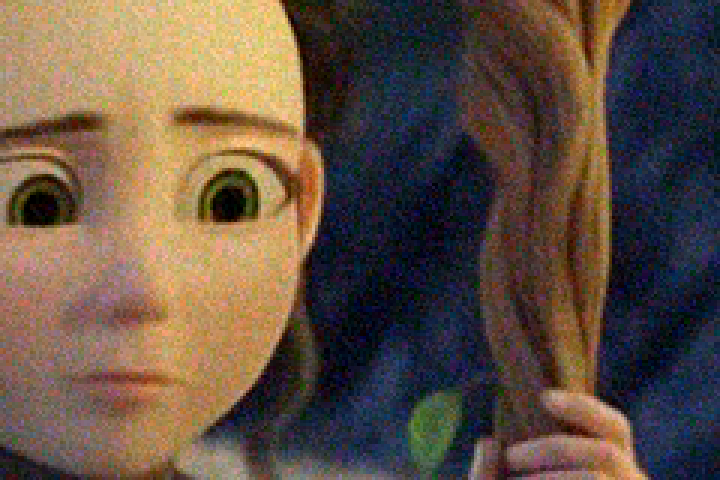
<figcaption>AV1 mit Film Grain Synthesis: 55.341 Bytes</figcaption></figure>
</div>

Ohne den Trick rundet AV1 bei dieser Qualität das Korn einfach weg, und das Mädchen sieht aus wie aus Plastik. Mit ihm ist das Korn wieder da. Die Datei ist etwas größer als die ohne den Trick, braucht aber nur etwa ein Hundertzwanzigstel der Bytes von H.264 mit Korn.

Warum sind es gut 17.000 Bytes mehr und nicht nur ein paar für die Beschreibung des Korns? Weil libaom das Korn für jedes Bild neu misst und jedes Mal die ganze Beschreibung in die Datei schreibt, etwa 135 Bytes: bis zu 14 Stützstellen für Y und bis zu 10 für Cb und Cr, wie stark das Korn bei welchem Wert ist, dazu 74 Zahlen für ein kleines Filter, das aus Zufallszahlen Körner einer bestimmten Größe macht. Bei 96 Bildern sind das 13.472 Bytes, die übrigen knapp 4.000 stecken im Bild selbst. AV1 erlaubt auch, mit wenigen Bits die Beschreibung eines früheren Bildes wiederzuverwenden; libaom tut das hier nicht. Nachzählen lässt sich das mit `ffmpeg -i glance-av1-grain.mkv -c copy -bsf:v trace_headers -f null -`, das jedes Feld der Köpfe mit seinen Bits ausgibt.

Dieselbe Idee steckt in Restaurierungen alter Filme. Für die 4K-Fassung von »Die unendliche Geschichte« (1984) scannte CinePostproduction 2019 das 35-mm-Originalnegativ mit 4,5K und 16 Bit; die Szenen, die es nur in der längeren deutschen Fassung gibt, kamen von einem Dup-Positiv, einer späteren Kopie mit anderem Korn. Das Korn wurde für jede Art von Einstellung verringert und angeglichen, die Farben für SDR und HDR neu korrigiert, und einer der letzten Schritte war, wieder ein feines, über den ganzen Film gleichmäßiges Korn darüberzulegen, das ReGraining. So beschreibt es der [Bericht von CinePostproduction](https://www.cinepostproduction.de/wp-content/uploads/2019/08/Die_unendliche_Geschichte_4K_ReMastering_2019.pdf).

<!-- stage: stufen/artifacts-1.py as artifacts.py -->

## Bitrate steuern

Bisher hast du die Qualität festgelegt, mit `-crf` oder `-qp`, und die Größe war, was dabei herauskam. Wer Videos verschickt, braucht oft das Umgekehrte: Eine Leitung schafft 2 Mbit in der Sekunde, und das Video muss hindurchpassen. Um beides zu vergleichen, brauchst du zuerst eine Zahl dafür, wie gut ein Bild ist.

### Wie gut ist ein Bild?

Das einfachste Maß ist das **PSNR**, Peak Signal-to-Noise Ratio. Es ist gebaut wie der Signal-Rausch-Abstand in [Audio komprimieren](/audio-compression), nur steht über dem Bruchstrich statt der Energie des Signals der größte Wert, den ein Pixel haben kann, 255, quadriert. Man nimmt für jedes Pixel den Fehler zwischen Original und decodiertem Bild, quadriert ihn und bildet von allen Quadraten den Mittelwert, den **mittleren quadrierten Fehler**:

$$\text{PSNR} = 10 \cdot \log\_{10} \frac{255^2}{\text{Fehler}}$$

Das Ergebnis ist in **Dezibel** (dB) wie beim Ton, und der Logarithmus macht aus jedem Faktor einen gleich großen Schritt: 10 dB mehr heißen ein zehnmal kleinerer Fehler, 20 dB ein hundertmal kleinerer. Gut 6 dB mehr heißen ein Viertel des Fehlers, also dass jedes Pixel im Mittel nur halb so weit danebenliegt. Ab etwa 40 dB lässt sich ein Bild meist kaum noch vom Original unterscheiden, unter 30 dB sind die Fehler deutlich. So sieht das bei der Nahaufnahme aus, mit H.264 so grob gerundet, dass das PSNR jeweils so hoch ist:

<div class='gallery side-by-side'>
<figure><figcaption>Original</figcaption></figure>
<figure>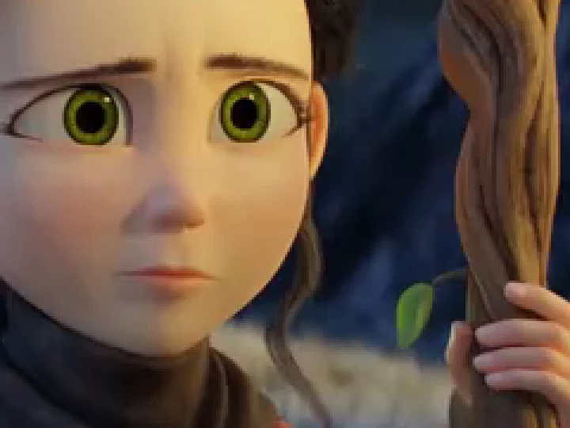<figcaption>40 dB</figcaption></figure>
<figure><figcaption>35 dB</figcaption></figure>
<figure>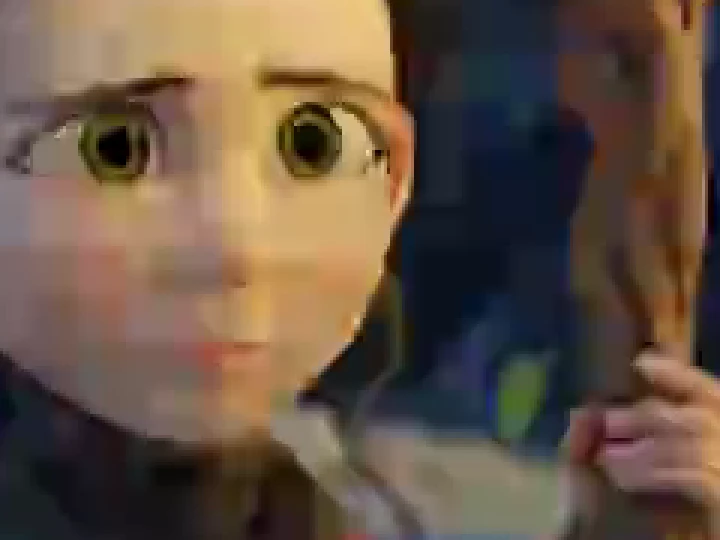<figcaption>30 dB</figcaption></figure>
</div>

Lege `quality.py` an:

<!-- page-code: own -->
```python
import os
import subprocess

import numpy as np

from video import read_frames


def luma(frames):
    return frames @ np.array([0.299, 0.587, 0.114])


def psnr(original, decoded):
    # hier: der mittlere quadrierte Fehler und daraus das PSNR in dB


def encode(source, target, options):
    subprocess.run(['ffmpeg', '-v', 'error', '-y', '-i', source, *options, target], check=True, capture_output=True)


def measure(source, target):
    return os.path.getsize(target), psnr(luma(read_frames(source)), luma(read_frames(target)))


if __name__ == '__main__':
    for clip in ['glance', 'tilt']:
        for label, options in [('crf28', ['-c:v', 'libx264', '-crf', '28']),
                               ('400k', ['-c:v', 'libx264', '-b:v', '400k'])]:
            target = f'{clip}-{label}.mp4'
            encode(f'{clip}.mp4', target, options)
            size, quality = measure(f'{clip}.mp4', target)
            print(f'{target:18} {size:7} Bytes  {quality:5.2f} dB')
```

`encode` ruft ffmpeg auf und behält seine Ausgabe für sich; geht etwas schief, zeigt Python sie mit dem Fehler. `measure` gibt die Bytes einer Datei und ihr PSNR gegenüber dem Original, gemessen an der Helligkeit Y aller Bilder.

<div class='hint own' data-check='psnr'>
<strong>Jetzt bist du dran:</strong> Schreib <code>psnr(original, decoded)</code>. Die beiden Arrays haben dieselbe Form, Bilder als Bytes oder Kommazahlen. Rechne den mittleren quadrierten Fehler aus und daraus 10 · log10(255² / Fehler). Sind beide Arrays gleich, ist der Fehler 0: Dann gib <code>float('inf')</code> zurück, unendlich.
</div>

<!-- hint -->
`original.astype(float) - decoded.astype(float)` gibt die Fehler, auch bei Bytes richtig: In `uint8` wäre 0 − 255 nämlich 1. `** 2` quadriert jeden, `np.mean` bildet den Mittelwert über alles.
<!-- /hint -->
<!-- hint -->
```python
error = np.mean((original.astype(float) - decoded.astype(float)) ** 2)
if error == 0:
    return float('inf')
```
`np.log10` ist der Logarithmus zur Basis 10, `np.log` wäre der natürliche.
<!-- /hint -->

<!-- solution -->
```python
def psnr(original, decoded):
    error = np.mean((original.astype(float) - decoded.astype(float)) ** 2)
    if error == 0:
        return float('inf')
    return 10 * np.log10(255 ** 2 / error)
```
<!-- /solution -->

_task(psnr)

### Feste Qualität, feste Rate

Das Hauptprogramm codiert den Blick des Mädchens und die Fahrt die Wand hinauf je zweimal: mit fester Qualität, `-crf 28`, und mit fester Rate, `-b:v 400k`, 400 kbit in der Sekunde.

_task(same-rate)

```bash
python3 quality.py
```

<!-- tutorial-step
write-file: video/quality.py <- file:stufen/quality-1.py
check-task: psnr
terminal-run: python3 quality.py
terminal-wait-for-prompt: 120
wait-for-text: tilt-400k
-->

<!-- after: same-rate -->
```text
glance-crf28.mp4     71407 Bytes  40.78 dB
glance-400k.mp4     135496 Bytes  41.39 dB
tilt-crf28.mp4      327850 Bytes  34.08 dB
tilt-400k.mp4       170631 Bytes  30.36 dB
```

Mit fester Qualität sind beide etwa gleich gut, aber die Fahrt braucht fast fünfmal so viele Bytes. Mit fester Rate sind beide ähnlich groß, aber der Blick bekommt mehr Bytes, als er braucht, und die Fahrt zu wenige: 30 dB, man sieht die Blöcke. x264 trifft die Rate dabei nicht genau, beide Dateien sind kleiner als 400 kbit/s · 4 s = 200.000 Bytes; mit einem Durchgang weiß der Encoder nicht, was noch kommt.
<!-- /after -->

Mit **zwei Durchgängen** (`-pass 1`, dann `-pass 2`) schaut sich der Encoder das ganze Video zuerst an und verteilt beim zweiten Mal die Bytes: wenige an ruhige Stellen, viele an schnelle, und am Ende passt die Größe. So arbeiten Encoder, wenn ein Film auf eine Scheibe oder in eine feste Größe passen muss. Oft mischt man beides: eine feste Qualität mit einer Obergrenze für die Rate, bei x264 `-crf 23 -maxrate 2M -bufsize 4M`.

ffmpeg kann das PSNR auch selbst messen:

```bash
ffmpeg -hide_banner -i glance-crf28.mp4 -i glance.mp4 -lavfi psnr -f null - 2>&1 | grep -o "PSNR.*"
```

```text
PSNR y:42.329499 u:45.854655 v:45.929024 average:43.226220 min:42.488342 max:43.888032
```

Für Y kommt ffmpeg auf 42,33 dB statt 40,78. Es misst Y so, wie es in der Datei steht: von 16 bis 235 statt von 0 bis 255 wie dein `luma`. Dieselben Fehler sind dort im Verhältnis 219 zu 255 kleiner, und das sind gut 1,3 dB. Zum Vergleichen von Dateien taugen beide Zahlen, solange man nicht die eine mit der anderen vergleicht. PSNR misst allerdings nur Unterschiede von Pixeln, nicht, was das Auge sieht. Genauer sind **SSIM**, das Strukturen und Kontraste vergleicht (`-lavfi ssim`), und **VMAF**, das Netflix mit Hochschulen entwickelt hat: Es hat an den Urteilen von Menschen gelernt, die Videos angeschaut und bewertet haben.

### Die Kurve

Ein Codec ist nicht bei einer Größe besser, sondern bei allen: Seine Kurve aus Bytes und PSNR liegt über der eines anderen. Erweitere `quality.py`: die Zeile mit PIL zu den anderen `import`-Zeilen, `CODECS` darunter, und zwei Funktionen hinter `measure`. Das neue Hauptprogramm ersetzt das alte:

```python
from PIL import Image, ImageDraw, ImageFont

CODECS = {
    'H.264': (['-c:v', 'libx264', '-crf'], [18, 23, 28, 33, 38], (37, 99, 235)),
    'H.265': (['-c:v', 'libx265', '-x265-params', 'log-level=error', '-crf'], [18, 23, 28, 33, 38], (22, 163, 74)),
    'AV1': (['-c:v', 'libsvtav1', '-svtav1-params', 'lp=1', '-crf'], [25, 32, 39, 46, 53], (220, 38, 38)),
}
```

```python
def curve(source, name, options, crfs):
    points = []
    for crf in crfs:
        target = f'curve-{name}-{crf}.mp4'
        encode(source, target, options + [str(crf)])
        points.append(measure(source, target))
    return points


def draw_curves(curves, path, width=900, height=520):
    picture = Image.new('RGB', (width, height), 'white')
    draw = ImageDraw.Draw(picture)
    font = ImageFont.load_default(size=18)
    left, right, top, bottom = 70, width - 50, 20, height - 50
    most = max(size for points, _ in curves.values() for size, _ in points)
    low, high = 28, 44
    x = lambda size: left + (right - left) * size / most
    y = lambda db: bottom - (bottom - top) * (db - low) / (high - low)
    for db in range(low, high + 1, 4):
        draw.line([left, y(db), right, y(db)], fill=(225, 225, 225))
        draw.text((10, y(db) - 10), f'{db} dB', fill='black', font=font)
    for kb in range(0, int(most / 1000) + 1, 200):
        draw.text((x(kb * 1000) - 15, bottom + 12), f'{kb} KB', fill='black', font=font)
    for n, (name, (points, colour)) in enumerate(curves.items()):
        corners = [(x(size), y(db)) for size, db in sorted(points)]
        draw.line(corners, fill=colour, width=3)
        for cx, cy in corners:
            draw.ellipse([cx - 5, cy - 5, cx + 5, cy + 5], fill=colour)
        draw.text((right - 90, bottom - 30 - 26 * n), name, fill=colour, font=font)
    picture.save(path)


if __name__ == '__main__':
    curves = {}
    for name, (options, crfs, colour) in CODECS.items():
        points = curve('slope.mp4', name, options, crfs)
        curves[name] = (points, colour)
        for crf, (size, quality) in zip(crfs, points):
            print(f'{name:6} crf {crf:2}  {size:7} Bytes  {quality:5.2f} dB')
    draw_curves(curves, 'curves.png')
```

`curve` codiert `slope.mp4` mit einem Codec bei mehreren Werten für `-crf` und misst jede Datei. Die Werte unterscheiden sich von Codec zu Codec: Bei AV1 geht `-crf` bis 63, und dieselbe Zahl heißt nicht dieselbe Qualität. Darum vergleicht man die Kurven, nicht einzelne Punkte. `libsvtav1` ist ein schneller AV1-Encoder, den Intel und Netflix begonnen haben. `lp=1` lässt ihn auf einem Kern rechnen: Ohne diese Angabe startet er für die Kerne des Rechners so viele Threads, wie ein Workspace nicht starten darf, und bricht ab. Alles zusammen braucht etwa eine halbe Minute.

_task(av1-saves)

<!-- tutorial-step
write-file: video/quality.py <- file:stufen/quality-2.py
terminal-run: python3 quality.py
terminal-wait-for-prompt: 240
wait-for-text: AV1    crf 53
-->

<!-- after: av1-saves -->
```text
H.264  crf 18  1037368 Bytes  42.23 dB
H.264  crf 23   503795 Bytes  38.38 dB
H.264  crf 28   241036 Bytes  34.74 dB
H.264  crf 33   122668 Bytes  31.46 dB
H.264  crf 38    68084 Bytes  28.61 dB
H.265  crf 18  1034153 Bytes  42.38 dB
H.265  crf 23   515880 Bytes  39.36 dB
H.265  crf 28   244698 Bytes  36.21 dB
H.265  crf 33   114172 Bytes  32.96 dB
H.265  crf 38    53779 Bytes  29.98 dB
AV1    crf 25   541237 Bytes  40.33 dB
AV1    crf 32   326862 Bytes  38.58 dB
AV1    crf 39   207857 Bytes  37.02 dB
AV1    crf 46   140863 Bytes  35.69 dB
AV1    crf 53    97681 Bytes  34.32 dB
```

<!-- tutorial-screenshot
image-file: video/curves.png 1
-->
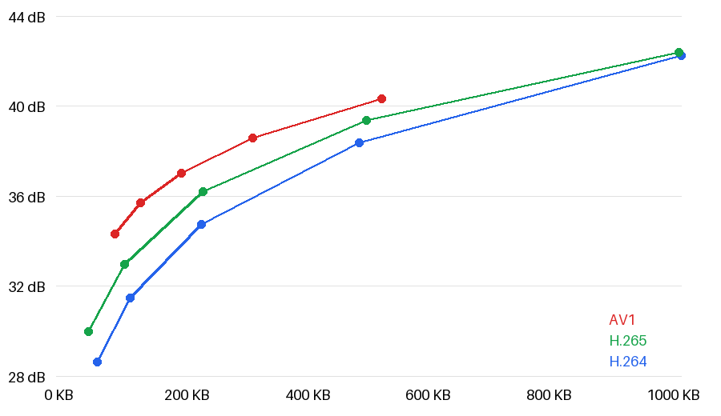

Bei 38,4 dB braucht H.264 504 KB, AV1 bei 38,6 dB 327 KB, gut ein Drittel weniger; bei 34 dB ist es über die Hälfte. H.265 liegt dazwischen. Jede Generation spart, aber sie kostet auch: Der Encoder probiert mehr aus, und ein Gerät muss den neuen Codec decodieren können, am besten mit einem eigenen Chip. Die Kurven steigen erst steil und werden dann flach: Die ersten Bytes bringen viel, die letzten wenig.
<!-- /after -->

### Eine Leiter fürs Streaming

Ein Streamingdienst weiß nicht, wie schnell deine Leitung gerade ist. Darum legt er jedes Video in mehreren Stufen bereit, einer **Leiter**: groß und mit vielen Bytes, kleiner und mit weniger. Jede Stufe ist in Stücke von ein paar Sekunden zerteilt. Der Player misst beim Laden, wie schnell die Stücke kommen, und holt das nächste aus der Stufe, die gerade hindurchpasst. Das heißt **adaptives Streaming**:


Für jedes Stück nimmt der Player die größte Stufe, deren Rate unter der gemessenen bleibt. Apple führte 2009 HLS ein, HTTP Live Streaming; die Norm DASH von MPEG funktioniert ähnlich. ffmpeg baut dir eine Leiter mit drei Stufen:

```bash
mkdir -p stream_0 stream_1 stream_2
ffmpeg -v error -y -i slope.mp4 \
  -filter_complex "[0:v]split=3[a][b][c];[b]scale=640:-2[b2];[c]scale=480:-2[c2]" \
  -map "[a]" -c:v:0 libx264 -b:v:0 1500k \
  -map "[b2]" -c:v:1 libx264 -b:v:1 600k \
  -map "[c2]" -c:v:2 libx264 -b:v:2 250k \
  -g 48 -keyint_min 48 -sc_threshold 0 \
  -f hls -hls_time 2 -hls_playlist_type vod \
  -master_pl_name master.m3u8 -var_stream_map "v:0 v:1 v:2" \
  -hls_segment_filename "stream_%v/seg_%03d.ts" "stream_%v/index.m3u8"
cat master.m3u8 stream_0/index.m3u8
```

`split=3` macht drei Kopien des Videos, zwei davon werden kleiner gerechnet, auf 640 und 480 Pixel Breite. Jede bekommt ihre eigene Rate. `-g 48 -keyint_min 48 -sc_threshold 0` setzt genau alle 48 Bilder, alle 2 Sekunden, ein I-Frame, und `-hls_time 2` schneidet dort die Stücke.

<!-- tutorial-step
terminal-run: mkdir -p stream_0 stream_1 stream_2 && ffmpeg -v error -y -i slope.mp4 -filter_complex "[0:v]split=3[a][b][c];[b]scale=640:-2[b2];[c]scale=480:-2[c2]" -map "[a]" -c:v:0 libx264 -b:v:0 1500k -map "[b2]" -c:v:1 libx264 -b:v:1 600k -map "[c2]" -c:v:2 libx264 -b:v:2 250k -g 48 -keyint_min 48 -sc_threshold 0 -f hls -hls_time 2 -hls_playlist_type vod -master_pl_name master.m3u8 -var_stream_map "v:0 v:1 v:2" -hls_segment_filename "stream_%v/seg_%03d.ts" "stream_%v/index.m3u8" && cat master.m3u8 stream_0/index.m3u8
terminal-wait-for-prompt: 120
wait-for-text: EXT-X-ENDLIST
-->

```text
#EXTM3U
#EXT-X-VERSION:3
#EXT-X-STREAM-INF:BANDWIDTH=1650000,RESOLUTION=960x400,CODECS="avc1.64001e"
stream_0/index.m3u8

#EXT-X-STREAM-INF:BANDWIDTH=660000,RESOLUTION=640x266,CODECS="avc1.640015"
stream_1/index.m3u8

#EXT-X-STREAM-INF:BANDWIDTH=275000,RESOLUTION=480x200,CODECS="avc1.64000d"
stream_2/index.m3u8

#EXTM3U
#EXT-X-VERSION:3
#EXT-X-TARGETDURATION:2
#EXT-X-MEDIA-SEQUENCE:0
#EXT-X-PLAYLIST-TYPE:VOD
#EXTINF:2.000000,
seg_000.ts
#EXTINF:2.000000,
seg_001.ts
#EXT-X-ENDLIST
```

Die **Playlist** `master.m3u8` ist eine Textdatei mit den drei Stufen: wie viele Bits in der Sekunde jede braucht (`BANDWIDTH`), wie groß ihre Bilder sind und mit welchem Codec. Jede Stufe hat ihre eigene Playlist mit ihren Stücken, je 2 Sekunden lang. Der Player kann nur an der Grenze zweier Stücke die Stufe wechseln, und weil jedes Stück mit einem I-Frame beginnt, kann er es decodieren, ohne die anderen Stufen zu kennen. Das ist derselbe Grund wie beim Springen in »I-, P- und B-Frames«. Mit `ls -l stream_*` siehst du, wie groß die Stücke der drei Stufen sind.

<!-- stage: stufen/quality-2.py as quality.py -->

## Geschichte und heute

### Wie es anfing

Den ersten Standard für digitales Video, **H.120**, gab der CCITT, heute die ITU-T, 1984 heraus. Er speicherte für jedes Pixel den Unterschied zu einer Vorhersage, ohne Blöcke und ohne DCT, und war in der Praxis kaum zu gebrauchen. 1988 kam **H.261**, für Videokonferenzen über ISDN-Leitungen des Telefonnetzes mit 64 kbit/s oder einem Vielfachen davon. Es brachte zum ersten Mal zusammen, was du in diesen Kapiteln gebaut hast: Makroblöcke aus 16 × 16 Pixeln, die DCT auf Blöcken aus 8 × 8, Runden, Bewegungsvektoren und einen Filter in der Schleife. Fast jeder Videocodec seitdem ist so aufgebaut.

**MPEG-1** (1993) machte daraus ein Format für Filme: Auf eine Video-CD passten 74 Minuten in der Qualität einer Videokassette, mit I-, P- und B-Frames. **MPEG-2** (1995) konnte Halbbilder und größere Bilder und wurde das Video des digitalen Fernsehens und der DVD. **H.264** (2003) ist bis heute das Video, das fast jedes Gerät abspielen kann: auf Blu-ray, bei YouTube, in Videokonferenzen und in den Ausschnitten dieser Seite. **H.265** (2013) spart noch einmal, steckt in Ultra-HD-Blu-rays und in den Videos vieler Handys.

### Dreißig Jahre in einer Tabelle

ffmpeg kann die alten Codecs noch. Lege `history.py` an; es braucht `encode` und `measure` aus `quality.py`:

```python
from quality import encode, measure

CODECS = [
    ('MPEG-1', 1993, ['-c:v', 'mpeg1video'], 'mpg'),
    ('MPEG-2', 1995, ['-c:v', 'mpeg2video'], 'mpg'),
    ('H.264', 2003, ['-c:v', 'libx264'], 'mp4'),
    ('H.265', 2013, ['-c:v', 'libx265', '-x265-params', 'log-level=error'], 'mp4'),
    ('AV1', 2018, ['-c:v', 'libsvtav1', '-svtav1-params', 'lp=1'], 'mp4'),
]

if __name__ == '__main__':
    for name, year, options, ending in CODECS:
        target = f'history-{name}.{ending}'
        encode('slope.mp4', target, options + ['-b:v', '500k'])
        size, quality = measure('slope.mp4', target)
        print(f'{name:7} {year}  {size:7} Bytes  {quality:5.2f} dB')
```

Jeder Codec soll `slope.mp4` mit 500 kbit/s codieren, und `measure` misst, was dabei herauskommt.

_task(history-gain)

```bash
python3 history.py
```

<!-- tutorial-step
write-file: video/history.py <- file:stufen/history.py
terminal-run: python3 history.py
terminal-wait-for-prompt: 120
wait-for-text: AV1     2018
-->

<!-- after: history-gain -->
```text
MPEG-1  1993   477184 Bytes  29.36 dB
MPEG-2  1995   475136 Bytes  29.20 dB
H.264   2003   197259 Bytes  33.40 dB
H.265   2013   209100 Bytes  35.26 dB
AV1     2018   250156 Bytes  37.55 dB
```

MPEG-1 und MPEG-2 schaffen die 500 kbit/s gar nicht: Ihre Encoder runden höchstens mit dem Schritt 31, und für Bilder mit 960 × 400 Pixeln ist das nicht grob genug. Sie werden fast doppelt so groß wie verlangt und liegen trotzdem 8 dB unter AV1. 8 dB heißen: Der mittlere quadrierte Fehler von AV1 ist nur ein Sechstel so groß. Für 960 × 400 war MPEG-1 auch nicht gedacht; die Filme auf einer Video-CD hatten 352 × 240 oder 352 × 288 Pixel.
<!-- /after -->

### Patente und freie Codecs

Wer einen Codec nach einer Norm baut, nutzt Erfindungen, auf die Firmen Patente haben, und zahlt Lizenzen; bei MP3 lief das bis 2017. Bei H.265 wurde es teuer und unübersichtlich: Die Lizenzen kosteten mehr als bei H.264, sie waren auf mehrere Pools verteilt, und manche Inhaber von Patenten gingen in keinen davon. 2015 gründeten Amazon, Cisco, Google, Intel, Microsoft, Mozilla und Netflix die **Alliance for Open Media**, kurz AOMedia, um einen Codec ohne Lizenzgebühren zu bauen. Daraus wurde 2018 **AV1**, gebaut auf Googles VP9 und mit Ideen aus VP10, aus Daala von Xiph und Mozilla und aus Thor von Cisco.

Die ITU und MPEG gaben 2020 **VVC** heraus, H.266, noch einmal sparsamer als H.265. AOMedia stellte am 28. Mai 2026 die Spezifikation von **AV2** fertig; nach Angaben von AOMedia braucht es etwa 30 Prozent weniger als AV1.

### Codecs, die lernen

Wie beim Ton gibt es Videocodecs, in denen neuronale Netze stecken. Manche ersetzen nur einen Teil, etwa den Filter in der Schleife; andere bestehen ganz aus Netzen, die an sehr vielen Videos gelernt haben, Bilder in wenige Zahlen zu verwandeln und zurück. Im Labor kommen solche Codecs an die besten Normen heran, brauchen aber ein Vielfaches an Rechenzeit. Und sie werfen dieselbe Frage auf wie beim Ton: Ein Netz, das Einzelheiten erfindet, zeigt ein scharfes Bild, das so nie aufgenommen wurde. Film Grain Synthesis ist ein harmloser Anfang davon: Das Korn, das du siehst, war nie im Film.

## Wie geht es weiter?

Du hast einen Videocodec Stück für Stück gebaut: Bilder als Zahlen, Farbe in Y, Cb und Cr, Blöcke mit der DCT und einer Vorhersage im Bild, Unterschiede von Bild zu Bild, Bewegungsvektoren, die Reihenfolge der I-, P- und B-Frames, einen Filter für die Kanten und ein Maß für die Qualität. Wie dieselben Ideen mit Ton funktionieren, zeigt [Audio komprimieren](/audio-compression), und [Eine JPEG-Datei decodieren](/jpeg) liest echte Bilddateien Byte für Byte, mit der DCT, die in Abwandlungen in jedem dieser Videocodecs steckt.

<!-- stage: stufen/history.py as history.py -->
