<div class='meta'>
image: teaser.webp
image_alt: "Ein Bild aus dem Film Spring: ein Mädchen mit Wanderstab und ein kleiner Hund auf einem Pfad zwischen Felsen im Abendlicht, dahinter ein Berg. Darüber liegen Quadrate, die Blöcke eines Codecs: große im ruhigen Himmel und am unscharfen Berg, kleine an Felsen, Gras und den beiden Figuren."
kind: labor
language: Python
duration: 9 Doppelstunden
curriculum: "Oberstufe: Algorithmen und Datenstrukturen (Diskrete Kosinustransformation, Bewegungsschätzung), Vertiefung Technische Informatik (Videokompression)"
topics: [kompression, codierung]
requires: [jpeg, audio-compression]
reference: [bits-und-bytes]
</div>

<div
    class="autotoc-secondary-trigger"
    data-title="Auf dieser Seite"
    data-levels="h2,h3">
</div>

# Video komprimieren

<p class='abstract'>
Eine Sekunde Video in Full HD braucht unkomprimiert über 150 MB, ein Stream nur ein paar Hundert Kilobyte. Du liest Videos Bild für Bild in Python, sparst an der Farbe, sagst Blöcke aus ihren Nachbarn und aus dem vorigen Bild voraus, schätzt Bewegung und vergleichst, was H.264, AV1 und die Codecs von heute daraus machen.
</p>

## Bilder pro Sekunde

Ein Video ist eine Folge von Bildern, die schnell genug nacheinander kommen, dass das Auge eine Bewegung sieht. Jedes Bild hat Pixel, jedes Pixel drei Zahlen für Rot, Grün und Blau. Das ist viel: Ein Bild in Full HD hat 1.920 × 1.080 Pixel mit je 3 Bytes, über 6 MB, und davon kommen 25 in jeder Sekunde.

_task(full-hd)

### Das Pferd in Bewegung

Berührt ein galoppierendes Pferd immer mit einem Huf den Boden? Das wollte Leland Stanford wissen, früher Gouverneur von Kalifornien und Besitzer von Rennpferden. Der Fotograf Eadweard Muybridge stellte dafür im Juni 1878 auf Stanfords Rennbahn in Palo Alto zwölf Kameras nebeneinander auf. Unter der Bahn lagen Drähte, und das Pferd riss im Vorbeilaufen einen nach dem anderen ab; jeder Draht löste eine Kamera aus. Auf den Bildern sieht man: Für einen Moment schwebt das Pferd, alle vier Hufe in der Luft, und zwar mit den Beinen unter dem Körper, nicht weit nach vorn und hinten gestreckt, wie Maler es bis dahin gemalt hatten.

<figure><figcaption>»The Horse in Motion«, Eadweard Muybridge, 1878 (gemeinfrei, <a href='https://commons.wikimedia.org/wiki/File:The_Horse_in_Motion_high_res.jpg'>Wikimedia Commons</a>, verkleinert)</figcaption></figure>

Unter der Tafel steht, dass die Fotos etwa eine fünfundzwanzigstel Sekunde auseinander liegen: 25 Bilder pro Sekunde, so viele wie später beim europäischen Fernsehen. Die ersten elf Fotos zeigen einen Galoppsprung. Ausgeschnitten und nacheinander gezeigt, werden sie zu einem Film. Muybridge tat das ab 1880 mit einer Scheibe, auf die er die Bilder malte und die er drehte. Das machst du gleich selbst, mit Python.

### Einrichten

Lege einen Ordner an und hol dir die Tafel mit Muybridges Fotos:

```bash_copy
mkdir -p ~/video && cd ~/video
wget ${web_root}/video/muybridge.jpg
```

<!-- tutorial-step
terminal-open
terminal-run: mkdir -p /workspace/video && cd /workspace/video && (test -f muybridge.jpg || curl -sO http://workspace_nginx_1/video/muybridge.jpg) && ls
terminal-wait-for-prompt: 60
wait-for-text: muybridge.jpg
-->

### Bilder in Python

Python liest kein Video, aber ffmpeg kann es: Es packt die Bilder aus und schreibt die Pixel, ein Byte nach dem anderen, in eine **Pipe**, aus der Python liest. Umgekehrt nimmt ffmpeg Pixel aus einer Pipe und macht daraus ein Video. Lege `video.py` an:

```python
import subprocess

import numpy as np

WIDTH = 960
HEIGHT = 400


def read_frames(path):
    command = ['ffmpeg', '-v', 'error', '-i', path, '-f', 'rawvideo', '-pix_fmt', 'rgb24', '-']
    data = subprocess.run(command, capture_output=True, check=True).stdout
    return np.frombuffer(data, dtype=np.uint8).reshape(-1, HEIGHT, WIDTH, 3)


def write_video(path, frames, fps=24):
    count, height, width, _ = frames.shape
    command = ['ffmpeg', '-v', 'error', '-y', '-f', 'rawvideo', '-pix_fmt', 'rgb24',
               '-s', f'{width}x{height}', '-r', str(fps), '-i', '-',
               '-c:v', 'libx264', '-crf', '18', '-pix_fmt', 'yuv420p', path]
    subprocess.run(command, input=frames.astype(np.uint8).tobytes(), check=True)
```

`read_frames` startet ffmpeg mit `-f rawvideo -pix_fmt rgb24`: keine Datei, nur Pixel, drei Bytes je Pixel, und `-` heißt, in die Pipe statt in eine Datei. `subprocess.run` wartet, bis ffmpeg fertig ist, und gibt in `stdout` alle Bytes. `reshape(-1, HEIGHT, WIDTH, 3)` macht daraus ein Array mit vier Achsen: Bild, Zeile, Spalte, Farbe. `-1` heißt, numpy soll die Zahl der Bilder selbst ausrechnen. `WIDTH` und `HEIGHT` passen zu den Videos, die nach dem Pferd kommen: Sie haben 960 × 400 Pixel. `frames[10, 200, 480]` ist dann das Pixel in der Mitte des elften Bildes, drei Zahlen von 0 bis 255.

`write_video` geht den Weg zurück: ffmpeg bekommt die Größe der Bilder (`-s`) und die Bilder pro Sekunde (`-r`), liest die Pixel aus der Pipe (`-i -`) und schreibt mit H.264 eine MP4-Datei. Was `-crf 18` und `yuv420p` heißen, kommt in den nächsten Kapiteln.

### Ein Film aus elf Fotos

Lege `horse.py` an:

```python
import numpy as np
from PIL import Image

from video import write_video

plate = np.asarray(Image.open('muybridge.jpg').convert('L'))
frames = []
for k in range(11):
    row, column = divmod(k, 4)
    y = 40 + 218 * row
    x = 36 + 335 * column
    frames.append(plate[y:y + 200, x:x + 316])
frames = np.stack(frames)
rgb = np.stack([frames, frames, frames], axis=-1)
write_video('horse.mp4', np.tile(rgb, (10, 1, 1, 1)), fps=25)
```

`Image.open(…).convert('L')` liest die Tafel als Graustufen, ein Byte je Pixel, und `np.asarray` macht ein Array mit Zeilen und Spalten daraus. Die Fotos liegen in einem Raster: `divmod(k, 4)` gibt für Foto `k` die Reihe und die Spalte, und alle 218 Zeilen und 335 Spalten beginnt ein neues Foto. `plate[y:y + 200, x:x + 316]` schneidet eines aus, 200 Zeilen hoch und 316 Spalten breit. `np.stack` legt die elf Fotos zu einem Array mit drei Achsen übereinander, und noch einmal `np.stack` macht aus dem Grau drei gleiche Farben, Rot, Grün und Blau. `np.tile` wiederholt den Galoppsprung zehnmal.

```bash
python3 horse.py
```

<!-- tutorial-step
write-file: video/video.py <- file:stufen/video.py
write-file: video/horse.py <- file:stufen/horse.py
terminal-run: cd /workspace/video && python3 horse.py && ls -l horse.mp4
terminal-wait-for-prompt: 60
wait-for-text: horse.mp4
-->

Öffne `horse.mp4`: Das Pferd galoppiert, so schnell wie 1878 in Palo Alto.

<div class='hint try'>
<strong>Ausprobieren:</strong> Ändere <code>fps</code> auf 12 und auf 50. Bei welcher Zahl sieht der Galopp für dich echt aus? Und was passiert, wenn du mit <code>range(12)</code> auch das zwölfte Foto mitnimmst?
</div>

### Vier Ausschnitte aus Spring

Muybridges Pferd hat elf Bilder in Grau. Für den Rest der Seite gibt es Videos von heute, Ausschnitte aus **Spring**, einem Film der Blender Foundation von 2019, Regie Andy Goralczyk: © Blender Foundation | [cloud.blender.org/spring](https://studio.blender.org/films/spring/), unter der Lizenz [CC BY 4.0](https://creativecommons.org/licenses/by/4.0/deed.de). Es sind vier Stücke von je vier Sekunden, verkleinert auf 960 × 400 Pixel, 24 Bilder in der Sekunde. Gemacht sind sie aus der Fassung, die Blender auf YouTube zeigt und die auf Wikimedia Commons liegt: Der Film ist also schon einmal komprimiert, mit 2.048 Pixeln Breite. Verkleinert auf weniger als die Hälfte fällt davon kaum noch etwas auf. Hol sie dir:

```bash_copy
wget ${web_root}/video/glance.mp4 ${web_root}/video/pan.mp4 ${web_root}/video/slope.mp4 ${web_root}/video/tilt.mp4
```

<!-- tutorial-step
terminal-run: cd /workspace/video && for c in glance pan slope tilt; do test -f $c.mp4 || curl -sO http://workspace_nginx_1/video/$c.mp4; done; ls *.mp4
terminal-wait-for-prompt: 60
wait-for-text: pan.mp4
-->

<script src='/include/video_in_view.js'></script>
<div class='gallery columns-2'>
<figure><video src='/video/glance.mp4' poster='/video/glance.webp' data-play-in-view muted loop playsinline preload='none' role='img' aria-label='Eine Nahaufnahme des Mädchens mit dunklen Haaren, großen grünen Augen und einem Wanderstab; sie schaut besorgt zur Seite, nur ihre Augen bewegen sich ein wenig.'></video><figcaption><code>glance.mp4</code>: Das Mädchen schaut zur Seite; fast nur ihre Augen bewegen sich.</figcaption></figure>
<figure><video src='/video/pan.mp4' poster='/video/pan.webp' data-play-in-view muted loop playsinline preload='none' role='img' aria-label='Die Kamera gleitet langsam an einem verschneiten Bergkamm entlang, vor ziehenden Wolken.'></video><figcaption><code>pan.mp4</code>: Die Kamera gleitet langsam an einem Bergkamm entlang.</figcaption></figure>
<figure><video src='/video/slope.mp4' poster='/video/slope.webp' data-play-in-view muted loop playsinline preload='none' role='img' aria-label='Ein Hang im Abendlicht mit Felsen und Gras; das Mädchen mit Wanderstab und ihr kleiner Hund gehen einen Pfad entlang.'></video><figcaption><code>slope.mp4</code>: Ein Hang im Abendlicht, das Mädchen und ihr Hund gehen vorbei.</figcaption></figure>
<figure><video src='/video/tilt.mp4' poster='/video/tilt.webp' data-play-in-view muted loop playsinline preload='none' role='img' aria-label='Die Kamera fährt schnell eine Felswand mit gelben Pflanzen hinauf.'></video><figcaption><code>tilt.mp4</code>: Die Kamera fährt schnell eine Felswand hinauf.</figcaption></figure>
</div>

Öffne die Dateien auch im Explorer: VS Code spielt sie ab.

### Weniger Bilder

Wie viele Bilder pro Sekunde braucht es? Beim Ton bestimmte die Abtastrate, welche Frequenzen ankommen; beim Video bestimmt die Zahl der Bilder, wie flüssig eine Bewegung aussieht. Stummfilme liefen in vielen Kinos mit 22 bis 26 Bildern pro Sekunde, je nach Kino und Vorführer. Mit dem Tonfilm ging das nicht mehr, denn der Ton musste in derselben Geschwindigkeit laufen: Zwischen 1927 und 1930 einigte man sich auf 24 Bilder pro Sekunde, und dabei ist es im Kino bis heute geblieben.

Lege `frames.py` an. `held` soll zeigen, wie ein Video mit weniger Bildern aussieht, aber gleich lang bleibt: Es nimmt nur jedes `step`-te Bild und zeigt jedes davon `step`-mal.

<!-- page-code: own -->
```python
import numpy as np
from PIL import Image

from video import read_frames, write_video


def held(frames, step):
    # hier: jedes step-te Bild, jedes step-mal


if __name__ == '__main__':
    frames = read_frames('pan.mp4')
    print(frames.shape, frames.nbytes, 'Bytes')
    write_video('pan-6.mp4', held(frames, 4))
```

<div class='hint own' data-check='held'>
<strong>Jetzt bist du dran:</strong> Schreib <code>held(frames, step)</code>: ein Array mit genauso vielen Bildern wie <code>frames</code>, in dem die Bilder 0, <code>step</code>, <code>2 * step</code>, … je <code>step</code>-mal hintereinander stehen. Bei 24 Bildern pro Sekunde und <code>step = 4</code> sieht der Schwenk aus wie mit 6 Bildern pro Sekunde.
</div>

<!-- hint -->
`frames[::step]` sind die Bilder 0, `step`, `2 * step`, …, wie bei den Samples in »Audio komprimieren«. `np.repeat(a, n, axis=0)` wiederholt jedes Element entlang der ersten Achse `n`-mal.
<!-- /hint -->
<!-- hint -->
Ist die Zahl der Bilder kein Vielfaches von `step`, ist das Ergebnis von `np.repeat` etwas zu lang: Schneid es mit `[:len(frames)]` ab.

```python
return np.repeat(frames[::step], step, axis=0)[:len(frames)]
```
<!-- /hint -->

<!-- solution -->
```python
def held(frames, step):
    return np.repeat(frames[::step], step, axis=0)[:len(frames)]
```
<!-- /solution -->

_task(held)

```bash
python3 frames.py
```

<!-- tutorial-step
write-file: video/video.py <- file:stufen/video.py
write-file: video/frames.py <- file:stufen/frames-1.py
check-task: held
terminal-run: python3 frames.py
terminal-wait-for-prompt: 60
wait-for-text: 110592000 Bytes
-->

96 Bilder, je 400 Zeilen mit 960 Pixeln und 3 Farben: 110.592.000 Bytes für vier Sekunden, als MP4 sind es 1,3 MB. Öffne `pan-6.mp4` und `pan.mp4` nacheinander: Mit 6 Bildern pro Sekunde ruckelt der Schwenk, die Wolken springen.

<div class='hint try'>
<strong>Ausprobieren:</strong> Versuch <code>step</code> 2 und 3, also 12 und 8 Bilder pro Sekunde. Ab wann sieht der Schwenk für dich flüssig aus? Mach dasselbe mit <code>glance.mp4</code>: Warum fällt es dort viel weniger auf?
</div>

### Halbbilder

Das Fernsehen hatte ein anderes Problem. Ein Bild nach dem anderen zu übertragen, hätte zu viel Bandbreite gebraucht, und mit nur 25 Bildern in der Sekunde flackerte die Röhre. Darum sendete es in **Halbbildern**: erst alle geraden Zeilen, dann alle ungeraden, 50-mal in der Sekunde, im Takt des Stromnetzes mit 50 Hz. Die beiden Halbbilder eines Bildes sind aber zu verschiedenen Zeiten aufgenommen, eine fünfzigstel Sekunde auseinander. Das heißt auf Englisch **Interlacing**.

<div class='hint own' data-check='interlace'>
<strong>Jetzt bist du dran:</strong> Schreib <code>interlace(frames)</code>: Bild <code>k</code> des Ergebnisses hat die geraden Zeilen (0, 2, 4, …) von Bild <code>k</code> und die ungeraden (1, 3, 5, …) von Bild <code>k + 1</code>. Das Ergebnis hat ein Bild weniger als <code>frames</code>, und <code>frames</code> selbst bleibt unverändert.
</div>

<!-- hint -->
Fang mit einer Kopie aller Bilder außer dem letzten an, `out = frames[:-1].copy()`: Darin stehen die geraden Zeilen schon richtig.
<!-- /hint -->
<!-- hint -->
Die ungeraden Zeilen aller Bilder sind `out[:, 1::2]`; sie kommen aus den ungeraden Zeilen der Bilder 1 bis zum letzten, `frames[1:, 1::2]`.
<!-- /hint -->

<!-- solution -->
```python
def interlace(frames):
    out = frames[:-1].copy()
    out[:, 1::2] = frames[1:, 1::2]
    return out
```
<!-- /solution -->

_task(interlace)

Unten ins Programm kommt, was die Halbbilder der schnellen Fahrt zeigt. Von einem davon speichert es einen Ausschnitt, die oberen 200 Zeilen und die Spalten 300 bis 699, doppelt so groß und mit scharfen Pixeln (`Image.NEAREST`):

```python
~     write_video('pan-6.mp4', held(frames, 4))
    fast = read_frames('tilt.mp4')
    combed = interlace(fast)
    Image.fromarray(combed[48, :200, 300:700]).resize((800, 400), Image.NEAREST).save('combing.png')
    write_video('tilt-interlaced.mp4', combed)
```

_task(combing)

<!-- after: combing -->
<!-- tutorial-step
write-file: video/frames.py <- file:stufen/frames-2.py
check-task: interlace
terminal-run: python3 frames.py && ls -l tilt*.mp4
terminal-wait-for-prompt: 60
wait-for-text: tilt-interlaced.mp4
-->

Öffne `combing.png`: Wo sich etwas bewegt, sind die Kanten in feine Streifen zerfranst, jede zweite Zeile ein Stück verschoben. Das sieht aus wie die Zinken eines Kamms und heißt darum **Combing** (englisch *comb*, der Kamm). Wo das Bild still steht, fällt nichts auf.

<!-- tutorial-screenshot
image-file: video/combing.png 1
-->
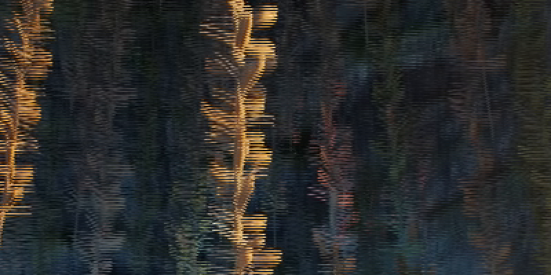

Und noch etwas zeigt `ls -l`: `tilt-interlaced.mp4` ist größer als `tilt.mp4`, obwohl es kein Bild mehr hat. Die feinen Streifen sind für einen Codec schwer zu speichern. Streams im Internet senden ganze Bilder; Halbbilder gibt es noch im Fernsehen, etwa bei Sendern mit 1080i, dem i für interlaced.
<!-- /after -->

<!-- stage: stufen/frames-2.py as frames.py -->

## Farbe sparen

Das Auge sieht Unterschiede in der Helligkeit viel feiner als Unterschiede in der Farbe. Darauf baut jeder Codec für Video: Er trennt zuerst die Helligkeit von der Farbe und speichert die Farbe gröber.

Die Idee ist älter als jeder Codec. Als das Farbfernsehen kam, sollten die alten Schwarz-Weiß-Fernseher weiter ein Bild zeigen. Darum blieb das Signal für die Helligkeit, wie es war, und die Farbe kam als zwei zusätzliche Signale dazu, mit viel weniger Bandbreite. In den USA sendete man so ab 1954 nach der Norm NTSC. In der Bundesrepublik begann das Farbfernsehen am 25. August 1967 mit PAL, das Walter Bruch bei Telefunken in Hannover entwickelt hatte.

### Helligkeit und Farbe trennen

Statt Rot, Grün und Blau speichert ein Codec drei andere Zahlen: **Y** ist die Helligkeit, auf Englisch **Luma**. **Cb** sagt, wie viel blauer das Pixel ist als ein Grau derselben Helligkeit, und **Cr**, wie viel röter; zusammen heißen die beiden **Chroma**. Die Formeln sind dieselben wie bei JPEG:

$$Y = 0{,}299\,R + 0{,}587\,G + 0{,}114\,B$$

$$Cb = 128 - 0{,}168736\,R - 0{,}331264\,G + 0{,}5\,B$$

$$Cr = 128 + 0{,}5\,R - 0{,}418688\,G - 0{,}081312\,B$$

Grün zählt für die Helligkeit am meisten, weil das Auge für Grün am empfindlichsten ist, Blau am wenigsten. Bei einem Grau sind R, G und B gleich: Dann ist Y genau dieser Wert, und Cb und Cr sind 128, denn die Zahlen vor R, G und B ergeben in beiden Zeilen zusammen 0. Fernsehen in HD rechnet mit etwas anderen Gewichten (die Norm BT.709) und lässt Y nur von 16 bis 235 laufen; die Idee ist dieselbe. Wie die drei Teile zusammen ein Foto ergeben, zeigt <a href='/colorspace' target='_blank' rel='noopener'>Trennung von Helligkeit und Farbe</a>.

Für dieses Kapitel gibt es ein einzelnes Bild als PNG, von derselben Stelle des Films wie `slope.mp4`. Warum kein Bild aus `slope.mp4`, steht am Ende des Kapitels.

```bash_copy
wget ${web_root}/video/slope.png
```

Lege `chroma.py` an:

<!-- page-code: own -->
```python
import numpy as np
from PIL import Image


def to_ycbcr(rgb):
    # hier: Y, Cb und Cr aus R, G und B


def save_grey(path, plane):
    Image.fromarray(plane.round().clip(0, 255).astype(np.uint8)).save(path)


if __name__ == '__main__':
    frame = np.asarray(Image.open('slope.png').convert('RGB'))
    ycbcr = to_ycbcr(frame)
    save_grey('y.png', ycbcr[..., 0])
    save_grey('cb.png', ycbcr[..., 1])
    save_grey('cr.png', ycbcr[..., 2])
```

`save_grey` speichert eine Ebene als Graubild: runden, auf 0 bis 255 begrenzen, in Bytes umwandeln.

<div class='hint own' data-check='ycbcr'>
<strong>Jetzt bist du dran:</strong> Schreib <code>to_ycbcr(rgb)</code>. Es bekommt ein Array, dessen letzte Achse R, G und B sind, für ein Pixel, ein Bild oder ein ganzes Video, und gibt ein Array derselben Form zurück, dessen letzte Achse Y, Cb und Cr sind.
</div>

<!-- hint -->
`rgb[..., 0]` sind alle Werte für Rot, egal wie viele Achsen davor stehen: Die drei Punkte heißen »alle Achsen davor«. Mit `r`, `g` und `b` rechnest du die Formeln oben für alle Pixel auf einmal.
<!-- /hint -->
<!-- hint -->
`np.stack([y, cb, cr], axis=-1)` legt die drei wieder zusammen, als neue letzte Achse.

```python
r, g, b = rgb[..., 0], rgb[..., 1], rgb[..., 2]
y = 0.299 * r + 0.587 * g + 0.114 * b
```
<!-- /hint -->

<!-- solution -->
```python
def to_ycbcr(rgb):
    r, g, b = rgb[..., 0], rgb[..., 1], rgb[..., 2]
    y = 0.299 * r + 0.587 * g + 0.114 * b
    cb = 128 - 0.168736 * r - 0.331264 * g + 0.5 * b
    cr = 128 + 0.5 * r - 0.418688 * g - 0.081312 * b
    return np.stack([y, cb, cr], axis=-1)
```
<!-- /solution -->

_task(ycbcr)

Das Mädchen in `slope.png` trägt eine rote Jacke. Bevor du das Programm startest:

_task(jacket)

```bash
python3 chroma.py
```

<!-- tutorial-step
terminal-run: cd /workspace/video && (test -f slope.png || curl -sO http://workspace_nginx_1/video/slope.png) && ls -l slope.png
terminal-wait-for-prompt: 30
wait-for-text: slope.png
-->

<!-- after: jacket -->
<!-- tutorial-step
write-file: video/chroma.py <- file:stufen/chroma-1.py
check-task: ycbcr
terminal-run: python3 chroma.py && ls *.png
terminal-wait-for-prompt: 60
wait-for-text: y.png
-->

Öffne `y.png`, `cb.png` und `cr.png`:

<div class='gallery'>
<figure>
<!-- tutorial-screenshot
image-file: video/y.png 1
-->
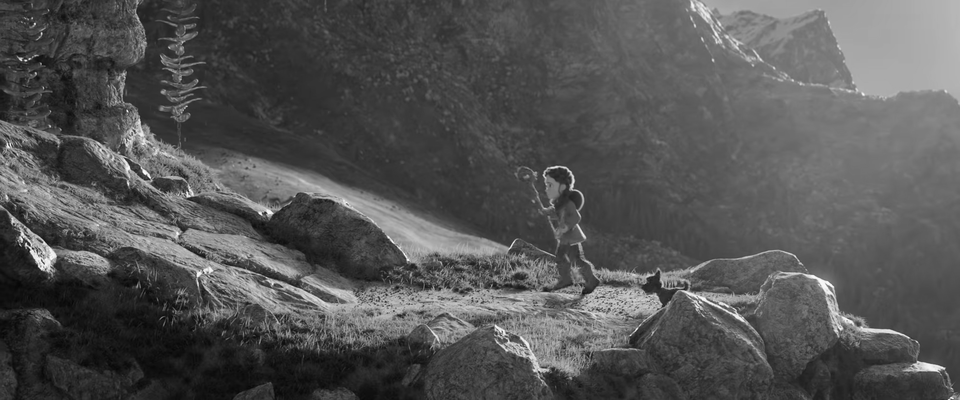
<figcaption>Y: die Helligkeit</figcaption></figure>
<figure>
<!-- tutorial-screenshot
image-file: video/cb.png 1
-->
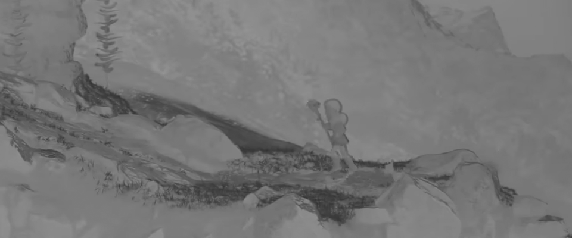
<figcaption>Cb: blauer oder weniger blau als Grau</figcaption></figure>
<figure>
<!-- tutorial-screenshot
image-file: video/cr.png 1
-->
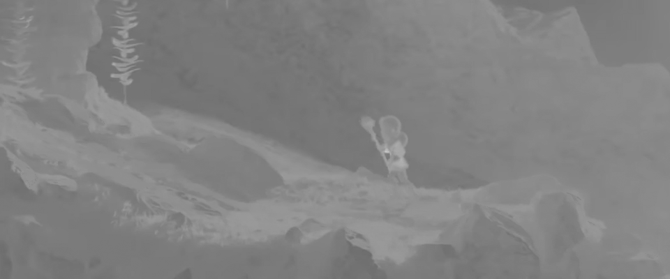
<figcaption>Cr: röter oder weniger rot als Grau</figcaption></figure>
</div>

`y.png` sieht aus wie ein Schwarz-Weiß-Foto, mit allen Einzelheiten. `cb.png` und `cr.png` sind fast überall ein mittleres Grau nahe 128, denn die meisten Farben in der Natur sind nicht sehr bunt. Die Jacke ist in Cr deutlich heller, im Mittel 162, weil sie viel röter ist als ein Grau derselben Helligkeit, und in Cb etwas dunkler, im Mittel 105, weil sie wenig Blau hat. Am dunkelsten in Cb ist das Gras in der Abendsonne: Gelb hat kaum Blau.
<!-- /after -->

### Chroma Subsampling

Wenn das Auge die Farbe nicht so scharf sieht, genügt sie gröber: für jedes Quadrat aus 2 × 2 Pixeln ein Cb und ein Cr, der Mittelwert aus vier. Y bleibt für jedes Pixel. Das heißt **Chroma Subsampling**, und so, wie es fast jedes Video macht, **4:2:0**. Die Zahlen kommen aus der Fernsehtechnik: In einem Streifen aus 4 Pixeln Breite und 2 Zeilen hat die erste Zeile 2 Werte für die Farbe und die zweite 0 neue. Bei 4:4:4 bleibt alles, bei 4:2:2 wird die Farbe nur halb so breit.

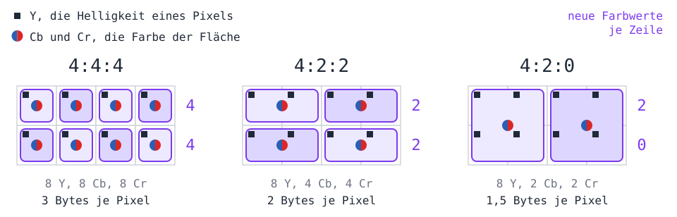
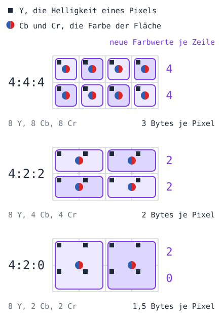

_task(bytes-420)

Erweitere `chroma.py`. `subsample(plane, n)` soll eine Ebene gröber machen, `upsample` macht sie wieder so groß wie vorher, indem es jeden Wert `n`-mal nach unten und `n`-mal nach rechts wiederholt. `from_ycbcr` rechnet zurück nach R, G und B, mit den Formeln aus <a href='/jpeg' target='_blank' rel='noopener'>der JPEG-Aktivität</a>, und `save_detail` speichert einen Ausschnitt um das Mädchen, dreimal so groß:

<!-- page-code: own -->
```python
def from_ycbcr(ycbcr):
    y, cb, cr = ycbcr[..., 0], ycbcr[..., 1] - 128, ycbcr[..., 2] - 128
    r = y + 1.402 * cr
    g = y - 0.344136 * cb - 0.714136 * cr
    b = y + 1.772 * cb
    return np.stack([r, g, b], axis=-1).round().clip(0, 255).astype(np.uint8)


def subsample(plane, n=2):
    # hier: der Mittelwert jedes Quadrats aus n × n Werten


def upsample(plane, n=2):
    return np.repeat(np.repeat(plane, n, axis=0), n, axis=1)


def save_detail(path, rgb):
    Image.fromarray(rgb[130:310, 460:700]).resize((720, 540), Image.NEAREST).save(path)
```

Und unten im Hauptprogramm, nach den drei Graubildern:

```python
    small_chroma = ycbcr.copy()
    small_chroma[..., 1] = upsample(subsample(ycbcr[..., 1]))
    small_chroma[..., 2] = upsample(subsample(ycbcr[..., 2]))
    small_luma = ycbcr.copy()
    small_luma[..., 0] = upsample(subsample(ycbcr[..., 0]))
    save_detail('detail.png', frame)
    save_detail('detail-chroma.png', from_ycbcr(small_chroma))
    save_detail('detail-luma.png', from_ycbcr(small_luma))
```

`small_chroma` hat die Farbe gröber, `small_luma` zum Vergleich die Helligkeit.

<div class='hint own' data-check='subsample'>
<strong>Jetzt bist du dran:</strong> Schreib <code>subsample(plane, n)</code>: Es bekommt eine Ebene mit zwei Achsen, deren Höhe und Breite Vielfache von <code>n</code> sind, und gibt eine Ebene zurück, die <code>n</code>-mal kleiner ist, in jeder Richtung. Jeder Wert ist der Mittelwert eines Quadrats aus <code>n</code> × <code>n</code> Werten.
</div>

<!-- hint -->
Nur jeden <code>n</code>-ten Wert zu nehmen, `plane[::n, ::n]`, wäre einfacher, aber dann bestimmt ein Pixel allein die Farbe von vier. Für den Mittelwert hilft `reshape`: Eine Ebene der Höhe `height` und Breite `width` lässt sich als Array mit vier Achsen lesen, `plane.reshape(height // n, n, width // n, n)`. Die zweite Achse ist dann die Zeile innerhalb eines Quadrats, die vierte die Spalte.
<!-- /hint -->
<!-- hint -->
`mean(axis=(1, 3))` mittelt über die Zeilen und Spalten innerhalb jedes Quadrats und lässt die beiden anderen Achsen stehen.

```python
height, width = plane.shape
```
<!-- /hint -->

<!-- solution -->
```python
def subsample(plane, n=2):
    height, width = plane.shape
    return plane.reshape(height // n, n, width // n, n).mean(axis=(1, 3))
```
<!-- /solution -->

_task(subsample)

```bash
python3 chroma.py
```

<!-- tutorial-step
write-file: video/chroma.py <- file:stufen/chroma-2.py
check-task: subsample
terminal-run: python3 chroma.py && ls detail*
terminal-wait-for-prompt: 60
wait-for-text: detail-luma.png
-->

Öffne die drei Ausschnitte:

<div class='gallery columns-3'>
<figure>
<!-- tutorial-screenshot
image-file: video/detail.png 1
-->

<figcaption>Das Original</figcaption></figure>
<figure>
<!-- tutorial-screenshot
image-file: video/detail-chroma.png 1
-->
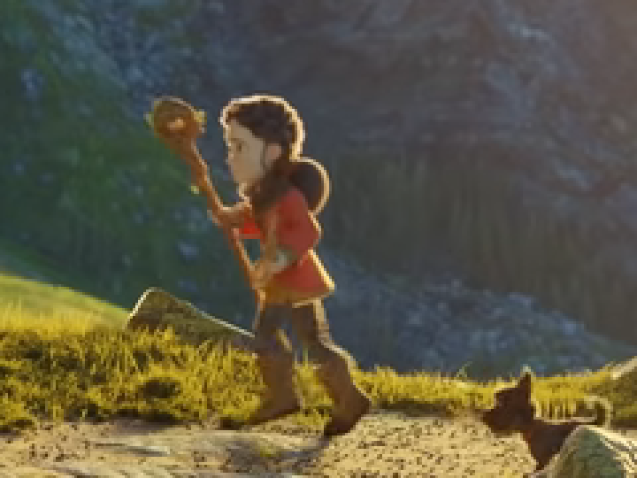
<figcaption>Farbe gröber: Cb und Cr in 2 × 2 gemittelt</figcaption></figure>
<figure>
<!-- tutorial-screenshot
image-file: video/detail-luma.png 1
-->
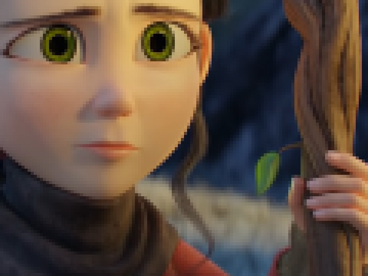
<figcaption>Helligkeit gröber: Y in 2 × 2 gemittelt</figcaption></figure>
</div>

Mit gröberer Farbe sieht der Ausschnitt aus wie das Original. Mit gröberer Helligkeit ist er sichtbar unscharf, obwohl er sogar mehr Zahlen behält: Y für jedes vierte Pixel und Cb und Cr für jedes Pixel sind 96.000 + 2 · 384.000 = 864.000 Werte, bei 4:2:0 sind es 576.000.

<div class='hint try'>
<strong>Ausprobieren:</strong> Mach die Farbe noch gröber: <code>upsample(subsample(ycbcr[..., 1], 4), 4)</code>, ebenso für Cr, und dann mit 8. Ab wann siehst du einen Unterschied? Achte auf die Ränder der roten Jacke und auf den Stab davor.
</div>

### Schon gespart

Warum `slope.png` und kein Bild aus `slope.mp4`? In `write_video` steht `-pix_fmt yuv420p`: Jede MP4-Datei dieser Seite ist schon 4:2:0, wie fast jedes Video im Internet, auf Blu-ray und im Fernsehen. Ein Bild aus `slope.mp4` hat Cb und Cr also schon gemittelt, und `subsample` fände nichts mehr zu sparen. `slope.png` ist auch aus dem Film von YouTube gemacht, der seine Farbe in 4:2:0 hat, aber für 2.048 Pixel Breite: 1.024 Werte je Zeile. Verkleinert auf 960 Pixel bekommt fast jedes Pixel wieder eine eigene Farbe.

<div class='hint try'>
<strong>Ausprobieren:</strong> Gib im Hauptprogramm aus, wie weit <code>small_chroma</code> im Mittel vom Original abweicht: <code>print(np.abs(from_ycbcr(small_chroma).astype(int) - frame).mean())</code>. Dann nimm statt <code>slope.png</code> das erste Bild aus <code>slope.mp4</code>, <code>read_frames('slope.mp4')[0]</code> mit <code>from video import read_frames</code>. Wie ändert sich die Zahl?
</div>

<!-- stage: stufen/chroma-2.py as chroma.py -->

## Innerhalb eines Bildes

Bevor ein Codec Bilder miteinander vergleicht, muss er ein einzelnes Bild gut speichern können: das erste eines Videos und jedes, mit dem eine neue Szene beginnt. Dafür macht er fast dasselbe wie JPEG. Er teilt das Bild in Blöcke, zerlegt jeden Block in Frequenzen und rundet sie grob. Neu ist ein Trick: Jeder Block wird aus den Pixeln vorhergesagt, die schon gespeichert sind, und nur der Rest kommt in die Datei.

### Blöcke und Frequenzen

Ein Block aus 8 × 8 Helligkeiten lässt sich als Summe von 64 **Basisbildern** schreiben: Muster aus Kosinus-Wellen, vom ganz glatten Block bis zum feinen Schachbrett. Die **DCT** (Diskrete Kosinustransformation) rechnet aus, wie stark jedes Muster im Block vorkommt; diese 64 Zahlen heißen **Koeffizienten**. Das ist dieselbe Idee wie bei der MDCT in »Audio komprimieren«, nur in zwei Richtungen; ausführlich steht es in <a href='/jpeg' target='_blank' rel='noopener'>der JPEG-Aktivität</a>.

Hier ist ein Block aus `slope.png`, die Wange des Mädchens mit dem Rand ihrer dunklen Haare rechts. Seine Koeffizienten sind schon auf Vielfache von 8 gerundet, und nur 20 der 64 sind nicht 0. Schritt für Schritt kommt ein Basisbild nach dem anderen dazu:

<script src='/include/idct_stepper.js'></script>
<div class='idct-stepper' data-stepper data-coef='-80 64 -72 32 -16 8 8 0 16 -24 0 0 -16 16 -8 8 -8 -8 0 -8 0 0 0 0 8 -8 0 -8 0 -8 0 0 0 0 0 0 0 0 0 0 0 0 0 0 0 0 0 0 0 0 0 0 0 0 0 0 0 0 0 0 0 0 0 0'></div>

Die ersten Koeffizienten bringen fast alles: die mittlere Helligkeit und den dunklen Rand rechts. Was danach kommt, sind feine Muster, und gerade bei denen sieht das Auge Fehler kaum. Darum rundet ein Codec sie grob, und viele werden 0.

Lege `blocks.py` an. Es braucht `to_ycbcr` aus `chroma.py`:

<!-- page-code: own -->
```python
import numpy as np
from PIL import Image

from chroma import to_ycbcr


def dct_matrix(n):
    k = np.arange(n)[:, None]
    i = np.arange(n)[None, :]
    d = np.cos((2 * i + 1) * k * np.pi / (2 * n)) * np.sqrt(2 / n)
    d[0] /= np.sqrt(2)
    return d


def split(plane, n):
    height, width = plane.shape
    return plane.reshape(height // n, n, width // n, n).swapaxes(1, 2)


def join(blocks):
    rows, columns, n, _ = blocks.shape
    return blocks.swapaxes(1, 2).reshape(rows * n, columns * n)


def dct(blocks):
    d = dct_matrix(blocks.shape[-1])
    return d @ blocks @ d.T


def idct(coefficients):
    d = dct_matrix(coefficients.shape[-1])
    return d.T @ coefficients @ d


def bits(levels):
    n = levels.shape[-1]
    flat = levels.reshape(-1, n * n)
    total = 0
    for k in range(n * n):
        _, counts = np.unique(flat[:, k], return_counts=True)
        p = counts / len(flat)
        total += -(p * np.log2(p)).sum() * len(flat)
    return total


def quantize(blocks, step):
    # hier: die Koeffizienten, durch step geteilt und gerundet


def restore(levels, step):
    # hier: zurück zu Pixeln


def save_detail(path, plane):
    grey = plane.round().clip(0, 255).astype(np.uint8)
    Image.fromarray(grey[130:310, 460:700]).resize((720, 540), Image.NEAREST).save(path)


if __name__ == '__main__':
    luma = to_ycbcr(np.asarray(Image.open('slope.png').convert('RGB')))[..., 0]
    blocks = split(luma - 128, 8)
    for step in (8, 32, 64):
        levels = quantize(blocks, step)
        share = np.count_nonzero(levels) / levels.size
        print(f'Schritt {step}: {share:.1%} nicht 0, {bits(levels) / luma.size:.2f} Bits je Pixel')
        save_detail(f'step-{step}.png', join(restore(levels, step)) + 128)
```

`dct_matrix(n)` hat in Zeile `k` das `k`-te Kosinus-Muster mit `n` Werten. `split` legt eine Ebene in Blöcke, mit demselben `reshape` wie `subsample`; `swapaxes(1, 2)` tauscht zwei Achsen, sodass `blocks[r, c]` der Block in Reihe `r` und Spalte `c` ist, mit `n` × `n` Pixeln. `join` setzt die Blöcke wieder zusammen. `dct` multipliziert jeden Block von links und von rechts mit der Matrix, einmal für die Zeilen und einmal für die Spalten; der Operator `@` macht das für alle Blöcke auf einmal. `idct` rechnet zurück: Die Matrix ist so gebaut, dass ihre Transponierte `d.T` ihre Inverse ist.

`bits` schätzt, wie viele Bits die gerundeten Koeffizienten brauchen, mit der Entropie wie bei FLAC in »Audio komprimieren«. Weil der Koeffizient oben links fast immer groß ist und die rechts unten fast immer 0, zählt `bits` für jede Position im Block eine eigene Tabelle, so wie es die Codecs machen. Vor der DCT zieht das Hauptprogramm von jeder Helligkeit 128 ab, damit ein mittleres Grau 0 ist.

<div class='hint own' data-check='quantize'>
<strong>Jetzt bist du dran:</strong> Schreib <code>quantize(blocks, step)</code> und <code>restore(levels, step)</code>. <code>quantize</code> gibt die Koeffizienten aller Blöcke zurück, durch <code>step</code> geteilt und auf ganze Zahlen gerundet. <code>restore</code> macht daraus wieder Pixel: mit <code>step</code> multiplizieren und zurückrechnen.
</div>

<!-- hint -->
`dct(blocks)` gibt die Koeffizienten aller Blöcke auf einmal, `np.round` rundet ein ganzes Array.
<!-- /hint -->
<!-- hint -->
`restore` ist der Weg zurück: `levels * step` sind die gerundeten Koeffizienten, und `idct` macht aus Koeffizienten Pixel.

```python
def quantize(blocks, step):
    return np.round(dct(blocks) / step)
```
<!-- /hint -->

<!-- solution -->
```python
def quantize(blocks, step):
    return np.round(dct(blocks) / step)


def restore(levels, step):
    return idct(levels * step)
```
<!-- /solution -->

_task(quantize)

Das Programm speichert für die Schritte 8, 32 und 64 einen Ausschnitt um das Mädchen. Bevor du es startest:

_task(tiles)

```bash
python3 blocks.py
```

<!-- tutorial-step
write-file: video/blocks.py <- file:stufen/blocks-1.py
check-task: quantize
terminal-run: python3 blocks.py
terminal-wait-for-prompt: 60
wait-for-text: Schritt 64
-->

<!-- after: tiles -->
<div class='gallery columns-3'>
<figure>
<!-- tutorial-screenshot
image-file: video/step-8.png 1
-->

<figcaption>Schritt 8: 33 % der Koeffizienten nicht 0</figcaption></figure>
<figure>
<!-- tutorial-screenshot
image-file: video/step-32.png 1
-->
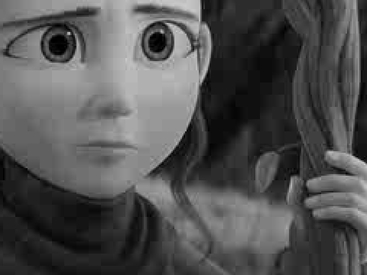
<figcaption>Schritt 32: 11,5 %</figcaption></figure>
<figure>
<!-- tutorial-screenshot
image-file: video/step-64.png 1
-->

<figcaption>Schritt 64: 5,4 %</figcaption></figure>
</div>

Bei Schritt 64 zerfällt der Hintergrund in Kacheln aus 8 × 8 Pixeln. In jedem Block blieb kaum mehr als der Koeffizient für die mittlere Helligkeit, und benachbarte Blöcke treffen sich mit einer Kante. Das ist das bekannteste Artefakt von JPEG und von Videos mit zu wenigen Bits. Bei Schritt 32 braucht das Bild 0,67 Bits je Pixel statt 8, ein Zwölftel, und ist noch gut zu erkennen.
<!-- /after -->

### Vorhersage im Bild

Ein Codec speichert die Blöcke nacheinander, Zeile für Zeile. Wenn er an einen Block kommt, kennen er und später der Decoder schon die Pixel darüber und links davon. Aus ihnen sagt er den Block voraus und speichert nur, was von der Vorhersage abweicht: den Rest, auf Englisch **Residual**. Für 4 × 4 Pixel kennt H.264 (2003) neun Arten der Vorhersage, H.265 (2013) 35, AV1 (2018) über 60. Die drei einfachsten:

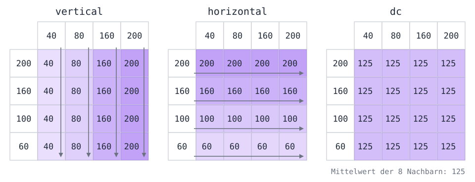
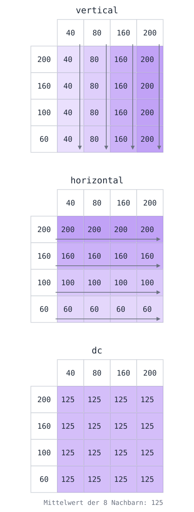

Bei einer senkrechten Kante passt `vertical`, bei einem waagerechten Horizont `horizontal`, bei einer ruhigen Fläche `dc`. Der Encoder probiert alle und nimmt die, deren Rest am kleinsten ist; welche er nahm, schreibt er mit in die Datei.

Erweitere `blocks.py` um die Vorhersage:

<!-- page-code: own -->
```python
MODES = ['vertical', 'horizontal', 'dc']


def predict(above, left, mode):
    # hier: ein Block aus n × n Pixeln, vorhergesagt aus above und left


def best_mode(block, above, left):
    # hier: die Art der Vorhersage mit dem kleinsten Rest


def residual(plane, n):
    height, width = plane.shape
    rest = np.zeros_like(plane)
    for y in range(0, height, n):
        for x in range(0, width, n):
            block = plane[y:y + n, x:x + n]
            above = plane[y - 1, x:x + n] if y > 0 else np.full(n, 128.0)
            left = plane[y:y + n, x - 1] if x > 0 else np.full(n, 128.0)
            rest[y:y + n, x:x + n] = block - predict(above, left, best_mode(block, above, left))
    return rest
```

`residual` geht die Blöcke durch. `above` ist die Zeile über dem Block, `left` die Spalte links davon; am oberen und linken Rand gibt es keine Nachbarn, dort nimmt es ein mittleres Grau. Ein echter Encoder sagt aus den Pixeln voraus, die der Decoder schon hat, also aus den gerundeten. Hier nehmen wir die Originale: Das ist einfacher und macht die Vorhersage etwas zu gut.

<div class='hint own' data-check='predict'>
<strong>Jetzt bist du dran:</strong> Schreib <code>predict(above, left, mode)</code>. <code>above</code> und <code>left</code> sind Arrays mit je <code>n</code> Werten. Das Ergebnis ist ein Block aus <code>n</code> × <code>n</code> Pixeln wie in der Zeichnung: bei <code>'vertical'</code> in jeder Zeile <code>above</code>, bei <code>'horizontal'</code> in jeder Spalte <code>left</code>, bei <code>'dc'</code> überall der Mittelwert aller <code>2 * n</code> Nachbarn.
</div>

<!-- hint -->
`np.tile(a, (n, 1))` legt ein Array `n`-mal untereinander. Für `'horizontal'` muss `left` eine Spalte werden: `left[:, None]` hat die Form `(n, 1)`.
<!-- /hint -->
<!-- hint -->
`np.full((n, n), value)` ist ein Block, in dem überall `value` steht.

```python
n = len(above)
if mode == 'vertical':
    return np.tile(above, (n, 1))
```
<!-- /hint -->

<!-- solution -->
```python
def predict(above, left, mode):
    n = len(above)
    if mode == 'vertical':
        return np.tile(above, (n, 1))
    if mode == 'horizontal':
        return np.tile(left[:, None], (1, n))
    return np.full((n, n), (above.sum() + left.sum()) / (2 * n))
```
<!-- /solution -->

_task(predict)

<div class='hint own' data-check='best-mode'>
<strong>Jetzt bist du dran:</strong> Schreib <code>best_mode(block, above, left)</code>: Es probiert jede Art aus <code>MODES</code> und gibt die zurück, bei der die Summe der Beträge von <code>block - predict(above, left, mode)</code> am kleinsten ist.
</div>

<!-- hint -->
`np.abs(a).sum()` ist die Summe der Beträge. Merk dir in einer Schleife über `MODES` die beste Art und ihren Fehler.
<!-- /hint -->
<!-- hint -->
```python
best, best_error = None, None
for mode in MODES:
    error = np.abs(block - predict(above, left, mode)).sum()
```
<!-- /hint -->

<!-- solution -->
```python
def best_mode(block, above, left):
    best, best_error = None, None
    for mode in MODES:
        error = np.abs(block - predict(above, left, mode)).sum()
        if best is None or error < best_error:
            best, best_error = mode, error
    return best
```
<!-- /solution -->

_task(best-mode)

Und unten im Hauptprogramm:

```python
    rest = residual(luma, 4)
    Image.fromarray((rest + 128).round().clip(0, 255).astype(np.uint8)).save('residual.png')
    for name, plane, n in [('8 × 8 ohne Vorhersage', luma - 128, 8),
                           ('4 × 4 ohne Vorhersage', luma - 128, 4),
                           ('4 × 4 mit Vorhersage ', rest, 4)]:
        print(f'{name}: {bits(quantize(split(plane, n), 32)) / luma.size:.2f} Bits je Pixel')
```

`residual.png` zeigt den Rest für Blöcke aus 4 × 4 Pixeln, 128 ist dort ein Rest von 0. Bevor du es öffnest:

_task(residual-look)

```bash
python3 blocks.py
```

<!-- tutorial-step
write-file: video/blocks.py <- file:stufen/blocks-2.py
check-task: predict
check-task: best-mode
terminal-run: python3 blocks.py
terminal-wait-for-prompt: 60
wait-for-text: mit Vorhersage
-->

<!-- after: residual-look -->
<!-- tutorial-screenshot
image-file: video/residual.png 1
-->
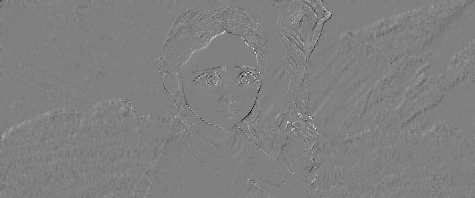

Fast alles ist mittelgrau: Wo das Bild ruhig ist, sagen die Nachbarn den Block gut voraus. Was bleibt, sind Kanten und feine Muster wie das Gras. Die Zahlen:

```text
8 × 8 ohne Vorhersage: 0.67 Bits je Pixel
4 × 4 ohne Vorhersage: 0.79 Bits je Pixel
4 × 4 mit Vorhersage : 0.60 Bits je Pixel
```

Kleine Blöcke folgen den Kanten besser, aber ohne Vorhersage kosten sie mehr: Jeder Block braucht seine eigene mittlere Helligkeit. Mit Vorhersage kommt diese fast umsonst aus den Nachbarn, und die kleinen Blöcke sind um ein Viertel billiger, sogar billiger als die großen ohne Vorhersage. Darum kann H.264 bei Kanten kleine Blöcke nehmen und bei ruhigen Flächen große.

<div class='hint try'>
<strong>Ausprobieren:</strong> Nimm in <code>residual</code> und der letzten Zeile Blöcke aus 8 × 8 Pixeln statt 4 × 4. Hilft die Vorhersage dann noch so viel? Und was ändert sich, wenn du <code>MODES</code> auf <code>['dc']</code> kürzt?
</div>
<!-- /after -->

<!-- stage: stufen/blocks-2.py as blocks.py -->

## Von Bild zu Bild

Zwei Bilder hintereinander sind sich meist sehr ähnlich, zwischen ihnen liegt nur eine vierundzwanzigstel Sekunde. Statt jedes Bild für sich zu speichern, kann ein Codec speichern, was sich geändert hat. Die Idee ist fast hundert Jahre alt: 1929 schlug R. D. Kell in Großbritannien vor, beim Fernsehen nur die Teile eines Bildes zu übertragen, die sich seit dem vorigen geändert haben.

### Unterschiede

Ein Bild aus `read_frames` besteht aus Bytes, Zahlen von 0 bis 255 (`uint8`). Was passiert, wenn man zwei davon voneinander abzieht?

_task(wrap)

<!-- after: wrap -->
Bytes können nicht negativ werden: numpy rechnet `3 - 5` modulo 256 und kommt auf 254. Aus einem kleinen Unterschied wird so ein riesiger. Vor dem Abziehen muss man die Bytes darum in größere Zahlen umwandeln, mit `astype(int)`.
<!-- /after -->

Lege `difference.py` an:

<!-- page-code: own -->
```python
import numpy as np
from PIL import Image

from video import read_frames

CLIPS = ['glance', 'pan', 'slope', 'tilt']


def luma(frames):
    return frames @ np.array([0.299, 0.587, 0.114])


def differences(frames):
    # hier: jedes Bild minus das vorige


if __name__ == '__main__':
    for name in CLIPS:
        frames = read_frames(f'{name}.mp4')[:24]
        d = differences(frames)
        print(f'{name}: im Mittel {np.abs(d).mean():.2f} Unterschied je Wert')
        grey = (luma(d[11]) + 128).round().clip(0, 255).astype(np.uint8)
        Image.fromarray(grey).save(f'{name}-diff.png')
```

`luma` rechnet nur Y aus, die Helligkeit, mit den Gewichten aus `to_ycbcr`; `@` multipliziert die letzte Achse, R, G und B, mit den drei Gewichten. Das Programm nimmt die erste Sekunde jedes Ausschnitts und speichert den Unterschied von Bild 11 zu Bild 12 als Graubild, ein Unterschied von 0 ist mittelgrau.

<div class='hint own' data-check='differences'>
<strong>Jetzt bist du dran:</strong> Schreib <code>differences(frames)</code>: ein Array mit einem Bild weniger als <code>frames</code>, in dem Bild <code>k</code> der Unterschied von Bild <code>k + 1</code> zu Bild <code>k</code> ist, als ganze Zahlen, auch negative.
</div>

<!-- hint -->
`frames[1:]` sind alle Bilder ab dem zweiten, `frames[:-1]` alle bis auf das letzte. Zieht man das eine vom anderen ab, steht an jedem Index der Unterschied zum vorigen Bild.
<!-- /hint -->
<!-- hint -->
Wandle vor dem Abziehen in ganze Zahlen um, sonst rechnet numpy modulo 256:

```python
frames[1:].astype(int)
```
<!-- /hint -->

<!-- solution -->
```python
def differences(frames):
    return frames[1:].astype(int) - frames[:-1]
```
<!-- /solution -->

_task(differences)

```bash
python3 difference.py
```

<!-- tutorial-step
write-file: video/difference.py <- file:stufen/difference-1.py
check-task: differences
terminal-run: python3 difference.py
terminal-wait-for-prompt: 120
wait-for-text: tilt: im Mittel
-->

```text
glance: im Mittel 0.46 Unterschied je Wert
pan: im Mittel 3.94 Unterschied je Wert
slope: im Mittel 5.57 Unterschied je Wert
tilt: im Mittel 12.51 Unterschied je Wert
```

<div class='gallery columns-2'>
<figure>
<!-- tutorial-screenshot
image-file: video/glance-diff.png 1
-->
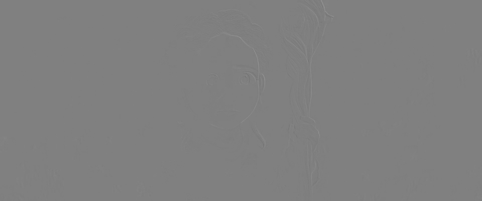
<figcaption><code>glance.mp4</code>: fast nichts</figcaption></figure>
<figure>
<!-- tutorial-screenshot
image-file: video/pan-diff.png 1
-->
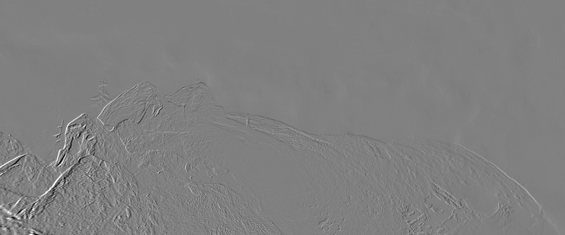
<figcaption><code>pan.mp4</code>: die Kanten des Bergkamms</figcaption></figure>
<figure>
<!-- tutorial-screenshot
image-file: video/slope-diff.png 1
-->
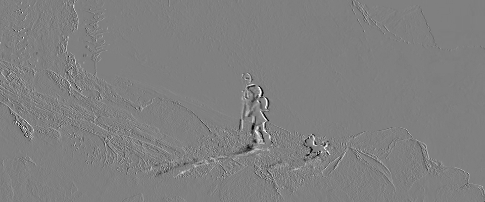
<figcaption><code>slope.mp4</code>: das Mädchen und der Hund, schwach die Felsen</figcaption></figure>
<figure>
<!-- tutorial-screenshot
image-file: video/tilt-diff.png 1
-->
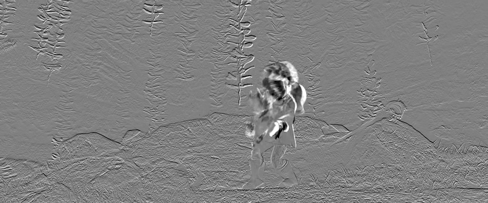
<figcaption><code>tilt.mp4</code>: alles</figcaption></figure>
</div>

Im Blick des Mädchens ändert sich fast nichts. Beim Hang gehen das Mädchen und der Hund, und die Kamera bewegt sich ein wenig mit. Beim Schwenk ändert sich jede Kante, obwohl sich nichts im Bild bewegt außer der Kamera, und bei der schnellen Fahrt die Wand hinauf ändert sich alles.

### Was der Unterschied kostet

Der Unterschied ist eine Ebene wie jede andere: Man kann ihn in Blöcke teilen, mit der DCT zerlegen und runden, mit den Funktionen aus `blocks.py`. Ein Bild allein bekommt dabei die Vorhersage aus den Nachbarn wie in »Innerhalb eines Bildes«.

_task(pan-bits)

Beim Speichern von Unterschieden gibt es eine Falle. Der Decoder kennt das vorige Bild nicht, wie es war, sondern nur, wie er es selbst aus gerundeten Zahlen gebaut hat. `encode_naive` rechnet den Unterschied trotzdem zum Original:

<!-- page-code: own -->
```python
STEP = 32


def code(plane, step):
    return join(restore(quantize(split(plane, 4), step), step))


def encode_naive(planes, step):
    decoded = [code(planes[0] - 128, step) + 128]
    for k in range(1, len(planes)):
        decoded.append(decoded[-1] + code(planes[k] - planes[k - 1], step))
    return np.array(decoded)


def encode(planes, step):
    # hier: der Unterschied zum Bild, das der Decoder hat


def frame_bits(plane, step):
    return bits(quantize(split(plane, 4), step)) / plane.size
```

`code` macht, was Encoder und Decoder zusammen mit einer Ebene tun: teilen, zerlegen, runden und zurück. `decoded` ist die Liste der Bilder, die der Decoder baut, das erste aus dem ersten Bild allein, jedes weitere aus dem vorigen und dem gerundeten Unterschied. `frame_bits` gibt die Bits je Pixel. Oben kommt dazu:

```python
from blocks import split, join, quantize, restore, bits, residual
```

_task(drift)

<div class='hint own' data-check='encode'>
<strong>Jetzt bist du dran:</strong> Schreib <code>encode(planes, step)</code> wie <code>encode_naive</code>, aber so, dass sich der Fehler nicht aufsummiert: Der Unterschied wird zu dem Bild gerechnet, das der Decoder zuletzt gebaut hat, nicht zum Original. Das Ergebnis ist ein Array aller gebauten Bilder.
</div>

<!-- hint -->
Das zuletzt gebaute Bild ist `decoded[-1]`. Der Unterschied des nächsten Bildes zu ihm ist `plane - decoded[-1]`.
<!-- /hint -->
<!-- hint -->
```python
for plane in planes[1:]:
    decoded.append(decoded[-1] + code(plane - decoded[-1], step))
```
<!-- /hint -->

<!-- solution -->
```python
def encode(planes, step):
    decoded = [code(planes[0] - 128, step) + 128]
    for plane in planes[1:]:
        decoded.append(decoded[-1] + code(plane - decoded[-1], step))
    return np.array(decoded)
```
<!-- /solution -->

_task(encode)

Und unten im Hauptprogramm:

```python
    for name in CLIPS:
        planes = luma(read_frames(f'{name}.mp4')[:24])
        alone = frame_bits(residual(planes[12], 4), STEP)
        change = frame_bits(planes[12] - planes[11], STEP)
        print(f'{name}: Bild allein {alone:.2f}, Unterschied {change:.2f} Bits je Pixel')

    planes = luma(read_frames('pan.mp4')[:24])
    for coder in (encode_naive, encode):
        decoded = coder(planes, STEP)
        errors = np.abs(decoded - planes).mean(axis=(1, 2))
        print(coder.__name__, ' '.join(f'{e:.1f}' for e in errors[::4]))
```

Die letzte Schleife gibt für beide Arten den mittleren Fehler der Bilder 0, 4, 8, … aus.

```bash
python3 difference.py
```

<!-- tutorial-step
write-file: video/difference.py <- file:stufen/difference-2.py
check-task: encode
terminal-run: python3 difference.py
terminal-wait-for-prompt: 180
wait-for-text: encode 3.3
-->

<!-- after: drift -->
```text
glance: Bild allein 0.18, Unterschied 0.00 Bits je Pixel
pan: Bild allein 0.32, Unterschied 0.33 Bits je Pixel
slope: Bild allein 0.62, Unterschied 0.55 Bits je Pixel
tilt: Bild allein 0.74, Unterschied 0.98 Bits je Pixel
encode_naive 3.3 5.8 8.0 9.8 11.6 13.2
encode 3.3 3.4 3.4 3.4 3.4 3.5
```

Beim Blick kostet der Unterschied fast nichts: Bei Schritt 32 wird er überall 0. Beim Hang spart er ein wenig. Beim Schwenk kostet er so viel wie das Bild allein, und bei der Fahrt die Wand hinauf sogar mehr. Ein Schwenk verschiebt das ganze Bild; abziehen hilft dann nicht, denn an jeder Kante steht nun etwas anderes.

`encode_naive` verliert in einer Sekunde den Anschluss: Jeder gerundete Unterschied hat einen kleinen Fehler, und der Decoder zählt alle zusammen. Der Fehler wächst von 3,3 auf 13,2 und wüchse weiter, bis zum nächsten Bild, das allein gespeichert ist. `encode` rechnet den Unterschied zum Bild, das der Decoder wirklich hat; was einmal falsch gerundet wurde, steckt im nächsten Unterschied und wird dort ausgeglichen. Darum enthält jeder Encoder einen Decoder. Auch was zu klein war und zu 0 gerundet wurde, geht nicht verloren: Der Unterschied wächst von Bild zu Bild, bis er groß genug ist, und kommt dann an.
<!-- /after -->

<div class='hint try'>
<strong>Ausprobieren:</strong> Rechne die Unterschiede nicht zum vorigen Bild, sondern zum ersten: <code>planes[12] - planes[0]</code>. Bei welchem Ausschnitt wird das teurer, bei welchem kaum?
</div>

<!-- stage: stufen/difference-2.py as difference.py -->
