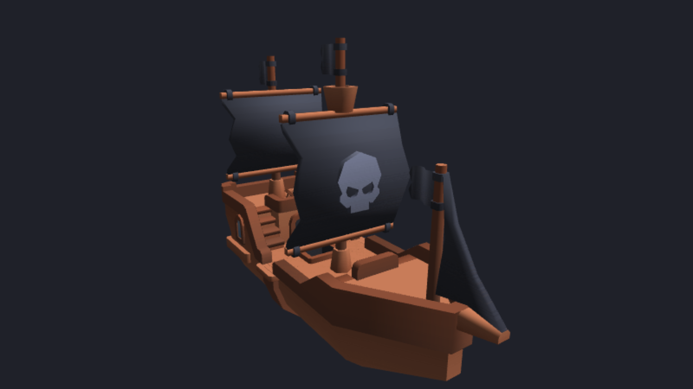

<div class='meta'>
image: teaser.webp
image_alt: "Ein Piratenschiff aus Dreiecken, rotbraun mit schwarzen Segeln und einem Totenkopf, schräg von vorne beleuchtet auf dunklem Grund"
kind: projekt
language: JavaScript / GLSL
duration: 3 Doppelstunden
curriculum: "Oberstufe: Vertiefung Computergrafik (Dreiecke auf der Grafikkarte, Matrizen für Drehung und Perspektive, Z-Buffer, Normalen und Licht, Texturen)"
topics: [computergrafik]
requires: [kata-loops]
reference: [vektoren, workspace]
</div>

<div
    class="autotoc-secondary-trigger"
    data-title="Auf dieser Seite"
    data-levels="h2,h3">
</div>

# 3D-Grafik mit WebGL

<p class='abstract'>
Fast alles, was du in Spielen in 3D siehst, besteht aus Dreiecken, und die Grafikkarte malt Millionen davon in jedem Bild. Du programmierst das selbst, in JavaScript und mit WebGL, direkt im Browser: ein Dreieck, einen Würfel, der sich dreht, den Z-Buffer, der weiß, was vorne ist, Licht aus Normalen, und am Ende ein Piratenschiff aus 3.163 Dreiecken mit Textur, das du mit der Maus drehst und als Drahtgitter siehst.
</p>

Ein 3D-Modell in einem Spiel ist eine Liste von Dreiecken: für jede Ecke eine
Lage im Raum und ein paar Zahlen mehr, eine Farbe oder eine Stelle in einem
Bild. Die Grafikkarte rechnet jede Ecke auf den Bildschirm, füllt jedes
Dreieck mit Pixeln und gibt jedem Pixel eine Farbe. Was sie dafür rechnen
soll, sagst du ihr in zwei kleinen Programmen, den **Shadern**, und in
JavaScript gibst du ihr die Dreiecke.

## Einrichten

### Ein Ordner und ein Schiff

Leg im Terminal einen Ordner an und lade das Schiff herunter, das am Ende
auf dem Bildschirm stehen wird, und das Bild mit seinen Farben:

```bash_copy
mkdir -p ~/webgl
cd ~/webgl
wget https://github.com/specht/workspace-files/raw/main/webgl/ship-pirate-large.obj
wget https://github.com/specht/workspace-files/raw/main/webgl/colormap.png
touch math.js model.js
```

Das Schiff stammt aus dem *Pirate Kit* von [Kenney](https://kenney.nl/assets/pirate-kit),
frei von Rechten (CC0). `touch` legt zwei leere Dateien an, die du später
füllst.

Öffne den Ordner jetzt in VS Code: <kbd>Strg</kbd>+<kbd>K</kbd>, dann
<kbd>Strg</kbd>+<kbd>O</kbd>, schreib `/workspace/webgl/` und bestätige mit
<kbd>Enter</kbd>. Leg darin die Datei `index.html` an:

```html
<!DOCTYPE html>
<html lang="de">
<head>
    <meta charset="UTF-8">
    <title>WebGL</title>
    <style>
        html, body { margin: 0; height: 100%; background: #1e2228; }
        canvas { display: block; width: 100%; height: 100%; }
    </style>
</head>
<body>
    <canvas id="canvas"></canvas>
    <script src="math.js"></script>
    <script src="model.js"></script>
    <script src="main.js"></script>
</body>
</html>
```

Die Seite besteht aus einer einzigen Fläche zum Malen, dem `canvas`, so groß
wie das Fenster. Die drei Skripte füllst du nacheinander: `main.js` malt,
`math.js` rechnet mit Matrizen, `model.js` liest das Schiff.

### Vorschau starten

Leg noch eine leere Datei `main.js` an und klicke unten rechts auf
»Go Live« (Handbuch, [Workspace](/reference/workspace)). Die Vorschau zeigt
eine dunkle Fläche: Noch malt nichts.

<!-- tutorial-step
# Der Ordner mit dem Schiff, in VS Code geöffnet, index.html und die
# Vorschau; main.js gleich mit dem Dreieck, das das nächste Bild zeigt
hide-left-sidebar
terminal-open
terminal-run: mkdir -p ~/webgl && cd ~/webgl && wget -q https://github.com/specht/workspace-files/raw/main/webgl/ship-pirate-large.obj && wget -q https://github.com/specht/workspace-files/raw/main/webgl/colormap.png && touch math.js model.js
terminal-wait-for-prompt
hide-bottom-panel
press: Control+K
press: Control+O
wait-for-input-value: /workspace/
type: webgl
press: Enter
wait-for-input-value: /workspace/webgl/
press: Enter
wait-for-text: colormap.png
write-file: webgl/index.html <- file:stufen/index.html
write-file: webgl/main.js <- file:stufen/main-1.js
go-live
-->

## Ein Dreieck

### Was die Grafikkarte tut

Ein Bild entsteht auf der Grafikkarte in einer festen Folge von Schritten,
der **Pipeline**:


Der **Vertex-Shader** läuft für jede Ecke und sagt, wo sie auf dem Bildschirm
landet. Die **Rasterung** findet alle Pixel, die ein Dreieck bedeckt; die
macht die Grafikkarte allein. Der **Fragment-Shader** läuft für jedes dieser
Pixel und sagt, welche Farbe es bekommt. Beide Shader schreibt man in
**GLSL**, einer Sprache wie C, die die Grafikkarte ausführt; wenn du die
Aktivität [Shader in GLSL](/glsl) kennst, kennst du den Fragment-Shader schon.

Auf dem Bildschirm rechnet WebGL in **Clip-Koordinaten**: \\(x\\) von −1
(links) bis 1 (rechts), \\(y\\) von −1 (unten) bis 1 (oben), egal wie groß
das Fenster ist.

### Zwei Shader

Schreib in `main.js`:

```js_copy
const canvas = document.getElementById('canvas');
const gl = canvas.getContext('webgl2');

const vertexShader = `#version 300 es
in vec2 position;
in vec3 color;
out vec3 v_color;
void main() {
    gl_Position = vec4(position, 0.0, 1.0);
    v_color = color;
}`;

const fragmentShader = `#version 300 es
precision highp float;
in vec3 v_color;
out vec4 color;
void main() {
    color = vec4(v_color, 1.0);
}`;

function compile(type, source) {
    const shader = gl.createShader(type);
    gl.shaderSource(shader, source);
    gl.compileShader(shader);
    if (!gl.getShaderParameter(shader, gl.COMPILE_STATUS)) {
        throw new Error(gl.getShaderInfoLog(shader));
    }
    return shader;
}

const program = gl.createProgram();
gl.attachShader(program, compile(gl.VERTEX_SHADER, vertexShader));
gl.attachShader(program, compile(gl.FRAGMENT_SHADER, fragmentShader));
gl.linkProgram(program);
gl.useProgram(program);

// drei Ecken: x, y und eine Farbe (Rot, Grün, Blau)
const vertices = [
    -0.6, -0.5,   1.0, 0.0, 0.0,
     0.6, -0.5,   0.0, 1.0, 0.0,
     0.0,  0.6,   0.0, 0.0, 1.0,
];
const buffer = gl.createBuffer();
gl.bindBuffer(gl.ARRAY_BUFFER, buffer);
gl.bufferData(gl.ARRAY_BUFFER, new Float32Array(vertices), gl.STATIC_DRAW);
const attributes = [['position', 2, 0], ['color', 3, 2]];
for (const [name, size, offset] of attributes) {
    const location = gl.getAttribLocation(program, name);
    gl.enableVertexAttribArray(location);
    gl.vertexAttribPointer(location, size, gl.FLOAT, false, 5 * 4, offset * 4);
}

canvas.width = canvas.clientWidth;
canvas.height = canvas.clientHeight;
gl.viewport(0, 0, canvas.width, canvas.height);
gl.clearColor(0.12, 0.13, 0.16, 1);
gl.clear(gl.COLOR_BUFFER_BIT);
gl.drawArrays(gl.TRIANGLES, 0, 3);
```

Was darin passiert:

- `gl` ist das Tor zur Grafikkarte; alles, was mit `gl.` anfängt, ist ein
  Befehl an sie.
- Der Vertex-Shader bekommt für jede Ecke `position` (zwei Zahlen) und
  `color` (drei Zahlen). Er schreibt die Lage in `gl_Position` (vier Zahlen;
  was die dritte und vierte bedeuten, kommt im nächsten Kapitel) und gibt die
  Farbe als `v_color` weiter.
- Der Fragment-Shader bekommt `v_color` und schreibt die Farbe des Pixels in
  `color`, mit 1.0 für »undurchsichtig«.
- `compile` übersetzt einen Shader; `gl.linkProgram` verbindet beide zu einem
  Programm. Hat ein Shader einen Fehler, steht er in der Konsole des Browsers
  (in der Vorschau <kbd>F12</kbd>).
- Die Ecken stehen in einem einzigen Array, fünf Zahlen je Ecke.
  `gl.bufferData` schickt sie auf die Grafikkarte. Die Schleife über
  `attributes` sagt ihr, wie sie zu lesen sind: `position` sind 2 Zahlen ab
  der Zahl 0 jeder Ecke, `color` 3 Zahlen ab der Zahl 2, und eine Ecke ist
  5 · 4 Bytes lang (eine Zahl als `float` hat 4 Bytes).
- Am Ende: die Fläche so groß wie das Fenster, ein dunkler Hintergrund, und
  `gl.drawArrays` malt aus den Ecken 0 bis 2 ein Dreieck.

### Farben dazwischen

Jede Ecke hat ihre Farbe, aber das Dreieck hat sehr viele Pixel, und für
jedes läuft der Fragment-Shader. Woher bekommt ein Pixel in der Mitte sein
`v_color`?

_task(farbe-mitte)

<!-- after: farbe-mitte -->
<!-- tutorial-scope -->
<!-- tutorial-screenshot
write-file: webgl/main.js <- file:stufen/main-1.js
preview-reload
tab: preview
viewport: 800x450
sleep: 1.5
-->


<!-- /tutorial-scope -->

Was ein Vertex-Shader mit `out` weitergibt, mischt die Rasterung für jedes
Pixel aus den drei Ecken, nach seiner Nähe zu jeder: Ein Pixel nahe der
roten Ecke bekommt fast Rot, eines in der Mitte von jeder Ecke ein Drittel,
also ein Grau. Genauso werden gleich Normalen und Stellen in einem Bild
gemischt.
<!-- /after -->

## Vom Raum auf den Bildschirm

### Matrizen

Ein Würfel hat Ecken im Raum, \\((x, y, z)\\). Bis sie auf dem Bildschirm
landen, werden sie mehrmals umgerechnet: gedreht, verschoben, perspektivisch
verkleinert. Jede dieser Umrechnungen ist eine **Matrix**, vier Zeilen mit je
vier Zahlen. Multipliziert man eine Matrix mit einem Punkt
\\((x, y, z, 1)\\), kommt der umgerechnete Punkt heraus; die vierte Zahl,
die 1, ist der Trick, mit dem eine Matrix auch verschieben kann.

WebGL möchte eine Matrix als Array aus 16 Zahlen, **Spalte für Spalte**: Die
Zahl in Zeile \\(r\\) und Spalte \\(c\\) steht beim Index \\(4c + r\\).
Eine Verschiebung um \\((x, y, z)\\) hat diese Zahlen in der letzten Spalte:

```js
function translate(x, y, z) {
    return [1, 0, 0, 0,  0, 1, 0, 0,  0, 0, 1, 0,  x, y, z, 1];
}
```

Zwei Umrechnungen nacheinander sind das **Produkt** ihrer Matrizen: Die Zahl
in Zeile \\(r\\) und Spalte \\(c\\) von \\(A \cdot B\\) ist die Summe
über \\(k\\) von \\(A\_{rk} \cdot B\_{kc}\\). Dabei zählt die Reihenfolge:
\\(A \cdot B\\) rechnet einen Punkt erst mit \\(B\\) um, dann mit
\\(A\\).

Schreib in `math.js`:

<!-- page-code: own -->
```js
// 4x4-Matrizen als Arrays aus 16 Zahlen, Spalte für Spalte, wie WebGL sie will

function multiply(a, b) {
    const out = new Array(16).fill(0);
    // hier: drei Schleifen, über Spalte, Zeile und k
    return out;
}

function translate(x, y, z) {
    return [1, 0, 0, 0,  0, 1, 0, 0,  0, 0, 1, 0,  x, y, z, 1];
}

if (typeof module !== 'undefined') module.exports = { multiply, translate };
```

Die letzte Zeile braucht der Browser nicht; sie gibt die Funktionen weiter,
wenn `node` die Datei lädt, und so prüft die Aufgabe unten deine Funktionen.

<div class='hint own' data-check='produkt'>
<strong>Jetzt bist du dran:</strong> Schreib <code>multiply(a, b)</code> fertig:
drei Schleifen, über die Spalte <code>col</code>, die Zeile <code>row</code>
und <code>k</code> von 0 bis 3, und für jedes <code>k</code> kommt
\(A_{\text{row},k} \cdot B_{k,\text{col}}\) zur Zahl in Zeile
<code>row</code> und Spalte <code>col</code> des Ergebnisses.
</div>

<!-- hint -->
Die Zahl in Zeile `row` und Spalte `col` steht beim Index `col * 4 + row`.
\\(A\_{\text{row},k}\\) ist also `a[k * 4 + row]`.
<!-- /hint -->

<!-- hint -->
<!-- page-code: own -->
```js
for (let col = 0; col < 4; col++) {
    for (let row = 0; row < 4; row++) {
        for (let k = 0; k < 4; k++) {
            out[col * 4 + row] += …;   // hier: ein Element von a mal eines von b
        }
    }
}
```
<!-- /hint -->

<!-- solution -->
```js
function multiply(a, b) {
    const out = new Array(16).fill(0);
    for (let col = 0; col < 4; col++) {
        for (let row = 0; row < 4; row++) {
            for (let k = 0; k < 4; k++) {
                out[col * 4 + row] += a[k * 4 + row] * b[col * 4 + k];
            }
        }
    }
    return out;
}
```
<!-- /solution -->

_task(produkt)

### Drehen

Eine Drehung um die x-Achse um den Winkel \\(\alpha\\) (im Bogenmaß)
lässt \\(x\\) unverändert und dreht \\(y\\) und \\(z\\) gegeneinander:

$$\begin{pmatrix} 1 & 0 & 0 & 0 \\\\ 0 & \cos\alpha & -\sin\alpha & 0 \\\\ 0 & \sin\alpha & \cos\alpha & 0 \\\\ 0 & 0 & 0 & 1 \end{pmatrix}$$

Spalte für Spalte geschrieben:

```js
function rotateX(angle) {
    const c = Math.cos(angle);
    const s = Math.sin(angle);
    return [1, 0, 0, 0,  0, c, s, 0,  0, -s, c, 0,  0, 0, 0, 1];
}
```

Eine Drehung um die y-Achse lässt \\(y\\) unverändert:

$$\begin{pmatrix} \cos\alpha & 0 & \sin\alpha & 0 \\\\ 0 & 1 & 0 & 0 \\\\ -\sin\alpha & 0 & \cos\alpha & 0 \\\\ 0 & 0 & 0 & 1 \end{pmatrix}$$

<div class='hint own' data-check='drehen'>
<strong>Jetzt bist du dran:</strong> Schreib unter <code>translate</code> die
Funktion <code>rotateX</code> von oben ab und dann selbst
<code>rotateY(angle)</code>, Spalte für Spalte wie <code>rotateX</code>.
Trag beide in <code>module.exports</code> ein.
</div>

<!-- hint -->
Lies die Matrix spaltenweise von oben nach unten: Die erste Spalte ist
\\(\cos\alpha, 0, -\sin\alpha, 0\\).
<!-- /hint -->

<!-- solution -->
```js
function rotateY(angle) {
    const c = Math.cos(angle);
    const s = Math.sin(angle);
    return [c, 0, -s, 0,  0, 1, 0, 0,  s, 0, c, 0,  0, 0, 0, 1];
}
```
<!-- /solution -->

_task(drehen)

### Perspektive

Was weiter weg ist, erscheint kleiner: Ein Punkt bei \\((x, y, z)\\) vor
der Kamera landet auf dem Bildschirm bei \\(x / (-z)\\), wenn die Kamera
entlang \\(-z\\) schaut (in WebGL schaut sie so). Eine Matrix kann aber
nicht durch \\(z\\) teilen. Darum schreibt die **Perspektivmatrix**
\\(-z\\) in die vierte Zahl des Punkts, \\(w\\), und die Grafikkarte
teilt nach dem Vertex-Shader selbst \\(x\\), \\(y\\) und \\(z\\) durch
\\(w\\). Die Zahl \\(f = 1 / \tan(\text{fov} / 2)\\) macht daraus einen
Blickwinkel `fov`, und `aspect`, Breite durch Höhe des Fensters, hält das Bild
unverzerrt:

```js
function perspective(fov, aspect, near, far) {
    const f = 1 / Math.tan(fov / 2);
    return [f / aspect, 0, 0, 0,  0, f, 0, 0,  0, 0, (far + near) / (near - far), -1,  0, 0, 2 * far * near / (near - far), 0];
}
```

Die dritte Zeile rechnet \\(z\\) so um, dass alles zwischen `near` und `far`
zwischen −1 und 1 landet; das braucht gleich der Z-Buffer. Schreib
`perspective` in `math.js` und trag sie in `module.exports` ein.

_task(wo-landet)

### Ein Würfel

Ein Würfel hat sechs Seiten, jede aus zwei Dreiecken: 36 Ecken. Ersetze in
`main.js` die Shader, die Ecken und alles danach:

```js_copy
const vertexShader = `#version 300 es
in vec3 position;
in vec3 color;
uniform mat4 projection;
uniform mat4 view;
uniform mat4 model;
out vec3 v_color;
void main() {
    gl_Position = projection * view * model * vec4(position, 1.0);
    v_color = color;
}`;
```

```js_copy
// sechs Seiten, jede aus zwei Dreiecken und in einer eigenen Farbe; die
// Ecken jeder Seite gegen den Uhrzeigersinn, von außen gesehen
const faces = [
    { corners: [[-1, -1, 1], [1, -1, 1], [1, 1, 1], [-1, 1, 1]], color: [0.9, 0.3, 0.2] },
    { corners: [[1, -1, -1], [-1, -1, -1], [-1, 1, -1], [1, 1, -1]], color: [0.2, 0.6, 0.9] },
    { corners: [[1, -1, 1], [1, -1, -1], [1, 1, -1], [1, 1, 1]], color: [0.3, 0.8, 0.3] },
    { corners: [[-1, -1, -1], [-1, -1, 1], [-1, 1, 1], [-1, 1, -1]], color: [0.95, 0.8, 0.2] },
    { corners: [[-1, 1, 1], [1, 1, 1], [1, 1, -1], [-1, 1, -1]], color: [0.8, 0.4, 0.9] },
    { corners: [[-1, -1, -1], [1, -1, -1], [1, -1, 1], [-1, -1, 1]], color: [0.9, 0.9, 0.9] },
];
const vertices = [];
for (const face of faces) {
    const [a, b, c, d] = face.corners;
    for (const corner of [a, b, c, a, c, d]) {
        vertices.push(...corner, ...face.color);
    }
}
const buffer = gl.createBuffer();
gl.bindBuffer(gl.ARRAY_BUFFER, buffer);
gl.bufferData(gl.ARRAY_BUFFER, new Float32Array(vertices), gl.STATIC_DRAW);
const attributes = [['position', 3, 0], ['color', 3, 3]];
for (const [name, size, offset] of attributes) {
    const location = gl.getAttribLocation(program, name);
    gl.enableVertexAttribArray(location);
    gl.vertexAttribPointer(location, size, gl.FLOAT, false, 6 * 4, offset * 4);
}

function frame(time) {
    canvas.width = canvas.clientWidth;
    canvas.height = canvas.clientHeight;
    gl.viewport(0, 0, canvas.width, canvas.height);
    gl.clearColor(0.12, 0.13, 0.16, 1);
    gl.clear(gl.COLOR_BUFFER_BIT);

    const t = time / 1000;
    const projection = perspective(0.8, canvas.width / canvas.height, 0.1, 100);
    const view = translate(0, 0, -6);
    const model = multiply(rotateY(t), rotateX(0.7 * t));
    gl.uniformMatrix4fv(gl.getUniformLocation(program, 'projection'), false, projection);
    gl.uniformMatrix4fv(gl.getUniformLocation(program, 'view'), false, view);
    gl.uniformMatrix4fv(gl.getUniformLocation(program, 'model'), false, model);
    gl.drawArrays(gl.TRIANGLES, 0, vertices.length / 6);
    requestAnimationFrame(frame);
}
requestAnimationFrame(frame);
```

Neu ist:

- Der Vertex-Shader bekommt drei Matrizen als `uniform`, Werte, die für alle
  Ecken gleich sind: `model` dreht den Würfel, `view` schiebt ihn 6 Einheiten
  vor die Kamera, `projection` macht die Perspektive. Gelesen von rechts
  nach links, wie das Produkt: erst drehen, dann schieben, dann projizieren.
- Jede Seite hat vier Ecken `a`, `b`, `c`, `d`; die beiden Dreiecke sind
  `a b c` und `a c d`.
- `frame` malt ein Bild und bittet mit `requestAnimationFrame` den Browser,
  es zum nächsten Bild wieder aufzurufen, etwa 60-mal in der Sekunde. `time`
  sind die Millisekunden seit dem Start; daraus wird der Winkel.

_task(ohne-tiefe)

<!-- after: ohne-tiefe -->
<!-- tutorial-scope -->
<!-- tutorial-screenshot
write-file: webgl/math.js <- file:stufen/math-1.js
write-file: webgl/main.js <- file:stufen/main-2.js
preview-reload
tab: preview
viewport: 800x450
sleep: 2.3
-->


<!-- /tutorial-scope -->

Der Würfel ist kaputt: Die Grafikkarte malt die Dreiecke in der Reihenfolge
des Arrays, und was zuletzt kommt, liegt oben, auch wenn es hinten ist. Die
violette Oberseite steht im Array nach der gelben Seite und malt sich über
sie.
<!-- /after -->

## Der Z-Buffer

Die Lösung heißt **Z-Buffer** (oder Tiefenpuffer): Für jedes Pixel merkt sich
die Grafikkarte neben der Farbe die Tiefe dessen, was dort gerade gemalt ist.
Ein neues Pixel wird nur gemalt, wenn es näher liegt; sonst wird es
verworfen. Damit ist die Reihenfolge der Dreiecke egal. Ergänze vor `frame`:

```js
~     gl.vertexAttribPointer(location, size, gl.FLOAT, false, 6 * 4, offset * 4);
~ }
gl.enable(gl.DEPTH_TEST);
```

und lösche zu Beginn jedes Bilds auch die Tiefen:

```js
gl.clear(gl.COLOR_BUFFER_BIT | gl.DEPTH_BUFFER_BIT);
```

<!-- tutorial-scope -->
<!-- tutorial-screenshot
write-file: webgl/math.js <- file:stufen/math-1.js
write-file: webgl/main.js <- file:stufen/main-3.js
preview-reload
tab: preview
viewport: 800x450
sleep: 2.3
-->


<!-- /tutorial-scope -->

<div class='hint try'>
<strong>Ausprobieren:</strong> Ergänze unter <code>gl.enable(gl.DEPTH_TEST);</code>
die Zeile <code>gl.enable(gl.CULL_FACE);</code>. Jetzt malt die Grafikkarte
nur noch die Dreiecke, deren Ecken auf dem Bildschirm gegen den
Uhrzeigersinn liegen, also die Seiten, die zur Kamera zeigen. Ändert sich das
Bild? Lass die Zeile danach drin oder lösch sie, wie du willst; einen Würfel
malt sie in halber Zeit.
</div>

Ein Z-Buffer kennt für jedes Pixel nur eines, das Nächste. Für Undurchsichtiges
reicht das. Für Durchscheinendes nicht: Was hinter einer halb durchsichtigen
Scheibe liegt, muss noch beigemischt werden, und der Z-Buffer hätte es
verworfen. Spiele malen darum Glas und Rauch zuletzt, nach der Tiefe sortiert.

## Licht

### Die Normale

Ein Würfel, dessen Seiten einfach nur ihre Farbe haben, sieht flach aus. Echte
Flächen sind hell, wenn sie zum Licht zeigen, und dunkler, wenn sie sich
abwenden. Dafür braucht jede Fläche ihre **Normale**: den Vektor der Länge 1,
der senkrecht auf ihr steht und nach außen zeigt.

Die Normale eines Dreiecks mit den Ecken \\(a\\), \\(b\\), \\(c\\) liefert das
**Kreuzprodukt** zweier Kanten, \\((b - a) \times (c - a)\\), geteilt durch
seine Länge (Handbuch, [Vektoren](/reference/vektoren)):

$$u \times v = \begin{pmatrix} u\_y v\_z - u\_z v\_y \\\\ u\_z v\_x - u\_x v\_z \\\\ u\_x v\_y - u\_y v\_x \end{pmatrix}$$

Liegen die Ecken von außen gesehen gegen den Uhrzeigersinn, zeigt es nach
außen. Darum stehen die Ecken jeder Seite des Würfels so herum.


<div class='hint own' data-check='normale'>
<strong>Jetzt bist du dran:</strong> Schreib in <code>math.js</code> die
Funktion <code>faceNormal(a, b, c)</code>. Sie bekommt drei Punkte als Arrays
aus drei Zahlen und gibt die Normale zurück, ebenfalls als Array, mit der
Länge 1. <code>Math.hypot(x, y, z)</code> ist die Länge eines Vektors. Trag
sie in <code>module.exports</code> ein.
</div>

<!-- hint -->
Ein Beispiel von Hand: Für \\(a = (0, 0, 0)\\), \\(b = (1, 0, 0)\\),
\\(c = (0, 1, 0)\\) sind die Kanten \\(u = (1, 0, 0)\\) und
\\(v = (0, 1, 0)\\), und das Kreuzprodukt ist \\((0, 0, 1)\\): Die
Normale zeigt aus dem Bildschirm heraus.
<!-- /hint -->

<!-- hint -->
<!-- page-code: own -->
```js
function faceNormal(a, b, c) {
    const u = [b[0] - a[0], b[1] - a[1], b[2] - a[2]];
    const v = …;   // hier: c − a
    const n = […];   // hier: das Kreuzprodukt von u und v
    const length = Math.hypot(n[0], n[1], n[2]);
    return …;   // hier: n geteilt durch seine Länge
}
```
<!-- /hint -->

<!-- solution -->
```js
function faceNormal(a, b, c) {
    const u = [b[0] - a[0], b[1] - a[1], b[2] - a[2]];
    const v = [c[0] - a[0], c[1] - a[1], c[2] - a[2]];
    const n = [u[1] * v[2] - u[2] * v[1], u[2] * v[0] - u[0] * v[2], u[0] * v[1] - u[1] * v[0]];
    const length = Math.hypot(n[0], n[1], n[2]);
    return [n[0] / length, n[1] / length, n[2] / length];
}
```
<!-- /solution -->

_task(normale)

### Wie hell?

Wie viel Licht eine Fläche bekommt, hängt vom Winkel \\(\theta\\) zwischen
ihrer Normale \\(n\\) und der Richtung \\(l\\) zum Licht ab: Steht das
Licht senkrecht darüber, ist es voll, fällt es flach darauf, wenig. Für
Vektoren der Länge 1 ist \\(\cos\theta\\) einfach das Skalarprodukt
\\(n \cdot l\\) (**Lambert**). Ist es negativ, liegt die Fläche im
Schatten, also 0. Dazu kommt ein bisschen Licht von überall, damit
Schattenseiten nicht schwarz sind:

$$\text{Farbe} = \text{Grundfarbe} \cdot (0{,}3 + 0{,}7 \cdot \max(n \cdot l, 0))$$

_task(wie-hell)

Gib jetzt jeder Ecke die Normale ihrer Seite mit. Im Vertex-Shader kommt
`normal` dazu; `mat3(model)` dreht sie mit dem Würfel mit:

```js_copy
const vertexShader = `#version 300 es
in vec3 position;
in vec3 color;
in vec3 normal;
uniform mat4 projection;
uniform mat4 view;
uniform mat4 model;
out vec3 v_color;
out vec3 v_normal;
void main() {
    gl_Position = projection * view * model * vec4(position, 1.0);
    v_color = color;
    v_normal = mat3(model) * normal;
}`;

const fragmentShader = `#version 300 es
precision highp float;
in vec3 v_color;
in vec3 v_normal;
uniform vec3 light;
out vec4 color;
void main() {
    float diffuse = max(dot(normalize(v_normal), normalize(light)), 0.0);
    color = vec4(v_color * (0.3 + 0.7 * diffuse), 1.0);
}`;
```

`normalize` macht einen Vektor wieder 1 lang: Die Rasterung mischt die
Normalen zwischen den Ecken, und eine Mischung ist kürzer. In der Schleife über
die Seiten kommt die Normale in jede Ecke:

```js
~     const [a, b, c, d] = face.corners;
    const normal = faceNormal(a, b, c);
    for (const corner of [a, b, c, a, c, d]) {
        vertices.push(...corner, ...face.color, ...normal);
    }
```

Jede Ecke hat jetzt 9 Zahlen. Ändere die Attribute und schick die Richtung
zum Licht, schräg von rechts oben und vorne:

```js
const attributes = [['position', 3, 0], ['color', 3, 3], ['normal', 3, 6]];
for (const [name, size, offset] of attributes) {
    const location = gl.getAttribLocation(program, name);
    gl.enableVertexAttribArray(location);
    gl.vertexAttribPointer(location, size, gl.FLOAT, false, 9 * 4, offset * 4);
}
gl.uniform3fv(gl.getUniformLocation(program, 'light'), [0.4, 0.8, 0.45]);
```

und in `frame` teilst du jetzt durch 9: `gl.drawArrays(gl.TRIANGLES, 0, vertices.length / 9);`

<!-- tutorial-scope -->
<!-- tutorial-screenshot
write-file: webgl/math.js <- file:stufen/math.js
write-file: webgl/main.js <- file:stufen/main-4.js
preview-reload
tab: preview
viewport: 800x450
sleep: 2.3
-->


<!-- /tutorial-scope -->

<div class='hint try'>
<strong>Ausprobieren:</strong> Ändere die Richtung zum Licht in
<code>[0, -1, 0]</code>, Licht von unten. Welche Seiten sind jetzt hell? Und
was passiert, wenn du die <code>0.3</code> im Fragment-Shader auf
<code>0.0</code> setzt? Stell beides danach wieder her.
</div>

## Ein Schiff aus 3.163 Dreiecken

### Das OBJ-Format

Ein Würfel lässt sich von Hand aufschreiben, ein Schiff nicht. Modelle kommen
aus Programmen wie Blender, und ein einfaches Format, das fast jedes Programm
schreibt, ist **OBJ**: eine Textdatei, eine Angabe je Zeile. Öffne
`ship-pirate-large.obj` und schau hinein:

```text
v 0.2643659 4.103146 -3.83468 1 1 1
vt 0.1015625 0.578125
vn 0.9238795 0.3826834 0
f 3/1/1 2/2/2 1/1/1
```

- `v` ist eine Ecke, \\(x\\), \\(y\\), \\(z\\) (die drei Zahlen danach
  brauchst du nicht).
- `vt` ist eine Stelle in einem Bild, der **Textur**, mit \\(u\\) nach
  rechts und \\(v\\) nach oben, beide von 0 bis 1.
- `vn` ist eine Normale.
- `f` ist ein Dreieck (englisch *face*): für jede seiner drei Ecken drei
  Nummern, getrennt durch `/`, welches `v`, welches `vt` und welches `vn` sie
  hat. Gezählt wird ab 1, in der Reihenfolge, in der die Zeilen in der Datei
  stehen.

Alle anderen Zeilen (Kommentare mit `#`, `g`, `mtllib`, `usemtl`) überliest
das Programm.

<div class='hint own' data-check='obj'>
<strong>Jetzt bist du dran:</strong> Schreib in <code>model.js</code> die
Funktion <code>parseObj(text)</code>. Sie geht die Zeilen durch, sammelt
<code>v</code>, <code>vt</code> und <code>vn</code> in drei Arrays und hängt
für jede Ecke jedes Dreiecks acht Zahlen an ein Array <code>vertices</code>
an, die Lage, die Stelle in der Textur und die Normale, und gibt es zurück.
Am Ende der Datei: <code>if (typeof module !== 'undefined') module.exports = { parseObj };</code>
</div>

<!-- hint -->
`text.split('\n')` gibt die Zeilen, `line.trim().split(/\s+/)` die Teile
einer Zeile; `trim` entfernt auch das Zeichen am Zeilenende, das Windows
schreibt. `parts.slice(1, 4).map(Number)` macht aus den Teilen 1 bis 3 Zahlen.
<!-- /hint -->

<!-- hint -->
Für ein `f`: `corner.split('/')` gibt die drei Nummern einer Ecke. Zieh von
jeder 1 ab, dann sind es Indizes in deine drei Arrays.
`vertices.push(...positions[p], ...uvs[t], ...normals[n])` hängt die acht
Zahlen an.
<!-- /hint -->

<!-- hint -->
<!-- page-code: own -->
```js
function parseObj(text) {
    const positions = [];
    const uvs = [];
    const normals = [];
    const vertices = [];
    for (const line of text.split('\n')) {
        const parts = line.trim().split(/\s+/);
        if (parts[0] === 'v') {
            positions.push(parts.slice(1, 4).map(Number));
        } else if (parts[0] === 'vt') {
            …   // hier: zwei Zahlen in uvs
        } else if (parts[0] === 'vn') {
            …   // hier: drei Zahlen in normals
        } else if (parts[0] === 'f') {
            for (const corner of parts.slice(1, 4)) {
                …   // hier: die drei Nummern, ab 0 gezählt, und acht Zahlen in vertices
            }
        }
    }
    return vertices;
}
```
<!-- /hint -->

<!-- solution -->
```js
// Ein Modell im OBJ-Format: für jede Ecke jedes Dreiecks acht Zahlen,
// die Lage (x, y, z), die Stelle in der Textur (u, v) und die Normale

function parseObj(text) {
    const positions = [];
    const uvs = [];
    const normals = [];
    const vertices = [];
    for (const line of text.split('\n')) {
        const parts = line.trim().split(/\s+/);
        if (parts[0] === 'v') {
            positions.push(parts.slice(1, 4).map(Number));
        } else if (parts[0] === 'vt') {
            uvs.push(parts.slice(1, 3).map(Number));
        } else if (parts[0] === 'vn') {
            normals.push(parts.slice(1, 4).map(Number));
        } else if (parts[0] === 'f') {
            for (const corner of parts.slice(1, 4)) {
                const [p, t, n] = corner.split('/').map((i) => Number(i) - 1);
                vertices.push(...positions[p], ...uvs[t], ...normals[n]);
            }
        }
    }
    return vertices;
}

if (typeof module !== 'undefined') module.exports = { parseObj };
```
<!-- /solution -->

_task(obj)

### Eine Textur

Die Farben des Schiffs stehen nicht in der OBJ-Datei, sondern in
`colormap.png`, einem kleinen Bild aus lauter Farbfeldern. Jede Ecke zeigt
mit \\((u, v)\\) auf eine Stelle darin, und der Fragment-Shader liest dort
die Farbe, mit `texture(colormap, v_uv)`. Weil alle drei Ecken eines Dreiecks
in dasselbe Farbfeld zeigen, bekommt das ganze Dreieck seine Farbe. Andere
Modelle haben Texturen mit Holzmaserung oder Gesichtern; dann zeigen die Ecken
auf verschiedene Stellen, und die Rasterung mischt \\((u, v)\\) wie vorhin
die Farben.

Schreib `main.js` neu, für das Schiff:

```js_copy
const canvas = document.getElementById('canvas');
const gl = canvas.getContext('webgl2');

const vertexShader = `#version 300 es
in vec3 position;
in vec2 uv;
in vec3 normal;
uniform mat4 projection;
uniform mat4 view;
out vec2 v_uv;
out vec3 v_normal;
void main() {
    gl_Position = projection * view * vec4(position, 1.0);
    v_uv = uv;
    v_normal = normal;
}`;

const fragmentShader = `#version 300 es
precision highp float;
in vec2 v_uv;
in vec3 v_normal;
uniform sampler2D colormap;
uniform vec3 light;
out vec4 color;
void main() {
    vec3 base = texture(colormap, v_uv).rgb;
    float diffuse = max(dot(normalize(v_normal), normalize(light)), 0.0);
    color = vec4(base * (0.3 + 0.7 * diffuse), 1.0);
}`;

function compile(type, source) {
    const shader = gl.createShader(type);
    gl.shaderSource(shader, source);
    gl.compileShader(shader);
    if (!gl.getShaderParameter(shader, gl.COMPILE_STATUS)) {
        throw new Error(gl.getShaderInfoLog(shader));
    }
    return shader;
}

const program = gl.createProgram();
gl.attachShader(program, compile(gl.VERTEX_SHADER, vertexShader));
gl.attachShader(program, compile(gl.FRAGMENT_SHADER, fragmentShader));
gl.linkProgram(program);
gl.useProgram(program);

let yaw = 0.6;
let pitch = 0.3;
let distance = 20;
let center = [0, 0, 0];

canvas.addEventListener('pointermove', (e) => {
    if (e.buttons) {
        yaw += e.movementX * 0.01;
        pitch = Math.max(-1.5, Math.min(1.5, pitch + e.movementY * 0.01));
    }
});
canvas.addEventListener('wheel', (e) => {
    distance *= Math.exp(e.deltaY * 0.001);
});

async function start() {
    const text = await (await fetch('ship-pirate-large.obj')).text();
    const vertices = parseObj(text);
    const count = vertices.length / 8;

    // die Kiste um das Modell: die Kamera schaut auf ihre Mitte
    const low = [Infinity, Infinity, Infinity];
    const high = [-Infinity, -Infinity, -Infinity];
    for (let i = 0; i < vertices.length; i += 8) {
        for (let k = 0; k < 3; k++) {
            low[k] = Math.min(low[k], vertices[i + k]);
            high[k] = Math.max(high[k], vertices[i + k]);
        }
    }
    center = [0, 1, 2].map((k) => (low[k] + high[k]) / 2);
    distance = 0.9 * Math.hypot(high[0] - low[0], high[1] - low[1], high[2] - low[2]);

    const buffer = gl.createBuffer();
    gl.bindBuffer(gl.ARRAY_BUFFER, buffer);
    gl.bufferData(gl.ARRAY_BUFFER, new Float32Array(vertices), gl.STATIC_DRAW);
    const attributes = [['position', 3, 0], ['uv', 2, 3], ['normal', 3, 5]];
    for (const [name, size, offset] of attributes) {
        const location = gl.getAttribLocation(program, name);
        gl.enableVertexAttribArray(location);
        gl.vertexAttribPointer(location, size, gl.FLOAT, false, 8 * 4, offset * 4);
    }

    const image = new Image();
    image.src = 'colormap.png';
    await image.decode();
    gl.bindTexture(gl.TEXTURE_2D, gl.createTexture());
    gl.pixelStorei(gl.UNPACK_FLIP_Y_WEBGL, true);
    gl.texImage2D(gl.TEXTURE_2D, 0, gl.RGBA, gl.RGBA, gl.UNSIGNED_BYTE, image);
    gl.texParameteri(gl.TEXTURE_2D, gl.TEXTURE_MIN_FILTER, gl.NEAREST);
    gl.texParameteri(gl.TEXTURE_2D, gl.TEXTURE_MAG_FILTER, gl.NEAREST);

    gl.uniform3fv(gl.getUniformLocation(program, 'light'), [0.4, 0.8, 0.45]);
    gl.enable(gl.DEPTH_TEST);

    function frame() {
        canvas.width = canvas.clientWidth;
        canvas.height = canvas.clientHeight;
        gl.viewport(0, 0, canvas.width, canvas.height);
        gl.clearColor(0.12, 0.13, 0.16, 1);
        gl.clear(gl.COLOR_BUFFER_BIT | gl.DEPTH_BUFFER_BIT);

        const projection = perspective(0.8, canvas.width / canvas.height, 0.1, 100);
        const view = multiply(translate(0, 0, -distance), multiply(rotateX(pitch), multiply(rotateY(yaw), translate(-center[0], -center[1], -center[2]))));
        gl.uniformMatrix4fv(gl.getUniformLocation(program, 'projection'), false, projection);
        gl.uniformMatrix4fv(gl.getUniformLocation(program, 'view'), false, view);
        gl.drawArrays(gl.TRIANGLES, 0, count);
        requestAnimationFrame(frame);
    }
    frame();
}

start();
```

Was neu ist:

- `start` ist `async`, weil Laden Zeit braucht: `await fetch(…)` wartet auf
  die Datei, `await image.decode()` auf das Bild.
- Die Kiste um das Modell gibt seine Mitte und seine Größe; die Kamera schaut
  auf die Mitte, aus einem Abstand, der zur Größe passt. So passt auch ein
  anderes Modell ins Bild.
- Diesmal dreht sich nicht das Modell, sondern die Kamera um es: Die
  Matrix `view` schiebt die Mitte des Modells in den Ursprung, dreht um
  `yaw` und `pitch` und schiebt alles `distance` vor die Kamera. Ziehen mit
  gedrückter Maustaste ändert die beiden Winkel, das Mausrad den Abstand.
  Weil das Modell sich nicht dreht, braucht die Normale keine Matrix.
- Die Textur: `gl.texImage2D` schickt das Bild auf die Grafikkarte.
  `UNPACK_FLIP_Y_WEBGL` dreht es um, weil \\(v\\) in OBJ unten anfängt und
  ein Bild oben. `NEAREST` nimmt die Farbe des nächsten Pixels, statt
  benachbarte zu mischen: Die Farbfelder bleiben scharf.

<!-- tutorial-scope -->
<!-- tutorial-screenshot
write-file: webgl/math.js <- file:stufen/math.js
write-file: webgl/model.js <- file:stufen/model-1.js
write-file: webgl/main.js <- file:stufen/main-5.js
preview-reload
tab: preview
viewport: 800x450
sleep: 3
-->


<!-- /tutorial-scope -->

<!-- tutorial-scope -->
<!-- tutorial-screenshot
# Bild für die Karte: das Schiff in 16:9, ein Stück näher
write-file: webgl/math.js <- file:stufen/math.js
write-file: webgl/model.js <- file:stufen/model-1.js
write-file: webgl/main.js <- file:stufen/main-5.js
preview-reload
tab: preview
viewport: 1029x579
sleep: 3
hook: zoom 1.2
-->


<!-- /tutorial-scope -->

<div class='hint try'>
<strong>Ausprobieren:</strong> Fünf weitere Modelle aus demselben Kit passen
zu derselben Textur: <code>ship-ghost.obj</code>, <code>palm-detailed-bend.obj</code>,
<code>chest.obj</code>, <code>cannon.obj</code> und
<code>tower-complete-large.obj</code>. Lade eins mit <code>wget</code> wie
oben und setz seinen Namen in <code>fetch</code> ein.
</div>

## Drahtgitter

Woraus das Schiff besteht, siehst du am besten an seinen Kanten. Ein
**Drahtgitter** malt statt der Dreiecke nur ihre drei Kanten, als Linien.
Dafür gibt es `gl.LINES`: Es verbindet je zwei Ecken. Welche Ecken, sagt
eine Liste von Indizes; Dreieck Nummer \\(i\\) hat die Ecken \\(3i\\),
\\(3i + 1\\) und \\(3i + 2\\).

<div class='hint own' data-check='kanten'>
<strong>Jetzt bist du dran:</strong> Schreib in <code>model.js</code> die
Funktion <code>edges(triangles)</code>. Sie bekommt die Zahl der Dreiecke und
gibt für jedes die drei Kanten zurück, als Indizes der Ecken, je zwei für
eine Kante: für das erste Dreieck <code>0, 1, 1, 2, 2, 0</code>. Trag sie in
<code>module.exports</code> ein.
</div>

<!-- hint -->
Eine Schleife über die Dreiecke; für Dreieck `i` ist die erste Ecke
`a = 3 * i`, und die drei Kanten sind `a` bis `a + 1`, `a + 1` bis `a + 2`
und `a + 2` zurück zu `a`.
<!-- /hint -->

<!-- solution -->
```js
function edges(triangles) {
    const lines = [];
    for (let i = 0; i < triangles; i++) {
        const a = 3 * i;
        lines.push(a, a + 1, a + 1, a + 2, a + 2, a);
    }
    return lines;
}
```
<!-- /solution -->

_task(kanten)

Jetzt das Umschalten mit der Taste <kbd>W</kbd>. Im Fragment-Shader kommt ein
Schalter dazu: Ist `wire` an, wird jede Linie weiß.

```js
~ uniform vec3 light;
uniform bool wire;
~ out vec4 color;
~ void main() {
    if (wire) {
        color = vec4(1.0, 1.0, 1.0, 1.0);
        return;
    }
~     vec3 base = texture(colormap, v_uv).rgb;
```

Oben bei den Variablen:

```js
~ let center = [0, 0, 0];
let wireframe = false;
```

und bei der Maus:

```js
window.addEventListener('keydown', (e) => {
    if (e.key === 'w') wireframe = !wireframe;
});
```

In `start` kommen die Indizes der Kanten in einen eigenen Buffer, einen
`ELEMENT_ARRAY_BUFFER`:

```js
~         gl.vertexAttribPointer(location, size, gl.FLOAT, false, 8 * 4, offset * 4);
~     }
~
    const lines = gl.createBuffer();
    gl.bindBuffer(gl.ELEMENT_ARRAY_BUFFER, lines);
    gl.bufferData(gl.ELEMENT_ARRAY_BUFFER, new Uint32Array(edges(count / 3)), gl.STATIC_DRAW);
```

und in `frame` malt `gl.drawElements` die Linien, wenn der Schalter an ist:

```js
        gl.uniform1i(gl.getUniformLocation(program, 'wire'), wireframe);
        if (wireframe) {
            gl.drawElements(gl.LINES, count * 2, gl.UNSIGNED_INT, 0);
        } else {
            gl.drawArrays(gl.TRIANGLES, 0, count);
        }
```

<!-- tutorial-scope -->
<!-- tutorial-screenshot
write-file: webgl/math.js <- file:stufen/math.js
write-file: webgl/model.js <- file:stufen/model.js
write-file: webgl/main.js <- file:stufen/main.js
preview-reload
tab: preview
viewport: 800x450
sleep: 3
click: selector:canvas
press: w
sleep: 1
-->


<!-- /tutorial-scope -->

Im Drahtgitter siehst du auch die Rückseite, denn Linien haben keine Fläche,
die etwas verdecken könnte. Und du siehst, wo das Modell seine Dreiecke
ausgibt: viele an den runden Masten, wenige am flachen Rumpf.

<div class='hint try'>
<strong>Ausprobieren:</strong> Zähl die Dreiecke selbst: Gib in
<code>start</code> mit <code>console.log(count / 3)</code> aus, wie viele es
sind, und schau in der Konsole des Browsers nach (<kbd>F12</kbd>). Wie viele
hat die Palme?
</div>

_task(warum-z-buffer)

## Wie geht es weiter?

Dein Programm malt Dreiecke, wie fast jedes Spiel: Ecken mit einer Matrix auf
den Bildschirm, Pixel aus der Rasterung, der Z-Buffer für das Nächste, Licht
aus Normalen. Einen ganz anderen Weg geht ein [Raytracer](/raytracing): Er
schickt für jedes Pixel einen Strahl in die Szene und rechnet aus, was er
trifft, mit Spiegeln, Glas und weichen Schatten, aber viel langsamer. Und was
dein Fragment-Shader tut, treibt [Shader in GLSL](/glsl) weiter, bis zu
Welten ohne ein einziges Dreieck.

Ohne Dreiecke kommt auch Gaussian Splatting aus: Eine
Szene aus Fotos besteht dort aus Millionen weicher, durchscheinender Splats,
und gerade weil sie durchscheinen, hilft kein Z-Buffer mehr; sie müssen in
jedem Bild nach der Tiefe sortiert werden.
