<div class='meta'>
image: teaser.webp
image_alt: "Ein türkiser Wecker mit zwei Glocken aus Chrom und einem Bügel darüber, in den Glocken spiegelt sich ein Zimmer; dazu ein cremefarbenes Zifferblatt mit römischen Ziffern hinter Glas, alles auf hellem Grund"
kind: projekt
language: JavaScript / GLSL
duration: 5 Doppelstunden
curriculum: "Oberstufe: Vertiefung Computergrafik (Dreiecke auf der Grafikkarte, Matrizen für Drehung und Perspektive, Z-Buffer, Normalen, Flat und Smooth Shading, Licht nach Lambert und Blinn-Phong, Texturen und Normal Maps, Spiegelung und Transparenz)"
topics: [computergrafik]
requires: [glsl, raytracing, kata-lists]
reference: [vektoren, workspace]
</div>

<div
    class="autotoc-secondary-trigger"
    data-title="Auf dieser Seite"
    data-levels="h2,h3">
</div>

# 3D-Grafik mit WebGL

<p class='abstract'>
Fast alles, was du in Spielen in 3D siehst, besteht aus Dreiecken, und die Grafikkarte malt Millionen davon in jedem Bild. Du programmierst das selbst, in JavaScript und GLSL, direkt im Browser: ein Dreieck, einen Würfel, der sich dreht, den Z-Buffer, der weiß, was vorne ist, Licht aus Normalen, eine Ukulele aus Holz mit Glanzlichtern und Texturen, die du mit der Maus drehst, als Drahtgitter und in flachen Facetten siehst, und am Ende einen Wecker aus Metall, in dem sich ein Zimmer spiegelt, mit Glas vor dem Zifferblatt.
</p>

Ein 3D-Modell in einem Spiel ist eine Liste von Dreiecken: für jede Ecke eine
Lage im Raum und ein paar Zahlen mehr, eine Farbe oder eine Stelle in einem
Bild. Die Grafikkarte rechnet jede Ecke auf den Bildschirm, füllt jedes
Dreieck mit Pixeln und gibt jedem Pixel eine Farbe. Was sie dafür rechnen
soll, sagst du ihr in zwei kleinen Programmen, den **Shadern**, und in
JavaScript gibst du ihr die Dreiecke.

## Einrichten

### Ein Ordner und zwei Modelle

Leg im Terminal einen Ordner an und lade die beiden Modelle herunter, die du
später auf den Bildschirm bringst, mit den Bildern, die zu ihnen gehören. Die
Schleife holt eine Datei nach der anderen:

```bash_copy
mkdir -p ~/webgl
cd ~/webgl
for f in ukulele.obj ukulele-color.jpg ukulele-normal.jpg ukulele-roughness.jpg \
         clock.obj glass.obj clock-color.jpg clock-normal.jpg clock-roughness.jpg \
         clock-ao.jpg clock-metal.jpg hotel-room.jpg; do
    wget https://raw.githubusercontent.com/specht/workspace-files/main/webgl/$f
done
touch math.js model.js
```

Die Modelle stammen aus der Sammlung [Poly Haven](https://polyhaven.com) und
sind frei von Rechten (CC0): die Ukulele [*Ukulele 01*](https://polyhaven.com/a/Ukulele_01)
von Joseph Burgan, der Wecker [*Alarm Clock 01*](https://polyhaven.com/a/alarm_clock_01)
von James Ray Cock, und `hotel-room.jpg` ist ein Rundumbild des Hotelzimmers
[*Hotel Room*](https://polyhaven.com/a/hotel_room) von Greg Zaal, in dem
sich der Wecker später spiegelt. `touch` legt zwei leere Dateien an, die du
später füllst.

Öffne den Ordner jetzt in VS Code: <kbd>Strg</kbd>+<kbd>K</kbd>, dann
<kbd>Strg</kbd>+<kbd>O</kbd>, schreib `/workspace/webgl/` und bestätige mit
<kbd>Enter</kbd>. Leg darin die Datei `index.html` an:

```html
<!DOCTYPE html>
<html lang="de">
<head>
    <meta charset="UTF-8">
    <title>WebGL</title>
    <style>
        html, body { margin: 0; height: 100%; background: #1e2228; }
        canvas { display: block; width: 100%; height: 100%; }
    </style>
</head>
<body>
    <canvas id="canvas"></canvas>
    <script src="math.js"></script>
    <script src="model.js"></script>
    <script src="main.js"></script>
</body>
</html>
```

Die Seite besteht aus einer einzigen Fläche zum Malen, dem `canvas`, so groß
wie das Fenster. Die drei Skripte füllst du nacheinander: `main.js` malt,
`math.js` rechnet mit Matrizen und Normalen, `model.js` liest die Modelle. Dazu
kommen gleich zwei Dateien für die Shader, `shader.vert` und `shader.frag`.

### Vorschau starten

Leg noch eine leere Datei `main.js` an und klicke unten rechts auf
»Go Live« (Handbuch, [Workspace](/reference/workspace)). Die Vorschau zeigt
eine dunkle Fläche: Noch malt nichts.

<!-- tutorial-step
# Der Ordner mit den Modellen, in VS Code geöffnet, index.html und die
# Vorschau; main.js und die Shader gleich mit dem Dreieck, das das nächste
# Bild zeigt
hide-left-sidebar
terminal-open
terminal-run: mkdir -p ~/webgl && cd ~/webgl && for f in ukulele.obj ukulele-color.jpg ukulele-normal.jpg ukulele-roughness.jpg clock.obj glass.obj clock-color.jpg clock-normal.jpg clock-roughness.jpg clock-ao.jpg clock-metal.jpg hotel-room.jpg; do wget -q https://raw.githubusercontent.com/specht/workspace-files/main/webgl/$f; done && touch math.js model.js
terminal-wait-for-prompt
hide-bottom-panel
press: Control+K
press: Control+O
wait-for-input-value: /workspace/
type: webgl
press: Enter
wait-for-input-value: /workspace/webgl/
press: Enter
wait-for-text: ukulele.obj
write-file: webgl/index.html <- file:stufen/index.html
write-file: webgl/shader.vert <- file:stufen/shader-1.vert
write-file: webgl/shader.frag <- file:stufen/shader-1.frag
write-file: webgl/main.js <- file:stufen/main-1.js
go-live
-->

## Ein Dreieck

### Was die Grafikkarte tut

Ein Bild entsteht auf der Grafikkarte in einer festen Folge von Schritten,
der **Pipeline**:

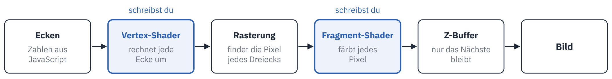
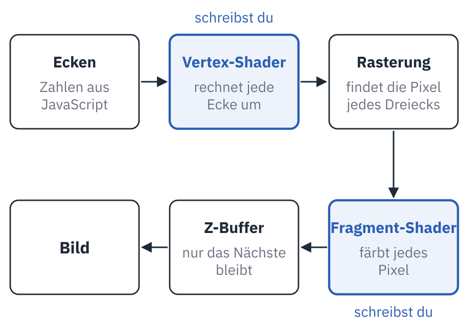

Der **Vertex-Shader** läuft für jede Ecke und sagt, wo sie auf dem Bildschirm
landet. Die **Rasterung** findet alle Pixel, die ein Dreieck bedeckt; die
macht die Grafikkarte allein. Der **Fragment-Shader** läuft für jedes dieser
Pixel und sagt, welche Farbe es bekommt. Beide Shader schreibt man in
**GLSL**, einer Sprache wie C, die die Grafikkarte ausführt. Aus
[Shader in GLSL](/glsl) kennst du den Fragment-Shader schon; neu ist hier der
Vertex-Shader davor.

Auf dem Bildschirm rechnet WebGL in **Clip-Koordinaten**: \\(x\\) von −1
(links) bis 1 (rechts), \\(y\\) von −1 (unten) bis 1 (oben), egal wie groß
das Fenster ist.

### Zwei Shader

Jeder Shader bekommt eine eigene Datei; dann färbt VS Code ihn wie C, und du
siehst Tippfehler leichter. Schreib in `shader.vert`:

```glsl
#version 300 es
in vec2 position;
in vec3 color;
out vec3 v_color;
void main() {
    gl_Position = vec4(position, 0.0, 1.0);
    v_color = color;
}
```

und in `shader.frag`:

```glsl
#version 300 es
precision highp float;
in vec3 v_color;
out vec4 color;
void main() {
    color = vec4(v_color, 1.0);
}
```

Die erste Zeile, `#version 300 es`, muss in beiden ganz oben stehen, auch vor
jedem Kommentar: Sie sagt, welches GLSL gemeint ist.

- Der Vertex-Shader bekommt für jede Ecke `position` (zwei Zahlen) und
  `color` (drei Zahlen). Er schreibt die Lage in `gl_Position` (vier Zahlen;
  was die dritte und vierte bedeuten, kommt im nächsten Kapitel) und gibt die
  Farbe als `v_color` weiter.
- Der Fragment-Shader bekommt `v_color` und schreibt die Farbe des Pixels in
  `color`, mit 1.0 für »undurchsichtig«.

Jetzt `main.js`. Es lädt die beiden Shader, übersetzt sie und gibt der
Grafikkarte drei Ecken:

```js_copy
const canvas = document.getElementById('canvas');
const gl = canvas.getContext('webgl2');

function compile(type, source) {
    const shader = gl.createShader(type);
    gl.shaderSource(shader, source);
    gl.compileShader(shader);
    if (!gl.getShaderParameter(shader, gl.COMPILE_STATUS)) {
        throw new Error(gl.getShaderInfoLog(shader));
    }
    return shader;
}

// lädt die beiden Shader aus ihren Dateien und verbindet sie zu einem Programm
async function loadProgram(vertexFile, fragmentFile) {
    const vertexSource = await (await fetch(vertexFile, { cache: 'no-store' })).text();
    const fragmentSource = await (await fetch(fragmentFile, { cache: 'no-store' })).text();
    const program = gl.createProgram();
    gl.attachShader(program, compile(gl.VERTEX_SHADER, vertexSource));
    gl.attachShader(program, compile(gl.FRAGMENT_SHADER, fragmentSource));
    gl.linkProgram(program);
    gl.useProgram(program);
    return program;
}

async function start() {
    const program = await loadProgram('shader.vert', 'shader.frag');

    // drei Ecken: x, y und eine Farbe (Rot, Grün, Blau)
    const vertices = [
        -0.6, -0.5,   1.0, 0.0, 0.0,
         0.6, -0.5,   0.0, 1.0, 0.0,
         0.0,  0.6,   0.0, 0.0, 1.0,
    ];
    const buffer = gl.createBuffer();
    gl.bindBuffer(gl.ARRAY_BUFFER, buffer);
    gl.bufferData(gl.ARRAY_BUFFER, new Float32Array(vertices), gl.STATIC_DRAW);
    const attributes = [['position', 2, 0], ['color', 3, 2]];
    for (const [name, size, offset] of attributes) {
        const location = gl.getAttribLocation(program, name);
        gl.enableVertexAttribArray(location);
        gl.vertexAttribPointer(location, size, gl.FLOAT, false, 5 * 4, offset * 4);
    }

    canvas.width = canvas.clientWidth * devicePixelRatio;
    canvas.height = canvas.clientHeight * devicePixelRatio;
    gl.viewport(0, 0, canvas.width, canvas.height);
    gl.clearColor(0.12, 0.13, 0.16, 1);
    gl.clear(gl.COLOR_BUFFER_BIT);
    gl.drawArrays(gl.TRIANGLES, 0, 3);
}

start();
```

Was darin passiert:

- `gl` ist das Tor zur Grafikkarte; alles, was mit `gl.` anfängt, ist ein
  Befehl an sie.
- `loadProgram` holt die beiden Dateien mit `fetch`, `compile` übersetzt
  jeden Shader, und `gl.linkProgram` verbindet beide zu einem Programm. Hat
  ein Shader einen Fehler, steht er in der Konsole des Browsers (in der
  Vorschau <kbd>F12</kbd>), mit der Zeile im Shader. `cache: 'no-store'` holt
  die Dateien jedes Mal neu, auch wenn der Browser sie schon kennt.
- `start` ist `async`, weil Laden Zeit braucht: `await` wartet, bis eine
  Datei da ist.
- Die Ecken stehen in einem einzigen Array, fünf Zahlen je Ecke.
  `gl.bufferData` schickt sie auf die Grafikkarte. Die Schleife über
  `attributes` sagt ihr, wie sie zu lesen sind: `position` sind 2 Zahlen ab
  der Zahl 0 jeder Ecke, `color` 3 Zahlen ab der Zahl 2, und eine Ecke ist
  5 · 4 Bytes lang (eine Zahl als `float` hat 4 Bytes).
- Am Ende: die Fläche so groß wie das Fenster, ein dunkler Hintergrund, und
  `gl.drawArrays` malt aus den Ecken 0 bis 2 ein Dreieck. `devicePixelRatio`
  sagt, wie viele Pixel des Bildschirms auf einen Pixel der Seite kommen
  (auf vielen Laptops und Handys 2). Ohne diese Zahl malt die Grafikkarte
  weniger Pixel, als der Bildschirm hat, und das Bild wird unscharf.

### Farben dazwischen

Jede Ecke hat ihre Farbe, aber das Dreieck hat sehr viele Pixel, und für
jedes läuft der Fragment-Shader. Woher bekommt ein Pixel in der Mitte sein
`v_color`?

_task(farbe-mitte)

<!-- after: farbe-mitte -->
<!-- tutorial-scope -->
<!-- tutorial-screenshot
write-file: webgl/shader.vert <- file:stufen/shader-1.vert
write-file: webgl/shader.frag <- file:stufen/shader-1.frag
write-file: webgl/main.js <- file:stufen/main-1.js
preview-reload
tab: preview
viewport: 800x450
sleep: 1.5
-->
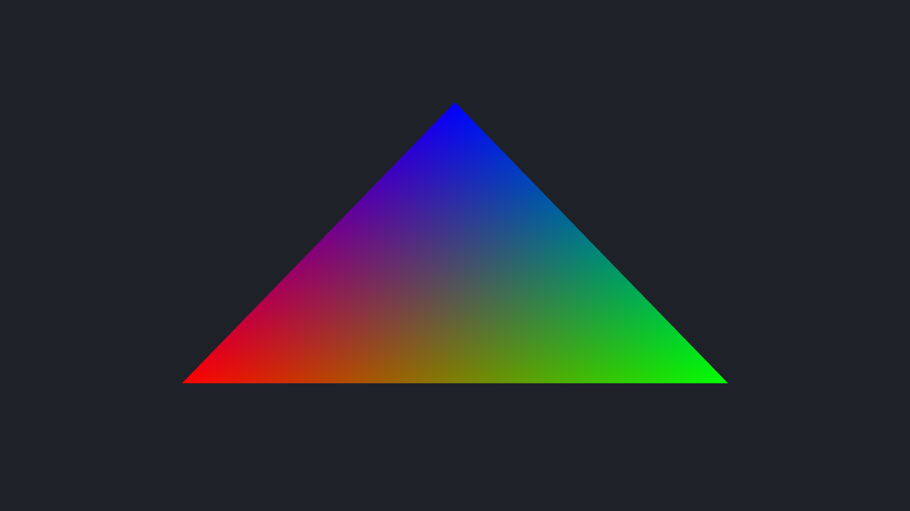

<!-- /tutorial-scope -->

Was ein Vertex-Shader mit `out` weitergibt, mischt die Rasterung für jedes
Pixel aus den drei Ecken, nach seiner Nähe zu jeder: Ein Pixel nahe der
roten Ecke bekommt fast Rot, eines in der Mitte von jeder Ecke ein Drittel,
also ein Grau. Genauso werden gleich Normalen und Stellen in einem Bild
gemischt.
<!-- /after -->

## Vom Raum auf den Bildschirm

### Matrizen

Ein Würfel hat Ecken im Raum, \\((x, y, z)\\). Bis sie auf dem Bildschirm
landen, werden sie mehrmals umgerechnet: gedreht, verschoben, perspektivisch
verkleinert. Jede dieser Umrechnungen ist eine **Matrix**, vier Zeilen mit je
vier Zahlen. Multipliziert man eine Matrix mit einem Punkt
\\((x, y, z, 1)\\), kommt der umgerechnete Punkt heraus; die vierte Zahl,
die 1, ist der Trick, mit dem eine Matrix auch verschieben kann.

WebGL möchte eine Matrix als Array aus 16 Zahlen, **Spalte für Spalte**: Die
Zahl in Zeile \\(r\\) und Spalte \\(c\\) steht beim Index \\(4c + r\\).
Eine Verschiebung um \\((x, y, z)\\) hat diese Zahlen in der letzten Spalte:

```js
function translate(x, y, z) {
    return [1, 0, 0, 0,  0, 1, 0, 0,  0, 0, 1, 0,  x, y, z, 1];
}
```

Zwei Umrechnungen nacheinander sind das **Produkt** ihrer Matrizen: Die Zahl
in Zeile \\(r\\) und Spalte \\(c\\) von \\(A \cdot B\\) ist die Summe
über \\(k\\) von \\(A\_{rk} \cdot B\_{kc}\\). Dabei zählt die Reihenfolge:
\\(A \cdot B\\) rechnet einen Punkt erst mit \\(B\\) um, dann mit
\\(A\\).

Schreib in `math.js`:

<!-- page-code: own -->
```js
// 4x4-Matrizen als Arrays aus 16 Zahlen, Spalte für Spalte, wie WebGL sie will

function multiply(a, b) {
    const out = new Array(16).fill(0);
    // hier: drei Schleifen, über Spalte, Zeile und k
    return out;
}

function translate(x, y, z) {
    return [1, 0, 0, 0,  0, 1, 0, 0,  0, 0, 1, 0,  x, y, z, 1];
}

if (typeof module !== 'undefined') module.exports = { multiply, translate };
```

Die letzte Zeile braucht der Browser nicht; sie gibt die Funktionen weiter,
wenn `node` die Datei lädt, und so prüft die Aufgabe unten deine Funktionen.

<div class='hint own' data-check='produkt'>
<strong>Jetzt bist du dran:</strong> Schreib <code>multiply(a, b)</code> fertig:
drei Schleifen, über die Spalte <code>col</code>, die Zeile <code>row</code>
und <code>k</code> von 0 bis 3, und für jedes <code>k</code> kommt
\(A_{\text{row},k} \cdot B_{k,\text{col}}\) zur Zahl in Zeile
<code>row</code> und Spalte <code>col</code> des Ergebnisses.
</div>

<!-- hint -->
Die Zahl in Zeile `row` und Spalte `col` steht beim Index `col * 4 + row`.
\\(A\_{\text{row},k}\\) ist also `a[k * 4 + row]`.
<!-- /hint -->

<!-- hint -->
<!-- page-code: own -->
```js
for (let col = 0; col < 4; col++) {
    for (let row = 0; row < 4; row++) {
        for (let k = 0; k < 4; k++) {
            out[col * 4 + row] += …;   // hier: ein Element von a mal eines von b
        }
    }
}
```
<!-- /hint -->

<!-- solution -->
```js
function multiply(a, b) {
    const out = new Array(16).fill(0);
    for (let col = 0; col < 4; col++) {
        for (let row = 0; row < 4; row++) {
            for (let k = 0; k < 4; k++) {
                out[col * 4 + row] += a[k * 4 + row] * b[col * 4 + k];
            }
        }
    }
    return out;
}
```
<!-- /solution -->

_task(produkt)

### Drehen

Eine Drehung um die x-Achse um den Winkel \\(\alpha\\) (im Bogenmaß)
lässt \\(x\\) unverändert und dreht \\(y\\) und \\(z\\) gegeneinander:

$$\begin{pmatrix} 1 & 0 & 0 & 0 \\\\ 0 & \cos\alpha & -\sin\alpha & 0 \\\\ 0 & \sin\alpha & \cos\alpha & 0 \\\\ 0 & 0 & 0 & 1 \end{pmatrix}$$

Spalte für Spalte geschrieben:

```js
function rotateX(angle) {
    const c = Math.cos(angle);
    const s = Math.sin(angle);
    return [1, 0, 0, 0,  0, c, s, 0,  0, -s, c, 0,  0, 0, 0, 1];
}
```

Eine Drehung um die y-Achse lässt \\(y\\) unverändert:

$$\begin{pmatrix} \cos\alpha & 0 & \sin\alpha & 0 \\\\ 0 & 1 & 0 & 0 \\\\ -\sin\alpha & 0 & \cos\alpha & 0 \\\\ 0 & 0 & 0 & 1 \end{pmatrix}$$

<div class='hint own' data-check='drehen'>
<strong>Jetzt bist du dran:</strong> Schreib unter <code>translate</code> die
Funktion <code>rotateX</code> von oben ab und dann selbst
<code>rotateY(angle)</code>, Spalte für Spalte wie <code>rotateX</code>.
Trag beide in <code>module.exports</code> ein.
</div>

<!-- hint -->
Lies die Matrix spaltenweise von oben nach unten: Die erste Spalte ist
\\(\cos\alpha, 0, -\sin\alpha, 0\\).
<!-- /hint -->

<!-- solution -->
```js
function rotateY(angle) {
    const c = Math.cos(angle);
    const s = Math.sin(angle);
    return [c, 0, -s, 0,  0, 1, 0, 0,  s, 0, c, 0,  0, 0, 0, 1];
}
```
<!-- /solution -->

_task(drehen)

### Perspektive

Was weiter weg ist, erscheint kleiner: Ein Punkt bei \\((x, y, z)\\) vor
der Kamera landet auf dem Bildschirm bei \\(x / (-z)\\), wenn die Kamera
entlang \\(-z\\) schaut (in WebGL schaut sie so). Eine Matrix kann aber
nicht durch \\(z\\) teilen. Darum schreibt die **Perspektivmatrix**
\\(-z\\) in die vierte Zahl des Punkts, \\(w\\), und die Grafikkarte
teilt nach dem Vertex-Shader selbst \\(x\\), \\(y\\) und \\(z\\) durch
\\(w\\). Die Zahl \\(f = 1 / \tan(\text{fov} / 2)\\) macht daraus einen
Blickwinkel `fov`, und `aspect`, Breite durch Höhe des Fensters, hält das Bild
unverzerrt:

```js
function perspective(fov, aspect, near, far) {
    const f = 1 / Math.tan(fov / 2);
    return [f / aspect, 0, 0, 0,  0, f, 0, 0,  0, 0, (far + near) / (near - far), -1,  0, 0, 2 * far * near / (near - far), 0];
}
```

Die dritte Zeile rechnet \\(z\\) so um, dass alles zwischen `near` und `far`
zwischen −1 und 1 landet; das braucht gleich der Z-Buffer. Schreib
`perspective` in `math.js` und trag sie in `module.exports` ein.

_task(wo-landet)

### Ein Würfel

Ein Würfel hat sechs Seiten, jede aus zwei Dreiecken: 36 Ecken. Der
Vertex-Shader bekommt jetzt drei Zahlen je Lage und drei Matrizen. Schreib
`shader.vert` neu (`shader.frag` bleibt):

```glsl
#version 300 es
in vec3 position;
in vec3 color;
uniform mat4 projection;
uniform mat4 view;
uniform mat4 model;
out vec3 v_color;
void main() {
    gl_Position = projection * view * model * vec4(position, 1.0);
    v_color = color;
}
```

In `main.js` ersetzt du in `start` alles nach `loadProgram`:

```js_copy
    // sechs Seiten, jede aus zwei Dreiecken und in einer eigenen Farbe; die
    // Ecken jeder Seite gegen den Uhrzeigersinn, von außen gesehen
    const faces = [
        { corners: [[-1, -1, 1], [1, -1, 1], [1, 1, 1], [-1, 1, 1]], color: [0.98, 0.36, 0.45] },
        { corners: [[1, -1, -1], [-1, -1, -1], [-1, 1, -1], [1, 1, -1]], color: [0.2, 0.75, 0.68] },
        { corners: [[1, -1, 1], [1, -1, -1], [1, 1, -1], [1, 1, 1]], color: [1.0, 0.82, 0.38] },
        { corners: [[-1, -1, -1], [-1, -1, 1], [-1, 1, 1], [-1, 1, -1]], color: [0.36, 0.6, 0.95] },
        { corners: [[-1, 1, 1], [1, 1, 1], [1, 1, -1], [-1, 1, -1]], color: [0.62, 0.88, 0.46] },
        { corners: [[-1, -1, -1], [1, -1, -1], [1, -1, 1], [-1, -1, 1]], color: [0.76, 0.52, 0.92] },
    ];
    const vertices = [];
    for (const face of faces) {
        const [a, b, c, d] = face.corners;
        for (const corner of [a, b, c, a, c, d]) {
            vertices.push(...corner, ...face.color);
        }
    }
    const buffer = gl.createBuffer();
    gl.bindBuffer(gl.ARRAY_BUFFER, buffer);
    gl.bufferData(gl.ARRAY_BUFFER, new Float32Array(vertices), gl.STATIC_DRAW);
    const attributes = [['position', 3, 0], ['color', 3, 3]];
    for (const [name, size, offset] of attributes) {
        const location = gl.getAttribLocation(program, name);
        gl.enableVertexAttribArray(location);
        gl.vertexAttribPointer(location, size, gl.FLOAT, false, 6 * 4, offset * 4);
    }

    function frame(time) {
        canvas.width = canvas.clientWidth * devicePixelRatio;
        canvas.height = canvas.clientHeight * devicePixelRatio;
        gl.viewport(0, 0, canvas.width, canvas.height);
        gl.clearColor(0.12, 0.13, 0.16, 1);
        gl.clear(gl.COLOR_BUFFER_BIT);

        const t = time / 1000;
        const projection = perspective(0.8, canvas.width / canvas.height, 0.1, 100);
        const view = translate(0, 0, -5);
        const model = multiply(rotateX(0.5), rotateY(0.5 * t));
        gl.uniformMatrix4fv(gl.getUniformLocation(program, 'projection'), false, projection);
        gl.uniformMatrix4fv(gl.getUniformLocation(program, 'view'), false, view);
        gl.uniformMatrix4fv(gl.getUniformLocation(program, 'model'), false, model);
        gl.drawArrays(gl.TRIANGLES, 0, vertices.length / 6);
        requestAnimationFrame(frame);
    }
    requestAnimationFrame(frame);
}
```

Neu ist:

- Der Vertex-Shader bekommt drei Matrizen als `uniform`, Werte, die für alle
  Ecken gleich sind: `model` dreht den Würfel, `view` schiebt ihn 5 Einheiten
  vor die Kamera, `projection` macht die Perspektive. Gelesen von rechts
  nach links, wie das Produkt: erst drehen, dann schieben, dann projizieren.
- `model` dreht den Würfel erst um die y-Achse, immer weiter, und kippt ihn
  dann um 0,5 (knapp 30°) nach vorne, so dass du immer auch auf seine
  Oberseite schaust.
- Jede Seite hat vier Ecken `a`, `b`, `c`, `d`; die beiden Dreiecke sind
  `a b c` und `a c d`.
- `frame` malt ein Bild und bittet mit `requestAnimationFrame` den Browser,
  es zum nächsten Bild wieder aufzurufen, etwa 60-mal in der Sekunde. `time`
  sind die Millisekunden seit dem Start; daraus wird der Winkel.

_task(ohne-tiefe)

<!-- after: ohne-tiefe -->
<!-- tutorial-scope -->
<!-- tutorial-screenshot
write-file: webgl/math.js <- file:stufen/math-1.js
write-file: webgl/shader.vert <- file:stufen/shader-2.vert
write-file: webgl/shader.frag <- file:stufen/shader-1.frag
write-file: webgl/main.js <- file:stufen/main-2.js
preview-reload
tab: preview
viewport: 800x450
sleep: 1.3
-->
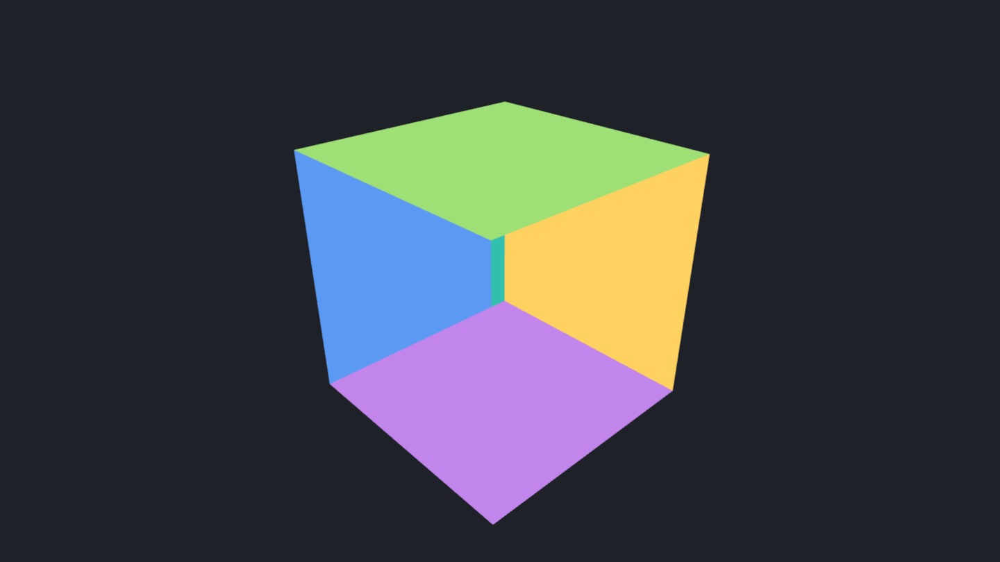

<!-- /tutorial-scope -->

Der Würfel ist kaputt: Die Grafikkarte malt die Dreiecke in der Reihenfolge
des Arrays, und was zuletzt kommt, liegt oben, auch wenn es hinten ist. Die
violette Unterseite steht im Array ganz am Ende und malt sich über alles.
<!-- /after -->

## Der Z-Buffer

Die Lösung heißt **Z-Buffer** (oder Tiefenpuffer): Für jedes Pixel merkt sich
die Grafikkarte neben der Farbe die Tiefe dessen, was dort gerade gemalt ist,
eine Zahl von 0 (bei `near`) bis 1 (bei `far`). Ein neues Pixel wird nur
gemalt, wenn es näher liegt; sonst wird es verworfen. Damit ist die
Reihenfolge der Dreiecke egal. Ergänze vor `frame`:

```js
~         gl.vertexAttribPointer(location, size, gl.FLOAT, false, 6 * 4, offset * 4);
~     }
    gl.enable(gl.DEPTH_TEST);
```

und lösche zu Beginn jedes Bilds auch die Tiefen:

```js
        gl.clear(gl.COLOR_BUFFER_BIT | gl.DEPTH_BUFFER_BIT);
```

<div class='gallery columns-2'>
<figure>
<!-- tutorial-screenshot
write-file: webgl/math.js <- file:stufen/math-1.js
write-file: webgl/shader.vert <- file:stufen/shader-2.vert
write-file: webgl/shader.frag <- file:stufen/shader-1.frag
write-file: webgl/main.js <- file:stufen/main-3.js
preview-reload
tab: preview
viewport: 800x450
sleep: 1.3
-->
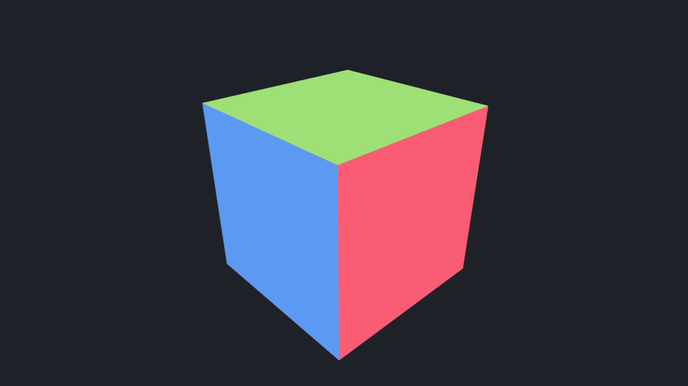
<figcaption>Mit Z-Buffer</figcaption></figure>
<figure>
<!-- tutorial-screenshot
write-file: webgl/math.js <- file:stufen/math-1.js
write-file: webgl/shader.vert <- file:stufen/shader-2.vert
write-file: webgl/shader.frag <- file:stufen/vergleich-tiefe.frag
write-file: webgl/main.js <- file:stufen/main-3.js
preview-reload
tab: preview
viewport: 800x450
sleep: 1.3
-->
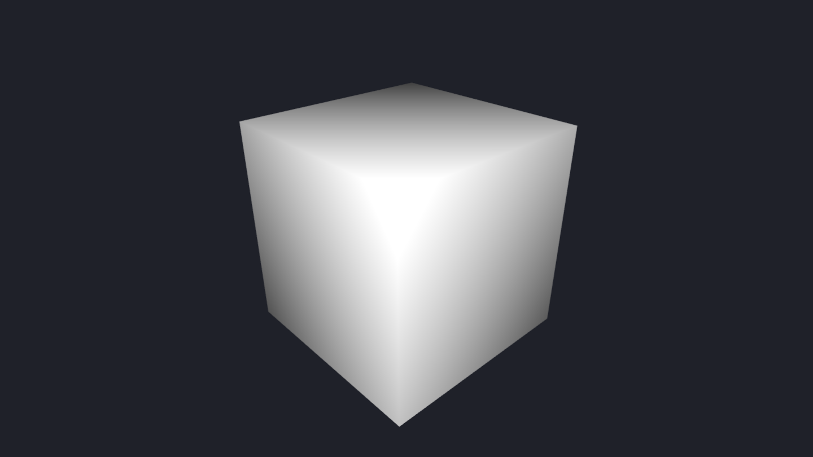
<figcaption>Die Tiefen im Z-Buffer, hell ist nah</figcaption></figure>
</div>

Rechts ist der Z-Buffer selbst zu sehen: Für jedes Pixel ist die gespeicherte
Tiefe in ein Grau umgerechnet, nah ist hell, fern ist dunkel. So ein Bild
rechnet die Grafikkarte nebenher in jedem Bild, damit das linke stimmt.

<div class='hint try'>
<strong>Ausprobieren:</strong> Sieh dir den Z-Buffer selbst an. Ersetz in
<code>shader.frag</code> die Zeile <code>color = vec4(v_color, 1.0);</code>
durch die Zeilen unten. <code>gl_FragCoord.z</code> ist die Tiefe des Pixels,
wie sie im Z-Buffer landet; die Zeilen rechnen sie in den Abstand zur
Kamera zurück, mit <code>near</code> und <code>far</code> wie in
<code>perspective</code>, und machen daraus ein Grau. Achte darauf, welche
Ecke des Würfels am hellsten ist, während er sich dreht. Stell die Zeile
danach wieder her.
</div>

<!-- page-code: own -->
```glsl
    float z = gl_FragCoord.z * 2.0 - 1.0;
    float near = 0.1;
    float far = 100.0;
    float distance = 2.0 * far * near / (far + near - z * (far - near));
    float gray = clamp((6.5 - distance) / 3.0, 0.0, 1.0);
    color = vec4(gray, gray, gray, 1.0);
```

<div class='hint try'>
<strong>Ausprobieren:</strong> Ergänze unter <code>gl.enable(gl.DEPTH_TEST);</code>
die Zeile <code>gl.enable(gl.CULL_FACE);</code>. Jetzt malt die Grafikkarte
nur noch die Dreiecke, deren Ecken auf dem Bildschirm gegen den
Uhrzeigersinn liegen, also die Seiten, die zur Kamera zeigen. Ändert sich das
Bild? Lass die Zeile danach drin oder lösch sie, wie du willst; einen Würfel
malt sie in halber Zeit.
</div>

Ein Z-Buffer kennt für jedes Pixel nur eines, das Nächste. Für Undurchsichtiges
reicht das. Für Durchscheinendes nicht: Was hinter einer halb durchsichtigen
Scheibe liegt, muss noch beigemischt werden, und der Z-Buffer hätte es
verworfen. Spiele malen darum Glas und Rauch zuletzt, nach der Tiefe sortiert.
Den Z-Buffer beschrieben 1974 unabhängig voneinander Wolfgang Straßer in
seiner Doktorarbeit an der TU Berlin und Edwin Catmull in Utah.

## Licht

### Die Normale

Ein Würfel, dessen Seiten einfach nur ihre Farbe haben, sieht flach aus. Echte
Flächen sind hell, wenn sie zum Licht zeigen, und dunkler, wenn sie sich
abwenden. Dafür braucht jede Fläche ihre **Normale**: den Vektor der Länge 1,
der senkrecht auf ihr steht und nach außen zeigt.

Die Normale eines Dreiecks mit den Ecken \\(a\\), \\(b\\), \\(c\\) liefert das
**Kreuzprodukt** zweier Kanten, \\((b - a) \times (c - a)\\), geteilt durch
seine Länge (Handbuch, [Vektoren](/reference/vektoren)):

$$u \times v = \begin{pmatrix} u\_y v\_z - u\_z v\_y \\\\ u\_z v\_x - u\_x v\_z \\\\ u\_x v\_y - u\_y v\_x \end{pmatrix}$$

Liegen die Ecken von außen gesehen gegen den Uhrzeigersinn, zeigt es nach
außen. Darum stehen die Ecken jeder Seite des Würfels so herum.

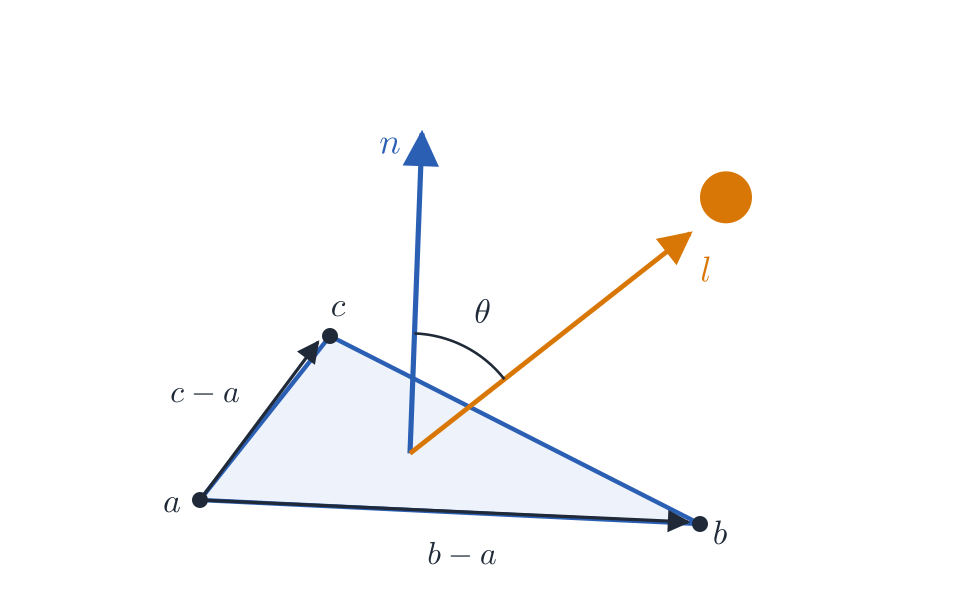

<div class='hint own' data-check='normale'>
<strong>Jetzt bist du dran:</strong> Schreib in <code>math.js</code> die
Funktion <code>faceNormal(a, b, c)</code>. Sie bekommt drei Punkte als Arrays
aus drei Zahlen und gibt die Normale zurück, ebenfalls als Array, mit der
Länge 1. <code>Math.hypot(x, y, z)</code> ist die Länge eines Vektors. Trag
sie in <code>module.exports</code> ein.
</div>

<!-- hint -->
Ein Beispiel von Hand: Für \\(a = (0, 0, 0)\\), \\(b = (1, 0, 0)\\),
\\(c = (0, 1, 0)\\) sind die Kanten \\(u = (1, 0, 0)\\) und
\\(v = (0, 1, 0)\\), und das Kreuzprodukt ist \\((0, 0, 1)\\): Die
Normale zeigt aus dem Bildschirm heraus.
<!-- /hint -->

<!-- hint -->
<!-- page-code: own -->
```js
function faceNormal(a, b, c) {
    const u = [b[0] - a[0], b[1] - a[1], b[2] - a[2]];
    const v = …;   // hier: c − a
    const n = […];   // hier: das Kreuzprodukt von u und v
    const length = Math.hypot(n[0], n[1], n[2]);
    return …;   // hier: n geteilt durch seine Länge
}
```
<!-- /hint -->

<!-- solution -->
```js
function faceNormal(a, b, c) {
    const u = [b[0] - a[0], b[1] - a[1], b[2] - a[2]];
    const v = [c[0] - a[0], c[1] - a[1], c[2] - a[2]];
    const n = [u[1] * v[2] - u[2] * v[1], u[2] * v[0] - u[0] * v[2], u[0] * v[1] - u[1] * v[0]];
    const length = Math.hypot(n[0], n[1], n[2]);
    return [n[0] / length, n[1] / length, n[2] / length];
}
```
<!-- /solution -->

_task(normale)

### Wie hell?

Wie viel Licht eine Fläche bekommt, hängt vom Winkel \\(\theta\\) zwischen
ihrer Normale \\(n\\) und der Richtung \\(l\\) zum Licht ab: Steht das
Licht senkrecht darüber, ist es voll, fällt es flach darauf, wenig. Für
Vektoren der Länge 1 ist \\(\cos\theta\\) einfach das Skalarprodukt
\\(n \cdot l\\); so rechnet auch dein [Raytracer](/raytracing) matte
Flächen (nach Johann Heinrich Lambert, 1760). Ist es negativ, liegt die
Fläche im Schatten, also 0. Dazu kommt ein bisschen Licht von überall, damit
Schattenseiten nicht schwarz sind:

$$\text{Farbe} = \text{Grundfarbe} \cdot (0{,}3 + 0{,}7 \cdot \max(n \cdot l, 0))$$

_task(wie-hell)

Gib jetzt jeder Ecke die Normale ihrer Seite mit. Im Vertex-Shader kommt
`normal` dazu; `mat3(model)` dreht sie mit dem Würfel mit:

```glsl
#version 300 es
in vec3 position;
in vec3 color;
in vec3 normal;
uniform mat4 projection;
uniform mat4 view;
uniform mat4 model;
out vec3 v_color;
out vec3 v_normal;
void main() {
    gl_Position = projection * view * model * vec4(position, 1.0);
    v_color = color;
    v_normal = mat3(model) * normal;
}
```

Der Fragment-Shader rechnet die Helligkeit nach der Formel:

```glsl
#version 300 es
precision highp float;
in vec3 v_color;
in vec3 v_normal;
uniform vec3 light;
out vec4 color;
void main() {
    float diffuse = max(dot(normalize(v_normal), normalize(light)), 0.0);
    color = vec4(v_color * (0.3 + 0.7 * diffuse), 1.0);
}
```

`normalize` macht einen Vektor wieder 1 lang: Die Rasterung mischt die
Normalen zwischen den Ecken, und eine Mischung ist kürzer. In der Schleife über
die Seiten kommt die Normale in jede Ecke:

```js
~         const [a, b, c, d] = face.corners;
        const normal = faceNormal(a, b, c);
        for (const corner of [a, b, c, a, c, d]) {
            vertices.push(...corner, ...face.color, ...normal);
        }
```

Jede Ecke hat jetzt 9 Zahlen. Ändere die Attribute und schick die Richtung
zum Licht, von vorne und etwas von oben:

```js
    const attributes = [['position', 3, 0], ['color', 3, 3], ['normal', 3, 6]];
    for (const [name, size, offset] of attributes) {
        const location = gl.getAttribLocation(program, name);
        gl.enableVertexAttribArray(location);
        gl.vertexAttribPointer(location, size, gl.FLOAT, false, 9 * 4, offset * 4);
    }
    gl.uniform3fv(gl.getUniformLocation(program, 'light'), [0, 0.3, 0.95]);
```

und in `frame` teilst du jetzt durch 9:

```js
        gl.drawArrays(gl.TRIANGLES, 0, vertices.length / 9);
```

<!-- tutorial-scope -->
<!-- tutorial-screenshot
write-file: webgl/math.js <- file:stufen/math-2.js
write-file: webgl/shader.vert <- file:stufen/shader-3.vert
write-file: webgl/shader.frag <- file:stufen/shader-3.frag
write-file: webgl/main.js <- file:stufen/main-4.js
preview-reload
tab: preview
viewport: 800x450
sleep: 1.3
-->
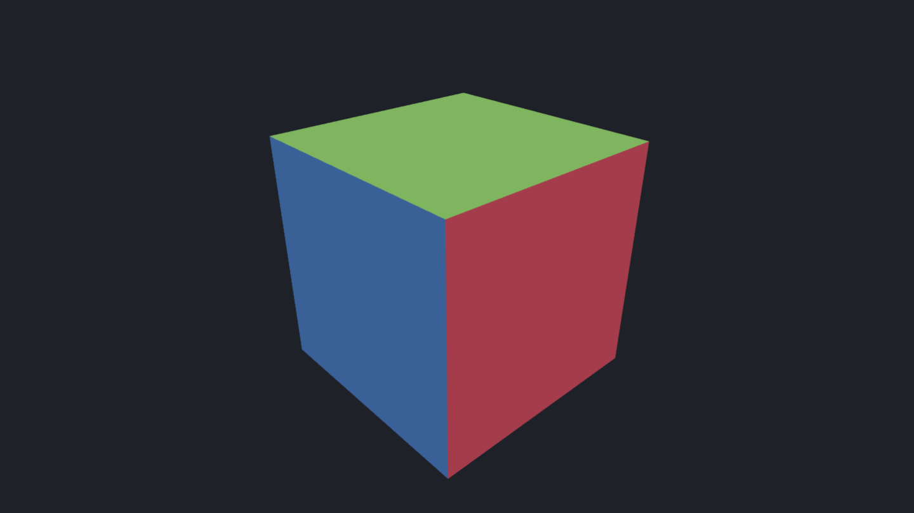

<!-- /tutorial-scope -->

<div class='hint try'>
<strong>Ausprobieren:</strong> Ändere die Richtung zum Licht in
<code>[0, -1, 0]</code>, Licht von unten. Welche Seiten sind jetzt hell? Und
was passiert, wenn du die <code>0.3</code> im Fragment-Shader auf
<code>0.0</code> setzt? Stell beides danach wieder her.
</div>

## Eine Ukulele aus 8.912 Dreiecken

### Das OBJ-Format

Ein Würfel lässt sich von Hand aufschreiben, eine Ukulele nicht. Modelle kommen
aus Programmen wie Blender, und ein einfaches Format, das fast jedes Programm
schreibt, ist **OBJ**: eine Textdatei, eine Angabe je Zeile. Öffne
`ukulele.obj` und schau hinein:

```text
v 0.00000 -0.01981 -0.00224
vt 0.19389 0.58144
vn -0.0000 1.0000 -0.0000
f 4/4/4 15/15/15 13/13/13
```

- `v` ist eine Ecke, \\(x\\), \\(y\\), \\(z\\); die Ukulele ist 0,53 Einheiten
  lang, eine Einheit ist ein Meter.
- `vt` ist eine Stelle in einem Bild, der **Textur**, mit \\(u\\) nach
  rechts und \\(v\\) nach oben, beide von 0 bis 1.
- `vn` ist eine Normale. Die Datei bringt sie mit; wie sie entstehen, kommt
  gleich.
- `f` ist ein Dreieck (englisch *face*): für jede seiner drei Ecken drei
  Nummern, getrennt durch `/`, welches `v`, welches `vt` und welches `vn` sie
  hat. Gezählt wird ab 1, in der Reihenfolge, in der die Zeilen in der Datei
  stehen.

Alle anderen Zeilen (Kommentare mit `#`, `g`, `mtllib`, `usemtl`) überliest
das Programm.

<div class='hint own' data-check='obj'>
<strong>Jetzt bist du dran:</strong> Schreib in <code>model.js</code> die
Funktion <code>parseObj(text)</code>. Sie geht die Zeilen durch, sammelt
<code>v</code>, <code>vt</code> und <code>vn</code> in drei Arrays und hängt
für jede Ecke jedes Dreiecks acht Zahlen an ein Array <code>vertices</code>
an, die Lage, die Stelle in der Textur und die Normale, und gibt es zurück.
Am Ende der Datei: <code>if (typeof module !== 'undefined') module.exports = { parseObj };</code>
</div>

<!-- hint -->
`text.split('\n')` gibt die Zeilen, `line.trim().split(/\s+/)` die Teile
einer Zeile; `trim` entfernt auch das Zeichen am Zeilenende, das Windows
schreibt. `parts.slice(1, 4).map(Number)` macht aus den Teilen 1 bis 3 Zahlen.
<!-- /hint -->

<!-- hint -->
Für ein `f`: `corner.split('/')` gibt die drei Nummern einer Ecke. Zieh von
jeder 1 ab, dann sind es Indizes in deine drei Arrays.
`vertices.push(...positions[p], ...uvs[t], ...normals[n])` hängt die acht
Zahlen an.
<!-- /hint -->

<!-- hint -->
<!-- page-code: own -->
```js
function parseObj(text) {
    const positions = [];
    const uvs = [];
    const normals = [];
    const vertices = [];
    for (const line of text.split('\n')) {
        const parts = line.trim().split(/\s+/);
        if (parts[0] === 'v') {
            positions.push(parts.slice(1, 4).map(Number));
        } else if (parts[0] === 'vt') {
            …   // hier: zwei Zahlen in uvs
        } else if (parts[0] === 'vn') {
            …   // hier: drei Zahlen in normals
        } else if (parts[0] === 'f') {
            for (const corner of parts.slice(1, 4)) {
                …   // hier: die drei Nummern, ab 0 gezählt, und acht Zahlen in vertices
            }
        }
    }
    return vertices;
}
```
<!-- /hint -->

<!-- solution -->
```js
// Ein Modell im OBJ-Format: für jede Ecke jedes Dreiecks acht Zahlen,
// die Lage (x, y, z), die Stelle in der Textur (u, v) und die Normale

function parseObj(text) {
    const positions = [];
    const uvs = [];
    const normals = [];
    const vertices = [];
    for (const line of text.split('\n')) {
        const parts = line.trim().split(/\s+/);
        if (parts[0] === 'v') {
            positions.push(parts.slice(1, 4).map(Number));
        } else if (parts[0] === 'vt') {
            uvs.push(parts.slice(1, 3).map(Number));
        } else if (parts[0] === 'vn') {
            normals.push(parts.slice(1, 4).map(Number));
        } else if (parts[0] === 'f') {
            for (const corner of parts.slice(1, 4)) {
                const [p, t, n] = corner.split('/').map((i) => Number(i) - 1);
                vertices.push(...positions[p], ...uvs[t], ...normals[n]);
            }
        }
    }
    return vertices;
}

if (typeof module !== 'undefined') module.exports = { parseObj };
```
<!-- /solution -->

_task(obj)

### Die Ukulele auf dem Bildschirm

Die Shader werden einfacher als beim Würfel: Die Ukulele hat keine Farbe je
Ecke und dreht sich nicht selbst, also braucht sie weder `color` noch `model`.
`shader.vert`:

```glsl
#version 300 es
in vec3 position;
in vec3 normal;
uniform mat4 projection;
uniform mat4 view;
out vec3 v_normal;
void main() {
    gl_Position = projection * view * vec4(position, 1.0);
    v_normal = normal;
}
```

`shader.frag`, erst einmal mit einem hellen Grau als Grundfarbe; die Farben
kommen später:

```glsl
#version 300 es
precision highp float;
in vec3 v_normal;
uniform vec3 light;
out vec4 color;
void main() {
    vec3 base = vec3(0.9, 0.88, 0.84);
    float diffuse = max(dot(normalize(v_normal), normalize(light)), 0.0);
    color = vec4(base * (0.3 + 0.7 * diffuse), 1.0);
}
```

Und `main.js`: `compile` und `loadProgram` oben bleiben, wie sie sind;
ersetz alles darunter:

```js_copy
let yaw = 1.25;
let pitch = 0.85;
let distance = 1;
let center = [0, 0, 0];

canvas.addEventListener('pointermove', (e) => {
    if (e.buttons) {
        yaw += e.movementX * 0.01;
        pitch = Math.max(-1.5, Math.min(1.5, pitch + e.movementY * 0.01));
    }
});
canvas.addEventListener('wheel', (e) => {
    distance *= Math.exp(e.deltaY * 0.001);
});

async function start() {
    const program = await loadProgram('shader.vert', 'shader.frag');
    const text = await (await fetch('ukulele.obj')).text();
    const vertices = parseObj(text);
    const count = vertices.length / 8;

    // die Kiste um das Modell: die Kamera schaut auf ihre Mitte
    const low = [Infinity, Infinity, Infinity];
    const high = [-Infinity, -Infinity, -Infinity];
    for (let i = 0; i < vertices.length; i += 8) {
        for (let k = 0; k < 3; k++) {
            low[k] = Math.min(low[k], vertices[i + k]);
            high[k] = Math.max(high[k], vertices[i + k]);
        }
    }
    center = [0, 1, 2].map((k) => (low[k] + high[k]) / 2);
    distance = 0.8 * Math.hypot(high[0] - low[0], high[1] - low[1], high[2] - low[2]);

    const buffer = gl.createBuffer();
    gl.bindBuffer(gl.ARRAY_BUFFER, buffer);
    gl.bufferData(gl.ARRAY_BUFFER, new Float32Array(vertices), gl.STATIC_DRAW);
    const attributes = [['position', 3, 0], ['uv', 2, 3], ['normal', 3, 5]];
    for (const [name, size, offset] of attributes) {
        const location = gl.getAttribLocation(program, name);
        if (location < 0) continue;   // ein Attribut, das der Shader nicht benutzt
        gl.enableVertexAttribArray(location);
        gl.vertexAttribPointer(location, size, gl.FLOAT, false, 8 * 4, offset * 4);
    }

    gl.uniform3fv(gl.getUniformLocation(program, 'light'), [0.4, 0.8, 0.45]);
    gl.enable(gl.DEPTH_TEST);

    function frame() {
        canvas.width = canvas.clientWidth * devicePixelRatio;
        canvas.height = canvas.clientHeight * devicePixelRatio;
        gl.viewport(0, 0, canvas.width, canvas.height);
        gl.clearColor(0.12, 0.13, 0.16, 1);
        gl.clear(gl.COLOR_BUFFER_BIT | gl.DEPTH_BUFFER_BIT);

        const projection = perspective(0.8, canvas.width / canvas.height, 0.01, 100);
        const view = multiply(translate(0, 0, -distance), multiply(rotateX(pitch), multiply(rotateY(yaw), translate(-center[0], -center[1], -center[2]))));
        gl.uniformMatrix4fv(gl.getUniformLocation(program, 'projection'), false, projection);
        gl.uniformMatrix4fv(gl.getUniformLocation(program, 'view'), false, view);
        gl.drawArrays(gl.TRIANGLES, 0, count);
        requestAnimationFrame(frame);
    }
    frame();
}

start();
```

Was neu ist:

- Die Kiste um das Modell gibt seine Mitte und seine Größe; die Kamera schaut
  auf die Mitte, aus einem Abstand, der zur Größe passt. So passt auch ein
  anderes Modell ins Bild.
- Diesmal dreht sich nicht das Modell, sondern die Kamera um es: Die
  Matrix `view` schiebt die Mitte des Modells in den Ursprung, dreht um
  `yaw` und `pitch` und schiebt alles `distance` vor die Kamera. Ziehen mit
  gedrückter Maustaste ändert die beiden Winkel, das Mausrad den Abstand. Zu
  Beginn schaut die Kamera schräg von oben auf die Ukulele, die auf dem
  Rücken liegt.
  Weil die Ukulele sich nicht dreht, braucht die Normale keine Matrix.
- Die Ecken haben 8 Zahlen, auch die Stelle in der Textur; `uv` braucht der
  Shader erst später. Ein Attribut, das ein Shader nicht benutzt, hat keine
  Nummer (`location` ist −1), und die Schleife überspringt es.
- `near` ist jetzt 0,01: Die Ukulele ist klein, und die Kamera kommt ihr
  nahe.

<!-- tutorial-scope -->
<!-- tutorial-screenshot
write-file: webgl/math.js <- file:stufen/math-2.js
write-file: webgl/model.js <- file:stufen/model-1.js
write-file: webgl/shader.vert <- file:stufen/shader-4.vert
write-file: webgl/shader.frag <- file:stufen/shader-4.frag
write-file: webgl/main.js <- file:stufen/main-5.js
preview-reload
tab: preview
viewport: 800x450
sleep: 4
-->


<!-- /tutorial-scope -->

## Drahtgitter

Woraus die Ukulele besteht, siehst du an ihren Kanten. Ein **Drahtgitter**
malt statt der Dreiecke nur ihre drei Kanten, als Linien. Dafür gibt es
`gl.LINES`: Es verbindet je zwei Ecken. Welche Ecken, sagt eine Liste von
Indizes; Dreieck Nummer \\(i\\) hat die Ecken \\(3i\\), \\(3i + 1\\) und
\\(3i + 2\\).

<div class='hint own' data-check='kanten'>
<strong>Jetzt bist du dran:</strong> Schreib in <code>model.js</code> die
Funktion <code>edges(triangles)</code>. Sie bekommt die Zahl der Dreiecke und
gibt für jedes die drei Kanten zurück, als Indizes der Ecken, je zwei für
eine Kante: für das erste Dreieck <code>0, 1, 1, 2, 2, 0</code>. Trag sie in
<code>module.exports</code> ein.
</div>

<!-- hint -->
Eine Schleife über die Dreiecke; für Dreieck `i` ist die erste Ecke
`a = 3 * i`, und die drei Kanten sind `a` bis `a + 1`, `a + 1` bis `a + 2`
und `a + 2` zurück zu `a`.
<!-- /hint -->

<!-- solution -->
```js
function edges(triangles) {
    const lines = [];
    for (let i = 0; i < triangles; i++) {
        const a = 3 * i;
        lines.push(a, a + 1, a + 1, a + 2, a + 2, a);
    }
    return lines;
}
```
<!-- /solution -->

_task(kanten)

Jetzt das Umschalten mit der Taste <kbd>W</kbd>. Im Fragment-Shader kommt ein
Schalter dazu: Ist `wire` an, wird jede Linie weiß.

```glsl
~ uniform vec3 light;
uniform bool wire;
~ out vec4 color;
~ void main() {
    if (wire) {
        color = vec4(1.0, 1.0, 1.0, 1.0);
        return;
    }
~     vec3 base = vec3(0.9, 0.88, 0.84);
```

In `main.js` oben bei den Variablen:

```js
~ let center = [0, 0, 0];
let wireframe = false;
```

und bei der Maus:

```js
window.addEventListener('keydown', (e) => {
    if (e.key === 'w') wireframe = !wireframe;
});
```

In `start` kommen die Indizes der Kanten in einen eigenen Buffer, einen
`ELEMENT_ARRAY_BUFFER`:

```js
~         gl.vertexAttribPointer(location, size, gl.FLOAT, false, 8 * 4, offset * 4);
~     }

    const lines = gl.createBuffer();
    gl.bindBuffer(gl.ELEMENT_ARRAY_BUFFER, lines);
    gl.bufferData(gl.ELEMENT_ARRAY_BUFFER, new Uint32Array(edges(count / 3)), gl.STATIC_DRAW);
```

und in `frame` malt `gl.drawElements` die Linien, wenn der Schalter an ist:

```js
        gl.uniform1i(gl.getUniformLocation(program, 'wire'), wireframe);
        if (wireframe) {
            gl.drawElements(gl.LINES, count * 2, gl.UNSIGNED_INT, 0);
        } else {
            gl.drawArrays(gl.TRIANGLES, 0, count);
        }
```

<!-- tutorial-scope -->
<!-- tutorial-screenshot
write-file: webgl/math.js <- file:stufen/math-2.js
write-file: webgl/model.js <- file:stufen/model.js
write-file: webgl/shader.vert <- file:stufen/shader-4.vert
write-file: webgl/shader.frag <- file:stufen/shader-5.frag
write-file: webgl/main.js <- file:stufen/main-6.js
preview-reload
tab: preview
viewport: 800x450
sleep: 4
click: selector:canvas
press: w
sleep: 1
-->
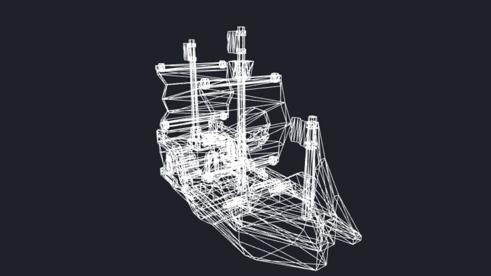

<!-- /tutorial-scope -->

Im Drahtgitter siehst du auch die Rückseite, denn Linien haben keine Fläche,
die etwas verdecken könnte. Und du siehst, wo das Modell seine Dreiecke
ausgibt: viele an Wirbeln, Bünden und am runden Rand, wo die Form sich
schnell ändert, wenige auf der flachen Decke, wo lange, schmale Dreiecke
genügen.

<div class='hint try'>
<strong>Ausprobieren:</strong> Zähl die Dreiecke selbst: Gib in
<code>start</code> mit <code>console.log(count / 3)</code> aus, wie viele es
sind, und schau in der Konsole des Browsers nach (<kbd>F12</kbd>).
</div>

## Flat Shading und Smooth Shading

Der runde Rand der Ukulele sieht weich aus, obwohl er aus flachen Dreiecken
besteht. Das liegt an den Normalen aus der Datei: Sie gehören nicht zu den
Dreiecken, sondern zu den Ecken. Jede steht senkrecht auf der gedachten
glatten Oberfläche, und weil die Rasterung sie zwischen den Ecken mischt,
ändert sich die Helligkeit innerhalb eines Dreiecks fließend. Das heißt
**Smooth Shading**.

Gibt man allen drei Ecken eines Dreiecks dieselbe Normale, die des Dreiecks
selbst, bekommt jedes Dreieck eine einzige Helligkeit, und man sieht die
Facetten: **Flat Shading**. So sahen 3D-Spiele bis in die 1990er Jahre aus.
Die Normale eines Dreiecks kannst du schon ausrechnen, mit `faceNormal`.

<div class='gallery columns-2'>
<figure>
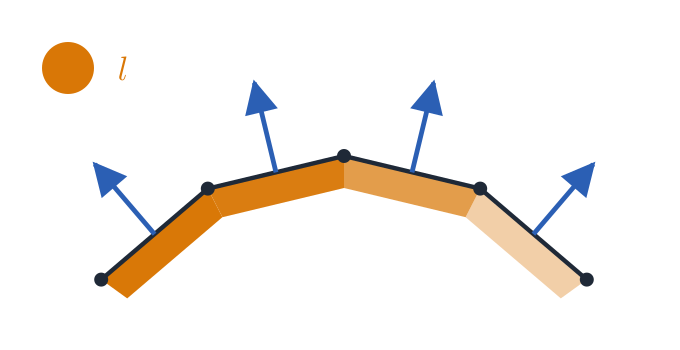
<figcaption>Flat Shading: eine Normale je Dreieck</figcaption></figure>
<figure>
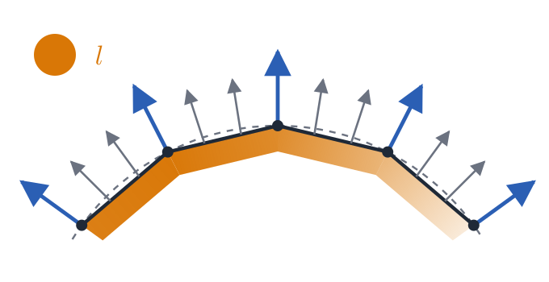
<figcaption>Smooth Shading: eine Normale je Ecke, dazwischen gemischt</figcaption></figure>
</div>

<div class='hint own' data-check='flach'>
<strong>Jetzt bist du dran:</strong> Schreib in <code>math.js</code> die
Funktion <code>flatNormals(vertices)</code>. Sie bekommt die Ecken mit acht
Zahlen je Ecke, wie <code>parseObj</code> sie liefert, und gibt ein neues
Array zurück, in dem jede Ecke statt ihrer Normale die Normale ihres Dreiecks
hat; Lage und Stelle in der Textur bleiben. Das übergebene Array bleibt, wie
es ist. Trag sie in <code>module.exports</code> ein.
</div>

<!-- hint -->
Ein Dreieck sind drei Ecken, also 24 Zahlen; eine Schleife mit `i += 24`
geht die Dreiecke durch. Die Lage der ersten Ecke steht bei `i` bis `i + 2`,
die der zweiten bei `i + 8`, die der dritten bei `i + 16`, und die Normale
jeder Ecke 5 Zahlen nach ihrer Lage. `vertices.slice()` macht eine Kopie.
<!-- /hint -->

<!-- hint -->
<!-- page-code: own -->
```js
function flatNormals(vertices) {
    const out = vertices.slice();
    for (let i = 0; i < vertices.length; i += 24) {
        const a = vertices.slice(i, i + 3);
        const b = …;   // hier: die Lage der zweiten Ecke
        const c = …;   // hier: die Lage der dritten Ecke
        const n = faceNormal(a, b, c);
        for (let k = 0; k < 3; k++) {
            …   // hier: n in die Normale der Ecke k, ab out[i + 8 * k + 5]
        }
    }
    return out;
}
```
<!-- /hint -->

<!-- solution -->
```js
// die Ecken eines Modells, acht Zahlen je Ecke, mit der Normale ihres Dreiecks
// statt der Normale aus der Datei
function flatNormals(vertices) {
    const out = vertices.slice();
    for (let i = 0; i < vertices.length; i += 24) {
        const a = vertices.slice(i, i + 3);
        const b = vertices.slice(i + 8, i + 11);
        const c = vertices.slice(i + 16, i + 19);
        const n = faceNormal(a, b, c);
        for (let k = 0; k < 3; k++) {
            out[i + 8 * k + 5] = n[0];
            out[i + 8 * k + 6] = n[1];
            out[i + 8 * k + 7] = n[2];
        }
    }
    return out;
}
```
<!-- /solution -->

_task(flach)

Mit der Taste <kbd>F</kbd> schaltest du um. Oben bei den Variablen:

```js
~ let wireframe = false;
let flat = false;
```

beim Drücken einer Taste:

```js
~     if (e.key === 'w') wireframe = !wireframe;
    if (e.key === 'f') flat = !flat;
```

in `start`, gleich nach `parseObj`, die Ecken mit flachen Normalen:

```js
~     const count = vertices.length / 8;
    const flatVertices = flatNormals(vertices);
```

und vor `frame` merkst du dir, welche Ecken auf der Grafikkarte sind:

```js
    let shownFlat = false;
```

In `frame` schickst du die anderen hin, sobald `flat` nicht mehr dazu passt:

```js
        if (flat !== shownFlat) {
            gl.bindBuffer(gl.ARRAY_BUFFER, buffer);
            gl.bufferData(gl.ARRAY_BUFFER, new Float32Array(flat ? flatVertices : vertices), gl.STATIC_DRAW);
            shownFlat = flat;
        }
```

<div class='gallery columns-2'>
<figure>
<!-- tutorial-screenshot
write-file: webgl/math.js <- file:stufen/math.js
write-file: webgl/model.js <- file:stufen/model.js
write-file: webgl/shader.vert <- file:stufen/shader-4.vert
write-file: webgl/shader.frag <- file:stufen/shader-5.frag
write-file: webgl/main.js <- file:stufen/main-7.js
preview-reload
tab: preview
viewport: 800x450
sleep: 4
hook: view 0 0 -0.1 0.28 -0.6 0.3
click: selector:canvas
press: f
sleep: 1
-->
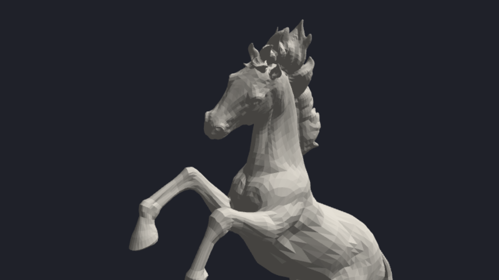
<figcaption>Flat Shading: eine Normale je Dreieck</figcaption></figure>
<figure>
<!-- tutorial-screenshot
write-file: webgl/math.js <- file:stufen/math.js
write-file: webgl/model.js <- file:stufen/model.js
write-file: webgl/shader.vert <- file:stufen/shader-4.vert
write-file: webgl/shader.frag <- file:stufen/shader-5.frag
write-file: webgl/main.js <- file:stufen/main-7.js
preview-reload
tab: preview
viewport: 800x450
sleep: 4
hook: view 0 0 -0.1 0.28 -0.6 0.3
sleep: 1
-->
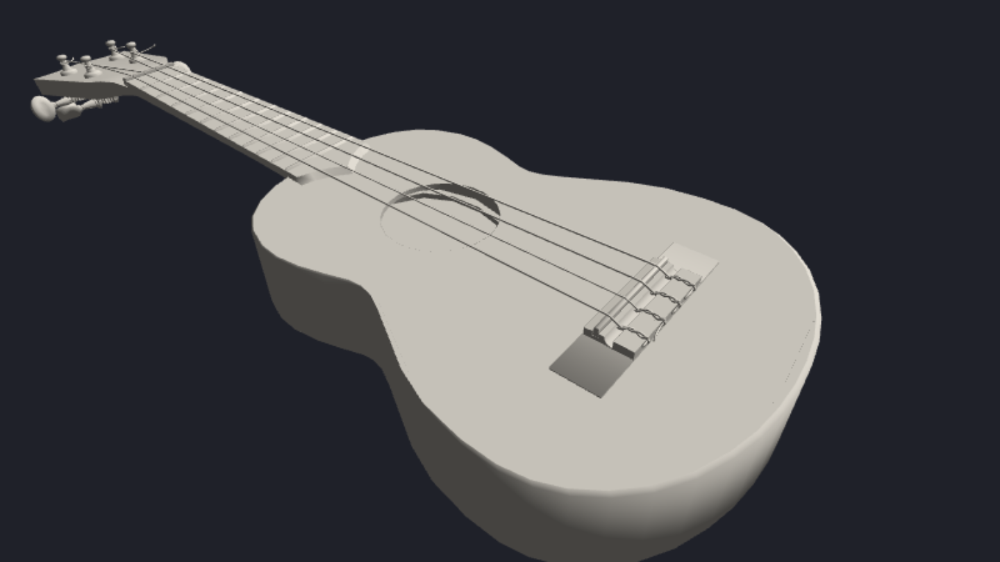
<figcaption>Smooth Shading: eine Normale je Ecke, gemischt</figcaption></figure>
</div>

Am Umriss hilft Smooth Shading nicht: Der bleibt aus geraden Kanten, denn die
Normalen ändern nur die Helligkeit, nicht die Form. Wo das stört, braucht
das Modell mehr Dreiecke.

Henri Gouraud mischte 1971 die Helligkeiten der Ecken. Bui Tuong Phong
mischte 1973 stattdessen die Normalen und rechnete das Licht für jedes Pixel
neu; so macht es dein Fragment-Shader. Der Unterschied zeigt sich beim
Glanzlicht im nächsten Kapitel: Ein Glanzpunkt mitten in einem großen
Dreieck fällt bei Gouraud unter den Tisch, denn an den Ecken ist er nicht.

## Glanzlicht

Die Ukulele ist lackiert, sie glänzt: Wo das Licht so zurückgeworfen wird,
dass es genau ins Auge fällt, sieht man einen hellen Fleck. Wie hell, hängt
nicht nur von der Fläche und vom Licht ab, sondern auch davon, wo die Kamera
steht. Jim Blinn rechnete das 1977 so: Die Richtung \\(h\\) genau zwischen
der zum Licht \\(l\\) und der zur Kamera \\(v\\),

$$h = \frac{l + v}{|l + v|},$$

liegt nahe an der Normale, wenn das Licht zum Auge gespiegelt wird.

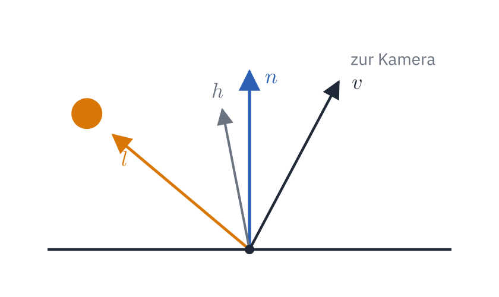

Dann ist
\\(n \cdot h\\) fast 1, und eine hohe Potenz davon macht daraus einen kleinen,
hellen Fleck, der zur Seite schnell auf 0 fällt:

$$\text{Glanz} = 0{,}4 \cdot \max(n \cdot h, 0)^{40}$$

Der Glanz kommt als Weiß zur Farbe dazu, unabhängig von der Grundfarbe: Bei
Lack, Porzellan und Plastik hat das zurückgeworfene Licht die Farbe der
Lampe. Die Zahl 40 heißt **Exponent** (englisch *shininess*).

_task(glanz)

Für \\(v\\) braucht der Fragment-Shader die Lage jedes Pixels im Raum und die
Lage der Kamera. Der Vertex-Shader gibt die Lage weiter:

```glsl
#version 300 es
in vec3 position;
in vec3 normal;
uniform mat4 projection;
uniform mat4 view;
out vec3 v_position;
out vec3 v_normal;
void main() {
    gl_Position = projection * view * vec4(position, 1.0);
    v_position = position;
    v_normal = normal;
}
```

Der Fragment-Shader bekommt die Kamera als `eye`:

```glsl
#version 300 es
precision highp float;
in vec3 v_position;
in vec3 v_normal;
uniform vec3 light;
uniform vec3 eye;
uniform bool wire;
out vec4 color;
void main() {
    if (wire) {
        color = vec4(1.0, 1.0, 1.0, 1.0);
        return;
    }
    vec3 base = vec3(0.9, 0.88, 0.84);
    vec3 n = normalize(v_normal);
    vec3 l = normalize(light);
    vec3 v = normalize(eye - v_position);
    vec3 h = normalize(l + v);
    float diffuse = max(dot(n, l), 0.0);
    float specular = pow(max(dot(n, h), 0.0), 40.0);
    color = vec4(base * (0.3 + 0.7 * diffuse) + 0.4 * specular, 1.0);
}
```

Wo die Kamera steht, folgt aus den Winkeln: Sie ist `distance` von `center`
entfernt, nach oben um `pitch` und zur Seite um `yaw` gedreht. In `main.js`
vor `start`:

```js
// wo die Kamera steht: dort, wohin die Matrix view den Ursprung schiebt
function cameraPosition() {
    return [
        center[0] - distance * Math.sin(yaw) * Math.cos(pitch),
        center[1] + distance * Math.sin(pitch),
        center[2] + distance * Math.cos(yaw) * Math.cos(pitch),
    ];
}
```

und in `frame` nach den beiden Matrizen:

```js
        gl.uniform3fv(gl.getUniformLocation(program, 'eye'), cameraPosition());
```

<!-- tutorial-scope -->
<!-- tutorial-screenshot
write-file: webgl/math.js <- file:stufen/math.js
write-file: webgl/model.js <- file:stufen/model.js
write-file: webgl/shader.vert <- file:stufen/shader-5.vert
write-file: webgl/shader.frag <- file:stufen/shader-6.frag
write-file: webgl/main.js <- file:stufen/main-8.js
preview-reload
tab: preview
viewport: 800x450
sleep: 4
-->
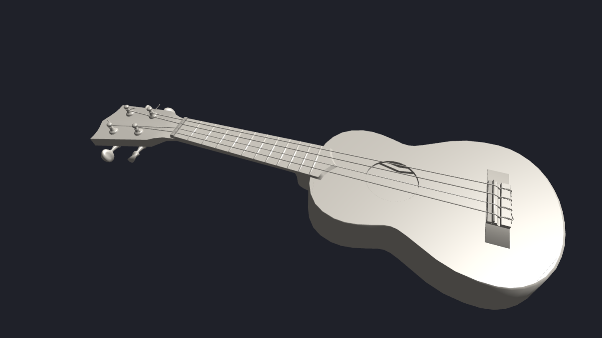

<!-- /tutorial-scope -->

Dreh die Ukulele mit der Maus: Die Glanzpunkte wandern mit, denn sie hängen
davon ab, wo du stehst. Die Helligkeit nach Lambert bleibt, wo sie ist.

_task(exponent)

<!-- after: exponent -->
<div class='hint try'>
<strong>Ausprobieren:</strong> Setz den Exponenten auf <code>200.0</code>
und danach auf <code>5.0</code>. Achte auf die Größe des Glanzpunkts auf dem
Korpus und darauf, wie scharf sein Rand ist. Stell danach <code>40.0</code>
wieder her.
</div>
<!-- /after -->

## Texturen

### Die Farbe

Die Farben der Ukulele stehen nicht in der OBJ-Datei, sondern in
`ukulele-color.jpg`. Öffne das Bild in VS Code: Es sieht aus wie eine
zerlegte Ukulele, ihre Teile flach ausgebreitet: Decke und Boden mit der
Maserung des Holzes, der Hals mit den Bünden, der Kopf, ein Aufkleber. Jede
Ecke zeigt mit \\((u, v)\\) auf eine Stelle darin, und die Rasterung mischt
\\((u, v)\\) zwischen den Ecken wie vorhin die Farben. Der Fragment-Shader
liest an der gemischten Stelle die Farbe, mit `texture(colorMap, v_uv)`. Ein
Bild so auf ein Modell zu legen, heißt **Texture Mapping**; es kommt, wie
der Z-Buffer, aus Edwin Catmulls Doktorarbeit von 1974.

Der Vertex-Shader gibt jetzt auch `uv` weiter:

```glsl
#version 300 es
in vec3 position;
in vec2 uv;
in vec3 normal;
uniform mat4 projection;
uniform mat4 view;
out vec3 v_position;
out vec2 v_uv;
out vec3 v_normal;
void main() {
    gl_Position = projection * view * vec4(position, 1.0);
    v_position = position;
    v_uv = uv;
    v_normal = normal;
}
```

Im Fragment-Shader kommt die Textur als `sampler2D` dazu, und die Grundfarbe
kommt aus ihr:

```glsl
~ in vec3 v_position;
in vec2 v_uv;
~ in vec3 v_normal;
uniform sampler2D colorMap;
```

```glsl
    vec3 base = texture(colorMap, v_uv).rgb;
```

In `main.js` lädt eine Funktion ein Bild auf die Grafikkarte; schreib sie vor
`start`:

```js
// ein Bild als Textur auf der Grafikkarte, in der Einheit unit (0, 1, 2, …)
async function loadTexture(file, unit) {
    const image = new Image();
    image.src = file;
    await image.decode();
    gl.activeTexture(gl.TEXTURE0 + unit);
    gl.bindTexture(gl.TEXTURE_2D, gl.createTexture());
    gl.pixelStorei(gl.UNPACK_FLIP_Y_WEBGL, true);
    gl.texImage2D(gl.TEXTURE_2D, 0, gl.RGBA, gl.RGBA, gl.UNSIGNED_BYTE, image);
    gl.generateMipmap(gl.TEXTURE_2D);
    gl.texParameteri(gl.TEXTURE_2D, gl.TEXTURE_MIN_FILTER, gl.LINEAR_MIPMAP_LINEAR);
}
```

und in `start` nach dem Buffer der Kanten:

```js
    await loadTexture('ukulele-color.jpg', 0);
    gl.uniform1i(gl.getUniformLocation(program, 'colorMap'), 0);
```

- Die Grafikkarte hat mehrere **Textureinheiten**, nummeriert ab 0; jedes
  Bild kommt in eine eigene, und `gl.uniform1i` sagt dem `sampler2D` im
  Shader, aus welcher er liest.
- `UNPACK_FLIP_Y_WEBGL` dreht das Bild um, weil \\(v\\) in OBJ unten anfängt
  und ein Bild oben.
- Ein Bild aus 2048 × 2048 Pixeln auf einer Ukulele, die im Fenster 300 Pixel
  lang ist: Auf ein Pixel des Bildschirms kommen viele Pixel der Textur, und
  nimmt man einfach eines davon, flimmert das Bild beim Drehen.
  `generateMipmap` rechnet darum kleinere Fassungen des Bilds aus, jede halb
  so breit wie die davor (**Mipmaps**, nach Lance Williams, 1983), und
  `LINEAR_MIPMAP_LINEAR` nimmt die Fassung, die zur Größe auf dem Bildschirm
  passt.

_person(williams)

<!-- tutorial-scope -->
<!-- tutorial-screenshot
write-file: webgl/math.js <- file:stufen/math.js
write-file: webgl/model.js <- file:stufen/model.js
write-file: webgl/shader.vert <- file:stufen/shader.vert
write-file: webgl/shader.frag <- file:stufen/shader-7.frag
write-file: webgl/main.js <- file:stufen/main-9.js
preview-reload
tab: preview
viewport: 800x450
sleep: 5
-->
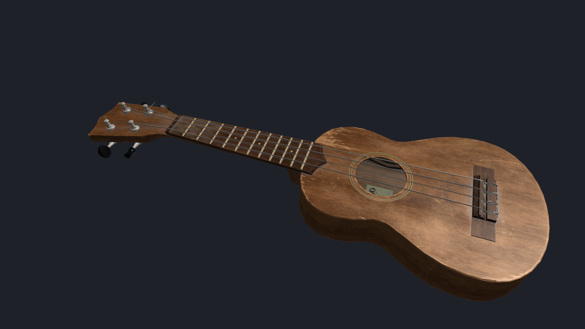

<!-- /tutorial-scope -->

### Mehr als Farbe

Zur Ukulele gehören noch zwei Bilder. Jedes ist eine **Map**, eine Karte,
die für jede Stelle der Oberfläche eine Zahl oder eine Richtung festhält, und
alle liegen gleich auf dem Modell: Dieselbe Stelle \\((u, v)\\) meint in
jedem Bild dieselbe Stelle der Ukulele.

<div class='gallery columns-3'>
<figure>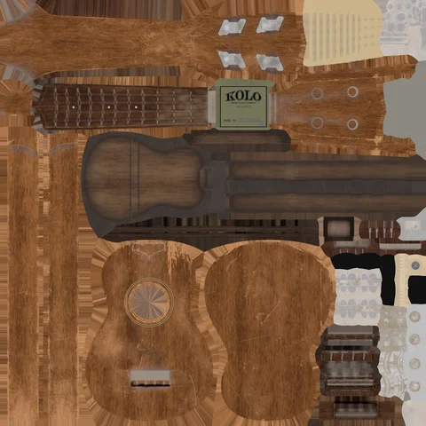<figcaption>Color Map</figcaption></figure>
<figure>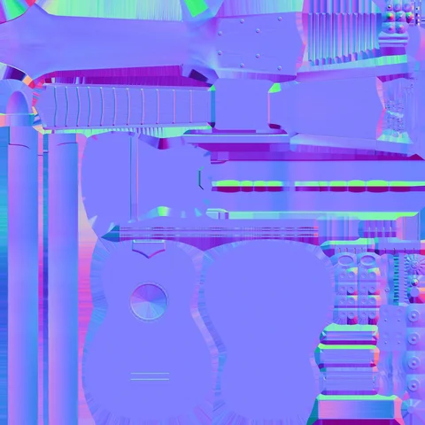<figcaption>Normal Map</figcaption></figure>
<figure>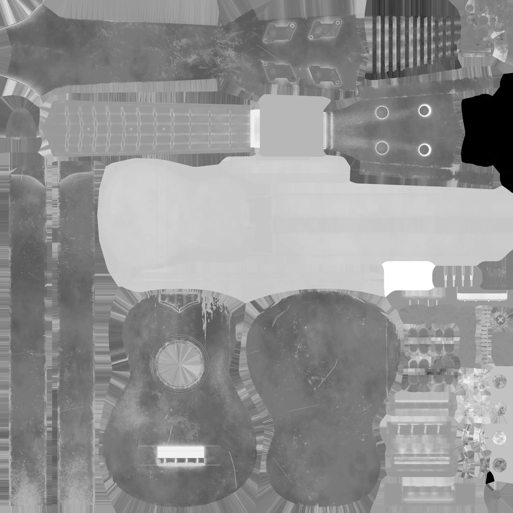<figcaption>Roughness Map</figcaption></figure>
</div>

- Die **Color Map** (auch *Albedo* oder *Diffuse Map*) hat die Farbe der
  Oberfläche, ohne Licht und ohne Schatten. Die kennst du schon.
- Die **Normal Map** hat für jede Stelle eine Normale, als Farbe: Rot ist
  \\(x\\), Grün \\(y\\), Blau \\(z\\), jeweils von 0 bis 1 statt von −1 bis 1.
  Die Richtung meint nicht den Raum, sondern die Fläche: \\(x\\) zeigt in
  die Richtung, in die \\(u\\) wächst, \\(y\\) in die, in die \\(v\\)
  wächst, und \\(z\\) gerade aus der Fläche heraus. Darum ist eine Normal
  Map meist hellblau, \\((0{,}5;\ 0{,}5;\ 1)\\), gerade heraus, und nur
  wo die Fläche Beulen und Rillen hat, kippt die Farbe. So bekommt die Ukulele
  Kerben, Kanten und Dellen im Holz, die in keinem Dreieck stecken: Das Modell
  aus 8.912 Dreiecken ist von einem viel feineren abgeleitet, und die Normal
  Map bewahrt, wie das Licht auf diesem gefallen wäre.
- Die **Roughness Map** sagt, wie rau die Oberfläche ist, von 0 (spiegelglatt)
  bis 1 (ganz rau). Auf einer glatten Fläche ist der Glanzpunkt klein und
  hell, auf einer rauen breit und schwach. Bei der Ukulele ist der Lack an
  vielen Stellen zerkratzt; dort ist sie heller, also rauer.

Die Idee hinter der Normal Map ist älter: Jim Blinn beulte 1978 Flächen ein,
indem er ihre Normalen nach einer **Bump Map** kippte, einem Bild aus
Höhen; heute speichert man meist gleich die gekippten Normalen. Mit einer
**Height Map** oder **Displacement Map** verschiebt der Vertex-Shader die
Ecken sogar wirklich, nach der Höhe im Bild; dafür braucht das Modell aber
sehr viele Ecken.

Der neue Fragment-Shader liest alle drei Maps. Mit den Tasten <kbd>1</kbd>
bis <kbd>3</kbd> schaltest du jede ein und aus, um zu sehen, was sie tut;
dafür gibt es für jede einen Schalter (`useColor` und so weiter). Schreib
`shader.frag` neu:

```glsl_copy
#version 300 es
precision highp float;
in vec3 v_position;
in vec2 v_uv;
in vec3 v_normal;
uniform sampler2D colorMap;
uniform sampler2D normalMap;
uniform sampler2D roughnessMap;
uniform bool useColor;
uniform bool useNormal;
uniform bool useRoughness;
uniform bool wire;
uniform vec3 light;
uniform vec3 eye;
out vec4 color;

// die Normale aus der Normal Map, gedreht auf die Fläche
vec3 mapNormal(vec3 n) {
    // wie sich Lage und Stelle in der Textur von Pixel zu Pixel ändern
    vec3 dp1 = dFdx(v_position);
    vec3 dp2 = dFdy(v_position);
    vec2 duv1 = dFdx(v_uv);
    vec2 duv2 = dFdy(v_uv);
    // daraus die Richtungen t und b, in die u und v auf der Fläche wachsen
    float s = sign(duv1.x * duv2.y - duv1.y * duv2.x);
    vec3 t = normalize(dp1 * duv2.y - dp2 * duv1.y) * s;
    vec3 b = normalize(dp2 * duv1.x - dp1 * duv2.x) * s;
    // die Farbe der Normal Map von 0 bis 1 wird eine Richtung von -1 bis 1
    vec3 m = texture(normalMap, v_uv).rgb * 2.0 - 1.0;
    return normalize(m.x * t + m.y * b + m.z * n);
}

void main() {
    if (wire) {
        color = vec4(1.0, 1.0, 1.0, 1.0);
        return;
    }
    vec3 base = useColor ? texture(colorMap, v_uv).rgb : vec3(0.9, 0.88, 0.84);
    vec3 n = normalize(v_normal);
    if (useNormal) n = mapNormal(n);
    float roughness = 0.5;
    float shininess = 40.0;
    float strength = 0.4;
    if (useRoughness) {
        roughness = texture(roughnessMap, v_uv).r;
        shininess = mix(200.0, 4.0, roughness);
        strength = 1.0 - roughness;
    }

    vec3 l = normalize(light);
    vec3 v = normalize(eye - v_position);
    vec3 h = normalize(l + v);
    float diffuse = max(dot(n, l), 0.0);
    float specular = strength * pow(max(dot(n, h), 0.0), shininess);
    color = vec4(base * (0.3 + 0.7 * diffuse) + specular, 1.0);
}
```

Was darin passiert:

- `mapNormal` braucht die Richtungen \\(t\\) und \\(b\\), in die \\(u\\) und
  \\(v\\) auf der Fläche wachsen, denn die Normal Map meint diese Richtungen.
  `dFdx` und `dFdy` sagen, wie sehr sich ein Wert vom Pixel zum rechten und
  zum oberen Nachbarn ändert. Aus der Änderung der Lage und der Änderung von
  \\((u, v)\\) folgt, wohin \\(u\\) und \\(v\\) im Raum zeigen. Dann wird
  die Farbe der Map zur Richtung, und \\(x\\), \\(y\\) und \\(z\\) zählen in
  den Richtungen \\(t\\), \\(b\\) und \\(n\\).
- Die Roughness ändert den Exponenten und die Stärke des Glanzes:
  `mix(200.0, 4.0, roughness)` geht von 200 bei 0 bis 4 bei 1.

In `main.js` kommen die Schalter zu den Variablen:

```js
~ let flat = false;
const maps = { useColor: true, useNormal: true, useRoughness: true };
```

die Tasten zum Drücken einer Taste:

```js
~     if (e.key === 'f') flat = !flat;
    const names = { 1: 'useColor', 2: 'useNormal', 3: 'useRoughness' };
    if (names[e.key]) maps[names[e.key]] = !maps[names[e.key]];
```

In `start` laden jetzt drei Bilder in die Einheiten 0 bis 2; das ersetzt die
zwei Zeilen mit `ukulele-color.jpg`:

```js
    const textures = [['colorMap', 'ukulele-color.jpg'], ['normalMap', 'ukulele-normal.jpg'],
        ['roughnessMap', 'ukulele-roughness.jpg']];
    for (let unit = 0; unit < textures.length; unit++) {
        const [name, file] = textures[unit];
        await loadTexture(file, unit);
        gl.uniform1i(gl.getUniformLocation(program, name), unit);
    }
```

und in `frame` gehen die Schalter an die Shader, nach `eye`:

```js
        for (const name in maps) {
            gl.uniform1i(gl.getUniformLocation(program, name), maps[name]);
        }
```

<div class='gallery columns-3'>
<figure>
<!-- tutorial-screenshot
write-file: webgl/math.js <- file:stufen/math.js
write-file: webgl/model.js <- file:stufen/model.js
write-file: webgl/shader.vert <- file:stufen/shader.vert
write-file: webgl/shader.frag <- file:stufen/shader-8.frag
write-file: webgl/main.js <- file:stufen/main-10.js
preview-reload
tab: preview
viewport: 800x450
sleep: 6
hook: view 0 0 -0.16 0.22 0.9 0.75
click: selector:canvas
press: 2
press: 3
sleep: 1
-->
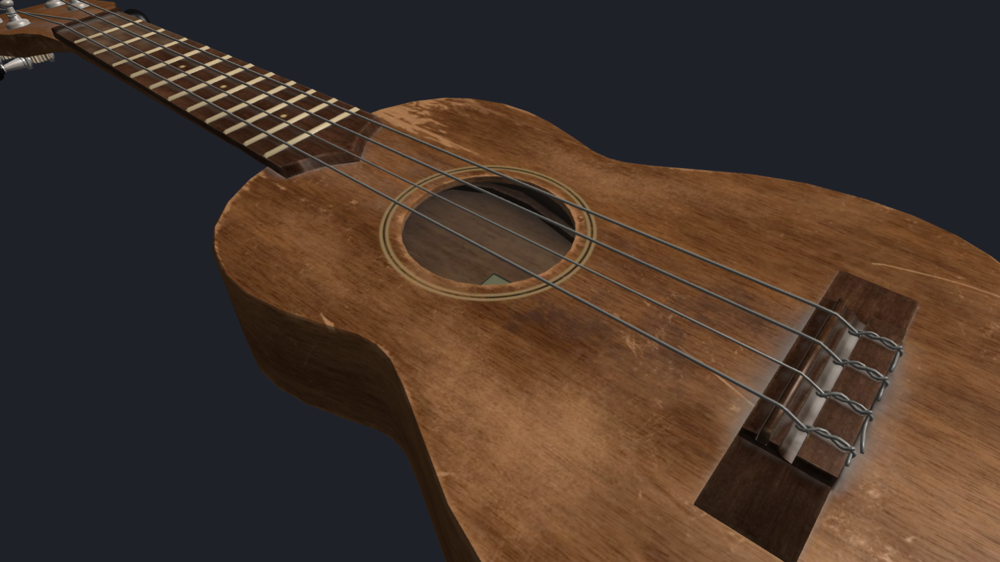
<figcaption>Nur die Color Map</figcaption></figure>
<figure>
<!-- tutorial-screenshot
write-file: webgl/math.js <- file:stufen/math.js
write-file: webgl/model.js <- file:stufen/model.js
write-file: webgl/shader.vert <- file:stufen/shader.vert
write-file: webgl/shader.frag <- file:stufen/shader-8.frag
write-file: webgl/main.js <- file:stufen/main-10.js
preview-reload
tab: preview
viewport: 800x450
sleep: 6
hook: view 0 0 -0.16 0.22 0.9 0.75
click: selector:canvas
press: 3
sleep: 1
-->
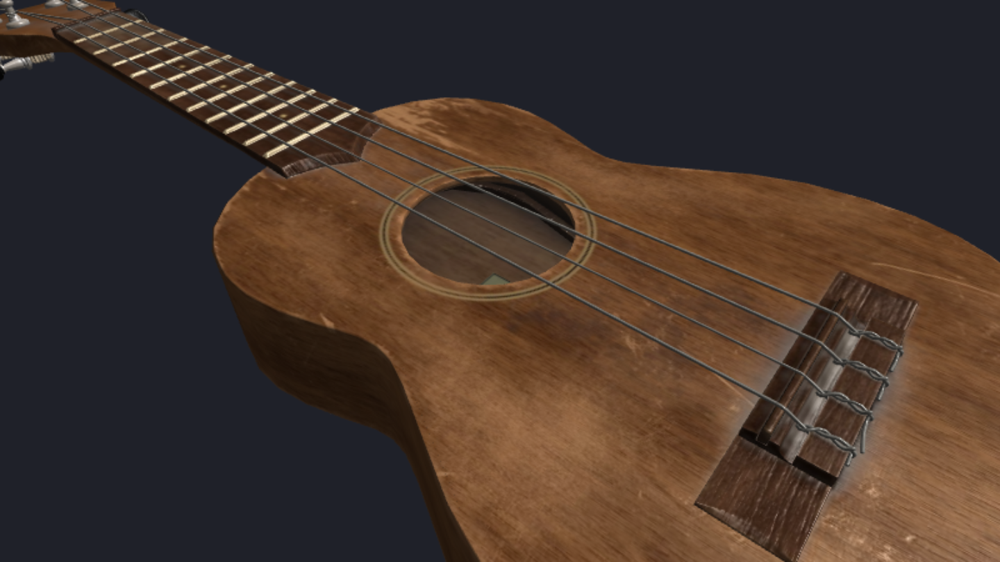
<figcaption>Dazu die Normal Map</figcaption></figure>
<figure>
<!-- tutorial-screenshot
write-file: webgl/math.js <- file:stufen/math.js
write-file: webgl/model.js <- file:stufen/model.js
write-file: webgl/shader.vert <- file:stufen/shader.vert
write-file: webgl/shader.frag <- file:stufen/shader-8.frag
write-file: webgl/main.js <- file:stufen/main-10.js
preview-reload
tab: preview
viewport: 800x450
sleep: 6
hook: view 0 0 -0.16 0.22 0.9 0.75
-->
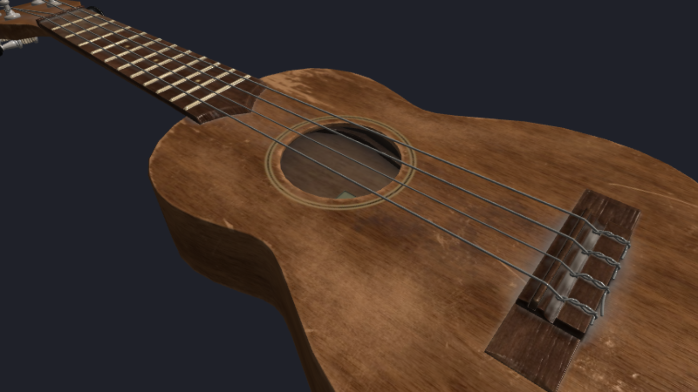
<figcaption>Dazu die Roughness Map</figcaption></figure>
</div>

<div class='hint try'>
<strong>Ausprobieren:</strong> Schalt mit <kbd>2</kbd> die Normal Map aus und
wieder an, während du die Ukulele drehst, und dann mit <kbd>F</kbd> auf Flat
Shading. Achte darauf, ob die Kerben am Schallloch dabei bleiben. Und schalt
mit <kbd>W</kbd> auf das Drahtgitter: Stecken die Kerben in den Dreiecken?
</div>

## Ein Wecker aus Metall und Glas

### Zwei Maps mehr

Ukulele aus, Wecker an: In `main.js` lädt `start` jetzt `clock.obj`:

```js
    const text = await (await fetch('clock.obj')).text();
```

Der Wecker steht aufrecht, mit dem Zifferblatt nach vorne; die Kamera
schaut ihn schräg von vorne an, aus etwas mehr Abstand:

```js
let yaw = -0.4;
let pitch = 0.15;
```

```js
    distance = 1.4 * Math.hypot(high[0] - low[0], high[1] - low[1], high[2] - low[2]);
```

Zum Wecker gehören zwei Maps, die die Ukulele nicht hat:

<div class='gallery columns-2'>
<figure>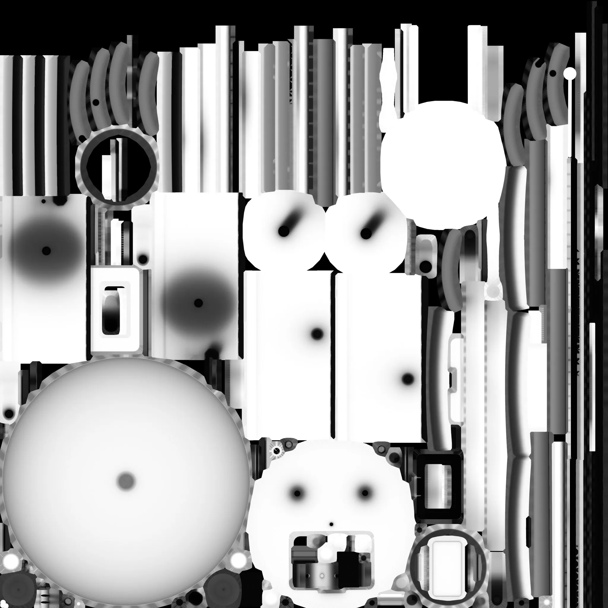<figcaption>Ambient Occlusion Map</figcaption></figure>
<figure>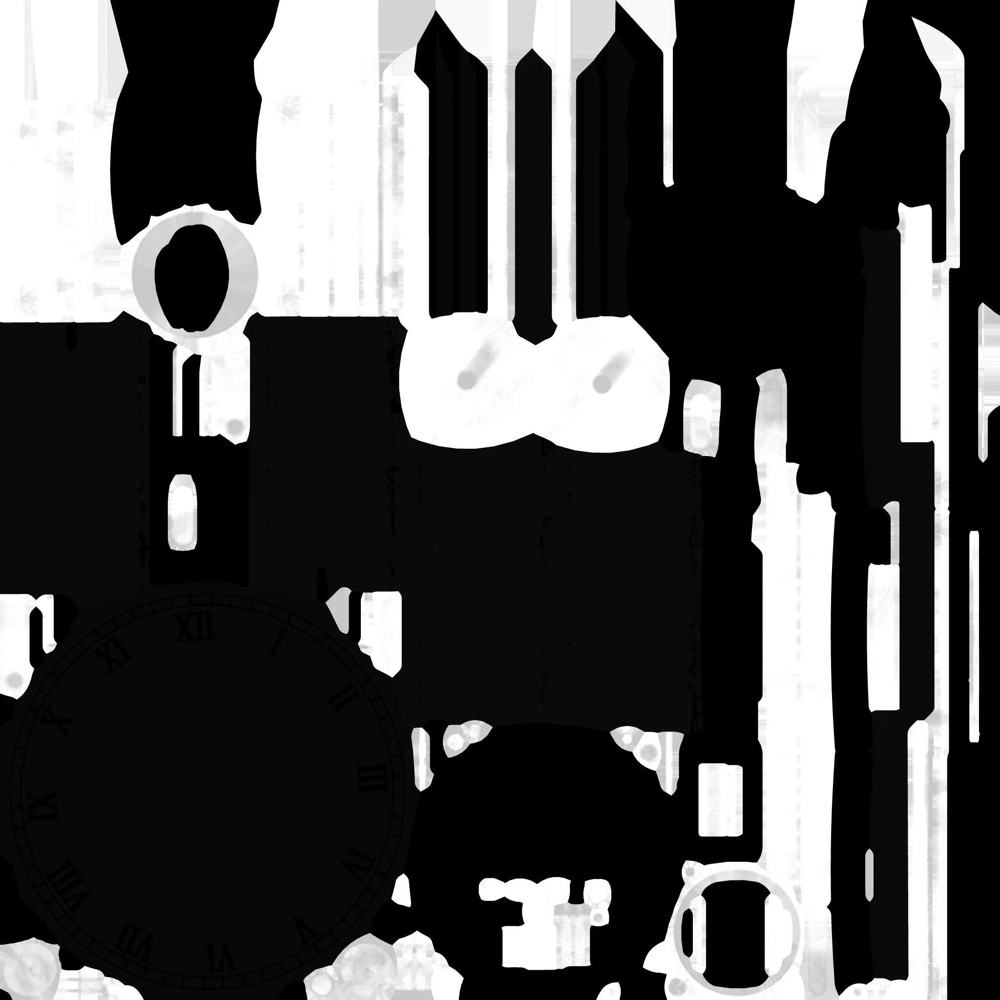<figcaption>Metallic Map</figcaption></figure>
</div>

- Die **Ambient Occlusion Map** (kurz *AO*) sagt, wie viel vom Licht, das von
  überall kommt, eine Stelle erreicht. Unter den Glocken und in Ritzen
  verdeckt das Modell sich selbst; dort ist sie dunkel.
- Die **Metallic Map** sagt, wo Metall ist: weiß, wo es ist, schwarz, wo
  nicht. Metall verhält sich anders als Lack: Es spiegelt fast alles, was um
  es herum ist, und färbt die Spiegelung mit seiner eigenen Farbe. Eine
  Glocke aus Messing spiegelt golden, eine aus Chrom grau.

_task(metall)

### Spiegelungen

Was spiegelt eine Glocke aus Chrom? Das Zimmer, in dem sie steht. Das
Zimmer ist `hotel-room.jpg`: ein Rundumbild, aufgenommen mit einer Kamera,
die in alle Richtungen zugleich schaut. Seine Breite geht einmal im Kreis
herum, seine Höhe von ganz unten bis ganz oben. Jede Richtung im Raum hat
darin eine Stelle: der Winkel zur Seite, mit `atan`, gibt \\(u\\), der
Winkel nach oben, mit `asin`, gibt \\(v\\). So eine Textur heißt
**Environment Map**.

Für jedes Pixel rechnet der Shader aus, wohin der Blick gespiegelt wird:
`reflect(-v, n)` spiegelt die Richtung von der Kamera zum Pixel an der
Normale. In diese Richtung liest er das Rundumbild. Auf einer rauen Fläche
ist die Spiegelung verschwommen: Dafür liest `textureLod` eine der Mipmaps,
je rauer, desto kleiner und verschwommener.

Schräg gesehen spiegelt jede Fläche mehr, auch Lack und Holz; schau einmal
flach über einen Tisch. Christophe Schlick fand 1994 eine einfache Formel
dafür:

$$F = 0{,}04 + 0{,}96 \cdot (1 - n \cdot v)^5$$

Von vorne, \\(n \cdot v = 1\\), sind es 4 Prozent, ganz von der Seite 100.

Schreib `shader.frag` neu:

```glsl_copy
#version 300 es
precision highp float;
in vec3 v_position;
in vec2 v_uv;
in vec3 v_normal;
uniform sampler2D colorMap;
uniform sampler2D normalMap;
uniform sampler2D roughnessMap;
uniform sampler2D aoMap;
uniform sampler2D metalMap;
uniform sampler2D environment;
uniform bool useColor;
uniform bool useNormal;
uniform bool useRoughness;
uniform bool useAo;
uniform bool useMetal;
uniform bool wire;
uniform vec3 light;
uniform vec3 eye;
out vec4 color;

// die Normale aus der Normal Map, gedreht auf die Fläche
vec3 mapNormal(vec3 n) {
    // wie sich Lage und Stelle in der Textur von Pixel zu Pixel ändern
    vec3 dp1 = dFdx(v_position);
    vec3 dp2 = dFdy(v_position);
    vec2 duv1 = dFdx(v_uv);
    vec2 duv2 = dFdy(v_uv);
    // daraus die Richtungen t und b, in die u und v auf der Fläche wachsen
    float s = sign(duv1.x * duv2.y - duv1.y * duv2.x);
    vec3 t = normalize(dp1 * duv2.y - dp2 * duv1.y) * s;
    vec3 b = normalize(dp2 * duv1.x - dp1 * duv2.x) * s;
    // die Farbe der Normal Map von 0 bis 1 wird eine Richtung von -1 bis 1
    vec3 m = texture(normalMap, v_uv).rgb * 2.0 - 1.0;
    return normalize(m.x * t + m.y * b + m.z * n);
}

// die Farbe der Umgebung in Richtung d, aus dem Panorama; blur wählt eine
// kleinere, verschwommenere Fassung (eine Mipmap)
vec3 environmentColor(vec3 d, float blur) {
    float u = 0.5 + atan(d.x, -d.z) / (2.0 * 3.14159265);
    float v = 0.5 + asin(clamp(d.y, -1.0, 1.0)) / 3.14159265;
    return textureLod(environment, vec2(u, v), blur).rgb;
}

void main() {
    if (wire) {
        color = vec4(1.0, 1.0, 1.0, 1.0);
        return;
    }
    vec3 base = useColor ? texture(colorMap, v_uv).rgb : vec3(0.9, 0.88, 0.84);
    vec3 n = normalize(v_normal);
    if (useNormal) n = mapNormal(n);
    float roughness = 0.5;
    float shininess = 40.0;
    float strength = 0.4;
    if (useRoughness) {
        roughness = texture(roughnessMap, v_uv).r;
        shininess = mix(200.0, 4.0, roughness);
        strength = 1.0 - roughness;
    }
    float ao = useAo ? texture(aoMap, v_uv).r : 1.0;
    float metal = useMetal ? texture(metalMap, v_uv).r : 0.0;

    vec3 l = normalize(light);
    vec3 v = normalize(eye - v_position);
    vec3 h = normalize(l + v);
    float diffuse = max(dot(n, l), 0.0);
    float specular = strength * pow(max(dot(n, h), 0.0), shininess);

    // was die Fläche spiegelt: die Umgebung in Richtung des gespiegelten Blicks
    vec3 mirrored = environmentColor(reflect(-v, n), roughness * 8.0);
    // schräg gesehen spiegelt jede Fläche mehr (nach Schlick)
    float fresnel = 0.04 + 0.96 * pow(1.0 - max(dot(n, v), 0.0), 5.0);
    // Lack und Farbe: Licht, Glanz und ein wenig Spiegelung
    vec3 painted = base * (0.3 * ao + 0.7 * diffuse) + specular + mirrored * fresnel * (1.0 - roughness);
    // Metall: spiegelt alles, in seiner eigenen Farbe
    vec3 shiny = mirrored * base * ao + specular * base;
    color = vec4(mix(painted, shiny, metal), 1.0);
}
```

- `painted` ist die Farbe von Lack und Zifferblatt: Licht von überall, jetzt
  mal der AO, Licht von der Lampe, Glanz und die Spiegelung nach Schlick,
  schwächer, je rauer die Fläche ist.
- `shiny` ist Metall: die Spiegelung mal der eigenen Farbe.
- `mix(painted, shiny, metal)` nimmt das eine, das andere oder, wo die Map
  grau ist, etwas dazwischen.

In `main.js` kommen zwei Schalter dazu, auf den Tasten <kbd>4</kbd> und
<kbd>5</kbd>:

```js
const maps = { useColor: true, useNormal: true, useRoughness: true, useAo: true, useMetal: true };
```

```js
    const names = { 1: 'useColor', 2: 'useNormal', 3: 'useRoughness', 4: 'useAo', 5: 'useMetal' };
```

und in `start` sechs Bilder, die Maps des Weckers und das Zimmer:

```js
    const textures = [['colorMap', 'clock-color.jpg'], ['normalMap', 'clock-normal.jpg'],
        ['roughnessMap', 'clock-roughness.jpg'], ['aoMap', 'clock-ao.jpg'],
        ['metalMap', 'clock-metal.jpg'], ['environment', 'hotel-room.jpg']];
```

<div class='gallery columns-2'>
<figure>
<!-- tutorial-screenshot
write-file: webgl/math.js <- file:stufen/math.js
write-file: webgl/model.js <- file:stufen/model.js
write-file: webgl/shader.vert <- file:stufen/shader.vert
write-file: webgl/shader.frag <- file:stufen/shader-9.frag
write-file: webgl/main.js <- file:stufen/main-11.js
preview-reload
tab: preview
viewport: 800x450
sleep: 7
click: selector:canvas
press: 5
sleep: 1
-->
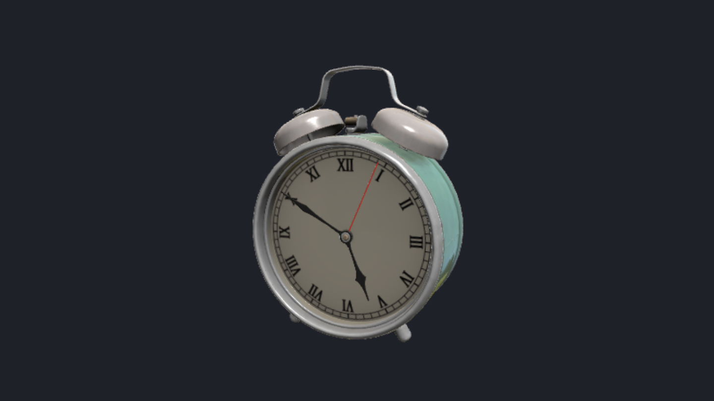
<figcaption>Ohne Metallic Map</figcaption></figure>
<figure>
<!-- tutorial-screenshot
write-file: webgl/math.js <- file:stufen/math.js
write-file: webgl/model.js <- file:stufen/model.js
write-file: webgl/shader.vert <- file:stufen/shader.vert
write-file: webgl/shader.frag <- file:stufen/shader-9.frag
write-file: webgl/main.js <- file:stufen/main-11.js
preview-reload
tab: preview
viewport: 800x450
sleep: 7
-->
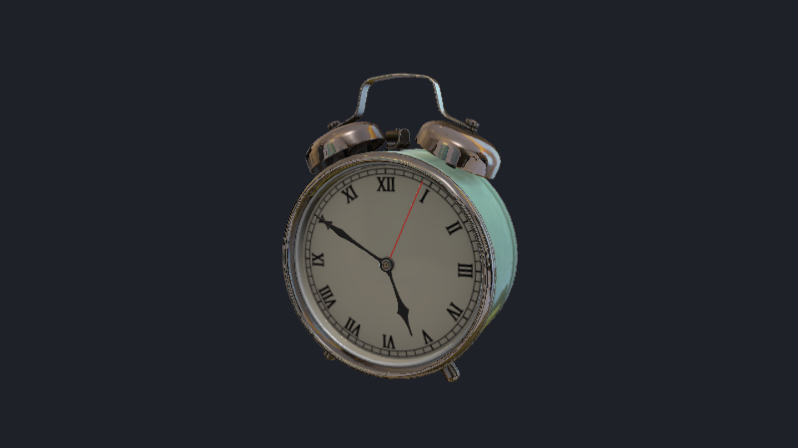
<figcaption>Mit Metallic Map und Spiegelung</figcaption></figure>
</div>

### Glas

Vor dem Zifferblatt sitzt eine Scheibe aus Glas. Sie liegt in einer eigenen
Datei, `glass.obj`, denn sie braucht etwas, was der Z-Buffer nicht kann:
Hinter ihr muss das Zifferblatt zu sehen sein.

_task(glas-zuerst)

<!-- after: glas-zuerst -->
Darum wird das Glas zuletzt gemalt, nach allem, was undurchsichtig ist, und
zwar so:

- **gemischt** statt übermalt: `gl.enable(gl.BLEND)` mit
  `gl.blendFunc(gl.ONE, gl.ONE_MINUS_SRC_ALPHA)` nimmt die Farbe des Glases und
  dazu so viel von dem, was schon dort ist, wie das Glas durchlässt. Wie viel
  das ist, sagt die vierte Zahl der Farbe, **Alpha**: 1 deckt ganz, 0 gar
  nicht.
- **ohne in den Z-Buffer zu schreiben**: `gl.depthMask(false)`. Der Z-Buffer
  prüft weiter, ob das Glas vor dem Wecker liegt, aber er merkt es sich
  nicht; sonst verdeckte das Glas alles, was danach noch käme.
<!-- /after -->

Im Fragment-Shader kommt ein Schalter dazu:

```glsl
~ uniform bool useMetal;
uniform bool glass;
```

und gleich nach `fresnel` der Fall für das Glas:

```glsl
    if (glass) {
        // Glas: fast nur Spiegelung, schräg mehr als von vorne. Echtes Glas
        // spiegelt von vorne 4 Prozent, hier sind es 15, damit man es sieht
        float reflectance = 0.15 + 0.85 * pow(1.0 - max(dot(n, v), 0.0), 5.0);
        color = vec4(mirrored * reflectance + specular, reflectance);
        return;
    }
```

Glas ist die Spiegelung und der Glanz; Alpha ist, wie viel es spiegelt. Was
es nicht spiegelt, lässt es durch.

In `main.js` gibt es jetzt zwei Modelle, also zwei Buffer. Zwei Funktionen
vor `start` legen einen an und sagen der Grafikkarte, wie sie ihn liest:

```js
// ein Modell als Buffer auf der Grafikkarte: die Ecken und wie sie zu lesen sind
function upload(vertices) {
    const buffer = gl.createBuffer();
    gl.bindBuffer(gl.ARRAY_BUFFER, buffer);
    gl.bufferData(gl.ARRAY_BUFFER, new Float32Array(vertices), gl.STATIC_DRAW);
    return buffer;
}

function bindAttributes(program, buffer) {
    gl.bindBuffer(gl.ARRAY_BUFFER, buffer);
    const attributes = [['position', 3, 0], ['uv', 2, 3], ['normal', 3, 5]];
    for (const [name, size, offset] of attributes) {
        const location = gl.getAttribLocation(program, name);
        if (location < 0) continue;   // ein Attribut, das der Shader nicht benutzt
        gl.enableVertexAttribArray(location);
        gl.vertexAttribPointer(location, size, gl.FLOAT, false, 8 * 4, offset * 4);
    }
}
```

In `start` liest du das Glas gleich nach dem Wecker:

```js
    const glassVertices = parseObj(await (await fetch('glass.obj')).text());
```

und an die Stelle des Buffers und der Schleife über die Attribute treten:

```js
    const buffer = upload(vertices);
    const glassBuffer = upload(glassVertices);
    bindAttributes(program, buffer);
```

Mit der Taste <kbd>G</kbd> schaltest du das Glas aus und an:

```js
~ let flat = false;
let showGlass = true;
```

```js
~     if (e.key === 'f') flat = !flat;
    if (e.key === 'g') showGlass = !showGlass;
```

In `frame` malst du das Glas zuletzt, nach dem Wecker:

```js
        // das Glas zuletzt: gemischt mit dem, was schon gemalt ist, und ohne
        // selbst in den Z-Buffer zu schreiben
        if (!wireframe && showGlass) {
            bindAttributes(program, glassBuffer);
            gl.uniform1i(gl.getUniformLocation(program, 'glass'), true);
            gl.enable(gl.BLEND);
            gl.blendFunc(gl.ONE, gl.ONE_MINUS_SRC_ALPHA);
            gl.depthMask(false);
            gl.drawArrays(gl.TRIANGLES, 0, glassVertices.length / 8);
            gl.depthMask(true);
            gl.disable(gl.BLEND);
            gl.uniform1i(gl.getUniformLocation(program, 'glass'), false);
            bindAttributes(program, buffer);
        }
```

<div class='gallery columns-2'>
<figure>
<!-- tutorial-screenshot
write-file: webgl/math.js <- file:stufen/math.js
write-file: webgl/model.js <- file:stufen/model.js
write-file: webgl/shader.vert <- file:stufen/shader.vert
write-file: webgl/shader.frag <- file:stufen/shader.frag
write-file: webgl/main.js <- file:stufen/main.js
preview-reload
tab: preview
viewport: 800x450
sleep: 7
hook: view 0 0.087 0.007 0.24 0.5 0.25
click: selector:canvas
press: g
sleep: 1
-->
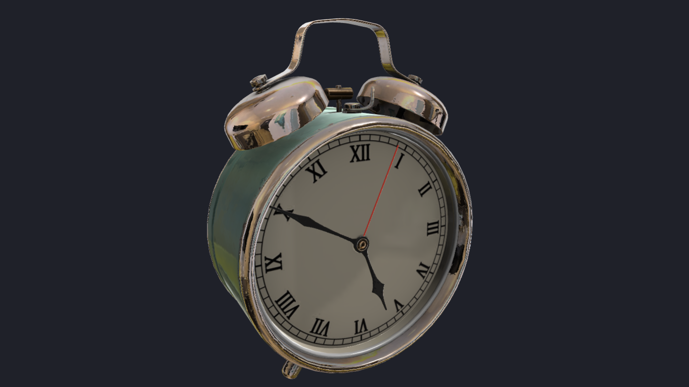
<figcaption>Ohne Glas</figcaption></figure>
<figure>
<!-- tutorial-screenshot
write-file: webgl/math.js <- file:stufen/math.js
write-file: webgl/model.js <- file:stufen/model.js
write-file: webgl/shader.vert <- file:stufen/shader.vert
write-file: webgl/shader.frag <- file:stufen/shader.frag
write-file: webgl/main.js <- file:stufen/main.js
preview-reload
tab: preview
viewport: 800x450
sleep: 7
hook: view 0 0.087 0.007 0.24 0.5 0.25
-->
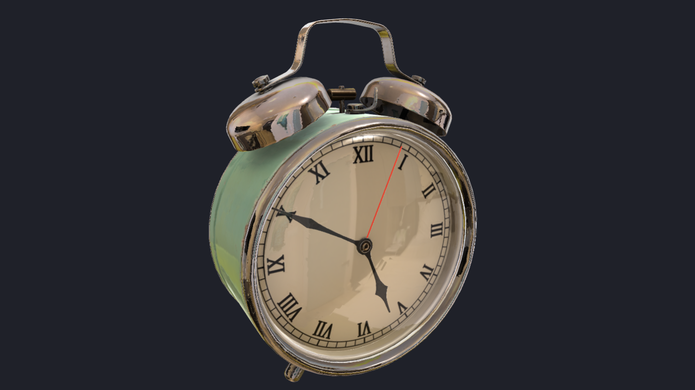
<figcaption>Mit Glas</figcaption></figure>
</div>

<!-- tutorial-scope -->
<!-- tutorial-screenshot
# Bild für die Karte: der Wecker mit Spiegelungen und Glas in 16:9
write-file: webgl/math.js <- file:stufen/math.js
write-file: webgl/model.js <- file:stufen/model.js
write-file: webgl/shader.vert <- file:stufen/shader.vert
write-file: webgl/shader.frag <- file:stufen/shader.frag
write-file: webgl/main.js <- file:stufen/main.js
preview-reload
tab: preview
viewport: 1029x579
sleep: 7
hook: clear 0.93 0.92 0.89
hook: view 0 0.086 0.007 0.28 0.5 0.22
-->
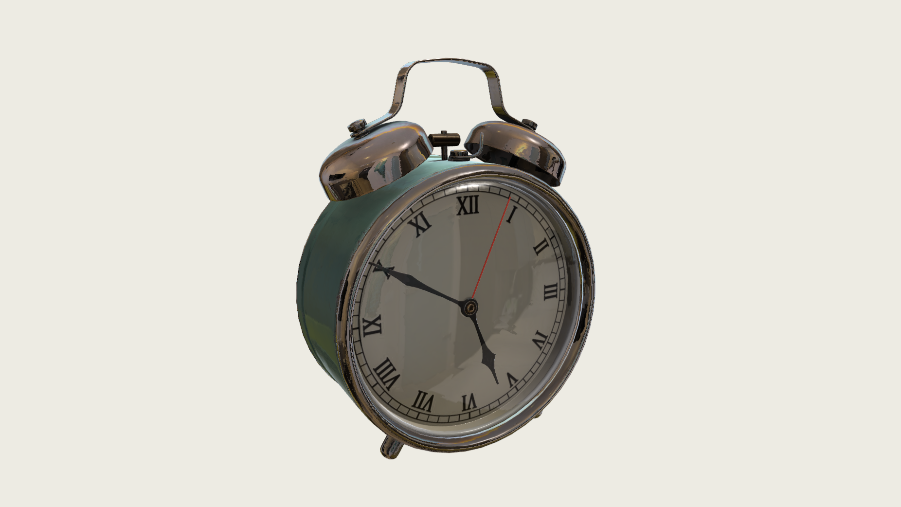

<!-- /tutorial-scope -->

Für ein einzelnes Glas reicht das. Liegen mehrere durchsichtige Flächen
hintereinander, müssen sie von hinten nach vorne gemalt werden, damit jede
mit dem richtigen Hintergrund gemischt wird: Spiele sortieren darum alles
Durchsichtige in jedem Bild nach der Tiefe.

<div class='hint try'>
<strong>Ausprobieren:</strong> Schalt mit <kbd>5</kbd> das Metall aus und
wieder an, und dreh den Wecker langsam: Achte darauf, wie das Zimmer über die
Glocken wandert. Setz dann im Glas die <code>0.15</code> auf
<code>0.04</code>, so viel, wie echtes Glas von vorne spiegelt, und schau das
Zifferblatt einmal von vorne und einmal ganz von der Seite an.
</div>

_task(warum-z-buffer)

## Wie geht es weiter?

Dein Programm malt Dreiecke, wie fast jedes Spiel: Ecken mit einer Matrix auf
den Bildschirm, Pixel aus der Rasterung, der Z-Buffer für das Nächste, Licht
aus Normalen, Texturen für alles, was in keinem Dreieck steckt, Spiegelungen
aus einem Rundumbild und Glas, das zuletzt gemischt wird. Spiele gehen noch
weiter: Schatten aus einem zweiten Z-Buffer, der von der Lampe aus gerechnet
wird, und Licht nach der Physik, bei dem Roughness und Metallic genauer
rechnen als dein Exponent (*Physically Based Rendering*). Einen ganz anderen
Weg geht ein [Raytracer](/raytracing): Er schickt für jedes Pixel einen
Strahl in die Szene und rechnet aus, was er trifft; Spiegel und Glas zeigen
dort, was wirklich daneben steht, nicht ein Rundumbild, aber das Bild
braucht viel länger. Und was dein Fragment-Shader tut, treibt
[Shader in GLSL](/glsl) weiter, bis zu Welten ohne ein einziges Dreieck.

Ohne Dreiecke kommt auch [Gaussian Splatting](/gaussian-splatting) aus: Eine
Szene aus Fotos besteht dort aus Millionen weicher, durchscheinender Splats,
und gerade weil sie durchscheinen, hilft kein Z-Buffer mehr; sie müssen in
jedem Bild nach der Tiefe sortiert werden.
