<div class='meta'>
image: teaser.webp
image_alt: "Ein Abstimmungsergebnis als Balken: Pizza 5, Nudeln 2, Curry 4, Salat 1"
kind: projekt
language: Ruby / Python
languages: [ruby, python]
topic: networks
duration: 2 Doppelstunden
requires: [tcpip]
reference: [netzwerk, http, ruby-python]
</div>

<div
    class="autotoc-secondary-trigger"
    data-title="Auf dieser Seite"
    data-levels="h2,h3">
</div>

# Ein eigener Webserver

<p class='abstract'>
Jedes Mal, wenn du eine Webseite öffnest, schickt dein Browser eine Anfrage an einen Webserver, und der schickt die Seite zurück. In dieser Aktivität schreibst du so einen Server selbst, in Ruby oder Python und ohne fertige Bibliothek: Er wartet auf Verbindungen, liest die Anfrage, antwortet, liefert HTML-Seiten aus, zählt seine Besuche und nimmt Stimmen aus einem Formular an. Am Ende teilst du ihn mit deiner Klasse.
</p>

Auf der Seite [TCP/IP](/tcpip) hast du mit `nc -l` an einem Port auf eine Verbindung gewartet und mit `nc -C info.cern.ch 80` eine HTTP-Anfrage von Hand getippt. Ein Webserver ist die andere Seite davon: Er wartet an einem Port auf eine TCP-Verbindung, liest Text und schickt Text zurück. Damit Browser und Server sich verstehen, folgt der Text einer festen Form, dem **HTTP**-Protokoll. Der Live Server, mit dem du sonst Webseiten ansiehst, ist genau so ein Programm. Hier baust du ihn selbst und siehst, was er tut.

_person(berners-lee)

## Einrichten

Lege im Terminal (<kbd>Strg</kbd><kbd>J</kbd>) einen Ordner an und öffne ihn mit <kbd>Strg</kbd><kbd>K</kbd> <kbd>Strg</kbd><kbd>O</kbd>:

```bash
mkdir /workspace/webserver
```

<!-- language: ruby -->
Lege darin die Datei `server.rb` an.
<!-- /language -->
<!-- language: python -->
Lege darin die Datei `server.py` an.
<!-- /language -->

## Ein Server, der zuhört

<!-- language: ruby -->
Schreibe in `server.rb`:

```ruby
require 'socket'

server = TCPServer.new(8000)
puts "Der Server wartet auf Port 8000 ..."

loop do
  client = server.accept          # wartet, bis jemand eine Verbindung aufbaut
  puts "--- Eine neue Verbindung"
  # Die Anfrage zeilenweise lesen, bis zur ersten leeren Zeile
  while (line = client.gets) && line != "\r\n"
    puts line
  end
  client.close
end
```

- `TCPServer.new(8000)` öffnet Port 8000. Ab jetzt nimmt das Betriebssystem Verbindungen an diesem Port für dein Programm entgegen.
- `server.accept` wartet, bis jemand eine Verbindung aufbaut, und gibt sie zurück. Mit `client` liest und schreibst du dann wie mit einer Datei.
- `client.gets` liest eine Zeile. Eine HTTP-Anfrage endet mit einer leeren Zeile, `"\r\n"`. Bis dahin gibt der Server jede Zeile im Terminal aus.

Starte den Server im Terminal:

```bash
ruby server.rb
```
<!-- /language -->
<!-- language: python -->
Schreibe in `server.py`:

```python
import socket

server = socket.create_server(('', 8000))
print('Der Server wartet auf Port 8000 ...')

while True:
    client, address = server.accept()   # wartet, bis jemand eine Verbindung aufbaut
    print('--- Eine neue Verbindung')
    with client, client.makefile('rb') as reader:
        # Die Anfrage zeilenweise lesen, bis zur ersten leeren Zeile
        for line in reader:
            if line == b'\r\n':
                break
            print(line.decode(), end='')
```

- `socket.create_server(('', 8000))` öffnet Port 8000. Ab jetzt nimmt das Betriebssystem Verbindungen an diesem Port für dein Programm entgegen; `''` heißt: an allen Adressen des Rechners.
- `server.accept()` wartet, bis jemand eine Verbindung aufbaut, und gibt sie zurück, zusammen mit der Adresse der Gegenseite. Mit `client.makefile('rb')` liest du aus der Verbindung wie aus einer Datei, Byte für Byte; `with` schließt am Ende beides.
- Jede `line` ist eine Zeile, als Bytes. Eine HTTP-Anfrage endet mit einer leeren Zeile, `b'\r\n'`. Bis dahin gibt der Server jede Zeile im Terminal aus; `decode()` macht aus den Bytes Text.

Starte den Server im Terminal:

```bash
python3 server.py
```
<!-- /language -->

Er wartet jetzt und hört auf Port 8000. Öffne daneben ein zweites Terminal mit <kbd>Strg</kbd><kbd>Shift</kbd><kbd>5</kbd> und schicke ihm mit `curl` eine Anfrage, so wie ein Browser es tut:

```bash
curl localhost:8000
```

<!-- language: ruby -->
<!-- tutorial-screenshot
# Ordner webserver mit Stufe 1, Server links, curl rechts
write-file: webserver/server.rb <- file:stufen/1.rb
press: Control+K
press: Control+O
wait-for-input-value: /workspace/
type: webserver
press: Enter
wait-for-input-value: /workspace/webserver/
press: Enter
wait-for-text: server.rb
hide-left-sidebar
terminal-open
terminal-maximize
terminal-run: ruby server.rb
wait-for-text: Der Server wartet
press: Control+Shift+5
sleep: 1
terminal-run: curl localhost:8000
sleep: 2
check-task-fails: antwort
-->
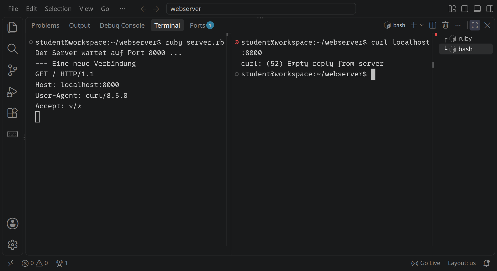
<!-- /language -->
<!-- language: python -->
<!-- tutorial-screenshot
# Stufe 1 in Python: Server links, curl rechts
write-file: webserver/server.py <- file:stufen/1.py
terminal-open
terminal-maximize
press: Alt+ArrowLeft
sleep: 1
press: Control+C
sleep: 1
press: Control+L
type: python3 server.py
press: Enter
sleep: 2
terminal-run: clear
sleep: 1
terminal-run: curl localhost:8000
sleep: 2
check-task-fails: antwort python
-->
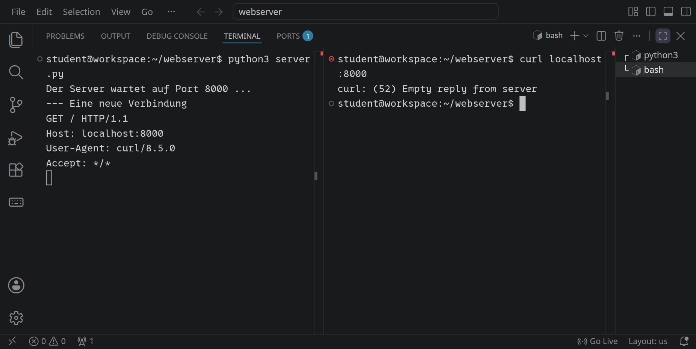
<!-- /language -->

Im linken Terminal steht, was `curl` geschickt hat. Die erste Zeile ist die **Request-Line**: die Methode `GET` (»gib mir«), der Pfad `/` und die Version des Protokolls. Danach kommen **Header**, je ein Name und ein Wert: an wen die Anfrage geht (`Host`), welches Programm fragt (`User-Agent`), was es annimmt (`Accept`). Rechts beschwert sich `curl`: Der Server hat die Verbindung geschlossen, ohne zu antworten.

_uses(http-anfrage)

_task(request-line)

## Eine Antwort

<!-- language: ruby -->
Eine Antwort hat dieselbe Form wie eine Anfrage: eine **Status-Line**, Header, eine leere Zeile, und danach kommt der Inhalt. Beende den Server im linken Terminal mit <kbd>Strg</kbd><kbd>C</kbd> und ersetze `server.rb` durch:

```ruby_copy
require 'socket'

server = TCPServer.new(8000)
puts "Der Server wartet auf Port 8000 ..."

loop do
  client = server.accept
  # Jede Verbindung bekommt einen eigenen Thread: So wartet der Server nicht
  # auf einen Besucher, während ein anderer schon etwas will.
  Thread.new(client) do |client|
    while (line = client.gets) && line != "\r\n"
      puts line
    end

    text = "Hallo aus meinem eigenen Server!\n"
    client.print "HTTP/1.1 200 OK\r\n"
    client.print "Content-Type: text/plain; charset=utf-8\r\n"
    client.print "Content-Length: #{text.bytesize}\r\n"
    client.print "Connection: close\r\n"
    client.print "\r\n"
    client.print text
    client.close
  end
end
```

- `HTTP/1.1 200 OK` ist die Status-Line: Version, Statuscode 200 und »OK«, alles in Ordnung.
- `Content-Type` sagt, was für Inhalt kommt: einfacher Text in UTF-8. `Content-Length` sagt, wie viele **Bytes** er hat. `text.bytesize` zählt Bytes, nicht Zeichen; das ist ein Unterschied, sobald ein Umlaut im Text steht.
- `Connection: close` kündigt an, dass der Server die Verbindung nach der Antwort schließt.
- `"\r\n"` ist das Zeilenende in HTTP, Wagenrücklauf und Zeilenvorschub. Die leere Zeile trennt die Header vom Inhalt.
- `Thread.new` lässt jede Verbindung in einem eigenen **Thread** laufen, gleichzeitig mit den anderen. Browser öffnen manchmal mehrere Verbindungen auf einmal; ohne Threads würde der Server bei der ersten warten und die anderen liegen lassen.
<!-- /language -->
<!-- language: python -->
Eine Antwort hat dieselbe Form wie eine Anfrage: eine **Status-Line**, Header, eine leere Zeile, und danach kommt der Inhalt. Beende den Server im linken Terminal mit <kbd>Strg</kbd><kbd>C</kbd> und ersetze `server.py` durch:

```python_copy
import socket
import threading


def handle(client):
    with client, client.makefile('rb') as reader:
        for line in reader:
            if line == b'\r\n':
                break
            print(line.decode(), end='')

        body = 'Hallo aus meinem eigenen Server!\n'.encode()
        client.sendall(b'HTTP/1.1 200 OK\r\n')
        client.sendall(b'Content-Type: text/plain; charset=utf-8\r\n')
        client.sendall(f'Content-Length: {len(body)}\r\n'.encode())
        client.sendall(b'Connection: close\r\n')
        client.sendall(b'\r\n')
        client.sendall(body)


server = socket.create_server(('', 8000))
print('Der Server wartet auf Port 8000 ...')

while True:
    client, address = server.accept()
    # Jede Verbindung bekommt einen eigenen Thread: So wartet der Server nicht
    # auf einen Besucher, während ein anderer schon etwas will.
    threading.Thread(target=handle, args=(client,), daemon=True).start()
```

- `HTTP/1.1 200 OK` ist die Status-Line: Version, Statuscode 200 und »OK«, alles in Ordnung.
- `Content-Type` sagt, was für Inhalt kommt: einfacher Text in UTF-8. `Content-Length` sagt, wie viele **Bytes** er hat. Darum wird der Text erst mit `encode()` zu Bytes, und `len(body)` zählt sie; `len` eines Textes zählt Zeichen, und das ist ein Unterschied, sobald ein Umlaut darin steht.
- `Connection: close` kündigt an, dass der Server die Verbindung nach der Antwort schließt.
- `"\r\n"` ist das Zeilenende in HTTP, Wagenrücklauf und Zeilenvorschub. Die leere Zeile trennt die Header vom Inhalt. `sendall` schickt Bytes, darum steht vor den festen Zeilen ein `b`.
- `threading.Thread(target=handle, args=(client,))` lässt jede Verbindung in einem eigenen **Thread** laufen, gleichzeitig mit den anderen; `handle` ist die Funktion, die eine Verbindung bedient. Browser öffnen manchmal mehrere Verbindungen auf einmal; ohne Threads würde der Server bei der ersten warten und die anderen liegen lassen. Mit `daemon=True` lässt sich der Server mit <kbd>Strg</kbd><kbd>C</kbd> beenden, auch wenn noch eine Verbindung offen ist.
<!-- /language -->

Starte den Server neu (<kbd>↑</kbd> holt den letzten Befehl zurück) und frag im rechten Terminal mit `-i`, dann zeigt `curl` auch Status-Line und Header:

```bash
curl -i localhost:8000
```

<!-- language: ruby -->
<!-- tutorial-screenshot
# Stufe 2: Server neu starten, curl -i zeigt die ganze Antwort
write-file: webserver/server.rb <- file:stufen/2.rb
terminal-open
terminal-maximize
press: Alt+ArrowLeft
sleep: 1
press: Control+C
sleep: 1
press: Control+L
type: ruby server.rb
press: Enter
sleep: 2
terminal-run: clear
sleep: 1
terminal-run: curl -i localhost:8000
sleep: 2
check-task: antwort
-->
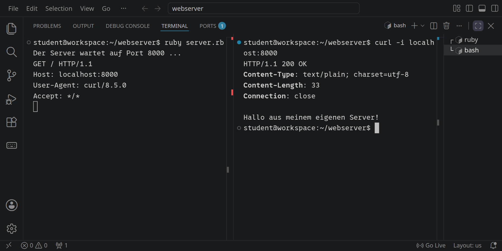
<!-- /language -->
<!-- language: python -->
<!-- tutorial-screenshot
# Stufe 2 in Python: Server neu starten, curl -i zeigt die ganze Antwort
write-file: webserver/server.py <- file:stufen/2.py
terminal-open
terminal-maximize
press: Alt+ArrowLeft
sleep: 1
press: Control+C
sleep: 1
press: Control+L
type: python3 server.py
press: Enter
sleep: 2
terminal-run: clear
sleep: 1
terminal-run: curl -i localhost:8000
sleep: 2
check-task: antwort python
expect-no-text: Traceback
-->
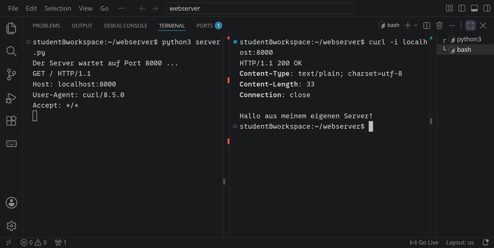
<!-- /language -->

_uses(http-antwort, http-header)

_task(antwort)

_task(bytes)


<div class='hint try'>
<strong>Ausprobieren:</strong> Schick eine falsche Länge. Schreib in der Zeile mit <code>Content-Length</code> statt der berechneten Länge eine feste Zahl, erst <code>10</code>, dann <code>100</code>, und frag nach jedem Neustart mit <code>curl -i localhost:8000</code>. Was zeigt <code>curl</code> jeweils, und was meldet es? Woher weiß ein Client überhaupt, wann der Inhalt zu Ende ist? Stell die Zeile danach wieder her.
</div>

Jetzt der Browser. Visual Studio Code leitet Port 8000 an eine Adresse weiter, die dein Browser erreicht. Du findest sie im Reiter »Ports« neben »Terminal«, in der Spalte »Forwarded Address«. Klicke mit gedrückter <kbd>Strg</kbd>-Taste darauf, und dein Server antwortet in einem neuen Tab.

Oder du schreibst die Anfrage selbst, Zeile für Zeile: Öffne die [TCP-Konsole](/tcp-console) und verbinde dich mit `localhost`, Port 8000. Die Konsole beginnt in deinem Workspace, also landet sie bei deinem Server. Tippe `GET / HTTP/1.1`, `Host: localhost` und eine leere Zeile. Im Terminal siehst du, wie dein Server die Zeilen liest, in der Konsole, was er antwortet. Probier auch, was passiert, wenn du die leere Zeile weglässt oder statt einer Anfrage einfach `Hallo` schickst.

_tool(tcp-console)

## Pfade und 404

Bisher bekommt jeder Pfad dieselbe Antwort. Ein richtiger Server schaut in die Request-Line und antwortet je nach Pfad etwas anderes, und auf einen unbekannten Pfad mit dem Statuscode **404 Not Found**. Weil sich jede Antwort gleich aufbaut, steht das jetzt in einer Funktion `respond`:

<!-- language: ruby -->
```ruby_copy
require 'socket'

# Schickt eine vollständige HTTP-Antwort und schließt die Verbindung
def respond(client, status, type, body)
  client.print "HTTP/1.1 #{status}\r\n"
  client.print "Content-Type: #{type}\r\n"
  client.print "Content-Length: #{body.bytesize}\r\n"
  client.print "Connection: close\r\n"
  client.print "\r\n"
  client.print body
  client.close
end

server = TCPServer.new(8000)
puts "Der Server wartet auf Port 8000 ..."

loop do
  Thread.new(server.accept) do |client|
    # Die erste Zeile: Methode, Pfad, Version
    request_line = client.gets.to_s
    method, path, version = request_line.split(' ')
    puts "#{method} #{path}"
    # Die übrigen Zeilen (Header) brauchen wir noch nicht
    while (line = client.gets) && line != "\r\n"
    end

    case path
    when '/'
      respond(client, '200 OK', 'text/html; charset=utf-8',
              "<h1>Willkommen!</h1><p>Das ist mein eigener Webserver.</p>")
    when '/time'
      respond(client, '200 OK', 'text/plain; charset=utf-8',
              "Es ist #{Time.now.strftime('%H:%M:%S')} Uhr.\n")
    else
      respond(client, '404 Not Found', 'text/plain; charset=utf-8',
              "Die Seite #{path} gibt es nicht.\n")
    end
  end
end
```

`split(' ')` zerlegt die Request-Line an den Leerzeichen in Methode, Pfad und Version. `case path` wählt die Antwort. Probiere die drei Fälle im zweiten Terminal aus:
<!-- /language -->
<!-- language: python -->
```python_copy
import socket
import threading
import time


def respond(client, status, content_type, body):
    """Schickt eine vollständige HTTP-Antwort."""
    data = body.encode() if isinstance(body, str) else body
    head = (f'HTTP/1.1 {status}\r\n'
            f'Content-Type: {content_type}\r\n'
            f'Content-Length: {len(data)}\r\n'
            'Connection: close\r\n'
            '\r\n')
    client.sendall(head.encode() + data)


def handle(client):
    with client, client.makefile('rb') as reader:
        # Die erste Zeile: Methode, Pfad, Version
        request_line = reader.readline().decode()
        method, _, rest = request_line.partition(' ')
        path, _, version = rest.partition(' ')
        print(method, path)
        # Die übrigen Zeilen (Header) brauchen wir noch nicht
        for line in reader:
            if line == b'\r\n':
                break

        if path == '/':
            respond(client, '200 OK', 'text/html; charset=utf-8',
                    '<h1>Willkommen!</h1><p>Das ist mein eigener Webserver.</p>')
        elif path == '/time':
            respond(client, '200 OK', 'text/plain; charset=utf-8',
                    f'Es ist {time.strftime("%H:%M:%S")} Uhr.\n')
        else:
            respond(client, '404 Not Found', 'text/plain; charset=utf-8',
                    f'Die Seite {path} gibt es nicht.\n')


server = socket.create_server(('', 8000))
print('Der Server wartet auf Port 8000 ...')

while True:
    client, address = server.accept()
    threading.Thread(target=handle, args=(client,), daemon=True).start()
```

`partition(' ')` teilt die Request-Line am ersten Leerzeichen und liefert immer drei Teile: was davor steht, das Leerzeichen und den Rest. Zweimal angewendet, ergibt das Methode, Pfad und Version, und das auch dann, wenn eine Anfrage einmal leer ist. `if` und `elif` wählen die Antwort. `respond` nimmt Text oder Bytes und schickt Kopf und Inhalt zusammen mit `sendall`. Probiere die drei Fälle im zweiten Terminal aus:
<!-- /language -->

```bash
curl localhost:8000/time
curl -i localhost:8000/missing
```

<!-- language: ruby -->
<!-- tutorial-screenshot
# Stufe 3: /time und ein unbekannter Pfad
write-file: webserver/server.rb <- file:stufen/3.rb
terminal-open
terminal-maximize
press: Alt+ArrowLeft
sleep: 1
press: Control+C
sleep: 1
press: Control+L
type: ruby server.rb
press: Enter
sleep: 2
terminal-run: clear
sleep: 1
terminal-run: curl localhost:8000/time
sleep: 1
terminal-run: curl -i localhost:8000/missing
sleep: 2
check-task-fails: webseite
-->
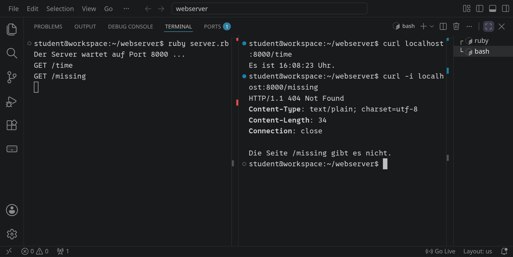
<!-- /language -->
<!-- language: python -->
<!-- tutorial-screenshot
# Stufe 3 in Python: /time und ein unbekannter Pfad
write-file: webserver/server.py <- file:stufen/3.py
terminal-open
terminal-maximize
press: Alt+ArrowLeft
sleep: 1
press: Control+C
sleep: 1
press: Control+L
type: python3 server.py
press: Enter
sleep: 2
terminal-run: clear
sleep: 1
terminal-run: curl localhost:8000/time
sleep: 1
terminal-run: curl -i localhost:8000/missing
sleep: 2
expect-no-text: Traceback
-->
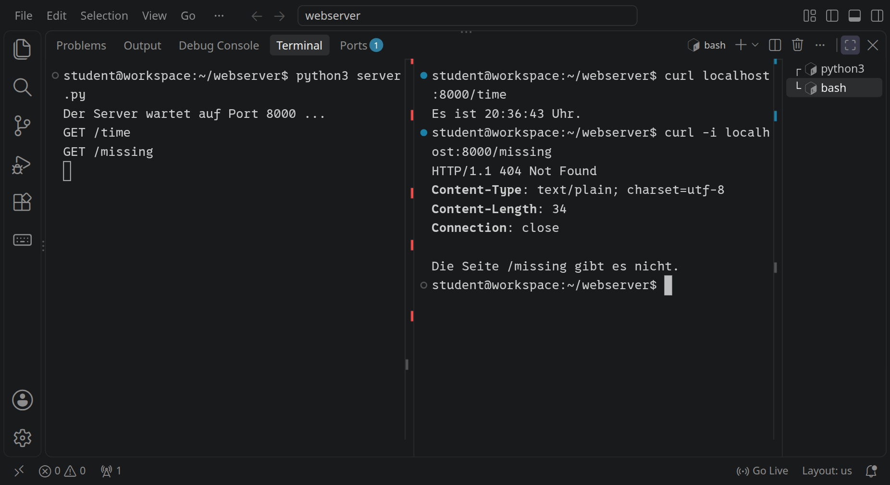
<!-- /language -->

_uses(statuscodes, curl)

_task(statuscodes)


<div class='hint try'>
<strong>Ausprobieren:</strong> Schreib in der Antwort für <code>/</code> <code>text/plain; charset=utf-8</code> statt <code>text/html; charset=utf-8</code>, starte den Server neu und öffne <code>/</code> im Browser. Was siehst du jetzt, und warum? Der Inhalt ist doch derselbe. Stell den Typ danach wieder her.
</div>

## Webseiten ausliefern

Ein Webserver liefert meistens Dateien aus: HTML, CSS, Bilder. Lege neben deinem Server einen Ordner `public` an und darin `index.html`:

```html_copy
<!DOCTYPE html>
<html lang="de">
<head>
  <meta charset="utf-8">
  <title>Mein Webserver</title>
  <link rel="stylesheet" href="style.css">
</head>
<body>
  <h1>Mein eigener Webserver</h1>
  <p>Diese Seite kommt aus dem Ordner <code>public</code>, ausgeliefert von
  einem Server, den ich selbst geschrieben habe.</p>
  <ul>
    <li><a href="time">Wie spät ist es?</a></li>
    <li><a href="hello?name=Ada">Begrüße Ada</a></li>
    <li><a href="visits">Zähle meinen Besuch</a></li>
    <li><a href="missing">Eine Seite, die es nicht gibt</a></li>
  </ul>
</body>
</html>
```

und `style.css`:

```css_copy
/* Die Seiten des Servers: eine weiße Karte auf hellem Grund */
html {
  background: #f4f1ea;
}

body {
  font-family: system-ui, sans-serif;
  line-height: 1.5;
  max-width: 34em;
  margin: 3em auto;
  padding: 2em 2.5em;
  background: white;
  border-radius: 14px;
  box-shadow: 0 2px 12px rgba(0, 0, 0, 0.08);
  color: #2b2b2b;
}

h1 {
  margin-top: 0;
  color: #b5482b;
}

a {
  color: #1f6f8b;
}

code {
  padding: 0.1em 0.35em;
  border-radius: 4px;
  background: #f4f1ea;
}

/* Für die Umfrage später: jede Antwort eine Kachel, die ganz klickbar ist */
label {
  display: block;
  padding: 0.6em 1em;
  border: 2px solid #ece6dc;
  border-radius: 10px;
  cursor: pointer;
}

label:has(input:checked) {
  border-color: #b5482b;
}

input[type="radio"] {
  margin-right: 0.5em;
  accent-color: #b5482b;
}

button {
  padding: 0.6em 1.6em;
  border: 0;
  border-radius: 8px;
  background: #b5482b;
  color: white;
  font: inherit;
  font-weight: 600;
  cursor: pointer;
}

/* Das Ergebnis: ein Balken in der Farbe der Seite für jede Antwort */
table {
  width: 100%;
}

td {
  padding: 0.3em 0;
}

td:first-child {
  width: 5em;
}

td:last-child {
  width: 2em;
  text-align: right;
  font-weight: 600;
}

progress {
  appearance: none;
  width: 100%;
  height: 0.9em;
  border: 0;
  border-radius: 999px;
  background: #ece6dc;
  overflow: hidden;
}

progress::-webkit-progress-bar {
  background: #ece6dc;
}

progress::-webkit-progress-value {
  border-radius: 999px;
  background: #d9774f;
}

progress::-moz-progress-bar {
  border-radius: 999px;
  background: #d9774f;
}
```

### Zu jedem Pfad eine Datei

Der Server sucht jetzt zu jedem Pfad eine Datei in `public`. `/` steht für `/index.html`. Am Dateinamen erkennt er, welcher `Content-Type` dazugehört, damit der Browser weiß, ob er HTML, CSS oder ein Bild bekommt:

<!-- language: ruby -->
```ruby_copy
require 'socket'

# Welcher Content-Type zu welcher Endung gehört
TYPES = {
  '.html' => 'text/html; charset=utf-8',
  '.css'  => 'text/css; charset=utf-8',
  '.js'   => 'text/javascript; charset=utf-8',
  '.png'  => 'image/png',
  '.jpg'  => 'image/jpeg',
  '.txt'  => 'text/plain; charset=utf-8',
}

PUBLIC_DIR = File.expand_path('public', __dir__)

# Schickt eine vollständige HTTP-Antwort und schließt die Verbindung
def respond(client, status, type, body)
  client.print "HTTP/1.1 #{status}\r\n"
  client.print "Content-Type: #{type}\r\n"
  client.print "Content-Length: #{body.bytesize}\r\n"
  client.print "Connection: close\r\n"
  client.print "\r\n"
  client.print body
  client.close
end

# Eine Datei aus dem Ordner public, aber nie etwas außerhalb davon
def serve_file(client, path)
  path = '/index.html' if path == '/'
  file = File.expand_path('.' + path, PUBLIC_DIR)
  if file.start_with?(PUBLIC_DIR + '/') && File.file?(file)
    type = TYPES[File.extname(file)] || 'application/octet-stream'
    respond(client, '200 OK', type, File.binread(file))
  else
    respond(client, '404 Not Found', 'text/plain; charset=utf-8',
            "Die Seite #{path} gibt es nicht.\n")
  end
end

server = TCPServer.new(8000)
puts "Der Server wartet auf Port 8000 ..."

loop do
  Thread.new(server.accept) do |client|
    request_line = client.gets.to_s
    method, path, version = request_line.split(' ')
    puts "#{method} #{path}"
    while (line = client.gets) && line != "\r\n"
    end

    if path == '/time'
      respond(client, '200 OK', 'text/plain; charset=utf-8',
              "Es ist #{Time.now.strftime('%H:%M:%S')} Uhr.\n")
    else
      serve_file(client, path.to_s)
    end
  end
end
```

Wichtig ist die Zeile mit `start_with?`. `File.expand_path` macht aus dem Pfad einen vollständigen Dateinamen, und der muss im Ordner `public` liegen. Ohne diese Prüfung könnte jemand nach `/../server.rb` fragen und bekäme deinen Quelltext, oder jede andere Datei, die dein Workspace lesen kann.
<!-- /language -->
<!-- language: python -->
```python_copy
import os
import socket
import threading
import time

# Welcher Content-Type zu welcher Endung gehört
TYPES = {
    '.html': 'text/html; charset=utf-8',
    '.css': 'text/css; charset=utf-8',
    '.js': 'text/javascript; charset=utf-8',
    '.png': 'image/png',
    '.jpg': 'image/jpeg',
    '.txt': 'text/plain; charset=utf-8',
}

PUBLIC_DIR = os.path.realpath(os.path.join(os.path.dirname(__file__), 'public'))


def respond(client, status, content_type, body):
    """Schickt eine vollständige HTTP-Antwort."""
    data = body.encode() if isinstance(body, str) else body
    head = (f'HTTP/1.1 {status}\r\n'
            f'Content-Type: {content_type}\r\n'
            f'Content-Length: {len(data)}\r\n'
            'Connection: close\r\n'
            '\r\n')
    client.sendall(head.encode() + data)


def serve_file(client, path):
    """Eine Datei aus dem Ordner public, aber nie etwas außerhalb davon"""
    if path == '/':
        path = '/index.html'
    file = os.path.realpath(os.path.join(PUBLIC_DIR, '.' + path))
    if file.startswith(PUBLIC_DIR + '/') and os.path.isfile(file):
        content_type = TYPES.get(os.path.splitext(file)[1], 'application/octet-stream')
        with open(file, 'rb') as f:
            respond(client, '200 OK', content_type, f.read())
    else:
        respond(client, '404 Not Found', 'text/plain; charset=utf-8',
                f'Die Seite {path} gibt es nicht.\n')


def handle(client):
    with client, client.makefile('rb') as reader:
        request_line = reader.readline().decode()
        method, _, rest = request_line.partition(' ')
        path, _, version = rest.partition(' ')
        print(method, path)
        for line in reader:
            if line == b'\r\n':
                break

        if path == '/time':
            respond(client, '200 OK', 'text/plain; charset=utf-8',
                    f'Es ist {time.strftime("%H:%M:%S")} Uhr.\n')
        else:
            serve_file(client, path)


server = socket.create_server(('', 8000))
print('Der Server wartet auf Port 8000 ...')

while True:
    client, address = server.accept()
    threading.Thread(target=handle, args=(client,), daemon=True).start()
```

Wichtig ist die Zeile mit `startswith`. `os.path.realpath` macht aus dem Pfad einen vollständigen Dateinamen, ohne `..`, und der muss im Ordner `public` liegen. Ohne diese Prüfung könnte jemand nach `/../server.py` fragen und bekäme deinen Quelltext, oder jede andere Datei, die dein Workspace lesen kann.
<!-- /language -->

Starte den Server neu (<kbd>Strg</kbd><kbd>C</kbd>, dann <kbd>↑</kbd> und <kbd>Enter</kbd>) und prüfe im zweiten Terminal, ob die CSS-Datei mit dem richtigen Content-Type kommt. Mit `-I` fragt `curl` nur nach den Headern, mit der Methode `HEAD` statt `GET`:

```bash
curl -I localhost:8000/style.css
```

<!-- language: ruby -->
<!-- tutorial-screenshot
# Stufe 4 mit public/: Neustart, curl holt style.css
write-file: webserver/public/index.html <- file:stufen/public/index.html
write-file: webserver/public/style.css <- file:stufen/public/style.css
write-file: webserver/server.rb <- file:stufen/4.rb
terminal-open
terminal-maximize
press: Alt+ArrowLeft
sleep: 1
press: Control+C
sleep: 1
press: Control+L
type: ruby server.rb
press: Enter
sleep: 2
terminal-run: clear
sleep: 1
terminal-run: curl -I localhost:8000/style.css
sleep: 2
check-task: webseite
-->
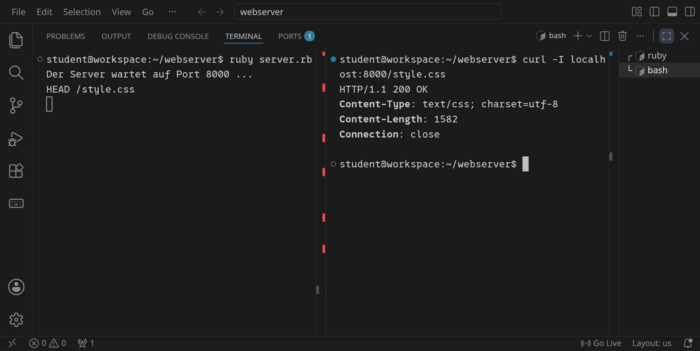
<!-- /language -->
<!-- language: python -->
<!-- tutorial-screenshot
# Stufe 4 in Python: Neustart, curl holt style.css
write-file: webserver/server.py <- file:stufen/4.py
terminal-open
terminal-maximize
press: Alt+ArrowLeft
sleep: 1
press: Control+C
sleep: 1
press: Control+L
type: python3 server.py
press: Enter
sleep: 2
terminal-run: clear
sleep: 1
terminal-run: curl -I localhost:8000/style.css
sleep: 2
expect-no-text: Traceback
-->
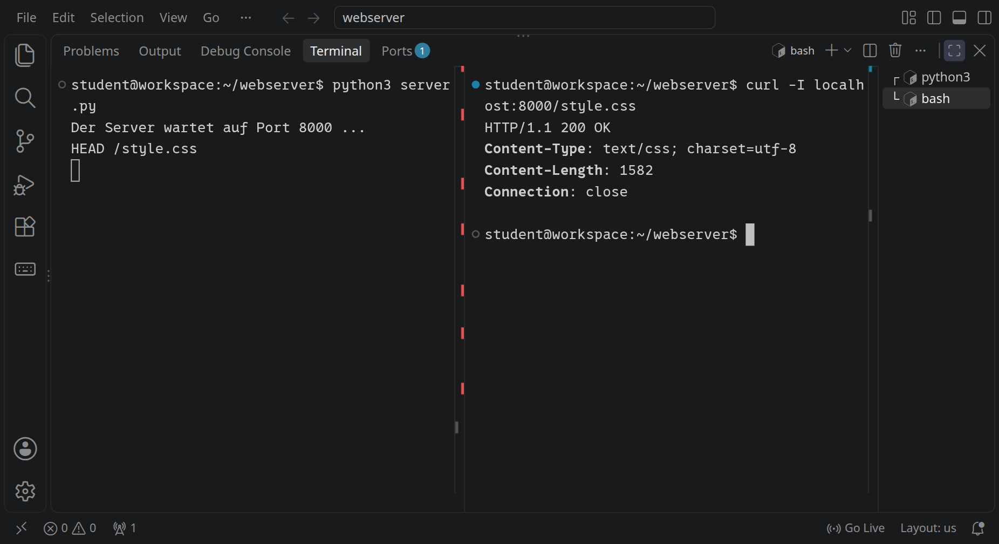
<!-- /language -->

Öffne dann die Adresse aus dem Reiter »Ports« (»Forwarded Address«) im Browser:

<!-- tutorial-screenshot
preview-port: 8000
tab: preview
wait-for-text: Mein eigener Webserver
sleep: 1
-->
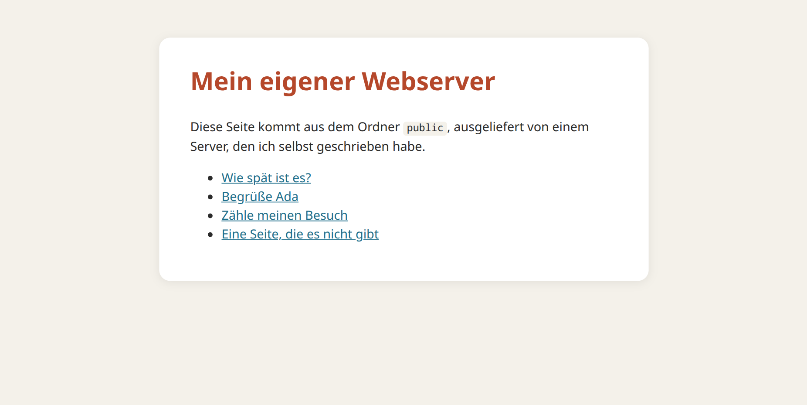

_task(webseite)

### Ein Angriff mit `..`

<!-- language: ruby -->
Probier den Angriff aus, gegen den die Prüfung mit `start_with?` schützt. Browser und `curl` räumen ein `..` in der Adresse normalerweise auf, bevor sie fragen; `curl -v localhost:8000/../server.rb` zeigt, dass in Wirklichkeit `GET /server.rb` geschickt wird. Mit `--path-as-is` geht der Pfad so hinaus, wie er dasteht:

```bash
curl --path-as-is localhost:8000/../server.rb
```

Dein Server antwortet »Die Seite /../server.rb gibt es nicht.« Nimm zum Vergleich `file.start_with?(PUBLIC_DIR + '/') &&` kurz aus der Bedingung heraus, starte den Server neu und frag noch einmal: Jetzt schickt er seinen eigenen Quelltext, an jeden, der fragt. Setz die Prüfung danach wieder ein. Solche Lücken heißen **Path Traversal**; echte Webserver hatten sie immer wieder.
<!-- /language -->
<!-- language: python -->
Probier den Angriff aus, gegen den die Prüfung mit `startswith` schützt. Browser und `curl` räumen ein `..` in der Adresse normalerweise auf, bevor sie fragen; `curl -v localhost:8000/../server.py` zeigt, dass in Wirklichkeit `GET /server.py` geschickt wird. Mit `--path-as-is` geht der Pfad so hinaus, wie er dasteht:

```bash
curl --path-as-is localhost:8000/../server.py
```

Dein Server antwortet »Die Seite /../server.py gibt es nicht.« Nimm zum Vergleich `file.startswith(PUBLIC_DIR + '/') and` kurz aus der Bedingung heraus, starte den Server neu und frag noch einmal: Jetzt schickt er seinen eigenen Quelltext, an jeden, der fragt. Setz die Prüfung danach wieder ein. Solche Lücken heißen **Path Traversal**; echte Webserver hatten sie immer wieder.
<!-- /language -->

_task(sicherheit)

## Parameter und ein Zähler

<!-- language: ruby -->
Adressen können Werte mitbringen: `/hello?name=Ada`. Nach dem `?` stehen **Parameter**, `name=wert`, mehrere getrennt durch `&`. Sonderzeichen wie Leerzeichen und Umlaute sind dort kodiert, `%20` ist ein Leerzeichen. `URI.decode_www_form` macht daraus wieder lesbare Werte.

Dazu kommt ein Zähler, der mitzählt, wie oft `/visits` aufgerufen wurde. Er gehört dem ganzen Server, nicht einer einzelnen Verbindung, darum steht er in einer globalen Variable `$visits`:

```ruby_copy
require 'socket'
require 'uri'

# Welcher Content-Type zu welcher Endung gehört
TYPES = {
  '.html' => 'text/html; charset=utf-8',
  '.css'  => 'text/css; charset=utf-8',
  '.js'   => 'text/javascript; charset=utf-8',
  '.png'  => 'image/png',
  '.jpg'  => 'image/jpeg',
  '.txt'  => 'text/plain; charset=utf-8',
}

PUBLIC_DIR = File.expand_path('public', __dir__)

# Der Zähler gehört dem Server, nicht einer Verbindung: Alle Threads
# benutzen ihn, darum zählt immer nur einer auf einmal (Mutex).
$visits = 0
$visits_lock = Mutex.new

# Schickt eine vollständige HTTP-Antwort und schließt die Verbindung
def respond(client, status, type, body)
  client.print "HTTP/1.1 #{status}\r\n"
  client.print "Content-Type: #{type}\r\n"
  client.print "Content-Length: #{body.bytesize}\r\n"
  client.print "Connection: close\r\n"
  client.print "\r\n"
  client.print body
  client.close
end

# Eine Datei aus dem Ordner public, aber nie etwas außerhalb davon
def serve_file(client, path)
  path = '/index.html' if path == '/'
  file = File.expand_path('.' + path, PUBLIC_DIR)
  if file.start_with?(PUBLIC_DIR + '/') && File.file?(file)
    type = TYPES[File.extname(file)] || 'application/octet-stream'
    respond(client, '200 OK', type, File.binread(file))
  else
    respond(client, '404 Not Found', 'text/plain; charset=utf-8',
            "Die Seite #{path} gibt es nicht.\n")
  end
end

server = TCPServer.new(8000)
puts "Der Server wartet auf Port 8000 ..."

loop do
  Thread.new(server.accept) do |client|
    request_line = client.gets.to_s
    method, target, version = request_line.split(' ')
    puts "#{method} #{target}"
    while (line = client.gets) && line != "\r\n"
    end

    # /hello?name=Ada: der Pfad und die Parameter nach dem Fragezeichen
    path, query = target.to_s.split('?', 2)
    params = URI.decode_www_form(query.to_s).to_h

    case path
    when '/time'
      respond(client, '200 OK', 'text/plain; charset=utf-8',
              "Es ist #{Time.now.strftime('%H:%M:%S')} Uhr.\n")
    when '/hello'
      name = params['name'] || 'Unbekannt'
      respond(client, '200 OK', 'text/plain; charset=utf-8', "Hallo, #{name}!\n")
    when '/visits'
      count = $visits_lock.synchronize { $visits += 1 }
      respond(client, '200 OK', 'text/plain; charset=utf-8',
              "Du bist Besuch Nummer #{count}.\n")
    else
      serve_file(client, path)
    end
  end
end
```

`$visits_lock` ist ein **Mutex**, ein Lock, den immer nur ein Thread auf einmal hält. `$visits += 1` sieht aus wie ein Schritt, sind aber drei: lesen, eins dazuzählen, zurückschreiben. Kommen zwei Threads gleichzeitig, könnten beide denselben alten Wert lesen, und ein Besuch ginge verloren.
<!-- /language -->
<!-- language: python -->
Adressen können Werte mitbringen: `/hello?name=Ada`. Nach dem `?` stehen **Parameter**, `name=wert`, mehrere getrennt durch `&`. Sonderzeichen wie Leerzeichen und Umlaute sind dort kodiert, `%20` ist ein Leerzeichen. `parse_qsl` aus `urllib.parse` macht daraus wieder lesbare Werte, als Paare aus Name und Wert, und `dict(…)` ein `dict`.

Dazu kommt ein Zähler, der mitzählt, wie oft `/visits` aufgerufen wurde. Er gehört dem ganzen Server, nicht einer einzelnen Verbindung, darum steht er außerhalb der Funktion in der Variable `visits`; mit `global visits` darf `handle` sie ändern:

```python_copy
import os
import socket
import threading
import time
from urllib.parse import parse_qsl

# Welcher Content-Type zu welcher Endung gehört
TYPES = {
    '.html': 'text/html; charset=utf-8',
    '.css': 'text/css; charset=utf-8',
    '.js': 'text/javascript; charset=utf-8',
    '.png': 'image/png',
    '.jpg': 'image/jpeg',
    '.txt': 'text/plain; charset=utf-8',
}

PUBLIC_DIR = os.path.realpath(os.path.join(os.path.dirname(__file__), 'public'))

# Der Zähler gehört dem Server, nicht einer Verbindung: Alle Threads
# benutzen ihn, darum zählt immer nur einer auf einmal (Lock).
visits = 0
visits_lock = threading.Lock()


def respond(client, status, content_type, body):
    """Schickt eine vollständige HTTP-Antwort."""
    data = body.encode() if isinstance(body, str) else body
    head = (f'HTTP/1.1 {status}\r\n'
            f'Content-Type: {content_type}\r\n'
            f'Content-Length: {len(data)}\r\n'
            'Connection: close\r\n'
            '\r\n')
    client.sendall(head.encode() + data)


def serve_file(client, path):
    """Eine Datei aus dem Ordner public, aber nie etwas außerhalb davon"""
    if path == '/':
        path = '/index.html'
    file = os.path.realpath(os.path.join(PUBLIC_DIR, '.' + path))
    if file.startswith(PUBLIC_DIR + '/') and os.path.isfile(file):
        content_type = TYPES.get(os.path.splitext(file)[1], 'application/octet-stream')
        with open(file, 'rb') as f:
            respond(client, '200 OK', content_type, f.read())
    else:
        respond(client, '404 Not Found', 'text/plain; charset=utf-8',
                f'Die Seite {path} gibt es nicht.\n')


def handle(client):
    global visits
    with client, client.makefile('rb') as reader:
        request_line = reader.readline().decode()
        method, _, rest = request_line.partition(' ')
        target, _, version = rest.partition(' ')
        print(method, target)
        for line in reader:
            if line == b'\r\n':
                break

        # /hello?name=Ada: der Pfad und die Parameter nach dem Fragezeichen
        path, _, query = target.partition('?')
        params = dict(parse_qsl(query))

        if path == '/time':
            respond(client, '200 OK', 'text/plain; charset=utf-8',
                    f'Es ist {time.strftime("%H:%M:%S")} Uhr.\n')
        elif path == '/hello':
            name = params.get('name', 'Unbekannt')
            respond(client, '200 OK', 'text/plain; charset=utf-8', f'Hallo, {name}!\n')
        elif path == '/visits':
            with visits_lock:
                visits += 1
                count = visits
            respond(client, '200 OK', 'text/plain; charset=utf-8',
                    f'Du bist Besuch Nummer {count}.\n')
        else:
            serve_file(client, path)


server = socket.create_server(('', 8000))
print('Der Server wartet auf Port 8000 ...')

while True:
    client, address = server.accept()
    threading.Thread(target=handle, args=(client,), daemon=True).start()
```

`visits_lock` ist ein **Lock**, den immer nur ein Thread auf einmal hält: `with visits_lock:` wartet, bis er frei ist. `visits += 1` sieht aus wie ein Schritt, sind aber drei: lesen, eins dazuzählen, zurückschreiben. Kommen zwei Threads gleichzeitig, könnten beide denselben alten Wert lesen, und ein Besuch ginge verloren.
<!-- /language -->

Starte den Server neu und probiere es im zweiten Terminal aus:

```bash
curl "localhost:8000/hello?name=Ada%20Lovelace"
curl localhost:8000/visits
curl localhost:8000/visits
```

<!-- language: ruby -->
<!-- tutorial-screenshot
# Stufe 5: Parameter und Zähler im Terminal
write-file: webserver/server.rb <- file:stufen/5.rb
terminal-open
terminal-maximize
press: Alt+ArrowLeft
sleep: 1
press: Control+C
sleep: 1
press: Control+L
type: ruby server.rb
press: Enter
sleep: 2
terminal-run: clear
sleep: 1
terminal-run: curl "localhost:8000/hello?name=Ada%20Lovelace"
sleep: 1
terminal-run: curl localhost:8000/visits
sleep: 1
terminal-run: curl localhost:8000/visits
sleep: 2
check-task-fails: umfrage
-->
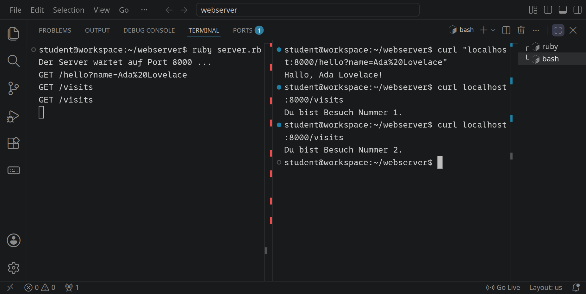
<!-- /language -->
<!-- language: python -->
<!-- tutorial-screenshot
# Stufe 5 in Python: Parameter und Zähler im Terminal
write-file: webserver/server.py <- file:stufen/5.py
terminal-open
terminal-maximize
press: Alt+ArrowLeft
sleep: 1
press: Control+C
sleep: 1
press: Control+L
type: python3 server.py
press: Enter
sleep: 2
terminal-run: clear
sleep: 1
terminal-run: curl "localhost:8000/hello?name=Ada%20Lovelace"
sleep: 1
terminal-run: curl localhost:8000/visits
sleep: 1
terminal-run: curl localhost:8000/visits
sleep: 2
check-task-fails: umfrage python
expect-no-text: Traceback
-->
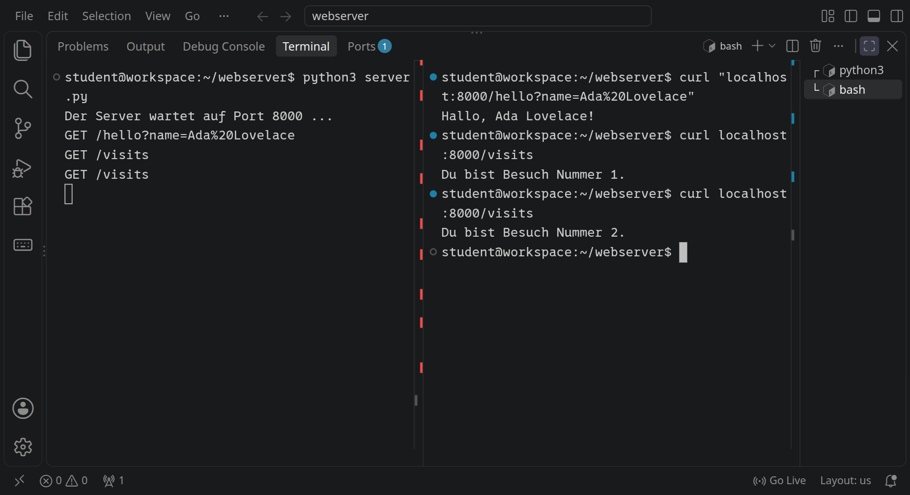
<!-- /language -->

Im Browser funktioniert es genauso: Hänge `/hello?name=…` an die Adresse aus »Forwarded Address«.

_uses(url)

_task(parameter)

_task(mutex)

## Ein Formular annehmen

Bisher hat der Browser nur gefragt. Ein Formular kann auch etwas schicken, zum Beispiel eine Stimme in einer Umfrage. Lege in `public` die Datei `poll.html` an:

```html_copy
<!DOCTYPE html>
<html lang="de">
<head>
  <meta charset="utf-8">
  <title>Umfrage</title>
  <link rel="stylesheet" href="style.css">
</head>
<body>
  <h1>Umfrage</h1>
  <form method="post" action="vote">
    <p>Was isst du in der Mensa am liebsten?</p>
    <p><label><input type="radio" name="choice" value="pizza" required> Pizza</label></p>
    <p><label><input type="radio" name="choice" value="pasta"> Nudeln</label></p>
    <p><label><input type="radio" name="choice" value="curry"> Curry</label></p>
    <p><label><input type="radio" name="choice" value="salad"> Salat</label></p>
    <button>Abstimmen</button>
  </form>
</body>
</html>
```

### Was ein Formular schickt

Wegen `method="post"` stehen die Felder nicht in der Adresse wie bei `/hello?name=Ada`. Sie kommen nach den Headern und der leeren Zeile, im **Body** der Anfrage. Wählt jemand »Curry« und klickt auf »Abstimmen«, schickt der Browser:

```text
POST /vote HTTP/1.1
Host: localhost:8000
Content-Type: application/x-www-form-urlencoded
Content-Length: 12

choice=curry
```

<!-- language: ruby -->
Hinter `choice=curry` steht kein Zeilenumbruch. Mit `client.gets` würde der Server auf ein Zeilenende warten, das nie kommt. Er muss wissen, wie viele Bytes er lesen soll, und das steht im Header `Content-Length`. Darum hebt er die Header jetzt in einem Hash auf, statt sie zu überspringen:

```ruby_copy
require 'socket'
require 'uri'

# Welcher Content-Type zu welcher Endung gehört
TYPES = {
  '.html' => 'text/html; charset=utf-8',
  '.css'  => 'text/css; charset=utf-8',
  '.js'   => 'text/javascript; charset=utf-8',
  '.png'  => 'image/png',
  '.jpg'  => 'image/jpeg',
  '.txt'  => 'text/plain; charset=utf-8',
}

PUBLIC_DIR = File.expand_path('public', __dir__)

# Der Zähler gehört dem Server, nicht einer Verbindung: Alle Threads
# benutzen ihn, darum zählt immer nur einer auf einmal (Mutex).
$visits = 0
$visits_lock = Mutex.new

# Die Umfrage: was im Formular steht, wie es auf der Seite heißt, und die
# Stimmen dazu, ebenfalls geschützt durch einen Lock
OPTIONS = { 'pizza' => 'Pizza', 'pasta' => 'Nudeln', 'curry' => 'Curry', 'salad' => 'Salat' }
$votes = Hash.new(0)
$votes_lock = Mutex.new

# Schickt eine vollständige HTTP-Antwort und schließt die Verbindung
def respond(client, status, type, body)
  client.print "HTTP/1.1 #{status}\r\n"
  client.print "Content-Type: #{type}\r\n"
  client.print "Content-Length: #{body.bytesize}\r\n"
  client.print "Connection: close\r\n"
  client.print "\r\n"
  client.print body
  client.close
end

# Schickt den Browser weiter zu einer anderen Adresse: »Sieh dort nach«
def redirect(client, location)
  client.print "HTTP/1.1 303 See Other\r\n"
  client.print "Location: #{location}\r\n"
  client.print "Content-Length: 0\r\n"
  client.print "Connection: close\r\n"
  client.print "\r\n"
  client.close
end

# Eine Datei aus dem Ordner public, aber nie etwas außerhalb davon
def serve_file(client, path)
  path = '/index.html' if path == '/'
  file = File.expand_path('.' + path, PUBLIC_DIR)
  if file.start_with?(PUBLIC_DIR + '/') && File.file?(file)
    type = TYPES[File.extname(file)] || 'application/octet-stream'
    respond(client, '200 OK', type, File.binread(file))
  else
    respond(client, '404 Not Found', 'text/plain; charset=utf-8',
            "Die Seite #{path} gibt es nicht.\n")
  end
end

server = TCPServer.new(8000)
puts "Der Server wartet auf Port 8000 ..."

loop do
  Thread.new(server.accept) do |client|
    request_line = client.gets.to_s
    method, target, version = request_line.split(' ')
    puts "#{method} #{target}"
    # Die Header in einen Hash: »Name: Wert«
    headers = {}
    while (line = client.gets) && line != "\r\n"
      name, value = line.split(':', 2)
      headers[name.strip.downcase] = value.to_s.strip
    end

    # /hello?name=Ada: der Pfad und die Parameter nach dem Fragezeichen
    path, query = target.to_s.split('?', 2)
    params = URI.decode_www_form(query.to_s).to_h

    case path
    when '/time'
      respond(client, '200 OK', 'text/plain; charset=utf-8',
              "Es ist #{Time.now.strftime('%H:%M:%S')} Uhr.\n")
    when '/hello'
      name = params['name'] || 'Unbekannt'
      respond(client, '200 OK', 'text/plain; charset=utf-8', "Hallo, #{name}!\n")
    when '/visits'
      count = $visits_lock.synchronize { $visits += 1 }
      respond(client, '200 OK', 'text/plain; charset=utf-8',
              "Du bist Besuch Nummer #{count}.\n")
    when '/vote'
      if method != 'POST'
        respond(client, '405 Method Not Allowed', 'text/plain; charset=utf-8',
                "Abstimmen geht nur mit POST.\n")
        next
      end
      # Nach der leeren Zeile kommt der Inhalt, genau Content-Length Bytes
      body = client.read(headers['content-length'].to_i).to_s
      choice = URI.decode_www_form(body).to_h['choice']
      if OPTIONS.key?(choice)
        $votes_lock.synchronize { $votes[choice] += 1 }
        redirect(client, '/results')
      else
        respond(client, '400 Bad Request', 'text/plain; charset=utf-8',
                "Diese Antwort gibt es nicht.\n")
      end
    when '/results'
      # Ein Balken für jede Antwort; <progress> zeichnet ihn ohne CSS
      rows = $votes_lock.synchronize do
        most = [$votes.values.max || 0, 1].max
        OPTIONS.map do |key, label|
          "<tr><td>#{label}</td><td><progress value='#{$votes[key]}' max='#{most}'></progress></td>" \
            "<td>#{$votes[key]}</td></tr>"
        end.join("\n")
      end
      respond(client, '200 OK', 'text/html; charset=utf-8',
              "<!DOCTYPE html><meta charset='utf-8'><link rel='stylesheet' href='style.css'>" \
              "<h1>Ergebnis</h1><table>#{rows}</table><p><a href='poll.html'>Noch einmal abstimmen</a></p>\n")
    else
      serve_file(client, path)
    end
  end
end
```

Was neu ist:

- Jede Header-Zeile wird an ihrem ersten `:` geteilt. Der Name kommt klein geschrieben in den Hash, weil HTTP Groß- und Kleinschreibung bei Header-Namen nicht unterscheidet: `headers['content-length']` findet `Content-Length` und `content-length`.
- `/vote` nimmt nur `POST` an und liest mit `client.read` genau so viele Bytes, wie `Content-Length` sagt. Der Body hat dieselbe Form wie die Parameter in einer Adresse, darum hilft wieder `URI.decode_www_form`.
- Der Server zählt nur Antworten, die in `OPTIONS` stehen. Was ankommt, muss nicht aus deinem Formular stammen: Jeder kann mit `curl` an `/vote` schicken, was er will.
- Die Stimmen zählt er unter einem eigenen Lock, aus demselben Grund wie die Besuche.
- Die Ergebnisseite zeichnet für jede Antwort einen Balken mit `<progress>`: `value` ist die Zahl ihrer Stimmen, `max` die größte Zahl. Den Balken malt der Browser selbst, ganz ohne CSS.
<!-- /language -->
<!-- language: python -->
Hinter `choice=curry` steht kein Zeilenumbruch. Mit `reader.readline()` würde der Server auf ein Zeilenende warten, das nie kommt. Er muss wissen, wie viele Bytes er lesen soll, und das steht im Header `Content-Length`. Darum hebt er die Header jetzt in einem `dict` auf, statt sie zu überspringen:

```python_copy
import os
import socket
import threading
import time
from urllib.parse import parse_qsl

# Welcher Content-Type zu welcher Endung gehört
TYPES = {
    '.html': 'text/html; charset=utf-8',
    '.css': 'text/css; charset=utf-8',
    '.js': 'text/javascript; charset=utf-8',
    '.png': 'image/png',
    '.jpg': 'image/jpeg',
    '.txt': 'text/plain; charset=utf-8',
}

PUBLIC_DIR = os.path.realpath(os.path.join(os.path.dirname(__file__), 'public'))

# Der Zähler gehört dem Server, nicht einer Verbindung: Alle Threads
# benutzen ihn, darum zählt immer nur einer auf einmal (Lock).
visits = 0
visits_lock = threading.Lock()

# Die Umfrage: was im Formular steht, wie es auf der Seite heißt, und die
# Stimmen dazu, ebenfalls geschützt durch einen Lock
OPTIONS = {'pizza': 'Pizza', 'pasta': 'Nudeln', 'curry': 'Curry', 'salad': 'Salat'}
votes = {key: 0 for key in OPTIONS}
votes_lock = threading.Lock()


def respond(client, status, content_type, body):
    """Schickt eine vollständige HTTP-Antwort."""
    data = body.encode() if isinstance(body, str) else body
    head = (f'HTTP/1.1 {status}\r\n'
            f'Content-Type: {content_type}\r\n'
            f'Content-Length: {len(data)}\r\n'
            'Connection: close\r\n'
            '\r\n')
    client.sendall(head.encode() + data)


def redirect(client, location):
    """Schickt den Browser weiter zu einer anderen Adresse: »Sieh dort nach«"""
    client.sendall((f'HTTP/1.1 303 See Other\r\n'
                    f'Location: {location}\r\n'
                    'Content-Length: 0\r\n'
                    'Connection: close\r\n'
                    '\r\n').encode())


def serve_file(client, path):
    """Eine Datei aus dem Ordner public, aber nie etwas außerhalb davon"""
    if path == '/':
        path = '/index.html'
    file = os.path.realpath(os.path.join(PUBLIC_DIR, '.' + path))
    if file.startswith(PUBLIC_DIR + '/') and os.path.isfile(file):
        content_type = TYPES.get(os.path.splitext(file)[1], 'application/octet-stream')
        with open(file, 'rb') as f:
            respond(client, '200 OK', content_type, f.read())
    else:
        respond(client, '404 Not Found', 'text/plain; charset=utf-8',
                f'Die Seite {path} gibt es nicht.\n')


def handle(client):
    global visits
    with client, client.makefile('rb') as reader:
        request_line = reader.readline().decode()
        method, _, rest = request_line.partition(' ')
        target, _, version = rest.partition(' ')
        print(method, target)
        # Die Header in ein dict: »Name: Wert«
        headers = {}
        for line in reader:
            if line == b'\r\n':
                break
            name, _, value = line.decode().partition(':')
            headers[name.strip().lower()] = value.strip()

        # /hello?name=Ada: der Pfad und die Parameter nach dem Fragezeichen
        path, _, query = target.partition('?')
        params = dict(parse_qsl(query))

        if path == '/time':
            respond(client, '200 OK', 'text/plain; charset=utf-8',
                    f'Es ist {time.strftime("%H:%M:%S")} Uhr.\n')
        elif path == '/hello':
            name = params.get('name', 'Unbekannt')
            respond(client, '200 OK', 'text/plain; charset=utf-8', f'Hallo, {name}!\n')
        elif path == '/visits':
            with visits_lock:
                visits += 1
                count = visits
            respond(client, '200 OK', 'text/plain; charset=utf-8',
                    f'Du bist Besuch Nummer {count}.\n')
        elif path == '/vote':
            if method != 'POST':
                respond(client, '405 Method Not Allowed', 'text/plain; charset=utf-8',
                        'Abstimmen geht nur mit POST.\n')
                return
            # Nach der leeren Zeile kommt der Inhalt, genau Content-Length Bytes
            body = reader.read(int(headers.get('content-length', '0'))).decode()
            choice = dict(parse_qsl(body)).get('choice')
            if choice in OPTIONS:
                with votes_lock:
                    votes[choice] += 1
                redirect(client, '/results')
            else:
                respond(client, '400 Bad Request', 'text/plain; charset=utf-8',
                        'Diese Antwort gibt es nicht.\n')
        elif path == '/results':
            # Ein Balken für jede Antwort; <progress> zeichnet ihn ohne CSS
            with votes_lock:
                most = max(max(votes.values()), 1)
                rows = '\n'.join(
                    f"<tr><td>{label}</td><td><progress value='{votes[key]}' max='{most}'></progress></td>"
                    f"<td>{votes[key]}</td></tr>"
                    for key, label in OPTIONS.items())
            respond(client, '200 OK', 'text/html; charset=utf-8',
                    "<!DOCTYPE html><meta charset='utf-8'><link rel='stylesheet' href='style.css'>"
                    f"<h1>Ergebnis</h1><table>{rows}</table><p><a href='poll.html'>Noch einmal abstimmen</a></p>\n")
        else:
            serve_file(client, path)


server = socket.create_server(('', 8000))
print('Der Server wartet auf Port 8000 ...')

while True:
    client, address = server.accept()
    threading.Thread(target=handle, args=(client,), daemon=True).start()
```

Was neu ist:

- Jede Header-Zeile wird an ihrem ersten `:` geteilt. Der Name kommt klein geschrieben ins `dict`, weil HTTP Groß- und Kleinschreibung bei Header-Namen nicht unterscheidet: `headers['content-length']` findet `Content-Length` und `content-length`.
- `/vote` nimmt nur `POST` an und liest mit `reader.read(…)` genau so viele Bytes, wie `Content-Length` sagt. Der Body hat dieselbe Form wie die Parameter in einer Adresse, darum hilft wieder `parse_qsl`.
- Der Server zählt nur Antworten, die in `OPTIONS` stehen. Was ankommt, muss nicht aus deinem Formular stammen: Jeder kann mit `curl` an `/vote` schicken, was er will.
- Die Stimmen zählt er unter einem eigenen Lock, aus demselben Grund wie die Besuche.
- Die Ergebnisseite zeichnet für jede Antwort einen Balken mit `<progress>`: `value` ist die Zahl ihrer Stimmen, `max` die größte Zahl. Den Balken malt der Browser selbst, ganz ohne CSS.
<!-- /language -->

Nach einer Stimme zeigt der Server nicht gleich das Ergebnis, sondern antwortet mit **`303 See Other`** und dem Header `Location: /results`: »Sieh dort nach.« Der Browser holt dann `/results` mit `GET`. Der Umweg hat einen Grund: Wäre das Ergebnis die Antwort auf das `POST`, würde der Browser beim Neuladen das Formular noch einmal schicken, und die Stimme zählte doppelt. So lädt er nur die Ergebnisseite neu. Das Muster heißt **Post/Redirect/Get**.

### Abstimmen

Starte den Server neu und stimme im zweiten Terminal mit `curl` ab. `-d` schickt Daten mit `POST`, wie das Formular:

```bash
curl -i -d choice=curry localhost:8000/vote
curl localhost:8000/results
```

<!-- language: ruby -->
<!-- tutorial-screenshot
# Stufe 6: eine Stimme mit curl, 303 und das Ergebnis
viewport: 1029x700
write-file: webserver/public/poll.html <- file:stufen/public/poll.html
write-file: webserver/server.rb <- file:stufen/6.rb
terminal-open
terminal-maximize
press: Alt+ArrowLeft
sleep: 1
press: Control+C
sleep: 1
press: Control+L
type: ruby server.rb
press: Enter
sleep: 2
terminal-run: clear
sleep: 1
terminal-run: curl -i -d choice=curry localhost:8000/vote
sleep: 1
terminal-run: curl localhost:8000/results
sleep: 2
check-task: umfrage
-->
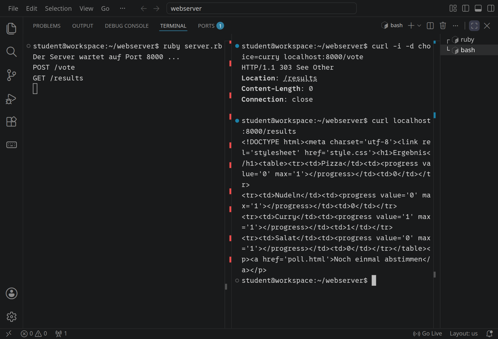
<!-- /language -->
<!-- language: python -->
<!-- tutorial-screenshot
# Stufe 6 in Python: eine Stimme mit curl, 303 und das Ergebnis
viewport: 1029x700
write-file: webserver/public/poll.html <- file:stufen/public/poll.html
write-file: webserver/server.py <- file:stufen/6.py
terminal-open
terminal-maximize
press: Alt+ArrowLeft
sleep: 1
press: Control+C
sleep: 1
press: Control+L
type: python3 server.py
press: Enter
sleep: 2
terminal-run: clear
sleep: 1
terminal-run: curl -i -d choice=curry localhost:8000/vote
sleep: 1
terminal-run: curl localhost:8000/results
sleep: 2
check-task: umfrage python
expect-no-text: Traceback
-->
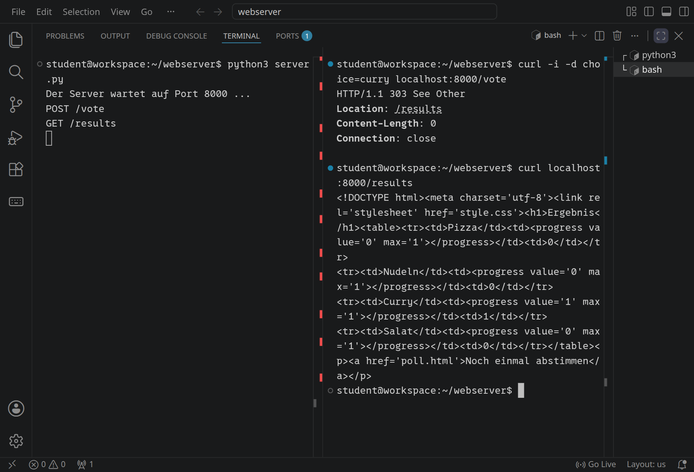
<!-- /language -->

Öffne jetzt im Browser die Adresse aus »Forwarded Address« mit `/poll.html` dahinter, wähle etwas und stimme ab:

<!-- tutorial-screenshot
preview-port: 8000 /poll.html
tab: preview
wait-for-text: Abstimmen
click: Pizza
sleep: 1
-->
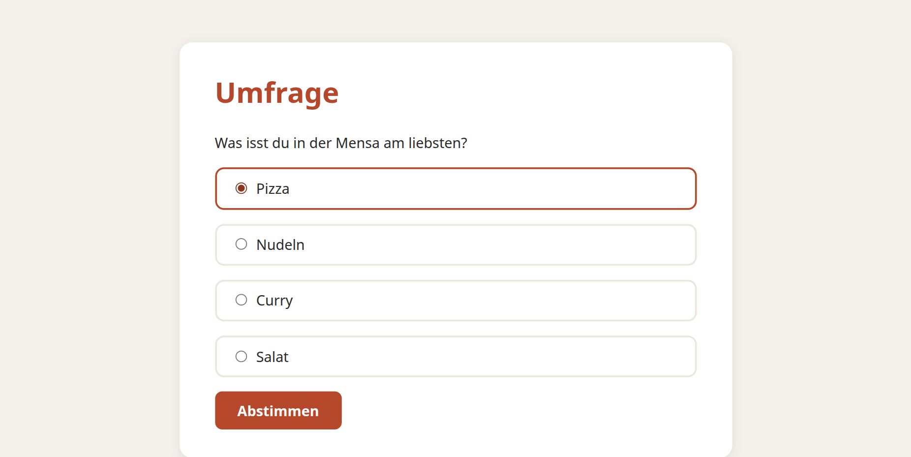

<!-- tutorial-screenshot
preview-port: 8000 /poll.html
tab: preview
wait-for-text: Abstimmen
click: Pizza
click: Abstimmen
wait-for-text: Ergebnis
sleep: 1
-->
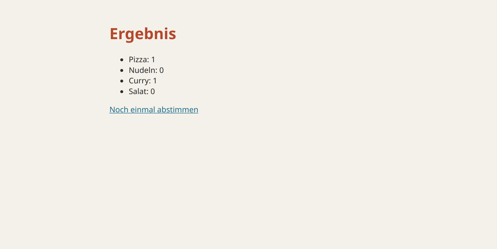

Lade die Ergebnisseite neu: Die Zahlen bleiben gleich. Im linken Terminal siehst du, dass der Browser nur `GET /results` geschickt hat.

_uses(http-methoden, http-formulare)

_task(umfrage)

_task(body)

_task(neu-laden)


<div class='hint try'>
<strong>Ausprobieren:</strong> Ein Formular schickt nur, was darin steht, aber <code>curl</code> schickt, was du willst:
<ul>
<li><code>curl -i -d choice=sushi localhost:8000/vote</code> und <code>curl -i localhost:8000/vote</code>: Welche Statuscodes bekommst du, und welche Zeilen im Server sorgen dafür?</li>
<li><code>for i in $(seq 50); do curl -s -o /dev/null -d choice=salad localhost:8000/vote; done</code>: Was zeigt die Ergebnisseite danach? Was müsste der Server wissen, um so etwas zu verhindern?</li>
</ul>
</div>

## Mit der Klasse teilen

Bisher erreichst nur du deinen Server. Um ihn deiner Klasse zu zeigen, öffne dein [Profil](/profil) und gib unter »Shared Live Apps« Port 8000 frei. Du bekommst eine Adresse, die alle in deiner Gruppe öffnen können, solange dein Server läuft. Lass ein paar Leute `/visits` aufrufen und unter `/poll.html` abstimmen: Der Server zählt alle, egal von wo sie kommen.

_task(abgabe)

## Wie geht es weiter?

Dein Server antwortet nur, wenn der Browser fragt. Soll er von sich aus etwas schicken, zum Beispiel, wenn jemand anderes etwas getan hat, braucht es eine Verbindung, die offen bleibt. Darum geht es in der [Pixelwand](/pixelwand): Die ganze Klasse malt gleichzeitig an einem Bild, und jeder sieht sofort, was die anderen malen.

Große Webserver wie nginx und Bibliotheken wie Sinatra für Ruby oder Flask für Python machen dasselbe wie deiner, nur mit vielen Fällen mehr: viele Verbindungen gleichzeitig, verschlüsselt mit HTTPS, mit Caching und Schutz gegen Angriffe.

<!-- tutorial-screenshot
# Bild für die Karte der Aktivität: das Ergebnis der Umfrage nach ein paar Stimmen
terminal-run: for c in pizza pizza curry pasta pizza salad curry pizza curry pasta; do curl -s -o /dev/null -d choice=$c localhost:8000/vote; done
sleep: 1
preview-port: 8000 /results
tab: preview
viewport: 720x405
wait-for-text: Ergebnis
sleep: 1
-->
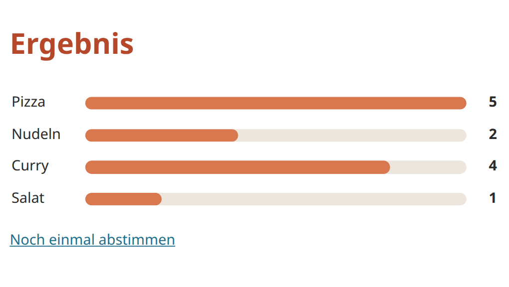
