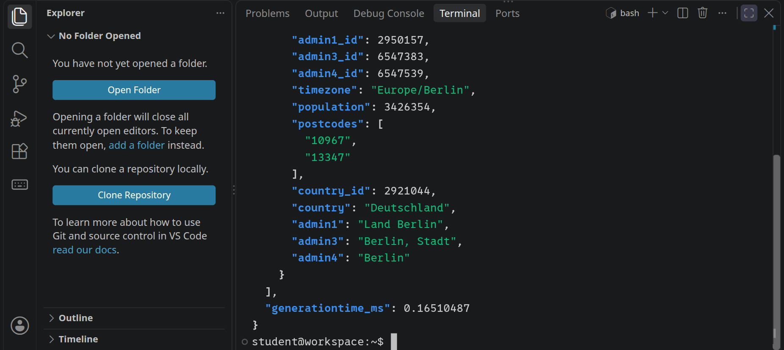
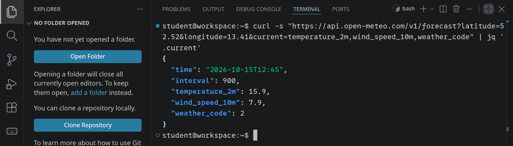
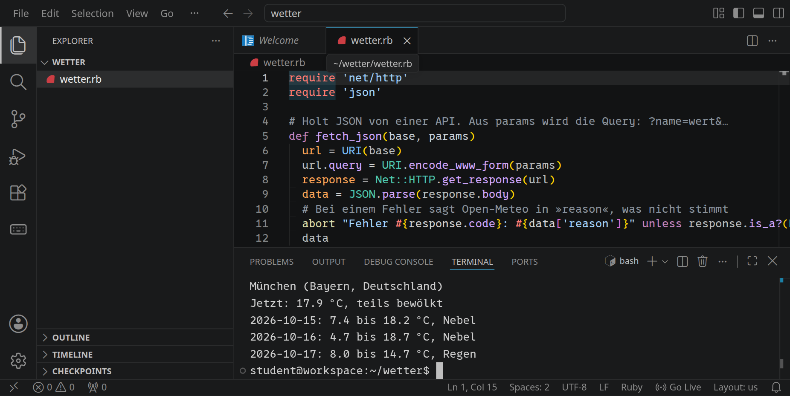
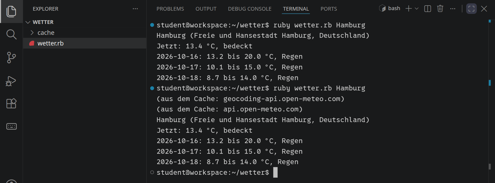
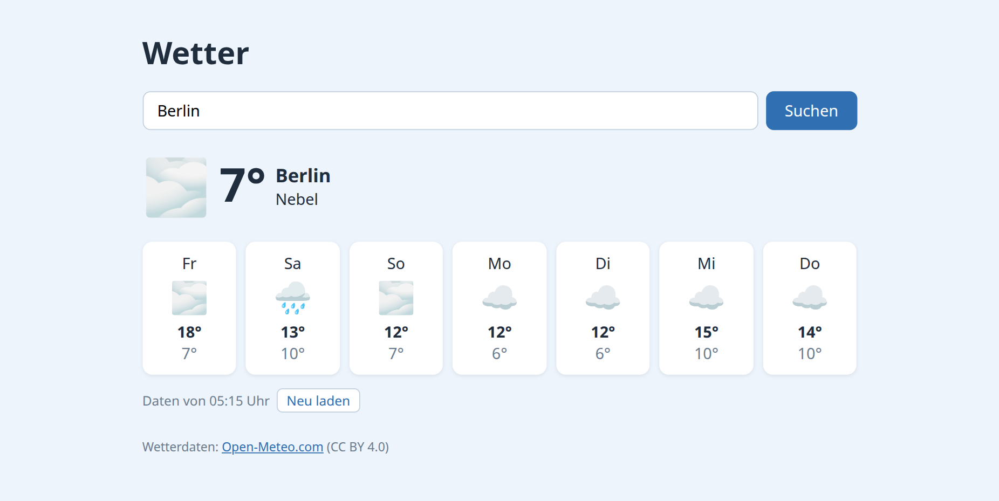
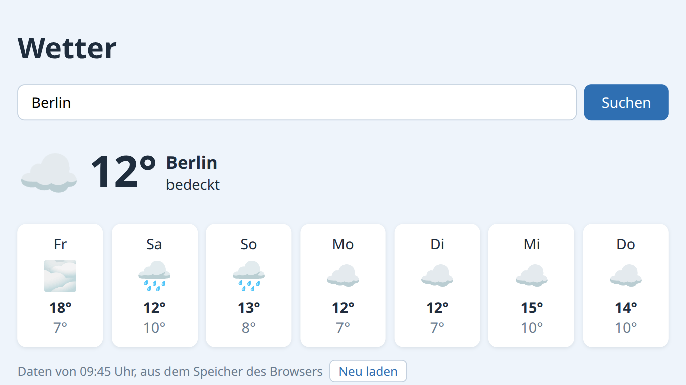

<div class='meta'>
image: teaser.webp
kind: projekt
language: Ruby / JavaScript
topic: networks
duration: 2 Doppelstunden
requires: [tcpip]
reference: [http, json]
</div>

<div
    class="autotoc-secondary-trigger"
    data-title="Auf dieser Seite"
    data-levels="h2,h3">
</div>

# Daten aus dem Netz

<p class='abstract'>
Viele Dienste im Netz haben eine Schnittstelle für Programme, eine API: Statt einer Webseite liefern sie Daten, die ein Programm weiterverarbeiten kann. Du fragst den Wetterdienst Open-Meteo nach dem Wetter in deiner Stadt, erst im Terminal, dann aus Ruby, und baust zum Schluss eine eigene Wetterseite. Dabei lernst du, wie man eine API liest, was bei Fehlern passiert und warum man eine API nicht ohne Not mit Anfragen überschüttet.
</p>

## Was ist eine API?

Wenn du im Browser eine Wetterseite öffnest, bekommst du HTML: Text, Bilder, Werbung, alles für Menschen gemacht. Ein Programm, das nur die Temperatur wissen will, müsste sie mühsam aus dem HTML herauslesen. Darum bieten viele Dienste eine zweite Tür an, eine **API** (Application Programming Interface): Adressen, unter denen sie nur die Daten liefern, meist als JSON.

Wir nehmen [Open-Meteo](https://open-meteo.com/), einen freien Wetterdienst. Er braucht keine Anmeldung und keinen Schlüssel. Dafür gelten zwei Regeln: Wer die Daten zeigt, nennt Open-Meteo als Quelle (Lizenz CC BY 4.0), und die kostenlose API ist für höchstens 600 Anfragen pro Minute und 10.000 pro Tag gedacht. Was das für deine Klasse bedeutet, steht weiter unten.

## Die erste Anfrage

Wo liegt Berlin? Die Geocoding-API von Open-Meteo sucht einen Ort und liefert seine Koordinaten. Frag sie im Terminal; `jq` macht die Antwort lesbar:

```bash
curl -s "https://geocoding-api.open-meteo.com/v1/search?name=Berlin&count=1&language=de" | jq
```

<!-- tutorial-screenshot
# Die Geocoding-API im Terminal
terminal-open
terminal-maximize
terminal-run: curl -s "https://geocoding-api.open-meteo.com/v1/search?name=Berlin&count=1&language=de" | jq
terminal-wait-for-prompt
crop-terminal-lines: auto
-->


Die Antwort ist länger als das Terminal; scroll nach oben bis zum Anfang. Sie ist ein Objekt mit einer Liste `results`. Jeder Eintrag ist ein Ort, mit Breitengrad (`latitude`), Längengrad (`longitude`), Land, Bundesland, Einwohnerzahl und Zeitzone. Einzelne Werte holt `jq` heraus:

```bash
curl -s "https://geocoding-api.open-meteo.com/v1/search?name=Berlin&count=1&language=de" | jq '.results[0].latitude'
```

_uses(json-aufbau, jq)

_task(breitengrad)

## Das Wetter

Mit den Koordinaten fragst du die eigentliche Wetter-API:

```bash
curl -s "https://api.open-meteo.com/v1/forecast?latitude=52.52&longitude=13.41&current=temperature_2m,wind_speed_10m,weather_code" | jq '.current'
```

<!-- tutorial-screenshot
# Das aktuelle Wetter im Terminal
terminal-run: clear
terminal-run: curl -s "https://api.open-meteo.com/v1/forecast?latitude=52.52&longitude=13.41&current=temperature_2m,wind_speed_10m,weather_code" | jq '.current'
terminal-wait-for-prompt
crop-terminal-lines: auto
-->


Alles, was die API wissen muss, steht in der **Query**, den Parametern nach dem `?`:

- `latitude` und `longitude` sind der Ort.
- `current` sagt, welche Werte du für jetzt haben willst, durch Kommas getrennt: `temperature_2m` ist die Temperatur in zwei Metern Höhe, `wind_speed_10m` der Wind in zehn Metern, `weather_code` ein Code für das Wetter.
- Mit `daily` bekommst du Werte für jeden Tag, etwa `temperature_2m_max`, und mit `forecast_days` bestimmst du, für wie viele Tage.

Welche Werte es gibt, steht in der [Dokumentation der API](https://open-meteo.com/en/docs); dort kannst du dir eine Adresse auch zusammenklicken. Der `weather_code` ist eine Zahl nach einer Tabelle der Weltorganisation für Meteorologie (WMO): 0 ist klar, 3 bedeckt, 61 bis 65 Regen, 95 Gewitter.

_uses(url, curl)

_task(tage)

## Wenn etwas schiefgeht

Eine API antwortet nicht immer mit Daten. Probier zwei Fehler aus. Ein Ort, den es nicht gibt:

```bash
curl -s "https://geocoding-api.open-meteo.com/v1/search?name=Xyzzy&count=1" | jq
```

und ein Breitengrad, den es nicht geben kann:

```bash
curl -s -i "https://api.open-meteo.com/v1/forecast?latitude=999&longitude=13.41&current=temperature_2m"
```

_task(kein-ort)

Für den Breitengrad 999 antwortet die API mit dem Statuscode `400 Bad Request` und erklärt in `reason`, was nicht stimmt. Ein Programm muss mit beidem umgehen können: mit einer leeren Antwort und mit einem Fehler.

_uses(statuscodes)

## Mit Ruby

Was `curl` kann, kann auch dein Programm. Lege einen Ordner an und öffne ihn mit <kbd>Strg</kbd><kbd>K</kbd> <kbd>Strg</kbd><kbd>O</kbd>:

```bash
mkdir /workspace/wetter
```

Lege darin `wetter.rb` an:

```ruby
require 'net/http'
require 'json'

# Das aktuelle Wetter in Berlin
url = URI('https://api.open-meteo.com/v1/forecast?latitude=52.52&longitude=13.41&current=temperature_2m,wind_speed_10m')
response = Net::HTTP.get_response(url)
data = JSON.parse(response.body)

current = data['current']
puts "Temperatur: #{current['temperature_2m']} °C"
puts "Wind: #{current['wind_speed_10m']} km/h"
```

`Net::HTTP.get_response` schickt die Anfrage und gibt die Antwort zurück, `response.body` ist ihr Inhalt, und `JSON.parse` macht daraus einen Hash. Starte es mit `ruby wetter.rb`.

Jetzt soll das Programm jeden Ort kennen, nicht nur Berlin: erst die Geocoding-API fragen, dann mit den Koordinaten die Wetter-API. Ersetze `wetter.rb` durch:

```ruby_copy
require 'net/http'
require 'json'

# Holt JSON von einer API. Aus params wird die Query: ?name=wert&…
def fetch_json(base, params)
  url = URI(base)
  url.query = URI.encode_www_form(params)
  response = Net::HTTP.get_response(url)
  data = JSON.parse(response.body)
  # Bei einem Fehler sagt Open-Meteo in »reason«, was nicht stimmt
  abort "Fehler #{response.code}: #{data['reason']}" unless response.is_a?(Net::HTTPSuccess)
  data
rescue SocketError, Net::OpenTimeout => e
  abort "Keine Verbindung: #{e.message}"
end

# Was die Wettercodes der WMO bedeuten, grob zusammengefasst
def describe(code)
  case code
  when 0 then 'klar'
  when 1, 2 then 'teils bewölkt'
  when 3 then 'bedeckt'
  when 45, 48 then 'Nebel'
  when 51..57 then 'Nieselregen'
  when 61..67, 80..82 then 'Regen'
  when 71..77, 85, 86 then 'Schnee'
  when 95..99 then 'Gewitter'
  else "Code #{code}"
  end
end

name = ARGV[0] || 'Berlin'

# 1. Wo liegt der Ort?
places = fetch_json('https://geocoding-api.open-meteo.com/v1/search',
                    name: name, count: 1, language: 'de')
place = (places['results'] || []).first
abort "Keinen Ort namens #{name} gefunden." if place.nil?

# 2. Das Wetter an diesem Ort
weather = fetch_json('https://api.open-meteo.com/v1/forecast',
                     latitude: place['latitude'], longitude: place['longitude'],
                     current: 'temperature_2m,weather_code',
                     daily: 'temperature_2m_min,temperature_2m_max,weather_code',
                     timezone: 'auto', forecast_days: 3)

now = weather['current']
puts "#{place['name']} (#{place['admin1']}, #{place['country']})"
puts "Jetzt: #{now['temperature_2m']} °C, #{describe(now['weather_code'])}"

days = weather['daily']
days['time'].each_with_index do |day, i|
  puts "#{day}: #{days['temperature_2m_min'][i]} bis #{days['temperature_2m_max'][i]} °C, " \
       "#{describe(days['weather_code'][i])}"
end
```

- `fetch_json` ist für beide APIs da. `URI.encode_www_form` baut aus einem Hash die Query, mit allem richtig kodiert: Aus `München` wird `M%C3%BCnchen`.
- Ist die Antwort kein Erfolg (`Net::HTTPSuccess`), steht in `reason`, warum. `abort` schreibt die Meldung und beendet das Programm.
- `rescue SocketError, Net::OpenTimeout` fängt den Fall ab, dass gar keine Verbindung zustande kommt.
- `places['results'] || []` ist eine leere Liste, wenn die API keine `results` schickt; `.first` ist dann `nil`.
- `describe` übersetzt die Wettercodes in Wörter.
- `ARGV[0]` ist das, was du beim Start hinter den Dateinamen schreibst.

```bash
ruby wetter.rb München
```

<!-- tutorial-screenshot
# Ordner wetter, wetter.rb (Stufe 2), München
write-file: wetter/wetter.rb <- file:stufen/wetter2.rb
press: Control+j
press: Control+k
press: Control+o
wait-for-text: Open Folder
press: Control+a
type: /workspace/wetter/
press: Enter
sleep: 5
wait-for-text: wetter.rb
open-file: wetter.rb
terminal-open
terminal-run: ruby wetter.rb München
terminal-wait-for-prompt
sleep: 1
-->


_task(wetter-rb)

## Höflich bleiben

Open-Meteo erlaubt höchstens 600 Anfragen pro Minute und 10.000 pro Tag. Das klingt nach viel, aber alle Workspaces deiner Schule gehen über denselben Server ins Netz, und für Open-Meteo kommt jede Anfrage eurer Schule von derselben Adresse. Ein Programm, das jede Sekunde nachfragt, bei 30 Leuten in der Klasse, verbraucht das Tageskontingent der ganzen Schule in wenigen Minuten. Danach bekommt niemand an der Schule mehr Daten, nur noch eine Fehlermeldung; viele APIs antworten dann mit dem Statuscode `429 Too Many Requests`.

Das Wetter ändert sich nicht jede Sekunde. Darum merkt sich ein höfliches Programm Antworten eine Weile: in einem **Cache**. Ersetze `fetch_json` in `wetter.rb` durch diese Fassung und ergänze die beiden Konstanten darüber:

```ruby
CACHE_DIR = File.join(__dir__, 'cache')
CACHE_SECONDS = 600   # zehn Minuten

# Holt JSON von einer API. Aus params wird die Query: ?name=wert&…
# Dieselbe Anfrage in den letzten zehn Minuten? Dann kommt die Antwort aus
# einer Datei im Ordner cache, und die API wird nicht gefragt.
def fetch_json(base, params)
  url = URI(base)
  url.query = URI.encode_www_form(params)
  file = File.join(CACHE_DIR, url.to_s.gsub(/[^A-Za-z0-9]+/, '_') + '.json')
  if File.exist?(file) && Time.now - File.mtime(file) < CACHE_SECONDS
    puts "(aus dem Cache: #{url.host})"
    return JSON.parse(File.read(file))
  end

  response = Net::HTTP.get_response(url)
  data = JSON.parse(response.body)
  # Bei einem Fehler sagt Open-Meteo in »reason«, was nicht stimmt
  abort "Fehler #{response.code}: #{data['reason']}" unless response.is_a?(Net::HTTPSuccess)
  Dir.mkdir(CACHE_DIR) unless Dir.exist?(CACHE_DIR)
  File.write(file, response.body)
  data
rescue SocketError, Net::OpenTimeout => e
  abort "Keine Verbindung: #{e.message}"
end
```

- Jede Antwort landet als Datei im Ordner `cache`. Der Dateiname ist die Adresse der Anfrage, mit `_` statt der Sonderzeichen.
- Gibt es für dieselbe Adresse schon eine Datei, die jünger ist als zehn Minuten (`File.mtime`), kommt die Antwort aus der Datei, und die API wird gar nicht gefragt.

Starte das Programm zweimal hintereinander für denselben Ort:

```bash
ruby wetter.rb Hamburg
ruby wetter.rb Hamburg
```

<!-- tutorial-screenshot
# Stufe 3: der zweite Aufruf kommt aus dem Cache
write-file: wetter/wetter.rb <- file:stufen/wetter3.rb
terminal-open
terminal-maximize
terminal-run: clear
terminal-run: ruby wetter.rb Hamburg
terminal-wait-for-prompt
terminal-run: ruby wetter.rb Hamburg
terminal-wait-for-prompt
crop-terminal-lines: auto
-->


_task(cache)

## Eine Wetterseite

Zum Schluss eine Webseite, die das Wetter für jeden Ort zeigt. Sie fragt die APIs selbst, direkt aus dem Browser, mit `fetch`. Lege im Ordner `wetter` die Datei `index.html` an:

```html_copy
<!DOCTYPE html>
<html lang="de">
<head>
  <meta charset="utf-8">
  <meta name="viewport" content="width=device-width, initial-scale=1">
  <title>Wetter</title>
  <style>
    body { font-family: system-ui, sans-serif; max-width: 46em; margin: 2em auto; padding: 0 1.2em;
           background: #eef4fb; color: #1f2d3d; }
    h1 { margin: 0 0 0.6em; }
    form { display: flex; gap: 0.5em; }
    input { flex: 1; font: inherit; padding: 0.5em 0.9em; border: 1px solid #c3d0de; border-radius: 8px; }
    button { font: inherit; padding: 0.5em 1.2em; border: 0; border-radius: 8px; background: #2f6fb2; color: white; }
    #now { display: flex; align-items: center; gap: 0.6em; margin: 1.2em 0; }
    #now .icon { font-size: 3.5em; }
    #now .temp { font-size: 3em; font-weight: 700; line-height: 1; }
    #now .place { font-size: 1.2em; font-weight: 600; }
    #days { display: grid; grid-template-columns: repeat(auto-fit, minmax(5.5em, 1fr)); gap: 0.6em; }
    .day { padding: 0.7em 0.4em; border-radius: 10px; text-align: center; background: white;
           box-shadow: 0 1px 4px rgba(31, 45, 61, 0.1); }
    .day .icon { font-size: 2em; margin: 0.1em 0; }
    .max { font-weight: 700; }
    .min { color: #6b7c8f; }
    footer { margin-top: 2em; font-size: 0.8em; color: #6b7c8f; }
    footer a { color: #2f6fb2; }
  </style>
</head>
<body>
  <h1>Wetter</h1>
  <form id="search">
    <input id="place" value="Berlin" autocomplete="off">
    <button>Suchen</button>
  </form>
  <div id="now">Lade …</div>
  <div id="days"></div>
  <footer>Wetterdaten: <a href="https://open-meteo.com/">Open-Meteo.com</a> (CC BY 4.0)</footer>

  <script>
    // Was die Wettercodes der WMO bedeuten, mit einem Symbol
    function describe(code) {
      if (code === 0) return ['☀️', 'klar'];
      if (code <= 2) return ['🌤️', 'teils bewölkt'];
      if (code === 3) return ['☁️', 'bedeckt'];
      if (code <= 48) return ['🌫️', 'Nebel'];
      if (code <= 57) return ['🌦️', 'Nieselregen'];
      if (code <= 67 || (code >= 80 && code <= 82)) return ['🌧️', 'Regen'];
      if (code <= 86) return ['🌨️', 'Schnee'];
      return ['⛈️', 'Gewitter'];
    }

    // Holt JSON von einer API; aus params wird die Query: ?name=wert&…
    async function fetchJson(base, params) {
      const response = await fetch(base + '?' + new URLSearchParams(params));
      const data = await response.json();
      if (!response.ok) throw new Error(data.reason);
      return data;
    }

    // Ein neues Element mit einer Klasse und einem Text
    function element(tag, className, text) {
      const el = document.createElement(tag);
      el.className = className;
      el.textContent = text;
      return el;
    }

    async function show(name) {
      const now = document.getElementById('now');
      const days = document.getElementById('days');
      now.textContent = 'Lade …';
      days.replaceChildren();
      try {
        // 1. Wo liegt der Ort?
        const places = await fetchJson('https://geocoding-api.open-meteo.com/v1/search',
          { name: name, count: 1, language: 'de' });
        if (!places.results) throw new Error(`Keinen Ort namens ${name} gefunden.`);
        const place = places.results[0];

        // 2. Das Wetter an diesem Ort, für sieben Tage
        const weather = await fetchJson('https://api.open-meteo.com/v1/forecast', {
          latitude: place.latitude, longitude: place.longitude,
          current: 'temperature_2m,weather_code',
          daily: 'temperature_2m_min,temperature_2m_max,weather_code',
          timezone: 'auto', forecast_days: 7,
        });

        // Jetzt: groß das Symbol und die Temperatur, daneben Ort und Wetter
        const [icon, text] = describe(weather.current.weather_code);
        const where = document.createElement('div');
        where.append(element('div', 'place', place.name), element('div', '', text));
        now.replaceChildren(element('div', 'icon', icon),
          element('div', 'temp', `${Math.round(weather.current.temperature_2m)}°`), where);

        // Die nächsten sieben Tage, je eine Karte
        weather.daily.time.forEach((day, i) => {
          const card = element('div', 'day', '');
          const weekday = new Date(day).toLocaleDateString('de-DE', { weekday: 'short' });
          card.append(element('div', '', weekday),
            element('div', 'icon', describe(weather.daily.weather_code[i])[0]),
            element('div', 'max', `${Math.round(weather.daily.temperature_2m_max[i])}°`),
            element('div', 'min', `${Math.round(weather.daily.temperature_2m_min[i])}°`));
          days.append(card);
        });
      } catch (error) {
        now.textContent = error.message;
      }
    }

    document.getElementById('search').addEventListener('submit', (event) => {
      event.preventDefault();   // die Seite nicht neu laden
      show(document.getElementById('place').value);
    });

    show('Berlin');
  </script>
</body>
</html>
```

- `fetchJson` macht dasselbe wie `fetch_json` in Ruby: `new URLSearchParams(params)` baut die Query, `await fetch(…)` schickt die Anfrage und wartet auf die Antwort, `response.json()` liest sie als JSON.
- `async` und `await` gehören zusammen: Eine Funktion mit `async` darf mit `await` auf eine Antwort aus dem Netz warten, ohne dass die Seite so lange einfriert.
- `try` und `catch` fangen jeden Fehler ab und zeigen seine Meldung auf der Seite an.
- Unten steht die Quelle der Daten. Das verlangt die Lizenz von Open-Meteo, und es gehört sich auch so.

Öffne die Seite mit »Go Live« unten rechts in der Statusleiste:

<!-- tutorial-screenshot
# Die Wetterseite mit Go Live
write-file: wetter/index.html <- file:stufen/index.html
go-live
tab: preview
wait-for-text: Wetterdaten
wait-for-text: °
sleep: 2
-->


Eigentlich darf eine Webseite nicht einfach Daten von einer fremden Adresse lesen; der Browser verhindert das, damit eine Seite nicht heimlich an deine Daten bei anderen Diensten kommt. Open-Meteo erlaubt es ausdrücklich, mit dem Header `access-control-allow-origin: *` in jeder Antwort: »Jede Seite darf diese Daten lesen.« Das heißt **CORS**, Cross-Origin Resource Sharing. Mit `curl -i -H "Origin: https://example.org" …` siehst du den Header selbst.

_uses(http-header)

_task(webseite)

_task(abgabe)

## Deine eigene Wetterseite

Ein paar Ideen, von leicht bis schwer:

- **Mehr Werte:** Die API kennt viel mehr: `precipitation_sum` (Regen in mm), `sunrise` und `sunset`, `uv_index_max`, `wind_speed_10m_max`. Zeig sie auf den Karten.
- **Stündlich:** Mit `hourly=temperature_2m` bekommst du die Temperatur für jede Stunde. Zeichne sie als Kurve auf ein `<canvas>`.
- **Mehrere Orte:** Vergleiche das Wetter in drei Städten nebeneinander.
- **Ein Cache im Browser:** Merke dir Antworten in `localStorage` mit der Uhrzeit, wie im Ruby-Programm.
- **Andere APIs:** Es gibt viele freie APIs ohne Schlüssel, etwa die von Wikipedia. Lies vorher ihre Bedingungen.

_task(api-key)

## Wie geht es weiter?

Viele APIs verlangen einen **API-Schlüssel**: eine lange Zeichenkette, die du bei der Anmeldung bekommst und bei jeder Anfrage mitschickst. Daran erkennt der Dienst, wer fragt, und zählt die Anfragen. Ein solcher Schlüssel ist wie ein Passwort: Er gehört nicht in eine Webseite, die jeder lesen kann, und nicht in ein öffentliches Git-Repository. Programme, die ihn brauchen, fragen die API vom Server aus, wie dein Ruby-Programm, nicht aus dem Browser.

Wie die andere Seite aussieht, ein Server, der selbst Anfragen beantwortet, zeigt [Ein eigener Webserver](/webserver).

<!-- tutorial-screenshot
# Bild für die Karte der Aktivität: die Wetterseite, groß
preview-reload
tab: preview
viewport: 760x428
wait-for-text: Wetterdaten
wait-for-text: °
sleep: 2
-->

