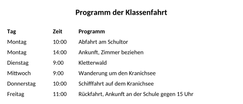
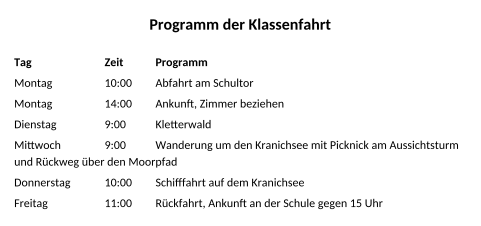
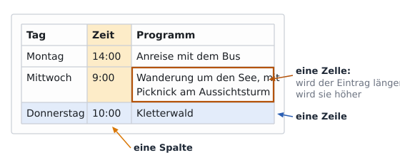
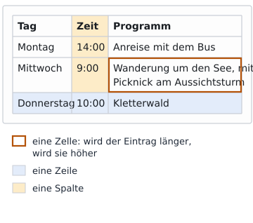
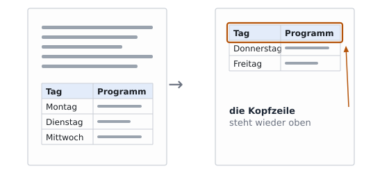
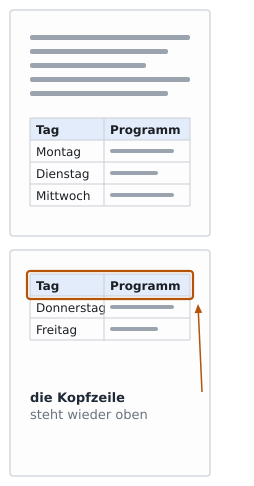
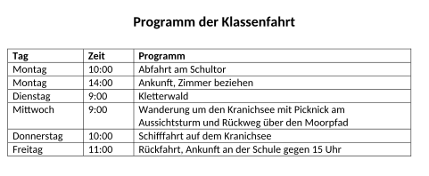

image: teaser.webp
image_alt: "Das Programm der Klassenfahrt: Tag, Zeit und Programm in drei Spalten, mit Tabs gesetzt"
kind: labor
duration: 1 Stunde (45 Minuten)
curriculum: "Sek I: Standardsoftware (Umgang mit Textverarbeitungssoftware); Medienbildung: Produzieren (Herstellung von Medienprodukten)"
topics: [standardsoftware]
language: LibreOffice / Word / Nextcloud Office
languages: [libreoffice, word, nextcloud]
requires: [lists-and-tabs]
reference: []

# Tabellen

Das Programm der Klassenfahrt steht in drei Spalten: Tag, Zeit, Programm.
Gebaut ist es mit zwei Tabstopps, so wie im letzten Blatt die Preise:

_task(laenger)

<!-- after: laenger -->

Ein Tab springt nur in der Zeile zum nächsten Tabstopp. Bricht der Text um,
fängt die neue Zeile wieder am linken Rand an: Die Spalten gelten nur für die
erste Zeile.
<!-- /after -->

## Eine Tabelle

Hol dir das Programm:

<a class='document-starter btn btn-primary' href='/word-tables/04%20Programm.docx' download><i class='bi bi-file-earmark-word' aria-hidden='true'></i>Vorlage herunterladen:04 Programm.docx</a>

In einer **Tabelle** hat jede Angabe ihre eigene **Zelle**. Wird ein Eintrag
länger, wächst seine Zeile nach unten, und alles bleibt in seiner Spalte.

Aus Text mit Tabs macht das Programm eine Tabelle auf einmal: Jeder Tab wird eine
neue Spalte, jeder Absatz eine Zeile. So geht es:

<!-- language: word -->
1. **Genau die sieben Zeilen markieren:** die Kopfzeile *Tag, Zeit, Programm*
   und die sechs Zeilen darunter. Nicht die Überschrift *Programm der
   Klassenfahrt* darüber, sonst wird auch sie eine Zeile der Tabelle.
2. Im Register *Einfügen* auf *Tabelle* klicken (den Knopf mit dem kleinen
   Pfeil), dann unten *Text in Tabelle umwandeln…*.
3. Im Fenster bei *Text trennen bei* den Punkt *Tabstopps* wählen. Oben bei
   *Spaltenanzahl* muss jetzt **3** stehen. Dann *OK*.
4. **Nachsehen:** drei Spalten, die Überschrift über der Tabelle, nicht in
   ihr. Stimmt etwas nicht, macht <kbd>Strg</kbd>+<kbd>Z</kbd> die Tabelle
   wieder zu Text, und du markierst noch einmal.
<!-- /language -->
<!-- language: libreoffice nextcloud -->
1. **Genau die sieben Zeilen markieren:** die Kopfzeile *Tag, Zeit, Programm*
   und die sechs Zeilen darunter. Nicht die Überschrift *Programm der
   Klassenfahrt* darüber, sonst wird auch sie eine Zeile der Tabelle.
2. *Tabelle* <i class='bi bi-chevron-right' aria-hidden='true'></i> *Umwandeln* <i class='bi bi-chevron-right' aria-hidden='true'></i> *Text in Tabelle*.
3. Im Fenster bei *Text trennen bei* den Punkt *Tabulatoren* wählen, dann *OK*.
4. **Nachsehen:** drei Spalten, die Überschrift über der Tabelle, nicht in
   ihr. Stimmt etwas nicht, macht <kbd>Strg</kbd>+<kbd>Z</kbd> die Tabelle
   wieder zu Text, und du markierst noch einmal.
<!-- /language -->

_task(spalten)

**Jetzt bist du dran:** Mach aus dem Programm eine Tabelle mit drei Spalten,
Schritt für Schritt wie oben. Klick dann hinter den Eintrag des Mittwochs und
schreib dazu: », mit Picknick am Aussichtsturm«. Sieh nach, was mit dem
Donnerstag passiert.

## Die Kopfzeile

Die erste Zeile mit Tag, Zeit und Programm ist die **Kopfzeile** der Tabelle.
Wird eine Tabelle länger als eine Seite, soll sie auf jeder Seite oben stehen.

Eine Tabelle merkt sich das, wenn du es ihr sagst:

<!-- language: word -->
1. **In eine Zelle der ersten Zeile klicken**, etwa in *Tag*. Es muss die
   erste Zeile sein: Word wiederholt die Zeile, in der der Cursor steht.
2. Erst jetzt, mit dem Cursor in der Tabelle, erscheinen rechts im Menüband
   zwei Register nur für Tabellen: *Tabellenentwurf* und *Layout* (in manchen
   Word-Versionen *Tabellenlayout*). Steht der Cursor außerhalb der Tabelle,
   sind sie wieder weg.
3. Im Register *Layout* der Tabelle, dem ganz rechts, nicht dem *Layout* der
   Seite weiter links, in der Gruppe *Daten* auf *Überschriften wiederholen*
   klicken. Der Knopf ist danach hervorgehoben.
<!-- /language -->
<!-- language: libreoffice nextcloud -->
1. **In eine Zelle der Tabelle klicken**; der Cursor muss in der Tabelle stehen.
2. *Tabelle* <i class='bi bi-chevron-right' aria-hidden='true'></i> *Eigenschaften* <i class='bi bi-chevron-right' aria-hidden='true'></i> Register *Textfluss*.
3. Den Haken bei *Überschrift wiederholen* setzen, dann *OK*.
<!-- /language -->

Auf einer Seite siehst du davon nichts; erst wenn die Tabelle über eine
Seite hinausgeht, steht die Kopfzeile oben auf der nächsten.

## Prüfen

_task(programm)

<!-- after: programm -->

<strong>Ausprobieren:</strong> Füge unter dem Dienstag eine Zeile ein (Rechtsklick in die Zeile, <em>Einfügen</em>) und trag einen Abend am Lagerfeuer ein. Achte darauf, was mit den Zeilen darunter passiert.

<!-- /after -->

<!-- extra -->
## Üben und knobeln

Drei Dokumente für alle, die mehr wollen: eins zum Üben, eins mit zwei neuen
Handgriffen und eins zum Suchen.

### Noch eine Runde

Die Ergebnisse vom Sportfest stehen mit Tabs in vier Spalten, gebaut wie das
Programm. Mach eine Tabelle daraus, diesmal ohne oben nachzusehen.

_task(runde)

### Zwei Handgriffe

Im Punktestand der siebten Klassen fehlt eine Zeile: Die 7d hat 11 Medaillen und
104 Punkte. Eine neue Zeile am Ende bekommt eine Tabelle mit einem Tab:
<kbd>Tab</kbd> springt von Zelle zu Zelle, und in der letzten Zelle hängt er
unten eine Zeile an.

Danach soll die Klasse mit den meisten Punkten oben stehen. **Sortieren**
stellt ganze Zeilen um, nach einer Spalte, die du wählst: aufsteigend (die
kleinste Zahl oben) oder absteigend (die größte oben). Die Kopfzeile muss
dabei oben bleiben, sonst wird sie mitsortiert.

<!-- language: word -->
In Word stellst du den Cursor in die Tabelle und klickst im Register
*Tabellenlayout* auf *Sortieren*. Unten bei *Liste enthält* wählst du
*Überschrift*; dann bleibt die Kopfzeile oben.
<!-- /language -->
<!-- language: libreoffice -->
In LibreOffice markierst du die Zeilen unter der Kopfzeile und wählst
*Tabelle* <i class='bi bi-chevron-right' aria-hidden='true'></i> *Sortieren*.
<!-- /language -->
<!-- language: nextcloud -->
In Nextcloud Office markierst du die Zeilen unter der Kopfzeile und wählst
*Tabelle* <i class='bi bi-chevron-right' aria-hidden='true'></i> *Sortieren*.
<!-- /language -->

Beim Sortieren fragt das Programm auch nach dem **Typ** der Spalte. Achte
darauf, was dort steht, bevor du auf OK klickst.

_task(handgriffe)

### Neun Fallen

Die 7b schreibt den Eltern einen Brief zur Projektwoche. Er sieht fertig aus.
Sechs Fallen sind von der Art wie auf dem ersten Blatt, je eine vom zweiten und
dritten, und eine ist von diesem. Wie bei den anderen Fallen zählt die Prüfung
nur, und jede Falle hat ihre eigenen Tipps.

_task(fallen)
